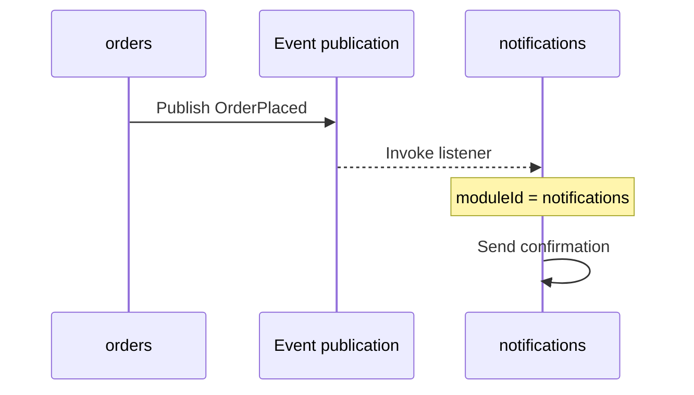

# Đưa module identifier vào log có kiểm soát

## 1. Vì sao log cần biết module đang thực thi?

Trong ứng dụng Spring Boot dùng **Spring Modulith**, nhiều application module như `orders`, `inventory`, `payments` và `notifications` cùng chạy trong một service. Một dòng log thông thường cho biết thời điểm, mức độ, logger và thông điệp, nhưng đôi khi chưa đủ để xác định **module nào đang chịu trách nhiệm cho thao tác đó**.

Ví dụ, khi xử lý một yêu cầu đặt hàng, ứng dụng có thể ghi:

```text
INFO  OrderService - Order accepted
INFO  InventoryService - Stock reserved
WARN  NotificationService - Email provider timeout
```

Tên logger gợi ý class phát log, nhưng khi tìm kiếm trên hệ thống log tập trung, nhóm vận hành thường muốn lọc theo **module ID ổn định**: `orders`, `inventory` hoặc `notifications`. Đưa module identifier vào log giúp nối thông tin giữa log, trace, module graph và metadata Actuator.

Mục tiêu của bài này là đưa module identifier vào log theo **scope thực thi của application module**, quản lý vòng đời MDC đúng cách, xử lý module lồng nhau và async, đồng thời kiểm soát dữ liệu được ghi. Trong `SPRING_MODULITH_DOCUMENTATION_OBSERVABILITY`, đây là phần bổ sung cho việc sinh tài liệu ranh giới module, quan sát tương tác bằng module spans, event metrics và tracing.

## 2. Phân biệt module identifier, logger name và trace attributes

Ba loại thông tin này có ý nghĩa khác nhau:

| Trường | Ví dụ | Trả lời câu hỏi |
| --- | --- | --- |
| **Logger name** | `com.example.shop.orders.OrderService` | Class/package nào phát log? |
| **Module identifier** | `orders` | Application module nào đang thực thi? |
| **Trace ID** | `4bf92f...` | Dòng log thuộc hành trình trace nào? |
| **Span ID** | `00f067...` | Log được ghi trong span cụ thể nào? |
| **Operation / span name** | `orders.place-order` | Đang thực hiện thao tác gì? |

Logger name thường dựa trên class. Module identifier được Spring Modulith xác định từ **module model**; nó phản ánh ranh giới kiến trúc. Trace ID và span ID do tracing tạo ra để liên kết hành trình và thao tác. Một log có thể mang đồng thời cả ba nhóm thông tin.

Ví dụ log có cấu trúc:

```text
timestamp=2026-11-27T10:15:20.123+07:00
level=INFO
service=shop-app
moduleId=orders
traceId=4bf92f3577b34da6a3ce929d0e0e4736
spanId=00f067aa0ba902b7
logger=com.example.shop.orders.OrderService
message=Order accepted
```

Trong bài, tên trường MDC được chọn là **`moduleId`**. Đây là tên trường log do ứng dụng quy ước; tag chuẩn trên module entry span của Spring Modulith vẫn là `module.identifier`. Có thể chọn `module.identifier` làm MDC key nếu hệ thống log hỗ trợ tốt dấu chấm, nhưng cần dùng nhất quán giữa appender, parser và dashboard.

## 3. Spring Modulith cung cấp module identity ở đâu?

Spring Modulith Observability instrument những Spring component thuộc **API của application module**. Khi có lời gọi vào module được hỗ trợ, framework tạo Micrometer observation/span với các tag:

| Tag trên module entry span | Ý nghĩa |
| --- | --- |
| `module.identifier` | Định danh kỹ thuật của module |
| `module.name` | Tên module để hiển thị |
| `module.invocation-type` | Kiểu gọi vào module, ví dụ `bean` hoặc `event listener` |
| `module.method` | Phương thức đang thực thi |

Thông tin module cũng có thể được đối chiếu với `ApplicationModules` và endpoint `GET /actuator/modulith` của bản ứng dụng đang chạy.

**Module tag trên span không tự động có nghĩa nó đã nằm trong MDC.** Tracing handler có thể đưa trace ID/span ID vào MDC; để bảo đảm `moduleId` xuất hiện trên log, ứng dụng cần một tích hợp logging riêng, chẳng hạn `ObservationHandler<ModulithContext>` đặt MDC khi module observation mở scope và khôi phục giá trị cũ khi scope đóng.

Không nên suy module ID bằng cách cắt tên class, đoán từ URL hay dùng logger name làm nguồn chuẩn. Những cách đó dễ sai khi đổi package, dùng nested module hoặc một component được đặt ở package dùng chung. Hãy lấy identifier từ context mà Spring Modulith cung cấp.

## 4. Chuẩn bị dependency

Với Spring Modulith 2.2.x, nếu code ứng dụng cần tham chiếu `ModulithContext`, khai báo API ở compile scope và hạ tầng observability ở runtime. Ví dụ Maven:

```xml
<dependencies>
    <dependency>
        <groupId>org.springframework.modulith</groupId>
        <artifactId>spring-modulith-observability-api</artifactId>
    </dependency>

    <dependency>
        <groupId>org.springframework.modulith</groupId>
        <artifactId>spring-modulith-starter-insight</artifactId>
        <scope>runtime</scope>
    </dependency>

    <!-- Chỉ cần khai báo trực tiếp nếu ứng dụng dùng MDC propagation qua thread. -->
    <dependency>
        <groupId>io.micrometer</groupId>
        <artifactId>context-propagation</artifactId>
    </dependency>
</dependencies>
```

Starter Insight bao gồm hỗ trợ Actuator và observability của Spring Modulith. Ứng dụng vẫn cần cấu hình Micrometer Tracing bridge/exporter tương thích nếu muốn xuất trace tới backend. Nếu không dùng starter, có thể khai báo `spring-modulith-observability-core` ở runtime cùng các dependency Actuator cần thiết.

Ví dụ sử dụng `org.slf4j.MDC` giả định ứng dụng đã có SLF4J binding, thường được Spring Boot starter cung cấp qua Logback. Quản lý phiên bản Spring Modulith bằng BOM tương thích với Spring Boot; không trộn các phiên bản API/runtime khác nhau.

## 5. Đưa module identifier vào MDC bằng ObservationHandler

**MDC (Mapped Diagnostic Context)** là nơi logging framework giữ các trường bổ sung gắn với thread hiện tại. Logback có thể đọc giá trị này qua `%X{key}`; encoder log dạng JSON có thể xuất các trường MDC thành thuộc tính riêng nếu được cấu hình.

Ta tạo một `ObservationHandler<ModulithContext>` để:

1. Chỉ xử lý observation có context là `ModulithContext`.
2. Khi module observation mở scope, lấy identifier từ `context.getModule()` và ghi vào MDC.
3. Khi scope đóng, khôi phục giá trị `moduleId` trước đó hoặc xóa key nếu trước đó chưa có.

Ví dụ class `ModulithModuleMdcHandler.java`:

```java
package com.example.shop.logging;

import java.util.ArrayDeque;
import java.util.Deque;
import java.util.Optional;

import org.slf4j.MDC;
import org.springframework.modulith.observability.ModulithContext;
import org.springframework.stereotype.Component;

import io.micrometer.observation.Observation;
import io.micrometer.observation.ObservationHandler;

@Component
final class ModulithModuleMdcHandler implements ObservationHandler<ModulithContext> {

    static final String MODULE_ID_KEY = "moduleId";

    private final ThreadLocal<Deque<Optional<String>>> previousModuleIds =
        ThreadLocal.withInitial(ArrayDeque::new);

    @Override
    public boolean supportsContext(Observation.Context context) {
        return context instanceof ModulithContext;
    }

    @Override
    public void onScopeOpened(ModulithContext context) {
        previousModuleIds.get().push(Optional.ofNullable(MDC.get(MODULE_ID_KEY)));

        String moduleId = context.getModule().getIdentifier().toString();
        MDC.put(MODULE_ID_KEY, moduleId);
    }

    @Override
    public void onScopeClosed(ModulithContext context) {
        Deque<Optional<String>> stack = previousModuleIds.get();

        if (stack.isEmpty()) {
            MDC.remove(MODULE_ID_KEY);
            previousModuleIds.remove();
            return;
        }

        Optional<String> previous = stack.pop();

        if (previous.isPresent()) {
            MDC.put(MODULE_ID_KEY, previous.get());
        } else {
            MDC.remove(MODULE_ID_KEY);
        }

        if (stack.isEmpty()) {
            previousModuleIds.remove();
        }
    }
}
```

`ModulithContext.getModule()` trả về module đang được quan sát; `getIdentifier()` trả về định danh kỹ thuật của module. Không cần tự phân tích package hoặc tra cứu class name.

Spring Boot tự động đăng ký các bean `ObservationHandler` trên `ObservationRegistry`. Vì vậy class được đánh dấu `@Component` và nằm trong vùng component scan sẽ được tích hợp vào registry. Nếu dùng Micrometer ngoài Spring Boot, phải đăng ký handler trực tiếp với `ObservationRegistry` theo cấu hình của ứng dụng.

### 5.1. Vì sao cần lưu và khôi phục MDC trước đó?

Giả sử `orders` gọi đồng bộ sang API của `inventory`:

```text
orders scope mở:
  MDC moduleId = orders

  inventory scope mở:
    MDC moduleId = inventory
  inventory scope đóng:
    MDC moduleId = orders

orders scope đóng:
  MDC moduleId được khôi phục về giá trị trước đó hoặc bị xóa
```

Nếu handler chỉ gọi `MDC.put("moduleId", ...)` khi mở scope và `MDC.remove(...)` khi đóng, khi `inventory` kết thúc nó sẽ xóa mất `orders` của scope cha. Stack `ThreadLocal` trong ví dụ bảo toàn giá trị trước đó, hỗ trợ module entry spans lồng nhau và không xóa các MDC key khác.

`ThreadLocal` stack được dọn khi rỗng. `onScopeOpened` và `onScopeClosed` được gọi theo vòng đời scope trên thread thực thi; không giữ một scope đang mở để chuyển nguyên sang thread khác. Với tác vụ bất đồng bộ, context cần được capture/restore qua cơ chế propagation riêng.

## 6. Thêm `moduleId` vào format log

Với output pattern của Spring Boot/Logback, có thể thêm MDC field vào correlation pattern. Ví dụ `application.yml`:

```yaml
logging:
  pattern:
    correlation: "[${spring.application.name:},%X{traceId:-},%X{spanId:-},module=%X{moduleId:-none}] "
  include-application-name: false
```

Khi tracing và module observation đều hoạt động, log có thể hiển thị:

```text
[shop-app,4bf92f3577b34da6a3ce929d0e0e4736,00f067aa0ba902b7,module=orders] INFO  OrderService - Order accepted
[shop-app,4bf92f3577b34da6a3ce929d0e0e4736,7c9e4f21a6b8d301,module=inventory] INFO  InventoryService - Stock reserved
```

Trace ID có thể giống nhau trong cùng hành trình, span ID khác nhau theo thao tác và module ID phản ánh module đang thực thi tại thời điểm ghi log. Nếu chỉ muốn thêm module mà không thay đổi correlation pattern, có thể dùng `logging.pattern.level` hoặc cấu hình Logback tương ứng; hãy tránh định nghĩa hai lần cùng một trường.

Giá trị `none` trong `%X{moduleId:-none}` là fallback khi log được ghi ngoài module entry scope, chẳng hạn startup, scheduler hoặc lớp hạ tầng. Không nên gán một module mặc định cho mọi log chỉ để tránh trường trống.

### 6.1. Structured logging

Nếu dùng JSON encoder, hãy cấu hình encoder xuất MDC map hoặc whitelist trường `moduleId` thành JSON field. Ví dụ một log JSON sau khi encoder đã được cấu hình:

```json
{
  "timestamp": "2026-11-27T10:15:20.123+07:00",
  "level": "INFO",
  "service": "shop-app",
  "moduleId": "orders",
  "traceId": "4bf92f3577b34da6a3ce929d0e0e4736",
  "spanId": "00f067aa0ba902b7",
  "logger": "com.example.shop.orders.OrderService",
  "message": "Order accepted"
}
```

Đây là schema minh họa, không phải output JSON mặc định của mọi logging encoder. Hãy xác nhận encoder có xuất MDC và hệ thống log index trường `moduleId` theo kiểu dữ liệu mong muốn.

## 7. Log nào sẽ có module ID?

Handler trên chỉ gắn module ID khi có **module observation scope** được Spring Modulith tạo. Điều này giúp trường log phản ánh module đang thực thi tại điểm vào API module được instrument.

| Vị trí ghi log | Có `moduleId` không? | Lý do |
| --- | --- | --- |
| Trong lời gọi qua component thuộc module API | Thường có | Module entry observation đang mở scope |
| Trong service nội bộ được gọi bên dưới module entry | Có thể có | Scope module bên ngoài vẫn đang hoạt động trên cùng thread |
| Trong controller trước khi gọi module | Thường chưa có | Chưa bước vào module entry scope |
| Trong startup hoặc shutdown hook | Thường không | Không có module invocation context |
| Trong scheduled job gọi module API | Có trong phần thực thi module được instrument | Module scope mở khi đi vào API module |
| Trong listener event được instrument | Có khi listener chạy trong module entry scope | Identifier là module sở hữu listener |
| Trong task async không đi qua module entry observation | Không tự có | Cần propagation hoặc scope riêng theo thiết kế |

Spring Modulith tập trung instrument các Spring component thuộc API của application module; không phải mọi method nội bộ đều tự tạo module entry span riêng. Tuy vậy, log ở các method nội bộ được gọi trong scope của một entry có thể vẫn thấy module ID của scope đó.

Không nên dùng `moduleId` như bằng chứng duy nhất để xác định nơi một dòng log được tạo. Logger name và trace/span context vẫn hữu ích để đối chiếu.

## 8. Module ID trong event listener và xử lý bất đồng bộ

Giả sử module `orders` publish `OrderPlaced`, module `notifications` nhận event:



Log trong listener nên mang **module ID của consumer** (`notifications`) khi listener được instrument dưới module scope. Không sao chép `orders` từ producer sang mọi log của consumer; producer và consumer là hai module chịu trách nhiệm cho hai giai đoạn khác nhau.

Nếu listener chạy trên executor hoặc qua message broker, cần phân biệt hai việc:

- **Module attribution:** module nào đang xử lý? Module entry observation ở consumer có thể cung cấp module ID tại scope của listener.
- **Trace/correlation propagation:** thao tác consumer có liên hệ với trace hoặc event gốc không? Việc này phụ thuộc propagation qua executor/broker và chính sách trace.

Có module ID đúng không có nghĩa trace ID tự động được nối. Ngược lại, trace ID được truyền không tự động gắn module ID nếu chưa có module observation scope hoặc handler.

## 9. Truyền MDC qua executor bằng Micrometer Context Propagation

MDC dựa trên thread-local storage. Nếu một task được submit sang thread khác, giá trị `moduleId` trong MDC không tự chuyển sang worker thread. Khi log bên trong task cần giữ context của nơi submit, có thể dùng Micrometer Context Propagation với `Slf4jThreadLocalAccessor` và `ContextPropagatingTaskDecorator`.

Đăng ký accessor chỉ cho key `moduleId`:

```java
package com.example.shop.logging;

import io.micrometer.context.ContextRegistry;
import io.micrometer.context.integration.Slf4jThreadLocalAccessor;
import org.springframework.context.annotation.Bean;
import org.springframework.context.annotation.Configuration;

@Configuration(proxyBeanMethods = false)
class MdcPropagationConfiguration {

    @Bean
    Slf4jThreadLocalAccessor moduleIdMdcAccessor() {
        var accessor = new Slf4jThreadLocalAccessor("moduleId");
        ContextRegistry.getInstance().registerThreadLocalAccessor(accessor);
        return accessor;
    }
}
```

Đặt `ContextPropagatingTaskDecorator` trên executor:

```java
package com.example.shop.config;

import org.springframework.context.annotation.Bean;
import org.springframework.context.annotation.Configuration;
import org.springframework.core.task.support.ContextPropagatingTaskDecorator;
import org.springframework.scheduling.concurrent.ThreadPoolTaskExecutor;

@Configuration(proxyBeanMethods = false)
class AsyncExecutorConfiguration {

    @Bean(name = "applicationTaskExecutor")
    ThreadPoolTaskExecutor applicationTaskExecutor() {
        var executor = new ThreadPoolTaskExecutor();
        executor.setCorePoolSize(4);
        executor.setMaxPoolSize(12);
        executor.setQueueCapacity(200);
        executor.setThreadNamePrefix("shop-async-");
        executor.setTaskDecorator(new ContextPropagatingTaskDecorator());
        executor.initialize();
        return executor;
    }
}
```

Task phải thực sự chạy qua `applicationTaskExecutor` thì decorator mới có tác dụng. `ContextPropagatingTaskDecorator` có từ Spring Framework 6.1; dùng phiên bản Spring Boot/Spring Framework tương thích. `Slf4jThreadLocalAccessor` có thể copy toàn bộ MDC hoặc chỉ các key được chỉ định; ví dụ chọn riêng `moduleId` để giới hạn phạm vi.

**Lưu ý về xung đột accessor:** nếu tracing bridge hoặc ứng dụng đã đăng ký accessor khác quản lý MDC, không đăng ký thêm một accessor bao phủ cùng key hoặc toàn bộ MDC mà chưa hiểu cách chúng phối hợp. Tài liệu Micrometer khuyến nghị tránh nhiều accessor cùng tương tác với MDC. Hãy kiểm tra registry và chỉ propagate key cần thiết; trace ID/span ID nên do tích hợp tracing hiện có quản lý.

### 9.1. Module scope mới ở worker sẽ ghi đè đúng module

Nếu task được submit từ `orders` nhưng worker thực thi API của `inventory`, MDC `moduleId` có thể được capture là `orders` trước khi task bắt đầu. Khi worker bước vào module entry scope của `inventory`, handler sẽ:

1. Lưu `orders` là giá trị MDC trước đó trên worker.
2. Đặt `moduleId=inventory` trong lúc module scope hoạt động.
3. Khi scope đóng, khôi phục giá trị trước đó theo cơ chế stack.

Nhờ vậy log trong `inventory` phản ánh module đang xử lý, còn log tiếp theo bên ngoài scope có thể trở về context đã được truyền. Nếu task chạy nền không thuộc module scope nào, việc giữ `orders` từ nơi submit có thể gây hiểu nhầm; hãy quyết định có cần truyền module nguồn hay xóa field trước khi chạy task. Không coi module nguồn là module đích.

## 10. Cardinality và chi phí của module ID trong log

Module ID thường có tập giá trị nhỏ và ổn định hơn request ID hoặc user ID. Tuy vậy, log volume và chi phí index phụ thuộc backend, schema và cách tổ chức log.

| Trường | Có nên đưa vào log? | Có nên dùng làm metric tag? |
| --- | --- | --- |
| `moduleId` | Có, nếu giúp lọc và điều tra | Thường có cardinality thấp, nhưng cần theo dõi số module |
| `traceId` | Có thể, để correlation | Không; gần như mỗi trace là một giá trị |
| `spanId` | Có thể, để correlation chi tiết | Không; mỗi span có ID riêng |
| `orderId` | Có thể ở log có kiểm soát và chính sách dữ liệu phù hợp | Không; cardinality cao |
| `customerEmail` | Tránh ghi nếu không có nhu cầu và cơ sở phù hợp | Không |
| `module.method` | Có thể nếu cần điều tra method | Cân nhắc; method/overload/refactor làm tăng số giá trị |

Không chuyển mọi MDC field thành metric labels. `moduleId` có thể hữu ích cho log search; `traceId`, `spanId`, `orderId` là dữ liệu truy vết từng lần thực thi và không phù hợp làm label của counter/timer thông thường.

Nếu ứng dụng có module ID động hoặc module được tạo từ tenant, cần đánh giá lại cardinality. Module ID của Spring Modulith thường đại diện cấu trúc code, không phải tenant ID.

## 11. Kiểm soát dữ liệu nhạy cảm

Log thường được chuyển tới hệ thống tập trung, có retention và quyền truy cập riêng. Vì vậy, chỉ ghi module ID và metadata cần thiết:

- Không đưa password, access token, cookie, session secret hoặc nội dung authorization header vào MDC.
- Không dùng MDC làm nơi lưu toàn bộ request/response body.
- Không ghi email, số điện thoại, địa chỉ hoặc thông tin thanh toán nếu không có nhu cầu và chính sách rõ ràng.
- Không truyền nguyên trạng security context vào task nền chỉ để tạo log; xác định service identity và quyền truy cập theo nghiệp vụ.
- Giữ module ID từ module model, không nhận giá trị `moduleId` tùy ý từ HTTP header hoặc message không tin cậy.
- Giới hạn quyền đọc log và retention theo yêu cầu vận hành/dữ liệu.

MDC chỉ là nơi gắn metadata cho log; nó không phải kho dữ liệu bảo mật, không xác thực giá trị và không cấp quyền.

## 12. Đối chiếu log với trace và module graph

Khi log có `moduleId`, có thể tìm theo module và liên kết với trace:

```text
Log query:
  service = shop-app
  moduleId = inventory
  traceId = 4bf92f3577b34da6a3ce929d0e0e4736
```

Sau đó mở trace có cùng trace ID và kiểm tra span mang:

```text
module.identifier = inventory
module.name = Inventory
module.invocation-type = bean
```

Đối chiếu thêm `GET /actuator/modulith` để xác nhận `inventory` là technical module ID trong bản ứng dụng đang chạy. Module graph/`ApplicationModules.verify()` kiểm tra cấu trúc và dependency tĩnh; log/trace thể hiện những hoạt động runtime đã được ghi nhận.

Không phải mọi dòng log đều phải có module ID. Log từ web filter trước module entry, startup, infrastructure, scheduler hoặc thư viện ngoài có thể không thuộc module scope. Việc thiếu `moduleId` ở những vị trí đó không chứng minh module instrumentation bị lỗi.

## 13. Kiểm thử handler và MDC cleanup

Nên kiểm tra ít nhất các trường hợp sau trong môi trường test:

| Tình huống | Kết quả mong đợi |
| --- | --- |
| Vào module `orders` | MDC có `moduleId=orders` trong scope |
| Gọi lồng module `inventory` | Trong scope con là `inventory` |
| Rời `inventory` về `orders` | MDC khôi phục `orders` |
| Rời `orders` | Giá trị trước đó được khôi phục hoặc key bị xóa |
| MDC ban đầu có module ID khác | Giá trị ban đầu được giữ sau khi scope đóng |
| Logic ném exception | Scope vẫn đóng và MDC được khôi phục |
| Hai task dùng chung thread pool | Không rò rỉ module ID từ task trước sang task sau |
| Listener bất đồng bộ | Module ID phản ánh module sở hữu listener trong scope xử lý |

Ví dụ kiểm tra logic stack riêng có thể dùng `MDC.get("moduleId")` trước, trong và sau một module observation. Khi kiểm thử tích hợp Spring Modulith, gọi một Spring bean thuộc API module qua Spring context để aspect/observation được kích hoạt; gọi method trực tiếp trên object tự tạo có thể bỏ qua proxy/instrumentation.

### 13.1. Mẫu log khi module scope lồng nhau

```text
INFO  moduleId=orders        OrderService - Starting checkout
INFO  moduleId=inventory     InventoryService - Reserving stock
INFO  moduleId=orders        OrderService - Stock reservation returned
INFO  moduleId=none          Application - Request processing finished
```

Đây là kết quả minh họa nếu log cuối cùng được ghi ngoài module scope và fallback được cấu hình là `none`. Nếu vẫn còn một module scope cha hoặc request-level module context khác, giá trị được khôi phục có thể khác.

## 14. Các lỗi thường gặp

| Triệu chứng | Nguyên nhân có thể | Cách xử lý |
| --- | --- | --- |
| Span có `module.identifier` nhưng log không có `moduleId` | Chưa đăng ký handler ghi MDC hoặc log pattern không đọc MDC | Kiểm tra ObservationHandler bean và `%X{moduleId}` |
| Mọi log đều có `moduleId=orders` | Handler chỉ put mà không restore hoặc task nền giữ MDC cũ | Khôi phục giá trị trước đó, dọn scope và test thread pool |
| Log trong `inventory` vẫn có `orders` | Module scope đích chưa được tạo hoặc context MDC nguồn bị truyền sang task | Kiểm tra module API instrumentation và module scope trên worker |
| Log ngoài module scope có `none` | Hành vi dự kiến | Giữ fallback để phân biệt log không thuộc module scope |
| Log async mất `moduleId` | MDC không tự truyền qua thread | Dùng Context Propagation và đúng executor nếu cần truyền key |
| `traceId` có nhưng `moduleId` không có | Tracing MDC hoạt động, custom module handler chưa hoạt động hoặc log ngoài scope | Kiểm tra riêng hai cơ chế |
| Handler không được gọi | Bean không nằm trong component scan hoặc ObservationRegistry khác được sử dụng | Kiểm tra Spring context và registry |
| Nested module làm mất module cha | Không lưu giá trị MDC trước khi ghi module con | Dùng stack và restore trong `onScopeClosed` |
| MDC field không xuất hiện trong JSON | Encoder không serialize MDC | Cấu hình encoder/whitelist MDC field |
| Module ID không khớp Actuator | Khác build, module detection hoặc dùng display name thay identifier | Đối chiếu `getIdentifier()` với technical key trong Actuator |
| Module ID bị giả mạo từ request | Lấy giá trị từ header thay vì module context | Chỉ lấy ID từ `ModulithContext` |

## 15. Bài thực hành: gắn module ID vào log của ba module

**Bối cảnh:** `shop-app` có `orders`, `inventory` và `notifications`. Khi khách hàng đặt hàng, `orders` gọi `inventory` đồng bộ và phát event cho `notifications` xử lý.

| Bước | Thực hiện | Tiêu chí hoàn thành |
| --- | --- | --- |
| 1 | Bật Spring Modulith observability và Micrometer Tracing | Module entry spans xuất hiện trong trace khi có traffic |
| 2 | Đăng ký `ModulithModuleMdcHandler` | Handler chỉ hỗ trợ `ModulithContext` |
| 3 | Thêm `moduleId` vào logging pattern | Log hiển thị module ID khi scope mở |
| 4 | Gọi API `orders` | Log bên trong module có `moduleId=orders` |
| 5 | Gọi API `inventory` từ `orders` | Log bên trong scope con có `moduleId=inventory`, sau đó khôi phục `orders` |
| 6 | Phát `OrderPlaced` cho listener `notifications` | Log trong listener có module ID của consumer |
| 7 | Thử executor bất đồng bộ | Không rò rỉ MDC giữa các task |
| 8 | Kiểm tra log JSON hoặc pattern text | Có module ID, trace ID và span ID nếu tracing đang hoạt động |
| 9 | Đối chiếu trace và `/actuator/modulith` | Module ID trong log khớp span và technical module ID |
| 10 | Kiểm tra log ngoài module scope | Không tự gán một module giả cho startup/infrastructure logs |

### 15.1. Câu hỏi tự kiểm tra

1. **Spring Modulith đặt `module.identifier` ở đâu theo instrumentation mặc định?** Trên module entry span; muốn có trường tương ứng trong log cần tích hợp MDC hoặc structured logging riêng.
2. **Tại sao dùng `ModulithContext.getModule().getIdentifier()`?** Vì đây là identifier kỹ thuật của module do Spring Modulith nhận diện.
3. **Tại sao handler phải xử lý cả `onScopeOpened` và `onScopeClosed`?** Để giới hạn module ID đúng vòng đời thực thi và tránh rò rỉ sang scope/task khác.
4. **Tại sao cần stack giá trị MDC cũ?** Để khi module con kết thúc, module cha được khôi phục đúng.
5. **Module ID có tự truyền qua executor không?** Không; MDC là thread-local. Cần Context Propagation và executor được cấu hình nếu muốn chuyển metadata đó qua thread.
6. **Log trong event listener nên mang ID của producer hay consumer?** Module sở hữu listener đang thực thi, tức consumer.
7. **Có nên thêm `traceId` hoặc `orderId` vào metric tag không?** Không; đây là giá trị có cardinality cao, phù hợp hơn với correlation log/trace theo chính sách dữ liệu.
8. **Nếu log không có module ID ở startup thì có phải lỗi không?** Không nhất thiết; startup thường nằm ngoài module entry observation scope.

## 16. Ghi nhớ

Để đưa module identifier vào log có kiểm soát, hãy lấy ID từ **`ModulithContext`** tại module entry observation, đặt vào **MDC trong lúc scope mở**, rồi khôi phục hoặc xóa giá trị khi scope đóng. `ObservationHandler<ModulithContext>` là điểm tích hợp phù hợp; Spring Boot tự đăng ký handler bean trên `ObservationRegistry`.

Giữ module ID riêng với logger name, span name và trace ID. Dùng một MDC key ổn định như `moduleId`, cấu hình Logback/JSON encoder xuất trường đó, xử lý nested scopes bằng cách lưu giá trị trước đó và dùng Micrometer Context Propagation khi thật sự cần chuyển MDC qua executor. Listener event phải được gắn module ID của module tiêu thụ; không sao chép nhãn producer sang consumer.

Chỉ log metadata cần thiết, không đưa token hoặc dữ liệu cá nhân vào MDC. Đối chiếu module ID trong log với `module.identifier` trên span và technical module ID từ Actuator; dùng module graph cùng `ApplicationModules.verify()` để kiểm chứng cấu trúc tĩnh. Cách kết hợp này giúp tìm log theo module mà vẫn giữ được trace correlation và vòng đời context rõ ràng.

### Tài liệu tham khảo

- [Spring Modulith — Production-ready Features](https://docs.spring.io/spring-modulith/reference/production-ready.html): module entry spans và tag `module.identifier`, `module.name`, `module.method`, `module.invocation-type`.
- [Spring Modulith — `ModulithContext` API](https://docs.spring.io/spring-modulith/docs/current/api/org/springframework/modulith/observability/ModulithContext.html): lấy module context từ observation.
- [Spring Boot — Observability](https://docs.spring.io/spring-boot/reference/actuator/observability.html): tự động đăng ký `ObservationHandler` beans và Micrometer Observation.
- [Spring Boot — Logging](https://docs.spring.io/spring-boot/reference/features/logging.html): logging pattern và correlation IDs.
- [Micrometer — Observation Components](https://docs.micrometer.io/micrometer/reference/observation/components.html): vòng đời `ObservationHandler`, scope mở/đóng và context.
- [Micrometer Context Propagation — `Slf4jThreadLocalAccessor`](https://javadoc.io/static/io.micrometer/context-propagation/1.2.1/io/micrometer/context/integration/Slf4jThreadLocalAccessor.html): truyền MDC qua ranh giới thread và chọn key cần sao chép.
- [Micrometer Context Propagation — Purpose](https://docs.micrometer.io/context-propagation/reference/purpose.html): capture/restore context giữa ThreadLocal, Reactor Context và executor.
