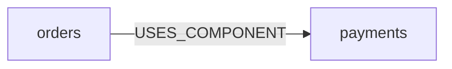
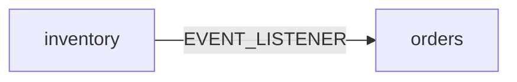
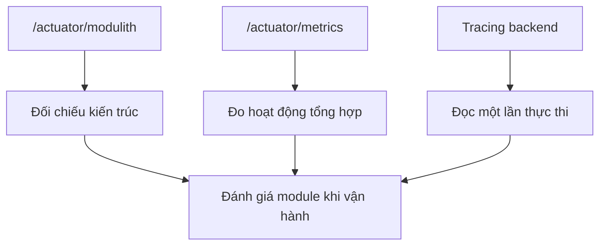

# Đưa thông tin module vào bộ endpoint vận hành

> **Chương:** Actuator và vận hành  
> **Bối cảnh:** Spring Modulith giúp mô hình hóa ranh giới application module và quan sát cách các module tương tác trong ứng dụng Spring Boot. Bài này hướng dẫn công bố mô hình module qua Spring Boot Actuator, đọc cấu trúc JSON của endpoint `modulith`, kiểm tra dependency và triển khai endpoint an toàn trong môi trường vận hành.

## Mục tiêu học tập

Sau bài này, bạn có thể:

1. Giải thích vai trò của Spring Modulith Actuator và phân biệt nó với các endpoint sức khỏe, metrics và tracing.
2. Chọn dependency phù hợp: `spring-modulith-starter-insight` hoặc `spring-modulith-actuator` kết hợp Spring Boot Actuator.
3. Expose endpoint `modulith` qua HTTP/JMX và xác định URL thực tế khi ứng dụng dùng management port/base path riêng.
4. Đọc các trường `displayName`, `basePackage`, `parent`, `nested` và `dependencies`.
5. Diễn giải các loại dependency `DEFAULT`, `USES_COMPONENT`, `EVENT_LISTENER` để hiểu quan hệ giữa application module.
6. Bảo vệ endpoint, xử lý lỗi 404/401/403 và đối chiếu mô hình module giữa các lần triển khai.

## 1. Vì sao đưa thông tin module vào Actuator?

Trong một modular monolith, ứng dụng Spring Boot có thể gồm nhiều application module như `orders`, `payments`, `inventory` và `catalog`. Các module có API riêng, phần triển khai nội bộ và quan hệ phụ thuộc với module khác.

Khi hệ thống chạy ở môi trường staging hoặc production, đội vận hành cần trả lời những câu hỏi như:

- Bản build đang chạy nhận diện những module nào?
- Package gốc và tên hiển thị của từng module là gì?
- Module `orders` phụ thuộc vào `payments` theo kiểu nào?
- `inventory` đang nghe event từ module nào?
- Mô hình module sau release có thay đổi so với bản triển khai trước không?

Spring Modulith cung cấp **Application Module Actuator endpoint** để công bố mô hình cấu trúc module dưới dạng JSON. Endpoint này giúp công cụ vận hành đọc thông tin kiến trúc trực tiếp từ ứng dụng đang chạy.

Đây là dữ liệu mô hình kiến trúc được Spring Modulith phát hiện từ ứng dụng và cấu hình module. Endpoint không phải một hệ thống tracing, không phải danh sách mọi Spring bean và cũng không phải health check của từng module.

## 2. Endpoint `modulith` cung cấp điều gì?

Endpoint có ID:

```text
modulith
```

Với web exposure mặc định của Actuator, URL thường là:

```http
GET http://localhost:8080/actuator/modulith
```

Endpoint được triển khai bởi `ApplicationModulesEndpoint` trong package `org.springframework.modulith.actuator`. Nó trả về metadata `ApplicationModules` dưới dạng map để Spring Boot render thành JSON.

Một số thông tin chính:

| Trường | Ý nghĩa |
| --- | --- |
| `{moduleName}` | Technical name/identifier của application module; là key ở cấp cao nhất của JSON |
| `displayName` | Tên hiển thị thân thiện với con người |
| `basePackage` | Package gốc của module |
| `parent` | Tên parent module nếu đây là nested module |
| `nested` | Danh sách module con nếu có |
| `dependencies` | Danh sách dependency đi ra từ module hiện tại |
| `dependencies[].target` | Technical name của module được phụ thuộc |
| `dependencies[].types` | Các loại dependency hướng tới module đích |

Các trường `parent` và `nested` là tùy chọn: module thông thường có thể không có nested module. `dependencies` có thể là mảng rỗng nếu module không có dependency đi ra được mô hình hóa.

### 2.1. Endpoint không phải là một biểu đồ dựng sẵn

`/actuator/modulith` trả về **mô hình JSON**. Công cụ dashboard hoặc tài liệu có thể đọc JSON đó để hiển thị thành bảng, danh sách hoặc graph. Spring Modulith không biến endpoint này thành một giao diện đồ họa tương tác mặc định.

Endpoint cũng không tự đưa ra kết luận “module khỏe” hay “module đang lỗi”. Nó công bố cấu trúc module để công cụ khác sử dụng.

## 3. Kích hoạt Spring Modulith Actuator

Có hai cách khai báo dependency phổ biến.

### 3.1. Cách thuận tiện: Spring Modulith Insight starter

Nếu ứng dụng cần cả module Actuator và khả năng observability của Spring Modulith, dùng:

```groovy
dependencies {
    runtimeOnly 'org.springframework.modulith:spring-modulith-starter-insight'
}
```

Insight starter bao gồm:

- Hỗ trợ Application Module Actuator.
- Hỗ trợ observability để ghi nhận tương tác module bằng metrics/traces.
- Spring Boot Actuator startup cho hạ tầng endpoint chung.

Đây là cách thuận tiện khi ứng dụng cần vừa công bố mô hình kiến trúc, vừa quan sát tương tác module. Để gửi trace tới Zipkin, Grafana Tempo hoặc backend khác, vẫn cần tracing bridge/exporter phù hợp với Spring Boot và công cụ được chọn.

### 3.2. Chỉ cần endpoint module: khai báo riêng

Nếu mục tiêu là công bố cấu trúc module qua Actuator, có thể khai báo:

```groovy
dependencies {
    runtimeOnly 'org.springframework.modulith:spring-modulith-actuator'
    runtimeOnly 'org.springframework.boot:spring-boot-starter-actuator'
}
```

Hai dependency có vai trò riêng:

- `spring-modulith-actuator` cung cấp endpoint chuyên biệt `modulith`.
- `spring-boot-starter-actuator` kích hoạt hạ tầng Actuator chung của Spring Boot.

Nếu đã khai báo `spring-modulith-starter-insight`, không cần thêm `spring-modulith-actuator` lần nữa chỉ để có cùng endpoint.

### 3.3. Quản lý phiên bản

Các ví dụ dùng Gradle không ghi version trực tiếp vì giả định dự án đã quản lý phiên bản Spring Modulith bằng BOM/dependency management tương thích với Spring Boot. Nếu không dùng BOM, cần khai báo version đúng cho các artifact Modulith.

Không trộn tùy tiện các artifact Spring Modulith thuộc nhiều release train. Khi nâng cấp, kiểm tra compatibility matrix và tài liệu của đúng phiên bản ứng dụng.

## 4. Expose endpoint qua HTTP

Spring Boot mặc định chỉ expose endpoint `health` qua HTTP và JMX. Có dependency Modulith Actuator **chưa đủ** để truy cập `/actuator/modulith` từ xa; cần đưa ID `modulith` vào cấu hình exposure.

Ví dụ `application.yml`:

```yaml
management:
  endpoints:
    web:
      exposure:
        include: health,info,modulith
```

Nếu ứng dụng đã expose các endpoint khác, giữ lại các ID cần thiết trong danh sách `include`. Không dùng `*` chỉ để thêm endpoint module vì cách đó có thể mở rộng phạm vi truy cập ngoài ý muốn.

Sau khi khởi động ứng dụng, truy cập:

```http
GET http://localhost:8080/actuator
```

Actuator root có thể trả về Hypermedia links, trong đó có resource:

```json
{
  "_links": {
    "self": {
      "href": "http://localhost:8080/actuator",
      "templated": false
    },
    "health": {
      "href": "http://localhost:8080/actuator/health",
      "templated": false
    },
    "modulith": {
      "href": "http://localhost:8080/actuator/modulith",
      "templated": false
    }
  }
}
```

Đây là ví dụ rút gọn. Các link thực tế phụ thuộc endpoint đang được expose, cấu hình base path và các endpoint sẵn có của ứng dụng.

### 4.1. Expose qua JMX

Nếu hệ thống vận hành dùng JMX thay cho HTTP, có thể cấu hình:

```yaml
management:
  endpoints:
    jmx:
      exposure:
        include: health,info,modulith
```

HTTP và JMX có hai nhóm exposure riêng. Expose `modulith` qua HTTP không tự đồng nghĩa endpoint cũng được expose qua JMX, và ngược lại.

### 4.2. `include` và `exclude`

Actuator hỗ trợ cả danh sách include và exclude:

```yaml
management:
  endpoints:
    web:
      exposure:
        include: health,info,modulith,metrics
        exclude: env,beans
```

`exclude` có ưu tiên cao hơn `include`. Một endpoint nằm trong cả hai danh sách sẽ không được expose qua công nghệ tương ứng.

Trong YAML, nếu dùng wildcard `*`, phải đặt trong dấu nháy:

```yaml
management:
  endpoints:
    web:
      exposure:
        include: "*"
```

Với endpoint module, cấu hình rõ `health,info,modulith` thường dễ kiểm soát hơn expose tất cả.

## 5. Đọc JSON của `/actuator/modulith`

Giả sử ứng dụng có ba module:

```text
com.example.shop
├── ShopApplication.java
├── orders
│   ├── OrderPlaced.java
│   └── internal/CheckoutService.java
├── payments
│   └── PaymentService.java
└── inventory
    └── internal/OnOrderPlaced.java
```

Một response minh họa:

```json
{
  "orders": {
    "basePackage": "com.example.shop.orders",
    "displayName": "Đơn hàng",
    "dependencies": [
      {
        "target": "payments",
        "types": ["USES_COMPONENT"]
      }
    ]
  },
  "payments": {
    "basePackage": "com.example.shop.payments",
    "displayName": "Thanh toán",
    "dependencies": []
  },
  "inventory": {
    "basePackage": "com.example.shop.inventory",
    "displayName": "Kho hàng",
    "dependencies": [
      {
        "target": "orders",
        "types": ["EVENT_LISTENER"]
      }
    ]
  }
}
```

Đây là JSON minh họa theo cấu trúc endpoint, không phải dữ liệu được lấy từ một ứng dụng thực tế. Module key và dependency thực tế phụ thuộc cấu trúc package, metadata và cấu hình discovery của ứng dụng.

### 5.1. `{moduleName}` là technical name

Tên module ở cấp cao nhất là technical name dùng để tham chiếu module. Trong ví dụ, `orders`, `payments`, `inventory` là các key.

Tên này khác với `displayName`:

| Technical name | Display name | Vai trò |
| --- | --- | --- |
| `orders` | `Đơn hàng` | Key định danh module và tên hiển thị |
| `payments` | `Thanh toán` | Key định danh module và tên hiển thị |
| `inventory` | `Kho hàng` | Key định danh module và tên hiển thị |

Khi viết query hoặc nối dependency, dùng technical name. Khi trình bày dashboard, dùng `displayName` nếu có.

### 5.2. `basePackage`

`basePackage` cho biết package gốc mà Spring Modulith dùng để nhận diện module. Trường này giúp:

- Kiểm tra module được phát hiện từ package nào.
- Đối chiếu với package tổ chức trong source code.
- Nhận biết thay đổi cấu trúc package giữa các phiên bản.
- Hỗ trợ công cụ tài liệu hóa hoặc kiểm tra kiến trúc.

Không nên coi `basePackage` là danh sách toàn bộ class trong module. Endpoint mô tả ranh giới package và dependency, không xuất toàn bộ source code.

### 5.3. `displayName`

`displayName` là tên thân thiện với con người. Module có thể khai báo tên hiển thị qua metadata `@ApplicationModule`, ví dụ:

```java
@org.springframework.modulith.ApplicationModule(
    displayName = "Đơn hàng"
)
package com.example.shop.orders;
```

Nếu không tùy chỉnh, display name có thể được suy ra từ metadata module theo quy tắc mặc định. Khi xây dashboard, nên có phương án fallback sang technical name nếu `displayName` không được khai báo.

### 5.4. `parent` và `nested`

Với nested application modules, response có thể có:

```json
{
  "billing": {
    "basePackage": "com.example.shop.billing",
    "displayName": "Thanh toán",
    "nested": ["invoices", "refunds"]
  },
  "invoices": {
    "basePackage": "com.example.shop.billing.invoices",
    "displayName": "Hóa đơn",
    "parent": "billing",
    "dependencies": []
  },
  "refunds": {
    "basePackage": "com.example.shop.billing.refunds",
    "displayName": "Hoàn tiền",
    "parent": "billing",
    "dependencies": []
  }
}
```

Nested module là một cách tổ chức module theo cấp bậc. Trường `parent` tham chiếu module cha; trường `nested` liệt kê module con. Không giả định mọi ứng dụng đều có hai trường này.

## 6. Diễn giải `dependencies`

Mỗi phần tử trong `dependencies` mô tả một module hiện tại phụ thuộc vào module đích:

```json
{
  "target": "payments",
  "types": ["USES_COMPONENT"]
}
```

Có nghĩa module chứa phần tử này có dependency hướng tới module `payments`. `types` mô tả loại quan hệ mà Spring Modulith nhận diện.

### 6.1. `DEFAULT`

`DEFAULT` mô tả dependency kiểu thông thường được phát hiện từ tham chiếu giữa các module, chẳng hạn một module sử dụng kiểu Java thuộc module khác mà không được phân loại thành một trong các kiểu chuyên biệt.

Khi thấy `DEFAULT`, hãy kiểm tra package và loại tham chiếu trong source code để hiểu nguyên nhân. Không suy ra rằng đây chắc chắn là một Spring bean injection.

### 6.2. `USES_COMPONENT`

`USES_COMPONENT` biểu thị dependency thông qua Spring bean/component. Ví dụ:

```java
package com.example.shop.orders.internal;

import com.example.shop.payments.PaymentService;
import org.springframework.stereotype.Service;

@Service
class CheckoutService {

    private final PaymentService payments;

    CheckoutService(PaymentService payments) {
        this.payments = payments;
    }
}
```

Module `orders` sử dụng component/API của `payments`. Trong module graph, dependency đi từ `orders` tới `payments`:



### 6.3. `EVENT_LISTENER`

`EVENT_LISTENER` biểu thị dependency được nhận diện thông qua event listener. Ví dụ:

```java
// Event thuộc module orders
package com.example.shop.orders;

public record OrderPlaced(java.util.UUID orderId) {}
```

```java
// Listener thuộc module inventory
package com.example.shop.inventory.internal;

import com.example.shop.orders.OrderPlaced;
import org.springframework.modulith.events.ApplicationModuleListener;
import org.springframework.stereotype.Component;

@Component
class OnOrderPlaced {

    @ApplicationModuleListener
    void reserve(OrderPlaced event) {
        // Giữ tồn kho cho đơn hàng.
    }
}
```

Module `inventory` phụ thuộc vào event type do `orders` cung cấp. Vì vậy hướng dependency trong module graph là:



Hướng dependency tĩnh này có thể ngược với hướng sự kiện được publish trong runtime: `orders` phát event và `inventory` nhận event.

### 6.4. Nhiều loại dependency tới cùng module

Một module có thể phụ thuộc vào cùng module đích theo nhiều kiểu. Ví dụ:

```json
{
  "target": "orders",
  "types": ["EVENT_LISTENER", "USES_COMPONENT"]
}
```

Điều này có nghĩa mô hình phát hiện nhiều loại quan hệ giữa hai module. Không coi mỗi giá trị trong `types` là một module khác nhau.

### 6.5. Dependency không phải call graph runtime

`dependencies` mô tả dependency được phát hiện từ kiến trúc/mã nguồn, không phải lịch sử gọi method theo từng request.

- `orders → payments` không có nghĩa mọi request đặt hàng đều gọi thanh toán.
- `inventory → orders` với `EVENT_LISTENER` không cho biết event đã được publish bao nhiêu lần.
- Endpoint không trả latency, số lần gọi hoặc trạng thái listener.

Muốn xem tương tác runtime, dùng module spans, traces và event metrics. Muốn biết listener hoàn tất, kiểm tra Event Publication Registry và dữ liệu nghiệp vụ phù hợp.

## 7. Kết hợp endpoint module với endpoint Actuator khác

Một bộ endpoint vận hành thường có các nguồn thông tin riêng:

| Endpoint/tín hiệu | Trả lời câu hỏi |
| --- | --- |
| `/actuator/health` | Ứng dụng và các health indicator đang ở trạng thái nào? |
| `/actuator/info` | Ứng dụng công bố thông tin build/release nào? |
| `/actuator/modulith` | Bản ứng dụng này nhận diện module và dependency ra sao? |
| `/actuator/metrics` | Counter, timer, gauge đang ghi nhận điều gì? |
| `/actuator/prometheus` | Metrics được xuất theo định dạng scrape cho Prometheus ra sao? |
| Tracing backend | Một lần thực thi đã đi qua những span/module nào? |

Không endpoint nào thay thế hoàn toàn endpoint còn lại. Ví dụ, `/actuator/modulith` cho biết `orders` có dependency tới `payments`, còn trace cho biết một request cụ thể có thực sự đi qua module `payments` hay không.

## 8. Đường dẫn thực tế và management server

URL ví dụ `/actuator/modulith` giả định:

- `server.port` mặc định là `8080`.
- Actuator dùng base path `/actuator`.
- Không có servlet context path bổ sung.
- Management server dùng chung port với ứng dụng.

Nếu ứng dụng thay đổi cấu hình, URL có thể khác.

### 8.1. Thay đổi management base path

```yaml
management:
  endpoints:
    web:
      base-path: /manage
      exposure:
        include: health,info,modulith
```

Khi đó endpoint module có thể ở:

```http
GET /manage/modulith
```

### 8.2. Dùng management port riêng

```yaml
server:
  port: 8080

management:
  server:
    port: 8081
  endpoints:
    web:
      exposure:
        include: health,info,modulith
```

Trong cấu hình này, endpoint Actuator dùng management port `8081`. Khi triển khai qua container hoặc Kubernetes, cần expose/route port quản trị đúng cách; không giả định nó nằm trên cổng HTTP nghiệp vụ.

### 8.3. Kiểm tra link được quảng bá

Nếu không chắc URL cuối cùng, truy cập Actuator root trên management port và đọc `_links.modulith.href`. Đây là cách tốt hơn việc hard-code đường dẫn trong dashboard khi ứng dụng có base path hoặc port riêng.

## 9. Bảo vệ endpoint module

Mô hình module có thể tiết lộ:

- Tên module và package nội bộ.
- Ranh giới nghiệp vụ.
- Quan hệ phụ thuộc giữa các phần.
- Những module nào xử lý event hoặc sử dụng component của module khác.

Đây là metadata hữu ích cho vận hành, nhưng cũng là thông tin kiến trúc nội bộ. Không expose công khai chỉ vì endpoint là read-only.

### 9.1. Chỉ expose endpoint cần thiết

Ví dụ:

```yaml
management:
  endpoints:
    web:
      exposure:
        include: health,info,modulith
```

Tránh:

```yaml
management:
  endpoints:
    web:
      exposure:
        include: "*"
```

nếu ứng dụng không có nhu cầu expose tất cả endpoint. Một số endpoint Actuator khác có thể tiết lộ environment, configuration, beans hoặc dữ liệu vận hành chi tiết hơn.

### 9.2. Giới hạn truy cập bằng mạng và xác thực

Các lựa chọn triển khai:

- Đặt management port trong mạng nội bộ hoặc management network.
- Dùng firewall/network policy chỉ cho phép hệ thống giám sát hoặc máy quản trị truy cập.
- Dùng Spring Security để yêu cầu role vận hành phù hợp.
- Dùng TLS và cơ chế xác thực giữa các hệ thống khi endpoint đi qua mạng.
- Không đưa credential vào URL hoặc log.

Nếu ứng dụng có custom `SecurityFilterChain`, hãy bảo đảm rule Actuator được cấu hình rõ. Khi tự định nghĩa security chain, auto-configuration security của Spring Boot có thể nhường quyền quyết định cho cấu hình của ứng dụng.

Ví dụ minh họa cho Spring Security trên Spring Boot 3.x:

```java
import org.springframework.boot.actuate.autoconfigure.security.servlet.EndpointRequest;
import org.springframework.context.annotation.Bean;
import org.springframework.context.annotation.Configuration;
import org.springframework.core.annotation.Order;
import org.springframework.security.config.Customizer;
import org.springframework.security.config.annotation.web.builders.HttpSecurity;
import org.springframework.security.web.SecurityFilterChain;

@Configuration(proxyBeanMethods = false)
class ActuatorSecurityConfiguration {

    @Bean
    @Order(1)
    SecurityFilterChain actuatorSecurity(HttpSecurity http) throws Exception {
        return http
                .securityMatcher(EndpointRequest.to("modulith"))
                .authorizeHttpRequests(authorize -> authorize
                        .anyRequest().hasRole("OPS"))
                .httpBasic(Customizer.withDefaults())
                .build();
    }
}
```

Đây là ví dụ phân quyền riêng cho endpoint `modulith`; ứng dụng thật cần có user/role và authentication provider phù hợp. Nếu đã có security chain cho các endpoint khác, kiểm tra thứ tự `@Order` và matcher để tránh rule tổng quát bắt request trước. Package/import security có thể thay đổi theo dòng Spring Boot; hãy đối chiếu đúng version.

### 9.3. Quyền truy cập endpoint trong Spring Boot mới

Spring Boot có cơ chế kiểm soát access ở cấp endpoint, tách biệt với việc expose qua HTTP/JMX. Khi dùng phiên bản có `management.endpoint.<id>.access`, có thể đặt mức truy cập cho endpoint `modulith` theo chính sách của ứng dụng. Expose endpoint và cho phép truy cập là hai điều kiện riêng: endpoint phải **available** và **exposed** mới được truy cập qua công nghệ tương ứng.

Không xem `read-only` là thay thế cho authentication/network restriction. Read-only chỉ giới hạn loại thao tác; người không được phép vẫn không nên đọc metadata kiến trúc.

## 10. Đối chiếu mô hình module sau mỗi release

Endpoint có thể được dùng như một nguồn metadata cho quy trình vận hành:

1. Gọi `/actuator/modulith` ở staging sau khi triển khai.
2. Lưu response JSON làm snapshot gắn với build version.
3. So sánh `moduleName`, `basePackage`, `displayName`, `parent`, `nested` và `dependencies` với snapshot trước.
4. Xem xét các thay đổi có chủ đích: module mới, module bị đổi tên, dependency mới hoặc thay đổi loại dependency.
5. Nếu có thay đổi bất ngờ, kiểm tra cấu trúc package, metadata module và quy tắc phát hiện module trước khi phát hành.

Ví dụ diff có ý nghĩa:

```diff
 "orders": {
   "dependencies": [
     {
       "target": "payments",
       "types": ["USES_COMPONENT"]
     },
+    {
+      "target": "inventory",
+      "types": ["USES_COMPONENT"]
+    }
   ]
 }
```

Thay đổi này cho biết module `orders` có thêm dependency trực tiếp đến `inventory` trong mô hình được endpoint công bố. Đội kiến trúc có thể xem xét thay đổi có phù hợp quy tắc thiết kế hay không.

### 10.1. Endpoint không tự thay thế architecture tests

Actuator cung cấp dữ liệu mô hình để quan sát và đối chiếu. Nó không tự chạy `ApplicationModules.verify()` mỗi khi endpoint được gọi và không tự chặn release khi có dependency vi phạm quy tắc.

Hãy duy trì kiểm tra kiến trúc trong test/build pipeline, ví dụ:

```java
class ModularityTests {

    @Test
    void verifiesModuleStructure() {
        ApplicationModules.of(ShopApplication.class).verify();
    }
}
```

`ApplicationModules.verify()` kiểm tra các quy tắc kiến trúc được Spring Modulith áp dụng. Endpoint runtime giúp xác nhận mô hình được công bố từ bản ứng dụng đã triển khai. Hai việc bổ sung cho nhau:

- **Architecture test:** phát hiện vi phạm trong CI trước khi release.
- **Actuator endpoint:** cho biết cấu trúc module của bản đang chạy.

### 10.2. Module discovery customization phải có trong production sources

Nếu dự án tùy chỉnh cách phát hiện application module, bảo đảm cấu hình tùy chỉnh đó có trong production sources, không chỉ nằm trong test sources. Các tính năng production-ready của Spring Modulith dựa trên mô hình module mà runtime có thể truy cập.

Nếu test nhận diện module khác với endpoint runtime, kiểm tra lại:

- `ApplicationModuleDetectionStrategy` hoặc cấu hình discovery tùy chỉnh.
- Package của application class và các module.
- Metadata `@ApplicationModule`, named interface hoặc nested module.
- Cấu hình chỉ có trong source set test.

## 11. Kết hợp với module spans và event metrics

Một quy trình điều tra kiến trúc thường cần ba loại bằng chứng:



Ví dụ:

- `/actuator/modulith` cho biết `inventory` phụ thuộc `orders` theo `EVENT_LISTENER`.
- `module.events.published` cho biết event được công bố tăng theo thời gian.
- Trace backend cho biết một lần xử lý cụ thể có module entry span của `inventory` hay không.

Nếu counter tăng nhưng listener span không xuất hiện, chưa thể kết luận listener không chạy. Có thể listener không được instrument, trace bị sampling, context bị tách hoặc exporter lỗi. Cần kiểm tra Event Publication Registry (nếu được cấu hình), log và trạng thái nghiệp vụ.

## 12. Các lỗi thường gặp

| Triệu chứng | Nguyên nhân có thể | Cách kiểm tra |
| --- | --- | --- |
| `GET /actuator/modulith` trả 404 | Thiếu `spring-modulith-actuator`/Insight starter, chưa expose ID hoặc sai base path/port | Kiểm tra dependency, `include`, management port và Actuator root links |
| Actuator root không có link `modulith` | Endpoint không available hoặc chưa expose | Kiểm tra dependency và exposure configuration |
| Trả 401 | Chưa xác thực hoặc credential không hợp lệ | Kiểm tra authentication provider và request credentials |
| Trả 403 | User đã xác thực nhưng thiếu role/authority | Kiểm tra rule `SecurityFilterChain` và role |
| Response không có module mong đợi | Module discovery/package arrangement không đúng hoặc custom detection chưa được đưa vào production | Đối chiếu application class, package và metadata |
| `dependencies` rỗng | Module không có outgoing dependency được phát hiện hoặc endpoint phản ánh đúng mô hình hiện tại | Kiểm tra source imports, bean injection và event listeners |
| Hướng dependency bị hiểu ngược | Nhầm dependency của listener với hướng publish event | Với `EVENT_LISTENER`, module chứa listener phụ thuộc module sở hữu event |
| `displayName` không đúng | Chưa khai báo hoặc metadata tên hiển thị khác kỳ vọng | Kiểm tra `@ApplicationModule`/package metadata |
| Không thấy `parent`/`nested` | Ứng dụng không dùng nested modules | Đây có thể là response hợp lệ |
| Endpoint hoạt động ở local nhưng không ở production | Profile, dependency, management port, base path hoặc security khác nhau | So sánh effective config và startup logs |
| Endpoint trả JSON nhưng dashboard không vẽ graph | Dashboard không hỗ trợ schema hoặc parser giả định sai cấu trúc | Kiểm tra JSON contract, nested modules và dependency arrays |
| Module graph thay đổi sau release | Package/module metadata hoặc dependency thực tế đã thay đổi | So snapshot theo build version và review diff |
| Trace không khớp module graph | Module graph là dependency tĩnh, trace là đường chạy đã instrument | Kiểm tra request path, instrumentation và sampling |

## 13. Thực hành: công bố mô hình module qua Actuator

### Bước 1 — Chuẩn bị dependency

Chọn một trong hai cách:

```groovy
// Cách A: cả Actuator và Modulith observability
dependencies {
    runtimeOnly 'org.springframework.modulith:spring-modulith-starter-insight'
}
```

hoặc:

```groovy
// Cách B: chỉ cần endpoint module
dependencies {
    runtimeOnly 'org.springframework.modulith:spring-modulith-actuator'
    runtimeOnly 'org.springframework.boot:spring-boot-starter-actuator'
}
```

### Bước 2 — Expose endpoint

```yaml
management:
  endpoints:
    web:
      exposure:
        include: health,info,modulith
```

### Bước 3 — Khởi động ứng dụng

Kiểm tra startup logs để bảo đảm Actuator và auto-configuration Modulith không gặp lỗi. Nếu dùng Spring Security, chuẩn bị tài khoản/role được phép đọc endpoint.

### Bước 4 — Kiểm tra Actuator root

```http
GET http://localhost:8080/actuator
```

Tìm `_links.modulith.href`.

### Bước 5 — Đọc module JSON

```http
GET http://localhost:8080/actuator/modulith
```

Kiểm tra:

- Các technical name ở cấp cao nhất.
- `displayName` và `basePackage`.
- `parent`/`nested` nếu ứng dụng dùng nested modules.
- `dependencies[].target` và `dependencies[].types`.

### Bước 6 — Đối chiếu với source và test

Chọn một dependency bean và một event listener trong source code. Xác nhận hướng module graph và loại dependency phản ánh đúng thiết kế. Chạy architecture tests trong build pipeline để kiểm tra các quy tắc phụ thuộc.

### Bước 7 — Thử kiểm soát truy cập

Gọi endpoint với:

- Không có credentials.
- Tài khoản không có role vận hành.
- Tài khoản có role vận hành.

Xác nhận kết quả tương ứng với chính sách security đã cấu hình. Không đưa endpoint ra public network chỉ để tiện thử nghiệm.

## 14. Bài tập tự kiểm tra

**Câu 1.** Dependency nào cần thiết nếu ứng dụng chỉ muốn expose module structure qua Actuator mà không cần Insight observability starter?

**Câu 2.** Vì sao thêm `spring-modulith-actuator` nhưng `/actuator/modulith` vẫn trả 404?

**Câu 3.** Trong JSON, `orders.dependencies` có phần tử `{ "target": "payments", "types": ["USES_COMPONENT"] }`. Hãy diễn giải hướng dependency.

**Câu 4.** Module `inventory` có listener cho `OrderPlaced` do `orders` phát. Trong module graph, dependency `EVENT_LISTENER` đi theo hướng nào?

**Câu 5.** Vì sao không thể dùng `/actuator/modulith` để kết luận request đặt hàng vừa rồi đã gọi `payments`?

**Câu 6.** Endpoint hoạt động nhưng không có trường `nested`. Đây có nhất thiết là lỗi không?

**Câu 7.** Vì sao nên đưa module detection customization vào production sources?

**Câu 8.** Endpoint trả 403 dù user đăng nhập thành công. Cần kiểm tra điều gì?

### Gợi ý đáp án

1. `spring-modulith-actuator` và `spring-boot-starter-actuator`, thường khai báo ở runtime scope.
2. Có thể chưa expose `modulith`, sai management port/base path, security chặn hoặc dependency/auto-configuration chưa được kích hoạt.
3. Module `orders` phụ thuộc vào module `payments` qua Spring component/bean.
4. `inventory → orders`, vì module listener phụ thuộc vào event type được cung cấp bởi `orders`.
5. Endpoint là mô hình dependency tĩnh, không phải trace của một request cụ thể. Dùng tracing để xem runtime invocation.
6. Không. `parent` và `nested` là trường tùy chọn; module không có nested module có thể không xuất hiện các trường này.
7. Vì endpoint và các production-ready features phải dùng cùng mô hình module được ứng dụng production phát hiện; cấu hình chỉ có trong test sources sẽ không hiện diện khi chạy thật.
8. Kiểm tra role/authority, matcher của `SecurityFilterChain`, thứ tự các security chain và quyền đọc endpoint.

## 15. Checklist vận hành

- [ ] Đã chọn đúng dependency: Insight starter hoặc Actuator + Spring Boot Actuator.
- [ ] Đã expose ID `modulith` qua HTTP/JMX theo nhu cầu.
- [ ] Đã xác định management port, base path và URL thực tế.
- [ ] Đã đọc `_links.modulith.href` thay vì giả định URL cố định.
- [ ] Đã kiểm tra technical name, display name và base package.
- [ ] Đã diễn giải đúng `DEFAULT`, `USES_COMPONENT`, `EVENT_LISTENER`.
- [ ] Đã hiểu `dependencies` là dependency kiến trúc, không phải call graph runtime.
- [ ] Đã đưa custom module discovery vào production sources.
- [ ] Đã giới hạn endpoint exposure và kiểm tra xác thực/role.
- [ ] Đã đối chiếu module graph với architecture tests, metrics và traces.
- [ ] Đã lưu snapshot theo build version nếu cần phát hiện thay đổi kiến trúc sau release.

## 16. Ghi nhớ

Spring Modulith công bố mô hình application module qua Actuator endpoint có ID **`modulith`**, thường truy cập tại `/actuator/modulith`. Có thể kích hoạt bằng Insight starter hoặc kết hợp `spring-modulith-actuator` với Spring Boot Actuator. Để truy cập qua HTTP, phải expose ID `modulith`; mặc định Spring Boot chỉ expose `health`.

JSON endpoint mô tả technical name, display name, base package, nested module và dependency đi ra. Các loại dependency `DEFAULT`, `USES_COMPONENT`, `EVENT_LISTENER` giúp hiểu quan hệ kiến trúc nhưng không phải lịch sử lời gọi runtime. Hãy bảo vệ endpoint, kiểm tra mô hình sau release và kết hợp module graph với module spans, metrics cùng architecture tests để vận hành modular monolith có căn cứ.

### Tài liệu tham khảo

- [Spring Modulith — Production-ready Features](https://docs.spring.io/spring-modulith/reference/production-ready.html): Application Module Actuator, dependency và JSON schema.
- [Spring Modulith — ApplicationModulesEndpoint API](https://docs.spring.io/spring-modulith/docs/current/api/org/springframework/modulith/actuator/ApplicationModulesEndpoint.html): endpoint ID `modulith` và dữ liệu application module.
- [Spring Modulith — Fundamentals](https://docs.spring.io/spring-modulith/reference/fundamentals.html): application module, API và module dependencies.
- [Spring Boot — Actuator Endpoints](https://docs.spring.io/spring-boot/reference/actuator/endpoints.html): exposure, include/exclude, endpoint access và security.
- [Spring Boot 3.5 — Actuator Endpoints](https://docs.spring.io/spring-boot/3.5/reference/actuator/endpoints.html): cấu hình exposure và security theo dòng Boot 3.5.
- [Spring Modulith — Working with Application Events](https://docs.spring.io/spring-modulith/reference/events.html): event listeners và Event Publication Registry.
