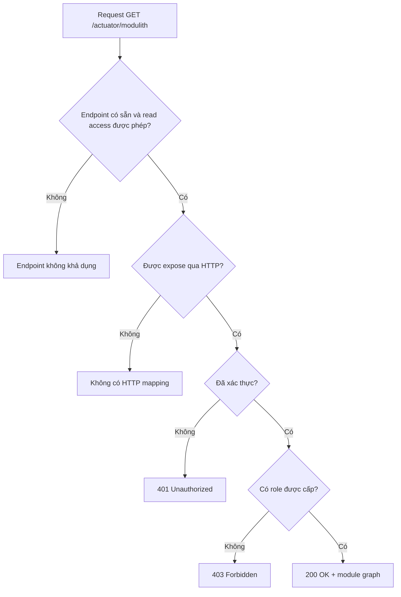
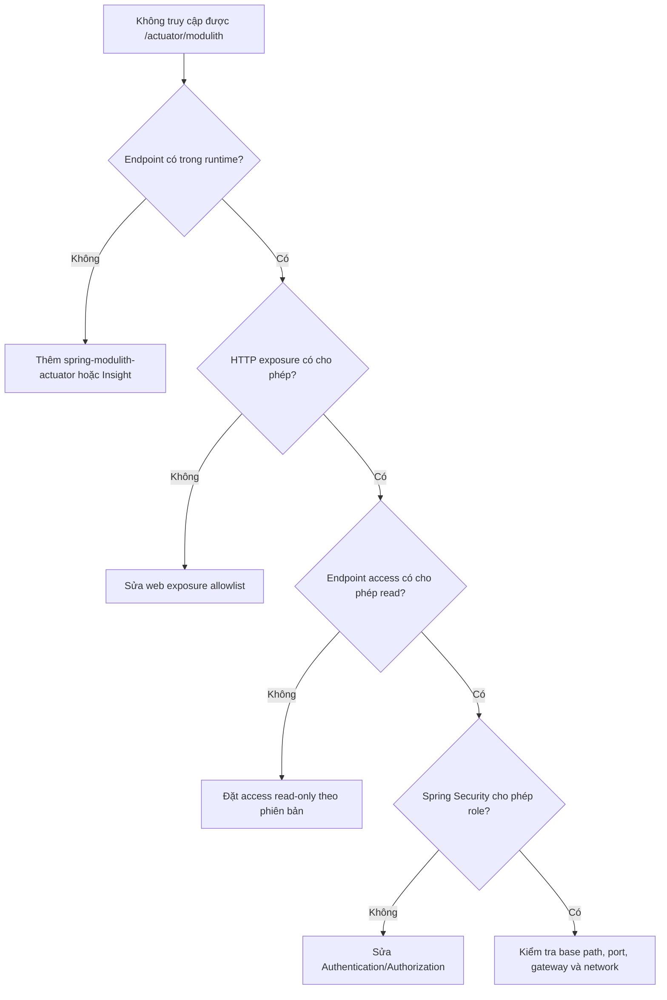

# Phân quyền endpoint modulith

## 1. Vì sao endpoint Modulith cần được phân quyền?

Spring Modulith có thể công bố cấu trúc application module qua Spring Boot Actuator tại endpoint `/actuator/modulith`. Dữ liệu trả về giúp đội phát triển xem module nào được phát hiện, package gốc và các dependency giữa module. Đây là thông tin hữu ích khi kiểm tra kiến trúc, nhưng cũng tiết lộ cách tổ chức nội bộ của ứng dụng.

Giả sử ứng dụng `shop-service` có các module `order`, `payment` và `inventory`. Người phát triển cần đọc module graph để điều tra một dependency bất thường; nhóm vận hành cần kiểm tra health; người dùng API nghiệp vụ không cần biết package và cấu trúc phụ thuộc bên trong. Nếu expose tất cả Actuator endpoint cho mọi người, thông tin kiến trúc có thể bị lộ ngoài phạm vi cần thiết.

Bài thuộc chương **Actuator và vận hành** của **SPRING_MODULITH_DOCUMENTATION_OBSERVABILITY**. Module này hướng dẫn dùng Spring Modulith sinh tài liệu ranh giới application module và quan sát tương tác giữa các phần trong ứng dụng Spring Boot qua module graph, Actuator, event metrics, tracing và context propagation.

Sau bài học, bạn có thể:

1. Phân biệt endpoint được kích hoạt, được expose và được Spring Security cho phép truy cập.
2. Chỉ expose endpoint `modulith` qua HTTP theo nhu cầu.
3. Giới hạn endpoint ở chế độ chỉ đọc bằng cấu hình Actuator khi phiên bản Spring Boot hỗ trợ.
4. Cấp quyền đọc module graph cho một role riêng bằng `EndpointRequest`.
5. Giữ nguyên chính sách bảo mật cho API nghiệp vụ khi tự khai báo `SecurityFilterChain`.
6. Kiểm thử các trường hợp `200`, `401`, `403` và `404` để xác định đúng lớp gây từ chối.

## 2. Endpoint modulith cung cấp dữ liệu gì?

Spring Modulith cung cấp Actuator endpoint có ID `modulith`. Khi endpoint được kích hoạt và expose qua HTTP, đường dẫn mặc định là:

```http
GET /actuator/modulith
```

Endpoint mô tả application module được phát hiện và dependency giữa chúng. Ví dụ phản hồi rút gọn:

```json
{
  "order": {
    "displayName": "Order Management",
    "basePackage": "com.example.shop.order",
    "dependencies": [
      {
        "target": "inventory",
        "types": ["USES_COMPONENT"]
      }
    ]
  },
  "inventory": {
    "displayName": "Inventory Management",
    "basePackage": "com.example.shop.inventory",
    "dependencies": []
  }
}
```

Thông tin này có thể tiết lộ:

- Tên kỹ thuật và tên hiển thị của application module.
- Package gốc và cách tổ chức mã nguồn.
- Module nào phụ thuộc module nào.
- Loại dependency, ví dụ `USES_COMPONENT` hoặc `EVENT_LISTENER`.
- Những module lồng nhau nếu ứng dụng có nested modules.

Đây không phải endpoint quản trị có thao tác thay đổi dữ liệu, nhưng vẫn là **thông tin kiến trúc nội bộ**. Không nên coi dữ liệu chỉ đọc là dữ liệu công khai. Quyền xem module graph nên được cấp cho người và hệ thống thực sự cần dùng nó.

## 3. Ba lớp kiểm soát cần phân biệt

Một endpoint Actuator chỉ truy cập được khi endpoint tồn tại/được cho phép, được expose qua giao thức đang gọi và request vượt qua lớp bảo mật HTTP.

| Lớp | Cấu hình hoặc cơ chế | Câu hỏi |
| --- | --- | --- |
| **Endpoint access** | `management.endpoint.<id>.access` và `management.endpoints.access.*` | Endpoint có được phép hoạt động và cho phép loại thao tác nào? |
| **Exposure** | `management.endpoints.web.exposure.include/exclude` | Endpoint có được công bố qua HTTP không? |
| **Authentication/authorization** | Spring Security, `SecurityFilterChain`, role/authority | Ai đang gọi và người đó có quyền truy cập không? |



Ba lớp này độc lập:

- Thêm `modulith` vào `exposure.include` không tự cấp quyền cho người dùng.
- Có role trong Spring Security không thể làm endpoint xuất hiện nếu endpoint chưa được expose.
- `access: read-only` giới hạn thao tác của endpoint; nó **không xác thực người gọi** và không thay thế role authorization.

## 4. Chuẩn bị dependency cho Modulith Actuator

Có hai cách phổ biến để đưa endpoint Modulith vào ứng dụng:

**Cách 1 — chỉ cần endpoint module graph:**

```groovy
dependencies {
    runtimeOnly "org.springframework.boot:spring-boot-starter-actuator"
    runtimeOnly "org.springframework.modulith:spring-modulith-actuator"
}
```

**Cách 2 — cần cả module Actuator và observability:**

```groovy
dependencies {
    runtimeOnly "org.springframework.modulith:spring-modulith-starter-insight"
}
```

Insight starter bao gồm hỗ trợ Actuator và observability của Spring Modulith. Nếu chỉ dùng endpoint module graph, bộ dependency Actuator cùng `spring-modulith-actuator` là đủ. Phiên bản Spring Modulith cần tương thích với Spring Boot; nên dùng BOM của dự án thay vì ghim từng dependency khác dòng.

Spring Security cho cấu hình phân quyền HTTP:

```groovy
dependencies {
    implementation "org.springframework.boot:spring-boot-starter-security"
}
```

Ví dụ bên dưới dùng Spring Boot 3.5+/4.x và Spring Security hiện đại. Với Boot 4, package của một số API Actuator Security đã chuyển; xem ghi chú phiên bản ở phần cấu hình Java.

## 5. Chỉ expose endpoint modulith qua HTTP

Trong `application.yml`:

```yaml
management:
  endpoints:
    web:
      exposure:
        include: "health,modulith"
```

Kết quả:

- `/actuator/health` được expose để kiểm tra tình trạng ứng dụng.
- `/actuator/modulith` được expose để đọc module graph.
- Các endpoint khác như `beans`, `env`, `configprops`, `heapdump` không được expose qua HTTP bởi cấu hình này.

Đây là allowlist, dễ review hơn việc mở toàn bộ bằng:

```yaml
management:
  endpoints:
    web:
      exposure:
        include: "*"
```

Không dùng `include: "*"` trong môi trường production nếu không có yêu cầu cụ thể và chính sách bảo vệ tương ứng. Một số endpoint có thể tiết lộ environment, bean registry, cấu hình hoặc thông tin runtime nhạy cảm.

### 5.1. Exposure qua HTTP khác với exposure qua JMX

`management.endpoints.web.exposure.*` chỉ kiểm soát HTTP. Nếu ứng dụng cũng dùng JMX, cần xem riêng:

```yaml
management:
  endpoints:
    jmx:
      exposure:
        include: "health"
```

Không giả định endpoint không có trên HTTP thì cũng không có trên JMX. Hãy cấu hình allowlist riêng cho từng giao thức mà hệ thống thực sự sử dụng.

## 6. Giới hạn endpoint ở chế độ chỉ đọc

Với các dòng Spring Boot hỗ trợ endpoint access properties (ví dụ Spring Boot 3.5 và 4.x), có thể giới hạn endpoint Modulith:

```yaml
management:
  endpoints:
    access:
      default: none
    web:
      exposure:
        include: "health,modulith"
  endpoint:
    health:
      access: read-only
    modulith:
      access: read-only
```

Giải thích:

- `management.endpoints.access.default: none` đặt chính sách mặc định là không cho endpoint access.
- `management.endpoint.health.access: read-only` bật thao tác đọc health.
- `management.endpoint.modulith.access: read-only` bật thao tác đọc module graph.
- `exposure.include` vẫn cần liệt kê endpoint muốn công bố qua HTTP.

Khi endpoint không được phép access, Spring Boot có thể loại endpoint đó khỏi application context. Điều này khác với chỉ ẩn URL khỏi HTTP: endpoint không khả dụng cho các giao thức liên quan.

**Endpoint Modulith chủ yếu cung cấp thao tác đọc.** Đặt `read-only` thể hiện rõ ý định cấu hình và giúp chính sách tổng thể an toàn hơn nếu endpoint được mở rộng trong tương lai.

### 6.1. Phiên bản Spring Boot cũ hơn

Các thuộc tính `management.endpoints.access.default` và `management.endpoint.<id>.access` không có ở mọi dòng Spring Boot cũ. Nếu dự án dùng phiên bản chưa hỗ trợ chúng:

- Vẫn dùng `management.endpoints.web.exposure.include` để allowlist endpoint.
- Dùng Spring Security để xác thực và phân quyền request.
- Không copy thuộc tính access mới vào cấu hình cũ rồi nghĩ rằng nó đã có hiệu lực; kiểm tra tài liệu đúng phiên bản.

Spring Security vẫn là lớp cần thiết để giới hạn người dùng. Endpoint access properties không thay thế authentication/authorization.

## 7. Cấp role riêng cho endpoint modulith bằng Spring Security

Giả sử tổ chức có role:

- `ARCHITECTURE_VIEWER`: được đọc module graph.
- `ACTUATOR_ADMIN`: được truy cập các endpoint quản trị khác theo chính sách.
- Người dùng nghiệp vụ thông thường: không có quyền đọc module graph.

Ta có thể dùng `EndpointRequest.to("modulith")` để match endpoint theo ID thay vì hard-code đường dẫn `/actuator/modulith`. Matcher này cũng xử lý các subpath của endpoint nếu có.

### 7.1. SecurityFilterChain cho Actuator

Ví dụ cho **Spring Boot 3.x**:

```java
package com.example.shop.config;

import org.springframework.boot.actuate.autoconfigure.security.servlet.EndpointRequest;
import org.springframework.context.annotation.Bean;
import org.springframework.context.annotation.Configuration;
import org.springframework.core.annotation.Order;
import org.springframework.security.config.Customizer;
import org.springframework.security.config.annotation.web.builders.HttpSecurity;
import org.springframework.security.web.SecurityFilterChain;

@Configuration(proxyBeanMethods = false)
class ActuatorSecurityConfiguration {

    @Bean
    @Order(1)
    SecurityFilterChain actuatorSecurity(HttpSecurity http) throws Exception {
        http
            .securityMatcher(EndpointRequest.toAnyEndpoint())
            .authorizeHttpRequests(authorize -> authorize
                .requestMatchers(EndpointRequest.to("health")).permitAll()
                .requestMatchers(EndpointRequest.to("modulith"))
                    .hasRole("ARCHITECTURE_VIEWER")
                .anyRequest().hasRole("ACTUATOR_ADMIN")
            )
            .httpBasic(Customizer.withDefaults());

        return http.build();
    }
}
```

Với Spring Boot 4.x, import matcher Actuator Security được chuyển sang package:

```java
import org.springframework.boot.security.autoconfigure.actuate.web.servlet.EndpointRequest;
```

Các rule authorization giữ nguyên ý tưởng. Luôn dùng import đúng với dòng Boot đang chạy.

Giải thích:

1. `securityMatcher(EndpointRequest.toAnyEndpoint())` giới hạn chain đầu tiên cho request Actuator.
2. `health` được phép đọc công khai nếu chính sách health check cho phép.
3. Chỉ người có role `ARCHITECTURE_VIEWER` mới đọc được endpoint `modulith`.
4. Các Actuator endpoint khác yêu cầu role `ACTUATOR_ADMIN`.
5. HTTP Basic ở ví dụ là cách đơn giản để minh họa. Production nên dùng cơ chế identity/SSO/token phù hợp của tổ chức.

`hasRole("ARCHITECTURE_VIEWER")` mặc định kiểm tra authority `ROLE_ARCHITECTURE_VIEWER`. Nếu hệ thống cấp authority không có prefix `ROLE_`, dùng `hasAuthority(...)` với đúng chuỗi authority.

### 7.2. Bảo vệ cả request nghiệp vụ

Một điểm rất quan trọng: khi ứng dụng khai báo một bean `SecurityFilterChain` tùy chỉnh, Spring Boot Security auto-configuration **nhường quyền kiểm soát cấu hình bảo mật HTTP**. Nếu chỉ khai báo chain dành cho Actuator, hãy bảo đảm request API nghiệp vụ cũng có chain bảo vệ riêng.

Ví dụ chain thứ hai:

```java
package com.example.shop.config;

import org.springframework.context.annotation.Bean;
import org.springframework.context.annotation.Configuration;
import org.springframework.core.annotation.Order;
import org.springframework.security.config.Customizer;
import org.springframework.security.config.annotation.web.builders.HttpSecurity;
import org.springframework.security.web.SecurityFilterChain;

@Configuration(proxyBeanMethods = false)
class ApplicationSecurityConfiguration {

    @Bean
    @Order(2)
    SecurityFilterChain applicationSecurity(HttpSecurity http) throws Exception {
        http
            .authorizeHttpRequests(authorize -> authorize
                .anyRequest().authenticated()
            )
            .httpBasic(Customizer.withDefaults());

        return http.build();
    }
}
```

Đây là ví dụ tối thiểu để thể hiện nguyên tắc. Nếu ứng dụng dùng OAuth2 Resource Server, form login, CSRF, CORS hoặc nhiều nhóm URL, hãy giữ đầy đủ chính sách hiện có và sắp xếp chain theo matcher/priority phù hợp. Không thay thế cấu hình bảo mật nghiệp vụ của dự án bằng hai đoạn code mẫu này mà chưa review.

### 7.3. Nguồn cấp role

Đoạn cấu hình trên giả định ứng dụng đã có authentication provider, user store hoặc identity provider trả về role/authority phù hợp. Ví dụ trong môi trường test có thể tạo user với role `ARCHITECTURE_VIEWER`, nhưng không nhúng mật khẩu production vào source code.

Có thể cấp quyền qua:

- Identity provider/SSO ánh xạ nhóm kiến trúc thành role `ARCHITECTURE_VIEWER`.
- LDAP/AD hoặc user store tập trung.
- OAuth2/JWT converter ánh xạ claim thành Spring Security authority.
- UserDetailsService trong integration test.

Không chỉ dựa vào tên user hoặc header tự gửi từ client để cấp role. Role phải đến từ nguồn xác thực tin cậy.

## 8. Phân biệt 401, 403 và 404

Khi kiểm tra endpoint, status code giúp xác định request dừng ở lớp nào:

| HTTP status | Ý nghĩa thường gặp | Ví dụ |
| --- | --- | --- |
| `200 OK` | Endpoint khả dụng và caller được phép đọc | User có role `ARCHITECTURE_VIEWER` |
| `401 Unauthorized` | Chưa xác thực hoặc thông tin xác thực không hợp lệ | Request thiếu Basic/Bearer token |
| `403 Forbidden` | Đã xác thực nhưng không đủ quyền | User chỉ có role `USER` |
| `404 Not Found` | Endpoint/path không khả dụng hoặc không được expose | Thiếu dependency, sai base path hoặc endpoint bị loại khỏi context |

Không kết luận mọi `404` đều là thiếu dependency. Kiểm tra theo thứ tự:

1. `spring-modulith-actuator` hoặc Insight starter đã có trên runtime classpath chưa?
2. Endpoint có được phép access trong cấu hình không?
3. Endpoint có nằm trong `management.endpoints.web.exposure.include` không?
4. Base path có còn là `/actuator` không, hay đã đổi bằng `management.endpoints.web.base-path`?
5. Management server có dùng port riêng không?
6. Request có đi tới đúng instance/environment không?

Tương tự, `403` có thể đến từ Spring Security role, CSRF, gateway hoặc policy mạng; xem response/log trước khi sửa cấu hình endpoint.

## 9. Kiểm thử phân quyền

Giả sử ứng dụng chạy tại `localhost:8080` và dùng HTTP Basic trong môi trường test. Thực hiện các trường hợp:

### 9.1. Không gửi thông tin xác thực

```powershell
curl.exe -i http://localhost:8080/actuator/modulith
```

Kết quả mong đợi: `401 Unauthorized` nếu Actuator security chain yêu cầu authentication.

### 9.2. User có role kiến trúc

```powershell
curl.exe -i -u architecture-viewer:TEST_PASSWORD http://localhost:8080/actuator/modulith
```

Kết quả mong đợi: `200 OK` và JSON module graph. `TEST_PASSWORD` là placeholder của user test; không dùng mật khẩu thật trong shell history hoặc tài liệu chia sẻ.

### 9.3. User đã xác thực nhưng thiếu role

```powershell
curl.exe -i -u ordinary-user:TEST_PASSWORD http://localhost:8080/actuator/modulith
```

Kết quả mong đợi: `403 Forbidden` nếu user không có role `ARCHITECTURE_VIEWER`.

### 9.4. Health vẫn truy cập được theo chính sách

```powershell
curl.exe -i http://localhost:8080/actuator/health
```

Kết quả mong đợi: `200 OK` nếu health được expose và cho phép truy cập công khai.

### 9.5. Endpoint khác không bị mở ngoài ý muốn

```powershell
curl.exe -i -u architecture-viewer:TEST_PASSWORD http://localhost:8080/actuator/beans
```

Nếu `beans` không nằm trong exposure allowlist, request không thể đọc bean registry dù user có role xem Modulith. Đây là hành vi mong muốn khi chính sách chỉ công bố `health` và `modulith`.

## 10. Tách management port và giới hạn mạng

Ngoài Spring Security, có thể đặt Actuator trên cổng quản trị riêng:

```yaml
server:
  port: 8080

management:
  server:
    port: 9091
  endpoints:
    web:
      exposure:
        include: "health,modulith"
```

Khi đó endpoint mặc định là:

```text
http://localhost:9091/actuator/modulith
```

Port riêng giúp cấu hình firewall, network policy hoặc ingress riêng cho lưu lượng quản trị. Nhưng **port riêng không tự tạo authentication** và không bảo đảm chỉ người nội bộ truy cập được. Cần giới hạn đường mạng, security group, Kubernetes NetworkPolicy hoặc reverse proxy theo kiến trúc triển khai.

Nếu ứng dụng chạy trên cùng host và management endpoint chỉ cần truy cập cục bộ, có thể cân nhắc bind management server vào loopback:

```yaml
management:
  server:
    address: 127.0.0.1
    port: 9091
```

Chỉ dùng địa chỉ loopback khi probe/monitoring thực sự chạy cùng network namespace/host phù hợp. Nếu Prometheus hoặc hệ thống giám sát ở pod/host khác, binding loopback có thể khiến chúng không scrape được.

## 11. Những lỗi cấu hình thường gặp

| Dấu hiệu | Nguyên nhân có thể | Cách xử lý |
| --- | --- | --- |
| `/actuator/modulith` trả 404 | Thiếu actuator/module dependency, chưa expose, sai base path hoặc endpoint bị access=none | Kiểm tra runtime dependency, access và exposure |
| Có dependency nhưng `/actuator` không quảng bá modulith | Endpoint chưa available hoặc không expose trên HTTP | Kiểm tra `/actuator`, allowlist và access property |
| User architecture viewer nhận 403 | Role không đúng authority hoặc matcher/chain khác đang áp dụng | Kiểm tra `ROLE_ARCHITECTURE_VIEWER`, chain order và request matcher |
| User không đăng nhập nhận 403 thay vì 401 | Gateway/security entry point tùy chỉnh hoặc CSRF/policy khác | Kiểm tra lớp phát response và log bảo mật |
| Sau khi thêm SecurityFilterChain, API nghiệp vụ bị mở | Boot security auto-configuration đã back off, chưa có application chain | Thêm/khôi phục chain bảo vệ API |
| Health check bị yêu cầu đăng nhập | Matcher health không được permit hoặc endpoint chain không khớp | Kiểm tra `EndpointRequest.to("health")` |
| Endpoint chỉ hoạt động trên cổng ứng dụng, không có cổng quản trị | Chưa cấu hình `management.server.port` hoặc môi trường không bind được | Kiểm tra port, address, firewall và context |
| Role viewer đọc được `/actuator/beans` | Exposure hoặc matcher quá rộng, rule fallback chưa đúng | Thu hẹp allowlist và phân quyền endpoint theo ID |
| JMX vẫn thấy endpoint dù HTTP đã ẩn | Chỉ cấu hình web exposure | Cấu hình riêng JMX exposure |

### Quy trình điều tra



## 12. Checklist vận hành

- [ ] Xác nhận endpoint Modulith có dependency runtime phù hợp.
- [ ] Chỉ expose `health` và `modulith` qua HTTP nếu đó là nhu cầu thực tế.
- [ ] Dùng `management.endpoint.modulith.access: read-only` khi phiên bản hỗ trợ.
- [ ] Hiểu endpoint access, exposure và Spring Security là ba lớp riêng.
- [ ] Dùng role chuyên biệt như `ARCHITECTURE_VIEWER` để đọc module graph.
- [ ] Dùng `EndpointRequest.to("modulith")` thay vì hard-code URL nếu cấu hình Spring Security hỗ trợ.
- [ ] Giữ một chain bảo vệ API nghiệp vụ khi tự khai báo Actuator SecurityFilterChain.
- [ ] Kiểm thử user không xác thực, viewer, user thường và health probe.
- [ ] Kiểm tra endpoint không mong muốn như `beans`/`env` không bị expose.
- [ ] Giới hạn cổng quản trị bằng network policy/firewall; không coi port riêng là authentication.
- [ ] Cấu hình JMX exposure riêng nếu ứng dụng sử dụng JMX.
- [ ] Theo dõi log bảo mật và rà soát role/permission theo thay đổi nhân sự.

## 13. Tài liệu tham khảo

- [Spring Modulith — Production-ready Features](https://docs.spring.io/spring-modulith/reference/production-ready.html): dependency Insight/Actuator và cấu trúc JSON của endpoint `modulith`.
- [Spring Boot — Actuator Endpoints](https://docs.spring.io/spring-boot/reference/actuator/endpoints.html): endpoint access, exposure, security và `EndpointRequest`.
- [Spring Boot 3.5 — Actuator Endpoints](https://docs.spring.io/spring-boot/3.5/reference/actuator/endpoints.html): endpoint access properties và security configuration trong Boot 3.5.
- [Spring Security — Authorization](https://docs.spring.io/spring-security/reference/servlet/authorization/authorize-http-requests.html): phân quyền HTTP request bằng role/authority và request matcher.
- [Spring Boot — Application Properties](https://docs.spring.io/spring-boot/appendix/application-properties/): `management.endpoints.*` và `management.endpoint.*`.
