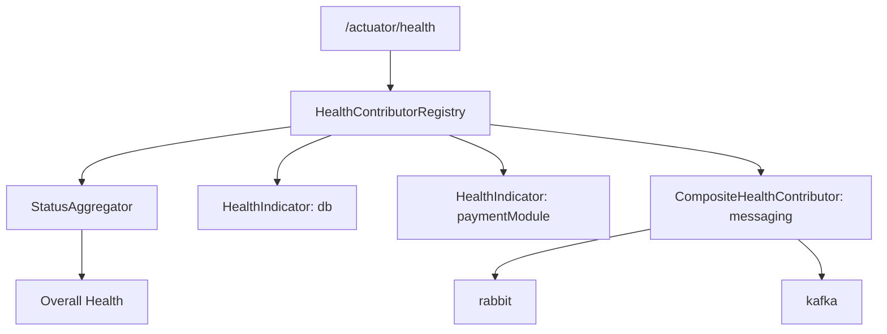

# Health indicator và module observability

## 1. Vì sao cần kết hợp health indicator với module observability?

Trong chương **Actuator và vận hành** của học phần **SPRING_MODULITH_DOCUMENTATION_OBSERVABILITY**, chúng ta tìm hiểu cách kiểm tra trạng thái ứng dụng Spring Boot và quan sát tương tác giữa các application module. Khi hệ thống có các module như `order`, `payment` và `inventory`, đội vận hành cần trả lời hai câu hỏi khác nhau:

- **Ứng dụng có đang sẵn sàng nhận request không?** Health endpoint và health probes của Spring Boot trả lời câu hỏi này.
- **Kiến trúc mô-đun đang được triển khai và vận hành ra sao?** Spring Modulith Actuator, module spans, event metrics và tracing cung cấp thông tin về cấu trúc và hoạt động giữa các module.

Một health indicator cho biết trạng thái tại thời điểm kiểm tra. Module graph cho biết quan hệ phụ thuộc được phát hiện từ cấu trúc ứng dụng. Module span ghi lại một lần gọi thực tế. Event metrics cho biết số lần publish event. Những tín hiệu này bổ sung cho nhau, nhưng không thể thay thế nhau.

**Mục tiêu học tập**

1. Hiểu `HealthIndicator`, `HealthContributor`, `CompositeHealthContributor` và `HealthContributorRegistry`.
2. Tạo health indicator riêng cho một module và xác định phụ thuộc nào cần kiểm tra.
3. Phân biệt trạng thái `UP`, `DOWN`, `OUT_OF_SERVICE` và `UNKNOWN`.
4. Cấu hình health groups, liveness/readiness probes và Kubernetes.
5. Bật Spring Modulith Actuator để xem module structure và dependency.
6. Kết hợp health, module graph, event metrics và traces trong quy trình vận hành.
7. Tránh biến health endpoint thành một luồng kiểm tra phụ thuộc chậm, gây quá tải hoặc làm lộ thông tin.

## 2. Health indicator trong Spring Boot Actuator

Spring Boot Actuator cung cấp endpoint `/actuator/health` để báo cáo trạng thái của ứng dụng. Endpoint này thu thập dữ liệu từ các `HealthContributor` được đăng ký trong application context thông qua `HealthContributorRegistry`.

Một contributor có thể là:

- **`HealthIndicator`:** kiểm tra một thành phần hoặc subsystem và trả về một `Health` cùng trạng thái.
- **`CompositeHealthContributor`:** nhóm nhiều contributor thành một cây health có cấu trúc.
- **`ReactiveHealthIndicator`:** phiên bản non-blocking dành cho nguồn kiểm tra reactive.
- **`CompositeReactiveHealthContributor`:** nhóm các reactive contributors.

Mô hình tổng quát:



`StatusAggregator` tổng hợp các status từ contributors theo thứ tự ưu tiên cấu hình. Nếu không có status nào được aggregator nhận diện, kết quả có thể là `UNKNOWN`. Một contributor không nhất thiết phải biết toàn bộ trạng thái hệ thống; nó chỉ chịu trách nhiệm kiểm tra phần mình đại diện.

### 2.1. Các trạng thái thường gặp

| Status | Ý nghĩa vận hành | Ví dụ |
| --- | --- | --- |
| `UP` | Thành phần hoạt động bình thường | Kết nối database thành công |
| `DOWN` | Thành phần không hoạt động hoặc kiểm tra thất bại | Không thể kết nối một dependency bắt buộc |
| `OUT_OF_SERVICE` | Thành phần tạm thời không phục vụ request | Module payment đang bị tắt theo chính sách vận hành |
| `UNKNOWN` | Không đủ thông tin để kết luận | Chưa cấu hình endpoint kiểm tra hoặc kết quả chưa xác định |

Mặc định, Spring Boot ánh xạ `DOWN` và `OUT_OF_SERVICE` thành HTTP 503; `UP` và `UNKNOWN` thường trả HTTP 200. Có thể tùy chỉnh thứ tự status và HTTP mapping theo toàn hệ thống hoặc từng health group.

**Không nên trả `DOWN` cho mọi lỗi phụ trợ.** Chỉ đánh dấu trạng thái ảnh hưởng thực sự tới khả năng phục vụ mà indicator đại diện. Ví dụ, một dịch vụ gửi email không thiết yếu có thể lỗi nhưng module order vẫn nhận và xử lý đơn hàng bình thường nhờ retry/outbox.

### 2.2. HealthContributorRegistry và tên indicator

Spring Boot tự đăng ký các health contributor phù hợp trong application context, bao gồm những indicator được auto-configure như database, disk space, Redis, RabbitMQ hoặc Elasticsearch tùy dependency.

Bạn có thể đăng ký hoặc gỡ contributor ở runtime qua `HealthContributorRegistry`. Với indicator khai báo thành Spring bean, ID thường lấy từ tên bean sau khi bỏ hậu tố `HealthIndicator`. Ví dụ bean `paymentModuleHealthIndicator` có ID `paymentModule` để dùng trong health group.

## 3. Viết HealthIndicator riêng cho module

Spring Modulith không tự suy ra rằng mỗi application module có một trạng thái health độc lập. `/actuator/modulith` công bố module structure và dependency; nó không tự ping từng module hoặc tự trả `UP`/`DOWN` cho module.

Nếu muốn báo cáo sức khỏe của module `payment`, ứng dụng cần xác định **khả năng phục vụ thực tế** của module. Một indicator có thể kiểm tra dependency quan trọng như payment gateway hoặc credential/configuration cần thiết. Nó không nên gọi toàn bộ nghiệp vụ thanh toán hoặc thực hiện giao dịch thật mỗi lần health endpoint được truy cập.

### 3.1. Xác định hợp đồng kiểm tra dependency

Tạo một abstraction nhỏ để health indicator không phụ thuộc trực tiếp vào SDK của nhà cung cấp:

```java
package com.acme.shop.payment;

public interface PaymentGatewayProbe {
    boolean isAvailable();
}
```

Implementation của `PaymentGatewayProbe` thuộc module payment và có trách nhiệm gọi một health/status API nhẹ của gateway. Nó cần đặt connect/read timeout, giới hạn số lần retry và không thực hiện giao dịch có tác dụng phụ.

### 3.2. Tạo custom HealthIndicator

Ví dụ dưới đây dùng package Spring Boot 4.x:

```java
package com.acme.shop.payment;

import org.springframework.boot.health.contributor.Health;
import org.springframework.boot.health.contributor.HealthIndicator;
import org.springframework.stereotype.Component;

@Component("paymentModuleHealthIndicator")
public class PaymentModuleHealthIndicator implements HealthIndicator {

    private final PaymentGatewayProbe gatewayProbe;

    public PaymentModuleHealthIndicator(PaymentGatewayProbe gatewayProbe) {
        this.gatewayProbe = gatewayProbe;
    }

    @Override
    public Health health() {
        try {
            if (gatewayProbe.isAvailable()) {
                return Health.up()
                        .withDetail("module", "payment")
                        .withDetail("dependency", "payment-gateway")
                        .build();
            }

            return Health.outOfService()
                    .withDetail("module", "payment")
                    .withDetail("dependency", "payment-gateway")
                    .withDetail("reason", "dependency-unavailable")
                    .build();

        } catch (RuntimeException exception) {
            // Không đưa message hoặc thông tin kết nối nhạy cảm ra endpoint.
            return Health.down()
                    .withDetail("module", "payment")
                    .withDetail("dependency", "payment-gateway")
                    .withDetail("reason", "health-check-failed")
                    .build();
        }
    }
}
```

Bean có tên `paymentModuleHealthIndicator`, vì vậy ID health contributor là `paymentModule`. Có thể dùng ID này để thêm indicator vào group `readiness`.

**Điểm quan trọng:** `PaymentGatewayProbe` là hợp đồng do ứng dụng định nghĩa; bài viết không giả định có một health API chung cho mọi gateway. Implementation cần dùng API nhẹ, timeout ngắn và không ghi log mỗi lần health probe chạy. Nếu gateway lỗi nhưng module có fallback vẫn đáp ứng nghiệp vụ, hãy cân nhắc không đưa indicator này vào readiness group.

### 3.3. Chi tiết trả về phải đủ dùng và an toàn

Health response có thể chứa detail để người vận hành biết subsystem nào gặp vấn đề. Chỉ nên trả các trường ổn định như tên module, tên dependency, mã lỗi đã chuẩn hóa hoặc trạng thái kết nối.

Không nên trả:
- URL có credential, API key, token hoặc connection string.
- Nội dung exception message có thể chứa SQL, hostname nội bộ hoặc dữ liệu khách hàng.
- Request payload, thông tin thanh toán hoặc thông tin nhận dạng cá nhân.
- Stack trace đầy đủ qua endpoint health công khai.

Spring Boot mặc định không hiển thị health details cho người dùng HTTP. Có thể cấu hình `when-authorized` và role vận hành để chỉ người được phép xem chi tiết.

**Khác biệt package theo phiên bản:** các ví dụ Java trong bài dùng Spring Boot 4.x với package `org.springframework.boot.health.contributor`. Trong Spring Boot 3.x, các kiểu health tương ứng nằm dưới `org.springframework.boot.actuate.health`; hãy dùng package theo dòng Boot của dự án.
## 4. ReactiveHealthIndicator cho ứng dụng WebFlux

Nếu dependency được kiểm tra bằng API reactive như R2DBC hoặc reactive client, hãy dùng `ReactiveHealthIndicator` để giữ health check non-blocking.

```java
package com.acme.shop.payment;

import java.time.Duration;

import org.springframework.boot.health.contributor.Health;
import org.springframework.boot.health.contributor.ReactiveHealthIndicator;
import org.springframework.stereotype.Component;

import reactor.core.publisher.Mono;

@Component("paymentReactiveHealthIndicator")
public class PaymentReactiveHealthIndicator
        implements ReactiveHealthIndicator {

    private final ReactivePaymentGatewayProbe gatewayProbe;

    public PaymentReactiveHealthIndicator(
            ReactivePaymentGatewayProbe gatewayProbe) {
        this.gatewayProbe = gatewayProbe;
    }

    @Override
    public Mono<Health> health() {
        return gatewayProbe.isAvailable()
                .timeout(Duration.ofMillis(500))
                .map(available -> available
                        ? Health.up().withDetail("module", "payment").build()
                        : Health.outOfService()
                                .withDetail("module", "payment")
                                .withDetail("reason", "gateway-unavailable")
                                .build())
                .onErrorResume(exception ->
                        Mono.just(Health.down()
                                .withDetail("module", "payment")
                                .withDetail("reason", "health-check-failed")
                                .build()));
    }
}
```

`ReactivePaymentGatewayProbe` là interface minh họa có method trả về `Mono<Boolean>`. Ví dụ có timeout 500 ms để health endpoint không chờ vô hạn. Thời gian cụ thể cần dựa trên SLA và timeout của hệ thống.

Trong ứng dụng WebFlux, Spring Boot sử dụng `ReactiveHealthContributorRegistry` cho reactive contributors. Contributor đồng bộ có thể được wrap để chạy trên elastic scheduler, nhưng không nên dùng cách đó để che giấu một thao tác blocking kéo dài trong pipeline reactive.

**Không đăng ký đồng thời hai indicator cùng đại diện một module nếu không có lý do rõ ràng.** Chọn indicator phù hợp với kiểu truy cập dependency và dùng một ID dễ hiểu.

## 5. Composite health và health theo module

Một module có thể phụ thuộc nhiều subsystem. Nếu cần quan sát từng dependency riêng, có thể dùng composite contributor hoặc tạo các indicator độc lập rồi tổ chức thành health group.

Ví dụ hệ thống:

| Module | Dependency | Mức độ |
| --- | --- | --- |
| `order` | Database đơn hàng | Bắt buộc |
| `payment` | Payment gateway | Bắt buộc cho thao tác thanh toán |
| `inventory` | Redis cache tồn kho | Có fallback đọc database |
| `notification` | Email provider | Không chặn đặt hàng; có retry |

Không phải mọi dependency đều cần đưa vào health group toàn ứng dụng. Nếu email provider lỗi, module notification có thể báo `DOWN` trong khi ứng dụng vẫn `UP` và nhận đơn hàng bình thường.

### 5.1. Chọn đúng phạm vi health

Có thể dùng các group riêng:
- `/actuator/health`: sức khỏe tổng thể theo cấu hình toàn hệ thống.
- `/actuator/health/readiness`: instance có nên nhận traffic hay không.
- `/actuator/health/liveness`: tiến trình còn hoạt động và có thể tiếp tục chạy hay không.
- `/actuator/health/payment`: group tùy chỉnh để xem riêng module payment.

Health group có thể include/exclude contributor theo ID. Ví dụ:

```yaml
management:
  endpoint:
    health:
      group:
        payment:
          include: "paymentModule"
        order:
          include: "db"
```

Đây là nhóm chẩn đoán tùy chỉnh, không tự động tương ứng với application module. Nhóm `order` ở ví dụ chỉ bao gồm contributor `db`; nếu có nhiều datasource hoặc nhiều indicator, cần chọn đúng ID của chúng.

## 6. Liveness, readiness và Kubernetes probes

Hai probe có mục tiêu khác nhau:

| Probe | Câu hỏi | Phản ứng thường gặp của Kubernetes |
| --- | --- | --- |
| **Liveness** | Tiến trình có còn ở trạng thái có thể tiếp tục chạy không? | Nếu thất bại liên tục, kubelet có thể restart container |
| **Readiness** | Instance hiện có nên nhận traffic không? | Nếu thất bại, instance bị loại khỏi endpoints nhận traffic |
| **Startup** | Ứng dụng đã khởi động xong chưa? | Trì hoãn liveness/readiness evaluation trong giai đoạn khởi động |

Spring Boot quản lý trạng thái availability và cung cấp health indicators cho liveness/readiness. Khi chạy trong Kubernetes, các health groups tương ứng thường được kích hoạt tự động; có thể bật rõ ràng bằng cấu hình probes nếu chạy ở môi trường khác.

### 6.1. Cấu hình probes

```yaml
management:
  endpoint:
    health:
      probes:
        enabled: true
        add-additional-paths: true
      show-details: when-authorized
      roles: OPS
      group:
        readiness:
          include: "readinessState,paymentModule"
```

Với cấu hình trên:
- `/actuator/health/liveness` kiểm tra trạng thái liveness.
- `/actuator/health/readiness` kiểm tra readiness và thêm `paymentModule`.
- `add-additional-paths: true` tạo thêm các path `/livez` và `/readyz` trên **main server port**, hữu ích khi management server chạy trên port riêng.
- `show-details: when-authorized` chỉ cho phép người đã xác thực với role phù hợp xem details.

Chỉ thêm `paymentModule` vào readiness nếu gateway thực sự bắt buộc để instance phục vụ traffic. Nếu payment gateway lỗi nhưng module có thể trả trạng thái pending và xử lý sau, việc đưa nó vào readiness có thể làm giảm khả năng phục vụ không cần thiết.

### 6.2. Liveness không nên kiểm tra dependency bên ngoài

Không đưa database, Redis, payment gateway hoặc API ngoài vào liveness group. Nếu một dependency dùng chung bị lỗi, mọi replica có thể cùng fail liveness và bị restart. Điều đó làm tăng tải lên hạ tầng đang gặp sự cố và có thể tạo cascading failure.

Readiness có thể kiểm tra dependency bên ngoài, nhưng phải cân nhắc:
- Dependency chỉ ảnh hưởng một instance hay được chia sẻ bởi toàn bộ replica?
- Module có fallback, cache, circuit breaker hoặc queue không?
- Nếu tất cả instance cùng unready, hệ thống upstream sẽ phản ứng thế nào?
- Probe có timeout ngắn và không gây thêm tải đáng kể không?

### 6.3. Kubernetes deployment minh họa

```yaml
livenessProbe:
  httpGet:
    path: /livez
    port: http
  periodSeconds: 10
  failureThreshold: 3

readinessProbe:
  httpGet:
    path: /readyz
    port: http
  periodSeconds: 5
  failureThreshold: 3

startupProbe:
  httpGet:
    path: /livez
    port: http
  periodSeconds: 5
  failureThreshold: 30
```

Đây là ví dụ minh họa. Tên port `http` phải khớp với container port trong Pod spec. Với ứng dụng khởi động chậm, `startupProbe` giúp kubelet chờ lâu hơn trước khi áp dụng liveness probe. Điều chỉnh period, timeout và failure threshold theo thời gian khởi động, tải và SLA thực tế.

## 7. Spring Modulith Actuator: xem cấu trúc module

Spring Modulith có endpoint `/actuator/modulith` để công bố thông tin kiến trúc module. Endpoint này trả về module technical name, base package, display name, module cha/con và các dependency đã phát hiện.

Để bật endpoint và observability thuận tiện, có thể thêm starter Insight:

```groovy
dependencies {
    implementation platform(
        "org.springframework.modulith:spring-modulith-bom:" + springModulithVersion
    )

    runtimeOnly "org.springframework.modulith:spring-modulith-starter-insight"
}
```

`springModulithVersion` phải là phiên bản stable tương thích với Spring Boot đang dùng. Starter Insight bao gồm hỗ trợ Actuator và observability của Spring Modulith. Nếu chỉ cần module actuator, có thể dùng `spring-modulith-actuator` cùng Spring Boot Actuator. Nếu chỉ cần module observability, có thể dùng artifact observability core phù hợp.

Expose endpoint cần thiết:

```yaml
management:
  endpoints:
    web:
      exposure:
        include: "health,modulith"
```

Sau khi ứng dụng khởi động, truy cập:
- `GET /actuator/health`: trạng thái health contributors.
- `GET /actuator/modulith`: module structure và dependency.
- `GET /actuator`: danh sách endpoint được expose, nếu discovery endpoint đang được bật.

Ví dụ response rút gọn:

```json
{
  "order": {
    "basePackage": "com.acme.shop.order",
    "displayName": "Order",
    "dependencies": [
      {
        "target": "payment",
        "types": ["USES_COMPONENT"]
      }
    ]
  },
  "payment": {
    "basePackage": "com.acme.shop.payment",
    "displayName": "Payment",
    "dependencies": []
  }
}
```

Các loại dependency có thể bao gồm `DEFAULT`, `USES_COMPONENT` và `EVENT_LISTENER`. Cấu trúc JSON thực tế phụ thuộc module detection và các module được tìm thấy trong ứng dụng.

**Điều endpoint này không làm:** nó không kiểm tra database của module order, không gọi payment gateway, không kết luận module payment đang `UP` hay `DOWN`. Đây là thông tin kiến trúc, không phải health report.
## 8. Module observability: metrics và spans bổ sung cho health

Khi dùng `spring-modulith-starter-insight`, Spring Modulith có thể:
- Expose module structure qua Actuator.
- Instrument Spring component thuộc API module để tạo Micrometer spans.
- Ghi event metrics cho domain events được publish.

Một module entry span thường có các key:

| Key | Ý nghĩa |
| --- | --- |
| `module.identifier` | Technical ID của module |
| `module.name` | Tên hiển thị |
| `module.method` | Method thực thi ở điểm vào module |
| `module.invocation-type` | Kiểu invocation, ví dụ bean hoặc event listener |

Event metrics tiêu biểu:
- `module.events.published`: counter tổng hợp số event publication.
- `module.events.published.$moduleIdentifier.$simpleEventTypeName`: counter cho từng event type trong module.

Những dữ liệu này giúp trả lời câu hỏi vận hành khác với health:

| Tín hiệu | Câu hỏi |
| --- | --- |
| Health indicator | Module hoặc dependency hiện có sẵn sàng không? |
| Module actuator | Module nào tồn tại và phụ thuộc module nào? |
| Module span | Request thực tế đã đi qua module nào và tốn bao lâu? |
| Event metric | Module đã publish bao nhiêu event theo loại? |
| Trace | Các span có cùng trace liên kết với nhau ra sao? |

Ví dụ: health indicator của payment trả `UP` nhưng module span cho thấy thời gian gọi `PaymentOperations.authorize` tăng cao. Khi đó module vẫn có thể phục vụ request, nhưng latency đang xấu đi. Ngược lại, event counter tăng không chứng minh listener đã xử lý thành công; cần event publication state hoặc metric/log riêng cho kết quả listener.

## 9. Kết hợp health theo module với quan sát vận hành

Giả sử ứng dụng bán hàng có ba module:

```text
order
  ├── database (bắt buộc)
  └── payment API

payment
  └── payment gateway (bắt buộc cho authorize)

inventory
  └── Redis cache (có fallback database)
```

Có thể thiết kế health theo nguyên tắc:
- `order` readiness phụ thuộc database và khả năng xử lý đơn hàng.
- `payment` readiness phụ thuộc gateway nếu không có chế độ fallback.
- `inventory` vẫn readiness nếu Redis mất nhưng fallback database còn hoạt động.
- `notification` có thể báo lỗi riêng nhưng không làm toàn ứng dụng ngừng nhận đơn hàng.

### Một tình huống điều tra

Người dùng phản ánh không thể thanh toán. Hãy kiểm tra theo thứ tự:

1. `/actuator/health/readiness`: instance có đang nhận traffic không?
2. `/actuator/health/payment`: health riêng của payment có báo dependency unavailable không?
3. `/actuator/modulith`: module order có dependency tới payment như dự kiến không?
4. `/actuator/metrics/module.events.published`: event publication có thay đổi bất thường không?
5. Trace backend: module span payment có latency cao hoặc error không?
6. Log và trạng thái event publication: có request nào đã retry hoặc chưa hoàn tất không?

Health cho biết trạng thái hiện tại; trace cho biết đường thực thi của request cụ thể. Kết hợp cả hai giúp phân biệt lỗi dependency, lỗi code trong module và vấn đề luồng bất đồng bộ.

## 10. Cấu hình chi tiết endpoint health và bảo mật

Spring Boot mặc định chỉ expose health endpoint qua HTTP. Khi thêm `modulith`, cần cân nhắc bảo vệ endpoint vì response có thể tiết lộ package, tên module, dependency hoặc thông tin triển khai.

Ví dụ cấu hình hiển thị chi tiết chỉ cho người được phân quyền:

```yaml
management:
  endpoints:
    web:
      exposure:
        include: "health,modulith"
  endpoint:
    health:
      show-details: when-authorized
      show-components: when-authorized
      roles: OPS
```

Trong production:
- Chỉ expose những endpoint cần thiết; tránh `include: "*"` nếu chưa có chính sách bảo vệ rõ ràng.
- Đặt management endpoints trong mạng quản trị hoặc bảo vệ bằng Spring Security/gateway.
- Không hiển thị exception message, secret, connection URL hoặc dữ liệu khách hàng trong health details.
- Tách quyền xem trạng thái tổng quát và quyền xem chi tiết nếu cần.
- Cấu hình management port riêng không thay thế authentication/network policy.

Nếu Actuator chạy trên management port riêng, hãy cân nhắc thêm health paths vào main server port để probe phản ánh khả năng nhận request thật. Nếu chỉ probe management port, management server vẫn có thể trả lời trong khi web server chính không nhận traffic được.

## 11. Timeout, cache và tác động của health check

Health endpoint thường được gọi định kỳ bởi Kubernetes, load balancer, monitoring và người vận hành. Vì vậy mỗi lần kiểm tra cần:
- Hoàn tất nhanh hơn timeout của caller.
- Có timeout riêng cho từng network dependency.
- Hạn chế retry; không tạo một đợt retry lớn mỗi lần probe.
- Tránh query nặng, scan bảng hoặc chạy nghiệp vụ có side effect.
- Không gọi health endpoint của nhiều module theo chuỗi nếu có thể kiểm tra trực tiếp dependency cần thiết.
- Dùng cache ngắn hoặc trạng thái được cập nhật nền khi việc kiểm tra quá tốn kém, nhưng phải cân nhắc độ mới của trạng thái.

Nếu một health indicator mất nhiều giây, nó có thể làm probe timeout và khiến Kubernetes loại instance khỏi service dù nghiệp vụ vẫn hoạt động. Đặt timeout phù hợp và theo dõi thời gian chạy health check như một tín hiệu vận hành.

Health group có thể cấu hình cache time-to-live cho endpoint read operation. Không nên cache quá lâu cho readiness nếu trạng thái dependency thay đổi nhanh; ngược lại, kiểm tra external API quá thường xuyên cũng có thể làm tăng tải khi sự cố đang diễn ra.

## 12. Chẩn đoán lỗi thường gặp

| Triệu chứng | Nguyên nhân thường gặp | Cách xử lý |
| --- | --- | --- |
| `/actuator/health` luôn `UP` dù payment gateway lỗi | Không có custom indicator cho dependency đó hoặc indicator không nằm trong group | Kiểm tra bean, contributor ID và health group |
| `/actuator/health/payment` trả 404 | Chưa khai báo group hoặc ID include sai | Kiểm tra `management.endpoint.health.group.payment` |
| Ứng dụng không khởi động vì health group | Group include/exclude contributor không tồn tại | Sửa ID; không tắt validate chỉ để che lỗi cấu hình |
| Kubernetes liên tục restart mọi replica | Liveness kiểm tra database/gateway dùng chung | Chỉ để trạng thái nội bộ vào liveness; chuyển dependency check sang readiness nếu phù hợp |
| Instance bị loại khỏi service khi Redis lỗi | Readiness phụ thuộc Redis dù có fallback | Chỉ kiểm tra dependency thực sự bắt buộc để phục vụ request |
| Health endpoint timeout | Indicator gọi external API không timeout hoặc retry quá nhiều | Đặt timeout ngắn, giới hạn retry và dùng probe nhẹ |
| Details không hiển thị | `show-details` mặc định là `never` hoặc caller chưa có role | Dùng `when-authorized`, cấu hình role và xác thực |
| `/actuator/modulith` trả 404 | Thiếu Modulith actuator/Insight starter hoặc chưa expose endpoint | Kiểm tra dependency và `management.endpoints.web.exposure.include` |
| Có module graph nhưng không có module spans | Có actuator nhưng chưa bật observability hoặc chưa có tracing pipeline | Bổ sung observability support và cấu hình Micrometer Tracing/exporter |
| Module health báo `UP` nhưng request vẫn lỗi | Indicator chỉ kiểm tra một dependency, không chạy nghiệp vụ thật | Kết hợp log, trace, metrics và synthetic test phù hợp |
| Module event metric tăng nhưng xử lý event thất bại | Metric đo publication, không đo listener completion | Kiểm tra publication registry, listener metrics và trace |
| Probe management port thành công nhưng app port lỗi | Management server dùng web infrastructure riêng | Thêm additional health paths trên main server port |

## 13. Quy trình vận hành đề xuất

Khi triển khai ứng dụng Spring Modulith lên Kubernetes hoặc môi trường container:

1. **Bật Actuator và Insight:** thêm starter tương thích, xác nhận health và modulith endpoints được đăng ký.
2. **Định nghĩa module health có chủ đích:** chọn dependency thực sự quyết định khả năng phục vụ; đặt timeout và detail an toàn.
3. **Cấu hình health groups:** tách liveness, readiness và nhóm chẩn đoán theo module.
4. **Cấu hình Kubernetes probes:** dùng path đúng trên main server port; cân nhắc startupProbe nếu ứng dụng khởi động chậm.
5. **Bảo vệ management endpoints:** chỉ expose health/modulith cần thiết, đặt authentication và network policy.
6. **Kiểm tra module graph:** xác nhận dependency tĩnh đúng với kiến trúc mong muốn.
7. **Kiểm tra module spans/event metrics:** xác minh hoạt động runtime và event volume.
8. **Kết nối trace backend:** dùng traces để tìm module, method và dependency gây lỗi hoặc latency.
9. **Diễn tập sự cố:** thử làm dependency tùy chọn unavailable, xác minh readiness vẫn hoạt động; thử làm dependency bắt buộc unavailable, xác minh health group phản ánh đúng.
10. **Theo dõi chi phí health check:** đo thời gian trả lời, timeout và số lần gọi dependency.

## 14. Bài tập thực hành

Một ứng dụng Spring Boot có các module `order`, `payment` và `notification`. Module order cần database để tạo đơn. Module payment cần payment gateway để authorize. Module notification gửi email bất đồng bộ và có retry.

**Yêu cầu:**

1. Viết một `HealthIndicator` cho payment gateway.
2. Tạo health group `payment` chỉ gồm indicator của payment.
3. Cấu hình readiness gồm `readinessState` và `paymentModule`.
4. Giải thích vì sao không đưa database và payment gateway vào liveness.
5. Giải thích vì sao notification lỗi không nhất thiết làm toàn ứng dụng unready.
6. Bật endpoint `/actuator/modulith` và mô tả thông tin có thể đọc được.
7. Nêu cách kết hợp module graph, health, event metrics và trace khi người dùng báo thanh toán chậm.

**Gợi ý đáp án:**

- Indicator payment gọi một health probe nhẹ, timeout ngắn, trả `UP` khi gateway sẵn sàng và `OUT_OF_SERVICE` hoặc `DOWN` khi dependency thiết yếu không khả dụng.
- Health group payment include ID `paymentModule`; readiness include `readinessState,paymentModule` chỉ khi gateway là dependency bắt buộc để instance nhận traffic.
- Liveness phản ánh trạng thái nội bộ của tiến trình; dependency bên ngoài lỗi không nên khiến Kubernetes restart toàn bộ replica.
- Notification có retry/outbox và không chặn tạo đơn nên có thể báo lỗi riêng mà không làm order readiness thất bại.
- Modulith actuator cung cấp module technical name, package, display name và dependencies; nó không trả module health.
- Dùng health xác định dependency hiện tại, module graph xác nhận quan hệ, trace tìm span chậm và event metrics quan sát lượng event được publish.

## 15. Ghi nhớ

**Health indicator trả lời liệu một thành phần có thể phục vụ hay không; module observability giải thích cấu trúc và hoạt động giữa các module.** Spring Boot Actuator thu thập các `HealthContributor`, tổng hợp trạng thái và cung cấp health groups cho liveness/readiness. Spring Modulith Actuator công bố module structure; module spans và event metrics cho biết tương tác và hoạt động thực tế.

Không có health status tự động cho từng module chỉ vì đã bật Spring Modulith. Hãy định nghĩa indicator theo dependency thiết yếu và khả năng phục vụ của module, đặt chúng vào health group phù hợp, giữ liveness độc lập với dependency bên ngoài, giới hạn thời gian kiểm tra và bảo vệ chi tiết health. Khi vận hành, kết hợp **health**, **module graph**, **event metrics** và **traces** để xác định ứng dụng có sẵn sàng, module nào đang được gọi và vấn đề nằm ở đâu.

## Tài liệu tham khảo

1. [Spring Boot 4 – Actuator Endpoints](https://docs.spring.io/spring-boot/4.0/reference/actuator/endpoints.html): HealthContributor, custom HealthIndicator, Health Groups, Kubernetes probes, endpoint exposure và security.
2. [Spring Boot 4 – HealthContributor API](https://docs.spring.io/spring-boot/4.0/api/java/org/springframework/boot/health/contributor/HealthContributor.html): các abstraction health contributor.
3. [Spring Boot 4 – HealthIndicator API](https://docs.spring.io/spring-boot/4.0/api/java/org/springframework/boot/health/contributor/HealthIndicator.html): contract của custom health indicator.
4. [Spring Modulith – Production-ready Features](https://docs.spring.io/spring-modulith/reference/production-ready.html): Insight starter, application module actuator, module spans và event metrics. Chọn tài liệu theo phiên bản stable tương thích của dự án.
5. [Spring Modulith – ApplicationModulesEndpoint API](https://docs.spring.io/spring-modulith/docs/current/api/org/springframework/modulith/actuator/ApplicationModulesEndpoint.html): endpoint công bố application module structure.
6. [Kubernetes – Liveness, Readiness and Startup Probes](https://kubernetes.io/docs/concepts/configuration/liveness-readiness-startup-probes/): cách kubelet sử dụng các probe để quản lý container lifecycle.
