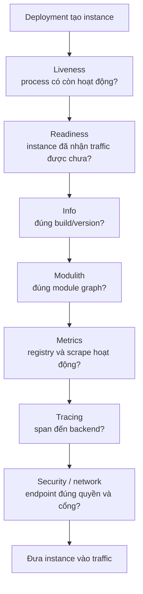

# Kiểm tra actuator sau deploy

> **Chương:** Actuator và vận hành  
> **Bối cảnh:** Spring Modulith công bố mô hình application module và cung cấp instrumentation để quan sát tương tác giữa module trong ứng dụng Spring Boot. Sau mỗi lần triển khai, đội vận hành cần xác nhận process đã khởi động, instance sẵn sàng nhận traffic, đúng build đang chạy, module graph như mong đợi và telemetry vẫn được xuất. Bài này xây dựng quy trình kiểm tra hậu triển khai bằng Spring Boot Actuator.

## Mục tiêu học tập

Sau bài này, bạn có thể:

1. Phân biệt health tổng thể, liveness và readiness khi kiểm tra instance sau deploy.
2. Xác nhận ứng dụng đã khởi động và đang nhận traffic bằng health groups đúng cổng.
3. Đọc endpoint info để xác định build/version đang chạy.
4. Kiểm tra endpoint modulith để xác nhận module graph của bản vừa triển khai.
5. Kiểm tra metrics, Prometheus scrape và trace export theo từng pipeline.
6. Xử lý các trạng thái 404, 401, 403, 503, dữ liệu thiếu hoặc telemetry đến trễ.
7. Xây dựng checklist rollout/canary có tiêu chí pass/fail rõ ràng và có thể lặp lại.

## 1. Mục đích của kiểm tra Actuator sau deploy

Một deployment thành công ở mức nền tảng chỉ cho biết container hoặc process đã được tạo. Điều đó chưa chứng minh ứng dụng đã sẵn sàng xử lý request hoặc Spring Modulith đang nhận diện đúng cấu trúc module.

Với ứng dụng modular monolith, kiểm tra sau deploy cần trả lời:

- Process đã khởi động và HTTP server đang hoạt động chưa?
- Instance có thể nhận traffic thật không?
- Build SHA/version đang chạy có đúng artifact vừa phát hành không?
- Spring Modulith có nhận diện đúng các module orders, payments, inventory và dependency không?
- Event metrics có tăng sau một thao tác thử không?
- Module entry spans có xuất hiện trên trace backend không?
- Management endpoint có được bảo vệ đúng chính sách không?

Spring Boot Actuator cung cấp endpoint để thu thập những tín hiệu này. Spring Modulith bổ sung endpoint modulith để công bố kiến trúc module. Các endpoint và hệ thống telemetry có vai trò riêng; một HTTP 200 từ health endpoint không chứng minh metrics, traces hoặc mọi luồng nghiệp vụ đều hoạt động.

## 2. Một lần deploy cần kiểm tra những lớp nào?

Quy trình nên đi từ khả năng sống của process đến khả năng xử lý traffic, sau đó xác nhận build, module model và telemetry.



Các bước có thể được tự động hóa trong deployment pipeline, Kubernetes probes hoặc smoke test. Tuy nhiên, cần hiểu tín hiệu nào đang được kiểm tra và giới hạn của nó.

| Lớp kiểm tra | Endpoint/tín hiệu | Điều cần xác nhận |
| --- | --- | --- |
| Liveness | /actuator/health/liveness | Process có ở trạng thái sống để tiếp tục chạy không? |
| Readiness | /actuator/health/readiness | Instance đã sẵn sàng nhận traffic chưa? |
| Build/release | /actuator/info | Đúng artifact, version, commit/build metadata? |
| Module architecture | /actuator/modulith | Module và dependency có đúng bản dự kiến? |
| Metrics | /actuator/metrics, /actuator/prometheus | Meter có được ghi nhận và scrape không? |
| Tracing | Trace backend / Collector | Request thử có trace và module spans không? |
| Access control | HTTP status, authentication, network policy | Chỉ đối tượng được phép mới đọc management endpoints? |

## 3. Chuẩn bị Actuator endpoint cần thiết

### 3.1. Dependency

Nếu cần cả module endpoint và observability của Spring Modulith:

```groovy
dependencies {
    runtimeOnly 'org.springframework.modulith:spring-modulith-starter-insight'
}
```

Insight starter tích hợp hỗ trợ Application Module Actuator, observability của Modulith và hạ tầng Spring Boot Actuator chung.

Nếu chỉ cần module endpoint:

```groovy
dependencies {
    runtimeOnly 'org.springframework.modulith:spring-modulith-actuator'
    runtimeOnly 'org.springframework.boot:spring-boot-starter-actuator'
}
```

Ví dụ giả định dependency management/BOM đã chọn các phiên bản Spring Modulith tương thích với Spring Boot. Nếu cần Prometheus scrape, bổ sung registry:

```groovy
dependencies {
    runtimeOnly 'io.micrometer:micrometer-registry-prometheus'
}
```

Muốn export trace, cần tracing bridge và exporter tương ứng với phiên bản Boot, ví dụ OpenTelemetry hoặc Brave. Có endpoint modulith không tự có nghĩa trace đã được gửi đến backend.

### 3.2. Expose đúng endpoint

Spring Boot mặc định chỉ expose health qua HTTP và JMX. Đưa các endpoint cần kiểm tra vào danh sách exposure:

```yaml
management:
  endpoints:
    web:
      exposure:
        include: health,info,modulith,metrics,prometheus
```

Danh sách trên là ví dụ cho môi trường nội bộ có yêu cầu kiểm tra các tín hiệu này. Chỉ expose prometheus nếu đã có registry Prometheus; chỉ expose modulith nếu Insight starter hoặc actuator module đã có mặt.

Không dùng include wildcard chỉ để tiện kiểm tra. Những endpoint như env, beans, configprops, heapdump hoặc loggers có thể tiết lộ thông tin nội bộ hoặc thay đổi trạng thái logging. Chỉ expose những gì monitoring/deployment thực sự cần.

### 3.3. Xác định URL thực tế

URL mặc định thường là:

```text
http://<host>:8080/actuator/<endpoint-id>
```

Nhưng URL thực tế còn phụ thuộc:

- management.server.port.
- management.server.address.
- management.endpoints.web.base-path.
- Servlet context path hoặc reverse proxy path.
- TLS, ingress và network policy.

Đừng hard-code cổng 8080 vào smoke test nếu ứng dụng dùng management port riêng.

## 4. Kiểm tra liveness và readiness

Hai probe này trả lời hai câu hỏi khác nhau.

### 4.1. Liveness: process có còn sống?

Endpoint:

```http
GET /actuator/health/liveness
```

Liveness giúp orchestrator quyết định instance có cần được restart hay không. Với Spring Boot, availability state được phản ánh qua LivenessStateHealthIndicator.

Một trạng thái liveness không tốt có thể khiến Kubernetes restart container. Vì vậy, **không nên đưa mọi dependency bên ngoài vào liveness**. Nếu database hoặc API bên ngoài tạm thời mất kết nối, restart tất cả instance có thể tạo thêm tải và gây cascading failure.

### 4.2. Readiness: instance đã nhận traffic được chưa?

Endpoint:

```http
GET /actuator/health/readiness
```

Readiness cho biết instance có nên được đưa vào danh sách nhận request hay không. Khi ứng dụng còn startup tasks, chưa hoàn tất initialization hoặc đang shutdown graceful, readiness có thể từ chối traffic.

Spring Boot không tự thêm mọi health indicator bên ngoài vào readiness group. Nếu muốn readiness kiểm tra một dependency, cần quyết định rõ dependency đó có thật sự bắt buộc để instance phục vụ request hay không.

Ví dụ:

- Một database riêng cho từng instance có thể cần kiểm tra readiness nếu không truy cập được thì instance không phục vụ được.
- Một dịch vụ notification có fallback hoặc circuit breaker có thể không nên làm readiness fail.
- Một database dùng chung cho mọi instance cần cân nhắc kỹ: nếu đưa vào readiness và database mất, toàn bộ instance có thể bị rút khỏi traffic.

### 4.3. Bật health probes ngoài Kubernetes

Trong môi trường không tự kích hoạt Kubernetes probes, có thể bật:

```yaml
management:
  endpoint:
    health:
      probes:
        enabled: true
```

Trong Kubernetes, Spring Boot có thể tự cấu hình liveness/readiness groups dựa trên môi trường. Kiểm tra cấu hình effective thay vì giả định chỉ cần property trên là đủ.

### 4.4. Trạng thái thường gặp

| Availability state | Ý nghĩa | Hành động vận hành |
| --- | --- | --- |
| LivenessState.CORRECT | Process được coi là sống | Không restart chỉ vì readiness chưa sẵn sàng |
| LivenessState.BROKEN | Process được coi là không còn hoạt động bình thường | Orchestrator có thể restart theo probe policy |
| ReadinessState.REFUSING_TRAFFIC | Instance chưa nhận traffic | Chờ startup/rollout hoặc kiểm tra lỗi readiness |
| ReadinessState.ACCEPTING_TRAFFIC | Instance có thể nhận traffic | Có thể đưa vào service endpoints nếu các kiểm tra khác đạt |

HTTP status thường ánh xạ DOWN và OUT_OF_SERVICE sang 503 Service Unavailable; UP thường trả 200. Tuy nhiên, cần đọc response body và status mapping thực tế của health group, không chỉ dựa vào một mã HTTP.

## 5. Kiểm tra health endpoint theo vòng đời deploy

### 5.1. Sau khi process bắt đầu

Gọi health tổng thể:

```bash
curl -i http://localhost:8080/actuator/health
```

Response minh họa:

```json
{
  "status": "UP"
}
```

UP cho biết tổng hợp các HealthContributor được cấu hình đang trả trạng thái tốt theo StatusAggregator. Nó không có nghĩa mọi chức năng nghiệp vụ đã được kiểm tra.

### 5.2. Kiểm tra liveness

```bash
curl -i http://localhost:8080/actuator/health/liveness
```

Kỳ vọng trong trạng thái hoạt động bình thường:

```json
{
  "status": "UP"
}
```

Nếu liveness chưa UP, đừng đưa instance vào traffic. Xem startup logs, application availability state và probe configuration.

### 5.3. Kiểm tra readiness

```bash
curl -i http://localhost:8080/actuator/health/readiness
```

Kỳ vọng trước khi nhận traffic:

```json
{
  "status": "UP"
}
```

Nếu readiness trả 503, instance có thể vẫn đang startup hoặc được đánh dấu REFUSING_TRAFFIC. Không ép load balancer gửi traffic chỉ vì process tồn tại.

### 5.4. Bật health details có kiểm soát

Để xem components/details:

```yaml
management:
  endpoint:
    health:
      show-details: when-authorized
      show-components: when-authorized
      roles: OPS
```

Các lựa chọn thường gặp:

| Giá trị | Hành vi |
| --- | --- |
| never | Không hiển thị details/components |
| when-authorized | Chỉ user có quyền phù hợp mới thấy chi tiết |
| always | Hiển thị cho mọi người có thể gọi endpoint |

Mặc định là never. Không bật always trên endpoint có thể truy cập từ mạng không tin cậy; health details có thể tiết lộ trạng thái database, disk, messaging hoặc thông tin hạ tầng.

## 6. Management port riêng và health check trên cổng ứng dụng

Một cấu hình thường gặp:

```yaml
server:
  port: 8080

management:
  server:
    port: 8081
  endpoints:
    web:
      exposure:
        include: health,info,modulith,metrics,prometheus
```

Khi đó:

- Business HTTP server lắng nghe trên 8080.
- Actuator server lắng nghe trên 8081.
- /actuator/health trên 8081 có thể trả UP dù business port 8080 không hoạt động đúng.

Hai server có thể dùng web infrastructure khác nhau, chẳng hạn connector, thread pool hoặc connection path. Vì vậy, health check chỉ gọi management port chưa chắc chứng minh main application port có thể nhận request.

### 6.1. Expose liveness/readiness path trên main port

Có thể cấu hình:

```yaml
management:
  endpoint:
    health:
      probes:
        add-additional-paths: true
```

Spring Boot có thể công bố thêm:

```text
GET http://localhost:8080/livez
GET http://localhost:8080/readyz
```

Các path này phục vụ kiểm tra trên main server port. Khi triển khai, cần xác nhận chúng thực sự được tạo và được ingress/proxy/orchestrator gọi đúng port.

### 6.2. Custom additional paths

Nếu cần đặt path cụ thể cho health group, có thể cấu hình additional-path:

```yaml
management:
  endpoint:
    health:
      group:
        liveness:
          additional-path: "server:/healthz"
        readiness:
          additional-path: "server:/ready"
```

Prefix server: chỉ main server port; management: chỉ management port. Đây là một path segment cho health group. Kiểm tra cú pháp theo Spring Boot version đang dùng.

## 7. Kiểm tra startup và shutdown trong rollout

### 7.1. Startup state

Trong lúc ứng dụng khởi động, trạng thái có thể chuyển qua:

| Giai đoạn | Liveness | Readiness | HTTP server |
| --- | --- | --- | --- |
| Starting | BROKEN | REFUSING_TRAFFIC | Chưa bắt đầu |
| Started | CORRECT | REFUSING_TRAFFIC | Chưa nhận traffic bình thường |
| Ready | CORRECT | ACCEPTING_TRAFFIC | Nhận request |

Readiness fail trong giai đoạn startup có thể là hành vi đúng. Orchestrator không nên đưa instance vào service endpoints trước khi startup tasks hoàn tất.

Nếu ứng dụng khởi động rất lâu, cân nhắc startupProbe trong Kubernetes để kubelet không áp dụng liveness failure threshold quá sớm trong khi ứng dụng vẫn đang startup hợp lệ.

### 7.2. Shutdown state

Khi shutdown graceful được kích hoạt:

- Readiness chuyển sang từ chối traffic mới.
- HTTP server có thể hoàn tất các request đang xử lý trong thời gian grace period.
- Context ứng dụng và exporter được đóng theo lifecycle.

Không đánh giá instance đang shutdown là lỗi liveness nếu nó đang rời khỏi traffic theo quy trình bình thường. Kiểm tra termination grace period, preStop hook và thời gian xử lý in-flight requests.

## 8. Kiểm tra info để xác nhận đúng build

Health UP không cho biết instance đang chạy đúng artifact nào. Sau deploy, cần xác nhận version/commit/build metadata.

Endpoint:

```http
GET /actuator/info
```

Có thể công bố build information bằng META-INF/build-info.properties. Với Gradle Spring Boot plugin:

```groovy
springBoot {
    buildInfo()
}
```

Một response minh họa:

```json
{
  "build": {
    "artifact": "shop-service",
    "name": "shop-service",
    "version": "1.8.0",
    "group": "com.example",
    "time": "2026-11-27T02:00:00Z"
  }
}
```

Các field thực tế phụ thuộc build plugin và cấu hình. Nếu muốn có commit metadata, có thể bật Git info contributor phù hợp và bảo đảm plugin tạo git.properties.

### 8.1. Gắn commit/build metadata

Một quy trình release nên công bố:

- Artifact/service name.
- Version hoặc release number.
- Build timestamp.
- Commit SHA hoặc source revision.
- Image tag/digest nếu nền tảng có thể bổ sung qua custom info contributor.

Không đưa secret, environment variables hoặc credential vào info endpoint. Đây là endpoint hiển thị thông tin release; chỉ công bố metadata đã được duyệt.

### 8.2. Xác minh từng replica

Khi deploy nhiều replica hoặc rolling update, đừng chỉ gọi một địa chỉ load balancer và kết luận toàn bộ cluster đã chạy version mới. Cần kiểm tra từng pod/instance qua management endpoint hoặc service discovery:

| Instance | Expected version | Actual info | Kết quả |
| --- | --- | --- | --- |
| shop-0 | 1.8.0 | 1.8.0 | PASS |
| shop-1 | 1.8.0 | 1.8.0 | PASS |
| shop-2 | 1.8.0 | 1.7.9 | FAIL: replica cũ |

Ví dụ bảng chỉ minh họa. Trong production, dùng instance identity và build metadata thực tế, không hard-code giá trị minh họa.

## 9. Kiểm tra module graph qua modulith endpoint

Sau khi xác nhận đúng build, kiểm tra mô hình module của chính instance đó:

```http
GET /actuator/modulith
```

Endpoint này cần:

- spring-modulith-starter-insight, hoặc
- spring-modulith-actuator cùng Spring Boot Actuator.

Đồng thời phải expose ID modulith qua HTTP/JMX phù hợp. Ví dụ:

```yaml
management:
  endpoints:
    web:
      exposure:
        include: health,info,modulith
```

### 9.1. Các trường cần kiểm tra

Response JSON có thể chứa:

| Trường | Kiểm tra sau deploy |
| --- | --- |
| moduleName | Các technical module ID có đủ và đúng không? |
| displayName | Tên hiển thị có theo metadata release không? |
| basePackage | Package gốc có đúng cấu trúc mong đợi không? |
| parent | Nested module có đúng parent không? |
| nested | Danh sách module con có đủ không? |
| dependencies[].target | Module đích có đúng không? |
| dependencies[].types | Loại quan hệ DEFAULT, USES_COMPONENT, EVENT_LISTENER có hợp lý không? |

Ví dụ rút gọn:

```json
{
  "orders": {
    "basePackage": "com.example.shop.orders",
    "displayName": "Đơn hàng",
    "dependencies": [
      {
        "target": "payments",
        "types": ["USES_COMPONENT"]
      }
    ]
  },
  "inventory": {
    "basePackage": "com.example.shop.inventory",
    "displayName": "Kho hàng",
    "dependencies": [
      {
        "target": "orders",
        "types": ["EVENT_LISTENER"]
      }
    ]
  }
}
```

JSON trên là ví dụ minh họa. Module ID và dependency thật được xác định từ source, package structure và metadata của ứng dụng.

### 9.2. So sánh với snapshot trước deploy

Nên lưu JSON module graph theo build version để phát hiện thay đổi:

1. Lấy snapshot ở bản release hiện tại.
2. Lấy snapshot từ instance vừa deploy.
3. Chuẩn hóa thứ tự key/list nếu công cụ so sánh yêu cầu.
4. Diff module ID, package, parent/nested và dependency types.
5. Review các cạnh dependency mới hoặc mất đi.

Ví dụ:

```diff
 "orders": {
   "dependencies": [
     {
       "target": "payments",
       "types": ["USES_COMPONENT"]
     },
+    {
+      "target": "inventory",
+      "types": ["USES_COMPONENT"]
+    }
   ]
 }
```

Thay đổi này cho biết mô hình runtime mới công bố dependency trực tiếp orders → inventory. Nó không tự chứng minh có vi phạm kiến trúc; đối chiếu với yêu cầu thiết kế và architecture tests trong CI.

### 9.3. Actuator không thay thế architecture tests

Endpoint modulith cung cấp mô hình module của bản đang chạy. Nó không tự chạy ApplicationModules.verify() sau mỗi request.

Trong build pipeline, vẫn cần kiểm tra:

```java
@Test
void verifiesApplicationModules() {
    ApplicationModules.of(ShopApplication.class).verify();
}
```

Architecture tests phát hiện dependency vi phạm trước release; endpoint sau deploy xác nhận mô hình được công bố bởi artifact đang chạy. Hai tín hiệu bổ sung cho nhau.

## 10. Kiểm tra metrics sau deploy

Metrics giúp xác nhận registry đang ghi nhận hoạt động tổng hợp, không phụ thuộc việc trace có được sample hay không.

### 10.1. Liệt kê meter

```http
GET /actuator/metrics
```

Tìm các meter liên quan:

- module.events.published.
- module.events.published.<moduleIdentifier>.<simpleEventTypeName>.
- HTTP server request metrics.
- JVM, process và datasource metrics nếu registry có cấu hình.

Để xem meter cụ thể:

```http
GET /actuator/metrics/module.events.published
```

Response có measurements và availableTags. Dùng giá trị tag thực tế để lọc:

```http
GET /actuator/metrics/module.events.published?tag=module.identifier:orders
```

Không giả định tag value trước khi xem availableTags. Counter có thể chưa tồn tại nếu event tương ứng chưa được publish hoặc meter instrumentation chưa hoạt động.

### 10.2. Thực hiện một smoke action có kiểm soát

Sau deploy, chọn một request hoặc test flow không gây side effect ngoài ý muốn:

1. Gọi một endpoint test/sandbox tạo event đã biết.
2. Ghi lại thời điểm và business correlation ID an toàn.
3. Đọc counter trước và sau thao tác.
4. Kiểm tra listener/side effect qua log hoặc dữ liệu nghiệp vụ.

Counter module.events.published tăng chứng minh event được ghi nhận là đã publish; nó không chứng minh listener đã xử lý thành công hoặc transaction đã commit.

Không cộng counter tổng và counter riêng theo event như hai hành động khác nhau: một lượt publish có thể được phản ánh ở cả hai meter.

### 10.3. Kiểm tra Prometheus scrape

Nếu dùng Prometheus registry:

```http
GET /actuator/prometheus
```

Prometheus cần scrape đúng:

- Host/target của instance.
- Port và path.
- TLS/authentication.
- Network policy và service discovery.

Một response HTTP 200 từ prometheus endpoint chưa chứng minh Prometheus đã scrape thành công. Mở trang Targets của Prometheus hoặc kiểm tra up và scrape_samples_scraped để xác nhận phía scraper.

Tên meter/tag có thể được chuẩn hóa theo naming convention của Prometheus. Dùng đúng tên thực tế từ endpoint, không đoán label bằng cách thay dấu chấm thủ công.

## 11. Kiểm tra tracing và module spans

Metrics và tracing là hai pipeline riêng. Một trace smoke test cần tạo request thực sự đi qua module boundary đã được instrument.

### 11.1. Xác nhận tracing pipeline

Kiểm tra:

1. Tracing bridge/tracer được khởi tạo.
2. Exporter endpoint và transport đúng (OTLP HTTP/gRPC hoặc Zipkin).
3. Collector/backend đang nhận telemetry.
4. Sampling probability/parent-based sampler đúng môi trường.
5. Queue/exporter không có lỗi hoặc drop.

Một request có thể được xử lý thành công nhưng trace không xuất hiện vì sampling. Nếu xác suất sample là 0.1, không phải mọi request đều có trace.

### 11.2. Gửi một request thử

Chọn một API test đi qua orders và payments, hoặc một event listener trong môi trường an toàn. Sau đó tìm trace theo service, thời gian và trace ID (nếu log có ghi).

Kiểm tra module span có các tag như:

```text
module.identifier
module.name
module.invocation-type
module.method
```

Các tag cụ thể phụ thuộc phiên bản và instrumentation. Dùng traceId, spanId, parentSpanId để xác nhận cây span; không chỉ dựa vào vị trí các dòng trên trace UI.

### 11.3. Kiểm tra listener bất đồng bộ

Nếu flow có @ApplicationModuleListener hoặc @Async:

- Xác nhận listener thực sự chạy bằng log/publication registry.
- Kiểm tra executor và context propagation.
- Chấp nhận trường hợp listener có trace riêng nếu context không được truyền.
- Phân biệt trace context với transaction context; listener sau commit thường chạy trong transaction riêng.

Không thấy listener span không đồng nghĩa event không được nhận. Có thể listener không được instrument, span bị sampling, context bị tách hoặc exporter không gửi được.

## 12. Bảo mật và phạm vi truy cập management endpoints

Actuator endpoints có thể tiết lộ build, package/module graph, metrics và tình trạng hạ tầng. Cần giới hạn cả exposure lẫn network/security access.

Ví dụ expose một tập endpoint tối thiểu:

```yaml
management:
  endpoints:
    web:
      exposure:
        include: health,info,modulith,metrics,prometheus
```

Các nguyên tắc:

- Health probe có thể cần truy cập không xác thực từ kubelet trong mạng cluster, nhưng không đồng nghĩa mọi endpoint khác phải public.
- info, modulith, metrics và prometheus nên nằm trong management network hoặc yêu cầu authentication phù hợp.
- Health details nên để never hoặc when-authorized nếu có thông tin hạ tầng.
- Dùng TLS/authentication khi endpoint đi qua mạng.
- Không truyền secrets trong URL hoặc log.
- Nếu có custom SecurityFilterChain, kiểm tra matcher và thứ tự chain để endpoint health/probes vẫn hoạt động theo policy.

### 12.1. Phân biệt endpoint available và exposed

Một endpoint chỉ truy cập được khi nó:

1. Được phép truy cập theo endpoint access policy.
2. Được expose qua HTTP/JMX.
3. Có dependency/auto-configuration để endpoint tồn tại.
4. Được security/network policy cho phép.

Do đó, HTTP 404, 401 và 403 có nguyên nhân khác nhau; không xử lý tất cả bằng cách expose wildcard.

## 13. Quy trình hậu deploy theo từng giai đoạn

### Giai đoạn A — Instance mới được tạo

1. Xác nhận pod/container/process đã chạy.
2. Kiểm tra startup logs không có lỗi cấu hình hoặc bean initialization.
3. Chờ liveness chuyển sang UP.
4. Chờ readiness chuyển sang UP trước khi đưa instance vào traffic.
5. Nếu readiness không lên, xem health group details theo quyền và application availability state.

### Giai đoạn B — Xác nhận artifact

1. Gọi info endpoint trên từng instance.
2. So version/build/commit với release vừa triển khai.
3. Kiểm tra không còn replica cũ ngoài kế hoạch.
4. Nếu instance không đúng build, dừng rollout hoặc loại instance khỏi traffic theo quy trình.

### Giai đoạn C — Xác nhận kiến trúc module

1. Gọi modulith endpoint.
2. Kiểm tra technical module IDs và basePackage.
3. Kiểm tra parent/nested nếu có.
4. Diff dependencies[].target và dependencies[].types với snapshot release.
5. Đối chiếu thay đổi với architecture tests và review đã duyệt.

### Giai đoạn D — Xác nhận metrics

1. Gọi metrics endpoint.
2. Kiểm tra meter mong đợi có được đăng ký không.
3. Thực hiện một smoke action an toàn.
4. Xác nhận counter/timer thay đổi theo mong đợi.
5. Kiểm tra Prometheus target đang UP và scrape samples không bằng 0 khi có dữ liệu.

### Giai đoạn E — Xác nhận traces

1. Tạo một request thử qua module boundary.
2. Kiểm tra sampling và trace context.
3. Tìm trace trên backend sau thời gian export/ingestion phù hợp.
4. Kiểm tra module entry span và parent-child IDs.
5. Nếu có async listener, xác nhận propagation và kết quả nghiệp vụ.

### Giai đoạn F — Mở traffic và theo dõi canary

1. Chỉ đưa instance vào traffic khi readiness đạt và build đúng.
2. Theo dõi error rate, latency, restart count và saturation.
3. So sánh metrics của bản mới với baseline.
4. Kiểm tra module graph có thay đổi bất thường không.
5. Quan sát trace/error sample và exporter/Collector health.
6. Tiếp tục rollout hoặc rollback theo ngưỡng đã định nghĩa trước.

## 14. Ví dụ lệnh smoke test

Các lệnh dưới đây dùng curl và URL local mặc định. Trong production, thay host/port/path bằng management endpoint thực tế và bổ sung authentication/TLS theo môi trường.

### 14.1. Kiểm tra status nhanh

```bash
curl -fsS -o /dev/null -w "liveness=%{http_code}\n" \
  http://localhost:8080/actuator/health/liveness

curl -fsS -o /dev/null -w "readiness=%{http_code}\n" \
  http://localhost:8080/actuator/health/readiness
```

Kỳ vọng cả hai trả 200 khi instance đã hoạt động bình thường. Nếu startup chưa hoàn tất, readiness có thể trả 503 và đó có thể là trạng thái đúng.

### 14.2. Kiểm tra build và module graph

```bash
curl -fsS http://localhost:8080/actuator/info
curl -fsS http://localhost:8080/actuator/modulith
```

So build version/commit và các module IDs với release manifest/snapshot đã duyệt.

### 14.3. Kiểm tra meter

```bash
curl -fsS http://localhost:8080/actuator/metrics
curl -fsSG \
  --data-urlencode 'tag=module.identifier:orders' \
  http://localhost:8080/actuator/metrics/module.events.published
```

Lệnh lọc chỉ hoạt động nếu meter có tag module.identifier với giá trị orders. Xem availableTags trước nếu query không khớp.

### 14.4. Kiểm tra Prometheus endpoint

```bash
curl -fsS http://localhost:8080/actuator/prometheus
```

Xác nhận output có meter cần scrape. Sau đó xác nhận target từ phía Prometheus; hai việc này kiểm tra hai đầu khác nhau.

### 14.5. Xử lý credentials

Nếu management endpoint yêu cầu Basic authentication trong môi trường test:

```bash
curl -u "$ACTUATOR_USER:$ACTUATOR_PASSWORD" \
  -fsS http://localhost:8080/actuator/health/readiness
```

Trong pipeline thật, inject credentials từ secret store/CI secret. Không ghi password vào script được commit, command history hoặc log job.

## 15. Bảng chẩn đoán sau deploy

| Triệu chứng | Nguyên nhân có thể | Hướng xử lý |
| --- | --- | --- |
| Liveness 503 | Application availability state đang BROKEN, startup chưa ổn định hoặc health indicator cấu hình sai | Xem startup logs, liveness contributors và probe threshold |
| Liveness 200, readiness 503 | Instance còn sống nhưng chưa sẵn sàng nhận traffic | Chờ startup tasks; kiểm tra readiness contributors và rollout timing |
| Readiness 200 nhưng request business lỗi | Probe không đi qua cùng cổng/web infrastructure hoặc readiness không kiểm tra dependency cần thiết | Kiểm tra main port, additional path và business smoke test |
| Management health 200, main port không nhận request | Management server tách port và health check chỉ xác nhận management context | Expose health additional path trên server port hoặc probe main endpoint |
| info thiếu build metadata | Chưa tạo build-info.properties hoặc info contributor chưa bật | Cấu hình build plugin và kiểm tra artifact contents |
| Một replica chạy version cũ | Rolling update chưa hoàn tất, service discovery còn pod cũ | Đối chiếu từng instance và rollout status |
| modulith trả 404 | Thiếu dependency, chưa expose endpoint, sai base path/port | Kiểm tra starter/actuator, include, Actuator root links |
| Module graph thiếu module | Package discovery/metadata hoặc production customization không đúng | Kiểm tra module package và custom detection trong production sources |
| Dependency graph khác snapshot | Source/package/module metadata thay đổi hoặc artifact sai | Diff JSON, xác nhận release manifest và architecture tests |
| metrics không có meter | Meter chưa được tạo, chưa có thao tác tương ứng hoặc registry/instrumentation thiếu | Gọi smoke action và xem registry/available meter |
| prometheus trả 404 | Thiếu Prometheus registry hoặc chưa expose prometheus | Thêm micrometer-registry-prometheus, expose endpoint |
| Prometheus target DOWN nhưng endpoint curl được | Prometheus không route được, auth/TLS/path/port sai | Kiểm tra scrape config, service discovery và network policy |
| Counter event tăng nhưng listener không hoàn tất | Publish metric không đo consumer success | Kiểm tra listener logs, publication registry và trạng thái nghiệp vụ |
| Trace không xuất hiện | Sampling, instrumentation, propagation, exporter hoặc backend | Kiểm tra từng lớp; không chỉ tăng probability |
| Trace có HTTP span nhưng thiếu module span | Điểm gọi không được instrument hoặc span bị filter/drop | Kiểm tra Spring bean/proxy, module API và trace pipeline |
| HTTP 401 | Thiếu hoặc sai authentication | Kiểm tra credential và auth mechanism |
| HTTP 403 | Đã xác thực nhưng thiếu role/authority hoặc access policy chặn | Kiểm tra SecurityFilterChain và endpoint access |
| HTTP 404 | Endpoint không tồn tại, không available hoặc sai URL | Kiểm tra dependency, exposure, base path và port |
| Health details không hiển thị | show-details=never hoặc user chưa được authorize | Đây có thể là hành vi bảo mật đúng; dùng quyền vận hành phù hợp |

## 16. Tiêu chí pass/fail cho một rollout

Nên ghi tiêu chí trước khi triển khai để tránh quyết định theo cảm tính:

| Hạng mục | PASS khi | FAIL khi |
| --- | --- | --- |
| Process | Container/process ổn định, không crash loop | Restart liên tục hoặc startup thất bại |
| Liveness | Health group trả trạng thái tốt | BROKEN hoặc probe liên tục fail |
| Readiness | Instance chấp nhận traffic sau startup | Vẫn từ chối traffic quá thời gian dự kiến |
| Build identity | Mọi replica được phép nhận traffic chạy đúng release | Có replica sai version/commit |
| Module model | Module IDs/dependencies khớp snapshot hoặc diff đã duyệt | Có module/dependency thay đổi ngoài kế hoạch |
| Metrics | Registry có meter mong đợi; scraper nhận sample | Không có meter/scrape target lỗi sau khi đã tạo hoạt động thử |
| Tracing | Trace smoke test được tìm thấy theo sampling policy | Trace mất ngoài tỷ lệ/điều kiện dự kiến và exporter/backend báo lỗi |
| Security | Management endpoint chỉ truy cập được từ principal/network được phép | Endpoint nội bộ bị public hoặc health details lộ dữ liệu |
| Runtime | Error rate, latency, saturation trong ngưỡng đã thống nhất | Vượt ngưỡng canary/rollback |

Một số hạng mục cần điều kiện kiểm thử rõ ràng. Ví dụ metrics không tăng nếu chưa có event tương ứng; tracing không xuất hiện có thể là hành vi đúng nếu sampling đã drop trace. Đừng đánh FAIL chỉ vì không có dữ liệu khi chưa tạo hoạt động hoặc chưa tính sampling.

## 17. Bài tập tự kiểm tra

**Câu 1.** Instance có liveness UP nhưng readiness REFUSING_TRAFFIC. Có nên đưa instance vào load balancer không? Vì sao?

**Câu 2.** Management server chạy ở port 8081, business server chạy ở 8080. Health trên 8081 trả UP nhưng request ở 8080 lỗi. Cần bổ sung kiểm tra nào?

**Câu 3.** info endpoint trả version cũ trên một replica trong rolling update. Có thể kết luận rollout hoàn tất không?

**Câu 4.** modulith endpoint cho biết inventory → orders với EVENT_LISTENER. Điều này có chứng minh listener đã chạy trong request vừa rồi không?

**Câu 5.** Event counter tăng nhưng trace không có. Nêu các khả năng cần kiểm tra.

**Câu 6.** prometheus endpoint trả HTTP 200. Có đủ chứng minh Prometheus đã scrape thành công không?

**Câu 7.** Vì sao không nên đưa database health indicator vào liveness group một cách mặc định?

**Câu 8.** modulith endpoint trả 403. Cần phân biệt điều gì trước khi thay đổi exposure?

### Gợi ý đáp án

1. Chưa. Liveness chỉ nói process còn sống; readiness đang từ chối traffic nên cần chờ startup hoặc xử lý lý do readiness fail.
2. Kiểm tra liveness/readiness additional path trên main server port (/livez, /readyz) hoặc gọi business smoke endpoint trên 8080; management port riêng có web infrastructure khác.
3. Không. Cần kiểm tra tất cả replica và trạng thái rollout; một instance vẫn chạy artifact cũ.
4. Không. Module graph là dependency tĩnh; listener runtime cần được xác nhận bằng log, trace, publication registry hoặc kết quả nghiệp vụ.
5. Trace bị sampling, module span không được instrument, context propagation bị đứt, exporter/Collector/backend lỗi hoặc query sai.
6. Không. Nó chỉ chứng minh endpoint có thể trả dữ liệu; phải xác nhận target ở phía Prometheus và sample được scrape.
7. Vì database bên ngoài có thể lỗi trong khi process vẫn sống; restart hàng loạt instance có thể tạo cascading failure.
8. 403 thường là đã qua xác thực nhưng thiếu quyền/access policy; exposure, security và endpoint availability là các lớp riêng.

## 18. Checklist sau deploy

- [ ] Instance/process đã khởi động và startup logs không có lỗi nghiêm trọng.
- [ ] Liveness đạt trạng thái tốt.
- [ ] Readiness đạt trạng thái ACCEPTING_TRAFFIC trước khi nhận traffic.
- [ ] Nếu dùng management port riêng, health probe cũng kiểm tra main server port.
- [ ] info endpoint phản ánh đúng version/build/commit.
- [ ] Mỗi replica đang nhận traffic chạy đúng artifact.
- [ ] modulith endpoint trả về module graph đúng với release snapshot.
- [ ] Dependency types DEFAULT, USES_COMPONENT, EVENT_LISTENER được review khi có thay đổi.
- [ ] metrics endpoint có meter mong đợi sau smoke action.
- [ ] Prometheus target UP và scrape samples được ghi nhận.
- [ ] Trace smoke test được kiểm tra theo sampling policy và exporter status.
- [ ] Async listener/context propagation được kiểm tra nếu flow có bất đồng bộ.
- [ ] Management endpoints không expose quá mức và được bảo vệ bằng network/authentication.
- [ ] Canary metrics/error rate/latency nằm trong ngưỡng cho phép.
- [ ] Có quyết định tiếp tục rollout hoặc rollback dựa trên tiêu chí đã định trước.

## 19. Ghi nhớ

Kiểm tra Actuator sau deploy cần đi theo thứ tự: **liveness → readiness → build identity → module graph → metrics → traces → security và runtime behavior**. Liveness cho biết process có còn sống; readiness cho biết instance có thể nhận traffic; info endpoint xác nhận build; modulith endpoint xác nhận mô hình module của artifact đang chạy.

Metrics và traces là hai pipeline khác nhau: event counter tăng không chứng minh listener hoàn tất, còn trace vắng mặt có thể do sampling hoặc export. Nếu management port tách khỏi business port, health trên management port chưa đủ chứng minh main application nhận request được. Kết hợp health probes, build metadata, module graph, telemetry và smoke test nghiệp vụ để đưa ra quyết định rollout có căn cứ.

### Tài liệu tham khảo

- [Spring Boot 3.5 — Actuator Endpoints](https://docs.spring.io/spring-boot/3.5/reference/actuator/endpoints.html): health groups, liveness/readiness, management port, endpoint exposure và security.
- [Spring Boot — Actuator Endpoints](https://docs.spring.io/spring-boot/reference/actuator/endpoints.html): endpoint availability, health, info, metrics và Prometheus.
- [Spring Boot — Production-ready Features](https://docs.spring.io/spring-boot/reference/actuator/index.html): các khả năng vận hành production của Actuator.
- [Spring Modulith — Production-ready Features](https://docs.spring.io/spring-modulith/reference/production-ready.html): Insight starter, Application Module Actuator, module spans và event metrics.
- [Spring Boot — Build Information](https://docs.spring.io/spring-boot/reference/actuator/endpoints.html): build info contributor và META-INF/build-info.properties.
- [Kubernetes — Liveness, Readiness and Startup Probes](https://kubernetes.io/docs/concepts/configuration/liveness-readiness-startup-probes/): probe lifecycle, startupProbe và hành vi khi restart/stop.
