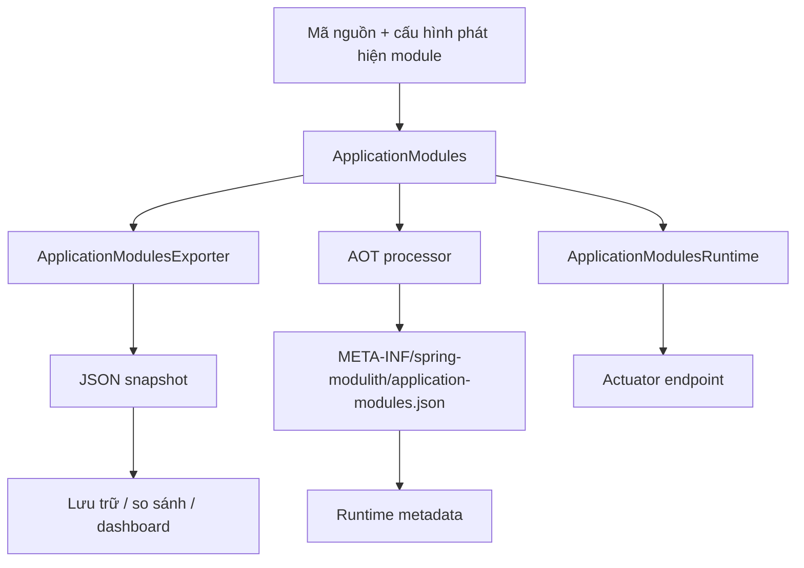
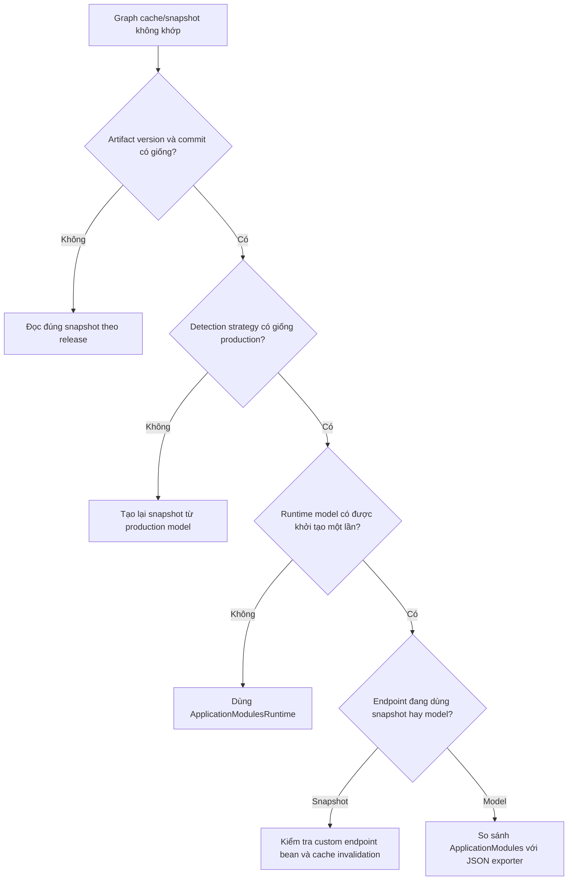

# Cache hoặc snapshot graph khi cần

## 1. Bài toán: không phải request nào cũng cần phân tích lại module graph

Spring Modulith có thể xuất cấu trúc application module qua Actuator endpoint `/actuator/modulith`. Graph này mô tả các module được phát hiện, package gốc và dependency giữa chúng. Trong một ứng dụng Spring Boot, cấu trúc đó chủ yếu được suy ra từ mã nguồn, annotation và cấu hình phát hiện module.

Giả sử `shop-service` có các module `order`, `payment`, `inventory` và `notification`. Nhóm kiến trúc muốn hiển thị module graph trên trang vận hành; hệ thống giám sát có thể đọc graph nhiều lần; một pipeline triển khai muốn lưu lại snapshot để so sánh giữa các phiên bản.

Nếu mỗi lần đọc lại quét classpath và dựng mô hình từ đầu, thao tác có thể tốn thời gian và tài nguyên hơn cần thiết. Nhưng nếu cache không có quy tắc hết hạn hoặc snapshot không gắn với phiên bản artifact, người xem có thể đọc nhầm graph cũ sau khi code đã thay đổi.

Bài **“Cache hoặc snapshot graph khi cần”** thuộc chương **Actuator và vận hành** của **SPRING_MODULITH_DOCUMENTATION_OBSERVABILITY**. Module này hướng dẫn dùng Spring Modulith tạo tài liệu ranh giới application module và quan sát tương tác giữa các phần trong Spring Boot qua module graph, Actuator, event metrics, tracing và context propagation.

Sau bài học, bạn có thể:

1. Hiểu khi nào nên dùng mô hình module được khởi tạo và giữ trong runtime.
2. Phân biệt cache đối tượng `ApplicationModules` với snapshot JSON của graph.
3. Biết Spring Modulith cung cấp sẵn `ApplicationModulesRuntime` và `ApplicationModulesEndpoint.precomputed(...)`.
4. Xuất graph bằng `ApplicationModulesExporter` để lưu snapshot hoặc so sánh phiên bản.
5. Hiểu vai trò của AOT metadata `META-INF/spring-modulith/application-modules.json`.
6. Thiết kế cache key, thời điểm tạo snapshot và quy tắc làm mới mà không hiển thị graph lỗi thời.

## 2. Module graph được tạo từ đâu?

Spring Modulith xây dựng `ApplicationModules` từ cấu trúc package, kiểu Java, annotation module và các quy tắc phát hiện module. Ví dụ:

```text
com.example.shop
├── ShopApplication.java
├── order/
│   └── OrderService.java
├── payment/
│   └── PaymentService.java
├── inventory/
│   └── InventoryService.java
└── notification/
    └── NotificationService.java
```

Với cấu trúc và quy tắc phát hiện mặc định, Spring Modulith phân tích các package module và dependency tĩnh giữa chúng. Mô hình có thể được tạo bằng:

```java
ApplicationModules modules = ApplicationModules.of(ShopApplication.class);
```

Graph phản ánh **cấu trúc được phân tích từ code**, không phải thống kê hành vi thực tế. Nó không tự thay đổi chỉ vì một request vừa gọi module `payment` hoặc một event vừa được publish.

Các thay đổi có thể làm graph khác đi:

- Thêm, xóa hoặc chuyển package/class sang module khác.
- Thay đổi `@ApplicationModule`, named interface hoặc allowed dependencies.
- Thay đổi chiến lược phát hiện module hay các package bổ sung.
- Thêm nguồn module thông qua cơ chế mở rộng phù hợp.
- Thay đổi mã nguồn hoặc dependency làm phát sinh dependency mới giữa module.

Vì vậy, graph phù hợp với **cache theo vòng đời ứng dụng/artifact**. Nó ít phù hợp với cache TTL ngắn như dữ liệu giá hoặc số dư tài khoản, bởi bản thân cấu trúc module không được thiết kế để thay đổi liên tục trong lúc một process đang chạy.

## 3. Phân biệt ba lớp: runtime cache, JSON snapshot và AOT metadata

Ba cơ chế dưới đây có mục đích liên quan nhưng không giống nhau:

| Cơ chế | Dữ liệu được giữ | Thời điểm | Dùng khi nào? |
| --- | --- | --- | --- |
| `ApplicationModulesRuntime` | Đối tượng mô hình `ApplicationModules` | Trong runtime của ứng dụng | Dùng chung mô hình module thay vì khởi tạo lặp lại |
| JSON snapshot | Nội dung graph đã xuất thành chuỗi JSON | Khi startup, build hoặc theo quy trình triển khai | Phục vụ dashboard, so sánh phiên bản, lưu hồ sơ kiến trúc |
| AOT metadata | Metadata module được sinh trong bước xử lý AOT | Build/AOT | Hỗ trợ runtime và initializer theo metadata đã tạo |



**Không nên gọi cả ba là một cache.** Runtime object cache giảm việc khởi tạo mô hình trong process; JSON snapshot giữ một biểu diễn bất biến của graph; AOT metadata là tài nguyên được tạo trong quá trình build ahead-of-time.

## 4. Dùng ApplicationModulesRuntime mặc định

Spring Modulith có runtime support với `ApplicationModulesRuntime`. API này triển khai `Supplier<ApplicationModules>` và bảo đảm việc khởi tạo một instance `ApplicationModules` chỉ diễn ra một lần cho mỗi application class trong runtime support.

Khi dùng dependency Actuator hoặc Insight starter, runtime support được kéo vào theo dependency tương ứng. Không cần tự tạo một `ApplicationModules.of(...)` mới mỗi lần endpoint được gọi.

Dependency Gradle mẫu với Spring Modulith 2.2.x:

```groovy
dependencies {
    // Chỉ cần module graph qua Actuator:
    runtimeOnly "org.springframework.boot:spring-boot-starter-actuator"
    runtimeOnly "org.springframework.modulith:spring-modulith-actuator"

    // Hoặc dùng Insight nếu cần cả module observability:
    // runtimeOnly "org.springframework.modulith:spring-modulith-starter-insight"
}
```

Ví dụ trên giả định BOM Spring Modulith và Spring Boot đã được quản lý tương thích trong dự án. Chọn một phương án dependency phù hợp; Insight starter đã bao gồm hỗ trợ Actuator và observability, nên không cần khai báo lại chỉ để có cùng endpoint.

### 4.1. Endpoint dùng runtime model

Actuator endpoint có ID `modulith` và đường dẫn HTTP mặc định `/actuator/modulith`. Auto-configuration của Spring Modulith tạo `ApplicationModulesEndpoint` dựa trên runtime support. Factory `ApplicationModulesEndpoint.ofApplicationModules(Supplier<ApplicationModules>)` cũng cho phép cung cấp mô hình được khởi tạo lazy.

Với cấu hình mặc định:

```yaml
management:
  endpoints:
    web:
      exposure:
        include: "health,modulith"
```

Đọc graph:

```http
GET http://localhost:8080/actuator/modulith
```

Lợi ích của runtime model cache:

- Cùng một process có thể dùng lại mô hình module đã khởi tạo.
- Endpoint và các thành phần runtime khác có thể chia sẻ nguồn mô hình.
- Không cần tạo một bộ quét classpath mới cho mỗi request.
- Vòng đời cache gắn với vòng đời application context/process, dễ hiểu khi deploy.

Đây là hành vi cache theo runtime của Spring Modulith; **không đồng nghĩa** JSON HTTP response được cache ở reverse proxy, browser hoặc CDN. Nếu cần cache response ở tầng HTTP, hãy cấu hình riêng và xem xét quyền truy cập, version và header cache.

## 5. Khi nào nên tạo JSON snapshot?

Snapshot là bản chụp graph tại một thời điểm. Thay vì phân tích object model khi cần đọc ở một hệ thống khác, ta xuất JSON và lưu cùng thông tin phiên bản.

Các tình huống phù hợp:

1. Dashboard kiến trúc muốn hiển thị graph của release hiện tại.
2. Pipeline triển khai muốn lưu graph để so sánh trước/sau khi phát hành.
3. Nhóm kiểm toán cần lưu hồ sơ cấu trúc module theo artifact đã phát hành.
4. Một công cụ bên ngoài chỉ cần JSON, không cần chạy Spring Modulith trong process của nó.
5. Endpoint được đọc rất thường xuyên và muốn trả về một nội dung JSON đã chuẩn bị trước.

Snapshot không phù hợp nếu mục tiêu là quan sát lời gọi module vừa diễn ra. Với câu hỏi runtime như “module nào đang được gọi nhiều?”, hãy dùng tracing/metrics. Module graph là cấu trúc tĩnh, còn trace và metrics phản ánh hoạt động.

### 5.1. Xuất JSON bằng ApplicationModulesExporter

Spring Modulith cung cấp `ApplicationModulesExporter` để xuất mô hình module thành JSON:

```java
import org.springframework.modulith.core.ApplicationModules;
import org.springframework.modulith.core.util.ApplicationModulesExporter;

ApplicationModules modules = ApplicationModules.of(ShopApplication.class);

String graphJson = new ApplicationModulesExporter(modules).toJson();
String fullGraphJson = new ApplicationModulesExporter(modules).toFullJson();
```

- `toJson()` xuất cấu trúc application module.
- `toFullJson()` xuất thêm chi tiết đầy đủ hơn, chẳng hạn named interfaces.

Chọn dạng JSON theo người tiêu thụ. Dashboard đơn giản thường chỉ cần graph cơ bản; công cụ kiến trúc cần chi tiết named interface có thể dùng full JSON.

Nếu snapshot được lưu ở artifact hoặc object storage, nên đặt cạnh metadata:

```json
{
  "application": "shop-service",
  "artifactVersion": "1.8.0",
  "gitCommit": "7ac91e2",
  "generatedAt": "2026-11-27T02:30:00Z",
  "springModulithVersion": "2.2.0",
  "graph": {
    "order": {
      "displayName": "Order Management",
      "basePackage": "com.example.shop.order",
      "dependencies": [
        {
          "target": "inventory",
          "types": ["USES_COMPONENT"]
        }
      ]
    }
  }
}
```

Đây là **envelope minh họa cho hệ thống lưu trữ snapshot riêng**, không phải JSON response nguyên bản của `/actuator/modulith`. Không bọc thêm trường `application` hoặc `generatedAt` vào response Actuator nếu client đang mong đợi schema Modulith chuẩn.

### 5.2. Không ghi snapshot thiếu dấu phiên bản

Hai snapshot có thể cùng tên file nhưng thuộc hai build khác nhau. Hãy lưu metadata phiên bản để biết snapshot nào đang được phục vụ:

| Metadata | Mục đích |
| --- | --- |
| Application/service name | Xác định ứng dụng |
| Artifact version | Phân biệt release |
| Git commit/build ID | Truy về source code |
| Thời điểm tạo | Xác định snapshot cũ hay mới |
| Spring Modulith version | Giải thích khác biệt schema/API |
| Hash JSON | Phát hiện nội dung graph thay đổi |

Không dùng timestamp làm cache key duy nhất nếu hệ thống cần truy xuất đúng snapshot của release. Ưu tiên artifact version hoặc commit ID kết hợp service name và môi trường.

## 6. Dùng snapshot đã tính trước cho Actuator endpoint

Spring Modulith cung cấp factory `ApplicationModulesEndpoint.precomputed(Supplier<String>)` từ phiên bản 1.1. Factory này tạo endpoint từ nội dung Actuator đã được tính trước. Auto-configuration endpoint sử dụng `@ConditionalOnMissingBean`, vì vậy ứng dụng có thể cung cấp bean endpoint tùy chỉnh nếu thật sự cần thay hành vi mặc định.

Ví dụ cho một ứng dụng muốn chuẩn bị JSON một lần khi Spring context khởi tạo:

```java
package com.example.shop.config;

import org.springframework.context.annotation.Bean;
import org.springframework.context.annotation.Configuration;
import org.springframework.modulith.actuator.ApplicationModulesEndpoint;
import org.springframework.modulith.core.util.ApplicationModulesExporter;
import org.springframework.modulith.runtime.ApplicationModulesRuntime;

@Configuration(proxyBeanMethods = false)
class ModulithSnapshotConfiguration {

    @Bean
    ApplicationModulesEndpoint applicationModulesEndpoint(
            ApplicationModulesRuntime runtime) {

        String snapshot =
            new ApplicationModulesExporter(runtime.get()).toJson();

        return ApplicationModulesEndpoint.precomputed(() -> snapshot);
    }
}
```

Luồng hoạt động:

1. Spring khởi tạo bean endpoint.
2. `ApplicationModulesRuntime` cung cấp mô hình module runtime đã được khởi tạo.
3. `ApplicationModulesExporter.toJson()` tạo chuỗi JSON một lần.
4. Supplier của `precomputed(...)` trả lại cùng chuỗi snapshot cho các lần đọc endpoint.

Với cách này, mỗi lần gọi endpoint không cần tạo lại JSON từ object graph. Tuy nhiên, lợi ích hiệu năng phụ thuộc kích thước graph và tần suất truy cập; với ứng dụng nhỏ, endpoint mặc định đã có runtime model được tái sử dụng nên chưa chắc cần tùy biến.

**Lưu ý quan trọng:** bean trên thay thế endpoint auto-configured. Chỉ dùng khi có lý do rõ ràng và kiểm thử schema response trên đúng phiên bản Spring Modulith. `ApplicationModulesExporter.toJson()` là API xuất graph JSON; hãy xác nhận JSON mà client nhận được tương thích với contract Actuator mà hệ thống của bạn đang sử dụng.

### 6.1. Snapshot là bất biến trong vòng đời process

Trong ví dụ, biến `snapshot` là chuỗi được tạo khi bean khởi tạo. Nếu file cấu hình, module detection hoặc classpath thay đổi trong lúc process đang chạy, chuỗi này không tự cập nhật.

Với cấu trúc module được suy ra từ artifact, hành vi này thường phù hợp: muốn graph mới thì build artifact mới và triển khai process mới. Nếu hệ thống có cơ chế module source động đặc biệt, phải thiết kế refresh riêng và xác định rõ khi nào snapshot hợp lệ.

Không gọi `ApplicationModules.of(ShopApplication.class)` trong Supplier của `precomputed(...)` ở mỗi request. Làm vậy sẽ biến snapshot thành một lần quét lặp lại, mất mục tiêu tối ưu.

## 7. AOT metadata và file application-modules.json

Từ Spring Modulith 1.4, có `ApplicationModulesFileGeneratingProcessor` triển khai `BeanFactoryInitializationAotProcessor`. Processor này render mô tả application module thành resource:

```text
META-INF/spring-modulith/application-modules.json
```

File được tạo trong bước xử lý ahead-of-time khi build AOT được bật. Runtime support có thể đọc metadata này thông qua `ApplicationModuleMetadata`; nội dung bao gồm thông tin định danh module và tên các type triển khai `ApplicationModuleInitializer`.

Phân biệt:

- **AOT metadata** được tạo ở build time, gắn với artifact.
- **Runtime model** là đối tượng `ApplicationModules` được dùng trong process.
- **Actuator JSON snapshot** là biểu diễn graph mà endpoint trả về hoặc snapshot ứng dụng tự lưu.

Không sửa thủ công file trong `META-INF/spring-modulith/application-modules.json`. Đây là resource được sinh bởi quá trình build/AOT; thay đổi mã nguồn hoặc cấu hình phát hiện module cần chạy lại build tương ứng để metadata được cập nhật.

Không giả định chỉ vì resource AOT tồn tại thì mọi endpoint response đã tự động chuyển sang một cache JSON tùy chỉnh. Endpoint và runtime support có API riêng; hãy xem API/documentation đúng phiên bản đang dùng.

## 8. Cache ở đâu và cache theo khóa nào?

Tùy nhu cầu, graph có thể được giữ ở các tầng:

| Tầng | Nội dung | Vòng đời | Phù hợp |
| --- | --- | --- | --- |
| Runtime object | `ApplicationModules` | Application context/process | Phân tích và sử dụng nội bộ |
| In-memory JSON | Chuỗi graph JSON | Application context/process | Endpoint snapshot, tránh serialize lặp |
| Build artifact | `META-INF/spring-modulith/application-modules.json` hoặc file export | Theo artifact | AOT/runtime metadata, hồ sơ release |
| External object storage | JSON + build metadata | Theo chính sách retention | Lịch sử graph và so sánh release |
| HTTP/reverse proxy cache | Response endpoint | TTL/cache headers | Chỉ khi nhiều client đọc cùng response và chính sách bảo mật cho phép |

Nếu lưu ở external cache, khóa nên phản ánh danh tính artifact:

```text
modulith-graph:{service-name}:{artifact-version}:{environment}
```

Hoặc dùng commit ID nếu pipeline cần so sánh theo source revision:

```text
modulith-graph:shop-service:7ac91e2:staging
```

Không dùng một khóa cố định như `modulith-graph:latest` mà không có cơ chế cập nhật nguyên tử. Khi rollout nhiều replica, một pod mới và một pod cũ có thể cùng ghi đè graph nếu không gắn version.

## 9. Khi nào cần refresh hoặc invalidate snapshot?

Module graph là dữ liệu có vòng đời gắn với artifact. Một chính sách đơn giản:

1. Build artifact mới.
2. Tạo module graph từ cùng source/config được dùng cho production.
3. Chạy kiểm tra kiến trúc và kiểm tra schema JSON.
4. Lưu snapshot với version/commit ID.
5. Triển khai artifact.
6. Chỉ định snapshot mới là phiên bản hiện hành sau khi rollout thành công.
7. Giữ snapshot cũ theo retention để so sánh hoặc rollback.

Invalidate hoặc tạo snapshot mới khi:

- Thay đổi package/module hoặc annotation module.
- Thay đổi allowed dependencies, named interfaces hoặc detection strategy.
- Thay đổi cấu hình package bổ sung hay module source factory.
- Nâng phiên bản Spring Modulith làm thay đổi cách biểu diễn graph.
- Thay đổi build profile khiến classpath hoặc metadata module khác.

**Không cần refresh theo mỗi request hoặc mỗi phút** nếu cấu trúc module chỉ thay đổi khi phát hành artifact. TTL ngắn không giúp graph tĩnh chính xác hơn; nó chỉ làm tăng công việc tạo và ghi cache.

### 9.1. Dùng hash để phát hiện graph thay đổi

Sau khi xuất JSON, có thể tính SHA-256 và lưu cùng metadata:

```java
import java.nio.charset.StandardCharsets;
import java.security.MessageDigest;
import java.util.HexFormat;

static String sha256(String value) throws Exception {
    byte[] digest = MessageDigest.getInstance("SHA-256")
        .digest(value.getBytes(StandardCharsets.UTF_8));

    return HexFormat.of().formatHex(digest);
}
```

Hash giúp phát hiện nội dung graph khác giữa hai build, ngay cả khi artifact version hoặc tên file chưa được cập nhật đúng. Nếu JSON có thứ tự phần tử không ổn định giữa phiên bản/serializer, hãy chuẩn hóa dữ liệu trước khi hash hoặc chỉ dùng hash để so sánh snapshot được sinh bởi cùng phiên bản serializer.

Hash không thay thế commit ID hoặc chữ ký artifact; nó chỉ là dấu kiểm tra nội dung.

## 10. Đảm bảo snapshot phản ánh đúng production

Spring Modulith nhấn mạnh rằng nếu ứng dụng tùy biến cách phát hiện module, các tùy biến đó phải nằm trong production sources để những tính năng production-ready như Actuator và observability cùng nhìn thấy một mô hình nhất quán.

Ví dụ, test có thể dùng một detection strategy hoặc predicate bỏ qua package khác với production. Nếu tạo snapshot từ test model nhưng deploy runtime model khác, graph được lưu có thể không trùng với endpoint thực tế.

Checklist trước khi snapshot:

- Dùng đúng application main class của artifact.
- Dùng cùng module detection strategy với production.
- Đặt các annotation và metadata module trong production source.
- Không lấy graph từ test-only classpath nếu mục tiêu là snapshot production.
- Xác định profile/build variant có làm thay đổi package/module source hay không.
- Kiểm tra dependency graph bằng `ApplicationModules.verify()` trong pipeline nếu đó là chính sách dự án.

Ví dụ kiểm tra kiến trúc trước khi export:

```java
ApplicationModules modules = ApplicationModules.of(ShopApplication.class);

modules.verify();

String snapshot = new ApplicationModulesExporter(modules).toJson();
```

`verify()` kiểm tra các quy tắc module được cấu hình và ném lỗi khi có vi phạm. Chỉ export snapshot sau khi kiểm tra thành công nếu pipeline yêu cầu graph phải hợp lệ. Không coi việc export thành công là bằng chứng dependency hợp lệ; export mô tả graph, còn verify thực hiện kiểm tra quy tắc.

## 11. Kiểm chứng endpoint và snapshot

### 11.1. Kiểm tra endpoint mặc định

Với endpoint được expose:

```powershell
curl.exe -i http://localhost:8080/actuator/modulith
```

Kiểm tra:

- HTTP status là `200` đối với caller có quyền.
- JSON có các module identifier mong đợi.
- Mỗi module có `basePackage` và `displayName` phù hợp.
- `dependencies[].target` trỏ đến module identifier hợp lệ.
- `dependencies[].types` thể hiện đúng loại dependency.

### 11.2. So sánh snapshot với endpoint

Trong pipeline hoặc integration test:

1. Sinh JSON snapshot từ cùng artifact.
2. Gọi endpoint Modulith trên ứng dụng đã khởi chạy.
3. Parse cả hai JSON thành cấu trúc.
4. So sánh danh sách module, package, display name và dependency.
5. Báo lỗi nếu snapshot của build không khớp graph runtime.

So sánh JSON theo cấu trúc thay vì so sánh chuỗi nguyên văn để tránh sai khác do thứ tự key hoặc khoảng trắng.

### 11.3. Theo dõi phiên bản graph

Dashboard hoặc công cụ đọc snapshot nên hiển thị:

| Trường | Giá trị ví dụ |
| --- | --- |
| Service | `shop-service` |
| Artifact | `1.8.0` |
| Commit | `7ac91e2` |
| Generated at | `2026-11-27T02:30:00Z` |
| Graph hash | `sha256:ab12...` |
| Module count | `4` |

Nhờ vậy người xem biết graph đang xem thuộc release nào. Không nên chỉ hiển thị “Latest graph” nếu hệ thống có rollout nhiều phiên bản cùng lúc.

## 12. Các lỗi thường gặp

| Triệu chứng | Nguyên nhân có thể | Cách xử lý |
| --- | --- | --- |
| Mỗi lần đọc endpoint đều tốn thời gian khởi tạo graph | Tự gọi `ApplicationModules.of(...)` trong request path | Dùng `ApplicationModulesRuntime` hoặc cache model ở application scope |
| Snapshot không thay đổi sau khi deploy code mới | Dùng khóa cache cố định hoặc không tạo snapshot theo artifact | Gắn artifact version/commit và cập nhật snapshot khi release |
| Endpoint trả graph khác file snapshot | Snapshot được tạo từ test model/profile khác production | Dùng cùng main class, detection strategy và production source |
| Endpoint không có dữ liệu precomputed | Custom bean chưa được đăng ký hoặc auto-configuration vẫn tạo endpoint mặc định | Kiểm tra bean override, dependency và endpoint exposure |
| JSON snapshot thiếu named interfaces | Dùng `toJson()` trong khi consumer cần đầy đủ chi tiết | Cân nhắc `toFullJson()` và xác minh schema |
| Graph cũ vẫn được dashboard hiển thị | External cache chưa invalidate hoặc client cache response | Dùng versioned key và cập nhật pointer hiện hành nguyên tử |
| Pod cũ ghi đè snapshot của pod mới | Nhiều version dùng chung cache key | Đưa artifact version/commit vào key |
| Snapshot AOT không được cập nhật | Build AOT chưa chạy lại sau khi đổi module | Chạy lại quy trình build/AOT và đóng gói resource mới |
| Có snapshot nhưng dependency sai | Export không thực hiện architecture verification | Chạy `ApplicationModules.verify()` trước khi export |
| Snapshot khác endpoint do khác phiên bản Modulith | Serializer/schema hoặc detection behavior đổi theo version | Lưu version Modulith và kiểm tra tương thích schema |

### Quy trình điều tra



## 13. Checklist thực hành

- [ ] Hiểu graph được suy ra từ mã nguồn và cấu hình phát hiện module.
- [ ] Phân biệt runtime model cache, JSON snapshot và AOT metadata.
- [ ] Dùng `ApplicationModulesRuntime` thay vì khởi tạo lại mô hình theo từng request.
- [ ] Biết `ApplicationModulesEndpoint.precomputed(Supplier<String>)` dùng cho nội dung endpoint đã chuẩn bị.
- [ ] Dùng `ApplicationModulesExporter.toJson()` hoặc `toFullJson()` theo nhu cầu.
- [ ] Không nhầm JSON snapshot tùy chỉnh với response schema nguyên bản của Actuator.
- [ ] Lưu artifact version, commit ID, thời điểm tạo và hash cùng snapshot.
- [ ] Invalidate snapshot khi module structure hoặc detection config thay đổi.
- [ ] Hiểu vai trò của AOT resource `META-INF/spring-modulith/application-modules.json`.
- [ ] Tạo graph từ production sources/configuration thay vì test-only model.
- [ ] Chạy `ApplicationModules.verify()` trước khi export nếu cần kiểm tra kiến trúc.
- [ ] Kiểm thử JSON snapshot và endpoint runtime có cùng module/dependency.

## 14. Tài liệu tham khảo

- [Spring Modulith — Production-ready Features](https://docs.spring.io/spring-modulith/reference/production-ready.html): endpoint Modulith, schema JSON và cách bật Actuator/Insight.
- [Spring Modulith — ApplicationModulesEndpoint API](https://docs.spring.io/spring-modulith/docs/current/api/org/springframework/modulith/actuator/ApplicationModulesEndpoint.html): `ofApplicationModules(...)` và `precomputed(...)`.
- [Spring Modulith — ApplicationModulesRuntime API](https://docs.spring.io/spring-modulith/docs/current/api/org/springframework/modulith/runtime/ApplicationModulesRuntime.html): khởi tạo mô hình module một lần cho mỗi application class.
- [Spring Modulith — ApplicationModulesExporter API](https://docs.spring.io/spring-modulith/docs/current/api/org/springframework/modulith/core/util/ApplicationModulesExporter.html): xuất graph JSON cơ bản và đầy đủ.
- [Spring Modulith — Runtime Support](https://docs.spring.io/spring-modulith/reference/runtime.html): runtime module support và application module initializer.
- [Spring Modulith — ApplicationModulesFileGeneratingProcessor API](https://docs.spring.io/spring-modulith/docs/current/api/org/springframework/modulith/runtime/autoconfigure/ApplicationModulesFileGeneratingProcessor.html): tạo AOT resource `META-INF/spring-modulith/application-modules.json`.
- [Spring Modulith — ApplicationModules API](https://docs.spring.io/spring-modulith/docs/current/api/org/springframework/modulith/core/ApplicationModules.html): tạo và xác minh application module model.
