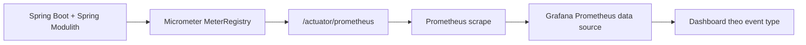

# Dashboard theo event type

## 1. Mục tiêu

Một ứng dụng Spring Boot được chia thành các application module như `orders`, `inventory` và `payments` có thể công bố nhiều domain events trong cùng một luồng nghiệp vụ. Khi lưu lượng tăng, nhóm phát triển cần biết event type nào xuất hiện nhiều, module nào đang phát event, tốc độ công bố thay đổi ra sao và loại event quan trọng nào đột ngột ngừng xuất hiện.

Xem từng meter trong Actuator phù hợp cho chẩn đoán ngắn, nhưng khó theo dõi xu hướng và so sánh nhiều event types. **Dashboard theo event type** tập hợp dữ liệu thành các panel có bộ lọc, biểu đồ theo thời gian, bảng xếp hạng và cảnh báo. Nhóm vận hành có thể dùng dashboard để nhận ra thay đổi bất thường trong hoạt động công bố event.

Bài **“Dashboard theo event type”** thuộc chương **Dashboard** của học phần **SPRING_MODULITH_DOCUMENTATION_OBSERVABILITY**. Học phần dùng Spring Modulith để sinh tài liệu ranh giới application module và quan sát tương tác giữa các phần trong ứng dụng Spring Boot qua module graph, Actuator, event metrics, tracing và context propagation.

Sau bài này, bạn có thể:

1. Giải thích hai họ event publication counters của Spring Modulith.
2. Chọn metric tổng hợp để phân nhóm theo event type.
3. Kết nối Spring Boot Actuator với Prometheus và Grafana.
4. Viết PromQL cho tốc độ, tổng số event và phân bố theo module.
5. Tạo Grafana variables để lọc theo job, module và event type.
6. Thiết kế panel phù hợp với câu hỏi vận hành.
7. Phân biệt event publication với listener completion và business outcome.
8. Kiểm soát cardinality, tránh đếm trùng và đặt cảnh báo theo kỳ vọng nghiệp vụ.
9. Kiểm tra dashboard bằng dữ liệu mẫu và xử lý trường hợp không có dữ liệu.

> **Phạm vi:** Bài dùng Spring Modulith event metrics, Spring Boot Actuator, Prometheus và Grafana. Tên metric/label trong ví dụ Prometheus là dạng đã chuẩn hóa và có thể khác theo registry/version. Hãy kiểm tra endpoint scrape của ứng dụng trước khi sao chép PromQL. Số liệu và biểu đồ minh họa không phải kết quả từ hệ thống đang chạy.

## 2. Hiểu dữ liệu event metrics trước khi vẽ dashboard

### 2.1. Spring Modulith cung cấp hai họ counter

Spring Modulith ghi nhận event publications bằng hai loại meter:

| Meter name trong Micrometer | Ý nghĩa | Tags mặc định |
| --- | --- | --- |
| `module.events.published` | Counter tổng hợp các event publications trong ứng dụng | `module.event.type`, `module.identifier`, `module.name` |
| `module.events.published.<moduleIdentifier>.<simpleEventTypeName>` | Counter riêng cho từng event type của module | `module.identifier`, `module.name` |

Metric tổng hợp là lựa chọn phù hợp để tạo dashboard động theo event type vì loại event nằm trong tag `module.event.type`. Một truy vấn có thể nhóm theo tag đó mà không cần biết trước mọi tên event.

Metric riêng đưa module identifier và simple event type vào **meter name**. Nó phù hợp khi cần drill-down một event cụ thể hoặc gắn thêm tag domain qua `ModulithEventMetricsCustomizer`. Nhưng metric riêng không có tag event type mặc định để truy vấn chung theo một label.

### 2.2. Vì sao dashboard chính nên dùng metric tổng hợp?

Giả sử ứng dụng công bố ba loại event:

- `OrderPlaced` từ module `orders`.
- `StockReserved` từ module `inventory`.
- `PaymentAuthorized` từ module `payments`.

Metric tổng hợp có thể được biểu diễn khái niệm như sau:

```text
module.events.published{
  module.event.type="OrderPlaced",
  module.identifier="orders",
  module.name="Orders"
}

module.events.published{
  module.event.type="StockReserved",
  module.identifier="inventory",
  module.name="Inventory"
}

module.events.published{
  module.event.type="PaymentAuthorized",
  module.identifier="payments",
  module.name="Payments"
}
```

Đây là cách mô tả các chiều dữ liệu; giá trị event type thực tế phụ thuộc cách Spring Modulith biểu diễn type trên phiên bản đang dùng. Hãy xem `availableTags` hoặc scrape output để xác nhận giá trị thật.

Với một metric name và tag event type, Grafana có thể tạo dropdown động, biểu đồ time series theo event type và bảng xếp hạng top event types.

### 2.3. Không cộng hai họ counters với nhau

Cùng một lần công bố event có thể được phản ánh trong counter tổng hợp `module.events.published` và counter riêng tương ứng `module.events.published.<moduleIdentifier>.<simpleEventTypeName>`.

Nếu dashboard cộng cả hai họ để tính “tổng event”, số liệu có thể bị **đếm hai lần**. Chọn một họ làm nguồn chính cho mỗi phép tính. Bài này dùng counter tổng hợp cho dashboard theo event type.

### 2.4. Publication không đồng nghĩa listener xử lý thành công

Tên metric là `published`. Nó phản ánh việc công bố event được ghi nhận, không khẳng định:

- Listener đã bắt đầu chạy.
- Listener đã hoàn tất thành công.
- Transaction của listener đã commit.
- Một tác vụ downstream đã hoàn tất.
- Trạng thái đơn hàng/thanh toán cuối cùng đã đúng.

Spring Modulith Event Publication Registry theo dõi vòng đời publication/listener riêng. Ở các phiên bản hỗ trợ lifecycle mới, publication có thể có trạng thái như `PUBLISHED`, `PROCESSING`, `COMPLETED` hoặc `FAILED`. Muốn quan sát completion/failure, dùng dữ liệu registry hoặc metric nghiệp vụ riêng; không suy ra từ counter publication.

### 2.5. Dashboard trả lời câu hỏi nào?

| Câu hỏi vận hành | Góc nhìn phù hợp |
| --- | --- |
| Event nào được công bố nhiều nhất trong khoảng thời gian? | Bar chart/top-N theo event type |
| Tốc độ publish của từng event thay đổi thế nào? | Time series theo event type |
| Module nào tạo event volume lớn? | Stacked time series theo module |
| Event type nào chiếm tỷ trọng lớn? | Bảng hoặc pie/donut theo tổng count |
| Event quan trọng có đột ngột ngừng xuất hiện? | Alert theo kỳ vọng/tần suất nghiệp vụ |
| Target nào không được scrape? | Panel scrape health riêng |
| Listener có xử lý xong event không? | Event Publication Registry hoặc metric outcome riêng |

Mỗi panel nên trả lời một câu hỏi, có phạm vi thời gian và đơn vị rõ ràng. Đừng dùng một panel để thay thế mọi góc nhìn.

## 3. Kiến trúc dữ liệu cho dashboard

### 3.1. Luồng từ ứng dụng đến Grafana



Vai trò của từng thành phần:

- **Spring Modulith:** đăng ký event publication counters.
- **Micrometer MeterRegistry:** giữ meter và tags trong ứng dụng.
- **Spring Boot Actuator:** expose metrics endpoint cho chẩn đoán và scrape.
- **Prometheus registry:** chuyển meter sang định dạng Prometheus.
- **Prometheus:** scrape từng application instance và lưu time series.
- **Grafana:** truy vấn Prometheus, hiển thị panel, variables và alert rules.

Grafana không đọc trực tiếp `MeterRegistry` trong JVM. Nó truy vấn datasource, thường là Prometheus hoặc backend tương thích PromQL.

### 3.2. Dependency cần có

Ví dụ Gradle cho ứng dụng Spring Modulith:

```groovy
dependencies {
    implementation 'org.springframework.boot:spring-boot-starter-actuator'

    // Bật module actuator và observability support của Spring Modulith.
    runtimeOnly 'org.springframework.modulith:spring-modulith-starter-insight'

    // Registry để expose metrics theo Prometheus format.
    runtimeOnly 'io.micrometer:micrometer-registry-prometheus'
}
```

Dùng Spring Boot BOM và Spring Modulith BOM tương thích để quản lý version. Nếu dự án đã khai báo Actuator/Modulith observability theo cách riêng, không cần thêm starter trùng chức năng.

`spring-modulith-starter-insight` cung cấp actuator và observability support của Spring Modulith. Registry Prometheus là thành phần riêng để scrape metrics. Chỉ có Insight starter mà không có Prometheus registry thì chưa đủ để expose Prometheus scrape format.

### 3.3. Expose endpoint cần thiết

Ví dụ cấu hình local/staging:

```yaml
management:
  endpoints:
    web:
      exposure:
        include: "health,metrics,prometheus,modulith"
```

- `/actuator/metrics` dùng để xem meter names và tags trong ứng dụng.
- `/actuator/prometheus` cung cấp scrape format cho Prometheus.
- `/actuator/modulith` trình bày cấu trúc module nếu actuator support được bật.

Chỉ expose endpoint cần thiết và bảo vệ chúng bằng network policy/Spring Security phù hợp. Không mở endpoint quản trị công khai chỉ để Grafana truy cập; Prometheus scrape nên đi qua mạng giám sát được kiểm soát.

### 3.4. Cấu hình Prometheus scrape

Ví dụ `prometheus.yml`:

```yaml
scrape_configs:
  - job_name: "shop-service"
    metrics_path: "/actuator/prometheus"
    scrape_interval: 15s
    static_configs:
      - targets:
          - "shop-service:8080"
```

Tên host/port phải truy cập được từ Prometheus. Trong Kubernetes, thường dùng service discovery thay cho danh sách static targets. Mỗi application instance cần được scrape theo cách phù hợp để Prometheus giữ được labels `job` và `instance`.

### 3.5. Kết nối Grafana với Prometheus

Trong Grafana:

1. Mở **Connections → Data sources**.
2. Thêm datasource **Prometheus**.
3. Điền URL Prometheus mà Grafana có thể truy cập.
4. Lưu và kiểm tra kết nối.
5. Tạo dashboard mới và chọn datasource này trong các panel.

Nếu Grafana và Prometheus chạy trong container/network riêng, URL datasource phải dùng hostname nội bộ phù hợp. `localhost` trong container Grafana trỏ về container Grafana, không mặc nhiên là Prometheus hoặc máy host.

## 4. Khám phá tên metric và tags thực tế

### 4.1. Xem meter names trong Actuator

Gọi endpoint metrics:

```bash
curl -s http://localhost:8080/actuator/metrics
```

Tìm meter tổng hợp:

```bash
curl -s http://localhost:8080/actuator/metrics/module.events.published
```

Kết quả minh họa:

```json
{
  "name": "module.events.published",
  "measurements": [
    {
      "statistic": "COUNT",
      "value": 1250.0
    }
  ],
  "availableTags": [
    {
      "tag": "module.event.type",
      "values": ["OrderPlaced", "StockReserved"]
    },
    {
      "tag": "module.identifier",
      "values": ["orders", "inventory"]
    },
    {
      "tag": "module.name",
      "values": ["Orders", "Inventory"]
    }
  ]
}
```

Đây là response giả định. Meter có thể chỉ xuất hiện sau khi ứng dụng đã publish loại event tương ứng. Nếu chưa có event nào, endpoint có thể chưa liệt kê meter/tag values như mong đợi.

### 4.2. Lọc một event type bằng Actuator

Có thể drill-down theo tag:

```bash
curl -s "http://localhost:8080/actuator/metrics/module.events.published?tag=module.event.type:OrderPlaced"
```

Có thể lọc thêm module identifier:

```bash
curl -s "http://localhost:8080/actuator/metrics/module.events.published?tag=module.event.type:OrderPlaced&tag=module.identifier:orders"
```

Tên meter dùng trong Actuator là tên Micrometer gốc, có dấu chấm. Khi sang Prometheus, naming convention có thể chuẩn hóa dấu chấm thành dấu gạch dưới. Đừng dùng tên đã chuẩn hóa của Prometheus để gọi Actuator metrics endpoint.

### 4.3. Xem scrape output

Gọi:

```bash
curl -s http://localhost:8080/actuator/prometheus
```

Một output minh họa:

```text
# TYPE module_events_published_total counter
module_events_published_total{
  module_event_type="OrderPlaced",
  module_identifier="orders",
  module_name="Orders"
} 1250.0
```

Ví dụ giả định về Prometheus naming convention:

| Micrometer name/key | Prometheus name/label thường gặp |
| --- | --- |
| `module.events.published` | `module_events_published_total` |
| `module.event.type` | `module_event_type` |
| `module.identifier` | `module_identifier` |
| `module.name` | `module_name` |

Tên chính xác phụ thuộc registry, phiên bản và naming convention. **Dùng output thật của `/actuator/prometheus` làm nguồn sự thật** trước khi viết query. Nếu metric thực tế không có hậu tố `_total`, hãy sửa PromQL cho đúng tên đã scrape.

### 4.4. Xác minh tag value của event type

Tag `module.event.type` biểu diễn type của event được phát. Giá trị có thể hiển thị theo dạng simple name hoặc định dạng type mà phiên bản/cấu hình đang sử dụng. Đừng giả định nó luôn là fully qualified class name hay luôn là simple class name.

Ghi lại một số giá trị thật từ Actuator/Prometheus, ví dụ:

```text
module_event_type="OrderPlaced"
module_event_type="StockReserved"
module_event_type="PaymentAuthorized"
```

Sau đó dùng đúng values đó trong dashboard variable, query, alert và tài liệu vận hành.

## 5. Thiết kế dashboard theo event type

### 5.1. Bố cục tổng thể

Một dashboard dễ sử dụng có thể chia thành các hàng:

```text
DASHBOARD: Event publications

[Filters: environment | job | module | event type | time range]

ROW 1 - Overview
  Total publications | Active event types | Publishing modules

ROW 2 - Trend
  Event publication rate by event type

ROW 3 - Distribution
  Top event types | Event volume by module and type

ROW 4 - Drill-down
  Event type table | Module × event type detail

ROW 5 - Telemetry health
  Prometheus target health | Last scrape / missing series
```

Không phải ứng dụng nào cũng có đủ labels như `environment` hoặc `cluster`. Chỉ tạo filter khi label đó tồn tại trong Prometheus series thực tế.

### 5.2. Hàng Overview

Các Stat panels có thể hiển thị:

- **Total publications:** tổng số event publications trong khoảng thời gian đang chọn.
- **Active event types:** số event types có dữ liệu trong khoảng thời gian.
- **Publishing modules:** số module đã công bố event trong khoảng thời gian.

Các panel này là thống kê theo cửa sổ thời gian, không phải trạng thái listener. Khi không có dữ liệu, hãy hiển thị `No data` hoặc giá trị mặc định có giải thích; đừng coi một event type không xuất hiện là lỗi nếu nghiệp vụ không kỳ vọng nó phải xuất hiện.

### 5.3. Hàng Trend

Dùng Time series panel để xem tốc độ công bố event theo event type. Có thể bật legend theo tên event type và dùng stacked display khi muốn thấy tổng volume theo từng loại.

Một biểu đồ cần có:

- Đơn vị là event/giây nếu dùng `rate`.
- Khoảng thời gian và query window rõ ràng.
- Legend theo event type.
- Bộ lọc module/job nếu cần.
- Tooltip cho phép xem từng series khi có nhiều event types.

Nếu có quá nhiều event types, chỉ hiển thị top-N hoặc cho phép chọn event type qua variable; không làm một panel duy nhất có hàng trăm series khó đọc.

### 5.4. Hàng Distribution

Dùng Bar chart/Table để trả lời:

- Top 10 event types theo số lần publish trong khoảng thời gian.
- Số lượng event theo module và event type.
- Tỷ trọng từng event type trong tổng publication volume.

Pie/donut chỉ phù hợp khi số loại event nhỏ và người xem cần so sánh tỷ trọng. Khi có nhiều event types, bảng xếp hạng hoặc bar chart dễ đọc hơn.

### 5.5. Hàng Drill-down

Một table có thể gồm các cột:

| Cột | Ý nghĩa |
| --- | --- |
| Event type | Giá trị `module_event_type` |
| Module | `module_identifier` |
| Publications | Tổng số lần tăng trong khoảng chọn |
| Rate | Tốc độ trung bình gần đây |
| Share | Tỷ trọng trên tổng event publications |
| Target | Job/instance nếu cần điều tra scrape |

Đừng đưa instance vào bảng tổng quan nếu mục tiêu là xem volume toàn service; nó có thể làm bảng dài và lặp lại cùng một event type trên nhiều instance. Dùng instance ở một panel drill-down riêng.

## 6. PromQL cho dashboard

Các query dưới đây giả định tên scrape là `module_events_published_total` và labels là `module_event_type`, `module_identifier`. Nếu output thực tế khác, thay tên metric/label trước khi sử dụng.

### 6.1. Tổng event publication rate

```promql
sum(
  rate(module_events_published_total[$__rate_interval])
)
```

Query này cộng tốc độ tăng counter trên mọi event type, module và instance. Đơn vị là **publications mỗi giây**.

Dùng `rate` cho counter thay vì lấy đạo hàm thủ công. Hàm xử lý counter reset do instance restart; hãy áp dụng `rate` trước khi aggregation để Prometheus nhận diện reset trên từng series.

### 6.2. Rate theo event type

```promql
sum by (module_event_type) (
  rate(module_events_published_total[$__rate_interval])
)
```

Đây là query chính cho Time series **Event publication rate by event type**. Mỗi series đầu ra tương ứng một loại event. `sum by` gộp các instance và module có cùng label event type.

Nếu cùng một event type có thể được phát từ nhiều module, phép tổng hợp này gộp chúng lại. Để giữ thêm chiều module, dùng query kế tiếp.

### 6.3. Rate theo module và event type

```promql
sum by (module_identifier, module_event_type) (
  rate(module_events_published_total[$__rate_interval])
)
```

Dùng cho stacked time series hoặc table chi tiết. Query giữ hai chiều phân loại:

- `module_identifier`: module công bố event.
- `module_event_type`: loại event được công bố.

Có thể đổi `module_identifier` thành `module_name` nếu muốn tên hiển thị, nhưng technical identifier thường ổn định hơn cho truy vấn và alert.

### 6.4. Tổng publications theo event type trong khoảng thời gian

```promql
sum by (module_event_type) (
  increase(module_events_published_total[$__range])
)
```

`increase` ước tính mức tăng counter trong khoảng thời gian dashboard đang chọn. Kết quả có thể là số thập phân vì Prometheus extrapolate đến biên cửa sổ; đây là hành vi bình thường của hàm.

Dùng query này cho Bar chart/Table có kiểu truy vấn **Instant** để lấy một giá trị tổng cho khoảng thời gian đã chọn. Nếu chạy như range query, Grafana sẽ đánh giá lại cửa sổ `$__range` ở từng bước thời gian, khiến biểu đồ không còn mang ý nghĩa “tổng trong toàn bộ khoảng đang chọn”.

### 6.5. Top 10 event types

```promql
topk(
  10,
  sum by (module_event_type) (
    increase(module_events_published_total[$__range])
  )
)
```

Dùng Instant query cho bảng hoặc bar chart top-N. `topk` chọn 10 event types có volume lớn nhất trong khoảng đang chọn.

Top-N là góc nhìn về **volume**, không nhất thiết là mức độ quan trọng. Một event hiếm nhưng thiết yếu có thể cần panel riêng hoặc alert riêng theo kỳ vọng nghiệp vụ.

### 6.6. Tỷ trọng event type

Query khái niệm tính tỷ trọng của mỗi event type trong tổng publications:

```promql
100 *
sum by (module_event_type) (
  increase(module_events_published_total[$__range])
)
/
scalar(
  sum(increase(module_events_published_total[$__range]))
)
```

Dùng Instant query cho Pie/Donut hoặc Table. Khi tổng volume bằng 0 hoặc không có series trong khoảng chọn, kết quả có thể không có giá trị hữu ích; cấu hình panel hiển thị `No data` thay vì diễn giải thành 0% cho mọi loại.

### 6.7. Tổng publications theo module

```promql
sum by (module_identifier) (
  increase(module_events_published_total[$__range])
)
```

Query này hữu ích cho Bar chart so sánh các module. Nếu muốn xem event type nào chiếm volume trong từng module, giữ cả hai labels:

```promql
sum by (module_identifier, module_event_type) (
  increase(module_events_published_total[$__range])
)
```

### 6.8. Đếm số event types có hoạt động

```promql
count(
  sum by (module_event_type) (
    increase(module_events_published_total[$__range])
  ) > 0
)
```

Kết quả là số event type có mức tăng dương trong cửa sổ đang chọn. Đây là “active event types trong khoảng”, không phải tổng số event classes được khai báo trong source code.

### 6.9. Lọc theo job/module/event type

Khi Grafana có các variables `job`, `module` và `event_type`:

```promql
sum by (module_event_type) (
  rate(
    module_events_published_total{
      job=~"$job",
      module_identifier=~"$module",
      module_event_type=~"$event_type"
    }[$__rate_interval]
  )
)
```

Với variable hỗ trợ multi-value/All, toán tử regex `=~` cho phép chọn một hoặc nhiều giá trị. Cấu hình giá trị All thành `.*` nếu muốn bỏ lọc theo chiều đó.

### 6.10. Kiểm tra scrape health

Để kiểm tra Prometheus có scrape target đang hoạt động:

```promql
up{job=~"$job"}
```

Giá trị `1` nghĩa target scrape thành công tại lần scrape gần nhất; `0` nghĩa scrape thất bại. Đây là health của target, không phải event publication health.

Nếu target down, event metric có thể không có mẫu mới dù ứng dụng vẫn xử lý nghiệp vụ. Dashboard cần tách panel scrape health khỏi panel event volume để người xem không nhầm hai nguyên nhân.

## 7. Tạo variables trong Grafana

### 7.1. Variable `job`

Tạo query variable:

| Trường | Giá trị |
| --- | --- |
| Name | `job` |
| Type | Query |
| Data source | Prometheus |
| Query type | Label values |
| Metric | `module_events_published_total` |
| Label | `job` |
| Multi-value | Bật nếu cần |
| Include All | Bật nếu cần; All value là `.*` |

Nếu Prometheus của bạn dùng label khác để nhận diện ứng dụng, thay `job` bằng label thật như `application` hoặc `service`. Không tự giả định mọi hệ thống đều có label service.

### 7.2. Variable `module`

Tạo variable thứ hai:

| Trường | Giá trị |
| --- | --- |
| Name | `module` |
| Query type | Label values |
| Metric | `module_events_published_total` |
| Label | `module_identifier` |

Variable này cung cấp danh sách module identifier có event publications trong dữ liệu Prometheus. Nếu muốn hiển thị tên thân thiện, có thể tạo variable từ `module_name` hoặc dùng mapping/alias ở panel.

### 7.3. Variable `event_type`

Tạo variable theo event type:

| Trường | Giá trị |
| --- | --- |
| Name | `event_type` |
| Query type | Label values |
| Metric | `module_events_published_total` |
| Label | `module_event_type` |
| Multi-value | Bật nếu cần |
| Include All | Bật nếu cần; All value là `.*` |

Grafana hỗ trợ query variables theo loại **Label values** để lấy các giá trị label có sẵn. Trong giao diện mới, chọn đúng query type và label field; không nhất thiết phải dùng cú pháp classic `label_values(metric, label)` cũ.

### 7.4. Dùng variables trong panel queries

Sau khi tạo variables, query có thể lọc:

```promql
sum by (module_event_type) (
  rate(
    module_events_published_total{
      job=~"$job",
      module_identifier=~"$module",
      module_event_type=~"$event_type"
    }[$__rate_interval]
  )
)
```

Nếu variable có ký tự đặc biệt hoặc được chọn nhiều giá trị, dùng định dạng escaping phù hợp với Grafana variable interpolation. Kiểm tra query được render trong Query Inspector để chắc chắn regex filter đúng.

### 7.5. Khi nào dùng repeating panels?

Grafana có thể lặp panel theo từng giá trị của một multi-value variable. Ví dụ tạo một panel rate theo event type và repeat by `event_type` để có panel riêng cho từng loại.

Chỉ dùng khi số event types nhỏ và có chủ đích. Nếu có hàng chục/hàng trăm loại, repeating panel tạo dashboard quá dài và tăng số truy vấn. Khi đó nên dùng một Time series có legend theo event type, top-N hoặc dropdown filter.

## 8. Cấu hình từng panel quan trọng

### 8.1. Stat: Total publications

- **Title:** Total event publications
- **Visualization:** Stat
- **Query:** `sum(increase(module_events_published_total[$__range]))`
- **Query type:** Instant
- **Unit:** short hoặc events
- **Description:** Tổng số lần công bố event trong khoảng thời gian đang chọn.

Nếu Prometheus metric name thực tế khác, thay bằng tên đã xác minh ở `/actuator/prometheus`. Không cộng counter tổng hợp với các counter riêng từng event.

### 8.2. Time series: Rate by event type

- **Title:** Event publication rate by type
- **Visualization:** Time series
- **Query:** `sum by (module_event_type) (rate(module_events_published_total[$__rate_interval]))`
- **Query type:** Range
- **Unit:** events/sec
- **Legend:** `{{module_event_type}}`
- **Display:** Lines hoặc stacked area nếu cần xem tỷ trọng volume theo thời gian.

Nếu nhiều series chồng lấn, thêm variable event type và mặc định chỉ chọn một số loại quan trọng. Đừng ẩn legend hoàn toàn vì người xem cần biết đường nào thuộc event nào.

### 8.3. Bar chart: Top event types

- **Title:** Top event types by publication count
- **Visualization:** Bar chart
- **Query:** `topk(10, sum by (module_event_type) (increase(module_events_published_total[$__range])))`
- **Query type:** Instant
- **Unit:** events
- **Category:** `module_event_type`
- **Value:** result value

Sắp xếp giảm dần theo số lượng. Nếu muốn xem top event types trong từng module, giữ `module_identifier` trong grouping và thiết kế panel theo cặp module/event type.

### 8.4. Stacked time series: Module × event type

- **Title:** Event publication rate by module and type
- **Visualization:** Time series
- **Query:** `sum by (module_identifier, module_event_type) (rate(module_events_published_total[$__rate_interval]))`
- **Legend:** `{{module_identifier}} / {{module_event_type}}`
- **Display:** Stacked nếu muốn nhìn tổng volume và phần đóng góp của từng cặp.

Stacking hữu ích để thấy tổng thể, nhưng có thể che khuất biến động của một series nhỏ. Cho phép tắt stacking hoặc lọc một module/event type khi điều tra.

### 8.5. Table: Event type detail

Dùng Instant query:

```promql
sum by (module_identifier, module_event_type) (
  increase(module_events_published_total[$__range])
)
```

Hiển thị columns:

- `module_identifier`
- `module_event_type`
- Value đổi tên thành `Publications`

Có thể thêm query thứ hai cho rate gần đây và join theo labels trong Grafana transformation nếu cần. Đừng ghép các query có labels khác nhau mà không kiểm tra join keys; một phép join sai có thể nhân dòng hoặc làm mất event type.

### 8.6. Donut: Event type share

Dùng query tỷ trọng ở mục 6.6, chọn Pie chart với Display name là event type. Donut chỉ phù hợp khi số loại event vừa phải; với nhiều loại, các lát nhỏ khó phân biệt. Dùng bảng hoặc top-N thay thế nếu cần.

### 8.7. Scrape health: Targets

- **Title:** Prometheus scrape health
- **Visualization:** Stat hoặc Table
- **Query:** `up{job=~"$job"}`
- **Value mapping:** `1 → UP`, `0 → DOWN`

Nếu target không xuất hiện trong query, kiểm tra service discovery/scrape config; một target không tồn tại có thể tạo `No data` thay vì giá trị DOWN.

## 9. Đọc dashboard đúng ngữ nghĩa

### 9.1. Rate và count là hai phép đo khác nhau

- `rate(counter[window])` biểu diễn tốc độ tăng trung bình mỗi giây trong cửa sổ.
- `increase(counter[window])` biểu diễn mức tăng ước tính trong cửa sổ.
- Giá trị counter thô là tổng tích lũy từ lần khởi động/đăng ký meter; không phù hợp để so sánh trực tiếp giữa các instance đã restart.

Dùng rate để xem trend, increase để xem tổng số trong khoảng. Prometheus tự xử lý counter reset trong hai hàm này.

### 9.2. Áp dụng rate trước khi aggregate

Đúng:

```promql
sum by (module_event_type) (
  rate(module_events_published_total[$__rate_interval])
)
```

Không nên aggregate counter giữa các instance trước rồi mới lấy rate. Khi một instance restart và counter reset, phép tính có thể không còn xử lý reset đúng cho từng series gốc.

### 9.3. Chọn cửa sổ rate phù hợp

Grafana cung cấp `$__rate_interval` để điều chỉnh cửa sổ rate theo time range và scrape interval. Đây thường là lựa chọn thuận tiện cho panel dashboard.

Nếu dùng cửa sổ cố định như `[1m]` trong khi scrape interval là 60 giây, có thể không có đủ samples để tính rate. Chọn cửa sổ đủ dài so với scrape interval và đặc điểm lưu lượng; với event ít xảy ra, cửa sổ quá ngắn làm biểu đồ giật hoặc có nhiều khoảng trống.

### 9.4. Counter reset khi instance restart

Một counter có thể quay về 0 sau khi ứng dụng restart. Đó là lý do dùng `rate`/`increase` thay vì trừ hai giá trị counter bằng tay. Nếu dashboard hiển thị một spike âm hoặc số liệu bất thường, kiểm tra query có áp dụng hàm counter đúng thứ tự và scrape target có thay đổi không.

### 9.5. No data không giống zero

Các trường hợp khác nhau:

- **Zero:** Có series và mức tăng trong cửa sổ bằng 0.
- **No data:** Không có series/sample phù hợp để query trả kết quả.
- **Target down:** Prometheus scrape thất bại, `up` bằng 0.
- **Target missing:** Target không còn trong service discovery hoặc query không match label.

Một event type mới chưa từng publish có thể chưa có series. Không thể kết luận nó có zero publication chỉ dựa trên query trả rỗng. Dashboard nên phân biệt `No data` và zero, đồng thời có panel scrape health.

## 10. Cảnh báo theo event type

### 10.1. Chỉ cảnh báo khi có kỳ vọng rõ

Không phải event type nào cũng phải xuất hiện liên tục. Ví dụ `OrderPlaced` có thể có lưu lượng đều, nhưng `YearlySettlementStarted` chỉ xuất hiện theo lịch. Một alert “không có event trong 5 phút” sẽ gây false positive nếu event vốn không được kỳ vọng trong thời gian đó.

Trước khi tạo alert, xác định:

- Event type có phải luồng liên tục hay theo lịch?
- Có giờ hoạt động/seasonality?
- Một module hay nhiều instance có thể publish?
- Có độ trễ chấp nhận được giữa các lần publish?
- No data có nghĩa không publish, hay target chưa được scrape?
- Ai nhận cảnh báo và hành động dự kiến là gì?

### 10.2. Ví dụ alert khi event type kỳ vọng không xuất hiện

Nếu metric series đã tồn tại và event type cần có publications trong mọi cửa sổ 15 phút, có thể dùng:

```promql
sum(
  increase(
    module_events_published_total{
      job="shop-service",
      module_event_type="OrderPlaced"
    }[15m]
  )
) == 0
```

Nếu series chưa từng xuất hiện, biểu thức có thể trả về no data thay vì zero. Cần quyết định chính sách xử lý missing series riêng, ví dụ kiểm tra `absent_over_time` hoặc xác nhận target scrape health. Không coi no data là zero mà không có quy tắc.

### 10.3. Alert khi scrape target down

```promql
up{job="shop-service"} == 0
```

Đây là cảnh báo scrape health, không phải cảnh báo event type. Tách riêng giúp người nhận biết ứng dụng không được scrape hay event thực sự ngừng phát.

### 10.4. Cảnh báo tăng đột biến

Có thể dùng baseline theo giờ/ngày hoặc ngưỡng rate đã được nhóm vận hành xác nhận để phát hiện event volume tăng bất thường. Không có một ngưỡng publications/giây đúng cho mọi ứng dụng. Xem xét lưu lượng nghiệp vụ, lịch chạy batch, campaign và retry behavior trước khi bật alert.

### 10.5. Đừng suy ra listener failure từ publication dashboard

Nếu event publication tăng nhưng listener không hoàn tất, dashboard này vẫn có thể trông bình thường. Dùng Event Publication Registry, trạng thái `FAILED` hoặc metric outcome do ứng dụng chủ động tạo để theo dõi listener processing. Dashboard publication chỉ phản ánh đầu vào của luồng event.

## 11. Cardinality và chất lượng tags

### 11.1. Event type tag có tập giá trị hữu hạn

`module.event.type` thường đại diện cho tập event classes được định nghĩa trong code. Đây là một chiều phân loại phù hợp với dashboard theo event type nếu số loại được quản lý.

Không gắn thêm các giá trị động như:

- `event.id` riêng cho mỗi publication.
- `order.id` hoặc `customer.id`.
- Raw payload, error message hoặc timestamp.
- URL chứa ID giao dịch.

Các giá trị này làm số time series tăng theo từng event và làm Prometheus/Grafana tốn tài nguyên.

### 11.2. Customizer tác động counter riêng

`ModulithEventMetricsCustomizer` cho phép thêm tags domain-specific vào **counter riêng theo event type**. Ví dụ một enum channel có tập giá trị hữu hạn có thể hữu ích khi drill-down metric riêng.

Tuy nhiên, customizer này không có nghĩa tag tùy chỉnh tự động xuất hiện trên metric tổng hợp `module.events.published`. Nếu dashboard chính dùng metric tổng hợp, kiểm tra tags của meter đó và chọn nguồn dữ liệu đúng.

### 11.3. Không nhân đôi chiều module

Metric tổng hợp đã có `module.identifier` và `module.name`. Không cần thêm lại một custom tag chứa cùng thông tin module. Nếu tag custom chứa tên module động hoặc biến thể không chuẩn, dashboard có thể tạo các series trùng ý nghĩa.

### 11.4. Giới hạn số series trong dashboard

Một event type × module × job × instance tạo nhiều series. Khi số instance tăng, số series cũng tăng. Dashboard nên aggregate bỏ labels không cần thiết trong panel tổng quan, chỉ giữ instance ở panel drill-down.

Đừng dùng `count(metric)` để đo số event publications; nó đếm số series. Dùng `increase` để tính số publications trong cửa sổ và `rate` để xem tốc độ.

## 12. Kiểm thử dashboard trước khi dùng vận hành

### 12.1. Kiểm tra nguồn metric

1. Khởi động ứng dụng với Spring Modulith observability và Prometheus registry.
2. Publish ít nhất hai event types khác nhau qua luồng thực.
3. Gọi `/actuator/metrics/module.events.published`.
4. Xác nhận `module.event.type` và `module.identifier` xuất hiện trong `availableTags`.
5. Gọi `/actuator/prometheus`.
6. Xác nhận metric name và label names thực tế.
7. Kiểm tra Prometheus target có trạng thái `UP`.

Không tạo meter giả bằng một `SimpleMeterRegistry` độc lập rồi kết luận auto-configuration thật đã hoạt động. Hãy kiểm tra Spring-managed registry của ứng dụng.

### 12.2. Kiểm tra PromQL độc lập trước khi tạo panel

Trong Prometheus expression browser hoặc Grafana Explore, chạy lần lượt:

```promql
module_events_published_total
```

```promql
sum by (module_event_type) (
  increase(module_events_published_total[1h])
)
```

```promql
sum by (module_identifier, module_event_type) (
  rate(module_events_published_total[5m])
)
```

Xác nhận label names, số series và kết quả hợp lý trước khi copy query vào nhiều panel.

### 12.3. Dùng dữ liệu kiểm thử có chủ đích

Ví dụ tạo các publications:

| Event type | Module | Số lần publish giả định |
| --- | --- | ---: |
| `OrderPlaced` | `orders` | 120 |
| `OrderCancelled` | `orders` | 12 |
| `StockReserved` | `inventory` | 115 |
| `PaymentAuthorized` | `payments` | 110 |

Các số trên là fixture để kiểm tra dashboard. Kết quả mong đợi:

- Tổng publications bằng tổng các event được fixture tạo, trong cùng phạm vi metric.
- Top event types hiển thị đúng thứ tự.
- Filter module `orders` chỉ giữ hai event types thuộc orders.
- Filter `StockReserved` chỉ hiển thị event type đã chọn.
- Time series tăng khi fixture phát thêm events.
- Không có series theo từng event UUID.

### 12.4. Kiểm tra nhiều instances

Chạy hoặc mô phỏng nhiều targets để xác nhận:

- Prometheus scrape tất cả instances.
- Panel tổng hợp không đếm thiếu instance.
- Panel instance drill-down hiển thị labels phù hợp.
- Khi một instance restart, rate/increase không tạo kết quả âm giả.
- Khi target down, panel `up` thể hiện sự cố riêng.
- Không scrape cùng một instance qua hai job ngoài chủ đích.

### 12.5. Kiểm tra biến Grafana

Chọn từng variable:

- `job` chọn một service/job.
- `module` chọn một module.
- `event_type` chọn một event type.
- Chọn nhiều event types nếu bật multi-value.
- Chọn All và xác nhận regex All value hoạt động.
- Thay time range và xác nhận query `$__range`/`$__rate_interval` được render đúng.

Dùng Query Inspector để xem PromQL cuối cùng sau khi Grafana thay variables.

## 13. Chẩn đoán dashboard không có dữ liệu hoặc sai số

| Triệu chứng | Nguyên nhân có thể | Hướng kiểm tra |
| --- | --- | --- |
| Không thấy metric trong Prometheus | Thiếu registry hoặc endpoint chưa expose | Dependency, scrape endpoint, target |
| Có metric nhưng không có event type label | Đang xem counter riêng hoặc metric khác | Dùng `module.events.published` tổng hợp |
| Grafana query trả No data | Sai metric/label name hoặc chưa có publication | Scrape output, query browser, time range |
| Actuator có meter nhưng Prometheus không có | Registry/exporter chưa hoạt động hoặc scrape sai | Prometheus dependency, target, endpoint |
| Dashboard đếm gấp đôi | Cộng counter tổng hợp và counter riêng | Chỉ chọn một họ counter |
| Event type dropdown rỗng | Query variable dùng sai label hoặc metric | Label values query, metric selector |
| Filter All không hoạt động | Variable multi-value/All value không đúng | `=~`, All value `.*`, Query Inspector |
| Panel rate có khoảng trống | Cửa sổ rate quá ngắn hoặc scrape thưa | `$__rate_interval`, scrape interval |
| Panel có spike sau restart | Query không xử lý counter reset đúng | `rate`/`increase` trước aggregation |
| Tổng count khác số fixture | Chưa đủ scrape, time range sai hoặc target trùng/thiếu | Scrape interval, range, targets |
| Target down nhưng event panel rỗng | Không có sample mới do scrape lỗi | `up`, Prometheus target status |
| Có publication nhưng không có listener outcome | Metric chỉ đo publication | Event Publication Registry/listener metrics |
| Event type có quá nhiều series | Tag chứa ID hoặc text động | Meter tags, customizer, cardinality |
| Tên event trong Grafana khó đọc | Tag value dùng class/package name | Alias/label mapping, naming convention |
| Panel top-N thay đổi theo từng điểm thời gian | Dùng range query với `topk` | Dùng Instant query cho top-N theo range |
| Pie chart có quá nhiều lát | Nhiều event types | Top-N hoặc table/bar chart |

### 13.1. Thứ tự kiểm tra

1. Gọi Actuator metrics và xác nhận meter tổng hợp.
2. Xác nhận event type tag có values.
3. Đọc scrape output để biết metric/label names đã chuẩn hóa.
4. Kiểm tra Prometheus target và thời điểm scrape cuối.
5. Chạy query trực tiếp trong Prometheus/Grafana Explore.
6. Kiểm tra variables và interpolation.
7. Kiểm tra query type Instant/Range.
8. Đối chiếu số liệu với fixture hoặc event publication registry.
9. Kiểm tra dashboard có cộng nhầm hai họ counters không.

Bắt đầu ở nguồn dữ liệu trước khi chỉnh visualization. Nếu PromQL đã trả dữ liệu sai, đổi màu hoặc đổi kiểu panel không sửa được vấn đề.

## 14. Bài thực hành: xây dashboard cho cửa hàng

### 14.1. Bối cảnh

Một modular monolith có các module:

```text
orders
  - OrderPlaced
  - OrderCancelled

inventory
  - StockReserved
  - StockRejected

payments
  - PaymentAuthorized
  - PaymentDeclined
```

Nhóm vận hành cần dashboard hiển thị event publication theo event type trong 24 giờ gần nhất và có thể lọc theo module.

### 14.2. Chuẩn bị

- Bật Spring Modulith observability.
- Có Prometheus registry.
- Expose `/actuator/prometheus`.
- Cấu hình Prometheus scrape.
- Thêm Prometheus datasource vào Grafana.
- Publish fixture cho sáu event types.
- Xác minh tag `module.event.type` và `module.identifier` trên metric tổng hợp.

### 14.3. Tạo các variables

Tạo ba query variables:

| Variable | Metric | Label |
| --- | --- | --- |
| `job` | `module_events_published_total` | `job` |
| `module` | `module_events_published_total` | `module_identifier` |
| `event_type` | `module_events_published_total` | `module_event_type` |

Chọn query type **Label values**. Bật multi-value và All cho module/event type nếu người xem cần kết hợp nhiều lựa chọn.

### 14.4. Tạo panel

**Panel A — Tổng publications trong khoảng chọn**

```promql
sum(
  increase(
    module_events_published_total{
      job=~"$job",
      module_identifier=~"$module",
      module_event_type=~"$event_type"
    }[$__range]
  )
)
```

Đặt Instant query, Stat visualization và Unit là events.

**Panel B — Rate theo event type**

```promql
sum by (module_event_type) (
  rate(
    module_events_published_total{
      job=~"$job",
      module_identifier=~"$module",
      module_event_type=~"$event_type"
    }[$__rate_interval]
  )
)
```

Đặt Range query, Time series visualization và legend theo event type.

**Panel C — Top 5 event types**

```promql
topk(
  5,
  sum by (module_event_type) (
    increase(
      module_events_published_total{
        job=~"$job",
        module_identifier=~"$module"
      }[$__range]
    )
  )
)
```

Đặt Instant query, Bar chart và sort theo value giảm dần.

**Panel D — Module × event type**

```promql
sum by (module_identifier, module_event_type) (
  increase(
    module_events_published_total{
      job=~"$job",
      module_identifier=~"$module",
      module_event_type=~"$event_type"
    }[$__range]
  )
)
```

Đặt Instant query, Table visualization và đổi tên Value thành Publications.

**Panel E — Scrape health**

```promql
up{job=~"$job"}
```

Đặt Stat/Table để phát hiện target không được scrape.

### 14.5. Kết quả mong đợi

Với fixture giả định:

- Panel A hiển thị tổng publications trong 24 giờ theo bộ lọc.
- Panel B hiển thị tốc độ tăng theo từng event type.
- Panel C xếp hạng event type có volume lớn nhất.
- Panel D cho biết module nào công bố loại event nào.
- Panel E cho biết các targets có được scrape thành công.

Nếu chọn module `orders`, panel B/C/D chỉ còn `OrderPlaced` và `OrderCancelled`. Nếu chọn event type `StockReserved`, panel A/B/D chỉ hiển thị publications của event đó trong phạm vi job/module đã chọn.

### 14.6. Đánh giá

Dashboard được xem là đạt khi:

1. Mọi panel dùng đúng metric tổng hợp.
2. Không cộng thêm counter riêng của từng event.
3. Variable values khớp labels thật.
4. Tổng count khớp fixture trong cùng time range và scrape window.
5. Rate thay đổi khi phát thêm event.
6. Filter module/event type hoạt động đúng.
7. Target down được thể hiện riêng với event rate.
8. Dashboard không gắn IDs động vào metric labels.
9. Người xem hiểu publication count không phải listener completion count.

## 15. Quy ước vận hành và bảo trì dashboard

### 15.1. Đặt tên panel và mô tả rõ

Tên panel nên nói rõ đại lượng và chiều phân nhóm:

- `Event publication rate by type`.
- `Publications by module and type`.
- `Top event types by count`.
- `Total publications in selected range`.
- `Prometheus scrape health`.

Mô tả panel nên nêu metric nguồn, cách tính, đơn vị và giới hạn ngữ nghĩa. Ví dụ: “Counter tăng khi event được công bố; không phản ánh listener completion.”

### 15.2. Ghi rõ metric source và labels

Trong dashboard description hoặc panel description, ghi:

- Metric source: `module.events.published`.
- Label mapping: `module.event.type`, `module.identifier`, `module.name`.
- Prometheus normalized name/labels đã xác minh.
- Service/job và environment labels được dùng.
- Dashboard owner và ngày cập nhật.

Khi nâng Spring Boot, Spring Modulith hoặc Micrometer, kiểm tra lại scrape output và query trước khi deploy dashboard mới.

### 15.3. Quản lý thay đổi event type

Khi thêm/đổi event class:

1. Xác nhận event type tag mới xuất hiện trong metric tổng hợp.
2. Kiểm tra dashboard variable tự nhận giá trị mới.
3. Kiểm tra alert có danh sách event type cố định hay không.
4. Cập nhật mapping tên hiển thị nếu cần.
5. Đánh giá cardinality và retention.
6. Không xóa panel/alert cũ trước khi xác nhận không còn traffic của event type cũ.

### 15.4. Quản lý query cost

Các query `increase` trên toàn bộ service trong time range dài có thể tốn tài nguyên nếu có nhiều series. Có thể:

- Aggregate theo labels cần thiết, bỏ instance khỏi panel tổng quan.
- Dùng recording rules cho truy vấn lặp lại nặng.
- Giới hạn top-N.
- Đặt time range hợp lý.
- Dùng variables để giới hạn job/module.
- Tránh query regex quá rộng trên toàn bộ metric names nếu không cần.

### 15.5. Dashboard không phải nguồn sự thật duy nhất

Khi dashboard cho thấy volume tăng hoặc giảm bất thường, đối chiếu với:

- Application logs có trace/correlation ID.
- Trace backend để xem luồng runtime.
- Event Publication Registry để biết listener completion/failure.
- Business database/state để xác nhận outcome nghiệp vụ.
- Prometheus target/scrape health để xác nhận dữ liệu được thu thập.

Một biểu đồ đúng chỉ chứng minh đúng phép đo đã được thu thập và hiển thị; nó không tự giải thích nguyên nhân business.

## 16. Những sai lầm thường gặp

1. **Dùng counter riêng làm nguồn dashboard động theo event type.** Event type nằm trong metric name, không phải tag mặc định; dùng counter tổng hợp.
2. **Cộng cả metric tổng hợp và metric riêng.** Có thể đếm hai lần cùng một publication.
3. **Coi publication count là listener success.** Hai khái niệm có lifecycle khác nhau.
4. **Dùng tên metric Prometheus để gọi Actuator metrics.** Actuator dùng meter name gốc; Prometheus có naming normalization.
5. **Đo event volume bằng `count(metric)`.** Hàm count đếm số series, không đếm số publications.
6. **Aggregate counter rồi mới rate.** Áp dụng rate/increase trên từng series trước khi sum để xử lý reset.
7. **Dùng range query cho top-N toàn khoảng.** Dùng Instant query với increase trong range đã chọn.
8. **Dùng cửa sổ rate ngắn hơn scrape interval.** Có thể thiếu samples và tạo khoảng trống.
9. **Coi No data là zero.** Metric chưa từng xuất hiện, target down và không có publication là các trường hợp khác nhau.
10. **Tạo variable từ label chưa tồn tại.** Xác minh label names trong scrape output trước.
11. **Tạo một panel cho mọi event type.** Dashboard trở nên quá dài khi event types tăng.
12. **Đưa event ID/order ID vào tags.** Cardinality và chi phí time series tăng mạnh.
13. **Alert mọi event type khi không có traffic.** Chỉ cảnh báo khi có kỳ vọng về tần suất hoặc lịch phát.
14. **Chỉ kiểm tra Grafana panel.** Query cần được kiểm chứng trực tiếp trong Prometheus/Explore.
15. **Không kiểm tra target health.** Dashboard event có thể rỗng do scrape thất bại chứ không phải application ngừng publish.

## 17. Câu hỏi tự đánh giá

1. Spring Modulith cung cấp hai họ event publication counters nào?
2. Vì sao `module.events.published` phù hợp hơn counter riêng để tạo dropdown theo event type?
3. Ba low-cardinality tags mặc định của metric tổng hợp là gì?
4. Counter riêng có những tags mặc định nào và event type được thể hiện ở đâu?
5. Vì sao không cộng metric tổng hợp và counter riêng trong cùng một tổng?
6. Metric publication có chứng minh listener đã hoàn tất không?
7. Vì sao phải xem `/actuator/prometheus` trước khi viết PromQL?
8. Tên metric/label trong Actuator khác Prometheus naming convention như thế nào?
9. `rate` và `increase` khác nhau ra sao?
10. Vì sao phải áp dụng `rate` trước aggregation?
11. Khi nào nên dùng Instant query cho `topk` và `increase`?
12. Grafana Label values query variable lấy danh sách event types từ đâu?
13. Khi chọn All trong variable multi-value, vì sao regex `.*` hữu ích?
14. Làm sao phân biệt No data, zero publication và scrape target down?
15. Vì sao không nên tạo metric tag theo event ID?
16. Khi nào dùng Event Publication Registry thay vì event publication dashboard?
17. Một dashboard cần panel nào để phân biệt event volume với scrape health?
18. Khi thêm event type mới, cần kiểm tra những query/variables/alerts nào?

## 18. Tài liệu tham khảo chính thức

- [Spring Modulith — Production-ready Features](https://docs.spring.io/spring-modulith/reference/production-ready.html): hai họ event publication counters, tags của metric tổng hợp và counter riêng, `ModulithEventMetricsCustomizer`.
- [Spring Modulith — Working with Application Events](https://docs.spring.io/spring-modulith/reference/events.html): event publication registry, listener lifecycle và publication states.
- [Spring Boot — Metrics](https://docs.spring.io/spring-boot/reference/actuator/metrics.html): Prometheus registry, `/actuator/prometheus`, `/actuator/metrics`, common tags và metric naming.
- [Spring Boot — Actuator Endpoints](https://docs.spring.io/spring-boot/reference/actuator/endpoints.html): expose và bảo vệ Actuator endpoints.
- [Prometheus — Query Functions](https://prometheus.io/docs/prometheus/latest/querying/functions/): `rate`, `increase` và cách xử lý counter.
- [Prometheus — Querying Operators](https://prometheus.io/docs/prometheus/latest/querying/operators/): `sum`, `count`, `topk` và grouping.
- [Grafana — Prometheus Template Variables](https://grafana.com/docs/grafana/latest/datasources/prometheus/template-variables/): Label values query variables và dynamic dropdown.
- [Grafana — Configure Panel Options](https://grafana.com/docs/grafana/latest/visualizations/panels-visualizations/configure-panel-options/): panel options và repeat panels.
- [Grafana — Dashboard Controls](https://grafana.com/docs/grafana/latest/visualizations/dashboards/build-dashboards/create-dashboard/dashboard-controls/): tạo variables và dashboard filters.

> **Ghi nhớ:** Dashboard theo event type nên lấy **`module.events.published`** làm nguồn chính vì metric tổng hợp có tag `module.event.type`, `module.identifier` và `module.name`. Dùng `rate` để xem tốc độ, `increase` để tính tổng trong khoảng, tạo Grafana variables theo label values và luôn kiểm tra scrape health. Giữ rõ ranh giới giữa **event được công bố** và **listener xử lý thành công**, tránh cộng hai họ counters hoặc đưa ID động vào metric tags.
