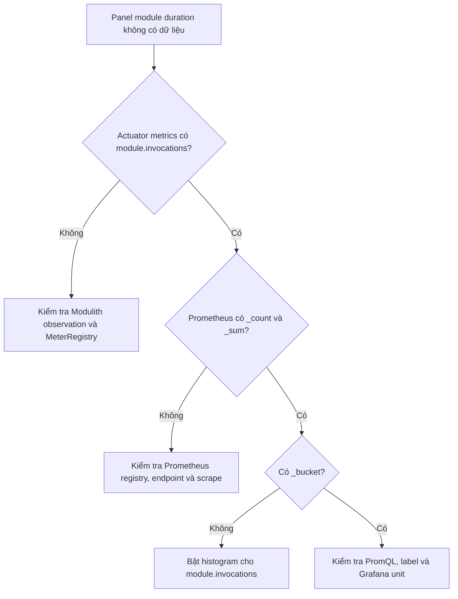

# Panel duration của module entry span

## 1. Mục tiêu của panel

Trong ứng dụng Spring Boot dùng **Spring Modulith**, một request đặt hàng có thể đi qua các application module như `order`, `payment` và `inventory`. Spring Modulith có thể quan sát các lần đi vào API của module bằng module entry observation/span. Khi muốn biết module nào đang xử lý chậm, đội vận hành cần một dashboard thể hiện thời lượng theo module và loại invocation.

Ví dụ một luồng:

```text
HTTP POST /orders
└── module entry: order.place()
    ├── module entry: inventory.reserve()
    └── module entry: payment.authorize()
```

Một panel duration tốt giúp trả lời:

- Thời gian xử lý trung bình của từng module đang tăng hay giảm?
- Module nào có p95/p99 cao hơn mục tiêu?
- Thời lượng khác nhau thế nào giữa lời gọi bean và event listener?
- Có phải một module chậm lên cùng lúc tỷ lệ lỗi tăng?
- Vấn đề nằm ở module nào để mở trace chi tiết và xem các span con?

Bài **“Panel duration của module entry span”** thuộc chương **Dashboard** của **SPRING_MODULITH_DOCUMENTATION_OBSERVABILITY**. Module học cách dùng Spring Modulith tạo tài liệu ranh giới application module và quan sát tương tác giữa các phần trong ứng dụng Spring Boot qua module graph, Actuator, event metrics, tracing và context propagation.

Sau bài học, bạn có thể:

1. Hiểu module entry span đo khoảng thời gian nào và được tạo ở đâu.
2. Phân biệt duration trong trace với Timer metric dùng cho dashboard tổng hợp.
3. Kiểm tra meter `module.invocations` và các tag của nó.
4. Dựng panel Grafana cho average duration, p95, throughput và error ratio.
5. Bật histogram đúng phạm vi để truy vấn percentile có thể tổng hợp giữa các instance.
6. Đọc panel đúng ngữ cảnh, tránh nhầm thời lượng lồng nhau, sampling và cardinality.

## 2. Module entry span đo điều gì?

Spring Modulith observability instrument các Spring component thuộc API của application module. Khi một lời gọi đi vào module qua component được quan sát, interceptor tạo một Micrometer Observation cho module entry. Khi tracing được cấu hình, observation đó có thể trở thành span trong distributed trace.

Module entry span mang các thuộc tính:

| Thuộc tính | Ý nghĩa | Ví dụ |
| --- | --- | --- |
| `module.identifier` | Định danh kỹ thuật của module | `inventory` |
| `module.name` | Tên hiển thị của module | `Inventory Management` |
| `module.invocation-type` | Kiểu invocation | `bean` hoặc `event listener` |
| `module.method` | Method được thực thi | `reserve` |

Các tag module giúp dashboard nhóm duration theo ranh giới kiến trúc. `module.method` là thông tin chi tiết có cardinality cao, phù hợp để điều tra trên trace; không nên mặc định biến nó thành Prometheus label.

**Phạm vi cần nhớ:** module entry span biểu diễn một lần đi vào API module được Spring Modulith instrument. Nó không phải span cho mọi method nội bộ. Các lời gọi giữa các bean cùng module không nhất thiết tạo thêm một module entry span mới. Vì vậy panel cho biết thời lượng của các entry point được quan sát, không phải tổng thời gian CPU của toàn bộ code trong module.

### 2.1. Thời lượng bắt đầu và kết thúc ở đâu?

Observation bắt đầu khi interceptor đi vào method được quan sát và kết thúc khi method trả về hoặc ném lỗi. Timer đo khoảng thời gian giữa hai thời điểm đó.

Với method đồng bộ, duration gần với thời gian thực thi method trong module. Với method chỉ lên lịch công việc bất đồng bộ rồi trả về ngay, duration có thể chỉ phản ánh thời gian lên lịch. Nếu method trả về `CompletableFuture` hoặc một reactive publisher, không được mặc định Timer bao gồm toàn bộ thời gian pipeline chạy sau đó; cần instrumentation phù hợp với lifecycle async/reactive nếu muốn đo phần công việc hoàn tất.

### 2.2. Span duration và metric duration

| Góc nhìn | Dữ liệu | Câu hỏi phù hợp |
| --- | --- | --- |
| **Trace span** | Một lần invocation, có span ID, parent, thời điểm bắt đầu/kết thúc và error status | Vì sao lần gọi cụ thể này mất 1,8 giây? |
| **Timer metric** | Phân phối thời lượng tổng hợp của nhiều invocation | p95 của module inventory trong 5 phút là bao nhiêu? |
| **Module graph** | Dependency tĩnh giữa module | Order có được phép phụ thuộc inventory không? |

Dashboard duration thường nên dùng **Timer metric** vì Prometheus/Grafana có thể tổng hợp số lượng lớn invocation. Khi một panel cho thấy p95 tăng, mở trace tương ứng để tìm span con gây chậm. Trace và metrics bổ sung cho nhau; một panel metric không thay thế việc phân tích trace.

## 3. Meter module.invocations được tạo như thế nào?

Spring Modulith định nghĩa observation cho module entry. Khi Spring Boot có `MeterRegistry` và đăng ký `DefaultMeterObservationHandler` trên `ObservationRegistry`, mỗi observation hoàn tất sẽ được chuyển thành Timer metric. Với convention mặc định của module entry, tên meter dùng cho duration là:

```text
module.invocations
```

Timer lưu thời lượng và số lần hoàn tất. Với Prometheus registry, tên thường được chuẩn hóa thành:

```text
module_invocations_seconds_count
module_invocations_seconds_sum
```

Khi histogram được bật, còn có các series bucket:

```text
module_invocations_seconds_bucket
```

Tên metric và label cuối cùng phụ thuộc registry, naming convention và cấu hình. Luôn xác minh ở `/actuator/metrics` và `/actuator/prometheus` của ứng dụng đang chạy trước khi đưa query vào dashboard.

### 3.1. Các tag dùng để chia panel

Các low-cardinality tags chính của module entry observation:

| Tag trong Micrometer | Label Prometheus thường thấy | Dùng để |
| --- | --- | --- |
| `module.identifier` | `module_identifier` | Lọc theo module kỹ thuật |
| `module.name` | `module_name` | Hiển thị tên dễ đọc |
| `module.invocation-type` | `module_invocation_type` | Phân biệt bean và event listener |
| `error` | `error` | Phân biệt invocation có lỗi |

Prometheus chuyển ký tự như dấu chấm và dấu gạch nối trong tên label sang dấu gạch dưới. Tên label thật cần được kiểm tra trên endpoint scrape.

`module.method` có thể xuất hiện như span attribute/high-cardinality data để điều tra trace. Không đưa method name tùy ý hoặc ID nghiệp vụ vào metric label nếu chưa đánh giá cardinality.

### 3.2. Điều kiện để có Timer

Để panel duration có dữ liệu, cần:

1. Spring Modulith observability được bật, thường qua `spring-modulith-starter-insight` hoặc observability support phù hợp.
2. Có `MeterRegistry`, ví dụ Prometheus registry.
3. Observation registry có `DefaultMeterObservationHandler` hoặc meter handler tương đương.
4. Code thực sự đi qua module entry point được instrument.
5. Meter không bị `ObservationPredicate`, thuộc tính `management.observations.enable` hoặc `MeterFilter` loại bỏ.
6. Prometheus scrape được endpoint metrics của ứng dụng.

Spring Boot tự đăng ký `DefaultMeterObservationHandler` khi có meter infrastructure phù hợp. Nếu ứng dụng tự tạo `ObservationRegistry` riêng hoặc thay handler, cần xác minh meter handler có mặt trên đúng registry mà Spring Modulith sử dụng.

## 4. Dependency và cấu hình ứng dụng

Ví dụ Gradle cho Spring Modulith 2.2.x, dùng BOM tương thích với Spring Boot:

```groovy
dependencies {
    runtimeOnly "org.springframework.modulith:spring-modulith-starter-insight"
    runtimeOnly "io.micrometer:micrometer-registry-prometheus"
}
```

Insight starter bao gồm hỗ trợ Actuator và quan sát application module. Prometheus registry giúp xuất meter qua endpoint Prometheus. Cần có tracer/exporter riêng nếu muốn xem trace ở Zipkin, Tempo hoặc backend tương ứng; việc tạo Timer metric không đòi hỏi phải có trace backend.

### 4.1. Expose metrics và Prometheus

Ví dụ `application.yml`:

```yaml
management:
  endpoints:
    web:
      exposure:
        include: "health,metrics,prometheus,modulith"
```

Trong môi trường production, giới hạn quyền truy cập Actuator theo chính sách bảo mật của hệ thống. Prometheus cần được phép scrape endpoint; dashboard người dùng không nhất thiết phải truy cập trực tiếp endpoint này.

### 4.2. Bật histogram cho riêng module.invocations

Timer mặc định có thể cung cấp count và sum, đủ để tính average duration. Để tính p50/p95/p99 có thể tổng hợp giữa nhiều instance bằng Prometheus histogram, bật histogram cho đúng meter:

```yaml
management:
  metrics:
    distribution:
      percentiles-histogram:
        "[module.invocations]": true
```

Nếu muốn có bucket phù hợp với mục tiêu dịch vụ, có thể thêm SLO boundaries:

```yaml
management:
  metrics:
    distribution:
      slo:
        "[module.invocations]":
          - 100ms
          - 250ms
          - 500ms
          - 1s
          - 2s
```

Chọn bucket dựa trên latency thực tế và SLO của hệ thống. Không bật histogram cho mọi meter một cách máy móc vì mỗi tổ hợp tag sẽ tạo thêm nhiều time series.

**Nếu không bật histogram**, query `histogram_quantile(...)` không có bucket để tính p95. Count và sum vẫn có thể dùng để tính average, nhưng không thể suy ra p95 chính xác từ hai số này.

## 5. Kiểm tra meter trước khi dựng panel

### 5.1. Kiểm tra danh sách meter

Gọi:

```powershell
curl.exe http://localhost:8080/actuator/metrics
```

Tìm meter:

```powershell
curl.exe http://localhost:8080/actuator/metrics/module.invocations
```

Endpoint metrics dùng tên meter Micrometer gốc `module.invocations`, không dùng tên đã chuẩn hóa thành `module_invocations_seconds` của Prometheus.

### 5.2. Lọc theo module

Ví dụ kiểm tra riêng module inventory và lời gọi bean:

```powershell
curl.exe "http://localhost:8080/actuator/metrics/module.invocations?tag=module.identifier:inventory&tag=module.invocation-type:bean"
```

Phản hồi cung cấp các measurement như count, total time và max time theo các meter khớp bộ tag. Đây là cách xác minh tag và giá trị trước khi viết PromQL.

### 5.3. Kiểm tra Prometheus scrape output

```powershell
curl.exe http://localhost:8080/actuator/prometheus
```

Tìm các dòng có tiền tố:

```text
module_invocations_seconds_count
module_invocations_seconds_sum
module_invocations_seconds_bucket
```

Nếu không có `_bucket`, kiểm tra cấu hình histogram. Nếu không có cả `_count` và `_sum`, kiểm tra observation có được tạo, meter handler, registry, filter và việc gọi module entry point.

## 6. Thiết kế dashboard duration

Một dashboard vận hành có thể chia thành các hàng:

| Panel | Nội dung | Dùng để |
| --- | --- | --- |
| Average module entry duration | Thời lượng trung bình theo module | Phát hiện xu hướng chậm kéo dài |
| p95 module entry duration | Phân vị 95 theo module | Theo dõi trải nghiệm của phần lớn invocation chậm |
| p99 module entry duration | Phân vị 99 theo module | Phát hiện đuôi latency dài |
| Invocation rate | Số invocation mỗi giây | Đặt latency vào bối cảnh tải |
| Error ratio | Tỷ lệ invocation có lỗi | Xem chậm có đi cùng lỗi hay không |
| Duration by invocation type | So sánh `bean` và `event listener` | Tìm khác biệt giữa lời gọi đồng bộ và listener |

Filter dashboard nên có:

- Time range.
- Service/application hoặc `job`.
- Module identifier.
- Invocation type.

Nên dùng module identifier làm giá trị lọc kỹ thuật; hiển thị module name để người vận hành dễ đọc. Nếu dashboard tổng hợp nhiều service, phải giữ chiều service để không gộp các module trùng identifier từ ứng dụng khác nhau.

## 7. PromQL cho các panel

Các query dưới đây giả định Prometheus xuất Timer thành `module_invocations_seconds_*` và label đã được chuẩn hóa thành dạng underscore. Nếu scrape output khác, thay tên metric/label theo dữ liệu thực tế.

### 7.1. Average duration theo module

Timer có `_sum` là tổng số giây đã ghi nhận và `_count` là số invocation hoàn tất. Lấy rate của cả hai trong cùng cửa sổ rồi chia:

```promql
sum by (job, module_identifier, module_name, module_invocation_type) (
  rate(module_invocations_seconds_sum[5m])
)
/
sum by (job, module_identifier, module_name, module_invocation_type) (
  rate(module_invocations_seconds_count[5m])
)
```

Kết quả là thời lượng trung bình theo giây trong cửa sổ 5 phút. Trong Grafana, đặt unit là **seconds (s)** hoặc đổi sang milliseconds ở phần hiển thị. Không lấy trung bình trực tiếp các giá trị trung bình riêng từng instance; công thức tổng rate sum chia tổng rate count sẽ cân theo số invocation.

Nếu không cần phân biệt invocation type, bỏ `module_invocation_type` khỏi cả hai mệnh đề `by(...)`.

### 7.2. p95 duration theo module

Sau khi bật histogram:

```promql
histogram_quantile(
  0.95,
  sum by (le, job, module_identifier, module_name, module_invocation_type) (
    rate(module_invocations_seconds_bucket[5m])
  )
)
```

Đây là percentile xấp xỉ được tính từ histogram buckets. `le` là ranh giới bucket và phải được giữ trong phép tổng hợp trước khi gọi `histogram_quantile`. Nếu bỏ `le`, query sẽ không còn dữ liệu bucket để tính percentile.

### 7.3. p99 duration theo module

Chỉ thay percentile thành 0.99:

```promql
histogram_quantile(
  0.99,
  sum by (le, job, module_identifier, module_name) (
    rate(module_invocations_seconds_bucket[5m])
  )
)
```

p99 nhạy với đuôi latency và số mẫu ít. Khi lưu lượng thấp, đường p99 có thể nhảy mạnh hoặc không có dữ liệu đủ tin cậy. Đọc p99 cùng invocation count/rate và p95, không dùng một điểm đơn lẻ để kết luận.

### 7.4. Invocation rate

```promql
sum by (job, module_identifier, module_name, module_invocation_type) (
  rate(module_invocations_seconds_count[5m])
)
```

Panel này cho biết số lần module entry hoàn tất mỗi giây. Nếu duration tăng đồng thời rate tăng mạnh, module có thể đang chịu tải lớn hơn. Nếu duration tăng nhưng rate ổn định, cần mở trace để tìm dependency hoặc thao tác chậm.

### 7.5. Error ratio

Default meter observation handler gắn tag `error` khi observation ghi nhận exception; giá trị thường là tên class exception hoặc `none` khi không có lỗi:

```promql
sum by (job, module_identifier, module_name) (
  rate(module_invocations_seconds_count{error=~".+", error!="none"}[5m])
)
/
sum by (job, module_identifier, module_name) (
  rate(module_invocations_seconds_count[5m])
)
```

Định dạng phần trăm trong Grafana. Kiểm tra label `error` thật sự có trong scrape output; nếu custom convention/handler thay đổi tag, sửa điều kiện theo dữ liệu thực tế. Tỷ lệ này phản ánh exception được ghi nhận trên module entry observation, không phải mọi lỗi nghiệp vụ được xử lý và nuốt bên trong method.

## 8. Tùy chỉnh SLO bucket và đọc tỷ lệ đáp ứng

Nếu SLO của module inventory yêu cầu 95% invocation hoàn tất trong 500 ms, có thể thêm bucket 500 ms như phần cấu hình. Query tỷ lệ invocation nằm trong bucket này:

```promql
sum by (job, module_identifier) (
  rate(module_invocations_seconds_bucket{le="0.5"}[5m])
)
/
sum by (job, module_identifier) (
  rate(module_invocations_seconds_count[5m])
)
```

Giá trị `0.5` là 0,5 giây. Đặt unit phần trăm hoặc nhân 100 trong query nếu panel không tự định dạng. Bucket `le="0.5"` chỉ tồn tại nếu histogram có ranh giới tương ứng; kiểm tra scrape output để chắc chắn.

Ví dụ cấu hình SLO buckets:

```yaml
management:
  metrics:
    distribution:
      slo:
        "[module.invocations]":
          - 100ms
          - 250ms
          - 500ms
          - 1s
```

Đối với SLO, xác định rõ:

- Module nào đang được đo.
- Loại invocation nào được tính.
- Thời gian cửa sổ đánh giá.
- Ngưỡng duration.
- Tỷ lệ mục tiêu.
- Lưu lượng tối thiểu để số liệu có ý nghĩa.

Không lấy trung bình duration của tất cả module làm SLO duy nhất nếu module có vai trò và yêu cầu khác nhau.

## 9. Phân tích trace khi panel báo chậm

Metrics cho biết module nào có duration tăng. Trace giúp giải thích một invocation cụ thể đã tiêu tốn thời gian ở đâu.

Ví dụ panel cho thấy p95 của `order` tăng. Mở một trace chậm và quan sát:

```text
HTTP POST /orders
└── module entry: order.place()                 1.40 s
    ├── database client: INSERT order           0.08 s
    ├── module entry: inventory.reserve()       0.92 s
    │   └── database client: UPDATE stock       0.81 s
    └── module entry: payment.authorize()       0.25 s
        └── HTTP client: payment gateway        0.21 s
```

Trong ví dụ này, inventory có duration cao và database client chiếm phần lớn khoảng thời gian bên trong. Panel giúp khoanh vùng module; trace chỉ ra thao tác cần điều tra.

### 9.1. Duration của module entry có thể bao gồm span con

Nếu `order.place()` gọi `inventory.reserve()` đồng bộ, duration của span order bao gồm thời gian gọi inventory. Hai span cha/con **chồng lấp về thời gian**:

- Duration order: 1,40 giây.
- Duration inventory: 0,92 giây.
- Duration payment: 0,25 giây.

Không cộng 1,40 + 0,92 + 0,25 để tính thời gian request; các khoảng này không độc lập. Cũng không cộng duration các module để suy ra tổng CPU time. Parent duration là wall-clock time của method, bao gồm các lời gọi con nằm trong khoảng đó.

### 9.2. Trace span và metric histogram có thể khác nhau

- Trace có thể bị sampling nên backend chỉ lưu một phần invocation.
- Timer metrics thường ghi nhận các observation hoàn tất độc lập với trace sampling, nếu meter handler vẫn hoạt động.
- Trace exporter có thể lỗi dù meter registry vẫn ghi Timer.
- Observation bị predicate/filter loại có thể không tạo cả metric lẫn trace.

Vì vậy số span nhìn thấy trong backend không nhất thiết bằng `_count` của Timer. Không dùng số trace đã lưu làm mẫu số cho dashboard duration tổng hợp.

## 10. Cardinality và độ ổn định dashboard

Các tag mặc định của module entry có tập giá trị tương đối hữu hạn:

- Module identifier và module name: theo số module trong ứng dụng.
- Invocation type: một số kiểu invocation như bean/event listener.
- Error: giá trị `none` hoặc loại exception; cần kiểm tra số loại exception thực tế.

Không thêm các chiều có giá trị tăng theo từng request như:

- `orderId`, `eventId`, `customerId`.
- Trace ID/span ID.
- URL có ID thực thay vì route template.
- Exception message hoặc payload.

`module.method` có ích trong trace nhưng nếu đưa toàn bộ method name vào metric label, số series sẽ tăng theo số method và số tổ hợp tag. Nếu cần duration theo method, dùng trace backend hoặc chỉ bổ sung một nhóm method đã được chọn có cardinality thấp, sau khi review ngân sách.

Histogram nhân số series theo số bucket và tổ hợp tag. Chỉ bật histogram cho meter cần percentile/SLO; không bật toàn cục nếu chưa tính tác động lên Prometheus.

## 11. Những giới hạn khi diễn giải panel

| Tình huống | Cách hiểu đúng |
| --- | --- |
| Module chưa được gọi trong cửa sổ thời gian | Panel có thể không có series; không đồng nghĩa module không tồn tại |
| Module entry duration tăng nhưng HTTP request không tăng | Có thể listener hoặc lời gọi nội bộ từ module khác tăng |
| Parent module duration cao hơn nhiều module con | Parent có thể làm thêm xử lý riêng hoặc chờ I/O ngoài các span con được instrument |
| Module entry duration thấp nhưng request tổng thể cao | Thời gian có thể nằm ở controller, filter, serialization hoặc khoảng chờ ngoài module entry |
| p95 dao động khi số mẫu thấp | Histogram có ít observation; cần xem rate/count |
| Trace backend có ít span hơn Timer count | Trace sampling hoặc export; metric không nhất thiết bị sample theo trace |
| Method trả về async type rất nhanh | Observation có thể dừng khi method trả về, không đo hết công việc bất đồng bộ |
| Error ratio bằng 0 nhưng log có lỗi | Exception có thể bị bắt và xử lý bên trong method, không được ghi vào observation |
| Parent và child duration cộng lại lớn hơn request | Các khoảng thời gian lồng nhau, không cộng như các công việc nối tiếp |

## 12. Chẩn đoán khi panel trống hoặc sai

| Triệu chứng | Nguyên nhân có thể | Cách xử lý |
| --- | --- | --- |
| Không thấy meter `module.invocations` | Thiếu Modulith observability hoặc chưa gọi module entry được instrument | Kiểm tra Insight starter và đường gọi vào API module |
| Có trace nhưng không có Timer | Không có MeterRegistry/DefaultMeterObservationHandler hoặc custom registry khác | Kiểm tra ObservationRegistry và meter handler |
| Có Timer nhưng không có Prometheus series | Thiếu Prometheus registry, endpoint chưa expose hoặc scrape lỗi | Kiểm tra dependency, Actuator và scrape target |
| Có `_sum/_count` nhưng p95 trống | Chưa bật histogram hoặc query sai bucket name | Bật histogram cho `module.invocations`, kiểm tra `_bucket` |
| Panel chia module không đúng | Query dùng sai label key hoặc custom convention đổi tag | Kiểm tra label trong `/actuator/prometheus` |
| p95 luôn bằng 0 hoặc nhảy mạnh | Cửa sổ quá ngắn, lưu lượng thấp hoặc bucket không phù hợp | Tăng cửa sổ và xem invocation rate |
| Duration bị nhân đôi | Dashboard cộng parent và child duration | Hiển thị từng module riêng; không cộng span lồng nhau |
| Error ratio luôn bằng 0 | Exception bị bắt, error tag không có hoặc query lọc sai | Xem error tag và luồng xử lý exception |
| Duration chỉ vài ms dù tác vụ chạy lâu | Method trả về async/publisher trước khi công việc kết thúc | Instrument lifecycle async riêng |
| Mất series sau khi deploy | Meter name/tag đổi hoặc module identifier đổi | Kiểm tra convention và naming contract |

### Quy trình điều tra



## 13. Bài thực hành

Thực hành với ứng dụng có module `order`, `inventory` và `payment`:

1. Thêm Spring Modulith Insight và Prometheus registry phù hợp với BOM.
2. Bật Actuator `metrics` và `prometheus` trong môi trường phát triển.
3. Gọi một Spring component thuộc API của từng module để sinh module entry observations.
4. Kiểm tra `/actuator/metrics/module.invocations` và ghi lại các tag.
5. Kiểm tra `/actuator/prometheus` để xác nhận `module_invocations_seconds_count` và `_sum`.
6. Bật histogram cho riêng `module.invocations`; kiểm tra các series `_bucket`.
7. Tạo panel average duration bằng rate của sum chia rate của count.
8. Tạo panel p95 bằng `histogram_quantile(0.95, ...)`.
9. Tạo panel invocation rate và error ratio.
10. Lọc theo module identifier và invocation type; so sánh bean với event listener.
11. Tạo một invocation chậm có chủ đích trong môi trường test, xem panel tăng và mở trace để tìm span con.
12. Ghi nhận trường hợp parent/child duration chồng lấp; không cộng duration để suy ra tổng request time.

Checklist hoàn thành:

- [ ] Giải thích được module entry observation/span đo khoảng thời gian nào.
- [ ] Phân biệt span duration với Timer metric.
- [ ] Xác nhận được meter `module.invocations` trên Actuator.
- [ ] Xác nhận được Prometheus series `_count` và `_sum`.
- [ ] Bật histogram có phạm vi cho riêng module invocation.
- [ ] Viết được query average duration và p95.
- [ ] Nhóm panel theo module, service và invocation type phù hợp.
- [ ] Hiểu tag `module.method` không nên mặc định là metric label.
- [ ] Biết parent/child module span có thể chồng lấp về thời gian.
- [ ] Biết trace sampling khác với việc ghi Timer metrics.
- [ ] Dùng trace để giải thích nguyên nhân khi metric panel báo chậm.

## 14. Tài liệu tham khảo

- [Spring Modulith — Production-ready Features](https://docs.spring.io/spring-modulith/reference/production-ready.html): module entry spans, tag keys, observability support và Insight starter.
- [Spring Modulith — ModulithObservations API](https://docs.spring.io/spring-modulith/docs/current/api/org/springframework/modulith/observability/ModulithObservations.html): observation `MODULE_ENTRY` và các key definitions.
- [Spring Boot — Metrics](https://docs.spring.io/spring-boot/reference/actuator/metrics.html): `DefaultMeterObservationHandler`, Timer metrics, Actuator metrics endpoint và Prometheus registry.
- [Spring Boot — Observability](https://docs.spring.io/spring-boot/reference/actuator/observability.html): Micrometer Observation, low/high cardinality và handler registration.
- [Micrometer — Observation Components](https://docs.micrometer.io/micrometer/reference/observation/components.html): cách `DefaultMeterObservationHandler` chuyển observation thành Timer, LongTaskTimer và Counter.
- [Micrometer — Histograms and Percentiles](https://docs.micrometer.io/micrometer/reference/concepts/histogram-quantiles.html): histogram buckets, percentile và SLO.
- [Prometheus — Histograms and Summaries](https://prometheus.io/docs/practices/histograms/): cách tính quantile và tổng hợp histogram.
- [Grafana — Prometheus Query Editor](https://grafana.com/docs/grafana/latest/datasources/prometheus/query-editor/): viết và kiểm tra PromQL trong panel.
