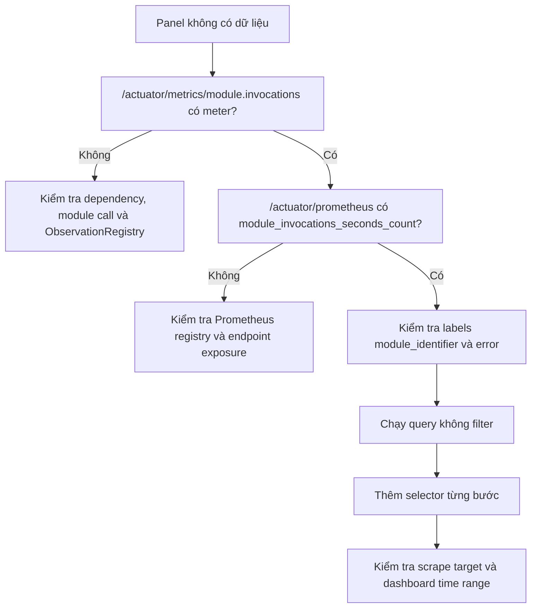

# Panel lỗi và tỷ lệ lỗi theo module

## 1. Mục tiêu của dashboard

Trong ứng dụng Spring Boot dùng **Spring Modulith**, một yêu cầu nghiệp vụ có thể đi qua nhiều application module như **ordering**, **inventory**, **payment** và **notification**. Khi một module gặp exception, đội vận hành cần trả lời nhanh:

- Module nào đang phát sinh lỗi?
- Lỗi tăng bao nhiêu lần mỗi giây?
- Tỷ lệ lỗi trên tổng số lần gọi module là bao nhiêu phần trăm?
- Lỗi tập trung ở một loại invocation (bean hay event listener) hay xuất hiện rộng khắp?
- Lỗi bắt đầu từ thời điểm nào và có liên quan đến đợt triển khai gần nhất không?

Một dashboard tốt cần cho thấy **số lỗi**, **tổng lưu lượng** và **tỷ lệ lỗi** theo cùng một chiều phân loại. Chỉ hiển thị số exception có thể khiến module có lưu lượng lớn luôn đứng đầu; chỉ hiển thị phần trăm lại dễ làm một lỗi đơn lẻ trên một request trông như sự cố nghiêm trọng.

Bài này xây dựng các panel Grafana dựa trên **module invocation metrics** do Spring Modulith instrument qua Micrometer. Ví dụ dùng Prometheus làm nguồn dữ liệu, nhưng các nguyên tắc về numerator, denominator và chiều module cũng áp dụng cho hệ thống metrics khác.

> **Phạm vi:** dashboard đo lỗi của các lời gọi application module đã được instrument. Nó không tự động đại diện cho mọi lỗi trong ứng dụng, mọi HTTP response 5xx hoặc mọi event publication thất bại. Những loại lỗi đó cần panel và nguồn dữ liệu riêng.

## 2. Nguồn dữ liệu: module invocation observation

### 2.1. Spring Modulith instrument điểm vào module

Khi bật observability, Spring Modulith trang trí các Spring component thuộc API của application module bằng interceptor. Lời gọi đi qua điểm vào module tạo một **Micrometer Observation** có tên mặc định:

```text
module.invocations
```

Tên này được khai báo bởi `ModulithContext.DEFAULT_CONVENTION_NAME`. Observation cung cấp metadata về module và invocation, sau đó Micrometer Observation handlers có thể chuyển metadata thành spans và metrics.

Các low-cardinality keys mặc định của module invocation:

| Key trong Observation | Giá trị minh họa | Ý nghĩa |
| --- | --- | --- |
| `module.identifier` | `inventory` | Identifier kỹ thuật của application module |
| `module.name` | `Inventory` | Tên hiển thị của module |
| `module.invocation-type` | `bean` hoặc `event listener` | Kiểu điểm vào module |

`module.method` là high-cardinality key. Key này hữu ích khi xem span/traces, nhưng **không được đưa vào metric tags mặc định**. Vì vậy dashboard tổng hợp theo module; khi cần tìm method cụ thể, hãy drill down sang trace.

### 2.2. Micrometer tạo Timer và error tag

Spring Boot tự đăng ký `DefaultMeterObservationHandler` trên `ObservationRegistry`. Handler này tạo một **Timer** khi observation kết thúc:

- Timer có tên observation, ở đây là `module.invocations`.
- Timer mang tất cả low-cardinality key-values của observation.
- Timer có thêm tag `error`: tên class exception nếu observation ghi nhận lỗi, hoặc giá trị `none` nếu không có lỗi.
- High-cardinality keys như `module.method` không trở thành metric tags.

Do đó, một tập series minh họa có thể trông như:

```text
module.invocations{
  module.identifier="inventory",
  module.name="Inventory",
  module.invocation-type="bean",
  error="none"
}

module.invocations{
  module.identifier="inventory",
  module.name="Inventory",
  module.invocation-type="bean",
  error="IllegalStateException"
}
```

Tên label ở trên được trình bày để dễ đọc. Prometheus registry chuẩn hóa tên metric và tag keys; khi scrape thường thấy `module_identifier`, `module_name`, `module_invocation_type`. Giá trị `error` là tên class exception theo convention của Micrometer; ví dụ dùng simple class name để minh họa. Hãy xác minh cả key lẫn value bằng output thực tế của `/actuator/prometheus` trước khi lưu query vào dashboard.

**Điều kiện để lỗi được tính:** exception phải được ghi nhận vào Observation. Lỗi thoát khỏi lời gọi được instrument thường được Observation ghi lại; nếu code bắt exception rồi xử lý như kết quả bình thường, metric có thể không mang tag lỗi. Hãy kiểm tra semantics xử lý exception của chính module.

### 2.3. Prometheus biểu diễn Timer như thế nào?

Với Prometheus registry của Micrometer, Timer `module.invocations` thường tạo các time series:

| Series | Ý nghĩa |
| --- | --- |
| `module_invocations_seconds_count` | Tổng số lần invocation đã kết thúc |
| `module_invocations_seconds_sum` | Tổng thời gian của các invocation, tính bằng giây |
| `module_invocations_seconds_max` | Thời gian lớn nhất trong cửa sổ cấu hình |
| `module_invocations_seconds_bucket` | Chỉ xuất hiện khi bật percentile histogram |

Dashboard lỗi sử dụng `_seconds_count`: đây là tổng số invocation đã hoàn tất, được chia theo các labels như module và `error`. Nó cho phép tính throughput, error rate và tổng số lỗi bằng `rate()` hoặc `increase()`.

## 3. Phân biệt module invocation errors với các lỗi khác

Không nên gộp mọi loại lỗi thành một panel rồi gọi chung là “module error”. Các tín hiệu có ý nghĩa khác nhau:

| Nguồn | Đo lường | Không thể tự kết luận |
| --- | --- | --- |
| `module.invocations` Timer | Lỗi thoát khỏi invocation đã được Spring Modulith instrument tại ranh giới module | Mọi exception bên trong private method hoặc mọi lỗi ứng dụng |
| `module.events.published` | Số event được công bố, có thể phân nhóm theo event type và module | Listener đã xử lý thành công hay thất bại |
| Event Publication Registry | Trạng thái publication/listener như đang chờ, đang xử lý, hoàn tất hoặc lỗi theo cơ chế registry | Trace của một request đã được export |
| `http.server.requests` | Metrics của request HTTP, bao gồm status/outcome theo instrumentation | Module nào bên trong request đã gây lỗi |
| Traces/spans | Đường đi của một lần thực thi và exception gắn với span | Tổng tỷ lệ lỗi của toàn hệ thống nếu trace bị sampling |

Ví dụ: `ordering` công bố `OrderPlaced`, listener ở `inventory` ném exception. Counter `module.events.published` vẫn có thể tăng vì event đã được công bố. Để biết listener publication có thất bại hay không, hãy kiểm tra Event Publication Registry. Panel `module.invocations` chỉ tính lỗi của invocation đã được instrument và ghi nhận exception.

## 4. Bật module metrics và Prometheus endpoint

### 4.1. Dependencies

Cách thuận tiện để bật Spring Modulith actuator và observability là Insight starter:

```kotlin
dependencies {
    runtimeOnly("org.springframework.modulith:spring-modulith-starter-insight")
    runtimeOnly("io.micrometer:micrometer-registry-prometheus")
}
```

`spring-modulith-starter-insight` bao gồm hỗ trợ actuator và observability của Spring Modulith cùng phần actuator cần thiết của Spring Boot. `micrometer-registry-prometheus` thêm registry để Prometheus scrape metrics. Dùng BOM/dependency management tương thích với phiên bản Spring Boot và Spring Modulith của dự án; không tự ghim version ví dụ nếu dự án đã quản lý qua BOM.

Nếu ứng dụng đã dùng `spring-modulith-observability-core` và `spring-modulith-actuator` riêng, không cần thêm Insight starter trùng lặp.

### 4.2. Expose endpoint

Ví dụ `application.yml` cho môi trường monitoring:

```yaml
management:
  endpoints:
    web:
      exposure:
        include: health,metrics,prometheus,modulith
```

Endpoint quan trọng:

- `/actuator/prometheus`: định dạng scrape cho Prometheus.
- `/actuator/metrics`: kiểm tra meter names và tags trong registry của instance.
- `/actuator/modulith`: xem cấu trúc application module và dependency.

Chỉ expose endpoint quản trị qua mạng nội bộ hoặc lớp bảo vệ phù hợp. Không mở toàn bộ Actuator endpoints ra Internet công khai.

### 4.3. Prometheus scrape

Một `scrape_config` tối giản:

```yaml
scrape_configs:
  - job_name: spring-modulith
    metrics_path: /actuator/prometheus
    static_configs:
      - targets:
          - app-host-1:8080
          - app-host-2:8080
```

Nếu chạy Kubernetes, thường dùng service discovery thay vì khai báo static targets. Điều quan trọng là mỗi instance được scrape riêng; Prometheus sẽ gắn labels như `job` và `instance` để phân biệt chúng.

## 5. Kiểm tra metric trước khi tạo dashboard

Đừng viết PromQL dựa trên tên metric đoán từ code. Hãy kiểm tra registry thực tế sau khi ứng dụng đã chạy một vài module invocation.

### 5.1. Liệt kê meter names

```bash
curl -sS http://localhost:8080/actuator/metrics
```

Tìm `module.invocations`, sau đó xem meter:

```bash
curl -sS http://localhost:8080/actuator/metrics/module.invocations
```

Response Actuator có `measurements` và `availableTags`. Kiểm tra các tags như `module.identifier`, `module.name`, `module.invocation-type` và `error`. Có thể drill down bằng query parameters:

```bash
curl -G http://localhost:8080/actuator/metrics/module.invocations --data-urlencode "tag=module.identifier:inventory" --data-urlencode "tag=error:none"
```

Tên tag trong `/actuator/metrics` dùng theo Meter ID của Micrometer, có dấu chấm như `module.identifier`. Đừng thay bằng dạng Prometheus `module_identifier` khi truy vấn endpoint này.

### 5.2. Xem series Prometheus

```bash
curl -sS http://localhost:8080/actuator/prometheus | grep '^module_invocations_seconds_count'
```

Một dòng minh họa:

```text
module_invocations_seconds_count{
  error="none",
  module_identifier="inventory",
  module_invocation_type="bean",
  module_name="Inventory",
  instance="app-host-1:8080",
  job="spring-modulith"
} 125
```

Tên label và các label hạ tầng trong ví dụ chỉ minh họa. Output thực tế phụ thuộc phiên bản Micrometer, Prometheus registry và common tags của ứng dụng. Nếu không thấy series:

1. Gọi một API bean thuộc module đã được expose.
2. Kiểm tra observability dependency và module detection.
3. Xác nhận ObservationRegistry có meter handler.
4. Xem `/actuator/metrics/module.invocations` trước khi kiểm tra Prometheus.
5. Kiểm tra exception có thoát khỏi invocation và được Observation ghi nhận hay không.

## 6. Các panel chính trong Grafana

Nên đặt các panel theo thứ tự: **lưu lượng tổng**, **lỗi tuyệt đối**, **tỷ lệ lỗi**, sau đó mới đến top modules. Người xem sẽ hiểu tỷ lệ phần trăm trong bối cảnh số lần gọi.

### 6.1. Panel A — Invocation throughput theo module

**Mục đích:** cho biết mỗi module đang xử lý bao nhiêu invocation mỗi giây.

```promql
sum by (module_identifier) (
  rate(module_invocations_seconds_count[5m])
)
```

| Cấu hình | Giá trị gợi ý |
| --- | --- |
| Visualization | Time series |
| Unit | calls/sec |
| Legend | `{{module_identifier}}` |
| Window | 5 phút |

Panel này là **denominator** cho error ratio. Khi module có lưu lượng rất thấp, phần trăm lỗi có thể dao động mạnh.

### 6.2. Panel B — Số lỗi theo module (errors/sec)

**Mục đích:** đo tốc độ phát sinh invocation errors.

```promql
sum by (module_identifier) (
  rate(
    module_invocations_seconds_count{
      error=~".+",
      error!="none"
    }[5m]
  )
)
```

Điều kiện `error=~".+"` chỉ chọn label error có giá trị; `error!="none"` loại các invocation không lỗi. Kết quả là số lỗi mỗi giây, đã cộng qua các instance.

| Cấu hình | Giá trị gợi ý |
| --- | --- |
| Visualization | Time series hoặc bar gauge |
| Unit | errors/sec |
| Legend | `{{module_identifier}}` |
| Reduce | Không cộng thêm theo instance ở Grafana nếu PromQL đã `sum by` |

Nếu muốn xem **số lỗi trong 1 giờ** thay vì tốc độ:

```promql
sum by (module_identifier) (
  increase(
    module_invocations_seconds_count{
      error=~".+",
      error!="none"
    }[1h]
  )
)
```

`rate()` phù hợp time series và alert theo tốc độ. `increase()` phù hợp thống kê số lần tăng trong một cửa sổ thời gian; cả hai đều xử lý counter reset tốt hơn phép trừ hai giá trị counter thô.

### 6.3. Panel C — Tỷ lệ lỗi theo module (%)

**Mục đích:** so sánh mức độ lỗi giữa các module có lưu lượng khác nhau.

```promql
100 *
sum by (module_identifier) (
  rate(
    module_invocations_seconds_count{
      error=~".+",
      error!="none"
    }[5m]
  )
)
/
sum by (module_identifier) (
  rate(module_invocations_seconds_count[5m])
)
```

Công thức:

\[
\text{Error rate (\%)} =
\frac{\text{failed module invocations}}
{\text{all completed module invocations}}
\times 100
\]

Numerator và denominator dùng cùng metric, cùng cửa sổ 5 phút và cùng nhóm `module_identifier`. Phép `sum by` loại chiều `instance` để tổng hợp toàn bộ replicas của cùng module.

| Cấu hình | Giá trị gợi ý |
| --- | --- |
| Visualization | Time series hoặc bar gauge |
| Unit | Percent (0–100) |
| Legend | `{{module_identifier}}` |
| Decimals | 1 hoặc 2 |
| Window | 5 phút; có thể cung cấp lựa chọn 15 phút |

Nếu module không có invocation trong cửa sổ, denominator bằng 0 và tỷ lệ không xác định (Prometheus có thể trả `NaN`, Grafana có thể hiển thị `No data` tùy cấu hình). Đừng thay giá trị này thành 0%; không có traffic không đồng nghĩa module đang khỏe.

### 6.4. Panel D — Top 5 module theo error rate

**Mục đích:** nhanh chóng tìm module có tỷ lệ lỗi cao nhất.

```promql
topk(
  5,
  100 *
  sum by (module_identifier) (
    rate(
      module_invocations_seconds_count{
        error=~".+",
        error!="none"
      }[5m]
    )
  )
  /
  sum by (module_identifier) (
    rate(module_invocations_seconds_count[5m])
  )
)
```

Top 5 chỉ xếp hạng các series có dữ liệu. Với lưu lượng rất thấp, một lỗi trên một invocation có thể tạo 100%; vì thế nên đọc cùng panel throughput hoặc đặt điều kiện lưu lượng tối thiểu cho cảnh báo.

### 6.5. Panel E — Phân tách lỗi theo invocation type

Spring Modulith phân loại invocation thành `bean` và `event listener`. Nếu cần xem lỗi đến từ kiểu tương tác nào:

```promql
sum by (module_identifier, module_invocation_type) (
  rate(
    module_invocations_seconds_count{
      error=~".+",
      error!="none"
    }[5m]
  )
)
```

Panel này giúp nhận ra module lỗi chủ yếu ở lời gọi bean đồng bộ hay event listener. Giá trị label thực tế cần xác nhận trong `/actuator/prometheus`; tên key có thể được chuẩn hóa thành `module_invocation_type`.

### 6.6. Panel F — Phân loại exception

Để điều tra sâu hơn, có thể nhóm lỗi theo exception class:

```promql
sum by (module_identifier, error) (
  rate(
    module_invocations_seconds_count{
      error=~".+",
      error!="none"
    }[5m]
  )
)
```

Panel này chỉ nên dùng để drill down. Exception class có thể tạo thêm series; không nhóm theo exception message, stack trace, request ID hoặc dữ liệu động. Nếu dashboard tổng quan bị quá nhiều series, giữ panel theo module và chuyển phân tích exception sang logs/traces.

## 7. Cấu hình latency panel bổ trợ

Panel lỗi cho biết invocation thất bại, nhưng không cho biết module nào đang chậm dần trước khi lỗi xuất hiện. Có thể bật histogram cho Timer `module.invocations` để tính p95/p99 bằng Prometheus.

Ví dụ:

```yaml
management:
  metrics:
    distribution:
      percentiles-histogram:
        "module.invocations": true
```

Sau khi bật histogram, Prometheus registry có thể xuất series `_seconds_bucket`. Query p95 theo module:

```promql
histogram_quantile(
  0.95,
  sum by (le, module_identifier) (
    rate(module_invocations_seconds_bucket[5m])
  )
)
```

Đây là p95 xấp xỉ từ histogram buckets. Cần xác nhận series `_seconds_bucket` xuất hiện sau khi cấu hình và chọn bucket/SLO phù hợp với thời gian xử lý thực tế. Histogram làm tăng số time series; chỉ bật khi dashboard latency thực sự cần.

## 8. Biến lọc và bố cục dashboard

### 8.1. Các biến nên có

| Variable | Nguồn | Mục đích |
| --- | --- | --- |
| `job` | Label scrape của Prometheus | Chọn application/job |
| `environment` | Common tag nếu ứng dụng đã gắn | Chọn dev, staging hoặc prod |
| `module_identifier` | Label của module invocation | Chọn một hoặc nhiều module |
| `module_invocation_type` | Label invocation type | Chọn bean hoặc event listener |

Không tự tạo variable từ label chưa tồn tại. Trước tiên xác minh labels trong Prometheus, sau đó mới cấu hình Grafana variable query.

Nếu dùng filter `job` hoặc `environment`, hãy áp dụng **cùng selector** cho numerator và denominator. Ví dụ:

```promql
sum by (module_identifier) (
  rate(
    module_invocations_seconds_count{
      job="$job",
      environment="$environment",
      error=~".+",
      error!="none"
    }[5m]
  )
)
```

Nếu `environment` không được gắn làm common tag, bỏ selector này. Filter chỉ có trong numerator sẽ làm tỷ lệ bị sai.

### 8.2. Bố cục đề xuất

```text
┌──────────────────────────────────────────────────────────────┐
│ Filters: Environment | Job | Module | Invocation type       │
├──────────────────────────────┬───────────────────────────────┤
│ Invocation throughput        │ Errors / second              │
├──────────────────────────────┴───────────────────────────────┤
│ Error rate (%) by module                                     │
├──────────────────────────────┬───────────────────────────────┤
│ Top 5 modules by error rate  │ Error rate by invocation type │
├──────────────────────────────┴───────────────────────────────┤
│ Exception class drill-down / p95 latency                     │
└──────────────────────────────────────────────────────────────┘
```

Panel tỷ lệ lỗi nên rộng nhất vì đây là chỉ số tổng quan chính. Throughput và errors/sec cung cấp bối cảnh để tránh diễn giải sai tỷ lệ.

## 9. Đặt ngưỡng và cảnh báo

Ngưỡng cảnh báo phụ thuộc SLO và lưu lượng của hệ thống. Một cấu hình khởi đầu có thể:

| Mức | Điều kiện minh họa | Phản ứng |
| --- | --- | --- |
| Theo dõi | Error rate vượt ngưỡng cảnh báo trong cửa sổ 5 phút | Hiển thị trên dashboard, kiểm tra module liên quan |
| Warning | Error rate tăng liên tục và throughput đủ lớn | Gửi thông báo cho nhóm sở hữu module |
| Critical | Error rate cao kéo dài, số lỗi tuyệt đối tăng và ảnh hưởng SLO | Kích hoạt quy trình incident |

Không đặt cảnh báo chỉ dựa vào phần trăm nếu module ít traffic. Kết hợp:

1. **Error ratio:** phần trăm invocation lỗi.
2. **Error throughput:** lỗi mỗi giây hoặc số lỗi trong cửa sổ.
3. **Minimum traffic:** chỉ đánh giá tỷ lệ khi có đủ invocation.
4. **Duration:** yêu cầu điều kiện kéo dài một khoảng thời gian để giảm false positive.

Ví dụ rule logic:

```text
error_rate_percent > configured_threshold
AND total_invocations_per_second > minimum_traffic
FOR 10m
```

Các giá trị threshold và minimum traffic phải lấy từ SLO, baseline và lưu lượng thực tế của ứng dụng; không dùng số ví dụ như một chuẩn production chung.

## 10. Đọc dashboard trong một tình huống thực tế

Giả sử dashboard hiển thị:

| Module | Invocation/s | Error/s | Error rate |
| --- | ---: | ---: | ---: |
| `ordering` | 120 | 0.2 | 0.17% |
| `inventory` | 80 | 4 | 5.0% |
| `payment` | 15 | 0.1 | 0.67% |
| `notification` | 2 | 0.2 | 10.0% |

`notification` có tỷ lệ lỗi cao nhất, nhưng lưu lượng rất thấp. `inventory` có tỷ lệ thấp hơn nhưng số lỗi tuyệt đối và tốc độ lỗi cao hơn đáng kể. Đội vận hành nên ưu tiên điều tra inventory trước, đồng thời kiểm tra notification vì tỷ lệ của module này cũng đáng chú ý.

Quy trình drill down:

1. Chọn `inventory` trên panel error rate.
2. Xem panel error/s để xác định lỗi tăng đột ngột hay kéo dài.
3. Lọc theo `module_invocation_type` để biết lỗi tập trung ở bean hay event listener.
4. Chuyển sang panel exception class để xác định nhóm exception.
5. Mở trace mẫu đã được sample để xem method và dependency liên quan.
6. Đối chiếu logs theo `traceId`/`spanId`, rồi kiểm tra Event Publication Registry nếu lỗi liên quan listener publication.

Dashboard chỉ cho thấy **xu hướng tổng hợp**. Logs và traces cung cấp ngữ cảnh của từng lần thực thi; publication registry giúp kiểm tra vòng đời event.

## 11. Cardinality và độ tin cậy của số liệu

Các dimension mặc định của module observation được thiết kế ở mức low cardinality: identifier, name và invocation type. Tuy vậy, dashboard có thể tăng series nếu thêm common tags hoặc custom convention.

Thực hành nên theo:

- Dùng `module_identifier` làm chiều group chính vì ổn định và ngắn gọn.
- Chỉ thêm `environment`, `region`, `cluster` hoặc `instance` nếu có nhu cầu vận hành.
- Không thêm `orderId`, `customerId`, request ID, exception message hoặc stack trace làm metric labels.
- Không group dashboard tổng quan theo `module.method`; key này là high-cardinality metadata để điều tra trong traces.
- Khi dùng exception class trong tag `error`, chỉ drill down ở panel phụ nếu số class thực tế được kiểm soát.
- Nếu custom `ModulithObservationConvention`, giữ lại module identifier và các tags cần cho dashboard hoặc cập nhật đồng bộ query.

Một thay đổi tên module/identifier hoặc convention có thể khiến series mới xuất hiện và dashboard cũ không còn dữ liệu. Khi refactor module, cần kiểm tra dashboard variables, alert rules và recording rules.

## 12. Chẩn đoán khi panel không có dữ liệu

| Triệu chứng | Nguyên nhân có thể | Cách xử lý |
| --- | --- | --- |
| Không có `module_invocations_seconds_count` | Chưa có invocation, observability core chưa chạy hoặc meter handler không có | Kiểm tra Insight starter, `/actuator/metrics/module.invocations` và gọi API module |
| Có timer nhưng không có tag `error` | Registry/version/handler khác cấu hình kỳ vọng hoặc output đang xem không đầy đủ | Kiểm tra `/actuator/metrics` và một dòng scrape hoàn chỉnh |
| Tất cả invocation đều có `error="none"` dù ứng dụng có lỗi | Exception được catch/handled bên trong method hoặc lỗi không đi qua module entry instrumentation | Kiểm tra nơi exception phát sinh và trace/log |
| Có error series nhưng error rate bằng 0 | Query sai tên label, selector `job`/`environment` không khớp hoặc window quá ngắn | Kiểm tra label thực tế và thử query tổng không filter |
| Tỷ lệ lỗi rất cao khi chỉ có vài request | Denominator nhỏ | Hiển thị throughput, tăng cửa sổ và áp dụng minimum traffic cho alert |
| Module bị lặp nhiều dòng | Query chưa aggregate qua `instance` hoặc group thêm label không cần thiết | Dùng `sum by (module_identifier)` |
| Dashboard không có `module.method` | Đây là high-cardinality key, không xuất thành metric tag mặc định | Drill down bằng traces |
| Event counter tăng nhưng module error panel không đổi | Publication counter và module invocation Timer đo hai việc khác nhau | Kiểm tra Event Publication Registry và listener traces |
| Histogram p95 không có dữ liệu | Chưa bật histogram hoặc Prometheus chưa scrape series bucket | Kiểm tra `module_invocations_seconds_bucket` |
| Metric name khác ví dụ | Naming convention hoặc phiên bản registry khác | Xem `/actuator/prometheus` và sửa query theo output thật |

### 12.1. Thứ tự kiểm tra ngắn



## 13. Bài tập tự kiểm tra

**Bài tập 1.** `module_invocations_seconds_count` có 1.000 invocation trong 5 phút, trong đó 20 invocation mang `error` khác `none`. Error ratio là bao nhiêu?

**Gợi ý:** \(20 / 1000 \times 100 = 2\%\).

**Bài tập 2.** Module `notification` có error rate 25% với 4 invocation, còn `inventory` có 3% với 10.000 invocation. Module nào cần điều tra trước?

**Gợi ý:** So sánh cả error ratio và error throughput. Notification có tỷ lệ cao nhưng sample rất nhỏ; inventory có thể tạo nhiều lỗi tuyệt đối hơn. Xem thêm mức độ ảnh hưởng nghiệp vụ.

**Bài tập 3.** Vì sao không dùng `module.method` làm label trên dashboard tổng quan?

**Gợi ý:** Đây là high-cardinality key; đưa vào metric labels có thể tạo quá nhiều time series. Dùng module identifier trong metrics và method trong traces.

**Bài tập 4.** `module.events.published` tăng nhưng panel lỗi module không tăng. Có phải dashboard sai?

**Gợi ý:** Chưa chắc. Counter publication đo event được công bố, còn module invocation Timer đo lỗi ở điểm vào module được instrument. Hãy xem publication status và listener traces.

**Bài tập 5.** Một module không có invocation trong 5 phút. Có nên hiển thị error rate bằng 0%?

**Gợi ý:** Không. Không có denominator thì tỷ lệ không xác định. Hiển thị No data hoặc N/A để phân biệt với module có traffic nhưng không lỗi.

## 14. Tổng kết

Để xây dựng **panel lỗi và tỷ lệ lỗi theo module**, hãy dùng Timer `module.invocations` do Spring Modulith instrument và Micrometer chuyển thành metrics. Tag `error` phân biệt invocation có exception với invocation bình thường; `module.identifier` là chiều group chính.

Các panel quan trọng:

- **Invocation throughput:** tổng invocation mỗi giây theo module.
- **Errors/sec:** tốc độ invocation lỗi.
- **Error rate (%):** số invocation lỗi chia tổng invocation trong cùng cửa sổ thời gian.
- **Top modules:** xếp hạng module theo error ratio nhưng luôn đọc kèm throughput.
- **Invocation type / exception drill-down:** hỗ trợ tìm nơi lỗi tập trung.
- **Latency p95:** panel bổ trợ khi histogram đã được bật.

Hãy xác minh tên metric và labels từ `/actuator/prometheus`, dùng cùng selectors cho numerator và denominator, giữ cardinality ở mức kiểm soát và kết hợp dashboard với traces, logs cùng Event Publication Registry. Nhờ đó, đội phát triển có thể xác định module đang lỗi, mức độ ảnh hưởng và hướng điều tra tiếp theo mà không nhầm lỗi invocation với lỗi publication event.

### Tài liệu tham khảo

- [Spring Modulith — Production-ready Features](https://docs.spring.io/spring-modulith/reference/production-ready.html): Insight starter, module invocation observations, tags và event publication metrics.
- [Spring Modulith — ModulithContext API](https://docs.spring.io/spring-modulith/docs/current/api/org/springframework/modulith/observability/ModulithContext.html): tên observation mặc định và metadata module invocation.
- [Spring Boot — Metrics and Prometheus](https://docs.spring.io/spring-boot/reference/actuator/metrics.html): DefaultMeterObservationHandler, /actuator/metrics, /actuator/prometheus và registry.
- [Micrometer — Observation Components](https://docs.micrometer.io/micrometer/reference/observation/components.html): Timer được tạo từ observation, error tag và low/high cardinality.
- [Micrometer — Prometheus Registry](https://docs.micrometer.io/micrometer/reference/implementations/prometheus.html): Timer series _seconds_count, _seconds_sum, _seconds_max và histogram buckets.
- [Micrometer — Timers](https://docs.micrometer.io/micrometer/reference/concepts/timers.html): count, total time và phân phối thời gian.
- [Prometheus — Querying Basics](https://prometheus.io/docs/prometheus/latest/querying/basics/): label selectors, range vectors và PromQL.
