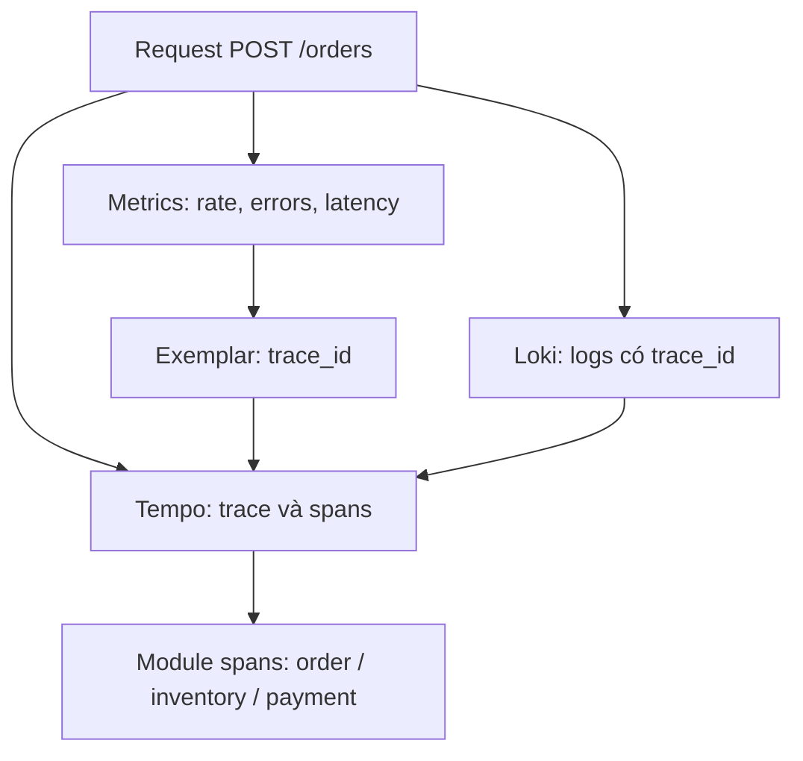
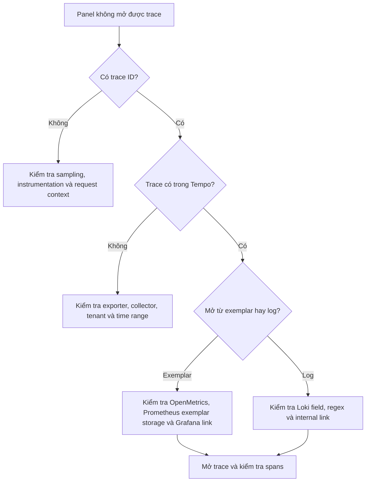

# Panel trace liên quan tới request

Khi một request đặt hàng đi qua các application module `order`, `inventory`, `payment` và `notification`, dashboard thường cho thấy request rate tăng, độ trễ p95 cao hoặc tỷ lệ lỗi bất thường. Những biểu đồ tổng hợp trả lời câu hỏi **điều gì đang xảy ra**, nhưng chưa chỉ ra **request cụ thể nào gây ra vấn đề và nó đã đi qua những bước nào**.

Một dashboard hữu ích cần cho phép đi từ số liệu tổng hợp tới trace của request liên quan. Trong Grafana, có thể tạo liên kết theo ba hướng:

- **Metrics → trace:** click exemplar trên biểu đồ Prometheus để mở trace tương ứng trong Tempo.
- **Log → trace:** click trace ID trong log panel để mở trace.
- **Trace → logs/metrics:** từ span trong Tempo mở các log và metrics liên quan để điều tra sâu hơn.

Bài thuộc chương **Dashboard** của học phần `SPRING_MODULITH_DOCUMENTATION_OBSERVABILITY`. Học phần dùng Spring Modulith để sinh tài liệu ranh giới application module và quan sát tương tác giữa các phần trong ứng dụng Spring Boot qua module graph, Actuator, event metrics, tracing và context propagation. Bài này tập trung xây dựng panel cho phép tìm trace liên quan tới request, kết nối Prometheus, Loki và Tempo, đồng thời phân biệt module graph với service graph.

Sau bài học, bạn có thể:

- Thiết kế dashboard để chuyển từ request rate/latency sang trace cụ thể.
- Dùng Prometheus exemplars để liên kết một metric sample với trace ID.
- Tạo panel TraceQL để tìm request chậm hoặc lỗi trong Grafana Tempo.
- Liên kết log với trace bằng trace ID và Loki derived fields.
- Cấu hình hai chiều trace-to-logs và trace-to-metrics.
- Tổ chức panel theo luồng request qua Spring Modulith modules.
- Chẩn đoán panel không có exemplar, trace link hoặc log correlation.

> **Phạm vi ví dụ:** Spring Boot 3.5.x, Micrometer Tracing, Prometheus, Grafana, Loki và Tempo. Tên metric, label, span và menu trong Grafana có thể khác theo phiên bản, registry và convention của ứng dụng. Hãy xác nhận dữ liệu thực tế trước khi chốt truy vấn.

## 1. Vì sao dashboard cần liên kết tới trace?

Một dashboard chỉ có số liệu tổng hợp thường có các panel như:

- Request rate theo route.
- Tỷ lệ HTTP 4xx/5xx.
- Độ trễ p50/p95/p99.
- Số event được publish/consume.
- Mức sử dụng CPU, bộ nhớ và connection pool.

Ví dụ panel latency cho thấy p95 của `POST /orders` tăng từ 120 ms lên 2,4 giây. Điều đó cho biết có vấn đề, nhưng không trả lời được:

- Request nào bị chậm?
- Module `order` mất thời gian ở bước nào?
- Lời gọi `inventory` hay `payment` có thời gian chờ lớn?
- Có exception hoặc retry nào xuất hiện?
- Request bị chậm có cùng một nguyên nhân hay nhiều nguyên nhân khác nhau?

Trace biểu diễn một lần thực thi qua các span có quan hệ cha-con. Khi dashboard có liên kết tới trace, người vận hành có thể click vào một điểm bất thường rồi xem waterfall của request tương ứng.



Dashboard đóng vai trò điểm bắt đầu điều tra. Prometheus giữ số liệu tổng hợp, Tempo lưu traces, Loki lưu logs. Liên kết bằng trace ID giúp tìm đúng dữ liệu của cùng một lần thực thi mà không cần nhét toàn bộ request payload vào metric hay log.

## 2. Các thành phần cần có

Để xây dựng panel trace liên quan tới request, cần chuẩn bị các thành phần sau:

| Thành phần | Vai trò | Dữ liệu chính |
| --- | --- | --- |
| Spring Boot Actuator | Cung cấp metrics và tích hợp tracing | HTTP request metrics, trace/span context |
| Micrometer Tracing | Tạo và quản lý trace context | `traceId`, `spanId` |
| Spring Modulith observability | Instrument tương tác qua ranh giới module theo cấu hình/version | Module observations/spans |
| Prometheus | Scrape và lưu metrics | Counter, timer, histogram, exemplars |
| Loki | Lưu và truy vấn logs | Log lines, structured fields, trace ID |
| Tempo | Lưu và truy vấn traces | Trace, spans, attributes |
| Grafana | Dashboard và liên kết các tín hiệu | Panels, data links, exemplars, TraceQL |

Ví dụ dependency tối thiểu cho metrics và OpenTelemetry tracing:

```xml
<dependencies>
    <dependency>
        <groupId>org.springframework.boot</groupId>
        <artifactId>spring-boot-starter-actuator</artifactId>
    </dependency>

    <dependency>
        <groupId>io.micrometer</groupId>
        <artifactId>micrometer-registry-prometheus</artifactId>
    </dependency>

    <dependency>
        <groupId>io.micrometer</groupId>
        <artifactId>micrometer-tracing-bridge-otel</artifactId>
    </dependency>

    <dependency>
        <groupId>io.opentelemetry</groupId>
        <artifactId>opentelemetry-exporter-otlp</artifactId>
    </dependency>
</dependencies>
```

Các version nên được quản lý bằng Spring Boot BOM. Nếu muốn quan sát lời gọi qua ranh giới application module, bổ sung artifact/starter observability phù hợp với phiên bản Spring Modulith đang dùng. `micrometer-registry-prometheus` cung cấp metrics registry; tracing bridge và exporter xử lý trace. Không có dependency nào trong số đó tự động bảo đảm mọi method trong ứng dụng đều có span.

### Cấu hình Actuator

Ví dụ cấu hình ứng dụng:

```yaml
spring:
  application:
    name: shop-modulith

management:
  endpoints:
    web:
      exposure:
        include: health,prometheus
  tracing:
    sampling:
      probability: 0.1
```

Sampling `0.1` chỉ là ví dụ cho môi trường có lưu lượng thực. Với local, có thể tăng lên `1.0` khi cần quan sát mọi request thử nghiệm. Micrometer Tracing của Spring Boot đưa `traceId` và `spanId` vào MDC để log có thể được liên kết với trace.

Endpoint `/actuator/prometheus` phải được expose theo cấu hình Actuator. Bảo vệ endpoint bằng network policy, authentication hoặc cơ chế bảo vệ phù hợp; không mở metrics endpoint công khai nếu không cần.

## 3. Phân biệt trace, metric, exemplar và log

Bốn loại dữ liệu này có vai trò khác nhau:

| Loại | Trả lời câu hỏi | Ví dụ |
| --- | --- | --- |
| Metric | Xu hướng của nhiều request ra sao? | p95 latency của `POST /orders` trong 5 phút |
| Trace | Một request cụ thể đã đi qua những bước nào? | Trace ID `4bf9...4736` với spans `order`, `inventory`, `payment` |
| Exemplar | Mẫu đo metric này liên quan tới trace nào? | Một điểm trên histogram có `trace_id` |
| Log | Điều gì đã được ghi nhận trong một bước xử lý? | `module=payment outcome=failure trace_id=...` |

**Exemplar không phải metric label.** Nó là metadata gắn với một sample của time series để tham chiếu tới dữ liệu khác, thường là trace ID và span ID. Vì exemplar không trở thành dimension/label của time series, nó không làm tăng cardinality như cách thêm `trace_id` vào label.

Không nên tạo metric kiểu:

```text
http_requests_total{trace_id="4bf92f..."} 1
```

Mỗi request có thể có trace ID khác nhau. Đưa ID này vào labels sẽ tạo ra rất nhiều time series. Dùng exemplar để nối metric sample tới trace.

Logs cũng cần được thiết kế riêng. Trace ID có thể là field trong log line hoặc structured metadata, nhưng không nên biến nó thành Loki indexed label vì số giá trị rất lớn.

## 4. Tạo metrics có thể liên kết tới trace bằng Prometheus exemplars

Spring Boot hỗ trợ Prometheus exemplars khi có tracing context phù hợp. Khi dùng Micrometer Tracing, Spring Boot tự cấu hình thành phần cung cấp `SpanContext` cho Prometheus registry. Mặc định, chỉ trace đã được sampled mới được đưa vào exemplar.

Prometheus phải nhận dữ liệu ở định dạng **OpenMetrics** và bật exemplar storage. Theo tài liệu Prometheus, exemplar storage cần feature flag `exemplar-storage`; hãy kiểm tra phiên bản Prometheus đang chạy vì đây là tính năng có thể thay đổi theo version.

Ví dụ chạy Prometheus với exemplar storage:

```bash
prometheus \
  --config.file=prometheus.yml \
  --enable-feature=exemplar-storage
```

Ví dụ cấu hình scrape ứng dụng Spring Boot:

```yaml
scrape_configs:
  - job_name: shop-modulith
    metrics_path: /actuator/prometheus
    static_configs:
      - targets:
          - localhost:8080
```

Đảm bảo scrape negotiation cho phép OpenMetrics format theo cấu hình Prometheus và exporter. Có thể kiểm tra trực tiếp endpoint với header OpenMetrics:

```bash
curl -H "Accept: application/openmetrics-text; version=1.0.0" \
  http://localhost:8080/actuator/prometheus
```

Một dòng metric có exemplar có thể có dạng minh họa:

```text
http_server_requests_seconds_count{method="POST",uri="/orders",status="201"} 42 # {trace_id="4bf92f3577b34da6a3ce929d0e0e4736",span_id="00f067aa0ba902b7"} 1.0 1795774521.25
```

Đây là output minh họa; tên field và format phải đối chiếu với registry/version đang dùng. Nếu chỉ thấy metric sample mà không có phần exemplar, kiểm tra OpenMetrics negotiation, exemplar storage của Prometheus, sampling và tracing context tại thời điểm metric được ghi.

### Metrics HTTP request trong Spring Boot

Spring Boot tạo metric `http.server.requests` cho các request Spring MVC và WebFlux. Với Prometheus naming convention, Timer thường được xuất thành các series tương tự:

```text
http_server_requests_seconds_count
http_server_requests_seconds_sum
http_server_requests_seconds_max
```

Nếu histogram được bật, có thể có series `_bucket`. Tên label mặc định thường gồm `method`, `uri`, `status`, `outcome` và `exception`; hãy xem `/actuator/prometheus` để xác nhận.

Có thể bật histogram cho HTTP server requests khi cần percentile từ bucket:

```yaml
management:
  metrics:
    distribution:
      percentiles-histogram:
        http.server.requests: true
```

Chỉ bật histogram khi có nhu cầu dashboard/SLO và đã đánh giá số lượng series, bucket và chi phí lưu trữ.

## 5. Tạo panel Time series có exemplar trong Grafana

Trước tiên, thêm hai data sources trong Grafana:

- **Prometheus:** kết nối tới Prometheus đang scrape `/actuator/prometheus`.
- **Tempo:** kết nối tới Tempo đang nhận traces từ OpenTelemetry Collector.

Sau đó cấu hình exemplar link trên Prometheus data source:

1. Mở **Connections → Data sources** và chọn Prometheus.
2. Tìm phần **Exemplars**, thêm một exemplar configuration.
3. Bật **Internal link**.
4. Chọn Tempo data source làm đích.
5. Điền **Label name** theo tên trường trace ID thực tế trong exemplar, ví dụ `trace_id`.
6. Lưu và kiểm tra data source.

Nếu exporter đang xuất `traceID` thay vì `trace_id`, hãy dùng đúng tên trường đang có trong payload. Không suy đoán tên label dựa trên cách viết trong code.

### Tạo panel request rate

Trong dashboard, thêm panel kiểu **Time series** và chọn Prometheus data source.

Ví dụ PromQL để xem tốc độ request theo route và method:

```promql
sum by (uri, method) (
  rate(
    http_server_requests_seconds_count{
      uri!~"/actuator.*"
    }[5m]
  )
)
```

Panel có thể đặt tên **Request rate by route**. Khi có exemplar và Grafana truy vấn được exemplar của series, biểu đồ sẽ hiển thị marker tại thời điểm có trace mẫu. Hover marker để xem thông tin exemplar, sau đó chọn link tới Tempo để mở trace tương ứng.

Để kiểm tra đường exemplar trước khi thêm aggregation hoặc transformation, hãy thử một query hẹp cho một series:

```promql
http_server_requests_seconds_count{
  method="POST",
  uri="/orders"
}
```

Khi query đã hiển thị exemplar, mới mở rộng thành panel tổng hợp theo route. Một số phép aggregation hoặc transformation có thể làm mất thông tin liên hệ với series nguồn; nếu marker không xuất hiện, thử query selector đơn giản và kiểm tra query exemplar riêng.

**Lưu ý:** exemplar chỉ đại diện cho một số sample, không phải danh sách đầy đủ mọi request. Một panel có 10.000 request không có nghĩa nó sẽ có 10.000 marker. Dùng biểu đồ để nhận biết xu hướng và exemplar để mở một số trace mẫu.

## 6. Tạo panel trace trực tiếp bằng Grafana Tempo và TraceQL

Exemplar phù hợp khi đi từ metric sample tới trace. Ngoài ra, dashboard có thể có panel **Traces liên quan tới request** dùng Tempo data source để tìm các trace chậm hoặc lỗi.

Tạo panel mới, chọn Tempo data source và dùng TraceQL query. Ví dụ tìm các trace lỗi của service:

```traceql
{ resource.service.name = "shop-modulith" && status = error }
```

Tìm request có tổng thời gian trace lớn hơn 500 ms:

```traceql
{ resource.service.name = "shop-modulith" && trace:duration > 500ms }
```

Tìm span HTTP lỗi:

```traceql
{ resource.service.name = "shop-modulith" && span.http.status_code >= 500 }
```

Tìm một trace theo Trace ID:

```traceql
{ trace:id = "$traceId" }
```

Các thuộc tính như `service.name`, `span.http.status_code`, tên span và route phụ thuộc instrumentation/semantic conventions. Hãy xem span thực tế trong Tempo rồi thay điều kiện cho khớp. Ví dụ request span có thể tên `POST /orders`, nhưng tên chính xác không phải hợp đồng cố định cho mọi instrumentation.

Trong query options, chọn **Table Format: Traces** để hiển thị danh sách trace. Khi click Trace ID, Grafana mở trace diagram; click một span sẽ mở waterfall và định vị span tương ứng.

### Dùng dashboard variable

Có thể tạo các variable:

| Variable | Mục đích | Ví dụ |
| --- | --- | --- |
| `$service` | Lọc service | `shop-modulith` |
| `$environment` | Lọc môi trường | `local`, `staging`, `production` |
| `$traceId` | Tìm một request cụ thể | ID được copy từ log hoặc exemplar |

Ví dụ query theo service và môi trường:

```traceql
{
  resource.service.name = "$service" &&
  resource.deployment.environment = "$environment" &&
  status = error
}
```

Panel trace lookup theo ID:

```traceql
{ trace:id = "$traceId" }
```

Nếu dashboard chưa có trace ID, hãy lấy nó từ exemplar marker hoặc log panel. Không nhập ID vào metric label để tạo một series riêng cho mỗi request.

## 7. Tạo panel log có link mở trace

Spring Boot và Micrometer Tracing có thể đưa `traceId` và `spanId` vào MDC. Với logging pattern mặc định, correlation ID được thêm vào log. Để Grafana/Loki liên kết ổn định, nên chuẩn hóa log output thành field có tên nhất quán, ví dụ JSON:

```json
{
  "timestamp": "2026-11-27T10:15:21.123+07:00",
  "level": "INFO",
  "service_name": "shop-modulith",
  "module": "order",
  "event": "OrderPlaced",
  "outcome": "success",
  "trace_id": "4bf92f3577b34da6a3ce929d0e0e4736",
  "span_id": "00f067aa0ba902b7"
}
```

Đây là log metadata minh họa, không phải payload event. Không đưa email, token hoặc request body vào log chỉ để phục vụ trace lookup.

Gửi logs tới Loki. Dùng `service_name`, `environment`, `cluster` hoặc những nhãn có cardinality thấp làm Loki labels. Để `trace_id` trong log line hoặc structured metadata, không tạo indexed label cho từng trace ID.

### Cấu hình Derived field trong Loki data source

Để click log line và mở trace:

1. Mở **Connections → Data sources**, chọn Loki.
2. Tìm **Derived fields**, thêm field mới có tên `TraceID`.
3. Chọn kiểu regex trong log line.
4. Nếu log JSON có field `trace_id`, regex minh họa là:

```regex
"trace_id":"([0-9a-fA-F]{32})"
```

5. Bật **Internal link**, chọn Tempo data source.
6. Đặt Query thành `${__value.raw}`.
7. Lưu và kiểm tra.

Nếu log dùng format `trace_id=...`, regex có thể là:

```regex
trace_id=([0-9a-fA-F]{32})
```

Regex phải khớp chính xác log line thực tế. Nếu mỗi service ghi trace ID với tên field khác nhau, cần cấu hình derived field tương ứng hoặc chuẩn hóa logging format.

### Query log theo trace ID

Một query LogQL minh họa khi log được ghi ở dạng JSON:

```logql
{service_name="shop-modulith"} | json | trace_id="4bf92f3577b34da6a3ce929d0e0e4736"
```

Khi dashboard có panel Logs, người vận hành có thể tìm log theo request và click derived field để mở trace. Đây là cách xây dựng bảng request gần đây có thể đi tới trace mà không phải lưu payload.

## 8. Cấu hình trace-to-logs và trace-to-metrics theo chiều ngược lại

Liên kết log-to-trace ở phần trước cho phép mở trace từ log. Để mở log từ span trong trace, cấu hình thêm trên Tempo data source.

### Trace to logs

Trong Tempo data source:

1. Mở phần **Trace to logs**.
2. Chọn Loki data source.
3. Đặt time shift trước/sau span, ví dụ `-2s` và `2s`, để bao phủ log được ghi sát ranh giới span.
4. Map `service.name` sang Loki label `service_name`.
5. Bật filter by trace ID nếu log có trace ID.
6. Lưu và kiểm tra.

Cả hai phía cần được cấu hình: Tempo biết truy vấn log nào khi click span; Loki biết trích xuất trace ID và tạo link ngược về Tempo.

Nếu query trả về quá nhiều log, đây có thể là hành vi đúng vì filter by trace ID lấy toàn bộ log trong trace, không chỉ log trong span đang chọn. Có thể dùng custom LogQL để lọc thêm span ID nếu log có field đó.

### Trace to metrics

Trong Tempo data source, mở **Trace to metrics**:

- Chọn Prometheus data source.
- Map các span/resource attributes sang label metrics tương ứng, ví dụ `service.name` → `service_name`.
- Có thể dùng query mặc định hoặc custom query.
- Đặt time shift quanh span nếu cần mở metrics trong khoảng thời gian trước/sau thao tác.

Một query tùy chỉnh có thể dùng biến tag của span:

```promql
http_server_requests_seconds_count{${__tags}}
```

Grafana thay `${__tags}` bằng các matcher đã map và có mặt trên span. Query chỉ hoạt động nếu metric thực tế có các label tương ứng. Nếu metric dùng `application` thay cho `service_name`, phải map đúng label hiện có.

Trace-to-metrics không yêu cầu Tempo metrics generator nếu bạn chỉ muốn mở metrics đã có trong Prometheus. Metrics generator là một tính năng khác, tạo metric từ span data.

## 9. Sắp xếp dashboard cho luồng Spring Modulith

Một dashboard vận hành có thể sắp xếp theo thứ tự từ tổng quan tới chi tiết:

| Hàng/panel | Nội dung | Mục đích |
| --- | --- | --- |
| 1. Request overview | Request rate, error rate, p95/p99 latency | Phát hiện bất thường |
| 2. Request by route | Rate theo URI template và method | Xác định endpoint bị ảnh hưởng |
| 3. Trace exemplars | Marker trên metric series | Mở trace mẫu tại thời điểm bất thường |
| 4. Trace lookup | Tempo TraceQL table | Tìm trace lỗi/chậm hoặc theo Trace ID |
| 5. Request logs | Loki logs có trace ID | Đọc log của request |
| 6. Module observations | Span timeline/attributes của module | Xác định bước xử lý chậm trong ứng dụng |
| 7. Service graph | Quan hệ giữa các service | Xem dependency ở cấp service |

Với Spring Modulith, các module `order`, `inventory`, `payment` có thể chạy trong **cùng một service/process**. Vì vậy, không mặc định Grafana Service Graph sẽ tạo một node cho từng application module. Service Graph thường mô tả quan hệ giữa các service đã được instrument. Để quan sát ranh giới module trong cùng ứng dụng, hãy kiểm tra spans/attributes do Spring Modulith instrumentation tạo và xem chúng trong trace waterfall.

Một trace minh họa:

```text
Trace: POST /orders
└── HTTP server span
    └── order.place
        ├── inventory.reserve
        ├── payment.capture
        └── event.publish OrderPlaced
```

Tên span và quan hệ trên chỉ minh họa. Nếu listener `notification` chạy bất đồng bộ, span có thể thuộc trace khác khi context không được truyền hoặc kiến trúc cố ý tạo trace mới. Dashboard nên hiển thị trace ID và event correlation đã được phê duyệt để điều tra mối liên hệ.

## 10. Tạo panel request lookup có thể dùng trong sự cố

Khi người vận hành nhận được request ID hoặc trace ID từ ticket, có thể dùng dashboard variable `$traceId` để mở thẳng trace.

Một bố cục gợi ý:

- **Panel 1 – Request context:** hiển thị service, environment và trace ID.
- **Panel 2 – Trace detail:** Tempo data source với TraceQL `{ trace:id = "$traceId" }`.
- **Panel 3 – Logs:** Loki query lọc theo `trace_id`.
- **Panel 4 – Related metrics:** request count, latency và error rate trong khoảng thời gian của trace.
- **Panel 5 – Module path:** xem span timeline để nhận diện module có duration hoặc status bất thường.

Đối với panel logs, có thể sử dụng query:

```logql
{service_name="$service"} | json | trace_id="$traceId"
```

Đối với panel metrics, chọn time range gần thời điểm trace bắt đầu/kết thúc. Trace-to-metrics link của Tempo có thể tự tạo khoảng thời gian dựa trên span timestamp và time shift.

Nếu chỉ có order reference nhưng chưa có trace ID, hãy tìm log hoặc hệ thống nghiệp vụ theo reference đã được phê duyệt rồi lấy trace ID từ kết quả. Không thêm order ID vào metric labels để tìm request.

## 11. Cardinality, bảo mật và quyền truy cập

Một dashboard có link trace tiện lợi nhưng không có nghĩa mọi metadata đều nên được index hoặc hiển thị.

### Không dùng trace ID làm metric/Loki label

Trace ID có thể thay đổi ở mỗi request. Nếu dùng làm metric label, mỗi request có thể tạo series mới. Nếu dùng làm Loki indexed label, mỗi trace có thể tạo một stream mới. Cả hai đều có thể gây cardinality bùng nổ.

| Nơi lưu | Nên dùng trace ID? | Cách dùng |
| --- | --- | --- |
| Prometheus metric label | Không | Dùng exemplar |
| Prometheus exemplar | Có | Gắn trace ID vào sample |
| Loki indexed label | Không | Giữ trace ID trong log line/structured metadata |
| Loki derived field | Có | Trích xuất ID để tạo link |
| Tempo trace ID | Có | ID chính để tìm trace |
| Grafana dashboard variable | Có | Nhập ID để lọc panel |

### Không đưa dữ liệu nhạy cảm vào span/log

Không thêm password, access token, cookie, email, số thẻ hoặc request payload vào span attributes, baggage hay log. Trace ID là correlation ID, không phải nơi lưu dữ liệu nghiệp vụ. Chỉ ghi metadata đã được phê duyệt như module, event type, outcome và error code.

### Giới hạn quyền truy cập

- Bảo vệ Prometheus, Loki và Tempo bằng authentication/RBAC phù hợp.
- Không chia sẻ dashboard chứa log production cho người không có quyền đọc dữ liệu tương ứng.
- Dùng retention phù hợp với chính sách dữ liệu.
- Hạn chế query/export trace và logs có thông tin vận hành nhạy cảm.
- Không expose Actuator metrics/tracing endpoint công khai ngoài phạm vi cần thiết.

## 12. Sự cố thường gặp khi panel không mở được trace

| Triệu chứng | Nguyên nhân có thể | Cách kiểm tra |
| --- | --- | --- |
| Không có exemplar marker trên biểu đồ | Prometheus chưa bật exemplar storage hoặc scrape không dùng OpenMetrics | Kiểm tra feature flag, scrape format và exemplar trong exposition |
| Exemplar có trace ID nhưng click không mở Tempo | Grafana Prometheus data source chưa cấu hình internal exemplar link hoặc label name sai | Kiểm tra exemplar label và Tempo data source |
| Panel Tempo không có kết quả | Chưa có trace, sai service name, time range quá hẹp hoặc sampling loại trace | Mở rộng time range và kiểm tra TraceQL trên Explore |
| Click log không mở trace | Loki derived field regex không khớp hoặc internal link chưa bật | Thử regex trên log line mẫu và kiểm tra datasource |
| Trace không mở được log | Chưa cấu hình Trace to logs ở Tempo hoặc thiếu tag mapping | Kiểm tra cả Tempo và Loki data source |
| Trace-to-logs trả quá nhiều dòng | Filter chỉ theo trace ID nên lấy mọi log của trace | Thêm span ID hoặc điều kiện LogQL |
| Trace-to-metrics không có link | Span thiếu attribute được map hoặc metric label khác tên | Xem span attributes và Prometheus labels |
| Dashboard không có span theo module | Module instrumentation chưa bật hoặc đường gọi không đi qua boundary được instrument | Kiểm tra Spring Modulith observability và trace thực tế |
| Service Graph không có node module | Các module cùng chạy trong một service | Xem trace waterfall; Service Graph không thay thế module graph |
| Có log nhưng không có trace | Sampling, exporter, collector hoặc trace backend có vấn đề | Kiểm tra trace pipeline và sampled flag |
| Trace ID không khớp log | Context propagation hoặc logging pattern không nhất quán | Kiểm tra MDC, async executor và tên field trace ID |
| Query chậm khi lọc trace ID | Trace ID được index như Loki label hoặc query quét quá nhiều log | Đưa trace ID về structured metadata/line field và lọc bằng pipeline |

### Quy trình chẩn đoán



Đừng sửa PromQL, regex hoặc data link trước khi xác nhận trace thực sự tồn tại trong Tempo. Nếu backend không có trace, panel link không thể tự tạo trace.

## 13. Bài thực hành: tạo dashboard trace liên quan request

**Bối cảnh:** ứng dụng Spring Modulith có module `order`, `inventory`, `payment` và `notification`. Spring Boot xuất HTTP request metrics, Micrometer Tracing tạo spans, Prometheus lưu metrics, Loki lưu logs và Tempo lưu traces.

Thực hiện:

1. Thêm Actuator, Prometheus registry, Micrometer Tracing bridge và exporter; bật instrumentation module phù hợp với phiên bản Spring Modulith.
2. Expose `/actuator/prometheus`, cấu hình Prometheus scrape ứng dụng và bật exemplar storage.
3. Xác nhận Prometheus scrape được OpenMetrics và có exemplar chứa trace ID.
4. Thêm Prometheus và Tempo data sources trong Grafana; cấu hình exemplar internal link từ Prometheus tới Tempo.
5. Tạo panel Time series request rate theo `uri` và `method`; kiểm tra exemplar marker trên sample.
6. Tạo panel Tempo TraceQL tìm trace lỗi và trace có `trace:duration` vượt ngưỡng.
7. Chuẩn hóa log để có `trace_id`/`span_id`; gửi logs tới Loki.
8. Cấu hình Loki derived field trích xuất trace ID và liên kết tới Tempo.
9. Cấu hình Tempo Trace to logs và Trace to metrics; kiểm tra cả hai chiều.
10. Gửi request đặt hàng thành công và request lỗi thanh toán. Mở trace từ exemplar/log, kiểm tra span của module đã được instrument.
11. Tạo dashboard variable `$traceId` và panel lookup `{ trace:id = "$traceId" }`.
12. Kiểm tra không có `trace_id` trong Prometheus labels hoặc Loki indexed labels; xác nhận trace ID chỉ xuất hiện ở exemplar, trace store hoặc log field/metadata.
13. Viết runbook ngắn: từ panel latency cao, click exemplar, xác định span lỗi/chậm, mở log liên quan và xem metrics quanh thời điểm request.

**Kết quả mong đợi:** dashboard có thể đi từ metric bất thường tới một trace cụ thể, từ log tới trace và từ span tới metrics/logs; người vận hành xác định được module/span liên quan tới request mà không làm tăng cardinality bằng trace ID labels.

## Tài liệu tham khảo

- [Spring Boot 3.5 — Metrics](https://docs.spring.io/spring-boot/3.5/reference/actuator/metrics.html): HTTP request metrics, Prometheus endpoint và exemplar support.
- [Spring Boot 3.5 — Tracing](https://docs.spring.io/spring-boot/3.5/reference/actuator/tracing.html): Micrometer Tracing, sampling và correlation ID trong log.
- [Grafana — Configure the Prometheus data source](https://grafana.com/docs/grafana/latest/datasources/prometheus/configure/): cấu hình exemplar link từ metrics tới trace.
- [Grafana — Introduction to exemplars](https://grafana.com/docs/grafana/latest/fundamentals/exemplars/): cách hiển thị exemplar và mở trace từ metric sample.
- [Grafana Tempo — Configure trace to logs](https://grafana.com/docs/grafana/latest/datasources/tempo/configure-tempo-data-source/configure-trace-to-logs/): liên kết hai chiều giữa Tempo và Loki.
- [Grafana Tempo — Configure trace to metrics](https://grafana.com/docs/grafana/latest/datasources/tempo/configure-tempo-data-source/configure-trace-to-metrics/): liên kết span với metrics Prometheus.
- [Grafana Tempo — TraceQL query examples](https://grafana.com/docs/grafana/latest/datasources/tempo/query-editor/traceql-query-examples/): truy vấn trace lỗi, chậm và theo service.
- [Prometheus — Feature flags](https://prometheus.io/docs/prometheus/latest/feature_flags/): bật exemplar storage.
- [Micrometer — Prometheus implementation](https://docs.micrometer.io/micrometer/reference/implementations/prometheus): exemplar, trace ID và OpenMetrics exposition.

**Ghi nhớ:** một panel trace liên quan tới request cần có đường nối từ tín hiệu tổng hợp tới trace ID. Hãy ưu tiên exemplar cho metrics, derived field cho logs và TraceQL cho panel trace; giữ trace ID ngoài metric/Loki labels để tránh cardinality cao.
