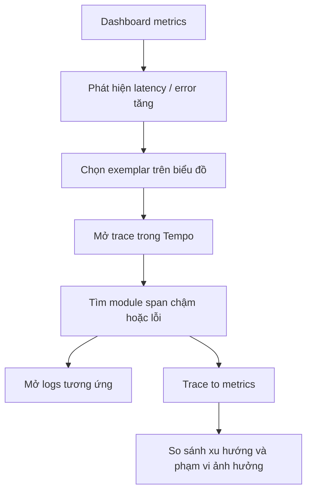
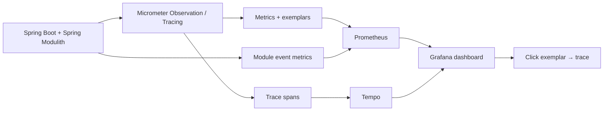

# Drill-down từ metric sang trace

## 1. Từ bức tranh tổng thể đến request cụ thể

Trong chương **Dashboard** của học phần **SPRING_MODULITH_DOCUMENTATION_OBSERVABILITY**, chúng ta học cách thiết kế dashboard để quan sát ranh giới application module và tương tác giữa các phần trong ứng dụng Spring Boot. Module graph cho biết module nào phụ thuộc module nào; event metrics cho biết sự kiện được publish với tần suất ra sao; module spans và distributed traces ghi lại đường đi của một lần thực thi.

Metrics là dữ liệu tổng hợp theo thời gian. Chúng trả lời các câu hỏi như: tỷ lệ request lỗi đang tăng không, p95 latency của module payment là bao nhiêu, module order đang publish bao nhiêu event mỗi phút? Trace đi sâu vào một lần thực thi cụ thể: request đó đã qua module nào, span nào chậm, lỗi xuất hiện ở lời gọi database hay ở payment gateway?

**Drill-down từ metric sang trace** kết nối hai mức quan sát này. Khi dashboard cho thấy latency tăng hoặc error rate bất thường, người vận hành có thể mở một trace đại diện để tìm nguyên nhân. Sau khi tìm được span chậm, họ có thể quay lại metrics để xem vấn đề có ảnh hưởng tới nhiều request hay chỉ một trường hợp.

Bài này tập trung vào Grafana, Prometheus, Tempo và Micrometer, nhưng các nguyên tắc tương quan tín hiệu cũng áp dụng cho backend tương thích.

**Mục tiêu học tập**

1. Phân biệt metrics, traces, exemplars và dashboard links.
2. Thiết kế dashboard theo service, application module và domain event.
3. Dùng Prometheus exemplars để mở trace từ một điểm dữ liệu metric.
4. Cấu hình Spring Boot/Micrometer tạo exemplar có trace context.
5. Cấu hình Prometheus, Grafana và Tempo để liên kết metric với trace.
6. Cấu hình chiều ngược lại: từ span trong trace sang metrics.
7. Liên kết trace với logs để theo dõi chi tiết một request.
8. Chẩn đoán khi exemplar không xuất hiện hoặc trace link không mở được.

## 2. Metrics và traces trả lời hai câu hỏi khác nhau

| Tín hiệu | Phạm vi | Câu hỏi điển hình | Ví dụ |
| --- | --- | --- | --- |
| **Metrics** | Tổng hợp theo chuỗi thời gian | Hệ thống có đang chậm hoặc lỗi không? | Request rate, error rate, p95 latency |
| **Traces** | Một lần thực thi được liên kết bằng trace ID | Request cụ thể đã đi qua những bước nào? | HTTP span → module order → module payment → database |
| **Exemplars** | Một mẫu đại diện gắn với một điểm đo | Có trace cụ thể nào minh họa điểm metric này? | Trace ID của một request có latency cao |
| **Logs** | Bản ghi sự kiện | Trong lần thực thi đó, ứng dụng đã ghi nhận điều gì? | Validation failure, gateway timeout, retry |

Một dashboard thường bắt đầu bằng metrics vì chúng có thể tóm tắt hàng nghìn hoặc hàng triệu request. Khi thấy một vùng bất thường, người vận hành chọn exemplar để chuyển sang trace. Trace cung cấp span, thời gian, trạng thái và attributes; log cung cấp chi tiết sự kiện gắn với cùng trace ID.



**Exemplar là cầu nối quan trọng của chiều metric → trace.** Nó lưu một ít metadata tham chiếu tới một trace cụ thể cùng điểm đo. Trace ID không trở thành metric label, nên không tạo một time series mới cho mỗi request. Micrometer mô tả exemplar là metadata gắn với giá trị đo, không phải tag/dimension của meter. [Micrometer – Prometheus exemplars](https://docs.micrometer.io/micrometer/reference/implementations/prometheus.html).

## 3. Exemplars là gì?

Một exemplar là một mẫu đại diện cho một phép đo tại một thời điểm hoặc trong một khoảng thời gian. Với tracing, exemplar thường mang thông tin như `trace_id` và `span_id` để tham chiếu trace tương ứng.

Ví dụ định dạng OpenMetrics rút gọn:

```text
# TYPE http_server_requests_seconds_count counter
http_server_requests_seconds_count{method="POST",uri="/orders",status="200"} 120 # {trace_id="4bf92f3577b34da6a3ce929d0e0e4736",span_id="00f067aa0ba902b7"} 1 1732700100.0
```

Trong ví dụ:
- Metric chính vẫn có label set cố định: `method`, `uri`, `status`.
- Phần sau giá trị metric là exemplar, chứa trace ID/span ID của một lần đo đại diện.
- Exemplar không phải một time series độc lập.
- Một time series có thể có nhiều exemplar theo thời gian, nhưng backend thường chỉ giữ một số lượng giới hạn.

### 3.1. Vì sao không thêm traceId thành metric label?

Không nên tạo metric như:

```text
# Không nên: mỗi trace ID tạo một label set mới.
http_server_requests_total{uri="/orders",trace_id="trace-001"} 1
http_server_requests_total{uri="/orders",trace_id="trace-002"} 1
http_server_requests_total{uri="/orders",trace_id="trace-003"} 1
```

Nếu mỗi request có một trace ID mới, số time series tăng theo lượng request. Điều này tạo cardinality rất cao, làm tăng chi phí bộ nhớ, index, scrape và query.

Dùng exemplar sẽ giữ trace ID bên cạnh một điểm đo đã tổng hợp, không biến nó thành label của series. Đây là cách kết nối metric và trace mà vẫn giữ cardinality của metrics có kiểm soát. [Prometheus – Exemplar storage](https://prometheus.io/docs/prometheus/latest/feature_flags/).

### 3.2. Exemplar không đại diện cho mọi request

Exemplar là một số mẫu được chọn, không phải bản ghi đầy đủ của từng request. Vì vậy:
- Không phải mọi điểm trên đường metric đều có exemplar.
- Không phải mọi trace đều được sampling và lưu.
- Exemplar có thể trỏ tới trace đã hết retention hoặc bị tail sampler loại bỏ.
- Exemplar giúp tìm một ví dụ điều tra, không thay thế việc thống kê metrics hoặc lưu traces theo chính sách.

Grafana hiển thị exemplar dưới dạng dấu nổi bật trên biểu đồ time series; khi hover, người dùng xem trace ID và có thể mở trace bằng data source tracing đã cấu hình. [Grafana – Introduction to exemplars](https://grafana.com/docs/grafana/latest/fundamentals/exemplars/).
## 4. Kiến trúc dashboard cho Spring Modulith

Với ứng dụng có các module `order`, `payment`, `inventory` và `notification`, dashboard nên cho phép chuyển từ tổng quan toàn ứng dụng tới từng module và request cụ thể.



Một dashboard có thể chia thành bốn vùng:

| Vùng dashboard | Panel đề xuất | Mục tiêu |
| --- | --- | --- |
| **Application overview** | Request rate, error ratio, p50/p95/p99 latency, JVM health | Nhận biết hệ thống có vấn đề |
| **Module overview** | Event publication rate, latency/error theo module, module span count | Khoanh vùng module liên quan |
| **Event flow** | Event publish rate theo module và event type, retry/failure nếu có metric riêng | Phát hiện luồng event bất thường |
| **Trace drill-down** | Time series có exemplars, link tới Tempo và logs | Mở request đại diện để điều tra |

### 4.1. Dashboard variables

Các biến lọc giúp người vận hành chọn môi trường, service hoặc module mà không phải tạo một dashboard riêng cho mỗi module.

| Variable | Ví dụ giá trị | Dùng để |
| --- | --- | --- |
| `environment` | `dev`, `staging`, `prod` | Lọc môi trường |
| `service` | `shop-application` | Lọc service |
| `module` | `order`, `payment`, `inventory` | Lọc module |
| `namespace` | `shop-prod` | Lọc namespace triển khai |
| `instance` | Pod/instance name | Khoanh vùng replica có vấn đề |

Tên label thực tế tùy cấu hình resource attributes/common tags. Hãy kiểm tra series được Prometheus lưu trước khi khai báo biến; không giả định mọi ứng dụng đều có label `environment` hoặc `module_identifier`.

Ví dụ truy vấn lấy module IDs cho Grafana variable khi metric event đã được xuất:

```promql
label_values(module_events_published_total, module_identifier)
```

Nếu metric family hoặc label chưa tồn tại trong hệ thống, dùng metric thực tế từ `/actuator/prometheus` để thay tên tương ứng.

### 4.2. Sơ đồ dashboard gợi ý

```text
┌─────────────────────────────────────────────────────────────────┐
│ Environment: prod     Service: shop-application   Module: all   │
├───────────────────────┬───────────────────────┬─────────────────┤
│ Request rate          │ Error ratio            │ p95 latency     │
├───────────────────────┴───────────────────────┴─────────────────┤
│ Module event publication rate                                   │
├─────────────────────────────────────────────────────────────────┤
│ Module / endpoint latency and error breakdown                   │
├─────────────────────────────────────────────────────────────────┤
│ Request duration time series  ★ exemplar → open trace in Tempo   │
├─────────────────────────────────────────────────────────────────┤
│ Event flow / retry / publication failures                        │
└─────────────────────────────────────────────────────────────────┘
```

Đây là bố cục tham khảo. Hãy ưu tiên những panel trả lời câu hỏi vận hành rõ ràng; tránh đưa quá nhiều biểu đồ khiến người dùng không biết nên bắt đầu từ đâu.

## 5. Chuẩn bị Spring Boot để tạo metrics và exemplars

### 5.1. Dependencies

Ví dụ dành cho Spring Boot 4.x; dùng BOM của dự án để quản lý version:

```groovy
dependencies {
    implementation "org.springframework.boot:spring-boot-starter-actuator"

    // Registry xuất metrics theo định dạng Prometheus/OpenMetrics.
    runtimeOnly "io.micrometer:micrometer-registry-prometheus"

    // Tracing để tạo span context cho exemplars.
    implementation "org.springframework.boot:spring-boot-starter-opentelemetry"

    // Module actuator, module spans và event metrics.
    runtimeOnly "org.springframework.modulith:spring-modulith-starter-insight"
}
```

`spring-modulith-starter-insight` bổ sung hỗ trợ actuator và observability của Spring Modulith. `spring-boot-starter-opentelemetry` cung cấp Micrometer Tracing với OpenTelemetry cho trace export. `micrometer-registry-prometheus` tạo Prometheus meter registry.

Chọn phiên bản Spring Modulith tương thích với Spring Boot đang dùng và giữ BOM quản lý dependency. Tên starter hoặc cấu hình exporter có thể khác giữa các major version; hãy dùng tài liệu đúng phiên bản dự án.

### 5.2. Expose Prometheus và Modulith endpoints

Ví dụ:

```yaml
management:
  endpoints:
    web:
      exposure:
        include: "health,metrics,prometheus,modulith"

  tracing:
    sampling:
      probability: 0.1
```

`/actuator/prometheus` xuất metrics cho Prometheus scrape; endpoint này không được expose mặc định. `/actuator/modulith` cung cấp cấu trúc module và dependency. Sampling 10% là ví dụ để giới hạn trace volume; trong môi trường local có thể tăng để học và kiểm thử, còn production cần chọn theo tải và chính sách.

Spring Boot tự cấu hình `SpanContext` cho Prometheus exemplar khi Micrometer Tracing có mặt. Mặc định chỉ những trace được sampled mới được đưa vào exemplars. Với Prometheus, giá trị `all` của `management.tracing.exemplars.include` không được hỗ trợ. [Spring Boot – Metrics and Prometheus exemplars](https://docs.spring.io/spring-boot/reference/actuator/metrics.html).

### 5.3. Kiểm tra output OpenMetrics

Dùng request với content negotiation để kiểm tra endpoint có xuất exemplar:

```bash
curl -H "Accept: application/openmetrics-text; version=1.0.0" http://localhost:8080/actuator/prometheus
```

Tìm các dòng có metadata exemplar, ví dụ `trace_id` hoặc `span_id`. Tên key phụ thuộc registry/client version; cấu hình Grafana phải dùng chính xác key thực tế được xuất ra.

Nếu không thấy exemplar:
- Kiểm tra request đã được sampled và có current span hay chưa.
- Kiểm tra Micrometer Tracing có được auto-configure không.
- Kiểm tra Prometheus registry có hỗ trợ exemplar.
- Kiểm tra endpoint đang xuất OpenMetrics format.
- Gửi một request mới sau khi tracing context đã được tạo.

## 6. Cấu hình Prometheus lưu exemplar

Prometheus cần bật exemplar storage. Ví dụ chạy Prometheus với feature flag:

```bash
prometheus --config.file=prometheus.yml --enable-feature=exemplar-storage
```

Exemplar storage là một circular buffer có kích thước giới hạn. Có thể cấu hình số exemplar tối đa trong block `storage.exemplars` của file cấu hình Prometheus. Feature flag và dung lượng lưu cần được kiểm tra theo phiên bản Prometheus đang chạy. [Prometheus – Feature flags](https://prometheus.io/docs/prometheus/latest/feature_flags/).

Bộ đệm exemplar của Prometheus chỉ giữ các tham chiếu mẫu trong giới hạn cấu hình; nó không lưu toàn bộ trace. Trace đầy đủ vẫn phải được exporter gửi tới backend tracing như Tempo và được giữ theo retention của backend đó.

Cấu hình scrape ví dụ:

```yaml
scrape_configs:
  - job_name: shop-application
    metrics_path: /actuator/prometheus
    static_configs:
      - targets:
          - shop-application:8080
```

Prometheus phải scrape đúng địa chỉ mà nó có thể truy cập từ môi trường triển khai. Nếu ứng dụng chạy trong Docker/Kubernetes, dùng service DNS hoặc target discovery phù hợp; `localhost` bên trong container không tự trỏ tới host hoặc container khác.

**OpenMetrics là điều kiện quan trọng:** exemplar chỉ được expose qua OpenMetrics format, không xuất hiện trong Prometheus text exposition format thông thường. Hãy xác minh negotiation giữa Prometheus và ứng dụng, sau đó kiểm tra Prometheus có thực sự nhận exemplar hay không.

## 7. Cấu hình Grafana: metric → trace

Grafana cần có hai data source:
- **Prometheus:** truy vấn metrics và đọc exemplar.
- **Tempo:** mở trace theo trace ID.

Tempo data source có sẵn trong Grafana hiện đại; với self-managed Tempo, cấu hình URL query endpoint của Tempo. Đây là địa chỉ Grafana dùng để đọc trace, khác với OTLP ingest endpoint mà ứng dụng dùng để gửi span. [Grafana – Configure the Tempo data source](https://grafana.com/docs/grafana/latest/datasources/tempo/configure-tempo-data-source/).

### 7.1. Thêm exemplar link trong Prometheus data source

Trong Grafana:

1. Vào **Connections → Data sources**, chọn Prometheus.
2. Tìm phần **Exemplars** và chọn **Add exemplar**.
3. Bật **Internal link**.
4. Chọn Tempo data source làm đích.
5. Điền **Label name** theo key trace ID xuất hiện trong OpenMetrics exemplar.
6. Đặt URL label nếu muốn tên link dễ hiểu, ví dụ `Open trace`.
7. Lưu cấu hình bằng **Save & test**.

Ví dụ nếu exemplar xuất ra `trace_id`, label name phải là `trace_id`. Nếu client xuất `traceID` thì dùng đúng key đó. Grafana lấy giá trị từ label của exemplar để mở trace tương ứng. [Grafana – Configure the Prometheus data source](https://grafana.com/docs/grafana/latest/datasources/prometheus/configure/).

### 7.2. Bật exemplar trên panel

Trên dashboard:
1. Tạo panel kiểu **Time series** dùng Prometheus data source.
2. Chọn metric query dạng range/time series.
3. Bật tùy chọn **Exemplars** trong phần query hoặc panel options tương ứng với phiên bản Grafana.
4. Lưu panel.
5. Gửi request tạo trace và chờ Prometheus scrape.
6. Quan sát điểm exemplar (thường hiển thị như dấu nổi bật trên đường metric).
7. Hover điểm đó, xem trace ID, chọn link tới Tempo.

Exemplars không hiển thị với instant query. Panel phải dùng dạng time series và data source Prometheus hỗ trợ exemplar. [Grafana – Prometheus query editor](https://grafana.com/docs/grafana/latest/datasources/prometheus/query-editor/).

### 7.3. Luồng thao tác của người vận hành

Giả sử dashboard cho thấy p95 latency của `POST /orders` tăng từ 300 ms lên 1,8 giây:

- Chọn khoảng thời gian có spike.
- Tìm exemplar trên biểu đồ latency hoặc request count.
- Mở trace trong Tempo.
- Mở cây span, tìm module span `payment`.
- So sánh duration của `PaymentOperations.authorize` với HTTP client/database span con.
- Nếu payment span chậm, dùng Trace to metrics để xem latency và error rate theo service/module trong cùng khoảng thời gian.
- Mở log theo trace ID để xem lỗi gateway hoặc retry.

Exemplar là trace đại diện cho điểm đo, nên nó giúp bắt đầu điều tra nhanh. Sau đó cần so sánh thêm nhiều trace và metrics để xác định phạm vi ảnh hưởng.
## 8. Ví dụ PromQL cho dashboard module

Tên metric và label thực tế phụ thuộc phiên bản, registry và convention. Hãy kiểm tra `/actuator/prometheus` trước khi sử dụng truy vấn mẫu dưới đây.

### 8.1. Event publication rate theo module và event type

```promql
sum by (module_identifier, module_event_type) (
  rate(module_events_published_total[5m])
)
```

Truy vấn này cho biết tốc độ publish event theo module và loại event trong 5 phút. Nó đo **publication rate**, không chứng minh listener đã xử lý thành công.

### 8.2. Request throughput

```promql
sum by (uri, method) (
  rate(http_server_requests_seconds_count[5m])
)
```

Có thể thêm label filter cho môi trường hoặc service nếu metric đã có các label đó. Dùng route template thay URL chứa ID để tránh cardinality tăng.

### 8.3. p95 latency theo route

```promql
histogram_quantile(
  0.95,
  sum by (le, uri, method) (
    rate(http_server_requests_seconds_bucket[5m])
  )
)
```

Truy vấn này yêu cầu timer được export dưới dạng histogram buckets. Nếu registry không có bucket series, bật histogram phù hợp theo cấu hình Micrometer/Spring Boot và kiểm tra số series phát sinh.

### 8.4. Tỷ lệ lỗi HTTP 5xx

```promql
sum(rate(http_server_requests_seconds_count{status=~"5.."}[5m]))
/
clamp_min(
  sum(rate(http_server_requests_seconds_count[5m])),
  1e-9
)
```

Đây là tỷ lệ request có status 5xx trong tổng request theo metric đang lọc. Cần điều chỉnh filter nếu ứng dụng dùng label hoặc tên metric khác.

### 8.5. So sánh event volume với request volume

Có thể đặt hai panel cạnh nhau:
- `http_server_requests_seconds_count` cho request rate.
- `module.events.published` (thường được Prometheus chuẩn hóa thành `module_events_published_total`) cho event publish rate.

Nếu request volume ổn định nhưng event publication tăng bất thường, cần xem event nào được publish lặp, retry hoặc phát sinh từ luồng nghiệp vụ mới. Không nên suy luận trực tiếp rằng event listener đang chạy nhanh hay thành công chỉ từ counter publish.

**Lưu ý về module span metrics:** Spring Modulith tạo module entry spans, nhưng span không tự động đồng nghĩa với một Prometheus time series. Nếu muốn panel duration/count theo module, có thể truy vấn traces trong Tempo, cấu hình span metrics/metrics-generator hoặc tự instrument một meter tổng hợp có tags cardinality thấp. Hãy ghi rõ nguồn dữ liệu của panel để người đọc không nhầm span data với metric mặc định.

## 9. Cấu hình chiều ngược lại: trace → metrics

Khi đang mở một trace trong Tempo, người vận hành có thể muốn xem metrics của service/span trong cùng khoảng thời gian. Grafana gọi tính năng này là **Trace to metrics**.

Yêu cầu:
- Tempo data source trong Grafana.
- Prometheus hoặc data source tương thích Prometheus.
- Metrics tương ứng với service/span đã instrument.
- Span có các attributes dùng để map sang metric labels.

Trong Grafana:
1. Mở **Connections → Data sources → Tempo**.
2. Tìm phần **Trace to metrics**.
3. Chọn Prometheus data source.
4. Cấu hình time shift quanh thời gian span; mặc định phổ biến là 2 phút trước và 2 phút sau.
5. Map span attributes sang metric labels.
6. Lưu và kiểm tra link **Metrics for this span** trong trace view.

Ví dụ mapping:

| Span attribute | Metric label | Mục đích |
| --- | --- | --- |
| `service.name` | `service_name` | Lọc service |
| `module.identifier` | `module_identifier` | Lọc module |
| `k8s.namespace.name` | `namespace` | Lọc namespace nếu có |
| `k8s.pod.name` | `pod` | Lọc instance/pod khi cần |

Nếu dùng custom query, có thể khai báo metric query và dùng biến `$__tags` để Grafana tự chèn các tag đã map. Ví dụ:

```promql
http_server_requests_seconds_count{$__tags}
```

Đảm bảo metric thực sự có các label tương ứng. Nếu span có `module.identifier` nhưng metric không có `module_identifier`, link có thể xuất hiện nhưng truy vấn không trả dữ liệu hoặc không lọc đúng. Grafana cho phép custom query và remap tag name trong cấu hình Trace to metrics. [Grafana – Configure trace to metrics correlation](https://grafana.com/docs/grafana/latest/datasources/tempo/configure-tempo-data-source/configure-trace-to-metrics/).

**Trace to metrics không bắt buộc Tempo metrics-generator.** Tính năng liên kết này truy vấn metrics đã tồn tại trong Prometheus. Metrics-generator là một cơ chế khác, dùng span data để tạo metrics mới.

## 10. Liên kết traces với logs

Trong quá trình điều tra, trace cho biết span nào chậm nhưng log thường chứa thông báo lỗi hoặc thông tin nghiệp vụ chi tiết. Có thể kết nối Tempo với Loki theo hai chiều:

- Từ span trong Tempo, chọn **Logs for this span** để mở log trong Loki.
- Từ log line chứa trace ID, chọn link tới trace trong Tempo.

Để hoạt động:
1. Cấu hình Tempo data source với Loki data source trong phần **Trace to logs**.
2. Map các span attributes như `service.name`, `namespace`, `pod` sang label Loki thực tế.
3. Đặt time shift quanh span; log có thể được ghi trước/sau timestamp span một chút.
4. Bật filter by trace ID nếu muốn xem log của toàn trace.
5. Cấu hình Loki **Derived fields** để trích trace ID từ log line và tạo internal link tới Tempo.
6. Đảm bảo log có trace ID được inject từ Micrometer Tracing/trace context.

Ví dụ log:

```text
2026-11-27T10:15:22.184+07:00 WARN
service=shop-application
module=payment
trace_id=4bf92f3577b34da6a3ce929d0e0e4736
span_id=00f067aa0ba902b7
message="payment gateway timeout"
```

Nếu log format có `trace_id=<VALUE>`, regex Derived field có thể dùng:

```regex
trace_id=(\w+)
```

Chọn internal link tới Tempo và truyền giá trị trace ID được trích xuất. Cần cấu hình cả hai phía: chỉ cấu hình Tempo không đủ để log line tự có link ngược về trace. [Grafana – Configure trace to logs correlation](https://grafana.com/docs/grafana/latest/datasources/tempo/configure-tempo-data-source/configure-trace-to-logs/).

**Chú ý cardinality của Loki:** không biến trace ID/span ID thành stream labels. Dùng structured metadata hoặc nội dung log để lưu giá trị high-cardinality; chỉ dùng label có tập giá trị giới hạn như service, namespace hoặc cluster.
## 11. Dashboard mẫu cho Spring Modulith

Một dashboard có thể tổ chức theo các câu hỏi vận hành sau.

### Hàng 1 – Application overview

| Panel | Truy vấn/nguồn | Câu hỏi |
| --- | --- | --- |
| Request rate | HTTP request counter | Tải đang tăng hay giảm? |
| Error ratio | HTTP 5xx / tổng request | Lỗi có tăng bất thường? |
| p95/p99 latency | Histogram quantile | Người dùng đang chờ lâu không? |
| JVM memory/GC | JVM metrics | Có áp lực tài nguyên trong process không? |

### Hàng 2 – Module và event flow

| Panel | Truy vấn/nguồn | Câu hỏi |
| --- | --- | --- |
| Event publication rate by module | `module.events.published` | Module nào đang phát event nhiều? |
| Event type distribution | Tag event type | Event nào tăng bất thường? |
| Module entry span duration | Tempo traces hoặc span-derived metrics | Module nào chiếm nhiều thời gian? |
| Module dependency map | `/actuator/modulith` | Quan hệ module có đúng thiết kế? |

### Hàng 3 – Trace drill-down

- Time series p95 latency theo endpoint, bật exemplars.
- Request count hoặc error rate có exemplar.
- Link sang Tempo và Loki.
- Dashboard variables lọc theo service/module/environment.

### Hàng 4 – Điều tra chuyên sâu

- Trace timeline với module spans.
- Span attributes: module identifier, method, invocation type.
- Logs có trace ID.
- Metrics liên quan cùng time range.
- Event publication state hoặc retry metrics nếu ứng dụng có cung cấp.

**Không trộn module graph và service graph:** module graph biểu diễn dependency tĩnh trong mã nguồn; service graph/trace biểu diễn tương tác quan sát được khi hệ thống chạy. Dashboard nên ghi rõ loại đồ thị để tránh hiểu nhầm.

## 12. Chẩn đoán khi drill-down không hoạt động

| Triệu chứng | Nguyên nhân có thể | Cách kiểm tra |
| --- | --- | --- |
| Không thấy exemplar trên metric panel | Panel không phải Time series, query là Instant hoặc chưa bật Exemplars | Chọn range query, Time series panel và bật exemplar |
| Endpoint Prometheus không có trace ID | Chưa có sampled span, thiếu Micrometer Tracing/SpanContext hoặc không xuất OpenMetrics | Kiểm tra dependency, trace sampling và Accept header |
| Prometheus scrape metric nhưng không lưu exemplar | Chưa bật `--enable-feature=exemplar-storage` | Kiểm tra startup flags và exemplar storage |
| Hover exemplar không có link Tempo | Chưa cấu hình exemplar link hoặc label name sai | Đối chiếu key `trace_id`/`traceID` thực tế và Tempo data source |
| Link mở Tempo nhưng báo không tìm thấy trace | Trace chưa được lưu, sampling khác nhau, retention hết hoặc tail sampler drop trace | Kiểm tra trace backend và sampling policy |
| Trace không có module span | Thiếu Modulith observability hoặc lời gọi không qua API component được instrument | Kiểm tra Insight starter và module API boundary |
| Trace to metrics link không có dữ liệu | Span tags không map đúng metric labels | So sánh attributes trong span với labels trong Prometheus |
| Metrics for this span không xuất hiện | Chưa cấu hình Tempo Trace to metrics hoặc thiếu Prometheus datasource | Kiểm tra data source và tag mappings |
| Logs for this span không xuất hiện | Tempo chưa map đúng Loki tags/time shift hoặc log không có trace ID | Kiểm tra cả hai datasource và trace context trong log |
| Log có link nhưng trace ID sai | Regex Derived field trích sai nhóm hoặc log format không đồng nhất | Kiểm tra regex một capture group và chuẩn hóa log field |
| Dashboard có nhiều series hoặc chậm | Dùng ID động làm label hoặc query quá rộng | Kiểm tra cardinality, dùng module/route template và giới hạn time range |
| Trace link mở sai môi trường | Nhiều Tempo datasource hoặc link trỏ sai backend | Kiểm tra datasource đích và resource/service labels |

### 12.1. Checklist theo từng lớp

**Trong ứng dụng Spring Boot**
- Có Micrometer Tracing và Prometheus registry.
- Request thực sự tạo sampled span.
- Prometheus endpoint trả OpenMetrics exemplar.
- Trace ID trong exemplar trùng trace ID ở backend.

**Trong Prometheus**
- Scrape đúng endpoint và đúng OpenMetrics format.
- Exemplar storage đã bật.
- Exemplar xuất hiện khi query metrics.

**Trong Grafana**
- Prometheus datasource hỗ trợ exemplars.
- Exemplar link trỏ đúng Tempo datasource.
- Panel bật Exemplars.
- Trace to metrics và trace to logs đã cấu hình nếu cần.

**Trong Tempo/Loki**
- Trace được lưu và nằm trong retention.
- Tempo query endpoint hoạt động.
- Loki log có trace ID và labels được map đúng.
- Người dùng có quyền truy cập cả datasource liên quan.
## 13. Bảo mật và cardinality khi thiết kế dashboard

Dashboard tập trung nhiều dữ liệu có thể tiết lộ cấu trúc nội bộ và hành vi hệ thống. Hãy:
- Bảo vệ Prometheus, Tempo, Loki và Grafana bằng authentication/authorization.
- Không expose trực tiếp `/actuator/prometheus` hoặc `/actuator/modulith` ra Internet.
- Không đưa token, email, order ID hoặc thông tin thanh toán vào metric labels.
- Không biến trace ID thành metric label hoặc Loki stream label.
- Chỉ đưa attributes cần thiết vào span; redact thông tin nhạy cảm trước khi export.
- Giới hạn quyền xem dashboard theo môi trường và nhóm vận hành.
- Đặt retention cho metrics, traces và logs theo nhu cầu điều tra và chính sách dữ liệu.
- Dùng dashboard variables để giới hạn query thay vì truy vấn toàn bộ series trong mọi panel.

Exemplar chứa trace ID, vì vậy link của nó cũng là đường dẫn tới dữ liệu có thể chứa thông tin nội bộ. Cần bảo vệ quyền truy cập Tempo tương ứng, không chỉ bảo vệ dashboard.

## 14. Bài tập thực hành

Ứng dụng Spring Modulith có các module `order`, `payment` và `inventory`. Dashboard cho thấy p95 latency của `POST /orders` tăng mạnh trong 10 phút gần nhất. Error ratio vẫn thấp.

**Yêu cầu:**

1. Nêu những panel cần xem trước khi mở trace.
2. Giải thích tại sao không thêm trace ID vào metric label để tạo link.
3. Liệt kê cấu hình cần có để Spring Boot xuất exemplar cho Prometheus.
4. Nêu điều kiện Prometheus phải đáp ứng để lưu exemplar.
5. Mô tả các bước cấu hình Grafana để mở trace từ exemplar.
6. Sau khi mở trace, cần kiểm tra những module spans và attributes nào?
7. Cấu hình Trace to metrics để từ span payment quay lại biểu đồ latency theo module.
8. Nếu trace không có log liên quan, hãy kiểm tra những điểm nào?

**Gợi ý đáp án:**

- Xem request rate, error ratio, p95/p99 latency, event publication rate và module span duration.
- Trace ID có cardinality gần như mỗi request một giá trị; exemplar giữ ID bên cạnh điểm đo mà không tạo label set mới.
- Cần Micrometer Tracing/SpanContext, Prometheus registry, endpoint OpenMetrics và request có sampled span.
- Prometheus phải bật `--enable-feature=exemplar-storage` và scrape OpenMetrics.
- Trong Grafana Prometheus data source, thêm exemplar internal link tới Tempo và đặt label name đúng theo output; bật Exemplars trên Time series panel.
- Mở trace, kiểm tra module identifier, method, invocation type, duration và span con của payment gateway/database.
- Trong Tempo Trace to metrics, chọn Prometheus, map `module.identifier` sang `module_identifier` và tạo query cho metric phù hợp.
- Kiểm tra Tempo Trace to logs, Loki Derived fields, trace ID được inject vào log, time shift và tag mappings.

## 15. Ghi nhớ

**Drill-down từ metric sang trace giúp chuyển từ một bất thường tổng hợp sang một lần thực thi cụ thể.** Với Prometheus và Grafana, cách phổ biến là dùng **exemplars**: trace ID được gắn vào một điểm đo nhưng không trở thành metric label. Spring Boot có thể tự cung cấp SpanContext cho Prometheus exemplar khi Micrometer Tracing được cấu hình; Prometheus cần lưu exemplar và Grafana cần link exemplar tới Tempo.

Trong dashboard Spring Modulith, hãy tổ chức metrics theo service/module/event, thêm exemplar vào các biểu đồ latency hoặc request quan trọng, rồi dùng trace để đọc module spans và tìm bước chậm. Cấu hình chiều ngược lại bằng Tempo Trace to metrics và liên kết trace với Loki logs để hoàn thiện vòng điều tra. Luôn kiểm soát sampling, cardinality, retention và quyền truy cập để dashboard vừa hữu ích vừa an toàn.

## Tài liệu tham khảo

1. [Spring Boot – Metrics](https://docs.spring.io/spring-boot/reference/actuator/metrics.html): Prometheus endpoint, OpenMetrics, SpanContext bean và exemplar sampling.
2. [Spring Modulith – Production-ready Features](https://docs.spring.io/spring-modulith/reference/production-ready.html): module actuator, module spans và event metrics.
3. [Micrometer – Prometheus Registry](https://docs.micrometer.io/micrometer/reference/implementations/prometheus.html): exemplar metadata và cách trace context được gắn với phép đo.
4. [Prometheus – Feature Flags](https://prometheus.io/docs/prometheus/latest/feature_flags/): bật exemplar storage.
5. [Prometheus – Exposition Formats](https://prometheus.io/docs/instrumenting/exposition_formats/): OpenMetrics format và exemplar.
6. [Grafana – Introduction to Exemplars](https://grafana.com/docs/grafana/latest/fundamentals/exemplars/): hiển thị exemplar và mở trace từ metric.
7. [Grafana – Configure Prometheus Data Source](https://grafana.com/docs/grafana/latest/datasources/prometheus/configure/): thiết lập exemplar internal links.
8. [Grafana – Prometheus Query Editor](https://grafana.com/docs/grafana/latest/datasources/prometheus/query-editor/): bật exemplar trên time series panel.
9. [Grafana – Configure Tempo Data Source](https://grafana.com/docs/grafana/latest/datasources/tempo/configure-tempo-data-source/): kết nối Tempo với Grafana.
10. [Grafana – Trace to Metrics](https://grafana.com/docs/grafana/latest/datasources/tempo/configure-tempo-data-source/configure-trace-to-metrics/): liên kết từ span sang metrics.
11. [Grafana – Trace to Logs](https://grafana.com/docs/grafana/latest/datasources/tempo/configure-tempo-data-source/configure-trace-to-logs/): liên kết hai chiều giữa traces và logs.
