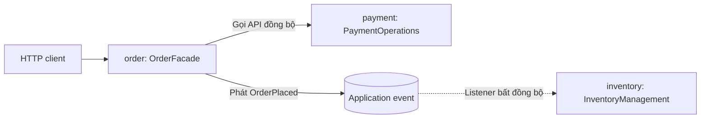
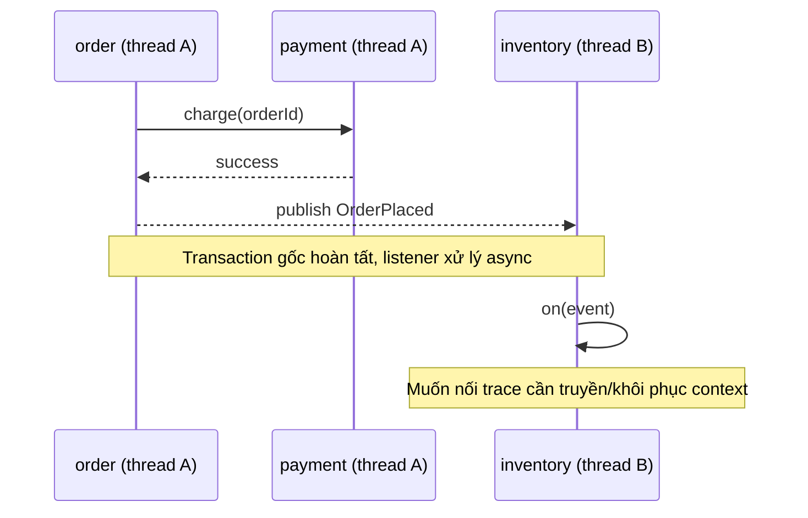

# Application module và ranh giới quan sát

Trong chương **Mô hình quan sát**, chúng ta tìm hiểu cách nhìn một ứng dụng Spring Boot theo **các application module có trách nhiệm nghiệp vụ rõ ràng** thay vì chỉ nhìn theo controller, service, repository hoặc tiến trình JVM. Spring Modulith vừa giúp mô tả, kiểm chứng cấu trúc module, vừa cung cấp dữ liệu Actuator, metrics và traces để quan sát tương tác giữa những module đó lúc hệ thống chạy.

Một hệ thống có thể tuân thủ cấu trúc trên sơ đồ nhưng vẫn có vấn đề trong vận hành: lời gọi giữa hai module chậm, một sự kiện được phát liên tục, hoặc xử lý bất đồng bộ làm mất mạch trace. Mô hình quan sát theo module giúp liên hệ những tín hiệu đó với ranh giới nghiệp vụ.

## Mục tiêu học tập

Sau bài này, bạn có thể:

1. Giải thích application module là gì, đâu là API công khai và đâu là phần nội bộ của module.
2. Phân biệt **ranh giới kiến trúc được khai báo/phát hiện** với **ranh giới thực sự được quan sát ở runtime**.
3. Đọc được module graph và dữ liệu cấu trúc module từ Spring Modulith Actuator.
4. Diễn giải module entry span, các metric sự kiện và ngữ cảnh trace đi qua lời gọi đồng bộ hoặc listener bất đồng bộ.
5. Dùng kết hợp kiểm chứng kiến trúc, traces và metrics để phân tích một tình huống cụ thể.

## 1. Application module là đơn vị quan sát nghiệp vụ

Một **application module** là phần chức năng logic bên trong cùng ứng dụng Spring Boot, chẳng hạn `order`, `payment` hoặc `inventory`. Theo mô hình Spring Modulith, mỗi module có ba mặt:

| Thành phần | Ý nghĩa | Ví dụ |
| --- | --- | --- |
| **Provided interface** | API mà module cho phép module khác sử dụng: Spring bean được công khai, kiểu dữ liệu công khai, application event xuất bản | `PaymentOperations`, `OrderPlaced` |
| **Internal implementation** | Các lớp hiện thực và chi tiết chỉ nên được dùng bên trong module | `payment.internal.PaymentRepositoryAdapter` |
| **Required interface** | Các API của module khác mà module đang phụ thuộc, gồm lời gọi bean và event được lắng nghe | `order` gọi `PaymentOperations`; `inventory` nghe `OrderPlaced` |

**Ranh giới module không đồng nghĩa với ranh giới tiến trình.** Ba module vẫn có thể chạy trong một JVM, một Spring `ApplicationContext` và dùng chung cơ sở dữ liệu. Điều Spring Modulith quản lý là quan hệ giữa các phần *logic* của chương trình; HTTP service-to-service không phải điều kiện để tạo ra module.

Theo cách phát hiện đơn giản mặc định, mỗi package cấp một nằm ngay dưới package gốc chứa lớp `@SpringBootApplication` là một application module. Những subpackage như `order.internal` thường được coi là phần nội bộ, không phải API mặc định.

```text
com.acme.shop
├── ShopApplication.java
├── order
│   ├── OrderFacade.java             # API của module order
│   ├── OrderPlaced.java             # Sự kiện do order công bố
│   └── internal
│       └── OrderRepositoryAdapter.java
├── payment
│   ├── PaymentOperations.java       # API của module payment
│   └── internal
│       └── PaymentGatewayAdapter.java
└── inventory
    ├── InventoryManagement.java     # Listener nhận OrderPlaced
    └── internal
        └── StockRepositoryAdapter.java
```

Trong ví dụ này, `order` được phép gọi API công khai của `payment`. `inventory` phụ thuộc vào sự kiện `OrderPlaced` do `order` công bố. Nếu `order` trực tiếp import `payment.internal.PaymentGatewayAdapter`, đó là sự xâm phạm ranh giới module, dù Java vẫn có thể biên dịch được khi lớp nội bộ được khai báo `public`.

> **Quy tắc thiết kế:** Muốn quan sát tương tác có ý nghĩa, trước hết phải có ranh giới có ý nghĩa. Một module nên gắn với khả năng nghiệp vụ tương đối độc lập; chia module đơn thuần thành `controller`, `service` và `repository` sẽ cho ít thông tin về luồng nghiệp vụ.

### API công khai và named interface

Với package module có nhiều subpackage, các kiểu trong subpackage thường là nội bộ. Nếu cần công bố một nhóm API bên dưới subpackage, Spring Modulith cho phép khai báo **named interface**. Ví dụ, khi chuyển `OrderPlaced` sang `order.events`:

```java
// com/acme/shop/order/events/package-info.java
@org.springframework.modulith.NamedInterface("events")
package com.acme.shop.order.events;
```

Module khác có thể tham chiếu API sự kiện này theo tên `order::events` khi cấu hình phụ thuộc được phép. Đây là cách công bố *đúng phần cần dùng*, thay vì coi toàn bộ subpackage là API. Tên interface và cách giới hạn dependency là quyết định kiến trúc; không phải cấu hình sinh metric.

## 2. Ba lớp của mô hình quan sát

Nên tách ba câu hỏi khác nhau:

| Lớp | Câu hỏi cần trả lời | Công cụ/tín hiệu | Giới hạn |
| --- | --- | --- | --- |
| **Cấu trúc tĩnh** | Module nào tồn tại, module nào phụ thuộc module nào, có vi phạm ranh giới không? | `ApplicationModules`, `verify()`, module graph, tài liệu module | Chỉ mô tả quan hệ suy ra từ mã nguồn/bytecode, không cho biết mức tải hoặc độ trễ |
| **Mô hình runtime** | Những module nào và API nào thực sự được gọi ở một luồng nghiệp vụ? | Modulith instrumentation, Micrometer Observation, trace/span | Chỉ thấy đường đi đã được thực thi và được ghi nhận; phụ thuộc instrumentation và sampling |
| **Tín hiệu vận hành** | Hệ thống đang phát bao nhiêu event, lỗi hoặc chậm ở đâu? | Metrics, logs, traces, registry sự kiện nếu được cấu hình | Mỗi tín hiệu trả lời một phần; một counter sự kiện không chứng minh listener xử lý thành công |

Sơ đồ kiến trúc và dấu vết thực thi có quan hệ với nhau, nhưng **không thể thay thế nhau**. Một cạnh `order → payment` trên graph biểu thị dependency tĩnh; một span gọi `PaymentOperations.charge()` biểu thị rằng API đó đã được gọi trong một lần chạy cụ thể. Ngược lại, việc không thấy span chưa chứng minh không có dependency.

### Ví dụ dòng nghiệp vụ

Giả sử API đặt hàng làm hai việc: gọi `payment` để thu tiền, sau đó phát `OrderPlaced` để `inventory` cập nhật tồn kho.



Đọc sơ đồ theo **hai kiểu quan hệ**:

- `order` **gọi** API của `payment`. Trong module graph, đây là dependency xuất phát từ `order` đến `payment`, thường được phân loại `USES_COMPONENT`.
- `inventory` **lắng nghe** event thuộc API của `order`. Về dependency tĩnh, `inventory` tham chiếu kiểu `OrderPlaced` của `order`; mô hình Actuator có thể biểu thị bằng `EVENT_LISTENER`. Mũi tên sự kiện trên sơ đồ thể hiện *luồng dữ liệu runtime*, không phải chiều dependency trong code.

Sự khác biệt về chiều mũi tên đặc biệt quan trọng khi phân tích module graph: **ai sở hữu event** và **ai phụ thuộc kiểu event** là hai vai trò khác nhau.

## 3. Kiểm chứng ranh giới trước khi quan sát runtime

Spring Modulith cung cấp `ApplicationModules` để dựng mô hình module từ ứng dụng. Có thể kiểm chứng ở một bài kiểm thử kiến trúc:

```java
import org.junit.jupiter.api.Test;
import org.springframework.modulith.core.ApplicationModules;

class ModuleArchitectureTests {

    @Test
    void dependenciesRespectModuleBoundaries() {
        ApplicationModules.of(ShopApplication.class).verify();
    }
}
```

`verify()` kiểm tra các quy tắc kiến trúc được Spring Modulith hỗ trợ, chẳng hạn truy cập vào kiểu nội bộ của module khác, dependency không hợp lệ hoặc vòng phụ thuộc trong phạm vi cấu hình tương ứng. Phép kiểm này giúp phát hiện vấn đề **trước khi deploy**; metrics và traces không thay thế được nó.

Để tự xem danh sách module được phát hiện:

```java
ApplicationModules modules = ApplicationModules.of(ShopApplication.class);
modules.forEach(System.out::println);
```

Khi cần công bố tài liệu kiến trúc, Spring Modulith còn hỗ trợ tạo module graph/tài liệu từ mô hình module. Tài liệu sinh ra thể hiện **kiến trúc suy ra từ code tại thời điểm sinh**, nên cần cập nhật khi package, API hoặc dependency thay đổi. Tài liệu có thể giúp đối chiếu kiến trúc dự kiến với thông tin của Actuator khi chạy.

## 4. Bộc lộ module graph bằng Spring Boot Actuator

**Spring Modulith Actuator** cung cấp endpoint `/actuator/modulith` mô tả module và quan hệ phụ thuộc. Endpoint này hữu ích cho công cụ vận hành, dashboard hoặc kiểm tra nhanh mô hình đang được ứng dụng sử dụng.

Trong Spring Modulith, dependency `spring-modulith-starter-insight` là cách thuận tiện để bật cả actuator module và observability. Với một dự án **Spring Boot 4.x** tương thích Spring Modulith **2.2.x**, ví dụ Gradle (Groovy DSL) dưới đây dùng BOM để quản lý phiên bản Spring Modulith:

```groovy
dependencies {
    implementation platform('org.springframework.modulith:spring-modulith-bom:2.2.0')
    implementation 'org.springframework.modulith:spring-modulith-starter-core'

    // Modulith Actuator + quan sát lời gọi giữa module.
    runtimeOnly 'org.springframework.modulith:spring-modulith-starter-insight'

    // Bộ xuất trace theo OTLP cho Spring Boot 4.x.
    implementation 'org.springframework.boot:spring-boot-starter-opentelemetry'

    // Chỉ cần khi muốn endpoint /actuator/prometheus.
    runtimeOnly 'io.micrometer:micrometer-registry-prometheus'

    testImplementation 'org.springframework.modulith:spring-modulith-starter-test'
}
```

**Chú ý phiên bản:** Đây là một cấu hình minh họa cho dòng Spring Boot 4.x/Spring Modulith 2.2.x. Nếu dự án đang dùng Spring Boot 3.x, cần chọn dòng Modulith tương thích và cấu hình Micrometer Tracing/exporter theo tài liệu của đúng phiên bản Spring Boot; tên starter hoặc property của tracer có thể khác.

Để truy cập endpoint khi chạy local:

```yaml
management:
  endpoints:
    web:
      exposure:
        include: "health,info,modulith,prometheus"
  tracing:
    sampling:
      probability: 1.0  # Dùng khi thử nghiệm; production thường sampling thấp hơn.
  opentelemetry:
    tracing:
      export:
        otlp:
          endpoint: "http://localhost:4318/v1/traces"
```

Endpoint OTLP nêu trên chỉ hoạt động khi có collector hoặc trace backend nhận dữ liệu tại địa chỉ đó. Starter Modulith tạo observation, còn tracer/exporter và backend quyết định trace có được gửi và hiển thị hay không. Để xem `/actuator/prometheus`, cũng cần Prometheus meter registry.

Kiểm tra endpoint cấu trúc:

```bash
curl -s http://localhost:8080/actuator/modulith
```

Ví dụ JSON **rút gọn, mang tính minh họa**:

```json
{
  "order": {
    "displayName": "Order",
    "basePackage": "com.acme.shop.order",
    "dependencies": [
      { "target": "payment", "types": ["USES_COMPONENT"] }
    ]
  },
  "payment": {
    "displayName": "Payment",
    "basePackage": "com.acme.shop.payment",
    "dependencies": []
  },
  "inventory": {
    "displayName": "Inventory",
    "basePackage": "com.acme.shop.inventory",
    "dependencies": [
      { "target": "order", "types": ["EVENT_LISTENER"] }
    ]
  }
}
```

Các trường quan trọng:

| Trường | Cách diễn giải |
| --- | --- |
| Khóa cấp cao nhất, ví dụ `order` | Định danh kỹ thuật của module |
| `displayName` | Tên thuận tiện cho người đọc |
| `basePackage` | Package gốc dùng để nhận diện module |
| `dependencies[].target` | Module mà module hiện tại đang phụ thuộc |
| `dependencies[].types[]` | Loại dependency, như `DEFAULT`, `USES_COMPONENT`, `EVENT_LISTENER` |
| `parent`, `nested` (nếu có) | Quan hệ module lồng nhau, tùy mô hình |

Nếu không thấy `/actuator/modulith`, hãy kiểm tra dependency `starter-insight`/`spring-modulith-actuator`, việc bật endpoint trong cấu hình `management.endpoints.web.exposure.include`, cổng management và cơ chế xác thực. Trong môi trường production, cần giới hạn truy cập vì endpoint có thể tiết lộ cấu trúc nội bộ ứng dụng.

## 5. Từ API module đến span trong trace

Khi có Modulith observability và Micrometer Tracing, Spring Modulith có thể instrument các lời gọi tới **Spring component thuộc API của application module**. Module entry observation được chuyển thành span khi có tracer thích hợp. Thông tin thường có trên module entry span gồm:

| Thuộc tính span | Mục đích |
| --- | --- |
| `module.identifier` | Định danh module trong mô hình kiến trúc |
| `module.name` | Tên hiển thị của module |
| `module.invocation-type` | Cách đi vào module, chẳng hạn qua Spring bean hoặc event listener |
| `module.method` | Phương thức tại điểm vào module |

Lưu ý: **không phải mọi phương thức Java đều tự động có module span**. Các lời gọi nội bộ, lời gọi không đi qua Spring proxy, đường thực thi chưa được instrument hoặc truy vết bị sampling có thể không xuất hiện. Tracing là dấu vết của các thao tác được quan sát, không phải danh mục đầy đủ mọi dependency.

### Code minh họa lời gọi và sự kiện

Ví dụ tối giản sau chỉ thể hiện các thành phần cần hiểu; phần kết nối cổng thanh toán và lưu dữ liệu được lược bỏ.

```java
// com.acme.shop.order.OrderPlaced
package com.acme.shop.order;

import java.util.UUID;

public record OrderPlaced(UUID orderId) {}
```

```java
// com.acme.shop.order.OrderFacade
package com.acme.shop.order;

import java.util.UUID;
import org.springframework.context.ApplicationEventPublisher;
import org.springframework.stereotype.Service;
import org.springframework.transaction.annotation.Transactional;
import com.acme.shop.payment.PaymentOperations;

@Service
public class OrderFacade {

    private final PaymentOperations payment;
    private final ApplicationEventPublisher events;

    public OrderFacade(PaymentOperations payment, ApplicationEventPublisher events) {
        this.payment = payment;
        this.events = events;
    }

    @Transactional
    public void place(UUID orderId) {
        payment.charge(orderId);              // Đi qua API module payment.
        events.publishEvent(new OrderPlaced(orderId));
    }
}
```

```java
// com.acme.shop.payment.PaymentOperations
package com.acme.shop.payment;

import java.util.UUID;
import org.springframework.stereotype.Service;

@Service
public class PaymentOperations {
    public void charge(UUID orderId) {
        // Gọi cổng thanh toán qua adapter nội bộ.
    }
}
```

```java
// com.acme.shop.inventory.InventoryManagement
package com.acme.shop.inventory;

import com.acme.shop.order.OrderPlaced;
import org.springframework.modulith.events.ApplicationModuleListener;
import org.springframework.stereotype.Component;

@Component
class InventoryManagement {

    @ApplicationModuleListener
    void on(OrderPlaced event) {
        // Cập nhật tồn kho trong transaction riêng.
        // Thực tế cần chống xử lý trùng theo mã sự kiện/đơn hàng.
    }
}
```

`@ApplicationModuleListener` là tiện ích kết hợp listener theo transaction, thực thi bất đồng bộ và transaction riêng. Với xử lý bất đồng bộ, cần bật/thiết lập cơ chế async thích hợp (ví dụ `@EnableAsync`) và cân nhắc **Event Publication Registry** để lưu dấu việc giao sự kiện, hỗ trợ khôi phục khi ứng dụng hoặc listener lỗi. Event đã phát **không đồng nghĩa** listener hoàn tất thành công.

Khi gửi một request đặt hàng, trace *có thể* cho thấy diễn tiến như sau:

```text
HTTP POST /orders
└── order / OrderFacade.place            [module entry]
    └── payment / PaymentOperations.charge [module entry]

Async event processing (có thể cùng trace, trace khác hoặc chỉ tương quan bằng ID)
└── inventory / InventoryManagement.on    [event listener entry]
```

Nếu một request mất 800 ms, trace giúp xem phần nào thuộc HTTP, phần nào do `order`, phần nào là lời gọi `payment`. Nếu listener được chạy sau khi transaction gốc hoàn tất, thời gian xử lý inventory không nên mặc nhiên được cộng vào latency trả về cho người dùng. Cần tách **độ trễ request** và **độ trễ hoàn thành luồng nghiệp vụ**.

## 6. Event metrics: quan sát điều gì và chưa quan sát điều gì?

Spring Modulith công bố metric cho sự kiện miền được phát trong ứng dụng. Trong mô hình Spring Modulith 2.x, hai nhóm counter quan trọng là:

| Metric | Ý nghĩa | Cách sử dụng |
| --- | --- | --- |
| `module.events.published` | Tổng hợp số lần phát domain event | So sánh tải event theo module/loại event |
| `module.events.published.$moduleIdentifier.$simpleEventTypeName` | Counter của từng loại event trong từng module | Theo dõi riêng `OrderPlaced` hoặc một event nghiệp vụ khác |

Các tag có cardinality thấp của counter tổng hợp gồm `module.event.type`, `module.identifier` và `module.name`. Counter riêng từng loại event có các tag module; có thể tùy biến để bổ sung tag nghiệp vụ phù hợp.

**Cách đọc đúng:**

- Nếu `OrderPlaced` tăng nhanh bất thường, module `order` có thể đang phát nhiều event hơn dự kiến; cần đối chiếu lượng request và quy tắc nghiệp vụ.
- Nếu metric của `OrderPlaced` tăng nhưng `inventory` không cập nhật, **chưa thể kết luận** event không tới listener chỉ từ counter phát sự kiện. Phải kiểm tra lỗi listener, trạng thái Event Publication Registry (nếu sử dụng), log và traces.
- Không đặt `orderId`, `userId`, request ID hay giá trị gần như duy nhất vào **metric tag** vì tạo cardinality rất lớn. Những dữ liệu đó nên được kiểm soát trong log/trace hoặc thông tin tương quan nghiệp vụ phù hợp với quy định bảo mật.
- Không hiểu counter là số sự kiện *đang chờ* hoặc *xử lý thành công*. Muốn đo backlog, số lần retry hay thời gian xử lý, cần thêm tín hiệu từ cơ chế xử lý/registry hoặc instrumentation phù hợp.

Các meter backend có thể đổi cách hiển thị tên metric, ví dụ quy tắc chuẩn hóa dấu chấm thành dấu gạch dưới trong Prometheus. Khi truy vấn, cần đối chiếu tên công bố trong Micrometer với tên đã xuất ở backend.

## 7. Context propagation qua ranh giới bất đồng bộ

Trong lời gọi đồng bộ trên cùng thread, trace context thường được truyền theo luồng thực thi. Nhưng khi chuyển sang `@Async`, executor hoặc reactive pipeline, công việc có thể chạy ở thread khác; `ThreadLocal` chứa observation hiện tại không tự chuyển theo trong mọi tình huống.



Với Spring Boot 4.x, nếu dùng `AsyncTaskExecutor` do Boot tự cấu hình, có thể bật:

```yaml
spring:
  task:
    execution:
      propagate-context: true
```

Nếu ứng dụng **tự cấu hình executor**, cần gắn `ContextPropagatingTaskDecorator` vào executor đang thực sự thực thi task:

```java
import org.springframework.context.annotation.Bean;
import org.springframework.context.annotation.Configuration;
import org.springframework.core.task.support.ContextPropagatingTaskDecorator;

@Configuration(proxyBeanMethods = false)
class AsyncObservationConfiguration {

    @Bean
    ContextPropagatingTaskDecorator contextPropagatingTaskDecorator() {
        return new ContextPropagatingTaskDecorator();
    }
}
```

Bean decorator này chỉ có tác dụng nếu executor sử dụng nó; không nên giả định mọi executor tùy biến sẽ tự lấy bean đó. Với Reactor, cấu hình tương ứng là `spring.reactor.context-propagation=auto` nếu dự án dùng mô hình reactive và phiên bản Spring Boot hỗ trợ.

Cần phân biệt hai trường hợp:

1. **Chuyển thread ngay khi xử lý:** Context propagation có thể giữ quan hệ cha–con giữa các span hoặc giữ thông tin liên kết cần thiết khi task thực thi.
2. **Sự kiện bền vững được xử lý lại sau restart/retry:** Thread context ban đầu không còn; có thể phải dùng correlation ID trong event hoặc metadata lưu bền để liên hệ các trace khác nhau. Không nên kỳ vọng mọi retry sẽ mang cùng một trace ID.

Thông tin nghiệp vụ như `orderId` giúp đối soát xuyên transaction và lần retry, nhưng phải cân nhắc mức độ nhạy cảm và tránh đưa ID cá nhân vào metric tag hoặc public trace backend một cách tùy tiện.

## 8. Đọc và kiểm chứng ranh giới quan sát trong thực tế

Một cách làm tuần tự với ứng dụng đặt hàng:

| Bước | Thao tác | Kết quả kỳ vọng |
| --- | --- | --- |
| 1 | Chạy `ApplicationModules.of(ShopApplication.class).verify()` | Phát hiện sớm truy cập vào internal package hoặc dependency trái quy định |
| 2 | Mở `GET /actuator/modulith` | Có `order`, `payment`, `inventory` và các dependency phù hợp với code |
| 3 | Gửi một request đặt hàng thử | Request đi qua `OrderFacade` rồi `PaymentOperations` |
| 4 | Tìm trace theo thời gian/request và xem các `module.*` tag | Thấy module entry span nếu đường gọi được instrument và trace được lấy mẫu |
| 5 | Kiểm tra `module.events.published` cùng log/registry listener | Tách được hoạt động phát event với tình trạng xử lý event |
| 6 | Cho listener thử chậm/lỗi trong môi trường thử nghiệm | Quan sát được sự khác biệt giữa latency HTTP, tiến trình async và trạng thái xử lý sự kiện |

### Một vài tình huống chẩn đoán

**Tình huống A – Graph có dependency, trace không có span.** Kiểm tra xem nhánh mã đó đã thực thi chưa; component có thật sự thuộc API module không; lời gọi có qua Spring proxy không; instrumentation, tracing exporter và sampling đã hoạt động chưa. Không thể kết luận graph sai chỉ vì không thấy span.

**Tình huống B – Trace chia làm hai phần sau event.** Nếu listener chạy bằng executor khác, kiểm tra context propagation. Nếu listener retry sau khi transaction nguồn hoặc JVM đã kết thúc, nên theo dõi correlation ID giữa những lần xử lý thay vì ép mọi công việc vào một trace.

**Tình huống C – Event counter tăng, trạng thái nghiệp vụ không đổi.** Kiểm tra lỗi/transaction của listener, idempotency, Event Publication Registry và chính sách retry. Counter phát event không phải counter thành công.

**Tình huống D – Endpoint `/actuator/modulith` không khớp tài liệu thiết kế.** Kiểm tra thay đổi package và API gần đây, code cấu hình phát hiện module có nằm trong nguồn production hay chỉ ở test, và phiên bản ứng dụng đang deploy. Module graph sinh tĩnh có thể cũ nếu không được tạo lại.

### Checklist chất lượng quan sát theo module

- Mỗi module có ranh giới API rõ ràng, phần internal không bị truy cập tùy tiện.
- Quy tắc dependency được kiểm chứng bằng test kiến trúc.
- Actuator chỉ công bố những endpoint cần thiết và được bảo vệ phù hợp.
- Các span có thể nhận diện module, phương thức và kiểu lời gọi.
- Metrics dùng tag cardinality thấp; metric của event không bị diễn giải thành trạng thái listener.
- Xử lý async có cơ chế truyền context hoặc correlation ID phù hợp với vòng đời công việc.
- Log, metrics, traces và trạng thái event được dùng bổ trợ, không suy luận từ một tín hiệu duy nhất.

## 9. Bài tập tự kiểm tra

Giả sử `inventory` muốn gọi trực tiếp `order.internal.OrderRepositoryAdapter` để đọc dữ liệu đơn hàng, còn mỗi đơn hàng mới làm metric `OrderPlaced` tăng một đơn vị. Hãy trả lời:

1. Việc gọi repository nội bộ có phù hợp ranh giới không? Hãy đề xuất một API công khai hoặc event thích hợp.
2. Module graph thể hiện chiều dependency nào nếu `inventory` lắng nghe event `OrderPlaced` của `order`?
3. Nếu trace của HTTP request có `order` và `payment` nhưng không có `inventory`, ba giả thuyết nào cần kiểm tra trước?
4. Metric `OrderPlaced` tăng 100 có chứng minh `inventory` xử lý 100 lần thành công không? Cần tín hiệu bổ sung nào?

**Gợi ý đối chiếu:** (1) Không nên truy cập implementation nội bộ, cần API công khai hoặc mô hình event; (2) dependency tĩnh từ `inventory` tới `order` theo kiểu event listener; (3) luồng async chưa chạy/chưa truyền context, trace sampling/exporter, instrumentation; (4) không, cần trạng thái listener/registry, log và có thể metric xử lý riêng.

## Tổng kết kiến thức

Application module là **đơn vị tổ chức nghiệp vụ và ranh giới API** bên trong ứng dụng Spring Boot. Spring Modulith cho phép dựng, kiểm chứng và tài liệu hóa module graph; Actuator công bố cấu trúc đó khi hệ thống vận hành; Micrometer Observability bổ sung traces và event metrics để nhìn thấy tương tác thực tế. Khi kết hợp chúng, ta có thể trả lời được cả **“hệ thống được phép phụ thuộc như thế nào?”** và **“một luồng nghiệp vụ đang đi qua các module ra sao?”**. Để kết luận tin cậy, phải phân biệt dependency tĩnh, việc phát sự kiện, kết quả xử lý listener và mối liên hệ trace giữa các công việc bất đồng bộ.

## Tài liệu tham khảo

- [Spring Modulith – Fundamentals](https://docs.spring.io/spring-modulith/reference/fundamentals.html): application module, API/internal packages, named interfaces và dependency.
- [Spring Modulith – Production-ready Features](https://docs.spring.io/spring-modulith/reference/production-ready.html): `/actuator/modulith`, span metadata và event metrics.
- [Spring Modulith – Working with Application Events](https://docs.spring.io/spring-modulith/reference/events.html): `@ApplicationModuleListener` và Event Publication Registry.
- [Spring Boot – Observability](https://docs.spring.io/spring-boot/reference/actuator/observability.html): Micrometer Observation và context propagation.
- [Spring Boot – Tracing](https://docs.spring.io/spring-boot/reference/actuator/tracing.html): tracer, exporter, sampling và trace propagation.
