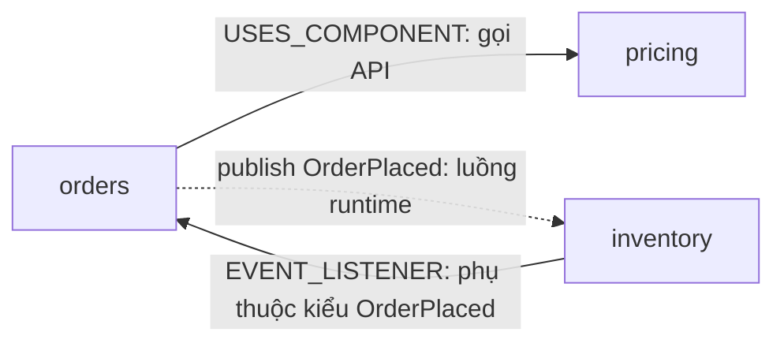
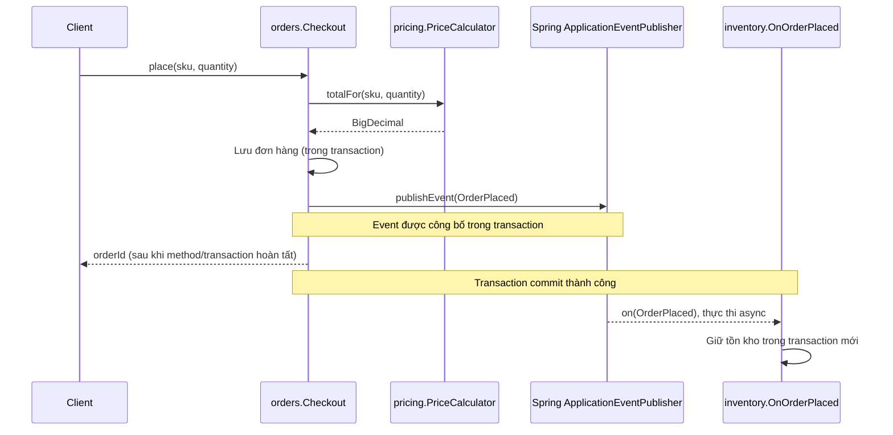

# Lời gọi bean giữa các module và loại tương tác

> **Chương:** Mô hình quan sát  
> **Phạm vi:** Spring Modulith trong ứng dụng Spring Boot; mô hình phụ thuộc giữa application module và dấu vết tương tác khi chạy.

## Mục tiêu học tập

Sau bài này, bạn có thể:

1. Xác định khi nào một lời gọi Spring bean đi qua ranh giới **application module**, khi nào nó chỉ là lời gọi nội bộ.
2. Phân biệt phụ thuộc `USES_COMPONENT`, `EVENT_LISTENER` và `DEFAULT` trong module graph; hiểu hướng mũi tên của phụ thuộc khác hướng truyền sự kiện.
3. Phân biệt lời gọi bean đồng bộ, lắng nghe sự kiện đồng bộ và xử lý sự kiện bất đồng bộ sau commit; dự đoán tác động lên transaction, lỗi và độ trễ.
4. Đối chiếu module graph tại `/actuator/modulith` với span và metric của Spring Modulith để biết tương tác nào đã thực sự xảy ra.

## 1. Từ bean đến ranh giới application module

Trong Spring Boot, `@Service`, `@Component` hay `@Repository` tạo ra các bean được Spring quản lý. **Spring bean không đồng nghĩa với application module.** Spring Modulith nhìn ứng dụng như tập hợp các module nghiệp vụ, thường được phát hiện theo các package con trực tiếp dưới package gốc của ứng dụng.

Ví dụ:

```text
com.example.shop
├── ShopApplication.java
├── orders
│   ├── OrderPlaced.java             # Event công khai của orders
│   └── internal
│       └── Checkout.java            # Bean nội bộ
├── pricing
│   ├── PriceCalculator.java         # API công khai của pricing
│   └── internal
│       └── DefaultPriceCalculator.java
└── inventory
    └── internal
        └── OnOrderPlaced.java       # Event listener
```

Theo quy ước mặc định, package gốc của mỗi module (chẳng hạn `pricing`) cung cấp API có thể được module khác sử dụng. Các package con như `pricing.internal` chứa phần triển khai riêng. Có thể cấu hình named interface hoặc các kiểu module đặc biệt, nên ranh giới thực tế phải được xác nhận bằng mô hình của Spring Modulith, không chỉ bằng suy đoán từ tên package.

Hãy tách ba cấp độ quan sát:

| Cấp độ | Câu hỏi | Ví dụ |
| --- | --- | --- |
| Lời gọi Java/Spring bean | Method nào gọi method nào? | `Checkout.place()` gọi `PriceCalculator.totalFor()` |
| Phụ thuộc kiến trúc | Module nào cần API hoặc thành phần của module nào? | `orders → pricing` qua `USES_COMPONENT` |
| Tương tác lúc chạy | Lần xử lý yêu cầu này đã đi qua ranh giới nào, mất bao lâu? | Một span vào `pricing` với loại lời gọi `bean` |

Hai bean trong cùng `orders` có thể gọi nhau liên tục mà không hình thành tương tác **giữa hai module**. Ngược lại, `orders.internal.Checkout` gọi bean qua `pricing.PriceCalculator` sẽ đi qua ranh giới `orders → pricing`.

## 2. Các loại phụ thuộc trong module graph

Trong thông tin kiến trúc mà Spring Modulith công bố qua Actuator, danh sách `dependencies` mô tả **phụ thuộc đi ra từ module đang xét**. Các loại thường gặp:

| Loại phụ thuộc | Dấu hiệu trong mã | Ý nghĩa cần nhớ |
| --- | --- | --- |
| `USES_COMPONENT` | Bean ở module A phụ thuộc vào Spring component ở module B | B cần được khởi tạo để A sử dụng thành phần của B. Ví dụ `Checkout` inject `PriceCalculator`. |
| `EVENT_LISTENER` | Module A khai báo listener cho kiểu event do module B công bố | **A phụ thuộc vào kiểu event của B** tại thời điểm thiết kế; không có nghĩa B gọi trực tiếp bean của A. |
| `DEFAULT` | A tham chiếu kiểu Java của B, nhưng không biểu thị quan hệ bean/listener chuyên biệt | Đây là phụ thuộc kiểu ở mức mã nguồn; không đủ để suy ra một lời gọi runtime đã xảy ra. |

Một số API/phiên bản còn có phân loại chi tiết hơn, ví dụ `ENTITY` trong `DependencyType`; danh sách JSON của Actuator cần được đọc theo phiên bản Spring Modulith đang dùng.

Điểm dễ nhầm nhất là **hướng phụ thuộc tĩnh** và **hướng luồng xử lý sự kiện**:



Đường `inventory → orders` trong module graph xuất hiện vì `inventory` import `OrderPlaced` do `orders` sở hữu. Nhưng khi một đơn hàng hoàn tất, event được **phát từ** `orders` và **được xử lý tại** `inventory`. Không nên đảo chiều `dependencies.target` chỉ để phù hợp với hướng event chạy.

Ngoài ba loại trên, đừng đồng nhất các trục phân loại sau:

- **Nội bộ / xuyên module**: lời gọi nằm trong cùng module hay vượt ranh giới kiến trúc.
- **Trực tiếp / qua event**: caller biết API của bên nhận hay phát thông báo nghiệp vụ để listener đăng ký nhận.
- **Đồng bộ / bất đồng bộ**: caller có chờ xử lý hay không; dùng event **không tự động** có nghĩa là bất đồng bộ.
- **Cùng / khác transaction**: tùy transaction boundary và annotation thực tế, không chỉ tùy loại phụ thuộc trong graph.

## 3. Ví dụ xuyên suốt: đặt hàng, tính giá và giữ tồn kho

Ta cần tính giá ngay khi đặt hàng, nhưng việc cập nhật tồn kho có thể được xử lý sau khi đơn hàng đã commit. Ba module `orders`, `pricing`, `inventory` có hai cách tương tác phù hợp với hai nhu cầu đó.

### 3.1. Lời gọi bean trực tiếp: orders → pricing

Module `pricing` công bố một interface nhỏ ở package API:

```java
// com/example/shop/pricing/PriceCalculator.java
package com.example.shop.pricing;

import java.math.BigDecimal;

public interface PriceCalculator {
    BigDecimal totalFor(String sku, int quantity);
}
```

Bean triển khai có thể ở package nội bộ:

```java
// com/example/shop/pricing/internal/DefaultPriceCalculator.java
package com.example.shop.pricing.internal;

import com.example.shop.pricing.PriceCalculator;
import java.math.BigDecimal;
import org.springframework.stereotype.Service;

@Service
class DefaultPriceCalculator implements PriceCalculator {

    @Override
    public BigDecimal totalFor(String sku, int quantity) {
        // Giá cố định chỉ phục vụ ví dụ; ứng dụng thật cần tra cứu bảng giá.
        return new BigDecimal("100000").multiply(BigDecimal.valueOf(quantity));
    }
}
```

Module `orders` inject interface công khai thay vì import class `pricing.internal.DefaultPriceCalculator`. Đây là phụ thuộc bean giữa hai module; Spring Modulith có thể phân loại là `USES_COMPONENT`.

### 3.2. Công bố sự kiện từ orders

Đặt event nghiệp vụ ở API của module sở hữu sự kiện:

```java
// com/example/shop/orders/OrderPlaced.java
package com.example.shop.orders;

import java.util.UUID;

public record OrderPlaced(UUID orderId, String sku, int quantity) {}
```

Service đặt hàng gọi bean tính giá đồng bộ rồi phát event:

```java
// com/example/shop/orders/internal/Checkout.java
package com.example.shop.orders.internal;

import com.example.shop.orders.OrderPlaced;
import com.example.shop.pricing.PriceCalculator;
import java.math.BigDecimal;
import java.util.UUID;
import org.springframework.context.ApplicationEventPublisher;
import org.springframework.stereotype.Service;
import org.springframework.transaction.annotation.Transactional;

@Service
public class Checkout {
    private final PriceCalculator pricing;
    private final ApplicationEventPublisher events;

    public Checkout(PriceCalculator pricing, ApplicationEventPublisher events) {
        this.pricing = pricing;
        this.events = events;
    }

    @Transactional
    public UUID place(String sku, int quantity) {
        BigDecimal total = pricing.totalFor(sku, quantity);
        UUID id = UUID.randomUUID();

        // Ví dụ rút gọn: lưu đơn hàng (id, sku, quantity, total) vào DB.
        events.publishEvent(new OrderPlaced(id, sku, quantity));
        return id;
    }
}
```

Trong tình huống này, `pricing.totalFor()` là một lời gọi bean trực tiếp, diễn ra trước khi `Checkout.place()` trả về. Exception từ tính giá thường lan ngược về `Checkout`; nếu có một transaction đang hoạt động thì hệ quả rollback còn phụ thuộc loại exception và cấu hình transaction.

### 3.3. Lắng nghe sự kiện ở inventory

Module `inventory` không cần được `orders` inject trực tiếp. Nó phụ thuộc vào **kiểu** `OrderPlaced` của `orders` và khai báo listener:

```java
// com/example/shop/inventory/internal/OnOrderPlaced.java
package com.example.shop.inventory.internal;

import com.example.shop.orders.OrderPlaced;
import org.springframework.modulith.events.ApplicationModuleListener;
import org.springframework.stereotype.Component;

@Component
class OnOrderPlaced {

    @ApplicationModuleListener
    void on(OrderPlaced event) {
        // Ví dụ rút gọn: ghi nhận/giữ tồn kho cho event.orderId().
        // Tác vụ thật cần có nghiệp vụ idempotent khi phải retry.
    }
}
```

`@ApplicationModuleListener` là shortcut cho listener sự kiện theo transaction, chạy bất đồng bộ trong transaction mới. Với luồng có transaction, listener thường xử lý sau commit của transaction công bố event. Cần có cấu hình thực thi bất đồng bộ và transaction phù hợp với ứng dụng; đoạn ví dụ lược bỏ phần repository, async executor và persistence để tập trung vào tương tác module.

**Điều kiện quan trọng:** event được phát trong method gắn `@Transactional` chỉ có ý nghĩa "sau commit" khi lời gọi thực sự đi qua Spring transactional proxy và có transaction manager; nếu transaction bị rollback thì listener ở pha `AFTER_COMMIT` sẽ không được kích hoạt cho lần đó.

### 3.4. Timeline một lượt xử lý



Sơ đồ là mô hình logic. Listener bất đồng bộ có thể bắt đầu rất sớm sau commit; lịch chạy thực tế tùy executor và hạ tầng nên không suy ra thứ tự tuyệt đối giữa việc client nhận response và listener bắt đầu chạy.

## 4. Đồng bộ, bất đồng bộ và transaction: bảng so sánh

| Cách tương tác | Caller chờ xử lý? | Khi nào listener/bean chạy? | Hệ quả lỗi điển hình |
| --- | --- | --- | --- |
| Inject và gọi bean trực tiếp | Có, trong lời gọi thông thường | Ngay tại vị trí gọi method | Lỗi có thể lan tới caller; transaction có thể được chia sẻ nếu cấu hình cho phép. |
| `publishEvent` + `@EventListener` mặc định | Thường có | Khi publish event, trên cùng luồng nếu dùng mặc định synchronous multicaster | Listener có thể làm chậm hoặc làm thất bại luồng phát event. |
| `@TransactionalEventListener` mặc định | Không phải lời gọi trực tiếp vào listener | Mặc định tại `AFTER_COMMIT` khi có transaction; cách dispatch còn tùy cấu hình | Không nên giả định phần xử lý này thuộc transaction đã commit. |
| `@ApplicationModuleListener` | Caller không chờ listener xử lý hoàn tất | Theo event transactional, thường sau commit, thực thi async và transaction mới | Failure xảy ra ngoài transaction gốc; cần cơ chế theo dõi/retry phù hợp. |

Đối với luồng cần kết quả ngay để quyết định có tiếp tục nghiệp vụ hay không (ví dụ tính tổng giá), lời gọi bean trực tiếp thường dễ hiểu hơn. Đối với phản ứng phụ theo nghiệp vụ (ví dụ gửi email hay cập nhật hệ thống khác), event giúp module phát không cần biết danh sách module nhận.

Việc phát event bằng `ApplicationEventPublisher` tự nó **không đảm bảo giao nhận bền vững**. Khi cần ghi nhận việc giao cho từng transactional listener và hỗ trợ phục hồi sau lỗi, hãy tìm hiểu **Event Publication Registry** của Spring Modulith cùng cơ chế lưu trữ và resubmission tương ứng. Event publication registry khác với chỉ số event đã phát: một lần "đã phát" không chứng minh listener đã hoàn tất.

## 5. Quan sát loại tương tác lúc chạy bằng Spring Modulith

### 5.1. Kích hoạt module observability

Với dự án dùng Spring Modulith BOM/dependency management tương thích, có thể khai báo trong Gradle:

```groovy
dependencies {
    runtimeOnly 'org.springframework.modulith:spring-modulith-starter-insight'
}
```

Starter này tích hợp phần **Actuator** trình bày mô hình module và **observability** để ghi nhận tương tác. Nếu chỉ dùng các artifact riêng, phần thường cần cho theo dõi lời gọi là `spring-modulith-observability-core`; phần endpoint là `spring-modulith-actuator` cùng Spring Boot Actuator. Bộ dependency để xuất trace tới backend (ví dụ Micrometer Tracing, bridge OpenTelemetry/Brave và exporter) cần cấu hình riêng theo Spring Boot đang dùng.

Ví dụ cấu hình **chỉ cho môi trường phát triển**:

```yaml
management:
  endpoints:
    web:
      exposure:
        include: health,info,modulith,metrics
  tracing:
    sampling:
      probability: 1.0
```

`sampling.probability: 1.0` giúp dễ nhìn thấy trace khi thử nghiệm, nhưng có thể gây quá tải nếu áp dụng nguyên xi ở production. Actuator có thể chứa thông tin cấu trúc ứng dụng, vì vậy cần giới hạn truy cập ở môi trường thực.

### 5.2. Đọc module graph từ Actuator

Khi endpoint đã được bật và cho phép truy cập:

```http
GET /actuator/modulith
```

Một phần JSON **minh họa** phù hợp ví dụ trên:

```json
{
  "orders": {
    "displayName": "Orders",
    "basePackage": "com.example.shop.orders",
    "dependencies": [
      { "target": "pricing", "types": ["USES_COMPONENT"] }
    ]
  },
  "pricing": {
    "displayName": "Pricing",
    "basePackage": "com.example.shop.pricing",
    "dependencies": []
  },
  "inventory": {
    "displayName": "Inventory",
    "basePackage": "com.example.shop.inventory",
    "dependencies": [
      { "target": "orders", "types": ["EVENT_LISTENER"] }
    ]
  }
}
```

**Cách diễn giải:**

- `orders.dependencies[].target = "pricing"`: `orders` dùng một component mà `pricing` cung cấp.
- `inventory.dependencies[].target = "orders"`: `inventory` lắng nghe kiểu event do `orders` công bố.
- JSON là **bản đồ phụ thuộc được phát hiện**, không phải nhật ký một request. Có một cạnh trong graph không chứng minh cạnh ấy đã được gọi trong lần xử lý đang xét.

Thử kiểm tra ràng buộc kiến trúc bằng API:

```java
import org.junit.jupiter.api.Test;
import org.springframework.modulith.core.ApplicationModules;

class ArchitectureTests {

    @Test
    void moduleDependenciesAreValid() {
        ApplicationModules.of(ShopApplication.class).verify();
    }
}
```

`verify()` giúp phát hiện các vi phạm như phụ thuộc vòng hoặc tham chiếu sang phần nội bộ của module khác. Nó không đo hiệu năng; trace mới cho biết đường thực thi cụ thể khi chạy.

### 5.3. Span cho điểm vào module: `bean` và `event listener`

Khi instrumentation và tracing được cấu hình, Spring Modulith có thể tạo **module entry span** khi có lời gọi vào API của application module hoặc xử lý listener được quan sát. Các nhãn quan trọng theo tài liệu:

| Span tag | Trả lời câu hỏi |
| --- | --- |
| `module.identifier` | Module nào được đi vào? |
| `module.name` | Tên hiển thị của module là gì? |
| `module.method` | Method nào được thực thi? |
| `module.invocation-type` | Đây là lời gọi `bean` hay `event listener`? |

Một trace minh họa (tên span và thời lượng chỉ để giải thích, không phải output cố định):

```text
HTTP POST /orders
└─ orders.Checkout.place
   ├─ pricing.PriceCalculator.totalFor  [module.invocation-type=bean]
   └─ publish OrderPlaced

Sau commit, tại listener được quan sát:
inventory.OnOrderPlaced.on              [module.invocation-type=event listener]
```

Span cuối có thể ở một nhánh trace khác hoặc một trace khác nếu context tracing không được truyền qua quá trình dispatch bất đồng bộ. Không nên khẳng định toàn bộ luồng luôn xuất hiện dưới **một** trace cha.

Lưu ý: instrumentation theo ranh giới module không đồng nghĩa trace mọi method Java. Các lời gọi trong cùng class (`this.method()`), object tạo bằng `new`, method nội bộ không thuộc điểm vào được instrument hoặc lời gọi không đi qua Spring proxy có thể không tạo span module riêng. Vì thế, *không thấy span* chưa đủ để kết luận *không có phụ thuộc*.

### 5.4. Event metrics không phải thành công của consumer

Spring Modulith còn ghi nhận metric cho các domain event đã được phát, chẳng hạn:

- `module.events.published`: counter tổng số lần phát event, có các chiều như loại event và module.
- `module.events.published.<moduleIdentifier>.<simpleEventTypeName>`: counter theo event cụ thể, có thể tùy biến thêm.

Ví dụ truy vấn endpoint Actuator để tìm meter liên quan:

```http
GET /actuator/metrics/module.events.published
```

Giá trị meter chịu ảnh hưởng cấu hình metric registry và cách xuất số liệu. Counter tăng chứng minh event được **publish** theo cơ chế đo lường, không chứng minh `inventory` đã nhận, xử lý thành công hay commit xong. Muốn kiểm tra tiến trình listener, cần kết hợp trace, log nghiệp vụ, tình trạng event publication registry (nếu kích hoạt) và trạng thái dữ liệu thực tế.

## 6. Context propagation giữa các lần tương tác

Ở lời gọi bean đồng bộ trong cùng luồng, trace context thường được duy trì qua scope hiện tại của tracing framework. Với `@ApplicationModuleListener`, công việc chuyển sang xử lý bất đồng bộ; việc giữ liên hệ trace phụ thuộc cấu hình executor, context propagation và phiên bản Spring Boot/Micrometer.

Hãy phân biệt:

1. **Trace context:** `traceId`, `spanId`, quan hệ parent/child giữa các span.
2. **Bối cảnh logging:** MDC và các thông tin bổ sung cho log; không phải mọi giá trị MDC đều tự động được chuyển qua thread.
3. **Business correlation:** `orderId` hoặc một correlation ID gắn trong event để đối chiếu chính xác cùng một nghiệp vụ, kể cả khi hai trace bị tách.

Nếu khi chạy thấy trace `orders` và `inventory` tách rời, hãy kiểm tra hạ tầng tracing và executor trước khi kết luận Spring Modulith không nhận ra event listener. Có thể dùng `orderId` để nối các bản ghi nghiệp vụ. Tránh đưa `orderId` (giá trị cardinality rất cao) thành tag của **metric**; với trace/log, cũng cần kiểm soát dữ liệu nhạy cảm và chi phí lưu trữ.

## 7. Phương pháp đọc graph và trace cùng nhau

Một quy trình kiểm chứng kiến trúc khi ứng dụng vận hành:

1. **Chụp graph tĩnh:** lấy `/actuator/modulith`; xác định `dependencies.target` và `types` cho mỗi module.
2. **Chạy nghiệp vụ thực:** gọi API đặt hàng, dùng một đơn hàng thử có thể nhận diện bằng ID.
3. **Đọc spans:** tìm span đi vào `pricing` với `module.invocation-type=bean` và listener ở `inventory` với `module.invocation-type=event listener`.
4. **Đối chiếu event metrics:** xác nhận `OrderPlaced` được publish; không suy ra consumer thành công chỉ từ counter.
5. **Kiểm chứng kết quả:** đọc trạng thái đơn hàng/tồn kho, log và publication registry (nếu có), đồng thời xem method nào chậm hay phát sinh lỗi.

| Hiện tượng | Cách hiểu phù hợp | Hướng kiểm tra |
| --- | --- | --- |
| Graph có `orders → pricing`, không có span giá | Có phụ thuộc tĩnh nhưng request này chưa chắc gọi bean, hoặc instrumentation chưa bắt được điểm vào | Đường thực thi, exposed API, proxy, dependency observability, sampling |
| Graph có `inventory → orders`, trace thấy `orders → inventory` | Hướng phụ thuộc kiểu event và hướng giao event là hai khái niệm khác nhau | Kiểu `OrderPlaced` thuộc module nào, listener đặt ở đâu |
| Counter publish tăng, tồn kho không đổi | Event được phát nhưng listener có thể chậm, thất bại, chưa chạy hoặc transaction không commit | Listener logs, transaction phase, registry, retry, idempotency |
| Span listener không cùng trace với request | Có thể mất/liên kết khác trace context sau khi chuyển thread | Async executor, Micrometer context propagation, tracing exporter, business correlation |
| Method nội bộ chạy nhưng không có span module | Công cụ tập trung vào điểm tương tác module được instrument | Ranh giới module, proxy, manual observation nếu cần đo sâu hơn |

## 8. Sai lầm thường gặp

**Nhầm `EVENT_LISTENER` với việc module phát event phụ thuộc module nhận.** Thực tế, listener thường phải import kiểu event của module phát nên phụ thuộc tĩnh đi từ consumer đến producer; producer không cần biết consumer.

**Cho rằng mọi event đều chạy async.** `@EventListener` mặc định có thể chạy đồng bộ ngay trong `publishEvent()`. Chỉ suy ra async hoặc sau commit khi đã biết annotation và cấu hình dispatch.

**Cho rằng mỗi call qua module tạo một transaction hoặc service riêng.** Spring Modulith vẫn là một ứng dụng Spring Boot; module là ranh giới logic, không tự biến thành tiến trình/HTTP service độc lập. Transaction là khái niệm được quyết định bởi Spring Transaction và phương thức gọi.

**Thấy module graph hợp lệ thì tin rằng runtime luôn tuân thủ mọi kỳ vọng.** Xác minh kiến trúc phát hiện phụ thuộc mã nguồn; quan sát runtime làm rõ hành vi thực tế, độ trễ, luồng async và lỗi.

**Đếm event đã publish như số event xử lý thành công.** Việc phát, giao cho listener, xử lý và commit là các mốc khác nhau; cần quan sát bằng công cụ phù hợp cho từng mốc.

## 9. Bài tập tự kiểm tra

**Tình huống A.** Module `billing` inject `PaymentService` từ API của `payments`, rồi gọi `charge()` trong một request. Trong graph, phụ thuộc nào đáng mong đợi? Trong trace, invocation type nào là hợp lý?

**Tình huống B.** Module `notifications` có `@ApplicationModuleListener` nhận `OrderPlaced` do `orders` sở hữu. Cho biết hướng dependency trong graph và hướng event khi chạy. Nếu listener lỗi sau khi đơn hàng commit thì có được mặc nhiên rollback đơn hàng không?

**Tình huống C.** Hệ thống ghi nhận 150 lần publish `OrderPlaced` nhưng chỉ có 148 bản ghi xử lý tồn kho thành công. Bạn sẽ kiểm tra bằng chứng nào trước khi sửa mã?

**Gợi ý đáp án:**

- **A:** `billing → payments` với `USES_COMPONENT`; khi lời gọi được instrument, span của điểm vào module nhận thường mang `module.invocation-type=bean`.
- **B:** phụ thuộc tĩnh `notifications → orders` với `EVENT_LISTENER`; sự kiện chạy `orders → notifications`. Listener sau commit không mặc nhiên rollback giao dịch đơn hàng đã hoàn tất.
- **C:** kiểm tra transaction commit ở producer, trace/log listener, registry và retry (nếu cấu hình), trạng thái executor, logic idempotency; số lần publish không thay thế số lần xử lý thành công.

## 10. Ghi nhớ

- **Module graph** trả lời "module nào phụ thuộc module nào, theo kiểu phụ thuộc nào?"; **trace** trả lời "trong lượt xử lý này, lời gọi đã đi đến đâu?".
- `USES_COMPONENT` và `EVENT_LISTENER` là **loại phụ thuộc kiến trúc**; `bean` và `event listener` là **loại lời gọi của span**.
- Event giúp giảm phụ thuộc từ module phát đến module nhận, nhưng vẫn cần thiết kế transaction, giao nhận, theo dõi lỗi và khả năng xử lý lại.
- Quan sát kiến trúc nên phối hợp `/actuator/modulith`, Micrometer spans/metrics, kiểm thử `ApplicationModules.verify()` và bằng chứng nghiệp vụ.

### Tài liệu tham khảo

- [Spring Modulith — Fundamentals](https://docs.spring.io/spring-modulith/reference/fundamentals.html): API và ranh giới application module.
- [Spring Modulith — Production-ready Features](https://docs.spring.io/spring-modulith/reference/production-ready.html): Actuator, `dependencies.types`, module entry span và event metrics.
- [Spring Modulith — Working with Application Events](https://docs.spring.io/spring-modulith/reference/events.html): `@ApplicationModuleListener`, transaction và event publication registry.
- [Spring Modulith — Verifying Application Module Structure](https://docs.spring.io/spring-modulith/reference/verification.html): quy tắc phụ thuộc module và `ApplicationModules.verify()`.
