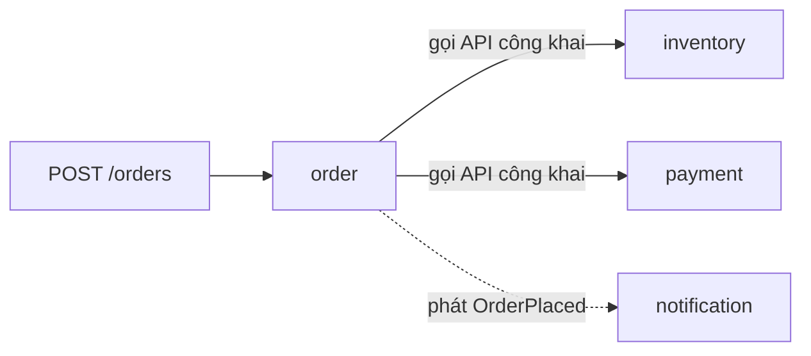
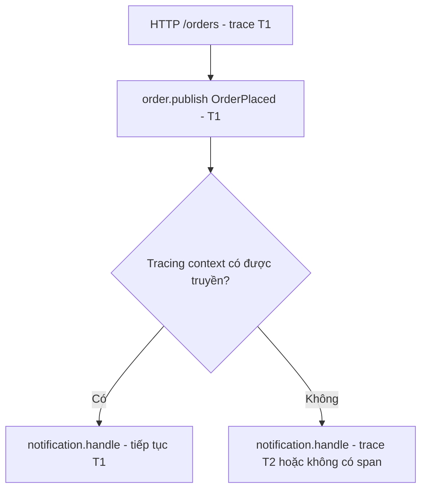
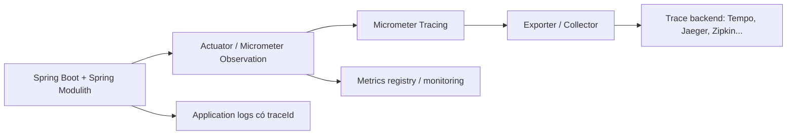

# Quan hệ giữa một trace và nhiều module

Trong ứng dụng Spring Boot sử dụng **Spring Modulith**, một yêu cầu nghiệp vụ thường đi qua nhiều *application module* trước khi hoàn thành. Chẳng hạn, thao tác đặt hàng bắt đầu ở module `order`, gọi `inventory` để giữ hàng, gọi `payment` để thanh toán, rồi phát sự kiện cho `notification`. Các module có ranh giới kiến trúc riêng nhưng vẫn có thể chạy trong **cùng một tiến trình ứng dụng**.

**Một trace** mô tả hành trình thực thi của một thao tác qua các bước đó; **một module** mô tả ranh giới sở hữu mã nguồn và trách nhiệm nghiệp vụ. Vì vậy, quan hệ giữa hai khái niệm là **một trace có thể chứa nhiều span thuộc nhiều module**, chứ không phải mỗi module có một trace độc lập.

Sau bài này, bạn có thể:

- Phân biệt `trace`, `span`, `traceId`, quan hệ cha–con giữa các span và danh tính application module.
- Đọc một trace đi qua nhiều module trong cùng ứng dụng Spring Boot.
- Giải thích khi nào lời gọi đồng bộ giữ cùng trace và vì sao tác vụ bất đồng bộ có thể làm mất liên kết quan sát.
- Kết hợp module graph, Actuator, Micrometer Tracing, log và event metrics để kiểm chứng ranh giới module khi hệ thống chạy.
- Nhận biết giới hạn của tracing: thiếu span không đồng nghĩa không có lời gọi; cùng trace không tự chứng minh kiến trúc đúng.

## 1. Hai góc nhìn: cấu trúc module và hành trình thực thi

Spring Modulith tổ chức ứng dụng thành các application module. Thông thường, những package nghiệp vụ trực tiếp dưới package gốc của ứng dụng được nhận diện thành module; module có API công khai và phần triển khai nội bộ. Spring Modulith có thể phân tích quan hệ phụ thuộc để tạo **module graph** và kiểm chứng các ranh giới đã khai báo.

Module graph trả lời câu hỏi: **“Module nào được phép phụ thuộc vào module nào?”** Tracing trả lời câu hỏi khác: **“Yêu cầu cụ thể này đã thực thi những công việc gì, theo thứ tự nào và mất bao lâu?”**

Ví dụ một cấu trúc đơn giản:

```text
com.example.shop
├── order          # Tiếp nhận và điều phối đơn hàng
├── inventory      # Kiểm tra và giữ tồn kho
├── payment        # Xử lý thanh toán
└── notification   # Gửi thông báo
```

Một luồng nghiệp vụ có thể được mô tả như sau:



Sơ đồ này chỉ là **luồng nghiệp vụ minh họa**, không phải bằng chứng rằng mọi lần chạy đều gọi tất cả module. Cạnh nét liền biểu thị lời gọi đồng bộ; cạnh nét đứt biểu thị xử lý dựa trên sự kiện, có thể diễn ra sau khi giao dịch đặt hàng hoàn tất.

| Đối tượng | Nó đại diện cho điều gì? | Dùng để trả lời câu hỏi nào? |
| --- | --- | --- |
| Application module | Ranh giới mã nguồn, API được công khai và trách nhiệm nghiệp vụ | Ai sở hữu chức năng? Phụ thuộc nào hợp lệ? |
| Trace | Một hành trình xử lý có thể trải qua nhiều thành phần | Yêu cầu này đã đi qua những bước nào? |
| Span | Một thao tác được đo trong trace, có thời điểm bắt đầu, kết thúc và ngữ cảnh | Bước nào chậm/lỗi? Ai gọi bước đó? |
| Module graph | Sơ đồ quan hệ phụ thuộc ở mức kiến trúc | Các module được liên kết ra sao? |

Một trace có thể xuất hiện nhiều span trong cùng module, và một span có thể mô tả thao tác hạ tầng không gán cho module nghiệp vụ cụ thể nào. Do đó, không tồn tại phép ánh xạ một–một cố định giữa module và span.

## 2. Trace, span và dấu vết module

Trong mô hình phân tán dựa trên Micrometer Tracing và OpenTelemetry, các thông tin thường gặp gồm:

- **`traceId`**: định danh dùng để nhóm các span của cùng một trace.
- **`spanId`**: định danh riêng của một span.
- **`parentSpanId`**: liên kết span với thao tác cha, khi quan hệ cha–con tồn tại.
- **Tên span và thời lượng**: mô tả việc đang đo, ví dụ `order.place` hoặc một lời gọi HTTP.
- **Attributes/tags**: ngữ cảnh bổ sung như tên operation, kết quả, loại span, tên ứng dụng hoặc tên module nếu instrumentation cung cấp.

Giả sử một yêu cầu tạo ra trace `8f19...c42a`. Công cụ quan sát có thể hiển thị cây span như sau:

```text
Trace 8f19...c42a
└── HTTP POST /orders                  [service: shop-app]
    └── order.place                    [module: order]
        ├── inventory.reserve          [module: inventory]
        ├── payment.capture            [module: payment]
        └── event.publish OrderPlaced  [module: order]
```

Trong ví dụ này, các span có **cùng `traceId`** nhưng **`spanId` khác nhau**. `inventory.reserve` và `payment.capture` là span con của thao tác điều phối ở `order`; việc quay về `order` sau mỗi lời gọi không làm phát sinh trace mới.

Đây là một **trace minh họa**: tên span, số lượng span và thuộc tính `module` thực tế phụ thuộc vào phiên bản thư viện, cấu hình Spring Modulith observability, Micrometer/Tracing và các observation do ứng dụng tự tạo. Không mặc định mọi phương thức Java hay mọi ranh giới module đều có span.

### Cùng tiến trình vẫn có thể đi qua nhiều module

Đừng đồng nhất “distributed tracing” với việc bắt buộc có nhiều microservice. Một ứng dụng Modulith có thể triển khai dưới **một `service.name`** nhưng trace vẫn đi qua nhiều module trong cùng JVM. Nếu một module gọi dịch vụ bên ngoài, trace còn có thể đi qua **nhiều `service.name`**, miễn là ngữ cảnh tracing được truyền tiếp và phía nhận tham gia tracing.

Khi phân tích, có thể xem `service.name` là danh tính đơn vị triển khai, còn tên application module (nếu được gắn vào span) là ranh giới nghiệp vụ ở bên trong đơn vị đó. Chúng thuộc hai cấp độ khác nhau.

### Quan hệ span mới giúp thấy đường đi

Việc trong cùng một trace xuất hiện các span gắn `order`, `inventory` và `payment` cho biết các thao tác liên quan cùng một hành trình. Để nhận ra **ai gọi ai**, cần xem thêm `parentSpanId`, thời điểm thực thi và loại thao tác; chỉ lọc theo tên module không đủ để khẳng định hướng gọi.

Ví dụ, `order` có thể gọi `inventory` hai lần trong một trace: lần đầu để kiểm tra tồn kho và lần sau để xác nhận giữ hàng. Khi đó cùng một module xuất hiện ở nhiều nhánh hoặc nhiều vị trí của cây span. Nếu instrumentation chỉ đo HTTP mà không đo lời gọi giữa các bean, trace có thể chỉ hiện một span HTTP dù bên trong đã thực thi nhiều module.

## 3. Ví dụ: một yêu cầu đặt hàng xuyên các module

Xét luồng đồng bộ sau:

1. `OrderController` nhận `POST /orders`.
2. `order` gọi API công khai của `inventory` để giữ hàng.
3. `order` gọi API công khai của `payment` để thu tiền.
4. `order` lưu trạng thái và phát `OrderPlaced` để module khác xử lý.

Trong phần đồng bộ, observation/span hiện hành thường nằm trong ngữ cảnh của thread thực thi. Nếu lời gọi sang `inventory` hoặc `payment` được instrument, span mới có thể dùng span hiện hành làm cha và giữ nguyên `traceId`. Tracing ghi lại sự thực thi; **Spring Modulith không cần biến mỗi module thành một microservice** để làm được điều này.

Có thể bổ sung một observation nghiệp vụ bằng Micrometer để thao tác `order.place` hiện rõ trong trace:

```java
// Mã minh họa: các kiểu PlaceOrder, InventoryPort, PaymentPort
// và OrderPlaced thuộc API nghiệp vụ của ứng dụng.
@Service
class OrderService {

    private final InventoryPort inventory;
    private final PaymentPort payment;
    private final ApplicationEventPublisher events;
    private final ObservationRegistry observations;

    OrderService(InventoryPort inventory, PaymentPort payment,
            ApplicationEventPublisher events, ObservationRegistry observations) {
        this.inventory = inventory;
        this.payment = payment;
        this.events = events;
        this.observations = observations;
    }

    void place(PlaceOrder command) {
        Observation.createNotStarted("order.place", observations)
                .lowCardinalityKeyValue("app.module", "order")
                .observe(() -> {
                    inventory.reserve(command.orderId());
                    payment.capture(command.orderId());
                    events.publishEvent(new OrderPlaced(command.orderId()));
                });
    }
}
```

`Observation` là API quan sát ở mức ứng dụng. Khi các handler phù hợp của Micrometer được cấu hình, một observation có thể cung cấp metric và/hoặc span; **gọi `Observation` không tự bảo đảm dữ liệu trace đã được xuất sang backend**. Khóa `app.module` ở đây là thuộc tính **do ví dụ tự đặt**, không phải tên tag mặc định bắt buộc của Spring Modulith. Với các lời gọi đã được Spring Modulith tự instrument, cần kiểm tra trace trước khi thêm span thủ công để tránh đo trùng.

Module `notification` có thể phản ứng với sự kiện bằng một listener:

```java
@Component
class OrderNotificationListener {

    @ApplicationModuleListener
    void on(OrderPlaced event) {
        // Gửi thông báo cho đơn hàng tương ứng.
    }
}
```

`@ApplicationModuleListener` của Spring Modulith hỗ trợ kiểu xử lý sự kiện theo ranh giới module và thường thực thi bất đồng bộ, gắn với giao dịch. **Không được suy ra rằng listener chắc chắn thuộc cùng trace với `POST /orders`**: cần kiểm tra cơ chế truyền ngữ cảnh giữa nơi phát sự kiện và nơi xử lý, cũng như thời điểm/giao dịch thực tế.

## 4. Khi nào nhiều module thuộc cùng trace?

Điểm quyết định không nằm ở số lượng module mà nằm ở **sự liên tục của tracing context**.

| Tình huống | Điều thường quan sát được | Điều cần kiểm tra |
| --- | --- | --- |
| Gọi đồng bộ giữa các bean/module trên cùng thread | Các span được instrument có thể là cha–con và cùng `traceId` | Có observation/span ở ranh giới cần xem hay không |
| Gọi HTTP sang ứng dụng khác | Span client/server có thể nằm trong cùng distributed trace | Header propagation, cấu hình tracing của hai phía và sampling |
| Chuyển việc sang `@Async` hoặc executor | Span ở thread mới có thể mất quan hệ với span trước đó | Có cơ chế capture/restore context khi chuyển thread không |
| Xử lý sự kiện bất đồng bộ trong Modulith | Listener có thể tiếp tục trace cũ hoặc bắt đầu trace riêng | Ngữ cảnh có được truyền qua bộ phát/nhận sự kiện không |
| Gửi qua message broker, xử lý muộn hoặc retry | Có thể là trace mới, đôi khi có span link tới trace trước | Propagation qua message header, thời gian lưu và semantics của consumer |
| Không được lấy mẫu hoặc không có instrumentation | Một số span/traces không xuất hiện | Sampling, exporter, collector và phạm vi instrumentation |

### Gọi đồng bộ: giữ ngữ cảnh hiện hành

Giả sử `order.place` đang có span hiện hành `S1`. Khi `inventory.reserve` bắt đầu một span `S2` trong cùng ngữ cảnh, `S2` kế thừa `traceId` và tham chiếu `S1` như span cha. Sau khi `S2` kết thúc, luồng trở về `S1`. Cơ chế tương tự có thể lặp lại với `payment`.

Tuy nhiên, chỉ **gọi một phương thức qua ranh giới module** chưa đủ để bảo đảm có span mới. Nếu phương thức không được instrument, thao tác vẫn chạy bình thường nhưng không tạo mục riêng trên giao diện tracing.

### Bất đồng bộ: tracing context có thể bị đứt

Khi chuyển từ thread nhận HTTP sang thread xử lý tác vụ, ngữ cảnh dựa trên thread-local không tự nhiên đi theo trong mọi cấu hình. Kết quả có thể là:



Nếu cần giữ liên kết, hãy sử dụng cơ chế context propagation do stack Spring/Micrometer hỗ trợ, chẳng hạn cấu hình executor với `ContextPropagatingTaskDecorator` trên các phiên bản Spring Framework hỗ trợ, hoặc capture/restore `ContextSnapshot` đúng vị trí chuyển thread. Với hàng đợi/broker, thường cần truyền trace context theo chuẩn như W3C Trace Context qua message headers. Các cách này có điều kiện về phiên bản, loại executor, instrumentation và vòng đời xử lý; **không thể chỉ gắn `@Async` rồi mặc định đã truyền trace**.

Với công việc chạy rất lâu, chạy lại nhiều lần hoặc được thực hiện qua hệ thống khác, việc bắt đầu một trace mới và dùng **span link**/business correlation để diễn tả quan hệ nhân quả đôi khi phù hợp hơn việc cố tạo cây cha–con kéo dài. Một trace ID cũng không phải khóa nghiệp vụ có tính bền vững.

### Trace ID và mã nghiệp vụ phục vụ hai mục đích

Giả sử một đơn hàng có `orderId = ORD-1042`. Yêu cầu ban đầu có trace `T1`, sau đó listener gửi mail thất bại và retry vào thời điểm khác với trace `T2`. Hai trace có thể đều liên quan đến **cùng đơn hàng**.

- Dùng **`traceId`** để điều tra từng lần thực thi và quan hệ giữa các span đã quan sát được.
- Dùng **`orderId`/event ID** để đối chiếu nghiệp vụ giữa các lần chạy, retry, log và thông điệp.

Nên đặt mã nghiệp vụ ở nơi log và dữ liệu nghiệp vụ phù hợp. Tránh dùng mã đơn hàng, email khách hoặc dữ liệu nhạy cảm làm **metric tag có cardinality cao**; cân nhắc chính sách bảo mật, quyền truy cập và chi phí lưu trữ trước khi đưa chúng vào span/log.

## 5. Thiết lập quan sát ở mức ứng dụng

Một bộ quan sát thực tế thường có các lớp sau:



**Spring Modulith** cung cấp hiểu biết về ranh giới module và khả năng bổ sung observability ở các ranh giới đó. **Spring Boot Actuator** cung cấp nền tảng quản trị và observability, **Micrometer** cung cấp API observation/metrics và cầu nối tracing, còn **tracing backend** tập hợp và hiển thị trace. Actuator không mặc định cung cấp một màn hình hay REST endpoint chứa toàn bộ cây distributed trace.

Khi chuẩn bị môi trường thực hành, hãy kiểm tra những thành phần sau:

1. Ứng dụng có Actuator, thành phần observability của Spring Modulith tương ứng với phiên bản đang dùng và Micrometer Tracing với bridge phù hợp.
2. Có reporter/exporter đưa span đến collector/backend đang chạy; endpoint và giao thức OTLP/Zipkin phải khớp với backend.
3. Có cấu hình sampling thích hợp. Trong môi trường học tập có thể lấy mẫu 100% để dễ quan sát; trong production phải cân nhắc lưu lượng và chi phí.
4. Logging có thông tin correlation (`traceId`, `spanId`) nếu muốn đối chiếu log với trace.
5. Module API thực sự được instrument hoặc có observation nghiệp vụ do ứng dụng định nghĩa.

Ví dụ **mang tính tham khảo** cho cấu hình Spring Boot 3.x dùng Micrometer Tracing và exporter OTLP, với collector lắng nghe HTTP tại cổng `4318`:

```yaml
management:
  tracing:
    sampling:
      probability: 1.0 # Chỉ dùng khi thực hành / lượng truy cập nhỏ
  otlp:
    tracing:
      endpoint: http://localhost:4318/v1/traces
```

Đoạn YAML này chỉ quy định sampling và endpoint, **không tự cài đặt các dependency** và không thay thế cấu hình collector. Tên property hoặc starter có thể khác theo dòng Spring Boot/Spring Modulith; phải đối chiếu tài liệu của phiên bản dự án trước khi áp dụng.

### Metrics, logs và traces bổ trợ cho nhau

Một trace trả lời chính xác đường đi của **một lần thực thi được ghi nhận**, nhưng khó trả lời tổng số yêu cầu lỗi hoặc xu hướng trong một giờ. Dùng metrics để theo dõi số lượng, tỷ lệ lỗi, độ trễ và các sự kiện được xử lý; dùng logs để xem ngữ cảnh chi tiết; dùng traces để xác định đường đi và bước tốn thời gian. Với event, các metric về số lần phát, xử lý thành công/thất bại hoặc retry (nếu có instrument) giúp phát hiện bất thường không thể suy ra từ một trace đơn lẻ.

Ví dụ: trace cho thấy `order.place` mất 800 ms, trong đó `payment.capture` chiếm 650 ms; metric theo thời gian sẽ cho biết vấn đề này xảy ra thường xuyên hay chỉ ở yêu cầu đang điều tra. Khi listener bất đồng bộ tạo trace khác, `orderId`/event ID trong log có thể giúp liên kết hai lần thực thi.

## 6. Đọc trace để kiểm chứng ranh giới module

Hãy bắt đầu từ một yêu cầu **đã biết** và lần theo dữ liệu thực thi theo thứ tự:

1. **Xác định trace gốc.** Gửi một yêu cầu thử `POST /orders`, lấy trace ID từ log hoặc giao diện tracing, rồi mở toàn bộ span thuộc trace đó.
2. **Tìm các thao tác nghiệp vụ.** Xem span của `order`, `inventory`, `payment` nếu có. Đối chiếu tên span và module attribute với API/module thực tế; phân biệt span do Spring Modulith tạo và observation thủ công.
3. **Kiểm tra quan hệ và thời gian.** Xem parent-child, thời điểm bắt đầu/kết thúc, lỗi, status và duration. Không kết luận “module A gọi module B” chỉ vì tên hai module cùng xuất hiện.
4. **Kiểm tra nhánh sự kiện.** Theo dõi `OrderPlaced` được publish khi nào, listener chạy ở thread/giao dịch nào và có giữ trace context không. Nếu trace khác, đối chiếu event ID và mã nghiệp vụ.
5. **Đối chiếu module graph.** Xem quan hệ phụ thuộc công khai do Spring Modulith phân tích và chạy kiểm tra kiến trúc; trace phản ánh một đường chạy, còn module graph phản ánh cấu trúc phụ thuộc có thể tồn tại.
6. **Đối chiếu metrics và logs.** Xem tỷ lệ lỗi, độ trễ và event metrics trên nhiều yêu cầu trước khi kết luận có vấn đề mang tính hệ thống.

Để kiểm tra kiến trúc ở mức mã nguồn, có thể dùng API kiểm chứng module của Spring Modulith trong một test phù hợp:

```java
@Test
void moduleBoundariesAreValid() {
    ApplicationModules.of(ShopApplication.class).verify();
}
```

Test này kiểm chứng các quy tắc module mà Spring Modulith hiểu được. Nó **không tạo distributed trace** và cũng không chứng minh rằng mọi luồng thời gian chạy đều đã được quan sát. Hai phương pháp bổ sung cho nhau: module graph và verification kiểm chứng cấu trúc, còn trace giúp nhận biết hành vi khi hệ thống vận hành.

### Một ví dụ chẩn đoán

Giả sử backend cho thấy:

| Span | Module được gắn | Thời lượng minh họa | Nhận xét ban đầu |
| --- | --- | ---: | --- |
| `HTTP POST /orders` | — | 920 ms | Tổng thời gian yêu cầu |
| `order.place` | `order` | 875 ms | Span điều phối bao trùm phần lớn công việc |
| `inventory.reserve` | `inventory` | 55 ms | Không phải phần chậm chính |
| `payment.capture` | `payment` | 690 ms | Ứng viên cần kiểm tra độ trễ |

Các thời lượng này **chỉ để minh họa**; span con có thể nằm chồng nhau, vì vậy **không cộng cơ học** thời lượng các span để suy ra duration của trace. Cần xem timeline và cách thực thi đồng bộ/bất đồng bộ để tính thời gian đóng góp thực tế.

Nếu một lỗi xuất hiện sau khi `order.place` kết thúc, có thể nó nằm trong listener sự kiện chạy bất đồng bộ và được ghi ở trace khác. Khi ấy, việc chỉ mở trace HTTP ban đầu sẽ bỏ sót một phần luồng nghiệp vụ.

## 7. Những ngộ nhận dễ gặp

| Ngộ nhận | Cách hiểu đúng |
| --- | --- |
| “Mỗi module phải có một trace.” | Một yêu cầu có thể đi qua nhiều module và vẫn cùng trace khi ngữ cảnh được duy trì. |
| “Một trace đi qua ba module nghĩa là ba microservice.” | Ba module có thể cùng chạy trong một ứng dụng Spring Boot với một `service.name`. |
| “Không thấy span của `inventory` nghĩa là không gọi `inventory`.” | Lời gọi có thể không được instrument, không được lấy mẫu hoặc span chưa được xuất/thu thập. |
| “Cùng `traceId` chứng minh module phụ thuộc đúng quy tắc.” | Trace không thay thế kiểm tra ranh giới bằng Spring Modulith; cần đối chiếu API và module graph. |
| “`@ApplicationModuleListener` luôn giữ trace của request.” | Cần kiểm tra context propagation qua thread và cơ chế xử lý sự kiện. |
| “Trace ID có thể thay mã đơn hàng.” | Trace ID phục vụ observability; mã nghiệp vụ mới giữ vai trò định danh lâu dài. |
| “Cứ thêm span là có thông tin tốt hơn.” | Span quá dày làm tăng chi phí, nhiễu và có thể trùng lặp với instrumentation tự động. |

## 8. Bài thực hành tự kiểm tra

Trong ứng dụng Spring Modulith có các module `order`, `inventory`, `payment`, `notification`, hãy thực hiện một luồng đặt hàng thành công và một luồng thanh toán thất bại. Mở trace của mỗi yêu cầu rồi trả lời:

1. Các span của `order`, `inventory`, `payment` có chung `traceId` không? Quan hệ `parentSpanId` thể hiện thứ tự gọi thế nào?
2. Span nào chiếm nhiều thời gian nhất? Số liệu có thay đổi khi chạy lại nhiều yêu cầu không?
3. Listener `notification` có xuất hiện trong cùng trace không? Nếu không, nó có trace riêng, chỉ có log hay hoàn toàn chưa được instrument?
4. Từ module graph và kết quả `ApplicationModules.verify()`, phụ thuộc giữa các module có hợp lệ không? Trace nào cho thấy hành vi, bằng chứng nào cho thấy tính hợp lệ của cấu trúc?
5. Nếu tắt lấy mẫu hoặc bỏ instrumentation của một thao tác, điều gì biến mất khỏi giao diện tracing, và điều gì vẫn có thể được xác minh qua log/metric/test?

**Kết quả mong đợi:** bạn phân biệt được một hành trình thực thi với các ranh giới module mà hành trình ấy đi qua; đọc được các span theo quan hệ cha–con; biết khi nào trace context cần được truyền tiếp; và biết kết hợp quan sát runtime với kiểm chứng kiến trúc tĩnh để đánh giá một Spring Modulith đang vận hành.
