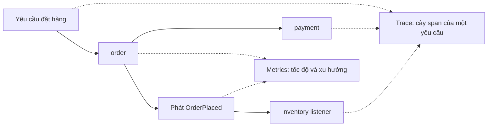

# Metrics tổng hợp với traces chi tiết

Trong ứng dụng Spring Boot tổ chức theo **Spring Modulith**, biết hệ thống có các module `order`, `payment`, `inventory` chưa đủ để xác định chúng thực sự tương tác ra sao khi chạy. Khi người dùng báo “đặt hàng chậm”, ta cần trả lời hai câu hỏi khác nhau:

1. **Tình hình chung có bất thường không?** Trong 5 phút gần đây, lượng sự kiện `OrderPlaced` có tăng đột biến, thời gian xử lý có vượt ngưỡng, tỷ lệ lỗi có tăng không?
2. **Chính giao dịch bị chậm đã đi qua đâu?** Yêu cầu HTTP nào gọi module `order`, sau đó chạm module `payment`, và phần xử lý `inventory` mất bao lâu?

**Metrics** trả lời câu hỏi thứ nhất bằng số liệu tổng hợp theo thời gian. **Traces** trả lời câu hỏi thứ hai bằng chuỗi span có quan hệ nhân quả của một lần thực thi. Kết hợp hai tín hiệu giúp kiểm tra hành vi vận hành của các application module; sơ đồ module và quy tắc phụ thuộc vẫn được kiểm chứng riêng bằng phân tích kiến trúc.

## 1. Mục tiêu học tập

Sau bài này, bạn có thể:

- Phân biệt metric, time series, trace, span, trace ID và sampling trong bối cảnh application module.
- Nhận diện hai nhóm dữ liệu Spring Modulith cung cấp: **counter cho sự kiện được phát** và **span cho lời gọi vào API module**.
- Kích hoạt Actuator, Prometheus và một backend tracing để quan sát luồng xử lý.
- Đọc metrics trước để khoanh vùng, sau đó dùng một trace để tìm đoạn thực thi chậm hoặc có lỗi.
- Phân biệt giới hạn của metric công bố sự kiện với kết quả xử lý của event listener; nhận biết đứt ngữ cảnh tracing khi qua luồng bất đồng bộ.

## 2. Hai độ phân giải của cùng một hoạt động

| Khía cạnh | Metrics tổng hợp | Traces chi tiết |
| --- | --- | --- |
| Đơn vị quan sát | Chuỗi giá trị theo thời gian, ví dụ số sự kiện/giây hoặc p95 độ trễ | Một trace gồm nhiều span của một lần xử lý |
| Câu hỏi điển hình | “Module nào phát nhiều sự kiện?”, “Lỗi có tăng sau triển khai?” | “Yêu cầu này chậm ở module nào?”, “Lời gọi nào là cha của span lỗi?” |
| Mức dữ liệu | Tổng hợp từ nhiều lần thực thi; có thể phân nhóm theo tag | Mô tả thứ tự, thời gian, quan hệ cha–con, thuộc tính và trạng thái của từng span |
| Chi phí | Thường phù hợp cho giám sát liên tục nếu giữ số chiều tag hữu hạn | Có thể tốn lưu trữ; thường áp dụng sampling |
| Điều không thể suy ra trực tiếp | Không biết chính xác một giao dịch đã đi theo đường nào | Một trace đơn lẻ không đại diện cho phân phối độ trễ hoặc tỷ lệ lỗi của cả hệ thống |

Ví dụ minh họa: metric cho thấy tốc độ phát `OrderPlaced` tăng từ 15 lên 90 sự kiện/giây. Điều này chưa chứng minh hệ thống chậm. Nếu đồng thời p95 độ trễ HTTP tăng, hãy mở trace của một yêu cầu chậm để xem thời gian nằm ở `payment`, lời gọi bên ngoài hay một listener của `inventory`.



**Điểm quan trọng:** metric sự kiện do Spring Modulith cung cấp đếm **lần công bố sự kiện**. Không được mặc định coi giá trị đó là số đơn hàng thành công, số listener đã xử lý xong hay số sự kiện đã được lưu bền vững. Muốn đo kết quả xử lý, phải quan sát thêm listener, registry công bố sự kiện (nếu được cấu hình) hoặc tự bổ sung metric nghiệp vụ.

## 3. Dữ liệu mặc định từ Spring Modulith

### 3.1. Counter công bố sự kiện

Trong phần observability, Spring Modulith ghi nhận các domain event được phát thông qua các meter:

| Tên meter theo Micrometer | Ý nghĩa |
| --- | --- |
| `module.events.published` | Counter tổng hợp các lần phát sự kiện; có thể phân tích theo các tag của module và loại event |
| `module.events.published.$moduleIdentifier.$simpleEventTypeName` | Counter riêng cho từng kết hợp module và kiểu sự kiện; có thể tùy biến thêm tag |

Các **low-cardinality keys** tài liệu Spring Modulith công bố:

- Với `module.events.published`: `module.event.type`, `module.identifier`, `module.name`.
- Với meter riêng cho từng sự kiện: `module.identifier`, `module.name`.

*Low cardinality* nghĩa là giá trị tag đến từ một tập có giới hạn, chẳng hạn tên module hoặc tên loại event. Tránh đưa `orderId`, email, UUID, nội dung payload hay mã yêu cầu ngẫu nhiên vào tag metric: mỗi giá trị mới có thể tạo ra một chuỗi thời gian mới, khiến hệ thống giám sát phình to. Những thông tin có độ phân biệt cao chỉ nên được đưa vào trace/log khi cần thiết, sau khi cân nhắc bảo mật.

**Đọc counter đúng cách:** counter có thể tăng theo mỗi sự kiện được phát, nhưng giá trị tích lũy có thể về 0 khi ứng dụng khởi động lại. Trên dashboard theo dõi `rate()` hoặc `increase()` trong một cửa sổ thời gian, thay vì so sánh thô hai giá trị counter cách xa nhau.

### 3.2. Span cho lời gọi vào module

Khi bật observability của Spring Modulith, các lời gọi qua **Spring component thuộc API công khai của application module** được instrument, tạo Micrometer span để đi vào trace. Span đầu vào module có thể mang các thuộc tính:

| Thuộc tính span | Nội dung |
| --- | --- |
| `module.identifier` | Định danh kỹ thuật của module |
| `module.name` | Tên module |
| `module.invocation-type` | Loại lời gọi, ví dụ `bean` hoặc `event listener` |
| `module.method` | Phương thức được thực thi |

Đây **không phải** công cụ tự động tạo span cho mọi phương thức Java, mọi lời gọi nội bộ, truy vấn SQL hay mỗi bước nghiệp vụ. Trace có chi tiết đến đâu còn phụ thuộc instrumentation từ Spring, client HTTP, thư viện truy cập dữ liệu và các span bạn tự thêm.

Một **trace** chứa một `traceId`; mỗi **span** có `spanId`, thời điểm bắt đầu, thời lượng và thường có `parentSpanId`. Quan hệ cha–con giúp mô tả một chuỗi thao tác; khi có xử lý bất đồng bộ, quan hệ đó chỉ liền mạch nếu tracing context được truyền đúng.

## 4. Ví dụ thực tế: quan sát luồng đặt hàng

Giả sử ứng dụng có ba application module:

- `order` nhận yêu cầu và phát sự kiện `OrderPlaced`.
- `payment` cung cấp API thanh toán cho `order`.
- `inventory` đăng ký xử lý `OrderPlaced` bằng event listener.

Ví dụ rút gọn của kiểu sự kiện trong API module `order`:

```java
// com.example.shop.order.OrderPlaced
package com.example.shop.order;

import java.util.UUID;

public record OrderPlaced(UUID orderId) {}
```

Module `order` phát sự kiện sau khi hoàn thành phần việc thích hợp với quy tắc giao dịch của ứng dụng:

```java
// com.example.shop.order.OrderService
package com.example.shop.order;

import java.util.UUID;
import org.springframework.context.ApplicationEventPublisher;
import org.springframework.stereotype.Service;

@Service
public class OrderService {

    private final ApplicationEventPublisher events;

    public OrderService(ApplicationEventPublisher events) {
        this.events = events;
    }

    public void placeOrder(UUID orderId) {
        // Ví dụ tối giản: phần xác thực, lưu đơn và giao dịch được lược bỏ.
        events.publishEvent(new OrderPlaced(orderId));
    }
}
```

Listener ở module `inventory` có thể dùng `@ApplicationModuleListener` (mô hình event listener giao dịch/bất đồng bộ của Spring Modulith):

```java
// com.example.shop.inventory.InventoryOnOrderPlaced
package com.example.shop.inventory;

import com.example.shop.order.OrderPlaced;
import org.springframework.modulith.events.ApplicationModuleListener;
import org.springframework.stereotype.Component;

@Component
class InventoryOnOrderPlaced {

    @ApplicationModuleListener
    void on(OrderPlaced event) {
        // Gọi logic giữ hàng theo event.orderId().
    }
}
```

Nếu bật instrumentation và có backend tracing, một trace minh họa cho một request đồng bộ có thể hiển thị:

```text
HTTP POST /orders                 420 ms
└─ module order: placeOrder        405 ms
   ├─ module payment: authorize    280 ms
   └─ publish OrderPlaced           10 ms
```

Nếu `inventory` xử lý sự kiện **bất đồng bộ**, span listener có thể xuất hiện sau đó, dưới context khác hoặc thậm chí một trace riêng khi context không được truyền. Không nên vẽ sẵn quan hệ cha–con xuyên qua ranh giới luồng rồi kết luận đó là kết quả chắc chắn của Spring Modulith. Trong trường hợp này, kiểm tra cả trace của listener, event publication registry và log tương quan.

### Kết hợp hai tín hiệu để điều tra

1. **Phát hiện:** dashboard hiển thị tốc độ `module.events.published` theo `module.identifier` và `module.event.type`; kết hợp metric độ trễ/lỗi HTTP từ Spring Boot và các timer nghiệp vụ tự định nghĩa.
2. **Khoanh vùng:** xác định loại sự kiện hoặc thao tác tăng mạnh và khung thời gian bất thường. Counter công bố sự kiện một mình không chỉ ra thời gian xử lý hay lỗi listener.
3. **Đi sâu:** tìm trace của các request chậm hoặc lỗi tương ứng; xem `module.method`, `module.invocation-type`, thời lượng span, quan hệ cha–con và lỗi.
4. **Đối chiếu:** nếu listener có lỗi nhưng counter công bố vẫn tăng, đây là tình huống hoàn toàn có thể xảy ra: “đã phát” khác “đã xử lý xong”. Kiểm tra trạng thái publication và metric kết quả xử lý.
5. **Kiểm chứng sửa lỗi:** theo dõi lại p95/p99 và lỗi trên một khoảng thời gian đủ dài, đồng thời xem nhiều trace sau thay đổi; một trace nhanh đơn lẻ chưa chứng minh độ trễ toàn hệ thống đã giảm.

## 5. Cấu hình quan sát trong Spring Boot

Ví dụ dưới đây hướng tới **Spring Boot 4.x + Spring Modulith 2.2.x** và giả định dự án đã quản lý phiên bản dependency của Spring Boot. Với Spring Boot 3.x, chọn dòng Spring Modulith tương thích (chẳng hạn 1.4.x cho Boot 3.5) và cấu hình dependency tracer theo tài liệu Boot 3.x; tên starter có thể khác.

Trong Gradle (Groovy DSL), nhập BOM để các artifact Spring Modulith cùng phiên bản:

```groovy
dependencies {
    implementation platform("org.springframework.modulith:spring-modulith-bom:2.2.0")

    implementation "org.springframework.modulith:spring-modulith-starter-core"
    runtimeOnly "org.springframework.modulith:spring-modulith-starter-insight"

    runtimeOnly "io.micrometer:micrometer-registry-prometheus"
    implementation "org.springframework.boot:spring-boot-starter-zipkin"
}
```

Vai trò từng thành phần:

- `spring-modulith-starter-core`: nền tảng phát hiện application module.
- `spring-modulith-starter-insight`: tập hợp Actuator và instrumentation observability của Spring Modulith, bao gồm Spring Boot Actuator.
- `micrometer-registry-prometheus`: chuyển metrics thành định dạng Prometheus để scrape.
- `spring-boot-starter-zipkin`: lựa chọn exporter/tracer để gửi trace tới Zipkin trên dòng Boot 4.x; có thể thay bằng OpenTelemetry/OTLP theo hạ tầng đang dùng.

Cấu hình phát triển trong `application.yml`:

```yaml
spring:
  application:
    name: shop-modulith

management:
  endpoints:
    web:
      exposure:
        include: "health,info,metrics,prometheus,modulith"
  tracing:
    sampling:
      probability: 1.0
```

`probability: 1.0` giúp xem đủ trace khi **thử nghiệm cục bộ**. Trên môi trường thực tế, chọn sampling phù hợp với lưu lượng, chi phí và nhu cầu điều tra; các bản Spring Boot gần đây mặc định chỉ lấy mẫu một phần yêu cầu. Cần chạy backend Zipkin và kiểm tra cấu hình exporter/endpoint phù hợp với môi trường, nếu không trace có thể được tạo nhưng không xuất hiện trên giao diện.

Ba endpoint cần biết:

| HTTP endpoint | Dùng để làm gì |
| --- | --- |
| `GET /actuator/modulith` | Xem mô hình module và các phụ thuộc được phát hiện, dùng làm mốc đối chiếu kiến trúc |
| `GET /actuator/metrics/module.events.published` | Xem meter theo tên Micrometer; metric chỉ xuất hiện khi đã ghi nhận sự kiện tương ứng |
| `GET /actuator/prometheus` | Cung cấp các chuỗi metrics cho Prometheus scrape |

Không mở các Actuator endpoint nội bộ cho Internet công cộng khi chưa cấu hình quyền truy cập phù hợp.

### 5.1. Đọc chuỗi Prometheus

Với registry Prometheus, tên counter và tag theo quy ước thường được chuẩn hóa từ dấu chấm sang dấu gạch dưới; có thể nhìn thấy dạng `module_events_published_total` với label như `module_identifier`, `module_event_type`. Hãy kiểm tra **tên series thực tế** tại `/actuator/prometheus` vì cách xuất tên có thể thay đổi theo phiên bản Micrometer/registry.

Ví dụ PromQL cho tốc độ công bố sự kiện mỗi giây:

```promql
sum by (module_identifier, module_event_type) (
  rate(module_events_published_total[5m])
)
```

Truy vấn cho số sự kiện đã công bố trong 30 phút (xấp xỉ theo dữ liệu scrape):

```promql
sum by (module_identifier) (
  increase(module_events_published_total[30m])
)
```

Hai truy vấn trên đều nói về **sự kiện được phát**, không tự đo thành công xử lý của listener. Muốn xác định thời gian giữ hàng, hãy đo timer phù hợp ở thao tác giữ hàng; muốn xác định tỷ lệ xử lý thất bại, dùng metric kết quả listener hoặc trạng thái publication được quản lý bởi ứng dụng.

### 5.2. Bổ sung chi tiết đúng chỗ

Spring Modulith không tự đo độ trễ của mọi bước nghiệp vụ. Có thể dùng Micrometer `Timer` cho một đoạn xử lý cần theo dõi:

```java
package com.example.shop.inventory;

import io.micrometer.core.instrument.MeterRegistry;
import io.micrometer.core.instrument.Timer;
import org.springframework.stereotype.Service;

@Service
class InventoryReservation {

    private final MeterRegistry registry;

    InventoryReservation(MeterRegistry registry) {
        this.registry = registry;
    }

    void reserve(String sku) {
        Timer.Sample sample = Timer.start(registry);
        String result = "success";

        try {
            // Thực hiện kiểm tra và giữ tồn kho.
            performReservation(sku);
        } catch (RuntimeException exception) {
            result = "failure";
            throw exception;
        } finally {
            sample.stop(
                Timer.builder("inventory.reservation.duration")
                    .tag("result", result)
                    .register(registry)
            );
        }
    }

    private void performReservation(String sku) {
        // Logic ví dụ.
    }
}
```

Tag `result` có hai giá trị dự kiến: `success` và `failure`. Không thêm `sku` hoặc `orderId` làm tag nếu tập giá trị lớn. Sau khi xuất Prometheus, timer thường tạo các chuỗi `_count`, `_sum` và có thể có histogram/percentile nếu cấu hình phân phối; **p95 không tự có** chỉ vì đã ghi Timer. Muốn tính p95 từ histogram Prometheus, phải bật histogram tương ứng và dùng `histogram_quantile()` trên bucket.

Để soi một lời gọi bên ngoài nằm *bên trong* module, có thể thêm một Micrometer `Observation` thủ công ở đoạn cần thiết:

```java
Observation.createNotStarted("inventory.warehouse.call", observationRegistry)
    .lowCardinalityKeyValue("dependency", "warehouse")
    .observe(() -> warehouseClient.reserve(orderId));
```

Ví dụ này giả định đã có `observationRegistry` và `warehouseClient`. Với bridge tracing được cấu hình, observation có thể tạo span; không nên bọc lặp lại đúng cùng ranh giới mà Spring Modulith đã instrument, vì dễ tạo span trùng và làm trace nhiễu.

## 6. Sampling và context propagation

### Sampling ảnh hưởng cách đọc trace

Trace sampling quyết định những trace nào được ghi/xuất sang backend. Metrics độc lập với việc trace của chính giao dịch đó có được lưu hay không. Vì vậy:

- Counter có thể tăng nhưng bạn không tìm thấy trace của sự kiện vừa diễn ra.
- Một trace có span chậm không nói lên tần suất chậm chung của toàn bộ hệ thống.
- Mục tiêu điều tra lỗi hiếm có thể cần điều chỉnh sampling hoặc cơ chế lấy mẫu có chủ đích, song phải tính chi phí và quyền riêng tư.

### Context qua ranh giới bất đồng bộ

Micrometer Tracing thường duy trì ngữ cảnh đang hoạt động bằng cơ chế phù hợp với luồng thực thi. Khi chuyển từ request thread sang `@Async`, executor tự tạo, CompletableFuture, message broker hoặc pipeline reactive, `traceId` và span cha có thể không còn được truyền tự động.

Để giảm đứt mạch quan sát:

1. Ưu tiên executor và client HTTP được Spring Boot quản lý, với cơ chế context propagation tương thích.
2. Với executor tự cấu hình, cân nhắc `ContextPropagatingTaskDecorator` hoặc Micrometer Context Propagation ở ranh giới phù hợp; xác minh bằng trace thực tế.
3. Với truyền thông qua network/message broker, sử dụng header truyền trace context theo chuẩn được hỗ trợ (ví dụ W3C Trace Context) và instrumentation tại bên gửi/bên nhận.
4. Nếu tác vụ thực sự tách rời về thời gian/ngữ nghĩa, một trace riêng hoặc **span link** có thể phù hợp hơn việc cố gán quan hệ cha–con giả tạo.

**Không truyền trace ID bằng tag metric.** Trace ID có cardinality cực lớn. Để liên kết từ điểm bất thường trên dashboard sang trace, dùng chức năng liên kết metric–trace của nền tảng giám sát (chẳng hạn exemplar khi được hỗ trợ) hoặc điều tra theo khung thời gian, service, module và các thuộc tính span.

## 7. Một kịch bản chẩn đoán hoàn chỉnh

Giả sử sau một đợt triển khai, đội vận hành thấy p95 của `POST /orders` tăng từ **250 ms lên 900 ms** (số liệu giả định):

| Bước | Bằng chứng | Diễn giải được phép |
| --- | --- | --- |
| Kiểm tra metrics HTTP | p95 tăng, lỗi HTTP không tăng rõ | Có suy giảm độ trễ; chưa biết module nào gây ra |
| Kiểm tra `module.events.published` | Tốc độ `OrderPlaced` gần như không đổi | Tải do số lượng event công bố chưa thấy tăng bất thường |
| Mở trace chậm | Span `payment.authorize` chiếm khoảng 700 ms | Có cơ sở điều tra lời gọi trong `payment` |
| Xem span sâu hơn | Span gọi cổng thanh toán ngoài chiếm phần lớn 700 ms | Nghi vấn nằm ở phụ thuộc bên ngoài, cần xác minh bằng nhiều trace và metric phụ thuộc |
| Đối chiếu module graph | `order` phụ thuộc vào API `payment` đúng thiết kế | Quan hệ phụ thuộc hợp lệ về cấu trúc không đảm bảo độ trễ tốt lúc chạy |
| Sau thay đổi | p95 giảm trên một khoảng đo đủ dài; trace cho thấy span phụ thuộc ngắn hơn | Có bằng chứng thực nghiệm rằng sửa đổi đã cải thiện độ trễ |

Nếu thay vào đó `module.events.published` vẫn tăng nhưng đơn hàng không được giữ tồn kho, cần xem **lỗi listener và trạng thái publication**, không quy lỗi cho chức năng phát sự kiện chỉ dựa vào counter.

## 8. Những nhầm lẫn cần tránh

| Nhận định sai | Cách hiểu đúng |
| --- | --- |
| “Counter tăng tức là event listener đã xử lý thành công.” | Counter cho biết sự kiện được phát; thành công listener phải đo/kiểm tra riêng. |
| “Spring Modulith tự tạo span cho mọi hàm.” | Instrumentation tập trung vào điểm vào module được hỗ trợ; chi tiết khác cần instrumentation bổ sung. |
| “Không thấy trace tức là code không chạy.” | Sampling, exporter, backend hoặc context propagation có thể khiến trace vắng mặt. |
| “Trace này nhanh nên hệ thống đã hết chậm.” | Dùng metrics phân phối trên nhiều giao dịch để đánh giá tổng thể. |
| “Có trace giữa hai module nghĩa là phụ thuộc đó hợp lệ.” | Trace phản ánh hành vi được quan sát; kiểm tra quy tắc kiến trúc phải dựa vào module model và verification. |
| “Gắn orderId làm metric tag sẽ dễ debug hơn.” | Dễ gây nổ số time series; dùng thông tin tương quan trên trace/log theo chính sách dữ liệu. |

## 9. Tự kiểm tra sau khi thực hành

- [ ] `/actuator/modulith` liệt kê được các module và quan hệ phụ thuộc dự kiến.
- [ ] Sau khi phát một domain event, `/actuator/metrics/module.events.published` có dữ liệu.
- [ ] `/actuator/prometheus` xuất các series liên quan, Prometheus scrape được.
- [ ] Backend tracing nhận trace từ request có đi qua API module và hiển thị các tag `module.*` thích hợp.
- [ ] Trace cho biết span nào chậm; dashboard metric giúp đánh giá ảnh hưởng trên nhiều request.
- [ ] Đã thử một luồng event bất đồng bộ và xác minh ngữ cảnh trace có/không được truyền đúng như thiết kế.
- [ ] Không nhầm số lần công bố event với số lần xử lý thành công, và không dùng ID có cardinality cao làm metric tag.

## Tài liệu tham khảo

- [Spring Modulith — Production-ready Features](https://docs.spring.io/spring-modulith/reference/production-ready.html): Actuator, module-entry spans, event publication metrics và các tag chính thức.
- [Spring Modulith — Fundamentals](https://docs.spring.io/spring-modulith/reference/fundamentals.html): API, internal implementation và phụ thuộc của application module.
- [Spring Modulith — Working with Application Events](https://docs.spring.io/spring-modulith/reference/events.html): `@ApplicationModuleListener` và Event Publication Registry.
- [Spring Boot — Metrics](https://docs.spring.io/spring-boot/reference/actuator/metrics.html): Prometheus, timer, histogram và các cách xuất metrics.
- [Spring Boot — Tracing](https://docs.spring.io/spring-boot/reference/actuator/tracing.html): tracer, sampling, exporter và propagation.
- [Spring Framework — Observability Support](https://docs.spring.io/spring-framework/reference/integration/observability.html): Observation, tag cardinality và tracing.
