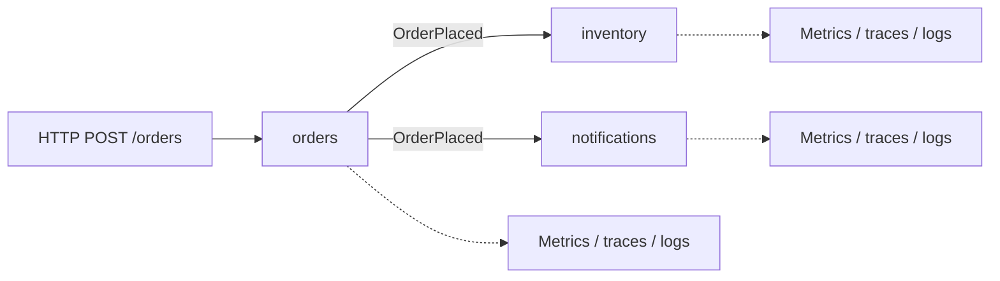
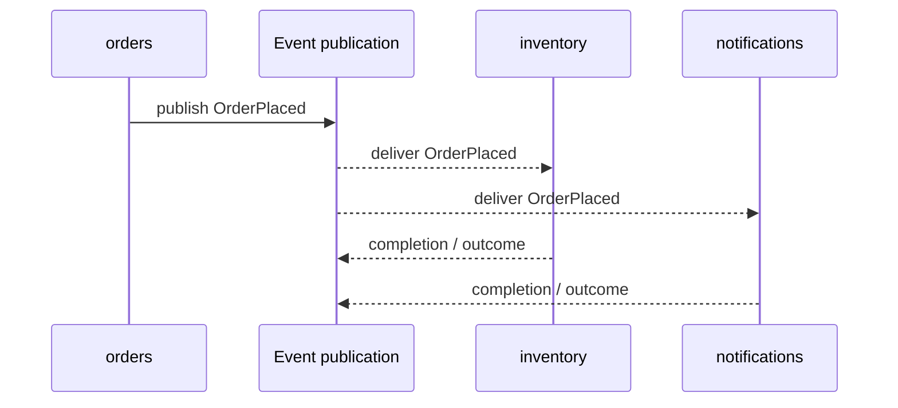
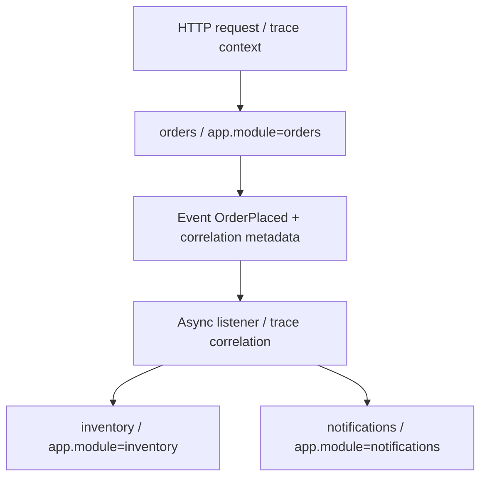

# Định danh module trong dữ liệu quan sát

## 1. Vì sao phải định danh module?

Trong ứng dụng Spring Boot được tổ chức theo **Spring Modulith**, nhiều *application module* cùng chạy trong một tiến trình. Các module vẫn có trách nhiệm nghiệp vụ và ranh giới phụ thuộc riêng: `orders` quản lý đơn hàng, `inventory` quản lý tồn kho và `notifications` gửi thông báo. Khi chỉ nhìn chỉ số toàn ứng dụng như thời gian đáp ứng HTTP hoặc CPU, chúng ta khó biết **module nào thực hiện công việc, module nào gọi module nào và lỗi xuất hiện tại ranh giới nào**.

**Định danh module trong dữ liệu quan sát** là gắn một định danh logic nhất quán với hoạt động thuộc một application module, để liên kết dữ liệu từ *module graph*, Spring Boot Actuator, metrics, traces, logs và việc xử lý domain event. Đây là một phần của mô hình quan sát trong chủ đề **SPRING_MODULITH_DOCUMENTATION_OBSERVABILITY**: dùng tài liệu ranh giới module kết hợp với quan sát khi chạy để đối chiếu **kiến trúc dự kiến** và **tương tác thực tế**.

Ví dụ, khi một yêu cầu đặt hàng chậm, thông tin `service.name=shop-app` chỉ cho biết ứng dụng đang chậm. Nếu các hoạt động liên quan còn được gắn `app.module=orders`, `app.module=inventory`, ta có thể khoanh vùng bước xử lý ở mỗi module. Trường `app.module` trong ví dụ là **quy ước minh họa do nhóm tự thiết kế**, không phải lời khẳng định Spring Modulith luôn sinh chính xác tên tag đó.



Nhìn từ góc độ vận hành, mục tiêu không chỉ là tìm thấy một chuỗi ký tự tên module. Mục tiêu là xác định chính xác **ai đang xử lý**, **ai khởi tạo tương tác**, **ai nhận tương tác** và **hoạt động nào thuộc cùng một lần xử lý nghiệp vụ**.

## 2. Định danh module là gì, khác gì các định danh khác?

Một ứng dụng modular monolith có thể có các tầng định danh sau:

| Định danh | Phạm vi | Ví dụ | Công dụng |
| --- | --- | --- | --- |
| **Service/application** | Ứng dụng hoặc workload được triển khai | `shop-app` | Xác định dịch vụ trong APM, metrics, tracing |
| **Application module** | Ranh giới chức năng bên trong ứng dụng | `orders`, `inventory` | Nhóm hoạt động theo module logic |
| **Operation** | Thao tác nghiệp vụ hoặc kỹ thuật | `place-order`, `reserve-stock` | Phân biệt các hoạt động bên trong module |
| **Module source/target** | Hai đầu của một tương tác | `orders` → `inventory` | Phân tích các cạnh tương tác giữa module |
| **Trace / span** | Một hành trình yêu cầu / một đoạn thực thi | `traceId`, `spanId` | Liên kết các bước cùng luồng xử lý |
| **Event / correlation ID** | Một event hoặc yêu cầu nghiệp vụ cụ thể | `eventId`, `orderId` | Đối chiếu từng giao dịch, hỗ trợ retry |
| **Instance** | Một bản chạy của ứng dụng | Pod/instance ID | Tìm vấn đề cục bộ ở một bản triển khai |

**Module ID không đồng nghĩa với `service.name`.** Trong modular monolith, cả `orders` và `inventory` có thể cùng thuộc `service.name=shop-app`; chúng chưa chắc là hai dịch vụ triển khai độc lập. Cũng không nên dùng `traceId`, `orderId`, tên class hoặc số thứ tự bean làm định danh module: các giá trị đó phục vụ mục đích khác và thường biến động hoặc quá chi tiết.

Một module nên có **ID ổn định, duy nhất trong phạm vi ứng dụng và dễ ánh xạ về mô hình module**. Tên hiển thị có thể thân thiện hơn (`Quản lý đơn hàng`), nhưng dashboard và bộ lọc máy thường cần một ID nhất quán (`orders`). Việc đổi package, tên hiển thị hoặc cách cấu hình module cần đi kèm kiểm tra tác động đến dữ liệu quan sát lịch sử.

## 3. Lấy định danh từ mô hình Spring Modulith

Spring Modulith xây dựng mô hình `ApplicationModules` từ cấu trúc code và quy ước hoặc khai báo application module của dự án. Đây là nguồn tham chiếu tự nhiên khi xác định danh sách module hợp lệ. Ví dụ:

```text
com.example.shop
├── ShopApplication.java
├── orders
│   ├── OrderService.java
│   └── internal
│       └── OrderRepository.java
├── inventory
│   ├── InventoryService.java
│   └── internal
│       └── StockRepository.java
└── notifications
    ├── NotificationService.java
    └── internal
        └── EmailGateway.java
```

Với cách tổ chức module mặc định theo package con trực tiếp, mô hình thường nhận ra các module `orders`, `inventory`, `notifications`. Tuy nhiên, **ID thực tế phải được kiểm tra trong mô hình của dự án**, đặc biệt khi nhóm đã tùy biến phát hiện module hoặc cấu hình tên/ranh giới.

Có thể kiểm tra tính hợp lệ của cấu trúc và sinh tài liệu như sau:

```java
import org.junit.jupiter.api.Test;
import org.springframework.modulith.core.ApplicationModules;
import org.springframework.modulith.docs.Documenter;

class ArchitectureTest {

    @Test
    void verifyAndDocument() {
        var modules = ApplicationModules.of(ShopApplication.class);
        modules.verify();
        new Documenter(modules).writeDocumentation();
    }
}
```

`ShopApplication` là class ứng dụng tại package gốc. Ví dụ yêu cầu dependency test thích hợp cho Spring Modulith Core/Docs và phiên bản tương thích. `modules.verify()` kiểm tra những quy tắc kiến trúc mà framework hỗ trợ; `Documenter` sinh tài liệu cấu trúc từ cùng một mô hình. **Module graph là nguồn để kiểm tra danh tính và quan hệ tĩnh**, còn trace là bằng chứng một tương tác đã xảy ra khi chạy.

Ở runtime, thành phần Actuator của Spring Modulith có thể công bố metadata module qua endpoint quản trị khi đã thêm dependency và bật exposure theo phiên bản đang sử dụng. Có thể đối chiếu danh sách module của ứng dụng đang chạy với tài liệu đã sinh. Tên endpoint, các trường JSON và khả năng truy vấn cụ thể cần kiểm tra theo phiên bản, tránh viết hệ thống giám sát phụ thuộc cứng vào một cấu trúc response chỉ thấy trong ví dụ.

### 3.1. Quy tắc ánh xạ nên được thống nhất

Ví dụ bảng quy ước nội bộ:

| Mô hình module | ID trong dữ liệu quan sát | Tên hiển thị | Phạm vi trách nhiệm |
| --- | --- | --- | --- |
| `orders` | `orders` | Đơn hàng | Tạo, cập nhật, hủy đơn |
| `inventory` | `inventory` | Tồn kho | Kiểm tra và dự trữ hàng |
| `notifications` | `notifications` | Thông báo | Email, thông báo nghiệp vụ |

Nếu dự án đổi tên module `notifications` thành `messaging`, cần quyết định rõ thời điểm và cách đổi nhãn quan sát, cập nhật truy vấn/dashboard và cân nhắc tính liên tục của số liệu lịch sử. Với ứng dụng có nhiều module, việc quản lý mapping tập trung giúp giảm lỗi đánh vần và tránh việc cùng một module bị gắn nhiều tên khác nhau.

## 4. Mô hình dữ liệu quan sát có gắn module

Một cách thiết kế là tách **định danh cố định của thực thể được triển khai** và **ngữ cảnh của từng hoạt động**:

```text
Resource / workload:
  service.name = shop-app
  service.version = 1.4.0

Operation / observation:
  app.module = orders
  app.operation = place-order
  outcome = success

Cross-module event:
  event.type = OrderPlaced
  source.module = orders
  target.module = inventory

Correlation (trace/log/event record):
  traceId = <trace ID>
  spanId = <span ID>
  eventId = <event ID>
```

`service.name` là khóa quen thuộc trong hệ sinh thái OpenTelemetry để nhận diện service. Các khóa `app.module`, `app.operation`, `source.module`, `target.module` trong bảng là **schema đề xuất cho ứng dụng**, không phải semantic convention chính thức bắt buộc của OpenTelemetry hoặc tên tag được Spring Modulith bảo đảm tự phát ra. Nếu thư viện phiên bản dự án đã cung cấp module attribute khác, nên ưu tiên kiểm tra và tái sử dụng nó hoặc chuẩn hóa ở tầng thu thập dữ liệu, tránh cùng một ý nghĩa nhưng có nhiều nhãn.

Một số nguyên tắc thiết kế schema:

1. **Cùng một module, cùng một ID ở mọi nguồn**: bảng điều khiển metrics, trace, log và catalog kiến trúc phải tìm được nhau.
2. **Phân biệt module hiện tại và hai đầu tương tác**: span đang chạy tại `inventory` có `app.module=inventory`, dù lời gọi được khởi tạo từ `orders`.
3. **Không biến metadata động thành danh tính module**: `orderId`, mã người dùng, email, request ID và timestamp không phải module ID.
4. **Định nghĩa rõ thế nào là một hoạt động**: ví dụ `place-order` là operation nghiệp vụ, không nhất thiết là một tên phương thức Java cụ thể.
5. **Duy trì khả năng giải thích dữ liệu cũ**: nếu đổi ID hoặc tách/gộp module, ghi nhận thay đổi trong tài liệu kiến trúc.

## 5. Đưa module ID vào metrics

Metric hỗ trợ phân tích xu hướng: tỷ lệ lỗi, throughput, độ trễ trung bình hoặc phân vị, số event xử lý. Nhãn module giúp phân tích các chỉ số đó theo ranh giới nghiệp vụ.

Giả sử nhóm tự định nghĩa timer `shop.module.operation` với tag `app.module`:

| Metric | `app.module` | `app.operation` | Ý nghĩa |
| --- | --- | --- | --- |
| `shop.module.operation` | `orders` | `place-order` | Độ trễ tạo đơn |
| `shop.module.operation` | `inventory` | `reserve-stock` | Độ trễ dự trữ hàng |
| `shop.module.operation` | `notifications` | `send-email` | Độ trễ gửi thông báo |

Thông qua Micrometer Observation, có thể bổ sung low-cardinality key values cho một hoạt động cần theo dõi riêng:

```java
package com.example.shop.orders;

import io.micrometer.observation.Observation;
import io.micrometer.observation.ObservationRegistry;
import org.springframework.stereotype.Service;

@Service
class OrderCommandService {

    private final ObservationRegistry observationRegistry;

    OrderCommandService(ObservationRegistry observationRegistry) {
        this.observationRegistry = observationRegistry;
    }

    void placeOrder() {
        Observation.createNotStarted("shop.order.place", observationRegistry)
            .lowCardinalityKeyValue("app.module", "orders")
            .lowCardinalityKeyValue("app.operation", "place-order")
            .observe(() -> {
                // Xử lý nghiệp vụ tạo đơn hàng.
            });
    }
}
```

Đây là ví dụ **instrumentation thủ công** bằng Micrometer; nó không có nghĩa Spring Modulith yêu cầu mọi service phải viết đoạn code này. Khi có `spring-modulith-observability`, framework có thể instrument các điểm vào module được hỗ trợ. Nên kiểm tra observation hiện có và các tag thực tế trước khi tự bọc thêm, nếu không có thể tạo span/metric trùng lặp hoặc làm sai thống kê.

**Low cardinality** nghĩa là số lượng giá trị có giới hạn tương đối nhỏ và ổn định. `orders`, `inventory`, `place-order`, `success`, `failure` thích hợp hơn ID từng đơn hàng. Gắn `orderId` vào metric label có thể tạo một chuỗi thời gian mới cho gần như mọi yêu cầu, tăng chi phí lưu trữ và làm truy vấn chậm. Với trace hoặc log, correlation ID có thể hữu ích, nhưng vẫn phải xem xét dữ liệu nhạy cảm và chính sách thu thập.

Ví dụ truy vấn PromQL *minh họa* cho một timer Micrometer tự định nghĩa sau khi được xuất sang Prometheus:

```promql
sum by (app_module) (
  rate(shop_module_operation_seconds_count[5m])
)
```

Truy vấn này chỉ áp dụng nếu ứng dụng **thực sự xuất** metric theo tên `shop_module_operation_seconds_count` và nhãn đã được chuẩn hóa thành `app_module`. Bộ chuyển tên Micrometer/Prometheus, cấu hình timer và phiên bản có thể làm tên khác đi. Cần xem dữ liệu tại `/actuator/prometheus` hoặc backend thực tế trước khi tạo dashboard. Metric timer cũng không tự trở thành histogram phân vị nếu chưa bật cấu hình phân phối tương ứng.

## 6. Đưa module ID vào tracing

Distributed tracing mô tả hành trình của một yêu cầu bằng **trace** và **span**. Khi mọi span liên quan có module ID, ta có thể xác định phần nào của thời gian xử lý thuộc module nào, và thao tác nào đã vượt ranh giới module.

```text
trace: HTTP POST /orders                     service=shop-app
└── span: create order                       module=orders
    ├── span: save order                     module=orders
    ├── span: reserve stock                  module=inventory
    └── span: publish OrderPlaced            module=orders
        └── span: consume OrderPlaced        module=notifications
```

Đây là sơ đồ logic nhằm giải thích ý nghĩa của nhãn module. **Không mặc định** các span hoặc quan hệ cha–con trên đều được sinh ra tự động: còn phụ thuộc vào nơi instrument, sampling, cách thực thi sự kiện và context propagation.

Với stack Spring Boot, Spring Modulith Observability kết hợp Micrometer Observation và tracing bridge phù hợp để theo dõi tương tác ở những điểm mà thư viện hỗ trợ. Tùy phiên bản, tên span và các key tag do framework sinh ra có thể khác schema ví dụ ở đây. Cần kiểm tra trace thực tế trong collector để xác nhận module identity xuất hiện ở đâu, được đặt tại span nào, và có nhất quán qua các phiên bản không.

Để một trace hữu ích cho việc kiểm chứng module, hãy đặt các câu hỏi:

- **Span gắn đúng module thực thi chưa?** Listener trong `inventory` phải được nhận diện là hoạt động `inventory`, dù trace bắt đầu tại `orders`.
- **Có thấy chuyển tiếp qua module không?** Nếu logic đi từ `orders` sang `inventory`, trace đủ chi tiết để biểu diễn điểm chuyển đó chưa?
- **Có trường hợp một span đại diện cho nhiều module không?** Khi đó cần lựa chọn ranh giới span hợp lý thay vì dùng một module label đánh đồng toàn bộ request.
- **Thiếu span vì logic không chạy hay vì instrumentation/sampling?** Không có dấu vết không đủ để kết luận không có tương tác.

Một lời gọi bị lộ trong trace có thể gợi ý phụ thuộc bất thường, nhưng **trace không tự chứng minh vi phạm quy tắc module**. Cần so sánh với `ApplicationModules`, module graph và kết quả `modules.verify()` để xác định quan hệ được phép hay không.

## 7. Đưa module ID vào logs

Logs giúp điều tra một lỗi cụ thể bằng timestamp, exception, thông tin nghiệp vụ và correlation key. Các trường thường hữu ích gồm:

```json
{
  "level": "INFO",
  "service.name": "shop-app",
  "app.module": "inventory",
  "app.operation": "reserve-stock",
  "event.type": "OrderPlaced",
  "traceId": "<trace-id>",
  "message": "Stock reservation completed"
}
```

Cấu trúc trên là ví dụ log chuẩn hóa, không phải định dạng được Spring Boot hoặc Spring Modulith mặc định bảo đảm. Một ứng dụng có thể dùng MDC, JSON encoder, tracing integration hoặc bộ thu thập log để cung cấp các trường tương đương.

Nếu cần gắn module vào MDC trong một đoạn xử lý đồng bộ, có thể làm rõ phạm vi để tránh rò rỉ giá trị sang request khác:

```java
import org.slf4j.MDC;

void reserveStock() {
    try (var ignored = MDC.putCloseable("app.module", "inventory")) {
        // Các log phát sinh trong phạm vi này mang nhãn module.
    }
}
```

Với thread pool, context MDC có thể được tái sử dụng sai nếu không đặt và xóa đúng phạm vi; `putCloseable` xóa khóa vừa đặt khi kết thúc block, tránh để sót nhãn trong thread. Nếu khóa đã có giá trị trước đó, cần lưu và khôi phục giá trị cũ một cách tường minh khi nghiệp vụ đòi hỏi lồng context. Khi thực thi bất đồng bộ, cấu hình truyền context tại executor/listener cần được kiểm tra riêng. Không giả định mọi logger/encoder đều tự đưa MDC ra log nếu chưa cấu hình pattern hoặc structured logging.

Định danh module nên hỗ trợ tìm kiếm logs theo `app.module=inventory` và `traceId=<id>`, không cần nhúng thông tin định danh người dùng vào metric tag. Log còn cần phân biệt hoạt động nghiệp vụ với lỗi kỹ thuật, đặc biệt khi listener đang retry và cùng event được xử lý nhiều lần.

## 8. Domain event: một sự kiện có nhiều module liên quan

Ví dụ `orders` phát `OrderPlaced`; `inventory` dự trữ hàng, `notifications` gửi thư. Cùng một event có thể được nhiều listener xử lý, do đó phải phân biệt **module phát (producer/source)** và **module tiêu thụ (consumer/target)**.



Nếu ở log xử lý event của `inventory` chỉ sao chép nguyên `app.module=orders` từ producer, dữ liệu sẽ **gán sai module thực thi**. Mô hình có thể là:

```text
Publish:
  app.module    = orders
  event.type    = OrderPlaced
  source.module = orders

Consume at inventory:
  app.module    = inventory
  event.type    = OrderPlaced
  source.module = orders
  target.module = inventory

Consume at notifications:
  app.module    = notifications
  event.type    = OrderPlaced
  source.module = orders
  target.module = notifications
```

Với metric, `source.module`, `target.module`, `event.type`, `outcome` có thể là các tag ít giá trị nếu danh sách module và event đã được quản lý chặt. `eventId` hay `orderId` nên dùng để đối chiếu record hoặc trace, không đưa vào nhãn metrics.

**Đếm publication khác với đếm delivery/completion**: một `OrderPlaced` được phát một lần nhưng có thể dẫn đến hai lần tiêu thụ bởi hai listener độc lập. Không nên dùng số event publish trừ số xử lý listener làm “số event thất lạc” khi chưa định nghĩa mẫu số và kỳ vọng chính xác. Nếu dùng cơ chế Event Publication Registry của Spring Modulith, cần đối chiếu trạng thái publication với cấu hình persistence, transaction và chiến lược retry đang sử dụng. Sự tồn tại của registry không đảm bảo hiệu ứng ngoài tiến trình diễn ra chính xác một lần.

## 9. Context propagation qua ranh giới đồng bộ và bất đồng bộ

Trace context giúp nối các thao tác trong cùng hành trình xử lý. Đối với lời gọi đồng bộ trên cùng thread, context thường được duy trì thông qua cơ chế instrumentation. Khi chuyển sang `@Async`, `Executor`, thread pool hoặc thông điệp/event xử lý trễ, trace/log correlation có thể mất nếu không truyền ngữ cảnh thích hợp.

Điểm quan trọng là **trace context và module context có ý nghĩa khác nhau**:

- `traceId` nhằm liên kết các bước; thường cần được truyền qua ranh giới async khi phù hợp.
- `app.module` mô tả **module hiện đang thực thi**; nó phải được xác định lại tại entry point của module đích, không mặc định kế thừa giá trị của module nguồn.
- `source.module` mô tả nơi khởi tạo tương tác; có thể cần truyền qua event payload hoặc metadata khi phục vụ phân tích luồng.
- Với event được lưu và xử lý lại sau thời gian dài, correlation ID hoặc span link có thể phù hợp hơn việc cố duy trì quan hệ span cha–con trực tiếp.

Một luồng đầy đủ:



Micrometer Context Propagation, cấu hình executor phù hợp và các tích hợp tracing của Spring có thể giúp mang ngữ cảnh qua luồng bất đồng bộ. Tuy nhiên, cần xác nhận **executor thực sự được listener sử dụng**, cách dữ liệu được chuyển qua event broker nếu có và thời điểm xử lý lại. Dù trace context được truyền thành công, module ID vẫn cần đúng với nơi chạy ở mỗi bước.

## 10. Dùng danh tính module để đối chiếu graph và hành vi thực tế

Module graph diễn tả các quan hệ phụ thuộc từ mã nguồn. Dữ liệu runtime quan sát được các tương tác đã xảy ra trong một khoảng thời gian và trong phạm vi instrumentation/sampling. Khi dùng chung module ID, ta có thể lập bảng đối chiếu:

| Câu hỏi kiểm chứng | Nguồn chính | Diễn giải |
| --- | --- | --- |
| `orders` có được phép phụ thuộc `inventory` không? | Module model, `verify()`, tài liệu graph | Quy tắc và phụ thuộc tĩnh |
| Một request đi qua `orders` rồi `inventory` thật không? | Trace có module identity | Đường đi của request đã được quan sát |
| Có bao nhiêu lần dự trữ hàng và độ trễ thế nào? | Metric có module/operation | Xu hướng theo thời gian |
| Listener nào thất bại khi xử lý `OrderPlaced`? | Log, trace, event status | Điều tra tình huống cụ thể |
| Hệ thống chạy đúng phiên bản graph nào? | Build metadata, module docs, Actuator | Gắn dữ liệu runtime với đúng bản triển khai |

Ví dụ graph cho biết `orders` chỉ phát event để module khác tiêu thụ, nhưng trace lại cho thấy nhiều hoạt động trực tiếp vào bean nội bộ của `inventory`. Đây là **dấu hiệu để kiểm tra code và thiết kế dependency**. Cần nhớ trace chỉ ghi được những phần đã instrument; một cạnh không thấy trong trace không đồng nghĩa cạnh đó không tồn tại.

Không nên gọi số lần chuyển module là “số vi phạm kiến trúc”: tương tác giữa module có thể hoàn toàn hợp lệ. Chỉ khi quan hệ cụ thể trái với quy tắc module mới gọi là vi phạm; `modules.verify()` và review code vẫn là công cụ chủ yếu để đánh giá tính hợp lệ của dependency.

## 11. Thực hành: thiết lập và kiểm tra định danh nhất quán

Giả sử ứng dụng có ba module `orders`, `inventory`, `notifications`. Có thể thực hiện quy trình sau:

| Bước | Hành động | Kết quả kỳ vọng |
| --- | --- | --- |
| 1. Xác nhận mô hình | Dùng `ApplicationModules` và tài liệu được sinh để chốt module ID | Danh sách module ổn định, không trùng |
| 2. Xác nhận runtime | So sánh metadata Actuator (nếu đã bật) với graph của cùng bản chạy | Metadata thống nhất với phiên bản triển khai |
| 3. Kiểm tra instrumentation có sẵn | Bật Spring Modulith Observability, Micrometer và tracing/exporter tương thích | Biết chính xác span và tag nào đã được sinh |
| 4. Chuẩn hóa tên | Quy định module ID cho metrics, traces, logs và event | Một module xuất hiện dưới một ID |
| 5. Chạy luồng đặt hàng | Gửi một yêu cầu tạo đơn, quan sát `OrderPlaced` | Thấy `orders` là producer và các listener thuộc module đích |
| 6. Kiểm tra async | Đối chiếu trace ID, correlation và giá trị module tại listener | Trace có liên kết phù hợp; module đích không bị gắn nhầm module nguồn |
| 7. Kiểm tra metric cardinality | Xem nhãn thực xuất ra backend | Không có `orderId`, `userId`, `eventId` dưới dạng nhãn metrics |
| 8. Tạo lỗi có kiểm soát | Cho một listener ném exception ở môi trường test | Xác định được module, event type và outcome thất bại |

Kịch bản chẩn đoán cụ thể:

1. Dashboard cho thấy độ trễ `app.module=inventory` tăng trong khi tỷ lệ HTTP thành công vẫn cao.
2. Truy trace của một yêu cầu đặt hàng cùng khoảng thời gian và tìm span `reserve-stock` để xem nguyên nhân.
3. Lọc log theo `app.module=inventory` và correlation ID, kiểm tra timeout hoặc lỗi database.
4. Nếu sự cố phát sinh ở listener event bất đồng bộ, kiểm tra trạng thái publication/retry; HTTP trả về trước không chứng minh listener đã xong.
5. Đối chiếu module graph để xác nhận `inventory` đang xử lý qua hợp đồng công khai và không bị truy cập xuyên vào package nội bộ.

Đây là cách **định danh module trở thành khóa nối dữ liệu**: từ kiến trúc tĩnh đến báo cáo vận hành và một lần điều tra lỗi cụ thể.

## 12. Sai lầm thường gặp

| Sai lầm | Hệ quả | Cách khắc phục |
| --- | --- | --- |
| Dùng `service.name` như tên module | Không phân biệt được module trong cùng ứng dụng | Giữ tên service cho workload; thêm chiều module khi cần |
| Gắn module ID theo tên class hoặc phương thức | Nhãn thay đổi khi refactor, dashboard phân mảnh | Dùng định danh logic của application module |
| Sao chép module nguồn sang toàn bộ listener | Trace/log gán nhầm chi phí cho module phát event | Phân biệt `app.module`, `source.module`, `target.module` |
| Tưởng tất cả module tự động có cùng tag | Thiếu dữ liệu hoặc truy vấn sai sau nâng phiên bản | Xem observation/span/metric thực tế và tài liệu phiên bản |
| Đưa ID đơn hàng vào nhãn metrics | Cardinality lớn, tốn tài nguyên | Dùng ID để correlation trong log/trace theo chính sách |
| Coi trace thiếu span là bằng chứng không có lời gọi | Kết luận kiến trúc sai do sampling/instrumentation | Kết hợp static graph, verification và kiểm tra instrument |
| Cho rằng cùng trace nghĩa là cùng module | Mọi span bị gán `orders` dù đã vào `inventory` | Tính lại module context tại ranh giới module |
| Đổi module ID mà không cập nhật truy vấn | Mất tính liên tục dashboard và cảnh báo | Quản lý thay đổi ID và mapping theo version |

## 13. Ghi nhớ

Định danh module là **khóa nối giữa cấu trúc Spring Modulith và dữ liệu observability**. Muốn dùng khóa đó hiệu quả, cần bắt đầu từ module model, đặt quy ước ID ổn định, phân biệt nó với service/trace/event ID và áp dụng thống nhất qua metrics, tracing, logs cùng event lifecycle.

Khi có tương tác bất đồng bộ, điều quan trọng là truyền đúng **correlation context** và xác định lại **module đang thực thi** tại điểm nhận. Cuối cùng, bằng chứng runtime chỉ phản ánh phần đã được quan sát; để kiểm chứng ranh giới kiến trúc, luôn đối chiếu với module graph và các bài kiểm tra Spring Modulith thay vì chỉ dựa vào một dashboard hoặc một trace.
