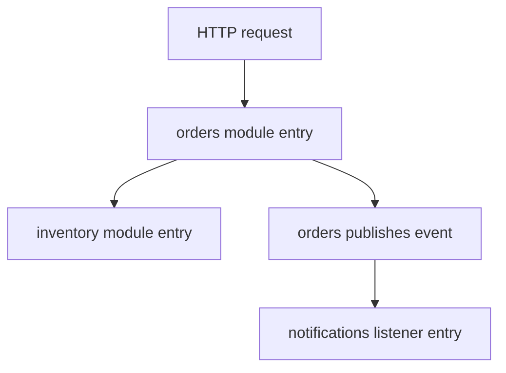
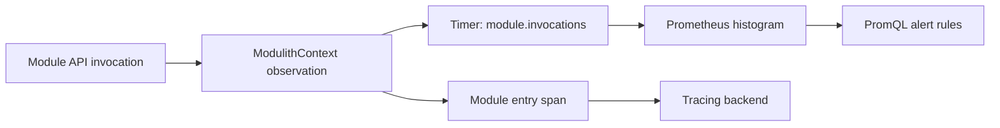

# Cảnh báo module span tăng duration

## 1. Mục tiêu cảnh báo

Trong ứng dụng Spring Boot dùng **Spring Modulith**, một yêu cầu có thể đi qua các application module như `orders`, `inventory`, `payments` và `notifications`. Spring Modulith instrument những điểm vào module được hỗ trợ để tạo Micrometer observations/spans. Khi thời gian xử lý của một module tăng bất thường, nhóm vận hành cần phát hiện sớm, xác định phạm vi ảnh hưởng và mở trace để tìm thao tác gây chậm.

Ví dụ, `POST /orders` trước đây thường hoàn tất invocation của module `orders` trong 180 ms. Sau một lần triển khai, p95 tăng lên 900 ms. Metric HTTP tổng thể cho biết request chậm; module entry span với `module.identifier` giúp phân tích module nào đang chiếm thời gian.

Bài này hướng dẫn đo duration của module invocation, bật histogram, viết PromQL cho p95 và SLO, tạo Prometheus alert rule, xây dựng dashboard Grafana và kết hợp trace với module graph để điều tra nguyên nhân.

## 2. Module entry span đo khoảng thời gian nào?

Spring Modulith Observability intercept lời gọi đi vào Spring component thuộc API của application module và tạo Micrometer spans cho invocation được hỗ trợ. Module entry span có các thuộc tính:

| Thuộc tính | Ý nghĩa |
| --- | --- |
| `module.identifier` | Technical identifier của module, ví dụ `orders` |
| `module.name` | Tên hiển thị của module |
| `module.invocation-type` | Kiểu invocation, ví dụ `bean` hoặc `event listener` |
| `module.method` | Phương thức được gọi trên module |

`module.identifier` phù hợp để tổng hợp metric theo module. `module.method` có thể có nhiều giá trị và không nên mặc định đưa vào metric label nếu chưa đánh giá cardinality.

Duration của module entry span là thời gian của invocation được intercept. Nếu `orders` gọi đồng bộ `inventory`, duration của `orders` có thể bao gồm cả thời gian chờ `inventory` trả kết quả. Các module span lồng nhau vì vậy có thể **chồng lấp thời gian**; không cộng duration của chúng để suy ra thời gian tổng thể của request.

Với xử lý bất đồng bộ, cần phân biệt thời gian publish event với thời gian listener thực sự xử lý. Producer có thể kết thúc invocation sau khi publish; listener có module entry invocation riêng khi nó chạy. Nếu method trả về `CompletionStage`, `Mono` hoặc pipeline reactive rồi kết thúc method ngay, duration của method có thể chỉ đo thời gian dựng pipeline. Muốn đo thời gian hoàn tất bất đồng bộ, cần instrument đúng lifecycle hoàn tất.



## 3. Từ observation đến metric duration

Spring Modulith dùng `ModulithContext` cho module invocation observation. Tên convention mặc định được API xác định là **`module.invocations`**. Spring Boot tự đăng ký `DefaultMeterObservationHandler` trên `ObservationRegistry`; handler này tạo metrics cho các observation đã hoàn tất. Trong cấu hình Spring Boot/Micrometer thông thường, hãy kiểm tra Timer `module.invocations` trong registry để xác nhận số liệu duration đã được tạo.



| Nguồn | Trả lời câu hỏi |
| --- | --- |
| Timer `module.invocations` | Module nào có duration tăng trên nhiều invocation? |
| Histogram buckets | Có bao nhiêu invocation hoàn tất trong từng khoảng thời gian? |
| p95/p99 từ PromQL | Phần đuôi phân phối latency đang ở mức nào? |
| Trace | Một invocation chậm đã đi qua database, HTTP client và module nào? |
| Module graph / `/actuator/modulith` | Module nào phụ thuộc module nào theo cấu trúc đang chạy? |

Metric name `module.invocations` là tên Micrometer. Khi xuất sang Prometheus, naming convention thường chuyển thành `module_invocations_seconds` vì đây là Timer đo thời gian theo giây. Histogram classic thường có các series `_bucket`, `_count` và `_sum`. Hãy kiểm tra exposition thực tế trước khi dùng tên series trong dashboard hoặc alert.

## 4. Định nghĩa SLI và SLO

Ví dụ: **SLO của module `orders` là ít nhất 95% module invocations hoàn tất trong không quá 500 ms**, tính trên cửa sổ 30 ngày. SLI là tỷ lệ invocation có duration nhỏ hơn hoặc bằng 500 ms; 500 ms là latency threshold; 5% còn lại là error budget latency.

Đây là ngưỡng minh họa. Ngưỡng thật phải dựa trên đặc tính nghiệp vụ, latency budget của API cấp trên, baseline production và cam kết với người dùng. Module có thể có SLO khác nhau: `payments` có thể cần chặt hơn một tác vụ đồng bộ hóa ít quan trọng.

| Chỉ số | Ý nghĩa | Dùng khi nào? |
| --- | --- | --- |
| p50 | Median duration | Theo dõi mức latency điển hình |
| p95 | 95% invocation nhanh hơn hoặc bằng giá trị này | Cảnh báo latency tăng ở phần lớn luồng |
| p99 | Đuôi latency cao hơn | Phát hiện một nhóm nhỏ invocation rất chậm |
| Tỷ lệ `duration <= 500 ms` | Phần invocation đáp ứng ngưỡng | Đánh giá SLO theo bucket |
| Invocation rate | Số invocation trên giây | Đánh giá mức tải và độ tin cậy của mẫu |

Không dùng **average duration** làm chỉ số duy nhất. Một số invocation rất chậm có thể bị che khuất khi lấy trung bình. Cũng không lấy trung bình p95 giữa nhiều instance; cần tổng hợp histogram buckets rồi mới tính quantile trên toàn bộ mẫu.

## 5. Bật histogram cho `module.invocations`

Để tính p95 trên Prometheus, cần có histogram buckets. Với Spring Boot và Micrometer, có thể cấu hình phân phối theo meter ID. Ví dụ `application.yml`:

```yaml
management:
  metrics:
    distribution:
      percentiles-histogram:
        module:
          invocations: true
      slo:
        module:
          invocations: 100ms, 250ms, 500ms, 1s, 2s
```

Các bucket SLO tạo ranh giới tích lũy phù hợp với mục tiêu 100 ms, 250 ms, 500 ms, 1 giây và 2 giây. Với ví dụ SLO 500 ms, cần bảo đảm có bucket đúng **500 ms** để truy vấn tỷ lệ invocation nằm trong ngưỡng. `percentiles-histogram` bổ sung phân phối bucket để tính quantile trên backend; nó có thể tạo thêm time series nên cần cân nhắc chi phí cardinality.

Các thuộc tính tương đương dạng properties:

```properties
management.metrics.distribution.percentiles-histogram.module.invocations=true
management.metrics.distribution.slo.module.invocations=100ms,250ms,500ms,1s,2s
```

Các property này áp dụng cho meter ID bắt đầu bằng `module.invocations`. Hãy kiểm tra property binding của đúng phiên bản Spring Boot và tên meter thực tế trong `/actuator/metrics`.

### 5.1. Dependency và endpoint cần thiết

Spring Modulith Insight starter kích hoạt tích hợp Actuator và observability của Modulith. Ví dụ Maven:

```xml
<dependency>
    <groupId>org.springframework.modulith</groupId>
    <artifactId>spring-modulith-starter-insight</artifactId>
    <scope>runtime</scope>
</dependency>

<dependency>
    <groupId>io.micrometer</groupId>
    <artifactId>micrometer-registry-prometheus</artifactId>
    <scope>runtime</scope>
</dependency>
```

Quản lý version Spring Modulith và Spring Boot qua BOM tương thích. Trong môi trường phát triển, có thể expose các endpoint cần thiết:

```yaml
management:
  endpoints:
    web:
      exposure:
        include: health,metrics,prometheus,modulith
```

Endpoint `metrics` dùng để chẩn đoán meter trong ứng dụng; `prometheus` phục vụ Prometheus scrape. Trong production, cần giới hạn mạng và quyền truy cập cho các endpoint quản trị.

## 6. Xác nhận metric trước khi viết alert

Kiểm tra danh sách meter:

```bash
curl -sS http://localhost:8080/actuator/metrics | jq .
```

Kiểm tra Timer:

```bash
curl -sS http://localhost:8080/actuator/metrics/module.invocations | jq .
```

Lọc riêng module `orders`:

```bash
curl -sS "http://localhost:8080/actuator/metrics/module.invocations?tag=module.identifier:orders" | jq .
```

`/actuator/metrics` sử dụng meter name và tag theo Micrometer, không dùng tên đã được Prometheus chuẩn hóa. Phản hồi cần có measurements của Timer và các tag tương ứng sau khi đã chạy traffic đi vào module.

Kiểm tra exposition Prometheus:

```bash
curl -sS http://localhost:8080/actuator/prometheus | grep "module_invocations_seconds"
```

Ví dụ các series sau khi histogram đã được bật:

```text
module_invocations_seconds_bucket{module_identifier="orders",le="0.5"} 1532
module_invocations_seconds_bucket{module_identifier="orders",le="1.0"} 1588
module_invocations_seconds_count{module_identifier="orders"} 1600
module_invocations_seconds_sum{module_identifier="orders"} 780.3
```

Các giá trị là dữ liệu minh họa. Bucket `le="0.5"` là số invocation có duration nhỏ hơn hoặc bằng 0,5 giây; `_count` là tổng số invocation được quan sát; `_sum` là tổng thời gian. Label có thể còn chứa `module_name`, `module_invocation_type`, `job`, `instance` và các chiều hạ tầng khác.

Nếu meter không xuất hiện, kiểm tra lần lượt: Insight/Observability dependency, component thuộc API module có được instrument hay không, đã có invocation thực tế chưa, ObservationRegistry có meter handler hay không và histogram đã được bật đúng meter ID chưa.

## 7. Truy vấn p95 duration theo module

Với classic histogram của Prometheus, dùng `histogram_quantile()` để tính p95. Trước tiên lấy rate của bucket trên từng instance, sau đó tổng hợp theo `le` và module ID:

```promql
histogram_quantile(
  0.95,
  sum by (le, module_identifier) (
    rate(module_invocations_seconds_bucket[5m])
  )
)
```

Kết quả là p95 duration theo module trong cửa sổ 5 phút, đơn vị giây. Nếu ứng dụng có nhiều service hoặc môi trường cùng gửi vào Prometheus, thêm bộ lọc phù hợp, ví dụ `job="shop-app"`, `namespace="production"` hoặc service label đang được dùng.

Để chỉ xem một module:

```promql
histogram_quantile(
  0.95,
  sum by (le) (
    rate(module_invocations_seconds_bucket{module_identifier="orders"}[5m])
  )
)
```

Tương tự, thay `0.95` bằng `0.50` hoặc `0.99` để xem p50/p99. `histogram_quantile()` ước lượng quantile dựa trên ranh giới bucket; độ chính xác phụ thuộc cách chọn bucket và phân phối duration thực tế.

### 7.1. Vì sao phải aggregate bucket trước khi tính quantile?

Giả sử `shop-app` có 4 instance. Mỗi instance có histogram riêng. Không tính p95 từng instance rồi lấy trung bình bốn p95 đó, vì percentile không phải đại lượng có thể cộng hoặc lấy trung bình trực tiếp. Phải cộng rate của các bucket tương ứng trên mọi instance, giữ lại label `le`, rồi tính quantile. Nếu bỏ `le` khi aggregate, Prometheus không còn ranh giới bucket để tính quantile. Nếu bỏ `module_identifier`, kết quả sẽ trộn tất cả module thành một phân phối chung.

## 8. Truy vấn tỷ lệ invocation đáp ứng SLO

Ví dụ SLO yêu cầu ít nhất 95% invocation hoàn tất trong 500 ms. Tỷ lệ invocation nằm trong bucket `le="0.5"` là:

```promql
sum by (module_identifier) (
  rate(module_invocations_seconds_bucket{le="0.5"}[5m])
)
/
sum by (module_identifier) (
  rate(module_invocations_seconds_count[5m])
)
```

Kết quả nằm trong khoảng 0 đến 1. Nếu `orders` có kết quả `0.97`, khoảng 97% invocation được ghi nhận trong cửa sổ đó hoàn tất trong không quá 500 ms.

Để tính tỷ lệ invocation **vượt** 500 ms:

```promql
1 - (
  sum by (module_identifier) (
    rate(module_invocations_seconds_bucket{le="0.5"}[5m])
  )
  /
  sum by (module_identifier) (
    rate(module_invocations_seconds_count[5m])
  )
)
```

Nếu kết quả là `0.08`, khoảng 8% invocation vượt ngưỡng 500 ms. Với SLO 95%, phần vượt ngưỡng mục tiêu là 5%; do đó có thể cảnh báo khi tỷ lệ chậm vượt `0.05` liên tục trong một khoảng thời gian.

**Điều kiện quan trọng:** truy vấn bucket phải có chính xác ranh giới `le="0.5"`. Nếu histogram không có bucket đó, không thể lấy một bucket gần nhất rồi giả định nó tương đương 500 ms. Hãy thêm SLO bucket đúng ngưỡng và xác nhận series xuất hiện trong Prometheus.

## 9. Tạo Prometheus alert rule

Ví dụ sau tạo cảnh báo khi p95 của một module vượt 500 ms trong ít nhất 10 phút. Ngưỡng và thời gian chờ chỉ là ví dụ:

```yaml
groups:
  - name: spring-modulith-module-duration
    rules:
      - alert: ModulithModuleP95DurationHigh
        expr: |
          (
            histogram_quantile(
              0.95,
              sum by (le, module_identifier) (
                rate(module_invocations_seconds_bucket[5m])
              )
            ) > 0.5
          )
          and on (module_identifier)
          (
            sum by (module_identifier) (
              rate(module_invocations_seconds_count[5m])
            ) > 0.1
          )
        for: 10m
        labels:
          severity: warning
          service: shop-app
        annotations:
          summary: "Module {{ $labels.module_identifier }} has high p95 duration"
          description: "The p95 module invocation duration is {{ $value }} seconds for at least 10 minutes. Check the module trace and downstream dependencies."
```

Điều kiện thứ hai là volume guard: chỉ tạo alert khi module có hơn 0,1 invocation/giây trong cửa sổ đánh giá. Điều này tương đương khoảng 6 invocation/phút và tránh kết luận mạnh từ một vài mẫu thưa. Hãy điều chỉnh hoặc bỏ guard cho module ít traffic nhưng quan trọng; synthetic probe hoặc alert riêng theo thời gian hoàn tất có thể phù hợp hơn.

`for: 10m` yêu cầu biểu thức tiếp tục đúng đủ 10 phút trước khi alert chuyển từ pending sang firing. `severity: warning` phù hợp khi cần điều tra module chậm nhưng chưa chứng minh người dùng đang chịu ảnh hưởng. Chỉ nâng thành page khi có liên hệ rõ với SLO ở tầng người dùng hoặc tác động nghiệp vụ nghiêm trọng.

### 9.1. Cảnh báo trực tiếp khi SLO latency bị vi phạm

Với SLO 95% invocation trong 500 ms, có thể cảnh báo khi tỷ lệ vượt 500 ms lớn hơn 5%:

```yaml
groups:
  - name: spring-modulith-module-slo
    rules:
      - alert: ModulithModuleLatencySLOViolation
        expr: |
          (
            1 - (
              sum by (module_identifier) (
                rate(module_invocations_seconds_bucket{le="0.5"}[5m])
              )
              /
              sum by (module_identifier) (
                rate(module_invocations_seconds_count[5m])
              )
            )
          ) > 0.05
        for: 10m
        labels:
          severity: warning
          service: shop-app
        annotations:
          summary: "Module {{ $labels.module_identifier }} is outside its latency SLO"
          description: "More than 5% of module invocations exceeded 500 ms in the evaluation window."
```

Alert này đánh giá **tỷ lệ invocation vượt ngưỡng**, không phải p95 ước lượng. Nó phù hợp để diễn đạt trực tiếp SLO. Trong production, có thể thêm volume guard, lọc theo môi trường/job và cân nhắc nhiều cửa sổ thời gian để tránh cảnh báo do traffic rất thấp.

### 9.2. Kiểm tra rule trước khi nạp

Lưu rules vào file YAML được Prometheus nạp qua `rule_files`. Dùng `promtool` để kiểm tra cú pháp:

```bash
promtool check rules alerting-rules.yml
```

Sau khi nạp, xem trạng thái Pending/Firing trong trang Alerts của Prometheus. Prometheus đánh giá rule theo chu kỳ; Alertmanager nhận alert đang firing để nhóm, deduplicate, silence và gửi notification theo cấu hình.

## 10. Cảnh báo duration và lưu lượng thấp

Percentile trên tập mẫu nhỏ thường dao động mạnh. Ví dụ module `notifications` chỉ nhận 2 invocation trong 5 phút; một invocation mất 1,5 giây có thể khiến p95 tăng cao dù không có xu hướng kéo dài. Vì vậy, chọn cửa sổ đo đủ dài so với traffic và scrape interval, dùng `for` để loại bỏ spike ngắn, cân nhắc volume guard và có policy riêng cho module ít traffic.

Không nên thêm một volume guard chung cho tất cả module mà không xét tầm quan trọng. Một module thanh toán có thể ít invocation nhưng mỗi lần chậm đều ảnh hưởng lớn. Với trường hợp đó, dùng cửa sổ dài hơn hoặc synthetic probe riêng thay vì bỏ qua module vì traffic thấp.

## 11. Thiết kế dashboard Grafana

Một dashboard vận hành module duration nên giúp trả lời nhanh: module nào chậm, chậm từ khi nào, bao nhiêu invocation bị ảnh hưởng và có trace nào giải thích được nguyên nhân.

| Panel | Truy vấn / dữ liệu | Mục đích |
| --- | --- | --- |
| p50/p95/p99 theo module | `histogram_quantile()` từ `module_invocations_seconds_bucket` | Nhìn phân phối latency và phần đuôi |
| Invocation rate | `rate(module_invocations_seconds_count[5m])` | Hiểu lưu lượng và độ tin cậy của mẫu |
| Tỷ lệ dưới ngưỡng SLO | Bucket `le="0.5"` chia `_count` | Theo dõi SLI trực tiếp |
| Tỷ lệ vượt ngưỡng | `1 - good_ratio` | Theo dõi error budget latency |
| Top module theo p95 | p95 sort giảm dần | Ưu tiên điều tra module chậm |
| Error/trace links | Trace backend và logs có correlation | Chuyển từ tín hiệu tổng hợp sang một invocation cụ thể |

Nên có biến lọc `service`, `environment`, `module_identifier` và khoảng thời gian. Giữ module ID làm nhãn chính; không đưa `traceId`, `spanId`, `orderId` vào metric labels để tránh cardinality cao.

Khi histogram có nhiều bucket, số time series tăng theo số module, loại invocation và bucket. Chỉ bật những bucket phục vụ SLO và độ chính xác quantile cần thiết. Nếu dashboard cần nhiều truy vấn lặp lại, cân nhắc recording rules để precompute p95 hoặc SLI theo module.

## 12. Từ alert đến trace: tìm nguyên nhân module chậm

Alert cho biết module nào có duration cao trên tập invocation, nhưng không tự giải thích nguyên nhân. Khi nhận cảnh báo:

1. Mở dashboard, xác nhận p95 và tỷ lệ invocation vượt ngưỡng tăng từ thời điểm nào.
2. Kiểm tra invocation rate và số instance; loại trừ lỗi scrape hoặc traffic quá thấp.
3. Mở trace có `module.identifier` tương ứng trong khoảng thời gian bị ảnh hưởng.
4. Xem span con để xác định thời gian nằm ở database, HTTP client, message broker hay module phụ thuộc.
5. Đối chiếu deployment/version, CPU, memory, GC, thread pool và connection pool.
6. So sánh với module graph và `GET /actuator/modulith` để xác nhận dependency của bản đang chạy.
7. Nếu module span là consumer event, kiểm tra thời gian listener và backlog/event publication state theo công cụ tương ứng.

Ví dụ trace:

```text
HTTP POST /orders
  orders module entry          920 ms
    inventory module entry     610 ms
      database query           540 ms
    orders save and publish    120 ms
```

Trong ví dụ, `orders` duration có thể bao gồm thời gian gọi đồng bộ `inventory`; `inventory` lại dành phần lớn thời gian chờ database. Hai duration lồng nhau không được cộng lại thành 1.530 ms. Trace cho thấy hướng điều tra cụ thể hơn: database call của `inventory`.

Nếu `notifications` xử lý event bất đồng bộ, nó có thể xuất hiện trong trace khác hoặc có liên kết trace theo cách propagation được cấu hình. Không mặc định duration của producer span bao gồm toàn bộ thời gian listener hoàn tất.

## 13. Chọn severity và giảm alert noise

Prometheus khuyến nghị cảnh báo dựa trên triệu chứng có ảnh hưởng tới người dùng, giữ số alert có thể hành động ở mức nhỏ và cung cấp dashboard để tìm nguyên nhân. Với module duration, có thể chia mức độ:

| Mức | Điều kiện minh họa | Hành động |
| --- | --- | --- |
| Dashboard only | p95 dao động ngắn, SLO vẫn đạt | Theo dõi xu hướng |
| Warning | p95 vượt ngưỡng trong 10 phút hoặc SLI bắt đầu vi phạm | Kiểm tra trace và deployment |
| Critical / page | SLO của luồng người dùng bị vi phạm đáng kể hoặc latency module gây tác động nghiệp vụ rõ ràng | On-call điều tra và giảm tác động |

Không tạo một alert riêng cho mọi module và mọi loại span nếu không có hành động cụ thể. Có thể nhóm alert theo `service` và `module_identifier` trong Alertmanager; thêm annotation gồm p95, ngưỡng, cửa sổ đo và đường dẫn dashboard/runbook nội bộ. Không đặt ID động vào label của alert.

## 14. Những lỗi thường gặp

| Triệu chứng | Nguyên nhân có thể | Cách xử lý |
| --- | --- | --- |
| Không có `module.invocations` | Chưa có module invocation được instrument hoặc meter handler chưa tạo metrics | Kiểm tra Insight/Observability, API module và ObservationRegistry |
| Có Timer nhưng không có `_bucket` | Histogram chưa bật hoặc registry không xuất classic buckets theo cấu hình | Bật histogram/SLO bucket và kiểm tra `/actuator/prometheus` |
| p95 query không có dữ liệu | Sai metric/label, thiếu bucket, chưa có sample hoặc filter không khớp | Kiểm tra exposition và bỏ dần label filter để tìm lỗi |
| p95 rất cao ở module ít traffic | Cỡ mẫu nhỏ, một invocation bất thường chi phối percentile | Dùng volume guard/cửa sổ dài hơn hoặc synthetic probe |
| p95 toàn service thấp nhưng một module cao | Tổng hợp đã bỏ `module_identifier` hoặc module traffic thấp bị chìm | Giữ module ID khi group by và xem từng module |
| p95 trung bình giữa instance cho kết quả lạ | Trung bình các percentile riêng lẻ | Aggregate histogram buckets trước `histogram_quantile()` |
| Alert nhấp nháy | Cửa sổ quá ngắn, thiếu `for`, traffic không ổn định | Tăng cửa sổ/for và kiểm tra volume guard |
| Alert firing nhưng người dùng không thấy chậm | Module span lồng nhau hoặc phần chậm chưa ảnh hưởng latency end-to-end | Xem trace và chỉ page theo SLO người dùng |
| Module span kết thúc trước async task | Method trả về trước khi pipeline/listener hoàn tất | Instrument lifecycle hoàn tất hoặc theo dõi consumer riêng |
| Không tìm được trace từ alert | Sampling, export hoặc context propagation không đầy đủ | Kiểm tra sampling, trace exporter và correlation |
| Series tăng mạnh sau khi thêm label | Dùng `module.method`, ID hoặc giá trị động làm metric label | Giữ tag low-cardinality và dùng trace/log cho chi tiết |
| Bucket SLO 500 ms không có | Chưa cấu hình bucket chính xác 500 ms | Thêm `500ms` vào `management.metrics.distribution.slo.module.invocations` |

## 15. Bài thực hành: tạo alert cho module `orders`

**Bối cảnh:** `shop-app` có `orders`, `inventory`, `payments`, `notifications`. Mục tiêu minh họa là 95% invocation của `orders` hoàn tất trong 500 ms. Prometheus scrape metrics từ `/actuator/prometheus`.

| Bước | Thực hiện | Tiêu chí hoàn thành |
| --- | --- | --- |
| 1 | Bật Spring Modulith Insight/Observability và Prometheus registry | Ứng dụng xuất module observation metrics |
| 2 | Tạo traffic qua API module `orders` | Có sample trong Timer `module.invocations` |
| 3 | Bật histogram và bucket `500ms` | Exposition có `module_invocations_seconds_bucket{le="0.5"}` |
| 4 | Xem `/actuator/metrics/module.invocations` | Có tag `module.identifier=orders` |
| 5 | Viết PromQL p95 theo module | Query trả p95 theo `module_identifier` |
| 6 | Viết PromQL good ratio | Tính được phần invocation không quá 500 ms |
| 7 | Nạp alert rule và chạy `promtool check rules` | Rule hợp lệ và hiển thị Pending/Firing theo dữ liệu |
| 8 | Tạo một tình huống làm chậm database ở staging | p95/SLI phản ánh thay đổi có kiểm soát |
| 9 | Mở trace của module `orders` | Xác định được span con gây chậm |
| 10 | Đối chiếu module graph/Actuator | Xác nhận dependency của bản chạy và hoàn thiện runbook |

### 15.1. Câu hỏi tự kiểm tra

1. **Spring Modulith gắn module ID vào đâu?** Module entry span/observation dùng `module.identifier`, `module.name` và `module.invocation-type`.
2. **Tên meter mặc định của module invocation observation là gì?** `module.invocations`.
3. **Tại sao cần histogram để tính p95 trên Prometheus?** Histogram giữ số observation theo bucket, cho phép aggregate qua instance rồi tính quantile bằng `histogram_quantile()`.
4. **Vì sao không lấy trung bình p95 của các instance?** Percentile không thể cộng hoặc lấy trung bình trực tiếp; phải tổng hợp bucket trước khi tính quantile.
5. **Bucket `le="0.5"` biểu thị điều gì?** Số invocation có duration nhỏ hơn hoặc bằng 0,5 giây.
6. **Tại sao cần volume guard?** Tránh alert mạnh dựa trên số lượng observation quá nhỏ; với module ít traffic cần policy riêng.
7. **Module span duration có phải end-to-end request latency không?** Không. Nó đo invocation tại module entry; có thể bao gồm lời gọi đồng bộ bên dưới nhưng không tự bao gồm tác vụ bất đồng bộ chạy sau khi method trả về.
8. **Khi alert module `orders` tăng duration, nên làm gì tiếp?** Mở trace theo module ID, xem span con, kiểm tra dependency, database/HTTP và đối chiếu module graph.

## 16. Ghi nhớ

Để cảnh báo khi module span tăng duration, trước tiên cần có module invocation observation được instrument và Timer `module.invocations` được ghi nhận. Dùng `module.identifier` làm chiều tổng hợp để biết module nào chậm; bật histogram/SLO bucket trong Micrometer để tính p95 và tỷ lệ invocation đáp ứng ngưỡng.

PromQL cần aggregate histogram buckets theo `le` và `module_identifier` trước khi gọi `histogram_quantile()`. Với SLO 95% trong 500 ms, bucket `le="0.5"` cho phép tính tỷ lệ invocation đáp ứng mục tiêu; cảnh báo khi phần vượt ngưỡng lớn hơn 5% đủ lâu và có đủ traffic. Dùng `for`, volume guard và severity hợp lý để giảm alert noise.

Alert cho biết **module nào có duration tăng**; trace giúp xác định **thao tác con nào gây chậm**. Kết hợp module entry spans, Prometheus, Grafana, Actuator và module graph để kiểm tra cả hành vi runtime lẫn cấu trúc dependency. Luôn phân biệt duration của invocation đồng bộ với công việc bất đồng bộ, và chỉ page khi có tác động đáng kể tới người dùng hoặc SLO của luồng nghiệp vụ.

### Tài liệu tham khảo

- [Spring Modulith — Production-ready Features](https://docs.spring.io/spring-modulith/reference/production-ready.html): module entry spans, tags và observability.
- [Spring Modulith — `ModulithContext` API](https://docs.spring.io/spring-modulith/docs/current/api/org/springframework/modulith/observability/ModulithContext.html): default convention name `module.invocations`.
- [Spring Boot — Metrics](https://docs.spring.io/spring-boot/reference/actuator/metrics.html): Observation metrics, histogram, percentiles, SLO buckets và Actuator metrics endpoint.
- [Prometheus — Histograms and summaries](https://prometheus.io/docs/practices/histograms/): bucket, `histogram_quantile()`, aggregation và quantile accuracy.
- [Prometheus — Alerting practices](https://prometheus.io/docs/practices/alerting/): alert theo triệu chứng, giảm noise và liên kết dashboard.
- [Prometheus — Alerting rules](https://prometheus.io/docs/prometheus/latest/configuration/alerting_rules/): `for`, labels, annotations và trạng thái pending/firing.
