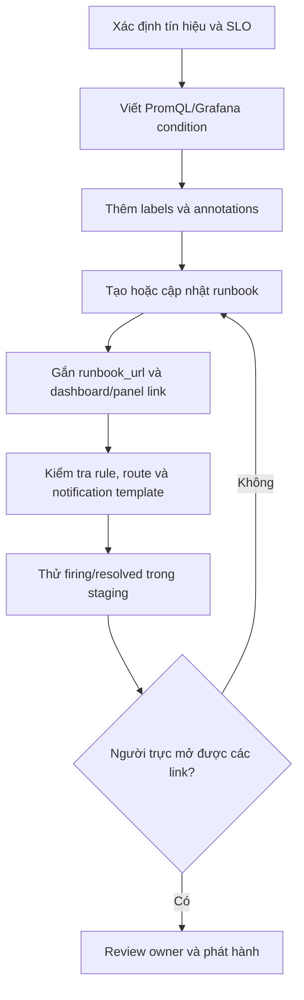

# Liên kết alert với runbook vận hành

## 1. Alert cần dẫn người trực đến hành động tiếp theo

Trong ứng dụng Spring Boot dùng **Spring Modulith**, các module như `order`, `payment` và `inventory` có thể được quan sát qua module entry spans, event metrics và distributed tracing. Dashboard cho biết xu hướng; alert báo khi một điều kiện cần được chú ý; **runbook** hướng dẫn người trực xác minh và xử lý sự cố.

Ví dụ, panel cho thấy p95 duration của module `inventory` tăng. Alert chỉ có nội dung “High latency” khiến người nhận phải tự tìm dashboard, đoán module và hỏi xem có hướng dẫn xử lý hay không. Một alert hữu ích cần mang theo ngữ cảnh và đường dẫn đến đúng runbook:

```text
ALERT: ModuleEntryLatencyHigh
Service: shop-service
Module: inventory
Severity: warning
Observed p95: 820 ms
Threshold: 500 ms for 10 minutes
Runbook: https://runbooks.example.net/spring-modulith/module-entry-latency
Dashboard: https://grafana.example.net/d/module-observability
```

Bài **“Liên kết alert với runbook vận hành”** thuộc chương **Alerting** của **SPRING_MODULITH_DOCUMENTATION_OBSERVABILITY**. Module này hướng dẫn dùng Spring Modulith sinh tài liệu ranh giới application module và quan sát tương tác giữa các phần trong ứng dụng Spring Boot qua module graph, Actuator, event metrics, tracing và context propagation.

Sau bài học, bạn có thể:

1. Phân biệt labels và annotations trong alert rule.
2. Đính kèm URL runbook và dashboard vào Prometheus alert.
3. Cấu hình Alertmanager định tuyến theo service, module, team và severity.
4. Hiển thị liên kết runbook trong notification template.
5. Cấu hình Runbook URL và dashboard/panel link cho Grafana-managed alert.
6. Viết runbook có bước xác minh, giảm thiểu, khôi phục và tiêu chí escalation.
7. Kiểm tra alert từ PromQL đến thông báo cuối cùng để tránh liên kết hỏng hoặc thiếu ngữ cảnh.

## 2. Alert, runbook và dashboard có vai trò khác nhau

| Thành phần | Vai trò | Ví dụ |
| --- | --- | --- |
| Metric | Đo tín hiệu định lượng | `module.invocations` Timer |
| Alert rule | Đánh giá điều kiện cần chú ý | p95 module entry duration vượt 500 ms |
| Alert labels | Phân loại, định danh và định tuyến alert | `severity=warning`, `module_identifier=inventory` |
| Alert annotations | Mô tả và cung cấp ngữ cảnh xử lý | `summary`, `description`, `runbook_url` |
| Runbook | Hướng dẫn người trực xử lý | Xác minh latency, kiểm tra dependency, rollback |
| Dashboard | Hiển thị xu hướng và số liệu liên quan | p95, rate, error ratio theo module |
| Trace | Điều tra một lần xử lý cụ thể | Span con nào làm module chậm? |

**Alert không phải runbook.** Alert xác định điều kiện; runbook giúp người trực hành động an toàn. Dashboard cho thấy diễn biến; trace giúp tìm nguyên nhân ở một request cụ thể.

Một alert nên trả lời nhanh:

- Điều gì đang xảy ra?
- Ảnh hưởng đến service/module nào?
- Mức độ ưu tiên ra sao?
- Ngưỡng nào đã bị vượt và trong bao lâu?
- Ai chịu trách nhiệm xử lý?
- Mở runbook ở đâu?
- Mở dashboard hoặc trace ở đâu?

## 3. Labels và annotations trong Prometheus alert rule

Prometheus alert rule có hai nhóm metadata:

- **Labels**: các cặp key-value được gắn vào alert instance. Chúng được dùng để nhận diện, group, route, inhibit và lọc alert.
- **Annotations**: nội dung bổ sung để con người hiểu alert, ví dụ summary, description và URL runbook.

Đừng đưa URL dài, hướng dẫn nhiều dòng hoặc mô tả sự cố vào labels. Giá trị label tham gia vào identity/fingerprint của alert; thay đổi label có thể tạo ra một alert instance khác. Nội dung hướng dẫn nên nằm trong annotations.

Các labels phù hợp:

| Label | Ví dụ | Mục đích |
| --- | --- | --- |
| `service` | `shop-service` | Service chịu ảnh hưởng |
| `module_identifier` | `inventory` | Module kỹ thuật |
| `team` | `commerce-platform` | Nhóm chịu trách nhiệm |
| `severity` | `warning` / `critical` | Mức độ ưu tiên |
| `environment` | `production` | Môi trường |

Các annotations thường dùng:

| Annotation | Ví dụ | Mục đích |
| --- | --- | --- |
| `summary` | `Inventory module entry latency is high` | Tiêu đề ngắn |
| `description` | p95 hiện tại và ngưỡng | Ngữ cảnh định lượng |
| `runbook_url` | URL trang hướng dẫn | Mở quy trình xử lý |
| `dashboard_url` | URL dashboard đã lọc module | Điều tra xu hướng |
| `panel_url` | URL panel liên quan | Mở đúng biểu đồ |

Prometheus không tự hiểu mọi annotation là một loại liên kết đặc biệt. `runbook_url`, `dashboard_url` và `panel_url` là tên annotation theo quy ước của đội vận hành; notification template phải đọc và hiển thị chúng. Grafana-managed alert có trường Runbook URL riêng trong giao diện tạo rule.

### 3.1. Template trong Prometheus alert rule

Prometheus hỗ trợ template trong labels và annotations:

- `{{ $labels.<labelname> }}` lấy giá trị label của alert instance.
- `{{ $value }}` lấy giá trị biểu thức tại thời điểm đánh giá.
- Các template được thực thi khi rule evaluation tạo alert.

Ví dụ description có thể chứa module và giá trị đo:

```yaml
annotations:
  summary: "Module {{ $labels.module_identifier }} entry latency is high"
  description: "p95 duration is {{ $value }} seconds for {{ $labels.module_identifier }}."
```

Giữ template gọn. Không chạy các truy vấn template phức tạp nếu nội dung có thể được tính trực tiếp trong PromQL hoặc được xem trên dashboard.

## 4. Tạo alert duration cho module entry

Giả sử ứng dụng đã xuất Timer của Spring Modulith module entry thành Prometheus histogram:

```text
module_invocations_seconds_bucket
module_invocations_seconds_sum
module_invocations_seconds_count
```

Các label dự kiến gồm `job`, `module_identifier` và có thể có `module_name`, `module_invocation_type`. Tên metric và label thực tế phải được xác minh từ `/actuator/prometheus` và Prometheus trước khi dùng trong rule.

Ví dụ file rule:

```yaml
groups:
  - name: spring-modulith-module-alerts
    rules:
      - alert: ModuleEntryLatencyHigh
        expr: |
          histogram_quantile(
            0.95,
            sum by (le, job, module_identifier) (
              rate(module_invocations_seconds_bucket[5m])
            )
          ) > 0.5
        for: 10m
        labels:
          service: shop-service
          team: commerce-platform
          environment: production
          severity: warning
        annotations:
          summary: "Module {{ $labels.module_identifier }} entry latency is high"
          description: "p95 duration is {{ $value }} seconds for {{ $labels.module_identifier }} in {{ $labels.job }}."
          runbook_url: "https://runbooks.example.net/spring-modulith/module-entry-latency"
          dashboard_url: "https://grafana.example.net/d/module-observability?var-module={{ $labels.module_identifier }}"
```

Giải thích:

- `histogram_quantile(0.95, ...)` tính p95 xấp xỉ từ histogram bucket.
- `sum by (le, job, module_identifier)` giữ bucket boundary và nhóm theo service/module.
- `rate(...[5m])` dùng cửa sổ 5 phút để làm mượt biến động ngắn.
- `> 0.5` là ngưỡng 500 ms nếu metric có đơn vị giây.
- `for: 10m` yêu cầu điều kiện tiếp tục đúng đủ 10 phút trước khi alert chuyển sang firing.
- `runbook_url` liên kết đến hướng dẫn xử lý latency module.
- `dashboard_url` đưa người trực đến dashboard đã lọc module nếu notification template nhận và hiển thị URL này.

Đây là ngưỡng ví dụ, không phải SLO mặc định của Spring Modulith. Hãy đặt ngưỡng theo latency baseline, SLO và mức độ ảnh hưởng nghiệp vụ. Nếu histogram chưa được bật, rule p95 sẽ không có bucket để tính.

### 4.1. Không tạo alert từ nhãn không tồn tại

Nếu Prometheus series không có label `service` mà chỉ có `job`, không viết query/annotation dựa trên label chưa được cung cấp. Có thể gắn label cố định trong rule, hoặc chuẩn hóa target labels ở scrape configuration. Tương tự, `module_identifier` cần tồn tại trong metric; nếu convention hoặc exporter dùng tên khác, cập nhật rule theo dữ liệu thực tế.

### 4.2. Dùng average khi chưa bật histogram

Nếu mới có `_sum` và `_count`, có thể cảnh báo theo average duration:

```promql
sum by (job, module_identifier) (
  rate(module_invocations_seconds_sum[5m])
)
/
sum by (job, module_identifier) (
  rate(module_invocations_seconds_count[5m])
)
> 0.5
```

Average có thể che khuất một nhóm invocation rất chậm. Nếu SLO đặt theo percentile, hãy bật histogram và dùng p95/p99 thay vì coi average là thay thế tương đương.

## 5. Alertmanager phải đưa runbook URL vào notification

Prometheus đánh giá alert rule và gửi trạng thái alert sang Alertmanager. Alertmanager đảm nhiệm grouping, routing, silencing, inhibition và gửi notification đến hệ thống nhận như email, chat hoặc webhook.

Việc đặt `runbook_url` trong annotation mới chỉ lưu URL vào alert metadata. Để người trực thấy được liên kết, receiver/template cần render annotation đó trong notification.

### 5.1. Định tuyến theo labels

Ví dụ `alertmanager.yml`:

```yaml
route:
  receiver: default-notifications
  group_by:
    - alertname
    - service
    - module_identifier
  group_wait: 30s
  group_interval: 5m
  repeat_interval: 4h
  routes:
    - matchers:
        - severity="critical"
      receiver: platform-oncall
      continue: true
    - matchers:
        - team="commerce-platform"
      receiver: commerce-platform

receivers:
  - name: default-notifications
    webhook_configs:
      - url: "https://notifications.example.net/default"
        send_resolved: true

  - name: platform-oncall
    webhook_configs:
      - url: "https://notifications.example.net/oncall"
        send_resolved: true

  - name: commerce-platform
    webhook_configs:
      - url: "https://notifications.example.net/commerce"
        send_resolved: true
```

Các URL webhook ở trên là placeholder. Thay bằng endpoint của notification gateway trong môi trường triển khai và cấu hình xác thực/TLS theo chính sách tổ chức.

Ý nghĩa:

- `group_by` gộp alert cùng alertname, service và module; tránh gửi một thông báo cho từng replica nếu đó là cùng một sự cố.
- `group_wait` cho phép các alert gần nhau được gom trước khi gửi thông báo đầu tiên.
- `group_interval` xác định thời gian chờ giữa các notification của cùng group khi có thay đổi.
- `repeat_interval` giới hạn chu kỳ nhắc lại khi alert vẫn firing.
- Route `severity="critical"` gửi đến on-call; `continue: true` cho phép tiếp tục đánh giá route tiếp theo để nhóm phụ trách service cũng nhận thông báo.
- Route theo `team` gửi đến nhóm sở hữu module/service.

Nếu không cần gửi cùng một alert đến nhiều receiver, bỏ `continue: true` để route matching đầu tiên kết thúc quá trình tìm route con. Thiết kế route phải được kiểm tra với thứ tự thực tế và fallback receiver.

### 5.2. Render annotation trong notification template

Alertmanager notification template dùng Go template với đối tượng alert. Cú pháp ở đây **khác** template trong Prometheus alert rule:

- Trong Prometheus rule: `{{ $labels.module_identifier }}` và `{{ $value }}`.
- Trong Alertmanager notification: `{{ .Labels.module_identifier }}` và `{{ .Annotations.runbook_url }}`.

Ví dụ file `/etc/alertmanager/templates/module-alerts.tmpl`:

```gotemplate
{{ define "module.alert.message" -}}
{{ range .Alerts }}
Alert: {{ .Labels.alertname }}
Status: {{ .Status }}
Service: {{ .Labels.service }}
Module: {{ .Labels.module_identifier }}
Severity: {{ .Labels.severity }}

Summary: {{ .Annotations.summary }}
Description: {{ .Annotations.description }}

Runbook: {{ .Annotations.runbook_url }}
Dashboard: {{ .Annotations.dashboard_url }}
{{ end }}
{{- end }}
```

Khai báo template trong `alertmanager.yml` và dùng nó trong receiver hỗ trợ template, ví dụ Slack:

```yaml
templates:
  - "/etc/alertmanager/templates/*.tmpl"

receivers:
  - name: commerce-platform
    slack_configs:
      - channel: "#commerce-alerts"
        api_url_file: "/etc/alertmanager/secrets/slack-webhook-url"
        title: "{{ .CommonLabels.alertname }} — {{ .Status }}"
        text: '{{ template "module.alert.message" . }}'
        send_resolved: true
```

Đây là hai mảnh cấu hình minh họa cần ghép vào cùng file Alertmanager thực tế; receiver dùng secret file thay vì ghi webhook URL trực tiếp vào source. Nếu dùng receiver khác, cần ánh xạ `runbook_url` và `dashboard_url` vào trường nội dung tương ứng của receiver đó.

Nếu notification group có nhiều alert, template lặp qua `.Alerts` để hiển thị từng module. Nếu chỉ đọc `.CommonAnnotations.runbook_url`, trường này chỉ có giá trị khi mọi alert trong group có cùng annotation. Với các module có runbook khác nhau, hãy render URL trên từng alert hoặc chia group theo module.

### 5.3. Đừng để notification chỉ có URL trống

Alert có thể đến từ rule cũ hoặc một module chưa có runbook. Template nên hiển thị fallback:

```gotemplate
{{ if .Annotations.runbook_url }}
Runbook: {{ .Annotations.runbook_url }}
{{ else }}
Runbook: chưa được khai báo — chuyển đến service owner.
{{ end }}
```

Fallback giúp người trực nhận ra thiếu metadata. Tuy nhiên, nên phát hiện thiếu runbook trong review/CI trước khi alert được triển khai production.

## 6. Liên kết alert với dashboard và panel

Runbook hướng dẫn **cách xử lý**; dashboard cung cấp **bằng chứng định lượng**. Một alert duration nên có ít nhất:

1. Link runbook chung cho module entry latency.
2. Link dashboard duration tổng quan.
3. Nếu có thể, link panel đã lọc theo module identifier.

Ví dụ annotation:

```yaml
annotations:
  runbook_url: "https://runbooks.example.net/spring-modulith/module-entry-latency"
  dashboard_url: "https://grafana.example.net/d/module-observability?var-service=shop-service"
  panel_url: "https://grafana.example.net/d/module-observability?viewPanel=12"
```

`dashboard_url` và `panel_url` là metadata theo quy ước của hệ thống. Prometheus/Alertmanager không tự kiểm tra dashboard tồn tại; notification receiver phải hiển thị link.

Khi cần URL lọc động theo module, có thể dùng:

```yaml
annotations:
  dashboard_url: "https://grafana.example.net/d/module-observability?var-module={{ $labels.module_identifier }}"
```

Chỉ nội suy label đã được kiểm soát và có tập giá trị hợp lệ. Nếu label có ký tự đặc biệt hoặc được lấy từ input tự do, cần URL-encode hoặc dùng dashboard link ổn định không gắn biến trực tiếp.

### 6.1. Grafana-managed alert

Nếu tạo alert trực tiếp trong Grafana:

1. Mở **Alerting → Alert rules** và tạo rule mới.
2. Chọn query/datasource và điều kiện đánh giá.
3. Đặt pending period để tránh cảnh báo do một spike ngắn.
4. Thêm labels như `service`, `module_identifier`, `team` và `severity` để notification policy định tuyến.
5. Trong phần annotations/message, điền summary và description.
6. Điền **Runbook URL** bằng địa chỉ runbook đã công bố.
7. Liên kết rule với dashboard và panel liên quan.
8. Lưu rule, kiểm tra preview/notification policy và thử notification.

Grafana có trường Runbook URL riêng và hỗ trợ link dashboard/panel ngay trong quy trình tạo Grafana-managed alert. Nếu dùng data source-managed rule từ Prometheus, annotation thường được lấy từ rule ở datasource; kiểm tra cách Grafana hiển thị metadata của loại rule đó.

Không giả định URL trong annotation tùy chỉnh tự trở thành liên kết trong mọi notification contact point. Xác nhận nội dung cuối cùng trên kênh nhận thực tế.

### 6.2. Chọn một nguồn quản lý alert

Một hệ thống có thể dùng Prometheus-managed rules hoặc Grafana-managed rules. Tránh tạo hai rule giống nhau cho cùng một tín hiệu nếu chưa có mục đích rõ ràng, vì chúng có thể gửi alert trùng lặp.

| Tiêu chí | Prometheus-managed | Grafana-managed |
| --- | --- | --- |
| Định nghĩa rule | File YAML, version control | Grafana UI hoặc provisioning |
| Đánh giá | Prometheus rule evaluator | Grafana alert evaluator |
| Metadata runbook | Annotation trong rule | Trường Runbook URL/annotation trong Grafana |
| Routing | Alertmanager | Grafana notification policies hoặc tích hợp Alertmanager |
| Kiểm tra thay đổi | Review file và `promtool` | Review provisioning/API/UI và preview |

Chọn nguồn quản lý theo nền tảng hiện có, quy trình review và trách nhiệm vận hành. Dù chọn cách nào, hợp đồng metadata nên nhất quán để người trực luôn thấy service, module, severity, runbook và dashboard.

## 7. Viết runbook cho alert module latency

Runbook nên được viết cho người trực chưa biết lịch sử cuộc điều tra. Một trang chỉ có vài dòng như “kiểm tra Grafana rồi restart service” không đủ để xử lý an toàn.

Một runbook tốt có cấu trúc ổn định:

| Phần | Nội dung cần có |
| --- | --- |
| Metadata | Tên alert, owner, severity, service/module áp dụng, lần cập nhật gần nhất |
| Purpose | Alert đo tín hiệu gì và vì sao cần quan tâm |
| Impact | Ảnh hưởng người dùng/nghiệp vụ có thể xảy ra |
| Trigger | PromQL, ngưỡng, cửa sổ và thời gian `for` |
| Initial checks | Xác nhận alert còn firing, đúng service/module và đúng môi trường |
| Diagnosis | Dashboard, metrics, trace, log và deploy cần kiểm tra |
| Mitigation | Hành động giảm ảnh hưởng đã được phê duyệt |
| Recovery | Điều kiện xác nhận dịch vụ trở lại bình thường |
| Escalation | Nhóm/người cần gọi nếu không xử lý được |
| Follow-up | Bằng chứng cần ghi lại và việc cần làm sau incident |

### 7.1. Ví dụ nội dung runbook

```markdown
# ModuleEntryLatencyHigh

Owner: Commerce Platform
Severity: warning
Applies to: Spring Modulith module entry Timer

## Purpose

p95 duration của module entry vượt 500 ms liên tục 10 phút.
Alert có thể ảnh hưởng thời gian phản hồi của request đi qua module.

## Initial checks

1. Xác nhận alert đang firing và đúng environment.
2. Kiểm tra service, module_identifier và giá trị p95 hiện tại.
3. Kiểm tra Prometheus scrape target và thời điểm dữ liệu cuối cùng.
4. Mở dashboard module observability theo module đang cảnh báo.

## Diagnosis

1. So sánh p50, p95, p99 và invocation rate.
2. Xem error ratio và các dependency metrics liên quan.
3. Mở một trace chậm; xác định module span và span con chiếm thời gian.
4. Kiểm tra deployment/configuration change gần thời điểm bắt đầu alert.
5. So sánh với module graph để xác định dependency liên quan.

## Mitigation

1. Nếu có tương quan rõ với release mới, làm theo quy trình rollback đã được phê duyệt.
2. Nếu dependency bên ngoài chậm, áp dụng timeout/circuit-breaker hoặc giới hạn tải theo runbook của dependency đó.
3. Không restart toàn bộ service hoặc tăng tài nguyên khi chưa xác định được phạm vi ảnh hưởng.

## Recovery

1. Xác nhận p95 xuống dưới ngưỡng trong khoảng theo dõi đã thống nhất.
2. Kiểm tra error ratio và invocation rate không xấu đi.
3. Xác nhận alert chuyển sang resolved.
4. Ghi lại trace, dashboard time range, release và hành động đã thực hiện.

## Escalation

Liên hệ Commerce Platform on-call nếu alert tiếp tục firing sau bước mitigation,
hoặc nếu có lỗi nghiệp vụ/ảnh hưởng người dùng nghiêm trọng.
```

Nội dung trên là mẫu. Thay owner, threshold, dependency, hành động rollback và kênh escalation bằng quy trình thật của tổ chức. Không hướng dẫn người trực chạy lệnh phá hủy dữ liệu hoặc thay đổi production nếu chưa có điều kiện phê duyệt.

### 7.2. Runbook phải khớp với alert expression

Nếu rule dùng p95 trên cửa sổ 5 phút và `for: 10m`, runbook phải nói đúng hai khoảng thời gian đó. Nếu đổi rule sang p99, đổi module hoặc ngưỡng SLO, cần review runbook cùng thay đổi.

Không viết hướng dẫn kiểm tra error ratio nếu metric chưa được export. Không yêu cầu tìm một label hoặc dashboard variable không tồn tại. Tất cả query, dashboard URL và tên module trong runbook phải được thử với dữ liệu thật của môi trường tương ứng.

## 8. Thiết kế labels để route và group đúng

Alertmanager sử dụng labels để định tuyến notification. Các labels nên ổn định và có ý nghĩa vận hành:

```yaml
labels:
  service: shop-service
  module_identifier: inventory
  team: commerce-platform
  severity: warning
  environment: production
```

### 8.1. Group theo service và module

Với alert duration, grouping theo `alertname`, `service` và `module_identifier` thường giúp gộp nhiều replica cùng module thành một notification. Nếu thêm `instance` vào `group_by`, người trực có thể nhận một nhóm riêng cho từng replica; chỉ làm vậy khi điều tra theo instance thực sự cần thiết.

Không đưa các giá trị thay đổi theo từng request vào alert labels:

- Trace ID/span ID.
- Order ID/event ID/customer ID.
- Exception message hoặc URL có resource ID.
- Payload hoặc dữ liệu cá nhân.

Những giá trị này làm tăng số alert instance/fingerprint, gây notification noise và có thể tiết lộ dữ liệu. Để điều tra một request cụ thể, dẫn người trực đến trace hoặc log có kiểm soát.

### 8.2. Severity và team phải có quy ước

Ví dụ:

| Severity | Ý nghĩa | Hành động thường gặp |
| --- | --- | --- |
| `info` | Tín hiệu để theo dõi | Dashboard hoặc ticket định kỳ |
| `warning` | Có nguy cơ ảnh hưởng SLO | Nhóm sở hữu kiểm tra trong giờ trực |
| `critical` | Ảnh hưởng nghiêm trọng hoặc đang xảy ra | On-call phản hồi ngay |

Tên mức độ và SLA phản hồi là chính sách nội bộ, không phải chuẩn bắt buộc của Prometheus. Hãy thống nhất cùng đội vận hành và dùng cùng quy ước trong notification policy.

## 9. Tránh alert noise và xử lý trạng thái

Prometheus alert có các trạng thái thường gặp:

- **Inactive**: biểu thức không trả về alert instance.
- **Pending**: điều kiện đã đúng nhưng chưa đủ thời gian `for`.
- **Firing**: điều kiện vẫn đúng sau thời gian chờ.

Khi điều kiện không còn đúng, alert có thể trở về inactive/resolved và Alertmanager gửi notification resolved nếu receiver được cấu hình.

### 9.1. Chọn cửa sổ và thời gian for

Ví dụ:

```yaml
expr: |
  histogram_quantile(
    0.95,
    sum by (le, job, module_identifier) (
      rate(module_invocations_seconds_bucket[5m])
    )
  ) > 0.5
for: 10m
```

`rate(...[5m])` làm mượt số đo trong cửa sổ 5 phút; `for: 10m` giảm cảnh báo do spike ngắn. Cần cân bằng giữa thời gian phát hiện và false positive. Nếu `for` quá dài, sự cố thật có thể được phát hiện muộn; nếu quá ngắn, một đợt tải ngắn có thể tạo nhiều notification.

Prometheus có thuộc tính `keep_firing_for` ở các phiên bản hỗ trợ, dùng để giữ alert firing thêm một khoảng sau khi điều kiện vừa hết nhằm giảm trạng thái chập chờn. Kiểm tra phiên bản Prometheus trước khi sử dụng; không coi thuộc tính này là thay thế cho `for` hoặc grouping.

### 9.2. Phân biệt không có dữ liệu với điều kiện bình thường

Nếu PromQL không trả về series, alert rule có thể không tạo alert instance. Điều này không nhất thiết có nghĩa module khỏe mạnh: có thể module chưa được gọi, metric bị mất, scrape target down hoặc label selector sai.

Thiết kế riêng alert cho telemetry mất dữ liệu, ví dụ kiểm tra target scrape:

```promql
up{job="shop-service"} == 0
```

Với metric module cụ thể, có thể cần `absent()` hoặc một recording rule phù hợp, nhưng phải phân biệt module không có traffic hợp lệ với exporter/scrape bị lỗi. Đừng cảnh báo “module duration = 0” khi thực tế không có invocation.

### 9.3. Inhibition và silence

Nếu toàn bộ service không scrape được, nhiều alert module latency có thể cùng firing do thiếu dữ liệu. Inhibition rule có thể ngăn alert mức thấp hơn khi đã có alert gốc nghiêm trọng cho cùng service:

```yaml
inhibit_rules:
  - source_matchers:
      - alertname="ServiceMetricsUnavailable"
      - severity="critical"
    target_matchers:
      - alertname="ModuleEntryLatencyHigh"
    equal:
      - service
      - environment
```

Chỉ dùng inhibition khi alert nguồn thực sự bao hàm nguyên nhân của alert đích. Nếu điều kiện `equal` quá rộng, alert quan trọng của module khác có thể bị ẩn. Silence dùng cho bảo trì hoặc khoảng thời gian đã biết; cần đặt người tạo, lý do và thời điểm hết hạn.

## 10. Kiểm tra toàn bộ đường đi từ rule đến runbook

Một rule hợp lệ về YAML chưa chứng minh liên kết sẽ hoạt động. Kiểm tra theo các bước:

1. **Metric**: xác nhận meter và label tồn tại trên `/actuator/prometheus`.
2. **PromQL**: chạy expression trong Prometheus UI, kiểm tra giá trị và label set.
3. **Rule**: kiểm tra rule file và trạng thái pending/firing.
4. **Annotation**: xác nhận `runbook_url`, `dashboard_url`, summary và description có giá trị.
5. **Alertmanager**: kiểm tra route, grouping và receiver đã match.
6. **Template**: xác nhận notification có render URL cho từng alert trong group.
7. **Access**: mở link từ máy/kênh mà người trực sử dụng; xác nhận đúng trang và có quyền truy cập.
8. **Resolved**: đưa điều kiện về bình thường và kiểm tra notification resolved.

### 10.1. Kiểm tra rule file

Prometheus cung cấp `promtool` để kiểm tra cú pháp rule:

```bash
promtool check rules rules/spring-modulith-alerts.yml
```

Có thể viết rule unit test để kiểm tra alert firing với input series mẫu:

```bash
promtool test rules rules/spring-modulith-alerts.test.yml
```

Kiểm tra Alertmanager configuration:

```bash
amtool check-config alertmanager.yml
```

Các lệnh trên là bước kiểm tra trong pipeline hoặc môi trường phát triển. Chúng không tự xác minh URL runbook có thể truy cập; cần kiểm tra HTTP link và notification thực tế.

### 10.2. Thử notification trong staging

Một lần kiểm tra end-to-end nên xác nhận:

- Alert chuyển từ pending sang firing sau đúng thời gian `for`.
- Receiver đúng nhận được notification.
- Thông báo có service, module, severity và giá trị đo.
- Runbook link mở đúng trang.
- Dashboard link mở đúng dashboard/panel và bộ lọc module.
- Người có quyền on-call truy cập được tài liệu; người ngoài phạm vi không được cấp quyền ngoài ý muốn.
- Khi metric trở lại bình thường, alert resolved được gửi theo cấu hình.

Không hạ threshold trực tiếp trên production chỉ để thử notification. Dùng staging, test rule riêng hoặc quy trình test notification của hệ thống.

## 11. Quản lý URL và quyền truy cập runbook

Một liên kết chỉ hữu ích nếu người trực mở được nó đúng lúc:

1. **URL ổn định:** dùng đường dẫn canonical có redirect khi đổi hệ thống tài liệu. Tránh URL tạm từ preview build hoặc phiên đăng nhập cá nhân.
2. **Có quyền truy cập:** người trực và on-call phải đọc được runbook từ thiết bị/kênh làm việc của họ. Kiểm tra SSO, VPN và quyền theo nhóm.
3. **Không chứa bí mật:** không đặt token, password, session ID hoặc thông tin cá nhân trong URL hay query string.
4. **Có owner:** mỗi runbook cần nhóm chịu trách nhiệm và ngày review gần nhất.
5. **Có phiên bản:** giữ lịch sử thay đổi để biết quy trình nào áp dụng cho release/môi trường nào.
6. **Có kiểm tra link:** pipeline tài liệu hoặc review định kỳ nên phát hiện URL 404, redirect sai hoặc trang đã bị xóa.
7. **Không lệ thuộc một người:** tài liệu phải nằm trong hệ thống nhóm có thể truy cập khi người viết không có mặt.

### 11.1. Link chung hay link riêng từng module?

| Cách tổ chức | Khi phù hợp | Lưu ý |
| --- | --- | --- |
| Một runbook chung cho module entry latency | Các module có cùng quy trình kiểm tra/mitigation | Dùng module label để chọn phạm vi |
| Một runbook riêng từng module | Module có dependency, SLO hoặc biện pháp khôi phục khác nhau | Cần duy trì nhiều trang |
| Runbook chung + phần phụ lục theo module | Quy trình chung nhưng có một số ngoại lệ | Link chính ổn định, trang có mục lục rõ |

Nếu tạo URL động từ `module_identifier`, chỉ dùng identifier đã được kiểm soát và ánh xạ rõ ràng đến trang tồn tại. Một template URL như `/runbooks/modules/{{ $labels.module_identifier }}` sẽ hỏng nếu module mới chưa có tài liệu hoặc slug khác identifier. Có thể dùng một runbook chung làm fallback.

### 11.2. Nội dung runbook không nên nằm trong alert

Annotation cần đủ ngắn để đọc trên điện thoại hoặc notification feed. Không chép toàn bộ runbook vào description:

- Summary: một câu nêu điều kiện và phạm vi.
- Description: giá trị hiện tại, ngưỡng, thời gian và tác động có thể có.
- Runbook URL: quy trình đầy đủ.
- Dashboard URL: bằng chứng và xu hướng.

Giữ hướng dẫn chi tiết trong runbook để có thể cập nhật mà không phải thay đổi mọi alert rule.

## 12. Liên hệ alert với các tín hiệu Spring Modulith

Spring Modulith cung cấp nhiều loại dữ liệu quan sát. Chọn tín hiệu đúng cho alert:

| Tín hiệu | Dùng để cảnh báo | Điều cần xác minh |
| --- | --- | --- |
| `module.invocations` Timer | Module entry duration tăng | Histogram, labels và sampling độc lập |
| `module.events.published` Counter | Lưu lượng publish tăng/giảm bất thường | Counter đo số lần publish, không tự chứng minh listener xử lý thành công |
| Event publication backlog | Publication chưa hoàn tất tích lũy | Tên meter/nguồn dữ liệu phụ thuộc registry và cấu hình publication |
| Module spans | Điều tra trace cụ thể | Trace có thể bị sampling |
| Module graph | Kiểm tra dependency tĩnh | Không phải tín hiệu runtime để alert theo mỗi request |

**Không tạo alert lỗi event chỉ từ counter published.** `module.events.published` cho biết số lần event được công bố theo meter tương ứng; để cảnh báo publication bị kẹt hoặc listener lỗi, cần một metric/health signal phản ánh trạng thái publication thực tế và phải xác minh nó được export.

Nếu ứng dụng tự bổ sung metric cho backlog, ví dụ:

```text
shop_event_publications_pending
```

hãy ghi rõ đây là metric do ứng dụng/platform tạo, không phải tên meter mặc định được đảm bảo cho mọi cấu hình Spring Modulith. Runbook của alert backlog nên hướng dẫn kiểm tra publication registry, retry, listener, transaction và chính sách xử lý event lỗi.

### 12.1. Mỗi alert nên có một mục tiêu xử lý

Không nên gom latency, event backlog và service unavailable vào cùng một alert chỉ vì chúng cùng liên quan module `inventory`. Mỗi alert nên có:

- Một biểu thức có ý nghĩa vận hành.
- Một severity và owner phù hợp.
- Một runbook có các bước chẩn đoán tương ứng.
- Một dashboard/panel hỗ trợ kiểm tra.

Ví dụ:

| Alert | Runbook tập trung vào |
| --- | --- |
| `ModuleEntryLatencyHigh` | p95/p99, trace span con, dependency chậm |
| `ServiceMetricsUnavailable` | scrape target, Actuator, network, exporter |
| `EventPublicationBacklogHigh` | publication registry, listener retry, transaction và consumer |

Tên alert là ví dụ minh họa; chỉ dùng khi rule/metric tương ứng đã được triển khai.

## 13. Quy trình từ thay đổi alert đến phát hành



Trong review, kiểm tra ít nhất:

- Tên alert nói đúng điều kiện.
- Query trả về label set cần thiết cho route và runbook.
- Severity phù hợp mức độ ảnh hưởng.
- `for` và cửa sổ rate không tạo cảnh báo quá nhạy hoặc quá trễ.
- Runbook mô tả đúng metric, threshold và service/module.
- Notification template render URL cho từng alert.
- Dashboard/panel tồn tại và mở đúng bộ lọc.
- Fallback receiver xử lý alert không match route cụ thể.
- Resolved notification không bị bỏ sót nếu quy trình trực cần biết sự cố đã kết thúc.

## 14. Checklist thực hành

- [ ] Phân biệt alert rule, labels, annotations, notification và runbook.
- [ ] Dùng labels ổn định như service, module identifier, team, environment và severity.
- [ ] Đưa summary, description, runbook URL và dashboard URL vào annotations.
- [ ] Xác minh metric name/label của module entry trên Prometheus trước khi viết PromQL.
- [ ] Dùng p95/p99 histogram nếu SLO yêu cầu percentile; không giả định bucket tồn tại khi chưa bật histogram.
- [ ] Chọn `for` và cửa sổ rate phù hợp với latency baseline.
- [ ] Định tuyến Alertmanager theo labels và kiểm tra fallback receiver.
- [ ] Render `runbook_url`/`dashboard_url` trong notification template.
- [ ] Hiểu template Prometheus và Alertmanager có cú pháp khác nhau.
- [ ] Với Grafana-managed alert, điền Runbook URL và liên kết dashboard/panel.
- [ ] Viết runbook có impact, initial checks, diagnosis, mitigation, recovery và escalation.
- [ ] Không đưa trace ID, request ID hoặc dữ liệu cá nhân vào alert labels.
- [ ] Phân biệt event published counter với publication failure/backlog signal.
- [ ] Kiểm tra URL, quyền truy cập, owner và ngày review của runbook.
- [ ] Kiểm thử pending, firing, notification, link và resolved trong staging.
- [ ] Chạy `promtool check rules`, rule tests và `amtool check-config` trong pipeline phù hợp.

## 15. Tài liệu tham khảo

- [Prometheus — Alerting Rules](https://prometheus.io/docs/prometheus/latest/configuration/alerting_rules/): cấu trúc alert rule, `for`, labels, annotations và template variables.
- [Prometheus — Notification Template Reference](https://prometheus.io/docs/alerting/latest/notifications/): cấu trúc notification, alert annotations và Go templates của Alertmanager.
- [Prometheus — Notification Examples](https://prometheus.io/docs/alerting/latest/notification_examples/): cách đưa summary/description vào notification receiver.
- [Alertmanager — Configuration](https://prometheus.io/docs/alerting/latest/configuration/): routing, grouping, receivers, inhibition và silence.
- [Prometheus — Unit Testing Rules](https://prometheus.io/docs/prometheus/latest/configuration/unit_testing_rules/): kiểm thử alerting/recording rules bằng promtool.
- [Grafana — Configure Grafana-managed Alert Rules](https://grafana.com/docs/grafana/latest/alerting/alerting-rules/create-grafana-managed-rule/): Runbook URL, annotations và dashboard/panel link.
- [Grafana — Alert Rule Quality](https://grafana.com/docs/grafana/latest/alerting/alerting-rules/alert-rule-quality/): quy ước yêu cầu runbook URL và team label.
- [Spring Modulith — Production-ready Features](https://docs.spring.io/spring-modulith/reference/production-ready.html): module observability, module spans và event metrics.
- [Spring Boot — Metrics](https://docs.spring.io/spring-boot/reference/actuator/metrics.html): Actuator metrics và Prometheus registry.
