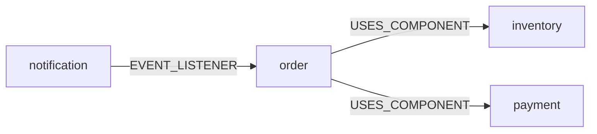
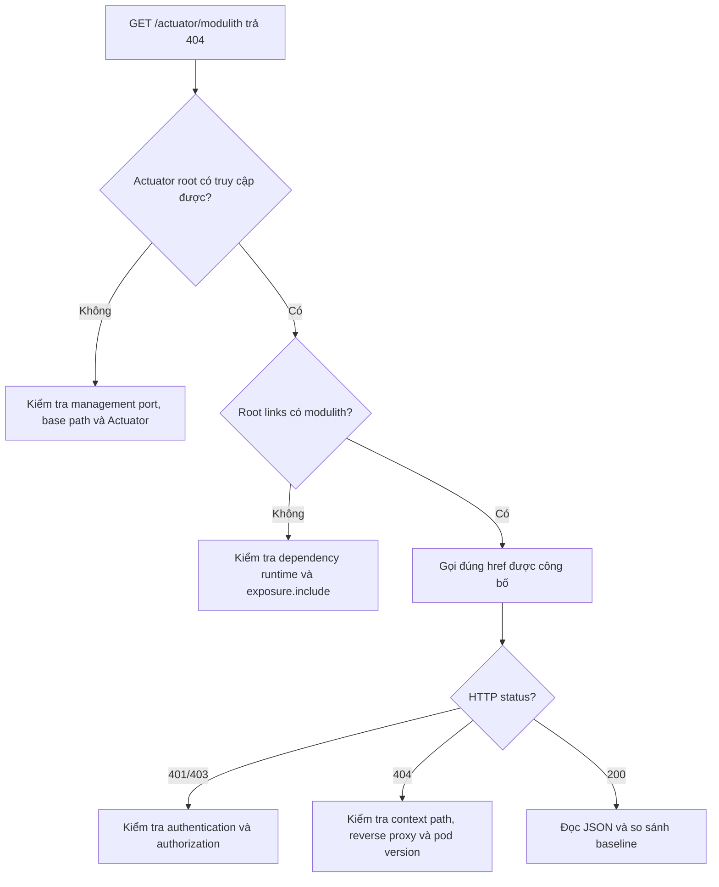

# Document endpoint modulith cho người vận hành

Khi vận hành một ứng dụng Spring Boot dùng Spring Modulith, người trực ca cần biết ứng dụng được chia thành những application module nào và các module phụ thuộc nhau ra sao. Khi một bản phát hành làm thay đổi ranh giới module, thông tin này giúp đội vận hành đối chiếu kiến trúc dự kiến, điều tra lỗi tích hợp và chuyển đúng vấn đề tới nhóm sở hữu module.

Spring Modulith cung cấp một **Actuator endpoint có tên `modulith`** để công bố cấu trúc application module dưới dạng JSON. Người vận hành có thể gọi endpoint này sau khi triển khai, xem tên module, package gốc, module cha/con và các dependency đã được Spring Modulith phát hiện.

Bài thuộc chương **Tài liệu vận hành** của học phần `SPRING_MODULITH_DOCUMENTATION_OBSERVABILITY`. Học phần dùng Spring Modulith để sinh tài liệu ranh giới application module và quan sát tương tác giữa các phần trong ứng dụng Spring Boot thông qua module graph, Actuator, event metrics, tracing và context propagation. Bài này tập trung vào cách bật, truy cập, đọc và dùng endpoint `modulith` trong quy trình vận hành; đồng thời làm rõ endpoint cho biết thông tin gì, không cho biết điều gì và cần bảo vệ ra sao.

Sau bài học, bạn có thể:

- Giải thích mục đích của endpoint `GET /actuator/modulith`.
- Chọn dependency phù hợp để bật Application Module Actuator.
- Cấu hình expose endpoint qua Spring Boot Actuator.
- Đọc JSON về module, package, dependency target và dependency type.
- Dùng kết quả để kiểm tra nhanh kiến trúc của bản triển khai.
- Phân biệt module structure endpoint với module traces, event metrics và architecture verification.
- Xử lý lỗi 404, 401/403, JSON thiếu module hoặc kết quả không khớp kiến trúc mong đợi.
- Bảo vệ endpoint vì dữ liệu cấu trúc nội bộ có thể nhạy cảm với tổ chức.

> **Phạm vi phiên bản:** ví dụ dựa trên Spring Boot 3.5.x và Spring Modulith 1.4.x. Trong các phiên bản Spring Modulith hiện hành, endpoint ID là `modulith`, do đó URL mặc định là `/actuator/modulith`. Một số bản Spring Modulith cũ từng dùng endpoint ID `applicationmodules`; hãy kiểm tra tài liệu đúng version nếu đang vận hành hệ thống cũ. Nếu thay đổi `management.endpoints.web.base-path`, context path hoặc management port, URL thực tế cũng thay đổi.

## 1. Endpoint modulith giải quyết nhu cầu nào?

Spring Modulith phân tích cấu trúc package và metadata của ứng dụng để nhận diện application module cùng các dependency giữa chúng. Endpoint `modulith` đưa mô hình đó ra qua Spring Boot Actuator để công cụ vận hành có thể đọc được mà không cần truy cập source code hoặc chạy bài kiểm tra kiến trúc tại máy phát triển.

Ví dụ ứng dụng bán hàng có các module:

```text
com.example.shop
├── order
├── inventory
├── payment
└── notification
```

Người vận hành có thể cần trả lời các câu hỏi:

- Bản đang chạy có nhận diện đủ bốn module không?
- Module `order` có dependency tới `inventory` và `payment` như kiến trúc dự kiến không?
- Module `notification` có phụ thuộc vào module phát event `order` không?
- Có dependency mới giữa hai module xuất hiện sau lần release gần nhất không?
- Một module có bị đổi base package hoặc đổi tên kỹ thuật không?

Endpoint trả về JSON mô tả module arrangement mà Spring Modulith đã phát hiện. Đây là **thông tin cấu trúc tại runtime**, phù hợp cho kiểm tra và tra cứu vận hành.

### Endpoint không phải là gì?

Endpoint `modulith` không phải:

- Swagger/OpenAPI endpoint mô tả REST API của ứng dụng.
- Danh mục đầy đủ domain event, schema event hoặc payload event.
- Dashboard đếm số lần gọi module hoặc thời gian xử lý.
- Trace của một request cụ thể.
- Cơ chế tự động xác nhận mọi quy tắc kiến trúc đều hợp lệ.
- Tài liệu giải thích nghiệp vụ do con người viết cho từng module.

Hãy kết hợp endpoint với tài liệu kiến trúc, kiểm thử `ApplicationModules.verify()`, module traces, event metrics và runbook của ứng dụng để có bức tranh đầy đủ.

## 2. Bật Application Module Actuator

Có hai lựa chọn phổ biến.

### Lựa chọn A: thêm actuator support riêng

Với ứng dụng đã có Spring Boot Actuator, thêm dependency runtime `spring-modulith-actuator`:

```xml
<dependencies>
    <dependency>
        <groupId>org.springframework.boot</groupId>
        <artifactId>spring-boot-starter-actuator</artifactId>
    </dependency>

    <dependency>
        <groupId>org.springframework.modulith</groupId>
        <artifactId>spring-modulith-actuator</artifactId>
        <scope>runtime</scope>
    </dependency>
</dependencies>
```

Dependency `spring-boot-starter-actuator` cung cấp hạ tầng Actuator nói chung. `spring-modulith-actuator` đăng ký endpoint để công bố module structure.

### Lựa chọn B: dùng Spring Modulith Insight starter

Nếu ứng dụng cần cả endpoint module và observability cho tương tác module, có thể dùng `spring-modulith-starter-insight`:

```xml
<dependency>
    <groupId>org.springframework.modulith</groupId>
    <artifactId>spring-modulith-starter-insight</artifactId>
    <scope>runtime</scope>
</dependency>
```

Insight starter bao gồm actuator và observability support của Spring Modulith. Ứng dụng vẫn cần dependency exporter/bridge phù hợp nếu muốn gửi traces tới công cụ giám sát bên ngoài.

**Chọn một cách tích hợp phù hợp với dự án.** Không cần thêm cả `spring-modulith-actuator` lẫn `spring-modulith-starter-insight` chỉ để có endpoint. Hãy quản lý version bằng Spring Modulith BOM hoặc dependency management tương thích với dòng Spring Boot đang dùng; không tự trộn các phiên bản Spring Modulith khác nhau.

Nếu dự án chỉ cần công bố module structure, lựa chọn A thường đủ. Nếu muốn quan sát runtime interactions bằng Micrometer spans và event metrics, lựa chọn B tiện lợi hơn.

## 3. Expose endpoint qua Spring Boot Actuator

Thêm dependency không đồng nghĩa endpoint tự động được mở qua HTTP. Spring Boot Actuator chỉ expose những endpoint được cấu hình.

Ví dụ `application.yml`:

```yaml
management:
  endpoints:
    web:
      exposure:
        include: health,modulith
```

Nếu đã có danh sách endpoint khác, hãy thêm `modulith` vào danh sách hiện tại thay vì ghi đè các endpoint đang được ứng dụng sử dụng.

Theo cấu hình mặc định, Actuator dùng base path `/actuator`, vì vậy URL là:

```text
http://localhost:8080/actuator/modulith
```

Nếu ứng dụng chạy với context path, management port hoặc base path khác, URL sẽ thay đổi. Ví dụ:

```yaml
server:
  servlet:
    context-path: /shop

management:
  endpoints:
    web:
      base-path: /manage
      exposure:
        include: health,modulith
```

Khi cấu hình này được áp dụng, endpoint có thể nằm ở `/shop/manage/modulith` trên server port, trừ khi management server được tách riêng bằng cấu hình khác. Luôn lấy URL thực tế từ môi trường đang chạy thay vì giả định mọi ứng dụng đều dùng `/actuator`.

### Khám phá endpoint từ Actuator root

Nếu Actuator web discovery được bật và root endpoint có thể truy cập, gọi:

```http
GET /actuator
```

Phần `_links` sẽ công bố những endpoint đang được expose. Với Spring Modulith actuator support, bạn có thể thấy liên kết tương tự:

```json
{
  "_links": {
    "self": {
      "href": "http://localhost:8080/actuator",
      "templated": false
    },
    "health": {
      "href": "http://localhost:8080/actuator/health",
      "templated": false
    },
    "modulith": {
      "href": "http://localhost:8080/actuator/modulith",
      "templated": false
    }
  }
}
```

Ví dụ trên là response minh họa. Danh sách link thực tế phụ thuộc endpoint nào được bật, cấu hình discovery và security.

## 4. Gọi endpoint trong quy trình vận hành

### Gọi bằng curl

Trong local:

```bash
curl --fail --silent --show-error \
  http://localhost:8080/actuator/modulith
```

Trong môi trường yêu cầu bearer token, dùng token do hệ thống secret cung cấp:

```bash
curl --fail --silent --show-error \
  -H "Authorization: Bearer $OPS_TOKEN" \
  "$ACTUATOR_BASE_URL/actuator/modulith"
```

Không ghi token trực tiếp vào script được commit, shell history dùng chung hoặc log của pipeline.

### Gọi bằng PowerShell

```powershell
$uri = "http://localhost:8080/actuator/modulith"
Invoke-RestMethod -Uri $uri -Method Get
```

Nếu endpoint cần bearer token, lấy token từ secret store của môi trường và truyền qua header theo quy trình bảo mật của tổ chức. Không paste token production vào terminal transcript được chia sẻ.

### Gọi trong Kubernetes hoặc môi trường container

Người vận hành thường truy cập qua internal service, port-forward hoặc management ingress được kiểm soát. Ví dụ port-forward cho một pod/service đã được chọn:

```bash
kubectl port-forward service/shop-modulith 8081:8080
curl --fail --silent --show-error \
  http://localhost:8081/actuator/modulith
```

Tên service và port chỉ là ví dụ. Dùng đúng namespace, workload và service port của cluster. Không tạo public ingress cho endpoint chỉ để thuận tiện kiểm tra.

### Lưu kết quả theo release

Có thể lưu JSON output như một artifact gắn với release/deployment:

- Tên service và environment.
- Image tag hoặc release version lấy từ hệ thống deployment.
- Thời điểm lấy snapshot.
- JSON trả về từ `/actuator/modulith`.
- Kết quả so sánh với baseline đã được duyệt.

Endpoint không nhất thiết tự trả về Git commit hoặc image tag. Thu thập metadata release từ hệ thống triển khai và lưu cùng snapshot để tránh nhầm JSON của hai bản phát hành.

## 5. Đọc cấu trúc JSON

Response là một object JSON. Mỗi key cấp cao nhất là tên kỹ thuật của một application module.

Ví dụ:

```json
{
  "inventory": {
    "displayName": "Inventory",
    "basePackage": "com.example.shop.inventory",
    "dependencies": []
  },
  "order": {
    "displayName": "Order",
    "basePackage": "com.example.shop.order",
    "dependencies": [
      {
        "target": "inventory",
        "types": ["USES_COMPONENT"]
      },
      {
        "target": "payment",
        "types": ["USES_COMPONENT"]
      }
    ]
  },
  "payment": {
    "displayName": "Payment",
    "basePackage": "com.example.shop.payment",
    "dependencies": []
  },
  "notification": {
    "displayName": "Notification",
    "basePackage": "com.example.shop.notification",
    "dependencies": [
      {
        "target": "order",
        "types": ["EVENT_LISTENER"]
      }
    ]
  }
}
```

Cách đọc:

- `inventory`, `order`, `payment`, `notification` là technical module names.
- `displayName` là tên dễ đọc dành cho người xem.
- `basePackage` là package gốc của module.
- `dependencies` liệt kê dependency đi ra từ module hiện tại.
- `target` trỏ tới module mà module hiện tại phụ thuộc.
- `types` cho biết kiểu dependency được phát hiện.

Trong ví dụ, `order` phụ thuộc vào `inventory` và `payment` qua Spring bean; `notification` phụ thuộc vào `order` vì lắng nghe event được module `order` phát hành.

### Các trường chính

| JSON path | Ý nghĩa | Cách dùng khi vận hành |
| --- | --- | --- |
| `$.{moduleName}` | Tên kỹ thuật của module | Đối chiếu module inventory của release |
| `$.{moduleName}.displayName` | Tên hiển thị | Dùng trong tài liệu/runbook |
| `$.{moduleName}.basePackage` | Package gốc | Phát hiện package/module bị đổi |
| `$.{moduleName}.parent` | Tên module cha nếu là nested module | Hiểu module lồng nhau |
| `$.{moduleName}.nested` | Danh sách nested modules nếu có | Kiểm tra cấu trúc phân cấp |
| `$.{moduleName}.dependencies[]` | Các dependency đi ra | Xem module hiện tại phụ thuộc ai |
| `$.{moduleName}.dependencies[].target` | Module đích | Xác định hướng dependency |
| `$.{moduleName}.dependencies[].types[]` | Các kiểu dependency | Phân biệt bean/type/event listener |

`parent` và `nested` là trường tùy chọn; không phải module nào cũng có. Một module không có dependency có thể trả về mảng `dependencies` rỗng.

## 6. Hiểu dependency types

Endpoint có thể trả về một hoặc nhiều loại dependency cho cùng một target.

| Type | Ý nghĩa trong module model | Cách diễn giải |
| --- | --- | --- |
| `DEFAULT` | Dependency ở mức type thông thường | Module tham chiếu type thuộc module khác |
| `USES_COMPONENT` | Dependency qua Spring bean/component | Module dùng một Spring component được cung cấp bởi module đích |
| `EVENT_LISTENER` | Dependency do event listener tạo ra | Module hiện tại lắng nghe event do module đích phát hành |

Ví dụ:

```json
{
  "notification": {
    "displayName": "Notification",
    "basePackage": "com.example.shop.notification",
    "dependencies": [
      {
        "target": "order",
        "types": ["EVENT_LISTENER"]
      }
    ]
  }
}
```

Đọc theo hướng: `notification` là module hiện tại; `order` là module đích mà nó phụ thuộc; `EVENT_LISTENER` cho biết dependency phát sinh từ việc lắng nghe event.

Nếu cùng một module vừa dùng Spring bean vừa lắng nghe event của target, `types` có thể chứa cả `USES_COMPONENT` và `EVENT_LISTENER`.

**Không đảo chiều dependency.** `dependencies` thuộc về module đang được mô tả. `target` là module mà module đó phụ thuộc, không phải module đang gọi nó.

### Vẽ module dependency từ JSON

Từ response trên có thể diễn giải:



Mũi tên biểu diễn hướng dependency: module ở đầu mũi tên phụ thuộc module ở cuối mũi tên. Khi đọc sơ đồ trong runbook, luôn ghi rõ quy ước này để không nhầm với hướng gọi ở runtime hoặc hướng event publication.

## 7. Dùng endpoint để kiểm tra một bản triển khai

Endpoint hữu ích nhất khi được dùng như một bước trong quy trình release và incident response.

### Trước khi phát hành

1. Lấy snapshot module JSON từ bản release hiện tại.
2. Lấy snapshot từ artifact hoặc môi trường staging của bản sắp phát hành.
3. So sánh danh sách technical module names.
4. So sánh `basePackage`, `parent`, `nested`.
5. So sánh các dependency target và dependency types.
6. Giải thích mọi dependency mới, module bị đổi tên hoặc module biến mất.
7. Lưu kết quả so sánh cùng release record.

### Sau khi triển khai production

1. Xác nhận đúng workload và image version đang chạy.
2. Gọi endpoint bằng tài khoản vận hành có quyền đọc.
3. Xác nhận endpoint trả JSON hợp lệ.
4. So sánh snapshot runtime với baseline đã duyệt cho release đó.
5. Nếu có khác biệt, xác minh image tag, cấu hình module detection và quá trình rollout.
6. Chuyển vấn đề tới nhóm sở hữu module nếu dependency không mong đợi xuất hiện.

Endpoint không tự thực hiện diff với baseline hoặc đánh dấu release pass/fail. Đội vận hành cần dùng công cụ so sánh JSON hoặc pipeline release để thực hiện bước này.

### Ví dụ những thay đổi cần xem xét

| Thay đổi trong JSON | Câu hỏi cần đặt ra |
| --- | --- |
| Module mới xuất hiện | Đây có phải module đã được phê duyệt trong release không? |
| Module dự kiến biến mất | Có phải module bị xóa/đổi tên hay cấu hình detection thay đổi? |
| `basePackage` đổi | Có thay đổi package layout hoặc application root không? |
| Dependency mới xuất hiện | Module có đang phụ thuộc vào API được phép của target không? |
| `EVENT_LISTENER` biến mất | Listener có bị xóa, chuyển module hoặc không được phát hiện? |
| Dependency type thay đổi | Cách hai module tương tác có thay đổi không? |
| `parent`/`nested` thay đổi | Cấu trúc nested modules có được thiết kế và kiểm tra lại không? |

Một khác biệt không tự động có nghĩa là lỗi. Hãy so sánh với kiến trúc được duyệt và nội dung thay đổi của release.

## 8. Kết hợp với module verification, traces và event metrics

Endpoint `modulith` là một phần của bức tranh vận hành, không thay thế các cơ chế khác.

| Cơ chế | Dữ liệu trả lời | Thời điểm dùng |
| --- | --- | --- |
| `GET /actuator/modulith` | Module names, packages, dependencies, nested structure | Kiểm tra cấu trúc đang được công bố |
| `ApplicationModules.verify()` | Quy tắc cấu trúc và dependency có hợp lệ không | Build/test/CI |
| Module observations/traces | Lời gọi module thực tế trong một request | Điều tra latency, lỗi và luồng thực thi |
| `module.events.published` | Số lượng event publication | Theo dõi hoạt động event |
| Module graph/documentation | Bức tranh kiến trúc dễ đọc cho con người | Review thiết kế và onboarding |

### Endpoint không phải architecture test

Một response JSON hợp lệ chỉ cho biết endpoint đã công bố module model. Nó không chứng minh mọi dependency đều đúng với quy tắc kiến trúc của tổ chức.

Dùng kiểm thử Spring Modulith, ví dụ:

```java
import org.junit.jupiter.api.Test;
import org.springframework.modulith.core.ApplicationModules;

class ModularityTests {

    @Test
    void verifiesApplicationModuleStructure() {
        ApplicationModules.of(Application.class).verify();
    }
}
```

`ApplicationModules.verify()` kiểm tra các quy tắc module được Spring Modulith hỗ trợ trong mô hình được phát hiện. Chạy test trong CI để phát hiện dependency vi phạm trước khi release. Endpoint runtime giúp người vận hành xem cấu trúc của bản đang chạy; hai cơ chế bổ sung cho nhau.

### Endpoint không phải runtime trace

Nếu `order` phụ thuộc `inventory`, endpoint mô tả dependency đó. Nó không cho biết request nào vừa gọi `inventory`, mất bao nhiêu mili giây hay có lỗi hay không. Để trả lời các câu hỏi runtime, dùng module spans/traces và metrics.

### Endpoint không phải event catalog

`EVENT_LISTENER` chỉ thể hiện dependency có liên quan đến event listener. Endpoint không trả danh sách đầy đủ tên event, payload schema, số lần publish hoặc trạng thái xử lý. Dùng event metrics, event publication registry hoặc tài liệu event riêng cho các thông tin đó.

## 9. Lưu ý về module detection và bản build đang chạy

Module model được suy ra từ cấu trúc package và các tùy chỉnh Spring Modulith của ứng dụng. Nếu ứng dụng có custom module detection, named interfaces hoặc nested modules, các cấu hình tùy chỉnh cần hiện diện trong production sources để endpoint runtime phản ánh đúng mô hình mà ứng dụng sử dụng.

Khi endpoint thiếu module hoặc package không đúng dự kiến, kiểm tra:

- Main application class có nằm tại package gốc đúng không?
- Package structure của artifact đang chạy có đúng với thiết kế không?
- Annotation `@ApplicationModule` hoặc package metadata có được đóng gói không?
- Customization cho module detection có nằm trong source set được build vào production không?
- Có loại trừ package hoặc nested module theo cấu hình không?
- Pod đang phục vụ request có đúng image tag của release không?

Không sửa module model chỉ để làm endpoint giống một sơ đồ mong muốn. Trước tiên xác định dữ liệu endpoint có phản ánh đúng artifact và cấu hình thực tế hay không.

## 10. Bảo vệ endpoint trong môi trường production

JSON module structure có thể tiết lộ:

- Tên và package nội bộ.
- Cách chia module của ứng dụng.
- Dependency giữa các vùng nghiệp vụ.
- Tên thành phần hoặc module nhạy cảm.
- Một phần cấu trúc kỹ thuật mà tổ chức không muốn công khai.

Vì vậy, endpoint nên được xem là **thông tin quản trị nội bộ**.

### Chỉ expose endpoint cần thiết

Cấu hình ví dụ:

```yaml
management:
  endpoints:
    web:
      exposure:
        include: health,modulith
```

Không expose toàn bộ endpoint bằng `include: "*"`, trừ khi đã có lý do, security controls và đánh giá rủi ro rõ ràng.

### Kiểm soát network và identity

- Chỉ cho phép truy cập từ mạng quản trị, VPN, bastion hoặc workload vận hành được duyệt.
- Bảo vệ endpoint bằng Spring Security hoặc security gateway của môi trường.
- Yêu cầu authentication và role phù hợp; không cho user nghiệp vụ thông thường đọc endpoint nếu không cần.
- Dùng TLS khi truy cập qua mạng.
- Không expose Actuator management port trực tiếp ra Internet.
- Ghi audit cho các truy cập quản trị nếu nền tảng hỗ trợ.
- Không đưa JSON module structure vào log công khai hoặc ticket không được kiểm soát.

**Exposure và authorization là hai lớp khác nhau.** `management.endpoints.web.exposure.include` quyết định endpoint có được expose qua web hay không; nó không thay thế cấu hình xác thực/phân quyền. Hãy kiểm tra security chain và network policy thực tế.

### Có thể tách management port

Nếu tổ chức dùng management port riêng, có thể cấu hình ví dụ:

```yaml
management:
  server:
    port: 8081
  endpoints:
    web:
      exposure:
        include: health,modulith
```

Trong trường hợp này, endpoint có thể truy cập qua port `8081` thay vì port ứng dụng. Cần bảo vệ management listener riêng và không publish port đó rộng hơn phạm vi cần thiết.

## 11. Sự cố thường gặp

| Triệu chứng | Nguyên nhân có thể | Cách kiểm tra |
| --- | --- | --- |
| `GET /actuator/modulith` trả 404 | Thiếu dependency, endpoint chưa expose hoặc URL base path khác | Kiểm tra dependency runtime, Actuator config và root links |
| `/actuator` không có link `modulith` | Endpoint không được đăng ký hoặc không được expose | Kiểm tra `spring-modulith-actuator`/Insight starter và `exposure.include` |
| Trả 401 | Request thiếu hoặc sai authentication | Dùng identity vận hành và credential hợp lệ |
| Trả 403 | Identity đã xác thực nhưng không có quyền | Kiểm tra role/authorization policy |
| JSON thiếu module dự kiến | Artifact/config detection khác baseline | Xác nhận image tag, package root và custom detection |
| Module có `dependencies: []` ngoài dự kiến | Dependency không được phát hiện hoặc module model khác thiết kế | Kiểm tra package, bean wiring và event listener |
| `target` không như mong đợi | Đọc nhầm hướng dependency | Nhớ rằng module hiện tại phụ thuộc vào `target` |
| Endpoint hoạt động local nhưng không ở production | Dependency scope, profile hoặc security khác nhau | Kiểm tra runtime classpath và cấu hình deploy |
| JSON khác giữa các pod | Rollout chưa đồng nhất hoặc đang chạy nhiều image version | Kiểm tra pod/image tag và rollout status |
| Endpoint lộ ra ngoài mạng công cộng | Exposure/network/security cấu hình sai | Thu hồi route công khai, giới hạn mạng và kiểm tra access logs |

### Quy trình chẩn đoán 404



Khi gặp 404, đừng lập tức đổi endpoint ID. Trước hết kiểm tra version Spring Modulith và link mà Actuator root công bố. Một số bản rất cũ từng dùng endpoint ID `applicationmodules`, trong khi các bản mới dùng `modulith`.

## 12. Runbook kiểm tra module structure sau deployment

Quy trình ngắn sau đây có thể được đưa vào runbook release:

1. **Xác định bản đang chạy:** lấy service, namespace, environment và image tag từ hệ thống deployment.
2. **Xác định management URL:** dùng base path, context path và port thực tế.
3. **Xác thực:** sử dụng tài khoản vận hành có quyền đọc endpoint.
4. **Gọi endpoint:** `GET /actuator/modulith`.
5. **Xác nhận HTTP:** kỳ vọng `200 OK` và JSON hợp lệ.
6. **Kiểm tra module list:** đối chiếu technical names và `basePackage`.
7. **Kiểm tra dependencies:** xem `target` và `types` có phù hợp kiến trúc release không.
8. **Kiểm tra nested modules:** xác nhận `parent` và `nested` nếu ứng dụng dùng module lồng nhau.
9. **So sánh baseline:** kiểm tra khác biệt với snapshot đã duyệt.
10. **Lưu bằng chứng:** gắn JSON snapshot, image tag, thời điểm và kết quả review vào release record.
11. **Chuyển điều tra:** nếu cấu trúc sai, kiểm tra build artifact và module detection; nếu cấu trúc đúng nhưng request lỗi, chuyển sang traces/metrics/logs để điều tra runtime.

Mẫu checklist:

| Kiểm tra | Kết quả cần ghi |
| --- | --- |
| Đúng service/environment/image tag | Đã xác nhận / Chưa |
| Endpoint trả `200 OK` | Đạt / Không đạt |
| Danh sách module khớp baseline | Khớp / Có khác biệt |
| `basePackage` và nested structure | Khớp / Có khác biệt |
| Dependency target/types | Khớp / Cần review |
| JSON snapshot được lưu cùng release | Có / Không |
| Khác biệt được chủ sở hữu module giải thích | Có / Chờ xác nhận |

Endpoint không tự động phê duyệt release. Người vận hành cần đối chiếu baseline và chuyển khác biệt cho owner phù hợp.

## 13. Bài thực hành: đọc endpoint modulith như một operator

**Bối cảnh:** ứng dụng Spring Boot có các module `order`, `inventory`, `payment` và `notification`. Bạn cần xác nhận cấu trúc sau deployment và điều tra một dependency mới.

1. Thêm `spring-boot-starter-actuator` và `spring-modulith-actuator`, hoặc dùng `spring-modulith-starter-insight` nếu cần cả observability.
2. Expose `health,modulith` qua Actuator web.
3. Khởi động ứng dụng và gọi `GET /actuator`; xác nhận root links công bố `modulith`.
4. Gọi `GET /actuator/modulith`; lưu JSON output.
5. Xác định technical name, display name và base package của từng module.
6. Đọc `dependencies` của `order`; giải thích từng `target` và `types`.
7. Đọc dependency `EVENT_LISTENER` của `notification`; giải thích vì sao hướng dependency là `notification` → `order`.
8. So sánh JSON với baseline của release trước và đánh dấu dependency mới.
9. Chạy `ApplicationModules.verify()` trong test để kiểm tra quy tắc cấu trúc.
10. Tạo một request qua `order`; dùng module traces để quan sát lời gọi runtime và phân biệt dữ liệu đó với JSON endpoint.
11. Kiểm tra endpoint chỉ truy cập được từ mạng quản trị và identity được cấp quyền.
12. Viết runbook ngắn gồm URL, cách xác thực, trường JSON cần xem, baseline và đầu mối xử lý khi có khác biệt.

**Tiêu chí hoàn thành:** người vận hành có thể gọi endpoint an toàn, đọc đúng hướng dependency, so sánh module structure giữa các bản release và biết khi nào cần dùng architecture tests hoặc traces để điều tra tiếp.

## Tài liệu tham khảo

- [Spring Modulith 1.4 — Production-ready Features](https://docs.spring.io/spring-modulith/reference/1.4/production-ready.html): dependency actuator, endpoint `modulith`, JSON schema và observability module.
- [Spring Modulith — ApplicationModulesEndpoint API](https://docs.spring.io/spring-modulith/docs/1.4.x/api/org/springframework/modulith/actuator/ApplicationModulesEndpoint.html): endpoint ID và read operation của application modules actuator.
- [Spring Modulith — Fundamentals](https://docs.spring.io/spring-modulith/reference/fundamentals.html): application modules, package arrangement, nested modules và dependency model.
- [Spring Boot 3.5 — Actuator Endpoints](https://docs.spring.io/spring-boot/3.5/reference/actuator/endpoints.html): expose, access và bảo vệ Actuator endpoints.
- [Spring Boot 3.5 — Monitoring and Management over HTTP](https://docs.spring.io/spring-boot/3.5/reference/actuator/monitoring.html): base path, management port và web endpoint configuration.

**Ghi nhớ:** `GET /actuator/modulith` công bố module structure dưới dạng JSON để người vận hành kiểm tra bản ứng dụng đang chạy. Hãy đọc `dependencies` theo hướng module hiện tại → `target`, so sánh với baseline của release, bảo vệ endpoint trong mạng quản trị và dùng `ApplicationModules.verify()` cùng traces/metrics cho các câu hỏi mà JSON cấu trúc không trả lời.
