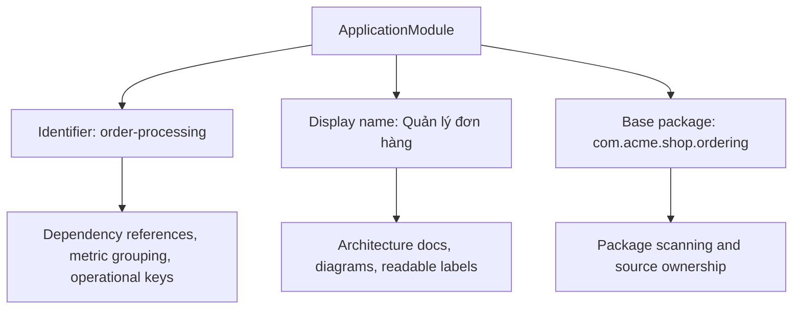

# Document ý nghĩa module identifier và display name

## 1. Mục tiêu của tài liệu vận hành

Trong ứng dụng Spring Boot dùng **Spring Modulith**, cấu trúc package được phân tích thành các application module. Khi tạo tài liệu kiến trúc, expose Actuator hoặc quan sát lời gọi module lúc runtime, mỗi module cần được nhận diện nhất quán.

Spring Modulith cung cấp hai khái niệm có mục đích khác nhau:

- **Module identifier** là tên kỹ thuật để nhận diện module trong mô hình kiến trúc và các tham chiếu giữa module.
- **Display name** là tên dễ đọc để hiển thị trong tài liệu, sơ đồ và giao diện quan sát.

Ví dụ một module có thể mang identifier **order-processing** và display name **Quản lý đơn hàng**. Identifier phù hợp cho cấu hình, dependency references, metric labels và truy vấn vận hành. Display name giúp người đọc hiểu module làm nhiệm vụ gì.

Tài liệu vận hành nên ghi cả hai cùng với base package, owner và các điểm tích hợp quan trọng. Khi dashboard hiển thị lỗi ở **order-processing**, người trực có thể tra ra đúng module; khi sơ đồ hiển thị **Quản lý đơn hàng**, người đọc vẫn hiểu vai trò nghiệp vụ.

## 2. Module identifier là gì?

**ApplicationModuleIdentifier** là kiểu đại diện cho logical identifier của một application module. Trong mô hình Spring Modulith, identifier được lấy từ tên module theo quy tắc phát hiện package hoặc được tùy chỉnh bằng thuộc tính **id** của **@ApplicationModule**.

Ví dụ cấu trúc package:

```text
com.acme.shop
├── ShopApplication.java
├── ordering
│   ├── OrderManagement.java
│   └── internal
│       └── OrderRepositoryAdapter.java
├── inventory
│   └── InventoryManagement.java
└── notification
    └── OrderNotificationListener.java
```

Với cấu trúc module đơn giản, các package con trực tiếp dưới package ứng dụng thường được nhận diện là application modules. Trong ví dụ này, các logical identifiers mặc định là **ordering**, **inventory** và **notification**.

Nếu module nằm ở package con nhiều cấp hoặc ứng dụng dùng cấu hình naming strategy khác, identifier có thể phản ánh đường dẫn tương đối dưới base package. Khi bật **useFullyQualifiedModuleNames** trên **@Modulithic**, cách đặt tên module trong các tham chiếu cũng thay đổi theo cấu hình đó.

**Identifier là khóa kỹ thuật.** Không dùng tên hiển thị có dấu, câu mô tả dài hoặc tên phụ thuộc ngôn ngữ làm identifier. Chọn một chuỗi ngắn, ổn định và nhất quán với các tham chiếu module.

### 2.1. Khai báo identifier tường minh

Từ Spring Modulith 1.3, **@ApplicationModule** hỗ trợ thuộc tính **id**. Có thể khai báo metadata trong **package-info.java**:

```java
@org.springframework.modulith.ApplicationModule(
    id = "order-processing"
)
package com.acme.shop.ordering;
```

Khi dùng Kotlin hoặc không muốn tạo package-info.java, annotation có thể đặt trên một type trong package gốc của module:

```kotlin
package com.acme.shop.ordering

import org.springframework.modulith.ApplicationModule

@ApplicationModule(id = "order-processing")
class ModuleMetadata
```

Nếu không khai báo **id**, Spring Modulith suy ra logical identifier theo module naming strategy từ package. Nếu khai báo **id**, dùng giá trị đó làm identifier của module.

### 2.2. Quy tắc đặt identifier

API của **@ApplicationModule.id** quy định identifier không được chứa chuỗi **::**. Đây là dấu phân cách được Spring Modulith sử dụng trong một số tham chiếu đến named interface. **ApplicationModuleIdentifier.of(...)** cũng từ chối giá trị null, rỗng hoặc có **::**.

Khuyến nghị vận hành:

- Dùng chữ thường và dấu gạch ngang hoặc tên ngắn theo convention của dự án.
- Giữ identifier duy nhất trong phạm vi mô hình module.
- Tránh gắn phiên bản, môi trường triển khai hoặc tên nhóm tạm thời vào identifier.
- Tránh đổi identifier chỉ để đổi cách viết hoa hoặc tên hiển thị.
- Nếu package có thể được tái cấu trúc, cân nhắc khai báo **id** tường minh để giữ khóa kỹ thuật ổn định.

| Identifier | Đánh giá | Lý do |
| --- | --- | --- |
| **ordering** | Tốt | Ngắn, rõ, ổn định |
| **order-processing** | Tốt | Nêu rõ trách nhiệm module |
| **Order Processing** | Không nên | Có khoảng trắng và cách viết không phù hợp cho khóa kỹ thuật |
| **đơn-hàng** | Không nên | Phụ thuộc encoding và khó dùng thống nhất trong toolchain |
| **ordering::API** | Không hợp lệ cho id | **::** dành cho cú pháp tham chiếu named interface |

## 3. Display name là gì?

**displayName** là tên con người có thể đọc được, dùng để hiển thị module và tạo tài liệu. Spring Modulith khai báo thuộc tính này trên **@ApplicationModule**:

```java
@org.springframework.modulith.ApplicationModule(
    id = "order-processing",
    displayName = "Quản lý đơn hàng"
)
package com.acme.shop.ordering;
```

Display name có thể chứa dấu tiếng Việt, khoảng trắng và cách diễn đạt nghiệp vụ:

| Module identifier | Display name |
| --- | --- |
| **order-processing** | Quản lý đơn hàng |
| **inventory** | Quản lý tồn kho |
| **notification** | Gửi thông báo |

Thuộc tính **displayName** có giá trị mặc định là chuỗi rỗng trong annotation. Mô hình **ApplicationModule** cung cấp **getDisplayName()** với kết quả không null và không rỗng; khi không cấu hình tên hiển thị riêng, hãy đọc giá trị thực từ mô hình thay vì tự giả định một quy tắc viết hoa.

Display name có thể được chỉnh để phù hợp với cách tổ chức nghiệp vụ hoặc ngôn ngữ tài liệu. Ví dụ, **order-processing** có thể hiển thị là **Quản lý đơn hàng** trong tài liệu tiếng Việt và **Order Management** trong tài liệu tiếng Anh. Việc đổi display name không nhất thiết đòi hỏi đổi identifier nếu identity và trách nhiệm module vẫn giữ nguyên.

Tuy nhiên, display name cũng có thể được xuất thành tag **module.name** trong metrics. Nếu thay đổi display name, một số time series có tag value mới có thể xuất hiện. Dashboard tổng quan nên group theo identifier để giữ tính liên tục.

## 4. Phân biệt identifier, display name và base package

Ba trường này trả lời ba câu hỏi khác nhau:

| Thuộc tính | Trả lời câu hỏi | Ví dụ |
| --- | --- | --- |
| Identifier | Hệ thống gọi module này bằng khóa nào? | **order-processing** |
| Display name | Người đọc nên hiểu module này là gì? | **Quản lý đơn hàng** |
| Base package | Code của module bắt đầu từ package nào? | **com.acme.shop.ordering** |

Không suy ra base package từ display name. Cũng không dùng display name thay cho identifier khi khai báo dependency hoặc lọc metric.



## 5. Metadata ở cấp ứng dụng và cấp module

Spring Modulith có metadata cho cả ứng dụng và từng module. Không trộn hai cấp này:

- **@Modulithic(systemName = "...")** khai báo tên logic của toàn ứng dụng, dùng cho mục đích tài liệu.
- **@ApplicationModule(id = "...", displayName = "...")** khai báo identifier và display name của một module.

Ví dụ:

```java
package com.acme.shop;

import org.springframework.boot.autoconfigure.SpringBootApplication;
import org.springframework.modulith.Modulithic;

@SpringBootApplication
@Modulithic(
    systemName = "Acme Shop",
    useFullyQualifiedModuleNames = false
)
class ShopApplication {
}
```

Ở đây **Acme Shop** là tên hệ thống. Các module vẫn có metadata riêng như **order-processing** và **Quản lý đơn hàng**. **useFullyQualifiedModuleNames** tác động đến cách Spring Modulith xác định tên module từ package và cách tham chiếu dependency. Nếu thay đổi thiết lập này, cần kiểm tra lại toàn bộ tên module được công bố và các tham chiếu cấu hình.

## 6. Identifier được dùng ở đâu trong vận hành?

### 6.1. Application module model

**ApplicationModule.getIdentifier()** trả về **ApplicationModuleIdentifier** của module. Từ Spring Modulith 1.3, API **getName()** cũ đã deprecated; code mới nên dùng **getIdentifier()**.

Ví dụ kiểm tra mô hình module:

```java
import org.springframework.modulith.core.ApplicationModule;
import org.springframework.modulith.core.ApplicationModules;

ApplicationModules modules = ApplicationModules.of(ShopApplication.class);

for (ApplicationModule module : modules) {
    System.out.printf(
            "identifier=%s displayName=%s basePackage=%s%n",
            module.getIdentifier(),
            module.getDisplayName(),
            module.getBasePackage()
    );
}
```

Đoạn code trên hữu ích cho diagnostic hoặc test. Trong production, không cần tự in toàn bộ mô hình ở mọi lần khởi động nếu actuator hoặc tài liệu kiến trúc đã cung cấp thông tin tương đương.

### 6.2. Actuator endpoint /actuator/modulith

Spring Modulith có thể công bố cấu trúc application module qua Actuator. Khi dùng **spring-modulith-starter-insight**, phần actuator và observability cần thiết được đưa vào cùng starter. Nếu cấu hình thủ công, cần **spring-modulith-actuator** và Spring Boot Actuator.

Để expose endpoint qua HTTP:

```yaml
management:
  endpoints:
    web:
      exposure:
        include: health,modulith
```

Sau khi ứng dụng chạy, kiểm tra:

```bash
curl -sS http://localhost:8080/actuator/modulith
```

Endpoint biểu diễn module bằng một object JSON có key là technical module name. Các trường quan trọng:

| JSON field | Ý nghĩa |
| --- | --- |
| **$.{moduleName}** | Tên kỹ thuật của module; cũng là đích tham chiếu trong **dependencies[].target** |
| **$.{moduleName}.displayName** | Tên hiển thị cho người đọc |
| **$.{moduleName}.basePackage** | Base package của module |
| **$.{moduleName}.parent** | Module cha nếu là nested module |
| **$.{moduleName}.nested** | Các module con |
| **$.{moduleName}.dependencies[]** | Các dependency đi ra từ module |
| **$.{moduleName}.dependencies[].target** | Tên kỹ thuật của module đích |
| **$.{moduleName}.dependencies[].types[]** | Loại quan hệ như **DEFAULT**, **USES_COMPONENT** hoặc **EVENT_LISTENER** |

Response rút gọn minh họa:

```json
{
  "order-processing": {
    "basePackage": "com.acme.shop.ordering",
    "displayName": "Quản lý đơn hàng",
    "dependencies": [
      {
        "target": "inventory",
        "types": ["USES_COMPONENT"]
      }
    ]
  },
  "inventory": {
    "basePackage": "com.acme.shop.inventory",
    "displayName": "Quản lý tồn kho",
    "dependencies": []
  }
}
```

JSON trên là ví dụ để giải thích cấu trúc, không phải output cố định của mọi ứng dụng. Endpoint thực tế chỉ hiển thị những module được phát hiện trong application model.

### 6.3. Observability spans và metrics

Khi bật Spring Modulith observability, module invocation spans sử dụng các tag như:

| Tag | Ý nghĩa |
| --- | --- |
| **module.identifier** | Identifier kỹ thuật của module |
| **module.name** | Tên module dùng cho hiển thị |
| **module.invocation-type** | Kiểu invocation như **bean** hoặc **event listener** |
| **module.method** | Method được gọi; là thông tin chi tiết có cardinality cao |

Các event metrics cũng có low-cardinality keys **module.identifier** và **module.name**. Do đó:

- Group dashboard và alert theo **module.identifier**.
- Dùng **module.name** làm legend hoặc label hiển thị nếu cần.
- Không group metrics tổng quan theo method, order ID, customer ID hoặc dữ liệu thay đổi theo từng request.
- Khi đổi identifier, rà soát dashboard, alert, dependency references và truy vấn log.
- Khi đổi display name, kiểm tra legend và time series do tag **module.name** thay đổi.

Identifier và display name có thể xuất hiện cùng lúc trong một record observability. Đừng xem chúng là hai alias có thể thay thế cho nhau.

## 7. Quy trình document module cho đội vận hành

Với mỗi application module, tài liệu vận hành nên có tối thiểu:

| Trường tài liệu | Nội dung cần ghi |
| --- | --- |
| Identifier | Giá trị **ApplicationModule.getIdentifier()** |
| Display name | Giá trị **ApplicationModule.getDisplayName()** |
| Base package | Package gốc của module |
| Trách nhiệm | Nghiệp vụ module sở hữu |
| Owner | Nhóm chịu trách nhiệm vận hành |
| Dependencies | Các module mà module này phụ thuộc |
| Exposed interfaces | API/named interfaces được module công bố |
| Events | Event module publish hoặc lắng nghe |
| Dashboard | Link dashboard có filter identifier |
| Runbook | Cách xử lý lỗi thường gặp của module |

Ví dụ bảng inventory:

| Identifier | Display name | Base package | Owner |
| --- | --- | --- | --- |
| **order-processing** | Quản lý đơn hàng | **com.acme.shop.ordering** | Commerce |
| **inventory** | Quản lý tồn kho | **com.acme.shop.inventory** | Supply |
| **notification** | Gửi thông báo | **com.acme.shop.notification** | Customer Experience |

Owner, dashboard và runbook là metadata vận hành do tổ chức quản lý; Spring Modulith không tự suy ra những thông tin này từ **@ApplicationModule**.

### 7.1. Checklist khi thêm module mới

1. Xác định base package và cách module được phát hiện.
2. Chọn identifier ổn định; nếu cần, khai báo **id** tường minh.
3. Chọn display name ngắn, dễ hiểu và phù hợp ngôn ngữ tài liệu.
4. Ghi rõ dependencies và named interfaces.
5. Kiểm tra JSON từ **/actuator/modulith**.
6. Kiểm tra spans/metrics có đúng **module.identifier** và **module.name**.
7. Thêm module vào danh mục vận hành, dashboard variables và runbook.

### 7.2. Checklist khi đổi tên hoặc tái cấu trúc package

Trước khi merge thay đổi:

1. Xác định identifier có thay đổi không.
2. Nếu identifier thay đổi, cập nhật **allowedDependencies**, **sharedModules** và mọi tham chiếu theo tên module.
3. Kiểm tra **dependencies[].target** từ actuator.
4. Kiểm tra metric labels, alert rules, dashboard variables và truy vấn logs.
5. Cập nhật tài liệu module map và owner.
6. Xác nhận display name vẫn đúng với phạm vi nghiệp vụ sau refactor.

Đổi package mà không khai báo **id** tường minh có thể làm identifier suy ra từ package thay đổi. Nếu cần giữ identity qua refactor, khai báo **id** và kiểm tra mô hình sau khi đổi package.

## 8. Kiểm thử metadata để tránh sai lệch tài liệu

Nên có test xác nhận identifier và display name của các module quan trọng. Ví dụ:

```java
package com.acme.shop;

import static org.assertj.core.api.Assertions.assertThat;

import org.junit.jupiter.api.Test;
import org.springframework.modulith.core.ApplicationModule;
import org.springframework.modulith.core.ApplicationModules;

class ModuleMetadataTests {

    @Test
    void exposesStableIdentifierAndDisplayName() {
        ApplicationModules modules = ApplicationModules.of(ShopApplication.class);

        ApplicationModule ordering = modules
                .getModuleByType(OrderManagement.class)
                .orElseThrow();

        assertThat(ordering.getIdentifier().toString())
                .isEqualTo("order-processing");
        assertThat(ordering.getDisplayName())
                .isEqualTo("Quản lý đơn hàng");
    }
}
```

Test cần import đúng **OrderManagement** từ module ordering:

```java
import com.acme.shop.ordering.OrderManagement;
```

Nếu package hoặc module detection thay đổi, test sẽ báo khi identifier/display name không còn đúng kỳ vọng. Đây là một kiểm tra nhỏ nhưng hữu ích vì metadata được dùng đồng thời trong actuator, docs và observability.

## 9. Quy ước thay đổi identifier và display name

| Thay đổi | Ảnh hưởng | Việc cần làm |
| --- | --- | --- |
| Chỉ đổi display name | Tên hiển thị trong actuator/docs/metrics có thể đổi | Cập nhật tài liệu; kiểm tra legend và metric series |
| Đổi identifier tường minh | Khóa kỹ thuật và tham chiếu module đổi | Cập nhật dependency declarations, dashboards, alerts, log queries và runbook |
| Đổi package khi không có **id** | Identifier suy ra từ package có thể đổi | So sánh module model trước/sau; cân nhắc khai báo **id** ổn định |
| Bật fully qualified module names | Naming convention và cách tham chiếu dependency thay đổi | Kiểm tra toàn bộ module references và actuator output |
| Đổi **systemName** | Tên ứng dụng trong tài liệu có thể đổi | Cập nhật tài liệu cấp hệ thống; không đổi identifier module chỉ vì việc này |

Không đổi identifier và display name cùng lúc nếu không cần thiết. Khi phải thay cả hai, tách thay đổi thành bước có thể kiểm tra để đội vận hành nhận biết khóa nào đổi và dashboard nào cần cập nhật.

## 10. Các lỗi thường gặp

| Triệu chứng | Nguyên nhân có thể | Cách xử lý |
| --- | --- | --- |
| Module xuất hiện dưới tên package lạ | Identifier đang được suy ra từ package hierarchy | Kiểm tra module base package và naming strategy; khai báo **id** nếu cần khóa ổn định |
| Tên hiển thị không đúng | **displayName** chưa được khai báo hoặc annotation đặt sai package/type | Kiểm tra **@ApplicationModule** và giá trị **getDisplayName()** |
| Actuator JSON key khác display name | JSON key là technical module name, **displayName** là field riêng | Dùng JSON key làm khóa kỹ thuật; hiển thị field **displayName** cho người đọc |
| Dependency target không khớp | Tham chiếu dùng tên cũ sau khi đổi identifier/naming strategy | Cập nhật **allowedDependencies**, shared module references và kiểm tra actuator |
| Dashboard tạo thêm series sau đổi tên | **module.identifier** hoặc **module.name** label đã thay đổi | Dùng identifier ổn định để group; cập nhật legend và chấp nhận series lịch sử |
| API **getName()** bị cảnh báo deprecated | Code đang dùng API cũ từ trước 1.3 | Chuyển sang **getIdentifier()** |
| Khai báo identifier có **::** bị từ chối | **::** dành cho named-interface references | Chọn identifier không chứa **::** |
| Actuator không có **/actuator/modulith** | Thiếu Modulith actuator/Insight starter hoặc endpoint chưa được expose | Kiểm tra dependency và Actuator exposure |
| Module không xuất hiện trong mô hình | Package không thuộc base package hoặc detection strategy không nhận diện | Kiểm tra **@Modulithic**, additional packages và detection strategy |
| Tên hệ thống bị nhầm thành tên module | Trộn **@Modulithic.systemName** với **@ApplicationModule.displayName** | Document riêng metadata cấp ứng dụng và cấp module |

## 11. Quy trình xác minh sau triển khai

Sau khi deploy một phiên bản có thay đổi module metadata:

1. Gọi **/actuator/modulith** ở từng môi trường.
2. So sánh technical keys, **displayName**, **basePackage** và dependency targets với tài liệu phát hành.
3. Gọi một luồng đi qua module để tạo invocation span/metric.
4. Kiểm tra **module.identifier** và **module.name** trong telemetry.
5. Xác nhận dashboard lọc theo identifier vẫn trả dữ liệu.
6. Nếu có thay đổi identifier, cập nhật alert, recording rules và truy vấn log trước khi kết thúc rollout.

Chỉ dựa vào display name không đủ để xác minh identity vì nhiều module có thể có tên hiển thị gần giống nhau hoặc tên có thể được biên tập lại. Dùng identifier và base package để đối chiếu.

## 12. Bài tập tự kiểm tra

**Bài tập 1.** Module có package **com.acme.shop.ordering**, identifier **order-processing** và display name **Quản lý đơn hàng**. Trường nào nên dùng làm key trong dashboard?

**Gợi ý:** Dùng **module.identifier** với giá trị **order-processing**; display name phù hợp làm nhãn hiển thị.

**Bài tập 2.** Sau khi đổi display name từ **Order Management** thành **Quản lý đơn hàng**, có cần đổi **id** không?

**Gợi ý:** Không nếu identity và trách nhiệm module vẫn giữ nguyên. Cập nhật tài liệu và kiểm tra metric label **module.name**.

**Bài tập 3.** Package được chuyển từ **com.acme.shop.ordering** sang **com.acme.shop.sales.ordering**. Làm sao giữ identifier cũ?

**Gợi ý:** Khai báo **@ApplicationModule(id = "order-processing")** và kiểm tra lại **getIdentifier()** cùng **/actuator/modulith**.

**Bài tập 4.** Vì sao không dùng display name trong **allowedDependencies**?

**Gợi ý:** Dependency references nhắm đến tên kỹ thuật/identifier của module. Display name là metadata cho người đọc và có thể thay đổi.

**Bài tập 5.** **/actuator/modulith** có key **inventory** và field **displayName** là **Quản lý tồn kho**. Điều này có mâu thuẫn không?

**Gợi ý:** Không. Key **inventory** là technical module name; **displayName** là tên con người dùng khi đọc tài liệu.

## 13. Tổng kết

Khi document Spring Modulith cho vận hành, luôn phân biệt:

- **Identifier:** khóa kỹ thuật để nhận diện module, tham chiếu dependency, group metrics và truy vấn vận hành.
- **Display name:** tên dễ đọc cho sơ đồ, tài liệu và giao diện quan sát.
- **Base package:** vị trí code mà Spring Modulith dùng để xây dựng module model.
- **System name:** tên logic của toàn ứng dụng được khai báo ở **@Modulithic**.

Hãy khai báo identifier ổn định khi cần bảo vệ identity qua refactor package, chọn display name có ý nghĩa với người vận hành và kiểm tra kết quả thực tế từ **ApplicationModules**, **/actuator/modulith** cùng telemetry. Cách làm này giúp tài liệu kiến trúc, dependency references, dashboard và runbook dùng chung một ngôn ngữ về module.

### Tài liệu tham khảo

- [Spring Modulith — ApplicationModule API](https://docs.spring.io/spring-modulith/docs/current/api/org/springframework/modulith/ApplicationModule.html): thuộc tính **id**, **displayName** và ràng buộc identifier.
- [Spring Modulith — ApplicationModule model API](https://docs.spring.io/spring-modulith/docs/current/api/org/springframework/modulith/core/ApplicationModule.html): **getIdentifier()**, **getDisplayName()** và base package.
- [Spring Modulith — Fundamentals](https://docs.spring.io/spring-modulith/reference/fundamentals.html): module detection, package arrangement và **@Modulithic**.
- [Spring Modulith — Production-ready Features](https://docs.spring.io/spring-modulith/reference/production-ready.html): JSON schema của **/actuator/modulith**, module observability tags và metrics.
- [Spring Modulith — ApplicationModuleIdentifier API](https://docs.spring.io/spring-modulith/docs/current/api/org/springframework/modulith/core/ApplicationModuleIdentifier.html): tạo identifier và các giá trị không hợp lệ.
