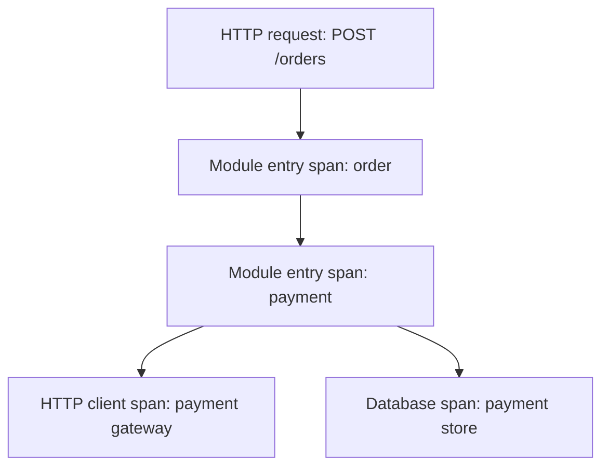
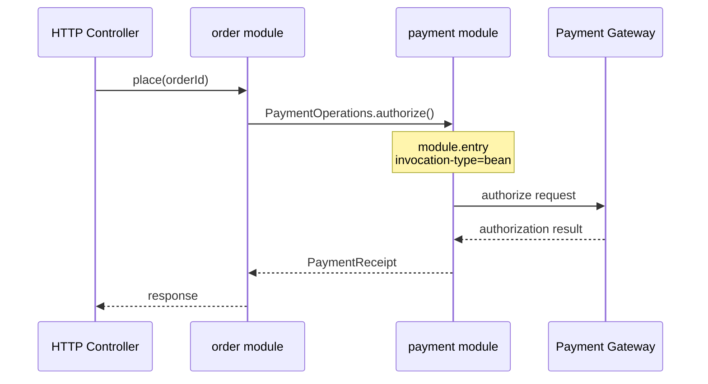
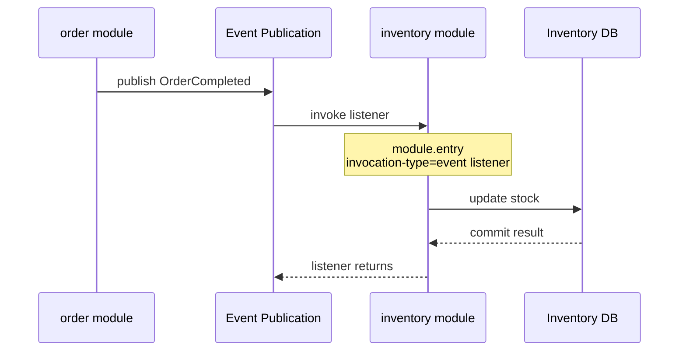

# Document module span và invocation type

## 1. Mục đích của tài liệu module span

Trong chương **Tài liệu vận hành** của học phần **SPRING_MODULITH_DOCUMENTATION_OBSERVABILITY**, chúng ta học cách ghi nhận và diễn giải module entry spans do Spring Modulith tạo ra. Một trace có thể chứa HTTP span, database span, message span và module span. Module span giúp người vận hành nhận ra thời điểm một lời gọi đi vào API của application module, module nào tiếp nhận lời gọi và lời gọi đó thuộc loại bean invocation hay event listener invocation.

Một tài liệu vận hành tốt cần trả lời được:

- Module nào đã được gọi?
- Lời gọi đi vào module qua Spring bean hay event listener?
- Method nào được thực thi?
- Span thuộc trace nào, có parent/child span nào?
- Thời gian thực thi và trạng thái lỗi ra sao?
- Các thuộc tính nào có thể dùng để lọc trace, và thuộc tính nào không nên đưa vào metric label?
- Khi span bị thiếu hoặc sai loại invocation, cần kiểm tra ở đâu?

Bài này tập trung vào **module entry span** và thuộc tính `module.invocation-type`. Các ví dụ dùng module `order`, `payment` và `inventory` để minh họa cách viết hồ sơ span, đọc trace và xây dựng runbook.

**Mục tiêu học tập**

1. Hiểu module entry span được tạo ở ranh giới nào.
2. Phân biệt `module.identifier`, `module.name`, `module.method` và `module.invocation-type`.
3. Diễn giải hai loại invocation: `bean` và `event listener`.
4. Phân biệt invocation type trong trace với dependency type trong module graph.
5. Ghi tài liệu vận hành cho bean invocation và event listener invocation.
6. Dùng module attributes để lọc trace và truy nguyên lời gọi giữa các module.
7. Nhận biết giới hạn của instrumentation, cardinality và xử lý bất đồng bộ.
8. Chuẩn hóa quy trình kiểm tra khi module span bị thiếu, sai thuộc tính hoặc có lỗi.

## 2. Module entry span là gì?

Spring Modulith có thể quan sát tương tác giữa application modules bằng Micrometer Observation. Khi bật observability support, các Spring component thuộc **API của application module** được trang bị interceptor để ghi nhận lời gọi đi vào module. Observation tương ứng có thể được chuyển thành span trong distributed trace khi ứng dụng đã cấu hình Micrometer Tracing và exporter/backend phù hợp.

Ví dụ, module `order` gọi một Spring bean được expose bởi module `payment`. Trace có thể có cấu trúc:



Module entry span giúp xác định **ranh giới lời gọi vào module**. Nó không phải một span cho từng dòng code, từng private method hoặc mọi thao tác nội bộ. Một module có nhiều component nội bộ nhưng chỉ các component thuộc API được Spring Modulith quan sát theo cơ chế module entry.

### 2.1. Phạm vi instrumentation

Cần kiểm tra component có thực sự thuộc API của module hay không. Spring Modulith xem xét cấu trúc package và các API package/named interface đã khai báo. Một Spring bean nội bộ không được expose có thể không tạo module entry span khi module khác gọi trực tiếp tới nó.

Ví dụ cấu trúc package:

```text
com.acme.shop
├── order
│   ├── api
│   │   └── OrderService.java
│   └── internal
│       └── OrderRepositoryAdapter.java
├── payment
│   ├── api
│   │   └── PaymentOperations.java
│   └── internal
│       └── GatewayClient.java
└── inventory
    ├── api
    │   └── InventoryOperations.java
    └── internal
        └── StockRepository.java
```

Khi `OrderService` gọi `PaymentOperations` qua API đã expose, lời gọi vào payment có thể được ghi nhận bằng module entry span. Nếu code bên ngoài truy cập thẳng một class nội bộ không thuộc API, đó là dấu hiệu cần xem lại ranh giới module và phạm vi instrumentation.

**Không dùng số lượng module spans để suy ra tổng số method đã chạy.** Một trace phản ánh những điểm vào module được instrument, không phải call graph đầy đủ của mọi method trong JVM.

### 2.2. Điều kiện để quan sát được span

Để module entry span xuất hiện trong trace, cần các điều kiện chính:

1. Ứng dụng có Spring Modulith observability support.
2. Component được gọi là Spring bean và thuộc API module được nhận diện.
3. Lời gọi thực sự đi qua Spring-managed proxy/interceptor.
4. Observation registry và Micrometer Tracing được cấu hình.
5. Tracing exporter gửi span tới backend và trace được lưu theo sampling/retention policy.

Có thể dùng `spring-modulith-starter-insight` để bật đồng thời hỗ trợ Actuator và observability của Spring Modulith. Nếu chỉ cần instrumentation, dùng `spring-modulith-observability-core` ở runtime. Các dependency tracing/exporter và backend vẫn phải được cấu hình theo nền tảng quan sát của ứng dụng.

## 3. Bốn thuộc tính cần ghi trong tài liệu vận hành

Spring Modulith định nghĩa bốn tag keys cho module entry span:

| Attribute | Ý nghĩa | Cách sử dụng |
| --- | --- | --- |
| `module.identifier` | Technical identifier của application module | Lọc module ổn định, đối chiếu với module graph |
| `module.name` | Tên hiển thị dễ đọc của module | Hiển thị trong trace và báo cáo |
| `module.invocation-type` | Loại lời gọi đi vào module | Phân biệt bean invocation với event listener invocation |
| `module.method` | Method được thực thi trong module | Xác định entry method cần điều tra |

### 3.1. module.identifier

`module.identifier` là định danh kỹ thuật của module. Ví dụ `payment` hoặc `inventory`. Đây là thuộc tính nên dùng làm khóa lọc và liên kết với module graph.

Hãy ghi nhận technical identifier theo đúng giá trị trace đang xuất. Không tự đổi thành display name, tên package hoặc tên service. Khi đổi tên module, cần cập nhật tài liệu vận hành và dashboard filter tương ứng.

### 3.2. module.name

`module.name` là tên hiển thị dễ đọc của module, ví dụ `Payment` hoặc `Inventory Management`. Tên hiển thị giúp người đọc dashboard nhận diện module nhanh hơn, trong khi `module.identifier` thích hợp cho việc đối chiếu kỹ thuật.

Không giả định hai giá trị này luôn giống nhau. Một module có technical identifier là `payment` nhưng display name có thể là `Payment Processing`.

### 3.3. module.invocation-type

`module.invocation-type` mô tả cách module được gọi tại điểm vào. Tài liệu Spring Modulith mô tả hai trường hợp:

- `bean`: lời gọi đi vào một Spring bean thuộc API của module.
- `event listener`: lời gọi đi vào method xử lý application event của module.

Thuộc tính này giúp phân biệt hai đường tích hợp khác nhau. Khi thấy `bean`, hãy tìm caller và method API được gọi. Khi thấy `event listener`, hãy tìm event type, publisher, listener method và trạng thái xử lý event.

Tên hiển thị trong backend có thể chịu ảnh hưởng bởi convention hoặc exporter. Khi xây dựng filter, dashboard hay alert, hãy kiểm tra giá trị thực tế được xuất ra thay vì giả định cách viết hoa, dấu gạch nối hoặc cách chuẩn hóa chuỗi.

### 3.4. module.method

`module.method` ghi lại method được thực thi tại điểm vào module. Ví dụ `authorize`, `reserveStock` hoặc `onOrderCompleted`.

Trong API Micrometer, `MODULE_METHOD` thuộc nhóm **high-cardinality key**. Tên method có thể tăng khi code phát triển hoặc có nhiều entry method. Vì vậy:

- Dùng `module.method` để đọc trace, lọc điều tra hoặc hiển thị span detail.
- Không thêm method name vào metric label nếu không có giới hạn cardinality rõ ràng.
- Không ghép method name với request ID, order ID, user ID hoặc payload để tạo metric dimension.
- Dùng các thuộc tính ít biến động như module identifier và invocation type cho thống kê tổng hợp.

Ba thuộc tính `module.identifier`, `module.name` và `module.invocation-type` là low-cardinality keys trong định nghĩa observation; `module.method` là high-cardinality key. Đây là khác biệt quan trọng khi thiết kế dashboard và metric.

## 4. Phân biệt bean invocation và event listener invocation

Hai loại invocation có ý nghĩa vận hành khác nhau.

| Nội dung | Bean invocation | Event listener invocation |
| --- | --- | --- |
| Giá trị invocation type | `bean` | `event listener` |
| Điểm vào | Method của Spring bean thuộc API module | Method listener xử lý application event |
| Caller trực tiếp | Component hoặc module gọi bean API | Event publisher / event multicaster / event processing mechanism |
| Dấu vết cần ghi | Caller module, API bean, method | Event type, publisher module, listener module, listener method |
| Câu hỏi điều tra | Vì sao module khác gọi API này? | Event nào kích hoạt listener và listener có xử lý thành công không? |
| Bằng chứng bổ sung | Parent span và child spans của bean | Event publication registry, event type, listener logs và trace |

### 4.1. Bean invocation

Bean invocation xảy ra khi một component đi vào API module thông qua Spring bean. Ví dụ module order gọi `PaymentOperations.authorize` của module payment:

```java
package com.acme.shop.payment.api;

import org.springframework.stereotype.Service;

@Service
public class PaymentOperations {

    public PaymentReceipt authorize(OrderId orderId) {
        // Thực hiện authorization với payment provider.
        return new PaymentReceipt(orderId, true);
    }
}
```

Caller ở module order:

```java
package com.acme.shop.order;

import com.acme.shop.payment.api.PaymentOperations;
import org.springframework.stereotype.Service;

@Service
public class OrderService {

    private final PaymentOperations paymentOperations;

    public OrderService(PaymentOperations paymentOperations) {
        this.paymentOperations = paymentOperations;
    }

    public void place(OrderId orderId) {
        paymentOperations.authorize(orderId);
    }
}
```

Đây là ví dụ minh họa. Để được quan sát như module entry, `PaymentOperations` phải là Spring bean được expose trong API của module payment và lời gọi phải đi qua cơ chế Spring-managed invocation.

Hồ sơ span có thể ghi:

| Trường tài liệu | Giá trị minh họa |
| --- | --- |
| Module identifier | `payment` |
| Module name | `Payment` |
| Invocation type | `bean` |
| Module method | `authorize` |
| Caller module | `order` |
| Nghiệp vụ | Authorize payment cho order |
| Child spans cần xem | HTTP client tới payment provider, database nếu có |

### 4.2. Event listener invocation

Event listener invocation xảy ra khi module nhận application event và listener method được thực thi. Ví dụ module inventory xử lý event `OrderCompleted`:

```java
package com.acme.shop.inventory;

import com.acme.shop.order.events.OrderCompleted;
import org.springframework.modulith.events.ApplicationModuleListener;
import org.springframework.stereotype.Component;

@Component
public class InventoryManagement {

    @ApplicationModuleListener
    void on(OrderCompleted event) {
        // Cập nhật hoặc giải phóng tồn kho theo nghiệp vụ.
    }
}
```

Trong trace, module entry span của inventory có thể được ghi với:
- `module.identifier` = `inventory`.
- `module.name` = `Inventory`.
- `module.invocation-type` = `event listener`.
- `module.method` = `on`.

Khi điều tra event listener, method name `on` chưa đủ để xác định event type. Cần đối chiếu listener signature, event class, publisher và event publication record. Nếu nhiều listener cùng dùng method name `on`, hãy dựa vào module identifier, event type và trace/log context để phân biệt.

### 4.3. Không nhầm invocation type với dependency type

Module graph và module entry span mô tả hai lớp khác nhau:

| Khái niệm | Ví dụ | Ý nghĩa |
| --- | --- | --- |
| Dependency type trong module graph | `USES_COMPONENT` | Module có quan hệ phụ thuộc qua Spring component |
| Dependency type trong module graph | `EVENT_LISTENER` | Module phụ thuộc module khác thông qua event listener |
| Invocation type trong span | `bean` | Lần thực thi cụ thể đi vào bean API |
| Invocation type trong span | `event listener` | Lần thực thi cụ thể đi vào listener method |

Dependency type mô tả **quan hệ kiến trúc** được phát hiện từ code. Invocation type mô tả **đường thực thi tại runtime** của một module entry span. Một module graph có thể cho biết module order có dependency tới payment; trace cho biết request cụ thể đã đi vào payment bằng bean invocation nào.

## 5. Ví dụ trace và cách đọc

### 5.1. Luồng đồng bộ qua bean API



Khi đọc trace:
1. Tìm HTTP server span của request.
2. Tìm module entry span của order nếu entry point đó được instrument.
3. Tìm span của payment với `module.identifier=payment`.
4. Xác nhận `module.invocation-type` là `bean`.
5. Đọc `module.method` để xác định entry method.
6. Kiểm tra child spans của payment để biết thời gian nằm ở HTTP client, database hay logic đồng bộ.

### 5.2. Luồng event listener



Khi đọc trace:
1. Xác định event được publish ở module nào.
2. Xác định listener thuộc module nào.
3. Kiểm tra invocation type là event listener.
4. Đối chiếu listener method và event type.
5. Kiểm tra span database hoặc downstream call bên trong listener.
6. Nếu listener bất đồng bộ, kiểm tra trace context và event publication status để hiểu đầy đủ kết quả xử lý.

### 5.3. Ví dụ cây span rút gọn

```text
Trace: HTTP POST /orders
└── order / place
    └── payment / authorize
        attributes:
          module.identifier = payment
          module.name = Payment
          module.invocation-type = bean
          module.method = authorize
        ├── HTTP client / POST payment-provider
        └── database / insert payment-record
```

Ví dụ listener riêng:

```text
Trace: OrderCompleted event
└── inventory / on
    attributes:
      module.identifier = inventory
      module.name = Inventory
      module.invocation-type = event listener
      module.method = on
    └── database / update stock
```

Tên span thực tế phụ thuộc observation convention và tracing backend. Khi viết runbook, ưu tiên ghi các attributes ổn định cùng span name quan sát được ở môi trường triển khai. Không coi ví dụ trên là tên span bắt buộc.

## 6. Ghi tài liệu vận hành cho mỗi module entry span

Một hồ sơ span nên mô tả cả ngữ nghĩa nghiệp vụ và cách tra cứu kỹ thuật. Có thể dùng mẫu sau trong runbook, catalog vận hành hoặc trang tài liệu module.

### 6.1. Mẫu hồ sơ

| Trường | Nội dung cần ghi |
| --- | --- |
| Module identifier | Technical identifier chính xác từ span |
| Module display name | Tên hiển thị của module |
| Entry point | Bean API hoặc event listener |
| Invocation type | `bean` hoặc `event listener` theo trace thực tế |
| Method | Giá trị `module.method` |
| Caller / publisher | Module hoặc component khởi phát lời gọi |
| Event type | Bắt buộc ghi nếu invocation là event listener |
| Business purpose | Mục đích nghiệp vụ của entry point |
| Expected parent | HTTP, message, scheduler hoặc module span nào |
| Expected child spans | Database, HTTP client, messaging hoặc module span con |
| Success signal | Kết quả nghiệp vụ hoặc trạng thái publication mong đợi |
| Failure signal | Error status, exception category hoặc failed publication |
| Dashboard / trace query | Link dashboard và cách lọc theo module attributes |
| Owner | Nhóm chịu trách nhiệm vận hành module |

### 6.2. Hồ sơ minh họa: Payment bean entry

```text
Module: payment
Display name: Payment
Entry kind: Spring bean API
Invocation type: bean
Method: authorize
Caller module: order
Business purpose: Authorize payment for an order
Expected parent: order module entry span
Expected child spans:
  - HTTP client call to payment provider
  - database write for payment attempt
Success:
  - payment authorization result accepted
Failure:
  - provider timeout / provider rejection / database error
Trace filters:
  - module.identifier = payment
  - module.invocation-type = bean
Owner: Payment team
```

### 6.3. Hồ sơ minh họa: Inventory event listener

```text
Module: inventory
Display name: Inventory
Entry kind: Application module listener
Invocation type: event listener
Method: on
Event type: OrderCompleted
Publisher module: order
Business purpose: Update inventory after order completion
Expected parent: event publication / event processing context
Expected child spans:
  - inventory database update
  - optional warehouse API call
Success:
  - listener completes and publication is marked completed
Failure:
  - listener exception / publication remains failed or incomplete
Trace filters:
  - module.identifier = inventory
  - module.invocation-type = event listener
Owner: Inventory team
```

Đây là hồ sơ mẫu. Trong hệ thống thực, thay event type, parent span, child spans, owner và success/failure criteria bằng dữ liệu của ứng dụng. Không ghi một dependency là bắt buộc nếu module có fallback hoặc luồng xử lý khác.

## 7. Cấu hình observability support

### 7.1. Dùng Spring Modulith Insight starter

Với dự án muốn bật cả module actuator và observability support, có thể thêm starter Insight:

```groovy
dependencies {
    runtimeOnly "org.springframework.modulith:spring-modulith-starter-insight"
}
```

Dùng Spring Modulith BOM để quản lý version tương thích với Spring Boot. Starter Insight bao gồm hỗ trợ Actuator và module observability. Ứng dụng vẫn cần dependency tracing/exporter phù hợp để đưa Micrometer spans tới backend như OpenTelemetry Collector, Zipkin hoặc Grafana Tempo.

Nếu chỉ cần module entry spans mà không cần actuator, có thể khai báo:

```groovy
dependencies {
    runtimeOnly "org.springframework.modulith:spring-modulith-observability-core"
}
```

Không cần khai báo cả hai cách nếu starter Insight đã đưa observability core vào dependency graph.

### 7.2. Cấu hình convention

Spring Modulith sử dụng `ModulithObservationConvention` để tạo observation name và key values. Ứng dụng có thể cung cấp bean convention riêng khi cần tùy chỉnh metadata:

```java
import org.springframework.context.annotation.Bean;
import org.springframework.context.annotation.Configuration;
import org.springframework.modulith.observability.ModulithObservationConvention;

@Configuration
class ObservabilityConfiguration {

    @Bean
    ModulithObservationConvention modulithObservationConvention() {
        return new CustomModulithObservationConvention();
    }
}
```

`CustomModulithObservationConvention` là class do ứng dụng triển khai. Đây là điểm mở rộng để chuẩn hóa observation theo quy ước nội bộ. Khi tùy chỉnh:
- Giữ lại các module attributes cần thiết cho vận hành.
- Không xóa `module.identifier` nếu dashboard và trace filter dựa vào nó.
- Giữ `module.invocation-type` để phân biệt bean và event listener.
- Không thêm dữ liệu nhạy cảm vào span attributes.
- Tránh biến method, user ID hoặc request ID thành metric dimensions.

Nếu chỉ cần ghi thêm context cho trace, hãy ưu tiên convention phù hợp thay vì tự tạo span trùng với module entry span.

### 7.3. Kiểm tra module spans trong backend

Sau khi bật dependency và tracing exporter:
1. Gọi một API bean thuộc module từ module khác.
2. Publish một domain event có listener thuộc module khác.
3. Tìm trace tương ứng trong backend.
4. Xác nhận module entry spans xuất hiện.
5. Kiểm tra bốn attributes của span.
6. Xác nhận child spans bên trong module có `module.identifier` nếu observation filter đang propagate thuộc tính đó.

Spring Modulith có `ModuleIdentifierPassingObservationFilter` để chuyển `module.identifier` từ parent observation sang child observation. Điều này giúp trace backend nhóm được các thao tác HTTP/database theo module đang thực hiện.

## 8. Đọc module span trong quy trình điều tra

### 8.1. Tìm module có thời gian xử lý cao

Khi người dùng báo request chậm:
1. Tìm trace ID từ log hoặc exemplar.
2. Mở trace và xác định module entry span.
3. Lọc theo `module.identifier` để tìm module liên quan.
4. Đọc `module.invocation-type` để xác định đường bean hay event listener.
5. Đọc `module.method` để biết entry method.
6. So sánh duration của module span với child spans.
7. Xác định phần thời gian nằm trong module logic hay dependency ngoài.

Không kết luận module chậm chỉ vì module span có duration lớn. Span có thể bao gồm thời gian chờ child span, lock, transaction hoặc xử lý đồng bộ bên trong module. Hãy xem span tree và timeline trước khi kết luận.

### 8.2. Điều tra event listener lỗi

Nếu event listener thất bại:
- Tìm span có `module.invocation-type` là event listener.
- Xác định module identifier và listener method.
- Đối chiếu event type từ listener signature hoặc event publication record.
- Kiểm tra error status và exception.
- Kiểm tra event publication status nếu ứng dụng dùng Event Publication Registry.
- Xác minh retry/resubmission có tạo một lần xử lý mới hay không.

Module span cho biết listener invocation đã được quan sát; Event Publication Registry cho biết trạng thái publication theo cơ chế lưu trữ. Hai dữ liệu này bổ sung nhau. Không suy ra publication đã hoàn tất chỉ từ việc thấy span kết thúc.

### 8.3. Điều tra lỗi bean invocation

Nếu lời gọi bean thất bại:
- Xác định caller module và target module.
- Kiểm tra `module.invocation-type` có phải `bean`.
- Xác định method qua `module.method`.
- Kiểm tra span status và child span lỗi.
- So sánh với dependency tĩnh trong module graph.
- Kiểm tra contract/API thay đổi nếu lỗi bắt đầu sau một lần deploy.

Một bean invocation thành công không chứng minh toàn bộ module khỏe mạnh; nó chỉ xác nhận lần gọi cụ thể đã hoàn tất theo trạng thái trace ghi nhận.

## 9. Giới hạn khi đọc span và invocation type

### 9.1. Span không phải module graph

Module graph là mô hình dependency tĩnh được phát hiện từ package, bean và event listener. Module span là bản ghi runtime của một lần đi vào module. Một dependency có trong module graph có thể chưa được gọi trong trace đang xem; một trace chỉ thể hiện những đường thực thi thực sự được ghi nhận.

### 9.2. Không phải mọi method đều có module span

Instrumentation tập trung vào Spring component thuộc API module. Các method nội bộ, private method hoặc helper method không mặc nhiên tạo module entry span riêng. Muốn đo một thao tác nội bộ đặc biệt, cần instrumentation phù hợp trong ứng dụng hoặc các span con từ library.

### 9.3. Bất đồng bộ và reactive

Với event listener bất đồng bộ, cần phân biệt thời điểm event được publish với thời điểm listener thực sự chạy. Listener có thể được thực thi trên thread khác hoặc trong transaction riêng. Hãy kiểm tra trace context propagation và event publication status khi trace bị tách.

Với method trả về publisher như `Mono` hoặc `Flux`, không mặc nhiên giả định span bao trùm toàn bộ thời gian xử lý reactive. Thời điểm method trả publisher có thể khác thời điểm pipeline subscribe và kết thúc. Cần kiểm tra integration/version cụ thể và dùng instrumentation reactive-aware nếu muốn đo toàn bộ lifecycle.

### 9.4. Invocation type không phải kết quả nghiệp vụ

`bean` chỉ cho biết lời gọi đi vào bean API. `event listener` chỉ cho biết lời gọi đi vào listener method. Cả hai không khẳng định nghiệp vụ thành công. Hãy đọc span status, exception, kết quả nghiệp vụ và publication status tương ứng.

### 9.5. Không dùng module.method làm metric label

`module.method` thuộc nhóm high-cardinality key. Dùng nó trong trace search hoặc span detail. Với metrics, ưu tiên module identifier, invocation type, service hoặc các dimension có tập giá trị hữu hạn. Không đưa request ID, order ID, email hay customer ID vào metric labels.

## 10. Troubleshooting module span và invocation type

| Triệu chứng | Nguyên nhân có thể | Cách kiểm tra |
| --- | --- | --- |
| Không có module entry span | Thiếu observability dependency hoặc component không thuộc API module | Kiểm tra Insight/observability core, API package và Spring bean |
| Chỉ có HTTP span, không có module span | Lời gọi không đi qua API component được instrument | Kiểm tra caller có gọi public module API hay truy cập class nội bộ |
| Span có module identifier nhưng thiếu module name | Convention hoặc exporter không giữ đủ attributes | Kiểm tra ObservationConvention và span attributes trước/sau export |
| Invocation type là bean trong khi mong đợi event listener | Method không được nhận diện là listener invocation hoặc gọi trực tiếp bean method | Kiểm tra annotation listener và đường gọi thực tế |
| Invocation type là event listener nhưng không rõ event nào | Span attributes không bao gồm event type | Kiểm tra listener signature, publisher log và event publication record |
| module.method không xuất hiện | High-cardinality attributes bị backend lọc hoặc exporter không giữ | Kiểm tra raw span attributes và exporter configuration |
| Child span không có module identifier | Observation filter không hoạt động hoặc context bị ngắt | Kiểm tra ModuleIdentifierPassingObservationFilter, observation nesting và async context propagation |
| Module span duration rất ngắn | Method trả về publisher/future trước khi công việc kết thúc hoặc span chỉ bao quanh phần đồng bộ | Kiểm tra subscription/terminal signal và reactive instrumentation |
| Trace không có parent mong đợi | Context propagation bị mất hoặc công việc chạy ở subscription/trace mới | Kiểm tra trace context qua executor, Reactor hoặc event handoff |
| Span kết thúc nhưng event vẫn pending | Span lifecycle không tương đương Event Publication Registry completion | Kiểm tra publication status và listener transaction |
| Có nhiều span giống nhau | Nhiều điểm vào API được gọi hoặc instrumentation tùy chỉnh tạo span trùng | Kiểm tra call graph và convention/custom observation |
| Filter dashboard không tìm được module | Dùng display name thay technical identifier hoặc label key sai | Dùng chính xác module.identifier và kiểm tra raw span |

## 11. Runbook kiểm tra một module entry span

Khi nhận một trace cần điều tra, dùng quy trình sau.

### Bước 1: Xác định trace

- Ghi trace ID, service, môi trường và thời gian.
- Xác nhận trace nằm trong khoảng retention.
- Xác định request hoặc event đã khởi phát trace.

### Bước 2: Tìm module entry

- Tìm span có `module.identifier` tương ứng.
- Ghi `module.name`.
- Ghi `module.invocation-type`.
- Ghi `module.method`.

### Bước 3: Xác định đường invocation

Nếu invocation type là `bean`:
- Xác định caller module.
- Xác định API bean được gọi.
- Kiểm tra parent span và downstream spans.

Nếu invocation type là `event listener`:
- Xác định event type.
- Xác định publisher module.
- Xác định listener method và publication status.
- Kiểm tra async/transaction boundary.

### Bước 4: Đọc thời gian và lỗi

- Ghi start time, end time và duration.
- Kiểm tra span status và exception.
- Xác định child span chiếm nhiều thời gian nhất.
- So sánh với baseline latency của module.

### Bước 5: Kết luận và cập nhật hồ sơ

Ghi lại:
- Module và invocation type.
- Entry method.
- Caller hoặc event publisher.
- Dependency gây chậm hoặc lỗi.
- Trace ID tham chiếu.
- Cách khôi phục và nhóm chịu trách nhiệm.
- Dashboard, alert hoặc log query cần dùng trong lần sau.

Không chèn dữ liệu nhạy cảm vào tài liệu runbook. Trace ID có thể được lưu như ví dụ sự cố nội bộ nếu chính sách retention và quyền truy cập cho phép; với tài liệu lâu dài, dùng trace ID đã ẩn danh hoặc ví dụ giả lập.

## 12. Checklist tài liệu hóa module spans

Trước khi đưa module span vào tài liệu vận hành, hãy xác nhận:

- [ ] Module identifier và display name khớp với module thực tế.
- [ ] Entry point được expose trong API module.
- [ ] Invocation type được ghi đúng theo trace backend.
- [ ] Method name khớp với method thực thi.
- [ ] Với event listener, event type và publisher đã được ghi.
- [ ] Parent span và child spans mong đợi đã được xác nhận bằng trace thật.
- [ ] Error status và publication status được diễn giải riêng.
- [ ] Không dùng high-cardinality method attribute làm metric label.
- [ ] Không đưa dữ liệu nhạy cảm vào span attributes.
- [ ] Dashboard filter và runbook query dùng đúng key.
- [ ] Tài liệu nêu rõ phiên bản Spring Modulith/Spring Boot đã kiểm chứng.

## 13. Bài tập thực hành

Một ứng dụng có ba module `order`, `payment` và `inventory`. Trace của một request đặt hàng có các span:
- HTTP server span cho `POST /orders`.
- Module span có `module.identifier=payment`, `module.name=Payment`, `module.invocation-type=bean`, `module.method=authorize`.
- HTTP client span gọi payment gateway.
- Sau đó một event `OrderCompleted` được publish.
- Module span khác có `module.identifier=inventory`, `module.invocation-type=event listener`, `module.method=on`.
- Database span bên trong inventory listener.

**Yêu cầu**

1. Ghi hồ sơ vận hành cho module span payment.
2. Ghi hồ sơ vận hành cho module span inventory.
3. Giải thích vì sao hai module span có invocation type khác nhau.
4. Xác định attribute nào thích hợp để lọc module và attribute nào có cardinality cao.
5. Nêu các kiểm tra cần làm nếu payment span có duration 1,5 giây nhưng HTTP client child span chỉ 200 ms.
6. Nêu các kiểm tra cần làm nếu inventory listener span kết thúc nhưng event publication vẫn chưa completed.
7. Giải thích vì sao module graph có dependency giữa order và inventory nhưng trace của request khác có thể không xuất hiện inventory span.

**Gợi ý đáp án**

1. Payment có technical identifier `payment`, display name `Payment`, invocation type `bean` và method `authorize`. Caller là order; child span quan trọng là HTTP client tới payment gateway.
2. Inventory có identifier `inventory`, invocation type `event listener` và method `on`. Event type là `OrderCompleted`, publisher là order; child span là database update.
3. Payment được gọi trực tiếp qua Spring bean API; inventory được gọi thông qua application event listener.
4. Dùng `module.identifier`, `module.name` và `module.invocation-type` để lọc. `module.method` là high-cardinality key, nên dùng trong trace search thay vì metric labels.
5. Kiểm tra thời gian logic đồng bộ ngoài HTTP child span, transaction, lock, scheduler, retry hoặc khoảng chờ khác trong module span.
6. Kiểm tra listener exception, transaction commit, publication registry, trạng thái PROCESSING/FAILED và cơ chế retry/resubmission.
7. Module graph mô tả dependency tĩnh; inventory chỉ xuất hiện trong trace khi đường thực thi đó thực sự phát event và listener được gọi.

## 14. Ghi nhớ

**Module entry span là bằng chứng runtime cho một lần đi vào API của application module.** Bốn thuộc tính cần ghi là `module.identifier`, `module.name`, `module.invocation-type` và `module.method`. Invocation type phân biệt `bean` với `event listener`; method xác định entry point cụ thể.

Khi viết tài liệu vận hành, hãy ghi cả module, entry method, caller hoặc event publisher, parent/child spans, success/failure signals và cách truy vấn trace. Dùng low-cardinality attributes để lọc và thống kê; giữ `module.method` ở trace detail vì đây là high-cardinality key. Phân biệt module graph với trace runtime, và phân biệt span completion với kết quả nghiệp vụ hoặc event publication completion.

## Tài liệu tham khảo

1. [Spring Modulith – Production-ready Features](https://docs.spring.io/spring-modulith/reference/production-ready.html): observability support, module entry spans, tag keys và event metrics.
2. [Spring Modulith – ObservedModule API](https://docs.spring.io/spring-modulith/docs/current/api/org/springframework/modulith/observability/ObservedModule.html): xác định module, display name, invoked method và event listener invocation.
3. [Spring Modulith – ModulithObservations.LowKeys API](https://docs.spring.io/spring-modulith/docs/current/api/org/springframework/modulith/observability/ModulithObservations.LowKeys.html): các low-cardinality observation keys.
4. [Spring Modulith – ModulithObservations.HighKeys API](https://docs.spring.io/spring-modulith/docs/current/api/org/springframework/modulith/observability/ModulithObservations.HighKeys.html): high-cardinality key `module.method`.
5. [Spring Modulith – Observability Support Package](https://docs.spring.io/spring-modulith/docs/current/api/org/springframework/modulith/observability/support/package-summary.html): ModuleEntryInterceptor, ModuleObservabilityBeanPostProcessor và ModuleIdentifierPassingObservationFilter.
6. [Spring Modulith – Working with Application Events](https://docs.spring.io/spring-modulith/reference/events.html): ApplicationModuleListener, Event Publication Registry và publication lifecycle.
7. [Spring Boot – Observability](https://docs.spring.io/spring-boot/reference/actuator/observability.html): Observation, Micrometer Tracing và kết nối backend tracing.
