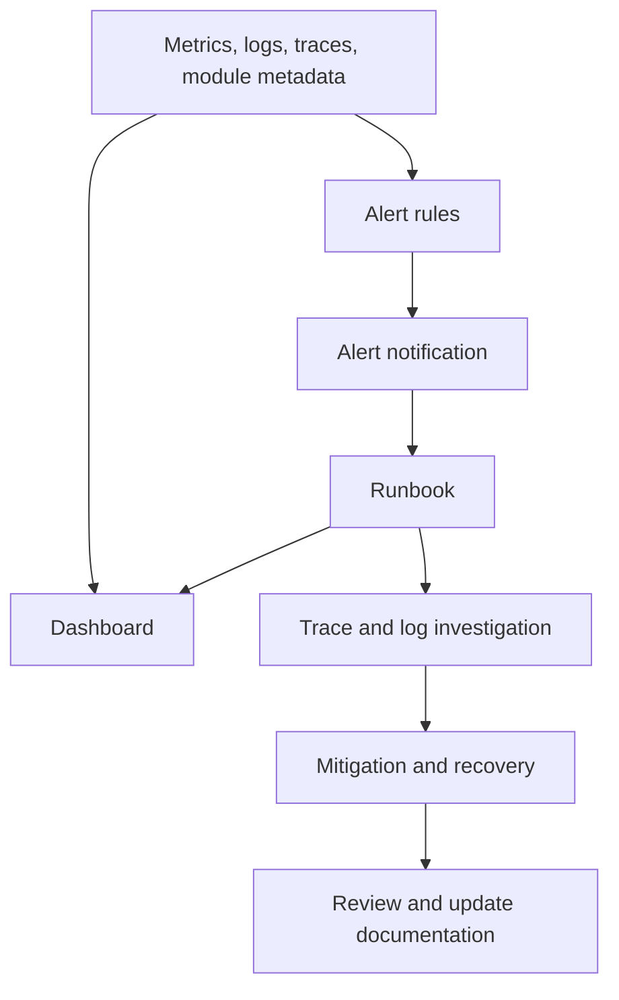

# Document dashboard, alert và runbook cho Spring Modulith

## 1. Vì sao cần tài liệu vận hành?

Một ứng dụng Spring Boot được tổ chức bằng **Spring Modulith** có thể chạy như một modular monolith: các module nghiệp vụ như `orders`, `inventory`, `payments` và `notifications` cùng triển khai trong một service, nhưng có ranh giới và trách nhiệm riêng. Khi hệ thống vận hành, nhóm phát triển cần hiểu module nào đang hoạt động, module nào phát sinh lỗi hoặc chậm, event được publish ra sao và cần làm gì khi cảnh báo xuất hiện.

Metrics, logs và traces cung cấp dữ liệu; **dashboard, alert và runbook biến dữ liệu thành cách làm việc nhất quán**:

- Dashboard giúp quan sát xu hướng và khoanh vùng vấn đề.
- Alert thông báo khi một triệu chứng vượt ngưỡng cần hành động.
- Runbook hướng dẫn người trực xác minh, điều tra, giảm tác động và khôi phục dịch vụ.

Tài liệu cần phản ánh đúng cấu trúc và hành vi runtime của ứng dụng. Với Spring Modulith, điều này có nghĩa phải dùng cùng technical module identifier giữa module graph, module entry spans, metrics và log fields; đồng thời giải thích rõ giới hạn của từng tín hiệu.

## 2. Ba loại tài liệu tạo thành một quy trình vận hành

| Tài liệu | Câu hỏi chính | Nội dung cần có |
| --- | --- | --- |
| **Dashboard** | Hệ thống đang hoạt động thế nào? | SLI/SLO, traffic, errors, duration, event activity, saturation, bộ lọc và liên kết |
| **Alert** | Khi nào cần chú ý hoặc hành động? | Điều kiện, ngưỡng, cửa sổ đánh giá, thời gian chờ, severity, người nhận và liên kết |
| **Runbook** | Khi alert xảy ra thì làm gì? | Xác minh, đánh giá ảnh hưởng, các bước điều tra, biện pháp giảm tác động, escalation và tiêu chí đóng sự cố |

Một alert tốt trỏ tới dashboard liên quan và runbook phù hợp. Dashboard cũng nên có đường dẫn tới trace backend, log search và module metadata. Nhờ vậy, người trực có thể đi từ tín hiệu tổng hợp tới một lần thực thi cụ thể mà không phải tự đoán nơi cần tìm.



## 3. Chuẩn hóa định danh module trước khi viết dashboard

Spring Modulith có thể expose cấu trúc module qua Actuator endpoint `/actuator/modulith` và instrument các Spring component thuộc API của module để tạo Micrometer spans. Module entry span có các tag:

| Tag | Ý nghĩa |
| --- | --- |
| `module.identifier` | Technical identifier của module, ví dụ `orders` |
| `module.name` | Tên hiển thị của module |
| `module.invocation-type` | Kiểu invocation, ví dụ `bean` hoặc `event listener` |
| `module.method` | Method được gọi trên module |

Dùng technical identifier làm khóa xuyên suốt trong tài liệu. Ví dụ, dashboard chọn `module.identifier=orders`, trace hiển thị `module.identifier=orders`, runbook cũng gọi đúng module đó là `orders`.

Không dùng display name làm khóa nếu nó có thể thay đổi theo cách trình bày. Không suy ra module từ package string trong dashboard. Đối chiếu module identifier với module metadata của đúng phiên bản ứng dụng đang chạy.

Spring Modulith 2.2 cung cấp Insight starter để bật Actuator và observability support:

```xml
<dependency>
    <groupId>org.springframework.modulith</groupId>
    <artifactId>spring-modulith-starter-insight</artifactId>
    <scope>runtime</scope>
</dependency>
```

Ứng dụng vẫn cần registry/exporter phù hợp để đưa metrics tới hệ thống monitoring và tracing backend để xuất spans. Quản lý version bằng Spring Modulith BOM tương thích với Spring Boot của dự án.

## 4. Xác minh dữ liệu trước khi ghi tài liệu

Không viết query hoặc alert dựa trên tên metric phỏng đoán. Trước khi tạo dashboard, xác nhận dữ liệu thực tế trong ứng dụng:

```bash
# Liệt kê các meter hiện có
curl -sS http://localhost:8080/actuator/metrics

# Xem meter module invocation theo tên Micrometer
curl -sS http://localhost:8080/actuator/metrics/module.invocations

# Lọc theo technical module identifier
curl -sS "http://localhost:8080/actuator/metrics/module.invocations?tag=module.identifier:orders"

# Xem Prometheus exposition
curl -sS http://localhost:8080/actuator/prometheus | grep module_invocations
```

Tên observation mặc định của `ModulithContext` là `module.invocations`. Spring Boot tự đăng ký `DefaultMeterObservationHandler` trên `ObservationRegistry`, tạo metrics cho các observation đã hoàn tất. Vì vậy, trong cấu hình Spring Boot thông thường, có thể dùng Timer của module invocation để xây dựng phân phối duration. Tuy nhiên, hãy kiểm tra registry và exposition thật: convention có thể được tùy chỉnh, metrics có thể bị filter hoặc registry có thể không được cấu hình như mong đợi.

Với Prometheus, tên meter thường được chuẩn hóa, ví dụ Timer `module.invocations` có thể xuất thành `module_invocations_seconds`, cùng các series histogram `_bucket`, `_count` và `_sum`. Tên label cũng có thể được chuẩn hóa, ví dụ `module.identifier` thành `module_identifier`. Hãy xác nhận trên endpoint thay vì giả định mọi naming convention giống nhau.

Nếu Timer đã tồn tại nhưng chưa có histogram hoặc bucket SLO, có thể cấu hình theo meter ID trong `application.yml`:

```yaml
management:
  metrics:
    distribution:
      percentiles-histogram:
        module.invocations: true
      slo:
        module.invocations: 100ms,250ms,500ms,1s,2s
  endpoints:
    web:
      exposure:
        include: health,metrics,prometheus,modulith
```

Ví dụ này giả định registry Prometheus và Spring Modulith Insight đã có trong runtime classpath. Chỉ expose các endpoint quản trị trên mạng được kiểm soát; bucket `500ms` phải xuất hiện trong exposition trước khi dùng query SLO ở phần sau.

Spring Modulith cũng cung cấp event counters như `module.events.published` và metric cho từng module/event type. Chúng đo hoạt động publish event; không tự chứng minh listener đã xử lý thành công hoặc hoàn tất. Nếu cần theo dõi consumer completion, backlog hay retry, cần thêm tín hiệu từ event publication registry, broker hoặc custom metrics tương ứng.

## 5. Thiết kế dashboard theo câu hỏi vận hành

Một dashboard tốt nên trả lời câu hỏi cụ thể và dẫn người xem từ tổng quan tới chi tiết. Có thể tổ chức thành bốn tầng.

### 5.1. Service overview

Bắt đầu với các tín hiệu gần trải nghiệm người dùng:

- **Rate:** số request/giây và số module invocation/giây.
- **Errors:** tỷ lệ request lỗi, số event publication lỗi hoặc listener failure nếu đã instrument.
- **Duration:** latency p50/p95/p99 của HTTP request và module invocation.
- **Saturation:** CPU, heap, GC, thread pool, connection pool, queue và tài nguyên liên quan.

Đây là cách tổ chức theo RED (Rate, Errors, Duration), bổ sung saturation để thấy khi tài nguyên gần giới hạn. Dashboard cấp service cần trả lời: người dùng có bị ảnh hưởng không, mức độ ảnh hưởng bao nhiêu và sự việc bắt đầu lúc nào?

### 5.2. Module overview

Một bảng tổng hợp theo module giúp so sánh các module trên cùng hệ thống:

| Module | Invocation rate | p95 duration | Error / failure | Event activity |
| --- | --- | --- | --- | --- |
| `orders` | Số invocation/giây | Độ trễ phần đuôi | Lỗi nếu có metric tương ứng | Event được publish |
| `inventory` | Số invocation/giây | Độ trễ phần đuôi | Lỗi nếu có metric tương ứng | Event được publish |
| `payments` | Số invocation/giây | Độ trễ phần đuôi | Lỗi nếu có metric tương ứng | Event được publish |
| `notifications` | Số invocation/giây | Độ trễ phần đuôi | Lỗi nếu có metric tương ứng | Event được publish |

Bảng này là khung dashboard; chỉ thêm cột khi metric tương ứng thực sự tồn tại. Không suy ra error rate của module từ duration Timer nếu Timer không có tag kết quả đáng tin cậy.

### 5.3. Module detail

Khi chọn một module, hiển thị:

- Invocation rate theo thời gian.
- p50, p95 và p99 duration.
- Tỷ lệ invocation đáp ứng ngưỡng SLO.
- Phân bố invocation theo `module.invocation-type` nếu chiều này hữu ích.
- Event publication rate theo event type.
- Trace gần thời điểm có bất thường.
- Resource metrics và downstream dependencies liên quan.

Không đưa `traceId`, `spanId`, order ID hoặc user ID thành metric label. Những giá trị này phù hợp với trace/log search; chúng tạo cardinality rất cao nếu dùng trong time series.

### 5.4. Dependency và event flow

Dùng module graph để trình bày dependency tĩnh và dùng trace để xem tương tác runtime. Hai góc nhìn bổ sung cho nhau:

| Nguồn | Dùng để trả lời |
| --- | --- |
| `/actuator/modulith` | Module nào tồn tại và dependency được nhận diện ở runtime? |
| `ApplicationModules.verify()` | Cấu trúc module có tuân thủ quy tắc kiến trúc không? |
| Module entry spans | Request thực tế đã đi qua module nào? |
| Event metrics | Module nào publish event và loại event nào xuất hiện? |
| Trace | Độ trễ hoặc lỗi nằm ở span/module/dependency nào? |

Không biến toàn bộ graph thành metric labels. Graph là dữ liệu cấu trúc; dashboard nên dùng nó như liên kết hoặc phần mô tả để điều hướng.

## 6. Ghi rõ metadata và cách đọc dashboard

Mỗi dashboard nên có phần mô tả ở đầu hoặc một Text panel với các thông tin:

| Trường | Ví dụ nội dung |
| --- | --- |
| Tên | Shop application — Module operations |
| Mục đích | Theo dõi traffic, latency và event activity theo application module |
| Phạm vi | Một service, một environment và các module được instrument |
| Owner | Nhóm chịu trách nhiệm duy trì dashboard |
| Data sources | Prometheus, trace backend và log backend |
| Variables | `environment`, `service`, `module_identifier`, `instance` |
| Refresh | Phù hợp với scrape interval và nhu cầu điều tra |
| SLO | Ngưỡng latency/error được nhóm thống nhất |
| Giới hạn | Module ít traffic có percentile dao động; async work có lifecycle riêng |
| Liên kết | Runbook, alert list, trace search và module metadata |

Mỗi panel cũng cần có tiêu đề, đơn vị, mô tả query và ý nghĩa của threshold. Ví dụ, panel p95 phải nói rõ đây là p95 trong cửa sổ 5 phút, đơn vị giây và được tổng hợp từ histogram buckets của những instance nào.

Nên dùng template variables để tái sử dụng dashboard cho nhiều environment hoặc module. Thiết kế drill-down từ service overview tới module detail, sau đó tới trace/log. Đừng tạo một dashboard bản sao cho mỗi module nếu chỉ khác một biến lọc.

## 7. Query mẫu cho module dashboard

Các query dưới đây giả định Prometheus exposition đã được xác nhận có series tương ứng và label `module_identifier`. Điều chỉnh tên metric/label theo kết quả thực tế.

### 7.1. Invocation rate theo module

```promql
sum by (module_identifier) (
  rate(module_invocations_seconds_count[5m])
)
```

Query trả số invocation mỗi giây theo module trong cửa sổ 5 phút.

### 7.2. p95 duration theo module

```promql
histogram_quantile(
  0.95,
  sum by (le, module_identifier) (
    rate(module_invocations_seconds_bucket[5m])
  )
)
```

Cần aggregate bucket theo `le` và module trước khi gọi `histogram_quantile()`. Không tính p95 từng instance rồi lấy trung bình các p95 đó.

### 7.3. Tỷ lệ invocation dưới 500 ms

Nếu histogram có bucket chính xác `le="0.5"`:

```promql
sum by (module_identifier) (
  rate(module_invocations_seconds_bucket{le="0.5"}[5m])
)
/
sum by (module_identifier) (
  rate(module_invocations_seconds_count[5m])
)
```

Query trả tỷ lệ invocation hoàn tất trong không quá 500 ms. Nếu bucket này chưa tồn tại, cần cấu hình SLO bucket ở Micrometer và xác nhận exposition trước khi sử dụng query.

### 7.4. Event publication rate

Nếu counter tổng hợp được xuất thành `module_events_published_total`:

```promql
sum by (module_identifier) (
  rate(module_events_published_total[5m])
)
```

Tên metric và label phụ thuộc naming convention của registry. Metric publication cho biết event được publish; không dùng nó làm bằng chứng rằng consumer đã hoàn tất xử lý.

## 8. Viết alert theo triệu chứng và hành động

Alert nên mô tả một tình trạng có ý nghĩa vận hành, có người chịu trách nhiệm và có hành động tiếp theo. Không tạo alert cho mọi metric chỉ vì có thể tạo được query.

Một alert definition nên ghi rõ:

| Trường | Nội dung |
| --- | --- |
| Alert name | Tên ổn định, dễ tìm trong rule và notification |
| Symptom | Điều đang ảnh hưởng tới hệ thống/người dùng |
| Expression | PromQL hoặc điều kiện đánh giá |
| Threshold | Ngưỡng và đơn vị |
| Evaluation window | Cửa sổ dữ liệu dùng để tính |
| Pending duration | Thời gian điều kiện phải liên tục đúng |
| Severity | Info, warning hoặc page theo chính sách |
| Labels | Service, environment, module identifier, team/severity |
| Annotations | Summary, description, dashboard URL và runbook URL |
| Owner | Nhóm chịu trách nhiệm phản hồi |

Đối với module duration, p95 vượt 500 ms có thể là cảnh báo điều tra. Nhưng một module span chậm không nhất thiết đồng nghĩa request end-to-end đã vi phạm SLO: span có thể lồng nhau, một phần xử lý có thể chạy async hoặc module ít traffic có mẫu thống kê nhỏ. Nên alert triệu chứng người dùng ở tầng service/API; alert module giúp khoanh vùng và hỗ trợ chẩn đoán.

### 8.1. Ví dụ alert rule cho module duration

Ví dụ dưới đây giả định Timer và histogram đã được xác minh, module ID được xuất thành label `module_identifier`, và 500 ms là ngưỡng cảnh báo đã được thống nhất:

```yaml
groups:
  - name: spring-modulith-operations
    rules:
      - alert: ModulithModuleP95DurationHigh
        expr: |
          (
            histogram_quantile(
              0.95,
              sum by (le, module_identifier) (
                rate(module_invocations_seconds_bucket[5m])
              )
            ) > 0.5
          )
          and on (module_identifier)
          (
            sum by (module_identifier) (
              rate(module_invocations_seconds_count[5m])
            ) > 0.1
          )
        for: 10m
        labels:
          severity: warning
          service: shop-app
        annotations:
          summary: "Module {{ $labels.module_identifier }} has high p95 duration"
          description: "The p95 module invocation duration is above 500 ms for at least 10 minutes."
          dashboard_url: "https://grafana.example.internal/d/shop-modules"
          runbook_url: "https://docs.example.internal/runbooks/module-duration"
```

Các URL là placeholder cần thay bằng địa chỉ nội bộ thật. Điều kiện rate là volume guard để hạn chế cảnh báo dựa trên mẫu quá thưa; ngưỡng 0,1 invocation/giây và `for: 10m` chỉ là ví dụ, cần điều chỉnh theo traffic/SLO của từng module. Với module ít traffic nhưng quan trọng, hãy thiết kế probe hoặc alert riêng thay vì để volume guard bỏ qua sự cố.

Prometheus hỗ trợ `for` để một điều kiện phải tồn tại liên tục trước khi alert chuyển sang firing. Annotation có thể chứa mô tả, giá trị hiện tại và liên kết runbook. Alertmanager đảm nhận nhóm, silence, inhibition và gửi notification theo routing policy.

### 8.2. Phân biệt alert, no data và scrape failure

Không có sample module có thể mang nhiều ý nghĩa:

- Module không được gọi trong cửa sổ đó.
- Prometheus không scrape được application.
- Application không export metric.
- Metric name hoặc label đã thay đổi sau deploy.
- Module observation không được tạo do instrumentation chưa hoạt động.

Đừng diễn giải mọi trường hợp thiếu dữ liệu thành latency bằng 0 hoặc module khỏe mạnh. Tạo alert riêng cho target scrape failure và kiểm tra telemetry pipeline. Với module ít hoạt động, dùng lịch chạy hoặc synthetic probe phù hợp.

## 9. Viết runbook để người trực có thể hành động

Runbook là hướng dẫn xử lý một tình huống cụ thể, không phải tài liệu kiến trúc tổng quát. Người trực cần biết alert có nghĩa gì, mức ảnh hưởng ra sao, kiểm tra ở đâu và khi nào cần gọi thêm người hỗ trợ.

Một runbook nên có cấu trúc:

1. **Mục đích và phạm vi:** alert nào kích hoạt, service/module nào liên quan.
2. **Tác động có thể có:** người dùng hoặc luồng nghiệp vụ nào có thể bị ảnh hưởng.
3. **Điều kiện kích hoạt:** ngưỡng, cửa sổ, severity và các giới hạn của tín hiệu.
4. **Liên kết:** dashboard, trace search, log search, deployment và module metadata.
5. **Xác minh ban đầu:** kiểm tra alert còn firing, dữ liệu mới nhất và phạm vi instance.
6. **Điều tra:** thứ tự kiểm tra metrics, traces, logs, dependencies và hạ tầng.
7. **Giảm tác động:** các hành động được phép và điều kiện sử dụng.
8. **Escalation:** nhóm hoặc vai trò cần liên hệ khi vượt phạm vi xử lý.
9. **Khôi phục và đóng sự cố:** tiêu chí xác nhận đã ổn định.
10. **Follow-up:** bằng chứng cần lưu, issue cần tạo và tài liệu cần cập nhật.

Mỗi bước nên có câu lệnh hoặc đường dẫn cụ thể nếu cần, expected result và hướng xử lý khi kết quả khác dự kiến. Không đặt secret, token hoặc credential trực tiếp trong runbook.

## 10. Runbook mẫu: module duration tăng bất thường

### Alert

`ModulithModuleP95DurationHigh` — p95 duration của một module vượt ngưỡng đã cấu hình trong thời gian liên tục.

### Tác động có thể có

- Request gọi module đồng bộ có thể tăng latency.
- Luồng nghiệp vụ phụ thuộc module đó có thể chậm theo.
- Event listener có thể xử lý lâu hơn nếu alert đo đúng lifecycle consumer.
- Người dùng có thể chưa bị ảnh hưởng nếu module invocation chạy nền hoặc không nằm trên critical path.

### Xác minh

1. Mở notification và xác nhận alert vẫn đang firing.
2. Mở dashboard theo `service`, `environment` và `module_identifier`.
3. Kiểm tra p95, invocation rate, số instance và khoảng thời gian bắt đầu tăng.
4. Xác nhận Prometheus scrape vẫn hoạt động và histogram có sample mới.
5. So sánh latency HTTP tổng thể để xác định tác động end-to-end.

### Điều tra

1. Mở trace trong khoảng thời gian cảnh báo, lọc theo module identifier.
2. Xem module entry span và các span con.
3. Kiểm tra database, HTTP client, message broker, connection pool và executor có liên quan.
4. So sánh thời điểm bắt đầu với deployment/configuration change gần nhất.
5. Kiểm tra CPU, heap, GC pause, thread pool queue và database connection saturation.
6. Nếu là event listener, kiểm tra event publication/processing state và backlog bằng metric hoặc công cụ tương ứng.
7. Đối chiếu module dependency trong `/actuator/modulith` để hiểu các module liên quan.

### Giảm tác động

- Nếu có tương quan rõ với bản deploy mới, thực hiện quy trình rollback đã được phê duyệt.
- Nếu downstream đang quá tải, phối hợp với owner của dependency trước khi tăng concurrency hoặc retry.
- Nếu queue tăng, kiểm tra consumer capacity và backpressure; không tăng worker vô hạn.
- Nếu chỉ một instance bất thường, xác minh tình trạng instance và thực hiện biện pháp thay thế theo quy trình deployment.
- Ghi lại thời điểm và hành động đã thực hiện để các nhóm khác có thể tiếp tục điều tra.

### Tiêu chí khôi phục

- Alert đã clear và không tái xuất hiện trong cửa sổ theo dõi đã thống nhất.
- p95 và tỷ lệ đáp ứng SLO trở về baseline.
- Error rate, queue và resource saturation ổn định.
- Luồng nghiệp vụ đầu cuối đã được kiểm tra thành công.
- Dashboard và trace không còn dấu hiệu bất thường mới.

### Escalation

Chuyển tới owner của module hoặc dependency khi nguyên nhân nằm ngoài phạm vi service team. Với ảnh hưởng diện rộng tới request SLO, gọi incident commander/on-call theo chính sách của tổ chức.

## 11. Gắn dashboard và runbook vào alert notification

Alert notification nên chứa đủ ngữ cảnh để người trực bắt đầu ngay:

- Alert name và severity.
- Service, environment và module identifier.
- Giá trị hiện tại, ngưỡng và cửa sổ đánh giá.
- Thời điểm bắt đầu.
- Link dashboard đã chọn sẵn service/module/time range nếu hệ thống hỗ trợ.
- Link runbook cụ thể.
- Owner hoặc routing group.

Ví dụ annotation:

```yaml
annotations:
  summary: "High duration in module {{ $labels.module_identifier }}"
  description: "p95={{ $value }} seconds. Check the module operations dashboard."
  dashboard_url: "https://grafana.example.internal/d/shop-modules"
  runbook_url: "https://docs.example.internal/runbooks/module-duration"
```

Dùng label ổn định để Alertmanager grouping và routing. Không đưa trace ID, span ID, order ID hoặc giá trị request động vào alert labels; chúng làm tăng số alert instances và gây khó deduplicate. Có thể đặt một link trace search chung trong runbook, rồi để người trực lọc theo thời gian và module.

## 12. Quản lý tài liệu như một phần của mã nguồn

Dashboard, alert rules và runbook nên được version control cùng ứng dụng hoặc trong repository vận hành có quy trình review rõ ràng. Ví dụ cấu trúc:

```text
observability/
  dashboards/
    shop-module-operations.json
  alerts/
    module-duration.rules.yml
    event-publication.rules.yml
  runbooks/
    module-duration.md
    event-processing.md
  README.md
```

Tên folder chỉ là một gợi ý; tổ chức thực tế có thể theo platform team hoặc repository riêng.

Quy tắc duy trì:

- Thay đổi metric name, tag, module identifier hoặc SLO phải cập nhật dashboard/alert/runbook cùng thay đổi code.
- Alert rule phải có owner và runbook URL.
- Dashboard cần title, tag, mô tả và variables thống nhất.
- Không giữ dashboard thử nghiệm hoặc bản sao không còn owner.
- Ghi version, ngày kiểm tra gần nhất và phạm vi ứng dụng tương thích.
- Review định kỳ query, threshold, link và quyền truy cập.
- Không commit credentials, token hoặc dữ liệu production nhạy cảm vào dashboard JSON hay runbook.

Grafana hỗ trợ provisioning/dashboard JSON để dashboard có thể được quản lý bằng code. Prometheus rule files cũng là YAML có thể kiểm tra bằng `promtool`. Thay đổi tài liệu vận hành nên được review như một thay đổi kỹ thuật.

## 13. Kiểm tra chất lượng trước khi publish

Một bộ tài liệu vận hành chỉ hữu ích nếu các liên kết và truy vấn thật sự hoạt động. Trước khi đưa vào production, kiểm tra:

| Thành phần | Kiểm tra | Kết quả mong đợi |
| --- | --- | --- |
| Module identity | So sánh identifier trong dashboard, trace và Actuator | Cùng một technical ID |
| Metric query | Chạy query trên Prometheus với dữ liệu thật | Có đơn vị và label đúng |
| Histogram | Kiểm tra bucket cần cho SLO | Bucket mục tiêu tồn tại |
| Dashboard variables | Chọn service/module/environment | Panels thay đổi đúng |
| Alert rule | Kiểm tra cú pháp và chạy thử với dữ liệu mẫu | Rule hợp lệ, không có alert ngoài ý muốn |
| Alert links | Mở dashboard/runbook từ notification mẫu | Đúng trang và đúng phạm vi |
| Runbook | Nhờ một người khác làm theo trong staging | Các bước rõ ràng, kết quả kiểm tra được |
| Access control | Kiểm tra quyền xem dashboard/log/trace | Đúng nhóm được phép truy cập |
| Ownership | Xác nhận owner và escalation path | Có người chịu trách nhiệm |

Kiểm tra cú pháp Prometheus rules:

```bash
promtool check rules observability/alerts/module-duration.rules.yml
```

Nếu có fixture cho rule, dùng rule unit tests để kiểm tra trạng thái pending/firing và labels. Với dashboard, kiểm tra JSON/provisioning trong môi trường Grafana thử nghiệm trước khi phát hành.

## 14. Các lỗi thường gặp khi viết tài liệu vận hành

| Lỗi | Hệ quả | Cách khắc phục |
| --- | --- | --- |
| Dashboard có nhiều panel nhưng không có mục tiêu | Người trực mất thời gian tìm tín hiệu quan trọng | Bắt đầu từ câu hỏi vận hành và sắp xếp từ tổng quan tới chi tiết |
| Alert chỉ có tên và ngưỡng | Người nhận không biết tác động hay bước tiếp theo | Thêm summary, description, dashboard URL và runbook URL |
| Runbook chỉ mô tả kiến trúc | Không hướng dẫn xử lý sự cố cụ thể | Viết các bước xác minh, điều tra, mitigation và recovery |
| Dùng tên metric phỏng đoán | Query không có dữ liệu hoặc tính sai | Kiểm tra Actuator và Prometheus exposition |
| Dùng trace ID làm label | Cardinality và số alert instances tăng mạnh | Dùng trace ID trong trace/log search |
| Dùng event published làm event completed | Có thể kết luận sai về consumer | Đo trạng thái xử lý/backlog riêng |
| Coi module span duration là request latency | Alert sai với async hoặc nested spans | Đối chiếu HTTP SLI và trace context |
| Không có volume guard hoặc cửa sổ đánh giá | Alert nhấp nháy khi traffic thấp | Điều chỉnh window, `for` và policy riêng |
| Dashboard không có owner/version | Query và threshold dần lỗi thời | Version control, review và ghi người chịu trách nhiệm |
| Không kiểm tra link sau deploy | Alert trỏ tới dashboard hoặc runbook không còn tồn tại | Kiểm tra link trong CI/staging và review release |

## 15. Bài thực hành: tạo bộ tài liệu vận hành cho `orders`

**Bối cảnh:** ứng dụng `shop-app` có các module `orders`, `inventory`, `payments` và `notifications`. Nhóm muốn theo dõi module invocation, event publication và trace để xử lý khi luồng đặt hàng chậm.

| Bước | Công việc | Tiêu chí hoàn thành |
| --- | --- | --- |
| 1 | Xác nhận Spring Modulith Insight và Micrometer registry | Có module metadata và observation data |
| 2 | Kiểm tra meter `module.invocations` và event counters | Tên, tags và đơn vị được xác nhận |
| 3 | Tạo dashboard service overview | Có request rate, errors, duration và saturation |
| 4 | Tạo module overview/detail | Có bộ lọc theo technical module ID và p95 duration |
| 5 | Thêm event activity panel | Hiển thị event publication, ghi rõ không đại diện consumer completion |
| 6 | Viết alert cho symptom đã chọn | Có expression, threshold, window, severity và owner |
| 7 | Gắn dashboard URL và runbook URL vào annotation | Notification dẫn tới đúng tài liệu |
| 8 | Viết runbook module duration | Có verify, investigate, mitigation, escalation và recovery |
| 9 | Kiểm tra rule và dashboard ở staging | Query, link và alert hoạt động |
| 10 | Nhờ người khác thực hiện tabletop exercise | Người trực tìm được module và bước điều tra mà không cần tác giả giải thích |

### 15.1. Câu hỏi tự kiểm tra

1. **Dashboard, alert và runbook khác nhau thế nào?** Dashboard quan sát, alert thông báo điều kiện cần hành động, runbook hướng dẫn xử lý.
2. **Vì sao dùng technical module identifier?** Để giữ khóa nhất quán giữa module graph, span, metric và tài liệu.
3. **Module entry span cho biết điều gì?** Thời gian invocation tại điểm vào module được instrument và các thuộc tính nhận diện module.
4. **Metric event publication có chứng minh listener hoàn tất không?** Không; cần tín hiệu processing/completion riêng.
5. **Tại sao alert cần dashboard và runbook URL?** Để người trực đi từ triệu chứng tới dữ liệu và các bước xử lý.
6. **Có nên đặt trace ID làm alert label không?** Không; dùng nó để tìm trace/log, tránh cardinality cao.
7. **Vì sao phải kiểm tra metric exposition trước khi viết query?** Tên metric, label và histogram có thể khác theo registry/convention/cấu hình.
8. **Ai chịu trách nhiệm cập nhật tài liệu khi module ID hoặc metric thay đổi?** Owner của service/module và owner của observability assets theo quy trình review đã thống nhất.

## 16. Ghi nhớ

Một bộ tài liệu vận hành tốt liên kết **dashboard → alert → runbook → điều tra → khôi phục**. Dashboard bắt đầu từ trải nghiệm người dùng và đi sâu tới module; alert tập trung vào triệu chứng có thể hành động; runbook cung cấp bước xác minh, điều tra, giảm tác động, escalation và tiêu chí recovery.

Với Spring Modulith, dùng technical module identifier làm chiều xuyên suốt, module entry spans để quan sát invocation, event counters để theo dõi publication và `/actuator/modulith` để đối chiếu cấu trúc runtime. Xác minh metric/label thật trước khi viết PromQL; không nhầm event published với consumer completed hoặc module duration với end-to-end request latency.

Đưa dashboard, alert rules và runbook vào version control, gắn owner, review khi code/metric/SLO thay đổi và kiểm tra link trước khi phát hành. Khi đó tài liệu vận hành trở thành một phần có thể kiểm tra và duy trì của hệ thống modular, giúp người trực hiểu điều gì đang xảy ra và biết bước tiếp theo cần thực hiện.

### Tài liệu tham khảo

- [Spring Modulith 2.2 — Production-ready Features](https://docs.spring.io/spring-modulith/reference/2.2/production-ready.html): module Actuator, module entry spans và event metrics.
- [Spring Modulith 2.2.0 API — ModulithContext](https://docs.spring.io/spring-modulith/docs/2.2.0/api/org/springframework/modulith/observability/ModulithContext.html): observation context và default convention name.
- [Spring Boot — Metrics](https://docs.spring.io/spring-boot/reference/actuator/metrics.html): Micrometer registry, Observation metrics, histogram, SLO buckets và Prometheus endpoint.
- [Prometheus — Alerting practices](https://prometheus.io/docs/practices/alerting/): alert theo symptom và giảm notification không có hành động.
- [Prometheus — Alerting rules](https://prometheus.io/docs/prometheus/latest/configuration/alerting_rules/): expression, `for`, labels, annotations và Alertmanager.
- [Prometheus — Recording rules](https://prometheus.io/docs/prometheus/latest/configuration/recording_rules/): precompute query và kiểm tra rule bằng `promtool`.
- [Grafana — Dashboard best practices](https://grafana.com/docs/grafana/latest/visualizations/dashboards/build-dashboards/best-practices/): RED/USE, dashboard variables, drill-down, documentation và version control.
