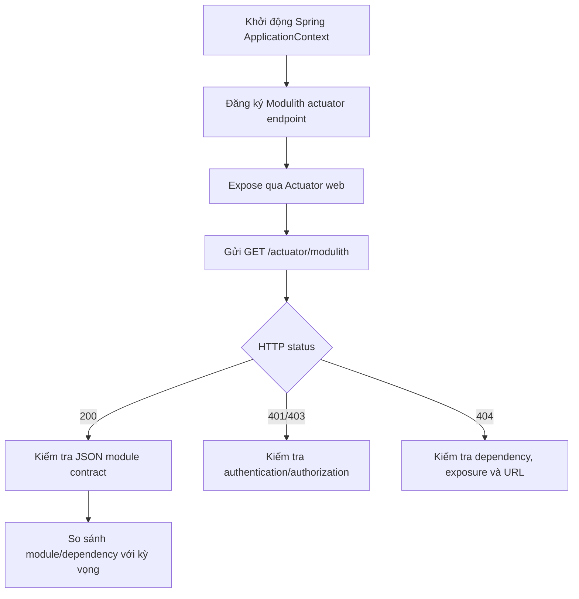
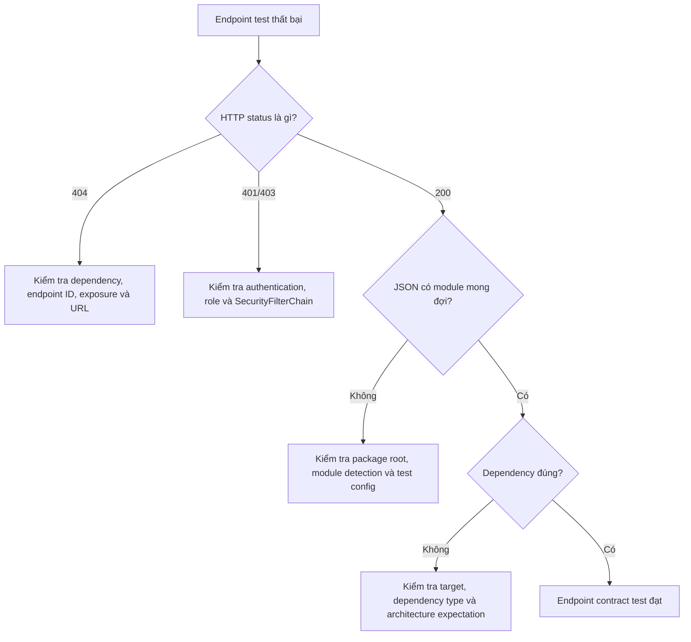

# Kiểm thử endpoint module actuator

Trong ứng dụng Spring Boot dùng Spring Modulith, endpoint Actuator `modulith` công bố cấu trúc application module đang được ứng dụng nhận diện. Sau khi triển khai, người vận hành có thể gọi `GET /actuator/modulith` để xem module names, base packages và dependency. Nhưng endpoint chỉ hữu ích khi được đăng ký, expose và bảo vệ đúng cách; cấu trúc JSON cũng cần ổn định đủ để công cụ vận hành có thể đọc.

Bài này hướng dẫn kiểm thử endpoint module actuator ở cấp HTTP integration test. Ta sẽ khởi động Spring ApplicationContext thật, gửi request bằng MockMvc hoặc WebTestClient, kiểm tra JSON module structure, xác nhận dependency direction, thử trường hợp endpoint không được expose và kiểm tra authorization. Cuối bài phân biệt kiểm thử endpoint với kiểm thử quy tắc kiến trúc và kiểm thử nghiệp vụ từng module.

Bài thuộc chương **Kiểm thử** của học phần `SPRING_MODULITH_DOCUMENTATION_OBSERVABILITY`. Học phần dùng Spring Modulith để sinh tài liệu ranh giới application module và quan sát tương tác giữa các phần trong ứng dụng Spring Boot thông qua module graph, Actuator, event metrics, tracing và context propagation. Mục tiêu ở đây là bảo đảm operator endpoint phản ánh module model của bản ứng dụng đang chạy, đồng thời không vô tình mở endpoint cho người không có quyền.

Sau bài học, bạn có thể:

- Chuẩn bị dependency và cấu hình để test endpoint `modulith`.
- Dùng `@SpringBootTest` và MockMvc để kiểm tra HTTP contract.
- Kiểm tra module names, `basePackage`, dependency `target` và dependency types trong JSON.
- Xác nhận Actuator root công bố link `modulith`.
- Kiểm tra hành vi khi endpoint không được expose hoặc bị chặn bởi security.
- Chọn MockMvc, WebTestClient hoặc real server test theo loại ứng dụng.
- Phân biệt endpoint test với `ApplicationModules.verify()` và `@ApplicationModuleTest`.
- Đưa các kiểm tra cần thiết vào CI mà không khóa test vào toàn bộ JSON implementation detail.

> **Phạm vi ví dụ:** Spring Boot 3.5.x và Spring Modulith 1.4.x, JUnit 5, Spring Boot Test, MockMvc và Spring Security Test khi cần. Endpoint ID là `modulith`, URL mặc định là `/actuator/modulith`. Nếu ứng dụng đổi management base path, context path hoặc management port, hãy cập nhật URL trong test theo cấu hình thật.

## 1. Kiểm thử endpoint để xác nhận điều gì?

Endpoint module actuator có nhiệm vụ công bố `ApplicationModules` metadata dưới dạng JSON. Kiểm thử endpoint cần xác nhận ít nhất bốn lớp:

1. **Registration:** Spring Modulith actuator support có trên runtime classpath và endpoint được đăng ký.
2. **Exposure:** endpoint được expose qua HTTP theo cấu hình Actuator.
3. **Contract:** response có module và dependency mà ứng dụng mong đợi.
4. **Access control:** chỉ identity được phép mới đọc được cấu trúc module.

Ví dụ một ứng dụng có các module `order`, `inventory`, `payment` và `notification`. Endpoint test có thể xác nhận `order` tồn tại, package gốc đúng và dependency của `order` trỏ tới `inventory`.



Một test endpoint tốt không cần assert toàn bộ JSON response. Hãy kiểm tra những phần contract mà operator hoặc automation thực sự sử dụng: module key, base package và một số dependency quan trọng. Những field không liên quan có thể được Spring Modulith mở rộng trong phiên bản sau.

## 2. Chuẩn bị dependency và cấu hình test

Nếu ứng dụng chỉ cần module actuator, dependency runtime thường gồm:

```xml
<dependencies>
    <dependency>
        <groupId>org.springframework.boot</groupId>
        <artifactId>spring-boot-starter-actuator</artifactId>
    </dependency>

    <dependency>
        <groupId>org.springframework.modulith</groupId>
        <artifactId>spring-modulith-actuator</artifactId>
        <scope>runtime</scope>
    </dependency>

    <dependency>
        <groupId>org.springframework.boot</groupId>
        <artifactId>spring-boot-starter-test</artifactId>
        <scope>test</scope>
    </dependency>
</dependencies>
```

Nếu ứng dụng đã dùng `spring-modulith-starter-insight`, starter này cung cấp actuator integration cùng các thành phần observability của Spring Modulith; không cần thêm `spring-modulith-actuator` lần nữa chỉ để đăng ký cùng endpoint.

Nếu cần kiểm tra security bằng `@WithMockUser` hoặc `user(...)`, bổ sung:

```xml
<dependency>
    <groupId>org.springframework.security</groupId>
    <artifactId>spring-security-test</artifactId>
    <scope>test</scope>
</dependency>
```

Các version nên được quản lý bằng Spring Boot và Spring Modulith BOM tương thích. Đừng ép riêng version của actuator module khác dòng với các artifact Spring Modulith còn lại.

### Cấu hình expose cho test

Trong production, chỉ expose endpoint cần thiết. Với test, có thể đặt property trực tiếp trên test class:

```java
@SpringBootTest(properties = {
    "management.endpoints.web.exposure.include=health,modulith"
})
```

Cấu hình này làm endpoint có mặt trong context của test. Nếu ứng dụng có `management.endpoints.web.base-path` tùy chỉnh, test phải gọi đúng base path đó. Không cần sửa `application.yml` production chỉ để phục vụ một test.

## 3. Hiểu JSON contract cần kiểm tra

Endpoint trả về một JSON object, trong đó key cấp cao nhất là technical name của application module. Một entry có thể chứa `displayName`, `basePackage`, `parent`, `nested` và `dependencies`.

Ví dụ response rút gọn:

```json
{
  "inventory": {
    "displayName": "Inventory",
    "basePackage": "com.example.shop.inventory",
    "dependencies": []
  },
  "order": {
    "displayName": "Order",
    "basePackage": "com.example.shop.order",
    "dependencies": [
      {
        "target": "inventory",
        "types": ["USES_COMPONENT"]
      },
      {
        "target": "payment",
        "types": ["USES_COMPONENT"]
      }
    ]
  },
  "payment": {
    "displayName": "Payment",
    "basePackage": "com.example.shop.payment",
    "dependencies": []
  }
}
```

Một số assertion phù hợp:

| JSON path | Điều cần xác nhận |
| --- | --- |
| `$.order` | Module `order` có được phát hiện |
| `$.order.basePackage` | Package gốc đúng với layout đã thiết kế |
| `$.order.displayName` | Tên hiển thị đúng nếu được dùng trong operator tooling |
| `$.order.dependencies[*].target` | Các module mà `order` phụ thuộc |
| `$.order.dependencies[*].types` | Kiểu dependency được công bố |
| `$._links.modulith.href` | Actuator root có công bố endpoint |

**Hướng dependency cần được hiểu đúng:** `dependencies` nằm trong entry của module hiện tại; `target` là module mà entry đó phụ thuộc. Ví dụ `order.dependencies` có target `inventory` nghĩa là `order` phụ thuộc `inventory`.

Không nên kiểm tra bằng cách so sánh cả response với một JSON string dài. Cách đó dễ làm test hỏng khi thứ tự key, field bổ sung hoặc formatting thay đổi mà contract quan trọng vẫn đúng.

## 4. Integration test cơ bản bằng MockMvc

Với ứng dụng Spring MVC/Servlet, `@SpringBootTest` kết hợp `@AutoConfigureMockMvc` khởi động ApplicationContext và cung cấp MockMvc mà không cần mở cổng HTTP thật.

Đặt test trong source set `src/test/java`, ở package có thể tìm thấy class `@SpringBootApplication` của dự án.

```java
package com.example.shop;

import static org.hamcrest.Matchers.hasItem;
import static org.springframework.test.web.servlet.request.MockMvcRequestBuilders.get;
import static org.springframework.test.web.servlet.result.MockMvcResultMatchers.jsonPath;
import static org.springframework.test.web.servlet.result.MockMvcResultMatchers.status;

import org.junit.jupiter.api.Test;
import org.springframework.beans.factory.annotation.Autowired;
import org.springframework.boot.test.autoconfigure.web.servlet.AutoConfigureMockMvc;
import org.springframework.boot.test.context.SpringBootTest;
import org.springframework.test.web.servlet.MockMvc;

@SpringBootTest(properties = {
    "management.endpoints.web.exposure.include=health,modulith"
})
@AutoConfigureMockMvc
class ModulithEndpointIntegrationTest {

    @Autowired
    MockMvc mockMvc;

    @Test
    void exposesModuleStructureAsJson() throws Exception {
        mockMvc.perform(get("/actuator/modulith"))
            .andExpect(status().isOk())
            .andExpect(jsonPath("$.order").exists())
            .andExpect(jsonPath("$.order.basePackage")
                .value("com.example.shop.order"))
            .andExpect(jsonPath("$.inventory").exists());
    }

    @Test
    void exposesExpectedDependencyFromOrderToInventory() throws Exception {
        mockMvc.perform(get("/actuator/modulith"))
            .andExpect(status().isOk())
            .andExpect(jsonPath("$.order.dependencies[*].target",
                hasItem("inventory")));
    }
}
```

Test này xác nhận endpoint trả HTTP 200, JSON có module `order` và `inventory`, package gốc của `order` đúng, và dependency target `inventory` được công bố.

Thay `com.example.shop.order` cùng tên module theo cấu trúc package thật. Nếu ứng dụng không có dependency trực tiếp từ `order` tới `inventory`, hãy kiểm tra một dependency đã được thiết kế và có trong module model của dự án; không thêm dependency giả chỉ để làm test pass.

### Với ứng dụng WebFlux

Nếu ứng dụng dùng WebFlux, có thể dùng `WebTestClient` thay cho MockMvc. Với mock web environment, Spring Boot có thể cấu hình client để gọi endpoint mà không cần mở cổng thật:

```java
import org.junit.jupiter.api.Test;
import org.springframework.beans.factory.annotation.Autowired;
import org.springframework.boot.test.autoconfigure.web.reactive.AutoConfigureWebTestClient;
import org.springframework.boot.test.context.SpringBootTest;
import org.springframework.test.web.reactive.server.WebTestClient;

@SpringBootTest(properties = {
    "management.endpoints.web.exposure.include=health,modulith"
})
@AutoConfigureWebTestClient
class ModulithEndpointWebFluxTest {

    @Autowired
    WebTestClient webTestClient;

    @Test
    void exposesModuleStructure() {
        webTestClient.get()
            .uri("/actuator/modulith")
            .exchange()
            .expectStatus().isOk()
            .expectBody()
            .jsonPath("$.order").exists()
            .jsonPath("$.order.basePackage")
                .isEqualTo("com.example.shop.order");
    }
}
```

Chọn client theo web stack thực tế. MockMvc dành cho Servlet/Spring MVC; WebTestClient phù hợp với WebFlux và cũng có thể dùng với server thật. Nếu classpath có cả MVC lẫn WebFlux, Spring Boot có thể chọn MVC theo mặc định; hãy cấu hình `spring.main.web-application-type=reactive` trong test nếu ứng dụng cần kiểm tra reactive stack.

### Có cần assert Content-Type?

Có thể kiểm tra response có media type JSON tương ứng với phiên bản Spring Boot/Actuator đang dùng. Actuator có thể dùng vendor media type như `application/vnd.spring-boot.actuator.v3+json`, vì vậy tránh giả định mọi phiên bản đều trả đúng chuỗi `application/json`. Các assertion `jsonPath` ở trên đã kiểm tra response có thể được parse như JSON.

## 5. Kiểm tra Actuator root discovery link

Ngoài gọi endpoint trực tiếp, có thể kiểm tra root Actuator công bố link `modulith`. Điều này hữu ích khi operator tool khám phá endpoint từ root thay vì hard-code path.

```java
@Test
void actuatorRootAdvertisesModulithEndpoint() throws Exception {
    mockMvc.perform(get("/actuator"))
        .andExpect(status().isOk())
        .andExpect(jsonPath("$._links.modulith.href")
            .value(org.hamcrest.Matchers.endsWith("/actuator/modulith")));
}
```

Link thực tế phụ thuộc `management.endpoints.web.base-path`, context path, management port, reverse proxy và cấu hình discovery. Nếu dự án có base path riêng, assertion nên dùng URL tương ứng hoặc kiểm tra phần path cần thiết thay vì cố định toàn bộ host.

Nếu Actuator root discovery bị tắt hoặc bị giới hạn, test link có thể không phù hợp dù endpoint trực tiếp vẫn hoạt động. Khi đó, test trực tiếp `GET /actuator/modulith` là contract chính.

## 6. Kiểm tra endpoint không được expose

Một test âm tính giúp bảo đảm endpoint không xuất hiện khi cấu hình không cho phép. Hãy dùng một test class/context riêng để tránh property của test expose endpoint làm ảnh hưởng kết quả.

```java
package com.example.shop;

import static org.springframework.test.web.servlet.request.MockMvcRequestBuilders.get;
import static org.springframework.test.web.servlet.result.MockMvcResultMatchers.status;

import org.junit.jupiter.api.Test;
import org.springframework.beans.factory.annotation.Autowired;
import org.springframework.boot.test.autoconfigure.web.servlet.AutoConfigureMockMvc;
import org.springframework.boot.test.context.SpringBootTest;
import org.springframework.test.web.servlet.MockMvc;

@SpringBootTest(properties = {
    "management.endpoints.web.exposure.include=health"
})
@AutoConfigureMockMvc
class ModulithEndpointNotExposedTest {

    @Autowired
    MockMvc mockMvc;

    @Test
    void doesNotExposeModulithWhenNotIncluded() throws Exception {
        mockMvc.perform(get("/actuator/modulith"))
            .andExpect(status().isNotFound());
    }
}
```

Test này giả định endpoint actuator đã được đăng ký nhưng không được expose qua web, và security không biến request thành 401/403 trước khi kiểm tra mapping. Nếu ứng dụng có custom security hoặc management base path, hãy điều chỉnh expected status và URL theo hành vi thực tế.

**Không nhầm hai tình huống:**

- Thiếu `spring-modulith-actuator` hoặc Insight starter: endpoint có thể không được đăng ký.
- Có dependency nhưng không có `modulith` trong `management.endpoints.web.exposure.include`: endpoint không được công bố qua HTTP.

Cả hai đều có thể khiến request trả 404, nhưng nguyên nhân và cách khắc phục khác nhau.

## 7. Kiểm tra authorization với Spring Security

Exposure không thay thế authorization. Nếu ứng dụng dùng Spring Security, endpoint module structure có thể chỉ dành cho role vận hành.

Ví dụ security configuration minh họa cho endpoint actuator:

```java
import static org.springframework.security.config.Customizer.withDefaults;

import org.springframework.boot.actuate.autoconfigure.security.servlet.EndpointRequest;
import org.springframework.context.annotation.Bean;
import org.springframework.context.annotation.Configuration;
import org.springframework.core.annotation.Order;
import org.springframework.security.config.annotation.web.builders.HttpSecurity;
import org.springframework.security.web.SecurityFilterChain;

@Configuration(proxyBeanMethods = false)
class ActuatorSecurityConfiguration {

    @Bean
    @Order(1)
    SecurityFilterChain actuatorSecurity(HttpSecurity http) throws Exception {
        return http
            .securityMatcher(EndpointRequest.to("modulith"))
            .authorizeHttpRequests(auth -> auth
                .anyRequest().hasRole("OPS"))
            .httpBasic(withDefaults())
            .build();
    }

    @Bean
    @Order(2)
    SecurityFilterChain applicationSecurity(HttpSecurity http) throws Exception {
        return http
            .authorizeHttpRequests(auth -> auth
                .anyRequest().authenticated())
            .httpBasic(withDefaults())
            .build();
    }
}
```

Đây là ví dụ về hai filter chain: chain đầu dành riêng cho endpoint `modulith`, chain thứ hai xử lý phần ứng dụng còn lại. Nếu dự án đã có security chains, hãy tích hợp matcher và role vào cấu hình hiện hữu thay vì thêm một chain trùng hoặc làm thay đổi quy tắc truy cập của ứng dụng.

Kiểm tra bằng Spring Security Test:

```java
import static org.springframework.test.web.servlet.request.MockMvcRequestBuilders.get;
import static org.springframework.test.web.servlet.result.MockMvcResultMatchers.status;

import org.junit.jupiter.api.Test;
import org.springframework.beans.factory.annotation.Autowired;
import org.springframework.boot.test.autoconfigure.web.servlet.AutoConfigureMockMvc;
import org.springframework.boot.test.context.SpringBootTest;
import org.springframework.security.test.context.support.WithMockUser;
import org.springframework.test.web.servlet.MockMvc;

@SpringBootTest(properties = {
    "management.endpoints.web.exposure.include=health,modulith"
})
@AutoConfigureMockMvc
class ModulithEndpointSecurityTest {

    @Autowired
    MockMvc mockMvc;

    @Test
    @WithMockUser(roles = "OPS")
    void allowsOperationsRole() throws Exception {
        mockMvc.perform(get("/actuator/modulith"))
            .andExpect(status().isOk());
    }

    @Test
    @WithMockUser(roles = "USER")
    void deniesRegularUser() throws Exception {
        mockMvc.perform(get("/actuator/modulith"))
            .andExpect(status().isForbidden());
    }
}
```

Nếu không có authentication, response thường là 401; user đã đăng nhập nhưng thiếu role thường là 403. Nếu test dùng HTTP Basic thay vì `@WithMockUser`, có thể dùng `httpBasic("ops", "password")` với user test được cấu hình. Không đưa credential production vào test.

Spring Boot security auto-configuration có hành vi riêng khi Spring Security hiện diện và không có `SecurityFilterChain` tùy chỉnh. Khi ứng dụng định nghĩa chain riêng, Boot không tự áp dụng toàn bộ cấu hình bảo vệ actuator nữa; test phải chạy với security configuration thật để phát hiện endpoint vô tình bị mở.

## 8. Khi management port hoặc base path riêng

Nếu ứng dụng dùng cùng server port, MockMvc thường đủ để kiểm tra HTTP contract. Nếu management server chạy trên port riêng (`management.server.port`), MockMvc không kiểm tra được đường mạng và listener riêng của management server.

Với trường hợp đó, dùng real server test:

```java
package com.example.shop;

import static org.assertj.core.api.Assertions.assertThat;

import org.junit.jupiter.api.Test;
import org.springframework.beans.factory.annotation.Autowired;
import org.springframework.boot.test.context.SpringBootTest;
import org.springframework.boot.test.web.server.LocalManagementPort;
import org.springframework.boot.test.web.client.TestRestTemplate;
import org.springframework.http.ResponseEntity;

@SpringBootTest(
    webEnvironment = SpringBootTest.WebEnvironment.RANDOM_PORT,
    properties = {
        "management.server.port=0",
        "management.endpoints.web.exposure.include=health,modulith"
    }
)
class ModulithManagementPortTest {

    @LocalManagementPort
    int managementPort;

    @Autowired
    TestRestTemplate restTemplate;

    @Test
    void servesModulithEndpointOnManagementPort() {
        ResponseEntity<String> response = restTemplate.getForEntity(
            "http://localhost:" + managementPort + "/actuator/modulith",
            String.class
        );

        assertThat(response.getStatusCode().is2xxSuccessful()).isTrue();
        assertThat(response.getBody()).contains("\"order\"");
    }
}
```

Đoạn test minh họa có thể cần cấu hình authentication nếu endpoint được bảo vệ. Với ứng dụng production dùng management port tách biệt, hãy kiểm tra cả network policy/firewall hoặc ingress quản trị bằng một bài kiểm thử triển khai phù hợp.

Nếu chỉ đổi `management.endpoints.web.base-path`, cập nhật URI trong MockMvc/HTTP client theo base path mới. Nếu có `server.servlet.context-path`, thêm context path vào URI của endpoint trên application server; management server riêng có thể có cách định tuyến khác tùy cấu hình.

## 9. Kiểm thử endpoint khác với kiểm thử kiến trúc module

Endpoint test xác nhận endpoint được đăng ký, expose và trả module metadata mong đợi. Nó **không chứng minh** mọi dependency đều hợp lệ theo quy tắc kiến trúc.

Để kiểm tra cấu trúc module, dùng `ApplicationModules.verify()`:

```java
import org.junit.jupiter.api.Test;
import org.springframework.modulith.core.ApplicationModules;

class ModularityVerificationTest {

    @Test
    void verifiesApplicationModuleRules() {
        ApplicationModules.of(Application.class).verify();
    }
}
```

Đặt test này trong test suite kiến trúc/CI. Nó kiểm tra các quy tắc dependency và cấu trúc mà Spring Modulith hỗ trợ. Endpoint test và architecture verification có mục tiêu khác nhau:

| Loại test | Điều được kiểm tra | Nên chạy ở đâu |
| --- | --- | --- |
| Endpoint integration test | HTTP status, endpoint exposure, JSON contract | Test integration của ứng dụng |
| Architecture verification | Dependency/module rules | CI/build |
| Module integration test | Hành vi một module trong isolation hoặc cùng dependencies | Test package của module |
| Deployment smoke test | Endpoint thực sự truy cập được sau deployment | Pipeline triển khai/staging |

Không dùng endpoint JSON snapshot thay cho `ApplicationModules.verify()`. Một dependency mới có thể xuất hiện trong JSON và endpoint vẫn trả 200; chỉ architecture verification mới xác định dependency đó có vi phạm quy tắc đã cấu hình hay không.

## 10. Khi nào dùng @ApplicationModuleTest?

Spring Modulith cung cấp `@ApplicationModuleTest` để bootstrap một application module độc lập hoặc cùng các module phụ thuộc trực tiếp/toàn bộ. Annotation này phù hợp để test service và hành vi của module.

Ví dụ:

```java
package com.example.shop.order;

import org.junit.jupiter.api.Test;
import org.springframework.modulith.test.ApplicationModuleTest;

@ApplicationModuleTest
class OrderModuleIntegrationTest {

    @Test
    void startsOrderModuleInIsolation() {
        // Kiểm tra component và hành vi thuộc module order.
    }
}
```

Các bootstrap mode thường dùng:

- `STANDALONE`: chỉ bootstrap module hiện tại.
- `DIRECT_DEPENDENCIES`: bootstrap module hiện tại cùng dependency trực tiếp.
- `ALL_DEPENDENCIES`: bootstrap cả cây dependency.

`@ApplicationModuleTest` không phải lựa chọn mặc định để kiểm tra `GET /actuator/modulith`, vì endpoint cần actuator auto-configuration và module model của ứng dụng. Dùng `@SpringBootTest` cho endpoint contract; dùng `@ApplicationModuleTest` cho hành vi bên trong từng module.

Để dùng annotation này, thêm `spring-modulith-starter-test` với scope `test` và quản lý version bằng Spring Modulith BOM:

```xml
<dependency>
    <groupId>org.springframework.modulith</groupId>
    <artifactId>spring-modulith-starter-test</artifactId>
    <scope>test</scope>
</dependency>
```

Nếu một module test cần Spring bean từ module khác, có thể chọn bootstrap mode phù hợp hoặc mock dependency bằng `@MockitoBean`. Không mở rộng context lên toàn bộ ứng dụng chỉ vì một test module thiếu bean mà chưa xem xét mức độ coupling.

## 11. Các assertion nên có và những điều không nên khóa cứng

Một endpoint test thực dụng nên xác nhận:

- HTTP status thành công.
- Module quan trọng có trong response.
- `basePackage` của module không bị đổi ngoài dự kiến.
- Dependency target quan trọng có mặt.
- Dependency type quan trọng có mặt nếu tooling dựa vào type đó.
- Actuator root công bố link nếu operator dùng discovery.
- Role đúng được phép, role không đúng bị từ chối.

Tránh các assertion dễ gây test brittle:

- So sánh nguyên văn toàn bộ JSON.
- Giả định thứ tự module keys hoặc dependency array không đổi nếu thứ tự không phải contract.
- Kiểm tra mọi module trong một test endpoint duy nhất nếu module model lớn và thay đổi thường xuyên.
- Assert chính xác toàn bộ URL tuyệt đối chứa hostname/port ngẫu nhiên.
- Assert `application/json` cứng nếu Actuator trả vendor JSON media type.
- Dùng mock `ApplicationModules` trong test chính nếu mục tiêu là kiểm tra endpoint phản ánh application model thật.

Có thể chia test theo trách nhiệm: một test kiểm tra endpoint và JSON cơ bản, một test kiểm tra các dependency quan trọng, một test security, và một test negative exposure. Cách chia này giúp failure message chỉ rõ lớp cấu hình bị lỗi.

## 12. Troubleshooting khi endpoint test thất bại

| Triệu chứng | Nguyên nhân thường gặp | Hướng kiểm tra |
| --- | --- | --- |
| `404 Not Found` | Thiếu actuator dependency, endpoint không đăng ký hoặc không expose | Kiểm tra runtime classpath và `management.endpoints.web.exposure.include` |
| `401 Unauthorized` | Endpoint yêu cầu authentication | Cấu hình test user hoặc HTTP Basic test credentials |
| `403 Forbidden` | User không có role cần thiết hoặc CSRF/security matcher cấu hình sai | Kiểm tra role, filter chain và request matcher |
| `200 OK` nhưng JSON không có module | Main application/package detection hoặc artifact test không đúng | Kiểm tra package root và module detection |
| Module tồn tại nhưng `basePackage` khác | Package được refactor hoặc test đang chạy app config khác | Xác nhận expected package và primary application class |
| Dependency target thiếu | Dependency không được Spring Modulith phát hiện hoặc kỳ vọng test sai | Kiểm tra module model, bean references và event listener |
| MockMvc không thấy management endpoint | Management server chạy trên port riêng | Dùng `RANDOM_PORT` và `@LocalManagementPort` |
| Test chạy local nhưng CI trả 404 | Profile, dependency scope hoặc config CI khác | Kiểm tra test runtime classpath và active profiles |
| Actuator root thiếu link | Endpoint không expose hoặc discovery bị giới hạn | Kiểm tra root response và endpoint exposure |
| JSONPath assertion sai | Sai module key, path hoặc JSON schema của version | In response body khi test fail, kiểm tra JSON thực tế |
| Test security luôn 401 | Test user không được áp dụng hoặc security chain khác match trước | Kiểm tra `@WithMockUser`, `@Order` và matcher |
| Test security luôn 200 | Endpoint không nằm trong filter chain dự kiến | Kiểm tra `EndpointRequest.to("modulith")` và thứ tự chain |

### Quy trình kiểm tra nhanh



Khi test thất bại, hãy xem status và response body trước. Không đổi endpoint ID hoặc sửa expected JSON chỉ để làm test xanh khi chưa xác nhận module model thực tế.

## 13. Bài thực hành: kiểm thử module actuator trong CI

**Bối cảnh:** ứng dụng Spring Modulith có `order`, `inventory`, `payment` và `notification`. Operator cần đọc endpoint `/actuator/modulith` sau deployment để so sánh module structure giữa các release.

Thực hiện:

1. Thêm `spring-boot-starter-actuator`, `spring-modulith-actuator` và `spring-boot-starter-test`; nếu dùng Insight starter, không thêm actuator artifact trùng.
2. Cấu hình test property expose `health,modulith`.
3. Viết `@SpringBootTest` + `@AutoConfigureMockMvc` kiểm tra `GET /actuator/modulith` trả 200.
4. Dùng JSONPath kiểm tra module `order`, `inventory` và `basePackage` của `order`.
5. Kiểm tra `order.dependencies[*].target` có `inventory` nếu đây là dependency trong kiến trúc dự kiến.
6. Kiểm tra `GET /actuator` công bố `_links.modulith.href` nếu operator tooling dùng discovery.
7. Viết test riêng để xác nhận endpoint không được expose khi chỉ cho phép `health`.
8. Nếu endpoint có security, kiểm tra role `OPS` được phép và role `USER` bị từ chối.
9. Nếu management server dùng port riêng, viết real server test bằng random port và `@LocalManagementPort`.
10. Chạy `ApplicationModules.verify()` riêng trong CI để kiểm tra quy tắc dependency.
11. Dùng `@ApplicationModuleTest` để test hành vi nghiệp vụ trong module `order` hoặc `notification`.
12. Đưa các test endpoint và architecture vào pipeline; sau deployment staging, chạy smoke test gọi endpoint với identity vận hành được cấp quyền.

**Tiêu chí hoàn thành:** test xác nhận endpoint đã đăng ký và expose đúng, JSON phản ánh các module/dependency quan trọng, security hoạt động theo policy, và CI có kiểm tra kiến trúc độc lập với HTTP endpoint test.

## Tài liệu tham khảo

- [Spring Modulith 1.4 — Application Module Actuator](https://docs.spring.io/spring-modulith/reference/1.4/production-ready.html): actuator endpoint công bố module structure.
- [Spring Modulith — ApplicationModulesEndpoint API](https://docs.spring.io/spring-modulith/docs/1.4.x/api/org/springframework/modulith/actuator/ApplicationModulesEndpoint.html): endpoint ID `modulith` và JSON metadata.
- [Spring Modulith 1.4 — Integration Testing Application Modules](https://docs.spring.io/spring-modulith/reference/1.4/testing.html): `@ApplicationModuleTest`, bootstrap modes và `Scenario`.
- [Spring Boot 3.5 — Testing Spring Boot Applications](https://docs.spring.io/spring-boot/3.5/reference/testing/spring-boot-applications.html): `@SpringBootTest`, MockMvc, WebTestClient và real server test.
- [Spring Boot 3.5 — Actuator Endpoints](https://docs.spring.io/spring-boot/3.5/reference/actuator/endpoints.html): exposure, endpoint discovery và security.
- [Spring Security — Testing](https://docs.spring.io/spring-security/reference/servlet/test/index.html): `@WithMockUser` và test support cho servlet security.

**Ghi nhớ:** hãy dùng `@SpringBootTest` với MockMvc để kiểm tra endpoint `modulith` và JSON contract của nó; dùng test riêng cho exposure và security; dùng `ApplicationModules.verify()` cho quy tắc kiến trúc và `@ApplicationModuleTest` cho hành vi từng module.
