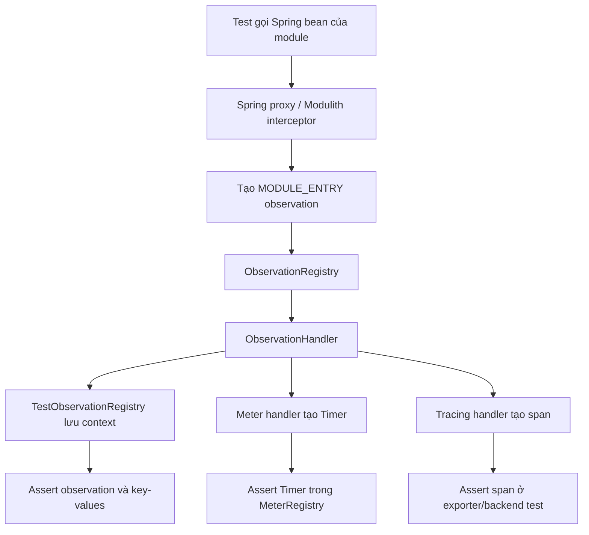
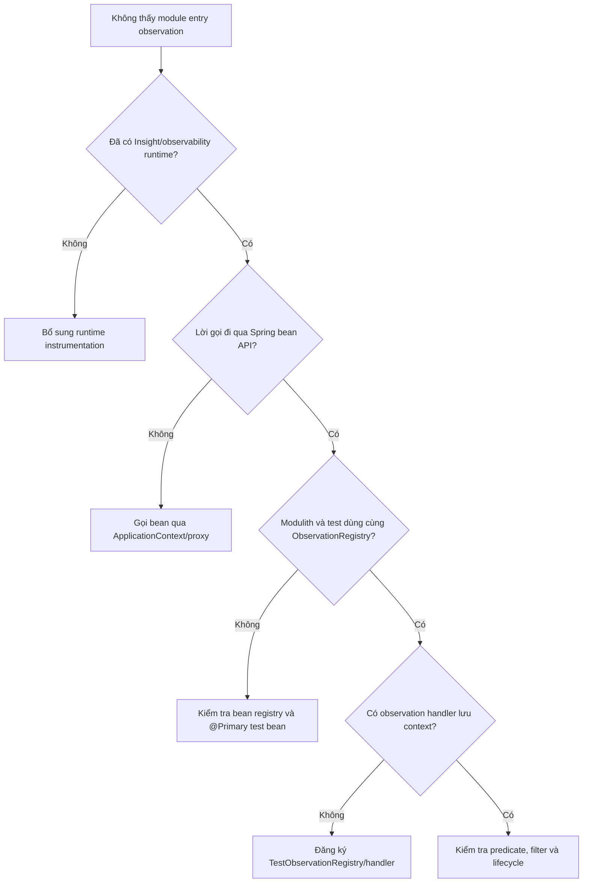

# Kiểm thử module entry observation

## 1. Vì sao cần kiểm thử module entry observation?

Spring Modulith có thể quan sát lúc một component thuộc API của application module được gọi. Observation này ghi nhận module đang được đi vào, kiểu invocation và method được thực thi. Khi có Micrometer Tracing, observation có thể trở thành span trong trace; khi có meter handler, nó cũng có thể tạo Timer metric.

Giả sử ứng dụng Spring Boot có các module `order`, `inventory` và `payment`. Một request đặt hàng có thể gọi:

```text
OrderController
  └── OrderManagement.placeOrder()
      ├── InventoryManagement.reserve()
      └── PaymentManagement.authorize()
```

Module graph cho biết các module phụ thuộc nhau như thế nào. Module entry observation cho biết lúc runtime một lần gọi đi vào module nào. Kiểm thử observation giúp xác nhận instrumentation thật sự được kích hoạt, gắn đúng metadata và kết thúc đúng lifecycle khi method thành công hoặc ném lỗi.

Bài **“Kiểm thử module entry observation”** thuộc chương **Kiểm thử** của **SPRING_MODULITH_DOCUMENTATION_OBSERVABILITY**. Module này hướng dẫn dùng Spring Modulith sinh tài liệu ranh giới application module và quan sát tương tác giữa các phần trong ứng dụng Spring Boot qua module graph, Actuator, event metrics, tracing và context propagation.

Sau bài học, bạn có thể:

1. Phân biệt kiểm thử cấu trúc module với kiểm thử observation lúc runtime.
2. Dùng `@ApplicationModuleTest` để khởi tạo một module trong phạm vi kiểm thử.
3. Dùng `TestObservationRegistry` để xác nhận module entry observation được tạo và dừng.
4. Kiểm tra low-cardinality keys và high-cardinality key của observation.
5. Kiểm thử trường hợp thành công, exception và event listener.
6. Phân biệt observation test, Timer metric test và trace exporter test.
7. Chẩn đoán test không thấy observation do bean không được proxy, registry không đúng hoặc instrumentation bị tắt.

## 2. Module entry observation đi qua những thành phần nào?

Spring Modulith observability instrument các Spring component thuộc API của application module. Bean post-processor của Modulith trang trí các component được quan sát bằng interceptor. Khi có lời gọi đi qua Spring bean proxy, interceptor tạo observation `MODULE_ENTRY` và gắn thông tin module.

Luồng tổng quát:



Các lớp có vai trò riêng:

| Thành phần | Trách nhiệm | Điều cần kiểm tra |
| --- | --- | --- |
| Module bean proxy | Bắt lời gọi đi vào module API | Test gọi Spring-managed bean qua proxy |
| `ModulithObservations.MODULE_ENTRY` | Định nghĩa observation cho module entry | Observation có đúng tên và metadata |
| `ObservationRegistry` | Nhận lifecycle của observation | Modulith dùng registry mà test đang quan sát |
| `ObservationHandler` | Xử lý start, stop, error và scope | Handler tương ứng được đăng ký |
| `TestObservationRegistry` | Lưu observation để assertion | Observation đã start/stop, có đúng keys |
| Meter handler | Chuyển observation thành metric | Timer được ghi vào MeterRegistry |
| Tracing handler | Chuyển observation thành span | Span được export nếu tracer/exporter được cấu hình |

Một test có thể xác nhận observation được tạo nhưng không chứng minh span đã đến backend. Muốn xác nhận exporter, cần kiểm tra thêm span exporter hoặc trace backend test.

## 3. Observation có những key nào?

Spring Modulith định nghĩa observation `MODULE_ENTRY` trong `ModulithObservations`. Các key được chia theo cardinality:

| Key | Cardinality | Ý nghĩa | Ví dụ |
| --- | --- | --- | --- |
| `module.identifier` | Low | Định danh kỹ thuật của module | `inventory` |
| `module.name` | Low | Tên hiển thị của module | `Inventory Management` |
| `module.invocation-type` | Low | Kiểu invocation | `bean` hoặc `event listener` |
| `module.method` | High | Method được thực thi | `reserve` |

Low-cardinality keys phù hợp để nhóm metrics và lọc dashboard. High-cardinality key hữu ích khi điều tra span cụ thể nhưng không nên mặc định đưa vào Prometheus label.

Trong code, dùng enum key chính thức để tránh hard-code tên:

```java
ModulithObservations.MODULE_ENTRY.getName();

ModulithObservations.LowKeys.MODULE_IDENTIFIER.asString();
ModulithObservations.LowKeys.MODULE_NAME.asString();
ModulithObservations.LowKeys.INVOCATION_TYPE.asString();

ModulithObservations.HighKeys.MODULE_METHOD.asString();
```

Tên observation và key lấy từ API giúp test ít phụ thuộc vào chuỗi literal. Khi nâng phiên bản Spring Modulith/Micrometer, compiler và API docs giúp phát hiện thay đổi sớm hơn.

## 4. Chọn đúng loại test

Không phải mọi kiểm thử có nhắc đến module đều kiểm tra module entry observation:

| Loại test | Công cụ | Xác nhận điều gì? |
| --- | --- | --- |
| Architecture verification | `ApplicationModules.verify()` | Dependency và ranh giới module có hợp lệ không? |
| Module integration test | `@ApplicationModuleTest` | Module có khởi động và hành vi tích hợp trong phạm vi module không? |
| Observation test | `TestObservationRegistry` | Module entry observation có được tạo, gắn key và dừng đúng không? |
| Metrics test | `MeterRegistry` | Timer/counter có được ghi với tag mong đợi không? |
| Tracing test | In-memory exporter hoặc test span handler | Span có được tạo, nối parent và export đúng không? |
| Actuator test | HTTP integration test | Endpoint có expose dữ liệu quan sát như mong đợi không? |

Một bài kiểm thử đầy đủ thường kết hợp module integration test và observation assertion. Không dùng `ApplicationModules.verify()` làm bằng chứng rằng module entry span đang hoạt động; kiểm tra cấu trúc tĩnh và instrumentation runtime là hai mục tiêu khác nhau.

## 5. Chuẩn bị dependency kiểm thử

Ví dụ Gradle dùng BOM tương thích giữa Spring Boot và Spring Modulith:

```groovy
dependencies {
    // Runtime instrumentation cho module entry observation
    runtimeOnly "org.springframework.modulith:spring-modulith-starter-insight"

    // Hỗ trợ @ApplicationModuleTest và các tiện ích test của Modulith
    testImplementation "org.springframework.modulith:spring-modulith-starter-test"

    // TestObservationRegistry và assertion cho Micrometer Observation
    testImplementation "io.micrometer:micrometer-observation-test"
}
```

Insight starter cung cấp observability support của Spring Modulith cùng Actuator integration. Nếu ứng dụng chỉ cần observability và không cần module Actuator, có thể chọn dependency observability phù hợp thay cho Insight; bài thực hành này dùng Insight để có cấu hình phổ biến và nhất quán.

Không ghim version riêng cho từng dependency nếu dự án đã quản lý phiên bản bằng Spring Boot/Spring Modulith BOM. Kiểm tra compatibility matrix của phiên bản dự án trước khi thêm starter.

## 6. Viết module integration test bằng @ApplicationModuleTest

`@ApplicationModuleTest` khởi động module chứa package của test class. Mặc định, chế độ `STANDALONE` chỉ đưa module hiện tại vào test context. Có thể chọn:

| Bootstrap mode | Phạm vi |
| --- | --- |
| `STANDALONE` | Module hiện tại |
| `DIRECT_DEPENDENCIES` | Module hiện tại và các dependency trực tiếp |
| `ALL_DEPENDENCIES` | Module hiện tại và toàn bộ dependency transitively |

Nếu module có bean dependency sang module khác nhưng test chạy ở chế độ `STANDALONE`, context có thể không khởi tạo được. Thường nên mock component ở module phụ thuộc nếu mục tiêu là kiểm thử module hiện tại; mở rộng bootstrap khi muốn kiểm thử integration xuyên module thật sự.

Đặt test class trong package module, ví dụ:

```java
package com.example.shop.inventory;

import org.springframework.modulith.test.ApplicationModuleTest;

@ApplicationModuleTest
class InventoryIntegrationTests {
    // Test cases
}
```

Test nên gọi bean được Spring quản lý qua constructor injection hoặc `@Autowired`. Không tạo service bằng `new InventoryManagement(...)` vì cách đó bỏ qua bean post-processor/proxy của Spring Modulith.

## 7. Dùng TestObservationRegistry để kiểm tra observation

`TestObservationRegistry` là registry dành cho test, lưu lifecycle và context của observation. Micrometer cung cấp assertion fluent như `hasObservationWithNameEqualTo(...)`, `hasBeenStarted()`, `hasBeenStopped()` và kiểm tra key-value.

Để Spring Modulith dùng registry test, có thể cung cấp bean `TestObservationRegistry` làm registry chính trong test context:

```java
package com.example.shop.inventory;

import io.micrometer.observation.tck.TestObservationRegistry;
import org.springframework.boot.test.context.TestConfiguration;
import org.springframework.context.annotation.Bean;
import org.springframework.context.annotation.Primary;

@TestConfiguration(proxyBeanMethods = false)
class ObservationTestConfiguration {

    @Bean
    @Primary
    TestObservationRegistry testObservationRegistry() {
        return TestObservationRegistry.create();
    }
}
```

Import cấu hình vào module test:

```java
package com.example.shop.inventory;

import io.micrometer.observation.tck.TestObservationRegistry;
import org.junit.jupiter.api.Test;
import org.springframework.beans.factory.annotation.Autowired;
import org.springframework.context.annotation.Import;
import org.springframework.modulith.test.ApplicationModuleTest;

@ApplicationModuleTest
@Import(ObservationTestConfiguration.class)
class InventoryObservationTests {

    @Autowired
    InventoryManagement inventory;

    @Autowired
    TestObservationRegistry observationRegistry;

    @Test
    void createsModuleEntryObservation() {
        inventory.reserve("SKU-42");

        // Assert observation ở phần tiếp theo.
    }
}
```

Bean `@Primary` giúp các thành phần cần `ObservationRegistry` nhận registry test. Nếu dự án có custom observation registry hoặc nhiều context, cần kiểm tra registry thực tế mà Modulith auto-configuration sử dụng; chỉ inject một registry vào test không đủ nếu interceptor đang dùng registry khác.

### 7.1. Assert tên, lifecycle và low-cardinality keys

Ví dụ assertion:

```java
import static org.assertj.core.api.Assertions.assertThat;

import org.springframework.modulith.observability.ModulithObservations;

assertThat(observationRegistry)
    .doesNotHaveAnyRemainingCurrentObservation()
    .hasObservationWithNameEqualTo(
        ModulithObservations.MODULE_ENTRY.getName()
    )
    .that()
    .hasBeenStarted()
    .hasBeenStopped()
    .hasLowCardinalityKeyValue(
        ModulithObservations.LowKeys.MODULE_IDENTIFIER.asString(),
        "inventory"
    )
    .hasLowCardinalityKeyValue(
        ModulithObservations.LowKeys.INVOCATION_TYPE.asString(),
        "bean"
    );
```

Assertion này xác nhận:

1. Không còn observation scope bị bỏ quên trong thread hiện tại.
2. Có observation đúng loại module entry.
3. Observation đã bắt đầu và kết thúc.
4. Identifier của module là `inventory`.
5. Invocation đến từ bean API.

Nếu module có display name tùy chỉnh, có thể kiểm tra thêm `MODULE_NAME`. Không nên phụ thuộc tên hiển thị trong logic routing hoặc metric query nếu identifier đã đủ để định danh.

### 7.2. Assert high-cardinality method key

Method được thực thi được ghi trong high-cardinality key:

```java
ModulithObservations.HighKeys.MODULE_METHOD.asString()
```

Giá trị có thể phụ thuộc convention/phiên bản và cách method được mô tả. Trong test, hãy kiểm tra giá trị theo convention mà ứng dụng cam kết; không copy một chuỗi ví dụ rồi mặc định mọi phiên bản đều trả về đúng cùng định dạng.

Nếu ứng dụng có `ModulithObservationConvention` tùy chỉnh, test nên xác nhận convention đó thay vì buộc test vào default convention.

## 8. Kiểm thử observation thành công và exception

Một module entry observation cần kết thúc dù method trả về bình thường hay ném exception. Đây là điều quan trọng vì observation lifecycle bị bỏ dở có thể làm scope hoặc tracing context rò sang xử lý tiếp theo.

Ví dụ module service:

```java
package com.example.shop.inventory;

import org.springframework.stereotype.Service;

@Service
public class InventoryManagement {

    public void reserve(String sku) {
        if (sku == null || sku.isBlank()) {
            throw new IllegalArgumentException("SKU is required");
        }
        // Reserve inventory.
    }
}
```

Test thành công:

```java
@Test
void recordsSuccessfulModuleEntry() {
    inventory.reserve("SKU-42");

    assertThat(observationRegistry)
        .hasObservationWithNameEqualTo(
            ModulithObservations.MODULE_ENTRY.getName()
        )
        .that()
        .hasBeenStarted()
        .hasBeenStopped();
}
```

Test exception:

```java
@Test
void recordsModuleEntryFailure() {
    assertThatThrownBy(() -> inventory.reserve(" "))
        .isInstanceOf(IllegalArgumentException.class);

    assertThat(observationRegistry)
        .hasObservationWithNameEqualTo(
            ModulithObservations.MODULE_ENTRY.getName()
        )
        .that()
        .hasBeenStarted()
        .hasBeenStopped();
}
```

Trong test thực tế, xóa registry trước mỗi test hoặc tạo context/registry riêng để tránh observation từ test trước làm assertion mơ hồ. Khi một thao tác gọi nhiều module, có thể có nhiều observation cùng tên; dùng assertion có predicate/metadata để chọn observation đúng thay vì chỉ kiểm tra “có một observation”. Ví dụ trên kiểm tra exception được ném ra và observation đã dừng; nếu cần xác minh error tag hoặc span status, hãy kiểm tra riêng MeterRegistry/tracing handler tương ứng.

## 9. Kiểm thử event listener invocation

Module entry observation không chỉ xuất hiện khi gọi bean API; module event listener cũng có thể được quan sát. Giá trị invocation type tương ứng là `event listener`.

Khi event được xử lý bất đồng bộ hoặc theo transaction, không nên publish event rồi assert ngay lập tức. Dùng `Scenario` trong `@ApplicationModuleTest` để mô tả stimulus, điều kiện hoàn tất và assertion:

```java
@ApplicationModuleTest
class OrderEventObservationTests {

    @Test
    void observesModuleEventListener(Scenario scenario) {
        scenario.publish(new OrderPlaced("order-42"))
            .andWaitForStateChange(() -> orderProjection.find("order-42"))
            .andVerify(result -> assertThat(result).isPresent());
    }
}
```

Sau khi scenario hoàn tất, kiểm tra observation có:

- Tên observation là `ModulithObservations.MODULE_ENTRY.getName()`.
- `MODULE_IDENTIFIER` bằng identifier của module chứa listener.
- `INVOCATION_TYPE` bằng `event listener`.
- Lifecycle đã stop.

`Scenario` thực hiện stimulus trong transaction callback để event được giao tới transactional listener. Điều này có nghĩa thay đổi database do stimulus tạo ra có thể không được rollback tự động như test transaction thông thường; cần cleanup bằng API của Scenario hoặc dọn dữ liệu rõ ràng.

Nếu listener nằm trong module khác với test, chọn bootstrap mode/include phù hợp và bảo đảm listener bean có mặt trong test context. Không mở toàn bộ ứng dụng nếu chỉ cần kiểm thử một module và có thể mock dependency ngoài phạm vi.

## 10. Kiểm thử Timer metric riêng với observation

`TestObservationRegistry` chứng minh observation được tạo và xử lý. Nó không tự chứng minh Timer metric được ghi vào Prometheus registry.

Để kiểm thử metric:

1. Dùng `MeterRegistry` phù hợp, ví dụ `SimpleMeterRegistry` trong test.
2. Đăng ký `DefaultMeterObservationHandler` trên đúng `ObservationRegistry`.
3. Gọi module bean qua Spring proxy.
4. Truy vấn Timer theo meter name và low-cardinality tags.

Ví dụ minh họa khi test tự cấu hình registry và handler:

```java
MeterRegistry meters = new SimpleMeterRegistry();
ObservationRegistry observations = ObservationRegistry.create();

observations.observationConfig()
    .observationHandler(
        new DefaultMeterObservationHandler(meters)
    );
```

Trong Spring Boot integration test, ưu tiên kiểm tra `MeterRegistry` và observation registry mà application context thực sự dùng; tránh tạo một registry riêng trong test nhưng không nối nó vào Modulith interceptor.

Với convention mặc định, meter Timer có tên `module.invocations`. Ví dụ assertion:

```java
Timer timer = meterRegistry.find("module.invocations")
    .tag("module.identifier", "inventory")
    .timer();

assertThat(timer).isNotNull();
assertThat(timer.count()).isEqualTo(1);
```

Tên meter/tag có thể được chuẩn hóa theo registry hoặc thay đổi khi ứng dụng cung cấp custom convention. Xác minh qua `/actuator/metrics/module.invocations` và test đúng schema mà dự án cam kết.

## 11. Kiểm thử span và exporter

Observation được tạo chưa có nghĩa span đã được export. Muốn kiểm tra tracing end-to-end, cần cấu hình tracer bridge và exporter dành cho test:

- Với OpenTelemetry, dùng in-memory span exporter/test exporter và truy vấn các span đã kết thúc.
- Với Brave, dùng test span handler/recorder phù hợp.
- Gọi module bean qua Spring context, sau đó kiểm tra span có tên, trace ID, parent span ID, attributes và status mong đợi.
- Nếu test có HTTP request hoặc message boundary, xác nhận context được propagate sang service/consumer tiếp theo.

Không dùng `TestObservationRegistry` thay cho span exporter assertion. Test registry xác nhận Observation lifecycle và key-values; nó không đảm bảo tracing handler hoặc exporter đã gửi span đi.

Khi test module entry span trong trace:

1. Xác nhận span tương ứng với module entry có mặt.
2. Xác nhận span có module identifier đúng.
3. Xác nhận parent/child relation đúng nếu module được gọi lồng nhau.
4. Xác nhận error status khi method ném exception.
5. Xác nhận span kết thúc và exporter flush trước khi assertion.
6. Không yêu cầu mọi trace luôn xuất hiện nếu sampling trong test không được đặt deterministic.

Trong test cần kiểm tra span, cấu hình sampling 100% hoặc sampler test deterministic để tránh kết quả ngẫu nhiên. Đây là cấu hình dành cho test, không phải đề xuất sampling production.

## 12. Những điều observation test không tự kiểm chứng

| Điều muốn xác nhận | Observation test có đủ không? | Cần thêm |
| --- | --- | --- |
| Modulith interceptor tạo observation | Có | `TestObservationRegistry` |
| Observation có đúng module identifier/type | Có | Assertion low-cardinality key |
| Observation dừng sau method | Có | Assertion lifecycle |
| Timer metric được ghi | Không mặc định | `MeterRegistry` + meter handler |
| Span được export | Không | In-memory exporter hoặc test span handler |
| Trace context qua HTTP | Không | HTTP integration test và kiểm tra header/parent span |
| Event listener đã xử lý event | Không chỉ bằng observation | `Scenario` hoặc assertion kết quả nghiệp vụ |
| Module dependency hợp lệ | Không | `ApplicationModules.verify()` |
| Actuator endpoint trả module graph | Không | HTTP/Actuator integration test |

Việc phân chia này giúp test không tạo cảm giác “đã kiểm tra observability” khi mới chỉ xác nhận một phần pipeline.

## 13. Các nguyên nhân khiến test không thấy observation

| Triệu chứng | Nguyên nhân thường gặp | Cách xử lý |
| --- | --- | --- |
| Không có observation `MODULE_ENTRY` | Thiếu Modulith observability runtime dependency | Thêm Insight/observability support tương thích |
| Có bean nhưng không có module entry | Bean không thuộc API được quan sát hoặc test gọi object tạo bằng `new` | Gọi Spring-managed component được expose bởi module |
| Registry test không ghi observation | Modulith interceptor dùng registry khác | Kiểm tra bean `ObservationRegistry` và injection trong context |
| Observation có tên nhưng thiếu module key | Custom convention/filter đã thay đổi metadata | Kiểm tra `ModulithObservationConvention` và filter |
| Observation start nhưng chưa stop | Method async hoặc scope/lifecycle chưa hoàn tất | Chờ completion đúng cách và kiểm tra lifecycle |
| Test module context không khởi động | Module cần bean ở module khác nhưng đang dùng STANDALONE | Mock dependency hoặc chọn bootstrap mode phù hợp |
| Có observation nhưng không có Timer | Không có meter handler/registry phù hợp | Kiểm tra `DefaultMeterObservationHandler` |
| Có observation nhưng không có span | Chưa có tracing handler/bridge hoặc sampling loại span | Kiểm tra tracer, handler và sampler |
| Có span nhưng không thấy backend | Exporter/collector chưa flush hoặc endpoint lỗi | Dùng in-memory exporter trong test hoặc kiểm tra exporter |
| Test event listener kết thúc quá sớm | Event được xử lý async/transactional | Dùng `Scenario` và completion condition |
| Assertion thấy nhiều observation cùng tên | Một thao tác gọi nhiều module hoặc test dùng chung context | Lọc theo module identifier/invocation type và reset registry |

### Quy trình điều tra



## 14. Bài thực hành

Thực hành với module `inventory` có bean API `InventoryManagement.reserve(...)`:

1. Thêm Insight starter ở runtime và Modulith test starter ở test scope.
2. Thêm `micrometer-observation-test` cho `TestObservationRegistry`.
3. Tạo một test class trong package `com.example.shop.inventory` và gắn `@ApplicationModuleTest`.
4. Import `@TestConfiguration` cung cấp `TestObservationRegistry` làm bean `@Primary`.
5. Inject `InventoryManagement` từ Spring context và gọi `reserve("SKU-42")`.
6. Assert observation có tên lấy từ `ModulithObservations.MODULE_ENTRY.getName()`.
7. Assert observation đã start/stop và có `MODULE_IDENTIFIER=inventory`, `INVOCATION_TYPE=bean`.
8. Gọi method với dữ liệu không hợp lệ; assert exception được ném ra và observation dừng.
9. Tạo một event listener trong module; dùng `Scenario` để đợi xử lý và kiểm tra `INVOCATION_TYPE=event listener`.
10. Nếu cần kiểm tra Timer, gắn meter handler và assert meter `module.invocations` trên registry của context.
11. Nếu cần kiểm tra trace, cấu hình in-memory exporter và xác nhận span/parent relation riêng.
12. Chạy test với dependency/bean thật cần thiết; mock module khác khi mục tiêu không phải integration xuyên module.

Checklist hoàn thành:

- [ ] Phân biệt architecture verification, module integration test và observation test.
- [ ] Dùng `@ApplicationModuleTest` trong package của module cần kiểm tra.
- [ ] Dùng đúng `TestObservationRegistry` trong context mà Modulith interceptor sử dụng.
- [ ] Gọi Spring-managed module API bean qua proxy.
- [ ] Assert tên observation qua `ModulithObservations.MODULE_ENTRY`.
- [ ] Assert module identifier và invocation type.
- [ ] Assert observation được start và stop.
- [ ] Kiểm thử cả method thành công và method ném exception.
- [ ] Dùng `Scenario` cho event listener/transactional event.
- [ ] Phân biệt assertion observation với assertion Timer và span exporter.
- [ ] Kiểm tra sampling deterministic trong tracing test.
- [ ] Không kết luận module graph hợp lệ chỉ từ việc observation được tạo.

## 15. Tài liệu tham khảo

- [Spring Modulith — Integration Testing Application Modules](https://docs.spring.io/spring-modulith/reference/testing.html): `@ApplicationModuleTest`, bootstrap modes và `Scenario`.
- [Spring Modulith — Production-ready Features](https://docs.spring.io/spring-modulith/reference/production-ready.html): module observability, module entry spans và metadata.
- [Spring Modulith — ModulithObservations API](https://docs.spring.io/spring-modulith/docs/current/api/org/springframework/modulith/observability/ModulithObservations.html): `MODULE_ENTRY`, low-cardinality và high-cardinality keys.
- [Spring Modulith — ModuleObservabilityBeanPostProcessor API](https://docs.spring.io/spring-modulith/docs/current/api/org/springframework/modulith/observability/support/ModuleObservabilityBeanPostProcessor.html): cơ chế decorate module beans để tạo module entry observations.
- [Micrometer — Testing Observations](https://docs.micrometer.io/micrometer/reference/observation/testing.html): `TestObservationRegistry` và fluent assertions.
- [Micrometer — Observation Components](https://docs.micrometer.io/micrometer/reference/observation/components.html): registry, handlers, predicates, filters và lifecycle.
- [Spring Boot — Observability](https://docs.spring.io/spring-boot/reference/actuator/observability.html): ObservationRegistry và các handler trong Spring Boot.
