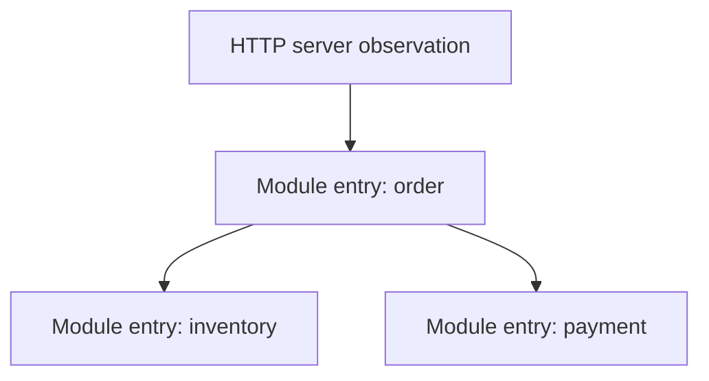
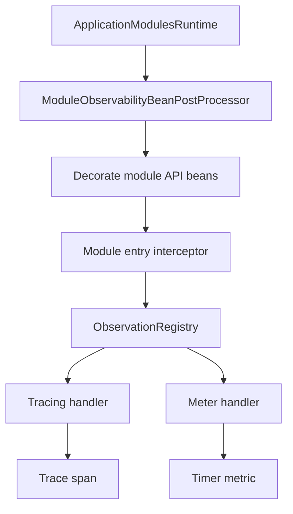
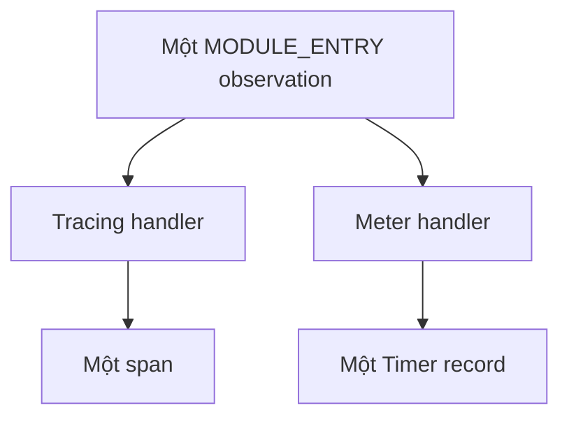
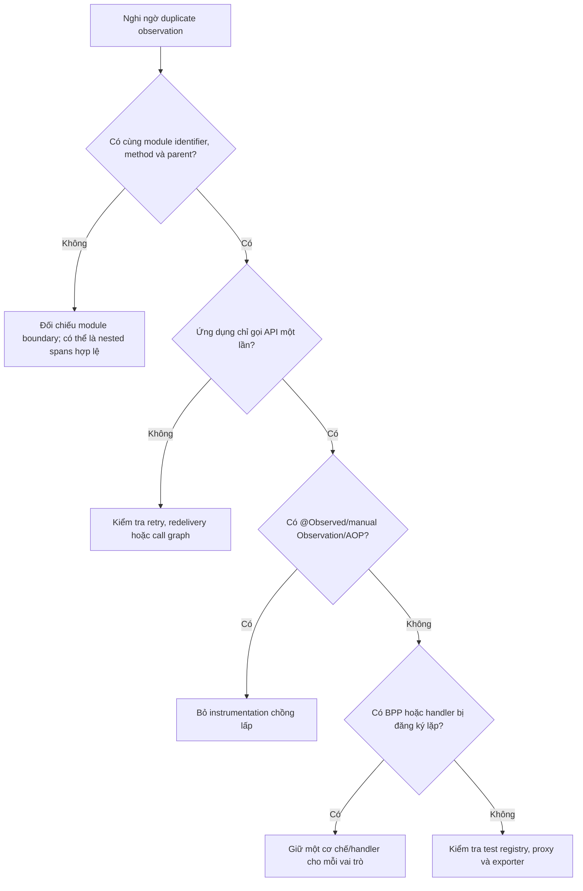

# Kiểm thử không tạo duplicate observation

## 1. Vì sao cần kiểm thử observation bị tạo trùng?

Spring Modulith có thể tự động quan sát lời gọi đi vào API của application module. Mỗi lần một Spring component thuộc API module được gọi qua proxy, instrumentation tạo một module entry observation. Khi tracing được bật, observation có thể trở thành span; khi meter handler được đăng ký, nó có thể trở thành Timer.

Giả sử ứng dụng Spring Boot có các module `order`, `inventory` và `payment`. Một request đặt hàng gọi qua hai ranh giới module:

```text
HTTP request
└── order.place()
    ├── inventory.reserve()
    └── payment.authorize()
```

Hai hoặc ba module entry spans trong cùng trace có thể là kết quả hoàn toàn đúng: mỗi span đại diện cho một lần đi vào API module. Nhưng nếu cùng một method `inventory.reserve()` bị instrument bởi Spring Modulith và một aspect `@Observed` khác, trace có thể xuất hiện hai observation bao quanh cùng một thao tác. Timer count cũng có thể bị tăng hai lần nếu cùng một observation được xử lý bởi meter handler bị đăng ký lặp.

Bài **“Kiểm thử không tạo duplicate observation”** thuộc chương **Kiểm thử** của **SPRING_MODULITH_DOCUMENTATION_OBSERVABILITY**. Module này hướng dẫn dùng Spring Modulith tạo tài liệu ranh giới application module và quan sát tương tác giữa các phần trong ứng dụng Spring Boot qua module graph, Actuator, event metrics, tracing và context propagation.

Sau bài học, bạn có thể:

1. Phân biệt module entry spans lồng nhau hợp lệ với observation bị instrument trùng.
2. Nhận diện annotation, aspect, manual observation và bean post-processor có thể tạo lớp đo lặp.
3. Kiểm tra số lần module entry observation được start cho một lần gọi.
4. Dùng `TestObservationRegistry.clear()` để cô lập dữ liệu giữa các test.
5. Kiểm tra số observation theo module identifier thay vì đếm mọi span trong trace.
6. Tránh đăng ký trùng ObservationHandler hoặc ModuleObservabilityBeanPostProcessor.
7. Phân biệt duplicate instrumentation với retry, event redelivery và nhiều lần gọi nghiệp vụ thực sự.

## 2. Trước hết: nhiều module entry spans không đồng nghĩa duplicate

Spring Modulith instrument các Spring component thuộc API của application module. Khi module `order` gọi API của module `inventory`, đó là hai lần đi vào hai ranh giới module khác nhau. Nếu module inventory tiếp tục gọi module payment, thêm một module entry span nữa cũng là đúng.



Trong ví dụ này, ba observation có ý nghĩa khác nhau:

| Observation | Ý nghĩa | Có phải duplicate? |
| --- | --- | --- |
| HTTP server observation | Đo request đi vào ứng dụng | Không |
| Module entry `order` | Request đi vào API module order | Không |
| Module entry `inventory` | Order gọi API module inventory | Không |
| Module entry `payment` | Order gọi API module payment | Không |

Ngay cả khi hai module entry observations có cùng tên kỹ thuật `MODULE_ENTRY`, chúng vẫn có thể là hai span hợp lệ nếu module identifier hoặc parent-child relation khác nhau.

**Duplicate observation** trong bài này là tình huống cùng một lần thực thi ở cùng một điểm instrumentation bị ghi nhận lặp do hai cơ chế quan sát chồng lên nhau, hoặc một handler xử lý cùng lifecycle nhiều lần. Không dùng số lượng span trong toàn trace làm tiêu chí duy nhất.

### 2.1. Dấu hiệu của observation trùng thật sự

Một số dấu hiệu đáng điều tra:

- Một lần gọi trực tiếp một module API nhưng có hai module entry spans giống metadata, cùng module identifier và method, cùng khoảng thời gian gần như trùng nhau.
- Một method có cả module entry span tự động và một span `@Observed` bao quanh cùng phần code mà không có mục tiêu quan sát riêng.
- Một Timer count tăng gấp đôi dù test chỉ gọi method một lần và chỉ có một observation lifecycle dự kiến.
- Cùng một observation name được ghi bởi hai handler hoặc hai interceptor cùng đo một thao tác.
- Một module entry span xuất hiện hai lần cùng parent, cùng module, cùng method trong khi application code chỉ gọi API một lần và không có retry.

Không kết luận duplicate chỉ vì trace có nhiều span cùng tên. Hãy so sánh module identifier, method, parent span ID, thời gian và số lần gọi thực tế.

## 3. Spring Modulith tự tạo module entry observation ở đâu?

Spring Modulith observability đăng ký `ModuleObservabilityBeanPostProcessor`. Bean post-processor này trang trí các Spring component thuộc API của application module bằng interceptor. Khi method được gọi qua proxy, interceptor tạo module entry observation và kết thúc observation khi lời gọi hoàn tất.

Luồng khái quát:



Với Insight starter, observability auto-configuration tạo bean post-processor cần thiết. Ứng dụng thường không cần tự khai báo một bean `ModuleObservabilityBeanPostProcessor` khác.

Thông tin module entry observation gồm:

| Key | Cardinality | Mục đích |
| --- | --- | --- |
| `module.identifier` | Low | Định danh module |
| `module.name` | Low | Tên hiển thị module |
| `module.invocation-type` | Low | `bean` hoặc `event listener` |
| `module.method` | High | Method được thực thi |

Khi kiểm thử, lọc observation theo tên lấy từ `ModulithObservations.MODULE_ENTRY.getName()` rồi đối chiếu các low-cardinality keys. Không đếm mọi observation trong registry vì HTTP server, database, messaging và các instrumentation khác cũng có thể tạo observation hợp lệ.

## 4. Các nguyên nhân thường tạo observation trùng

### 4.1. Đặt @Observed trên method đã được Modulith instrument

Spring Modulith đã tự instrument module API. Nếu đồng thời bật annotation scanning của Micrometer và đặt `@Observed` trên chính method đó, một lần gọi có thể tạo thêm observation từ aspect annotation.

Spring Boot bật hỗ trợ annotation scanning bằng:

```yaml
management:
  observations:
    annotations:
      enabled: true
```

Tính năng này yêu cầu AspectJ weaver theo tài liệu Spring Boot. Khi một method đã được instrument tự động lại có `@Observed`, có thể xuất hiện các observation chồng lên nhau. Spring Boot cũng cảnh báo tình huống duplicate khi annotate các thành phần vốn đã được instrument, ví dụ Spring MVC controller hoặc Spring Data repository.

Ví dụ dễ gây đo lặp:

```java
@Service
public class InventoryManagement {

    @Observed(name = "inventory.reserve")
    public void reserve(String sku) {
        // Business logic
    }
}
```

Nếu `reserve()` đã là API module được Spring Modulith quan sát, annotation trên có thể tạo thêm một observation cho cùng thao tác.

**Cách xử lý:** bỏ `@Observed` khỏi method đã được module entry instrumentation bao phủ nếu annotation không mang mục tiêu đo riêng. Nếu thực sự cần một observation nghiệp vụ riêng, hãy đặt tên và phạm vi khác rõ ràng, không dùng nó để đo lại cùng một module boundary.

### 4.2. Tự tạo Observation thủ công quanh cùng module API

Một trường hợp khác là code tự gọi `Observation.createNotStarted(...)` quanh method mà Modulith đã tự quan sát:

```java
@Service
public class InventoryManagement {

    private final ObservationRegistry registry;

    public InventoryManagement(ObservationRegistry registry) {
        this.registry = registry;
    }

    public void reserve(String sku) {
        Observation.createNotStarted("inventory.reserve", registry)
            .observe(() -> doReserve(sku));
    }

    private void doReserve(String sku) {
        // Business logic
    }
}
```

Nếu bean này là module API, Modulith đã tạo module entry observation bên ngoài method. Observation thủ công ở đây tạo thêm một span/timer cho cùng khoảng xử lý.

Có hai hướng:

- Dùng module entry observation sẵn có và bổ sung metadata bằng `ModulithObservationConvention`.
- Nếu cần quan sát một thao tác con có ý nghĩa độc lập, tạo observation cho đúng thao tác con và đặt tên phản ánh rõ mục tiêu, ví dụ một lời gọi gateway hoặc một bước xử lý nghiệp vụ riêng.

Không bọc lại toàn bộ module API chỉ để thêm một tag mà convention có thể cung cấp.

### 4.3. Đăng ký ModuleObservabilityBeanPostProcessor lần thứ hai

Khi có Insight starter hoặc observability support, auto-configuration đã tạo `ModuleObservabilityBeanPostProcessor`. Nếu ứng dụng tự khai báo thêm một bean post-processor cùng chức năng hoặc import một cấu hình cũ cũng tạo interceptor, bean có thể bị decorate nhiều lần.

Kiểm tra:

- Có tự khai báo `ModuleObservabilityBeanPostProcessor` trong cấu hình không?
- Có cấu hình observability nội bộ cũ vẫn tạo module tracing advisor không?
- Có hai auto-configuration/custom starter cùng đăng ký instrumentation module không?
- Có nhiều Spring application context cùng khởi tạo và quan sát cùng một bean không?

Chỉ để một cơ chế chịu trách nhiệm cho module entry instrumentation. Không copy bean post-processor nội bộ của Spring Modulith vào cấu hình ứng dụng nếu starter đã cung cấp nó.

### 4.4. Đăng ký ObservationHandler lặp

ObservationRegistry cho phép đăng ký nhiều handler. Đây là thiết kế hợp lệ khi cần một observation vừa tạo Timer vừa tạo span. Nhưng nếu cùng một `DefaultMeterObservationHandler` hoặc tracing handler bị đăng ký hai lần trên cùng registry, cùng lifecycle có thể bị xử lý lặp.

Ví dụ cần tránh:

```java
registry.observationConfig()
    .observationHandler(new DefaultMeterObservationHandler(meterRegistry))
    .observationHandler(new DefaultMeterObservationHandler(meterRegistry));
```

Hai handler giống nhau có thể cùng ghi cùng meter khi observation dừng. Timer trong registry có thể nhận hai lần record cho một lần thực thi.

Spring Boot tự cấu hình handler tương ứng khi có observability infrastructure phù hợp. Nếu cần custom handler, kiểm tra danh sách handler đã đăng ký và tránh thêm bản sao của handler mặc định.

### 4.5. Nhiều AOP aspect cùng đo một method

Ứng dụng có thể dùng:

- Spring Modulith module entry instrumentation.
- Micrometer annotation aspect.
- Aspect nội bộ ghi observation.
- Thư viện tracing cũ còn được giữ lại sau khi nâng cấp.

Các proxy AOP khác nhau không tự động tạo duplicate observation. Chỉ những aspect thực sự tạo observation/span cho cùng thao tác mới gây đo lặp. `@Transactional` hoặc `@Validated` tự thân không phải module entry observation.

Kiểm tra pointcut và method được annotate. Nếu một aspect cũ đã bao phủ module API, quyết định rõ nên giữ instrumentation nào.

## 5. Những trường hợp trông giống duplicate nhưng là hành vi đúng

### 5.1. Module entry span lồng nhau

Order gọi inventory, inventory gọi payment. Mỗi lần đi qua module API khác là một boundary invocation hợp lệ. Giữ các span này để xem dependency và thời gian giữa module.

### 5.2. Retry hoặc event redelivery

Nếu một lời gọi được thử lại ba lần, có ba lần thực thi thật. Nếu một event listener được gọi lại do retry/redelivery, mỗi attempt có thể tạo module entry observation riêng.

Để phân biệt:

- Kiểm tra retry count, event publication identifier và log nghiệp vụ.
- Xem parent span và thời điểm từng attempt.
- Xác nhận có retry policy hoặc redelivery policy đang hoạt động không.
- Không xóa instrumentation để che giấu nhiều lần thực thi thật.

### 5.3. HTTP observation và module entry observation

Một request có thể tạo HTTP server observation, HTTP client observation và module entry observations. Chúng đo các lớp khác nhau:

| Observation | Phạm vi |
| --- | --- |
| HTTP server | Request đi vào ứng dụng |
| Module entry | Lời gọi đi vào module API |
| HTTP client | Request rời ứng dụng qua HTTP |
| Database client | Truy vấn database |

Không bỏ HTTP server observation chỉ vì trace còn có module entry span.

### 5.4. Test registry còn dữ liệu từ test trước

`TestObservationRegistry` lưu các context observation đã được tạo. Nếu dùng cùng registry qua nhiều test và không xóa dữ liệu, assertion của test sau có thể nhìn thấy observation cũ.

Đây là duplicate trong **dữ liệu kiểm thử**, không nhất thiết là duplicate instrumentation lúc runtime.

Dùng `TestObservationRegistry.clear()` trước mỗi test hoặc tạo registry mới cho từng test context. Phương thức `clear()` xóa các context đã lưu và reset validator của registry.

### 5.5. Self-invocation thường gây thiếu observation

Khi một method gọi method khác trong cùng object qua `this.someMethod()`, lời gọi có thể bỏ qua Spring proxy. Điều này thường khiến observation dự kiến không được tạo, chứ không phải tạo trùng.

Nếu cần một module boundary mới, gọi bean API qua Spring-managed dependency/proxy và kiểm tra module API thực tế.

## 6. Chiến lược kiểm thử không tạo duplicate

Một test chống duplicate nên kiểm tra **một hành động có chủ đích** và **số module entry observations dự kiến**:

1. Làm sạch registry trước khi gọi method.
2. Gọi một Spring-managed module API đúng một lần.
3. Chỉ đếm observation có tên `MODULE_ENTRY`.
4. Nhóm theo module identifier.
5. Assert đúng số lần start cho từng module.
6. Assert các observation đã stop và không còn scope hiện hành.

Nếu chỉ kiểm tra “có observation” thì test vẫn pass khi có hai observation trùng. Cần assertion về số lượng khi mục tiêu của test là phát hiện duplicate.

### 6.1. Test đơn giản với một module entry

Trong một module integration test cô lập, nếu chỉ có một module API được gọi và không có observation khác, có thể dùng `hasSingleObservationThat()`:

```java
@ApplicationModuleTest
@Import(ObservationTestConfiguration.class)
class InventoryObservationTests {

    @Autowired
    InventoryManagement inventory;

    @Autowired
    TestObservationRegistry registry;

    @Test
    void oneModuleApiCallCreatesOneObservation() {
        registry.clear();

        inventory.reserve("SKU-42");

        assertThat(registry)
            .doesNotHaveAnyRemainingCurrentObservation()
            .hasSingleObservationThat()
            .hasNameEqualTo(
                ModulithObservations.MODULE_ENTRY.getName()
            )
            .hasBeenStarted()
            .hasBeenStopped()
            .hasLowCardinalityKeyValue(
                ModulithObservations.LowKeys.MODULE_IDENTIFIER.asString(),
                "inventory"
            );
    }
}
```

Đây là assertion nghiêm ngặt: nếu registry còn HTTP, database hoặc observation khác thì `hasSingleObservationThat()` sẽ không phù hợp. Trong HTTP integration test hoặc test có nhiều module, hãy lọc theo module entry name và đếm theo module identifier.

### 6.2. Đếm riêng module entry observations

Để đếm chính xác observation theo module, có thể đăng ký một test handler trên đúng `ObservationRegistry` mà Modulith interceptor sử dụng:

```java
import java.util.Map;
import java.util.concurrent.ConcurrentHashMap;
import java.util.concurrent.atomic.AtomicInteger;

import io.micrometer.observation.Observation;
import io.micrometer.observation.ObservationHandler;
import org.springframework.modulith.observability.ModulithObservations;

final class ModuleEntryObservationCounter
        implements ObservationHandler<Observation.Context> {

    private static final String MODULE_IDENTIFIER =
        ModulithObservations.LowKeys.MODULE_IDENTIFIER.asString();

    private final Map<String, AtomicInteger> starts =
        new ConcurrentHashMap<>();

    @Override
    public boolean supportsContext(Observation.Context context) {
        return ModulithObservations.MODULE_ENTRY.getName()
            .equals(context.getName());
    }

    @Override
    public void onStart(Observation.Context context) {
        var module = context.getLowCardinalityKeyValue(MODULE_IDENTIFIER);

        if (module != null) {
            starts.computeIfAbsent(
                module.getValue(),
                ignored -> new AtomicInteger()
            ).incrementAndGet();
        }
    }

    int count(String moduleIdentifier) {
        var value = starts.get(moduleIdentifier);
        return value == null ? 0 : value.get();
    }

    int total() {
        return starts.values().stream()
            .mapToInt(AtomicInteger::get)
            .sum();
    }

    void reset() {
        starts.clear();
    }
}
```

Handler này chỉ đếm observation có tên module entry; nó bỏ qua HTTP, JDBC và các observation khác. Đăng ký handler đúng một lần trên registry của test context:

```java
TestObservationRegistry registry = TestObservationRegistry.create();
ModuleEntryObservationCounter counter =
    new ModuleEntryObservationCounter();

registry.observationConfig().observationHandler(counter);
```

Trong Spring integration test, cấu hình để Modulith sử dụng chính registry này, sau đó đăng ký counter handler một lần sau khi registry được tạo. Không vừa khai báo counter như một handler bean để Boot tự đăng ký, vừa tự gọi `observationHandler(counter)` thêm lần nữa.

### 6.3. Assert một lần gọi chỉ tạo một module entry

Khi test context đã dùng registry và counter ở trên:

```java
@BeforeEach
void resetObservations() {
    registry.clear();
    counter.reset();
}

@Test
void inventoryEntryIsObservedOnce() {
    inventory.reserve("SKU-42");

    assertThat(counter.count("inventory")).isEqualTo(1);
    assertThat(counter.total()).isEqualTo(1);
    assertThat(registry)
        .doesNotHaveAnyRemainingCurrentObservation();
}
```

Nếu số đếm là 2 dù method chỉ được gọi một lần, hãy kiểm tra annotation, custom aspect, manual observation và bean post-processor. Nếu số đếm là 0, kiểm tra method có thực sự là module API và lời gọi có đi qua Spring proxy hay không.

## 7. Kiểm thử nested module calls với số lượng mong đợi

Một request có thể đi qua nhiều module. Test cần xác định trước số entry point thực tế sẽ được gọi:

```text
order.placeOrder()
  ├── inventory.reserve()
  └── payment.authorize()
```

Nếu mỗi method là một module API được instrument và được gọi đúng một lần, số observation mong đợi là:

| Module | Số lần gọi API | Số module entry observations mong đợi |
| --- | ---: | ---: |
| order | 1 | 1 |
| inventory | 1 | 1 |
| payment | 1 | 1 |
| **Tổng** | **3** | **3** |

Ví dụ:

```java
@Test
void crossModuleFlowCreatesOneEntryPerBoundary() {
    registry.clear();
    counter.reset();

    order.placeOrder("order-42");

    assertThat(counter.count("order")).isEqualTo(1);
    assertThat(counter.count("inventory")).isEqualTo(1);
    assertThat(counter.count("payment")).isEqualTo(1);
    assertThat(counter.total()).isEqualTo(3);
}
```

Đây là ví dụ minh họa. Điều chỉnh số lần theo call graph thực tế: nếu order gọi inventory hai lần, hai inventory module entry observations là đúng. Không đặt tổng bằng 1 cho một luồng có nhiều module boundary.

### 7.1. Assert parent-child relation khi kiểm tra trace

Nếu test có in-memory tracing exporter, ngoài số lượng observation hãy kiểm tra quan hệ span:

- Span của order là parent của span inventory/payment nếu lời gọi diễn ra đồng bộ trong scope đó.
- Mỗi lần invocation có span ID riêng.
- Span con có cùng trace ID với trace cha.
- Không có hai span cùng module/method/parent chỉ vì hai instrumentation chồng lên nhau.

Một span con hợp lệ có thể có thời gian nằm hoàn toàn trong span cha. Không kết luận duplicate chỉ từ việc các khoảng thời gian chồng lấp.

## 8. Làm sạch TestObservationRegistry giữa các test

`TestObservationRegistry` giữ lại các observation context đã ghi nhận để test có thể assert. Nếu Spring test context được cache và registry bean sống qua nhiều test method, observation cũ có thể làm test sau thấy nhiều kết quả hơn dự kiến.

Ví dụ:

```java
@BeforeEach
void setUp() {
    registry.clear();
    counter.reset();
}
```

`clear()` xóa context đã lưu và trạng thái validator của TestObservationRegistry. Counter tùy chỉnh là object riêng nên cần reset riêng.

Một số nguyên tắc:

- Tạo registry riêng cho test context khi cần isolation mạnh.
- Nếu dùng registry chung, clear trước mỗi test và reset mọi recorder/handler tự viết.
- Không chạy song song các test cùng mutate một registry dùng chung nếu assertion đòi hỏi số đếm chính xác.
- Với event listener async, đợi listener hoàn tất trước khi đọc counter.
- Không clear registry trong khi observation vẫn đang chạy; chờ lifecycle hoàn tất trước.

Nếu test có nhiều observation hợp lệ như HTTP server và module entry, không dùng `hasSingleObservationThat()` trên toàn registry. Dùng handler lọc `MODULE_ENTRY` hoặc assertion theo tên/module key.

## 9. Xử lý khi phát hiện duplicate

Điều tra theo thứ tự:

1. **Xác nhận có phải duplicate:** đối chiếu module identifier, method, parent span ID, thời gian và số lần gọi thực tế.
2. **Kiểm tra annotation:** tìm `@Observed`, `@NewSpan` hoặc annotation observability khác trên module API.
3. **Kiểm tra manual instrumentation:** tìm `Observation.createNotStarted(...)` hoặc tracer span tự tạo quanh cùng method.
4. **Kiểm tra AOP:** rà soát aspect nội bộ và pointcut trùng với module API.
5. **Kiểm tra bean post-processor:** bảo đảm chỉ một ModuleObservabilityBeanPostProcessor chịu trách nhiệm.
6. **Kiểm tra handler:** xác nhận MeterObservationHandler/TracingObservationHandler không bị đăng ký lặp.
7. **Kiểm tra retry:** xác nhận ứng dụng không thực sự gọi lại method hoặc giao lại event.
8. **Kiểm tra test isolation:** clear TestObservationRegistry và custom counters giữa các test.

Sửa tại nguồn instrumentation trùng. Sau đó chạy lại test đếm số observation và kiểm tra trace thực tế.

## 10. Chọn giải pháp phù hợp

| Nguyên nhân | Giải pháp nên dùng |
| --- | --- |
| `@Observed` trên module API đã được Modulith instrument | Bỏ annotation hoặc chuyển observation sang thao tác con có mục tiêu riêng |
| Manual Observation bao trùm toàn module method | Dùng module entry observation; thêm metadata bằng convention |
| Hai ModuleObservabilityBeanPostProcessor | Giữ auto-configuration của starter, bỏ bean post-processor tự tạo |
| Meter handler đăng ký hai lần | Giữ một handler cho mỗi vai trò trên registry |
| Custom AOP aspect đo cùng method | Thu hẹp pointcut hoặc bỏ instrumentation chồng lấp |
| Test registry giữ dữ liệu cũ | Gọi `clear()` và reset counter trước mỗi test |
| Retry/redelivery gọi method nhiều lần | Giữ observation cho từng attempt và thể hiện attempt/retry trong metadata phù hợp |
| Nested module calls | Giữ các span; đó là các module boundary khác nhau |

### 10.1. Dùng ObservationConvention để bổ sung metadata

Nếu mục đích của annotation/manual observation chỉ là thêm tag cho module entry, hãy xem xét `ModulithObservationConvention`. Convention cho phép tùy chỉnh tên hoặc key-values của observation theo context mà không tạo thêm một observation thứ hai.

Ví dụ khung cấu hình:

```java
@Configuration
class ModulithObservationConfiguration {

    @Bean
    ModulithObservationConvention modulithObservationConvention() {
        return new CustomModulithObservationConvention();
    }
}
```

Convention tùy chỉnh cần giữ các key mặc định cần thiết, nhất là low-cardinality module identifier và invocation type. Tránh đưa request ID, user ID hoặc order ID vào low-cardinality metric tags.

### 10.2. ObservationPredicate không phải cách chữa duplicate đầu tiên

Có thể dùng `ObservationPredicate` để ngăn một nhóm observation được tạo. Tuy nhiên, nếu lọc toàn bộ tên `MODULE_ENTRY`, mọi module entry observations đều bị tắt, kể cả observation hợp lệ. Predicate không tự phân biệt được observation do Modulith tạo với observation do một aspect khác tạo nếu chúng có cùng name/context.

Vì vậy, hãy bỏ instrumentation chồng lấp trước. Chỉ dùng predicate khi chủ đích là loại bỏ cả một loại observation, và phải kiểm tra ảnh hưởng đến cả tracing lẫn metrics.

## 11. Một observation tạo metric và trace cùng lúc là bình thường

Micrometer Observation được thiết kế theo hướng instrument một lần và để nhiều handler xử lý cùng lifecycle:



Một observation có thể tạo cả span và Timer mà không phải duplicate. Điều cần tránh là hai instrumentation độc lập cùng tạo observation cho một thao tác, hoặc một handler cùng vai trò bị đăng ký lặp.

| Hiện tượng | Diễn giải |
| --- | --- |
| Một module entry observation tạo một span và một Timer | Bình thường |
| Một method tạo module entry observation và một observation nghiệp vụ riêng có mục tiêu khác | Có thể hợp lệ nếu phạm vi khác nhau |
| Một method tạo hai module entry observations do hai interceptor cùng áp dụng | Duplicate cần xử lý |
| Một observation được hai meter handler giống nhau ghi nhận | Có thể làm Timer count/duration bị nhân đôi |
| Trace ít hơn Timer count | Có thể do trace sampling hoặc exporter; không tự chứng minh duplicate |

Trace sampling có thể loại một phần span trong khi Timer metrics vẫn ghi nhận observation hoàn tất. Vì vậy, không so sánh số span backend với Timer count như hai con số bắt buộc phải bằng nhau.

## 12. Cấu hình TestObservationRegistry cho integration test

Ví dụ cấu hình test cung cấp registry mà Spring Modulith sử dụng:

```java
@TestConfiguration(proxyBeanMethods = false)
class ObservationTestConfiguration {

    @Bean
    @Primary
    TestObservationRegistry testObservationRegistry() {
        return TestObservationRegistry.create();
    }
}
```

Đăng ký counter handler đúng một lần sau khi test context đã khởi tạo. Ví dụ với JUnit test instance dùng chung:

```java
@ApplicationModuleTest
@Import(ObservationTestConfiguration.class)
@TestInstance(TestInstance.Lifecycle.PER_CLASS)
class InventoryNoDuplicateObservationTests {

    @Autowired
    InventoryManagement inventory;

    @Autowired
    TestObservationRegistry registry;

    private final ModuleEntryObservationCounter counter =
        new ModuleEntryObservationCounter();

    @BeforeAll
    void registerCounterOnce() {
        registry.observationConfig().observationHandler(counter);
    }

    @BeforeEach
    void resetTestState() {
        registry.clear();
        counter.reset();
    }

    @Test
    void oneCallCreatesOneModuleEntry() {
        inventory.reserve("SKU-42");

        assertThat(counter.count("inventory")).isEqualTo(1);
        assertThat(counter.total()).isEqualTo(1);
        assertThat(registry)
            .doesNotHaveAnyRemainingCurrentObservation();
    }
}
```

Trong ví dụ này, counter được gắn vào registry một lần ở `@BeforeAll`. Không chuyển thao tác đăng ký handler vào `@BeforeEach` vì mỗi lần test chạy sẽ thêm một handler nữa và chính test setup có thể tạo ra duplicate.

Nếu dự án dùng test instance lifecycle mặc định, có thể đăng ký handler qua một `ObservationRegistryCustomizer` hoặc cấu hình test bean tương đương. Dù chọn cách nào, cần bảo đảm handler chỉ được thêm một lần trên registry của application context.

## 13. Chẩn đoán theo triệu chứng

| Triệu chứng | Nguyên nhân có thể | Cách xác minh và xử lý |
| --- | --- | --- |
| Một lần gọi API có hai module entry spans cùng module/method | `@Observed`, manual observation hoặc hai module interceptors | Kiểm tra annotation, custom aspect và BPP registration |
| Một module entry span cùng với HTTP server span | Hai instrumentation đo hai boundary khác nhau | Đây là hành vi bình thường |
| Timer count tăng gấp đôi nhưng test counter chỉ đếm một module entry | Meter handler bị đăng ký lặp | Kiểm tra handler trên ObservationRegistry |
| Test thấy thêm observation từ test trước | TestObservationRegistry được dùng chung mà chưa clear | Gọi `registry.clear()` và reset recorder |
| Cross-module test có ba module entry spans | Ba module API được gọi | Đối chiếu call graph; có thể là kết quả mong đợi |
| Có nhiều span vì listener được retry | Event redelivery hoặc retry policy | Kiểm tra event publication, attempt và retry logs |
| Không có module entry observation | Lời gọi không qua Spring proxy hoặc bean không thuộc API được instrument | Gọi Spring-managed API bean; kiểm tra module API |
| Có module entry nhưng không có Timer | Meter handler/registry không hoạt động | Kiểm tra MeterRegistry và DefaultMeterObservationHandler |
| Có Timer nhưng ít span hơn | Sampling hoặc exporter | Kiểm tra sampled decision và exporter |
| Có observation nhưng không thấy trong test registry | Modulith đang dùng registry khác | Kiểm tra bean ObservationRegistry thực tế trong context |
| Hai span có tên giống nhau nhưng module identifier khác | Hai module entry boundary riêng | Không gộp chỉ theo tên span |

### Quy trình điều tra



## 14. Bài thực hành

Thực hành với ứng dụng có module `order`, `inventory` và `payment`:

1. Bật Spring Modulith Insight và kiểm tra module entry instrumentation được tự cấu hình.
2. Tạo một test module dùng `@ApplicationModuleTest` và `TestObservationRegistry`.
3. Gọi trực tiếp `InventoryManagement.reserve(...)` đúng một lần.
4. Đếm observation theo tên `ModulithObservations.MODULE_ENTRY` và module identifier `inventory`; kỳ vọng đúng một lần start.
5. Tạm thêm `@Observed` vào method đã instrument, bật annotation scanning trong profile test và quan sát observation chồng lên nhau.
6. Bỏ annotation trùng, chạy lại test và xác nhận module entry count trở về một.
7. Tạo luồng order gọi inventory và payment; xác nhận mỗi module có một entry observation theo số lần gọi.
8. Thử gọi inventory hai lần có chủ đích; xác nhận count là hai và giải thích đây là hai invocation thật.
9. Kiểm tra test registry được clear trước mỗi test; counter tùy chỉnh được reset riêng.
10. Nếu Timer count gấp đôi trong khi module entry count bằng một, kiểm tra MeterObservationHandler registration.
11. Nếu trace count thấp hơn Timer count, kiểm tra sampling/exporter trước khi kết luận duplicate.
12. Xác nhận không có bean post-processor tự tạo trùng với auto-configuration của Insight starter.

Checklist hoàn thành:

- [ ] Phân biệt nested module entry spans với duplicate instrumentation.
- [ ] Hiểu ModuleObservabilityBeanPostProcessor tự decorate module API beans.
- [ ] Nhận diện `@Observed` và manual Observation chồng lên module entry.
- [ ] Kiểm tra không có ModuleObservabilityBeanPostProcessor bị đăng ký hai lần.
- [ ] Kiểm tra MeterObservationHandler/TracingObservationHandler không bị đăng ký lặp.
- [ ] Đếm module entry observation theo module identifier.
- [ ] Assert đúng số lần gọi dự kiến cho một module boundary.
- [ ] Dùng `TestObservationRegistry.clear()` và reset custom counter giữa các test.
- [ ] Hiểu retry/event redelivery tạo invocation thật và observation riêng.
- [ ] Không nhầm HTTP/database observations với module entry observations.
- [ ] Phân biệt một observation tạo cả metric và trace với duplicate instrumentation.
- [ ] Kiểm tra trace sampling và exporter trước khi so sánh span count với Timer count.
- [ ] Chạy test cho một module và luồng gọi qua nhiều module.

## 15. Tài liệu tham khảo

- [Spring Modulith — Production-ready Features](https://docs.spring.io/spring-modulith/reference/production-ready.html): observability support, module entry spans và module API instrumentation.
- [Spring Modulith — ModuleObservabilityBeanPostProcessor API](https://docs.spring.io/spring-modulith/docs/current/api/org/springframework/modulith/observability/support/ModuleObservabilityBeanPostProcessor.html): bean post-processor decorate module API beans.
- [Spring Modulith — ModulithObservations API](https://docs.spring.io/spring-modulith/docs/current/api/org/springframework/modulith/observability/ModulithObservations.html): module entry observation và key definitions.
- [Spring Boot — Observability](https://docs.spring.io/spring-boot/reference/actuator/observability.html): annotation scanning, duplicate observations, ObservationPredicate và handler registration.
- [Micrometer — Testing Observations](https://docs.micrometer.io/micrometer/reference/observation/testing.html): `TestObservationRegistry`, `clear()` và assertions.
- [Micrometer — Observation Components](https://docs.micrometer.io/micrometer/reference/observation/components.html): registry, handlers, predicates, filters và convention.
- [Micrometer — Observation API](https://docs.micrometer.io/micrometer/reference/observation/introduction.html): lifecycle start/stop/error và vai trò ObservationHandler.
