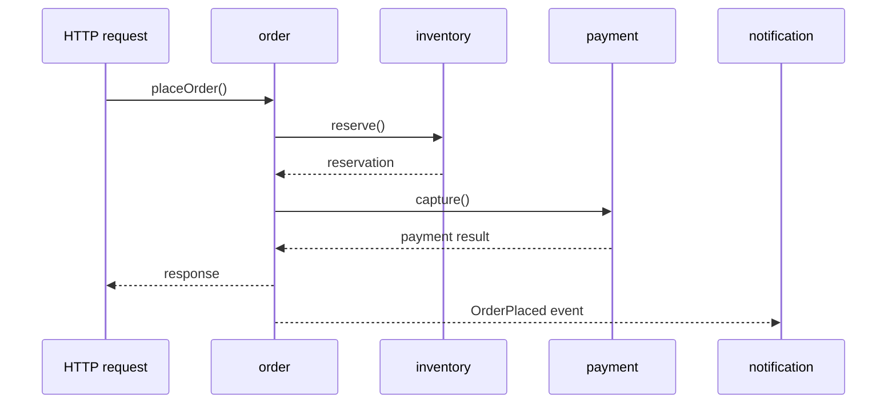
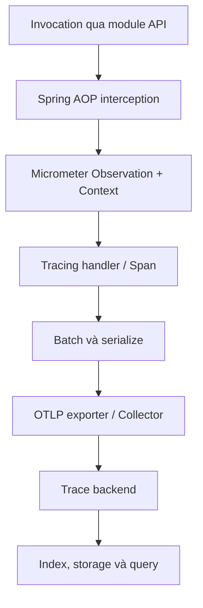

# Chi phí tạo module span

Trong ứng dụng Spring Boot dùng **Spring Modulith**, mỗi lần một module gọi component thuộc API của module khác có thể được ghi nhận bằng một span. Ví dụ, request đặt hàng đi từ `order` sang `inventory`, tiếp tục sang `payment`, rồi phát event để `notification` xử lý. Trace cho thấy thứ tự và thời gian của các bước này, nhưng instrumentation cũng tiêu tốn tài nguyên.

Chi phí không chỉ là gửi trace tới backend. Spring Modulith dùng aspect để intercept lời gọi tới các Spring component thuộc API của application module. Luồng đó có thể cần proxy/advice, tạo Observation và context, chạy ObservationHandler, quản lý scope và tạo span khi tracing được bật. Sau đó, span được batch, serialize và export theo cấu hình tracing.

Bài thuộc chương **Hiệu năng** của học phần `SPRING_MODULITH_DOCUMENTATION_OBSERVABILITY`. Học phần dùng Spring Modulith để sinh tài liệu ranh giới application module và quan sát tương tác giữa các phần trong ứng dụng Spring Boot thông qua module graph, Actuator, event metrics, tracing và context propagation. Bài này tập trung nhận diện các thành phần tạo ra chi phí, ước lượng số span, đo overhead bằng workload có kiểm soát và điều chỉnh instrumentation/sampling mà vẫn giữ được khả năng điều tra.

Sau bài học, bạn có thể:

- Giải thích các bước có chi phí khi tạo và export module span.
- Ước lượng số module span phát sinh theo request rate và số lần gọi qua module API.
- Phân biệt chi phí instrumentation, recording, export và lưu trữ.
- Hiểu sampling giảm phần chi phí nào và không giảm phần nào.
- Benchmark ứng dụng trước và sau khi bật Spring Modulith observability.
- Dùng JFR, metrics và trace backend để tìm nút thắt.
- Giảm span không cần thiết, tag cardinality và lượng dữ liệu export.
- Chọn mức quan sát phù hợp với mục tiêu local, staging và production.

> **Phạm vi ví dụ:** Spring Boot 3.5.x, Spring Modulith 1.4.x và Micrometer Observation/Tracing. Chi phí thực tế phụ thuộc JDK, phần cứng, số lần gọi module API, tracer, exporter, sampling, Collector và backend. Không có một phần trăm overhead cố định đúng cho mọi ứng dụng.

## 1. Module span được tạo ở đâu?

Spring Modulith có observability support để quan sát tương tác giữa application modules. Khi thêm dependency `spring-modulith-observability` (hoặc dùng Insight starter bao gồm phần observability tương ứng), các Spring component thuộc API của module được trang bị aspect để intercept invocation và tạo Micrometer span.

Ví dụ module structure:

```text
com.example.shop
├── order
│   └── OrderManagement
├── inventory
│   └── InventoryManagement
├── payment
│   └── PaymentManagement
└── notification
    └── OrderNotificationListener
```

Một request có thể gọi qua các module:



Trace có thể hiển thị các module entry spans lồng nhau dưới HTTP server span. Số span phụ thuộc số invocation đi qua các component API đã được instrument, không phụ thuộc đơn giản vào số lượng module được khai báo trong ứng dụng.

### Không phải mọi method Java đều tạo module span

- Spring Modulith quan sát component thuộc API của application module; không có nghĩa mọi method private/internal đều tự động trở thành span riêng.
- Invocation phải đi qua đường intercept của Spring component/proxy để aspect có thể chạy.
- Self-invocation qua `this.someMethod()` thường không đi qua Spring proxy, nên không nên giả định nó tạo một module entry span.
- Một module có nhiều component API được gọi nhiều lần có thể tạo nhiều span hơn module khác dù số module bằng nhau.
- Traces từ HTTP server, database, HTTP client và messaging có thể cùng xuất hiện trong trace; không phải tất cả đều là module spans do Spring Modulith tạo.

Khi đo hiệu năng, hãy đếm module spans riêng với tổng span count để biết phần nào đến từ instrumentation của Modulith.

## 2. Các lớp chi phí của một module span

Có thể chia chi phí thành năm lớp. Chúng xuất hiện ở các thời điểm khác nhau và có cách tối ưu khác nhau.

| Lớp | Hoạt động | Chi phí có thể phát sinh |
| --- | --- | --- |
| Interception | Proxy/advice chặn invocation tại module API | Thêm bước gọi, dispatch và kiểm tra |
| Observation | Tạo Observation, context, key-values và chạy lifecycle | Object allocation, CPU và quản lý scope |
| Span recording | Tracer tạo span, parent-child relationship, timestamps, status và attributes | CPU, allocation, context propagation |
| Export | Batch, serialize và gửi spans tới Collector/backend | CPU, bộ nhớ queue, network, thread |
| Storage/query | Collector và backend ingest, index, lưu và truy vấn | Dung lượng, index, CPU backend và chi phí vận hành |



Nếu tracing chưa được cấu hình, module instrumentation vẫn có thể đi qua proxy/Observation path tùy cách registry và handler được cấu hình; không nên mặc định rằng không có exporter thì toàn bộ chi phí instrumentation biến mất. Nếu có tracing handler, một sampled span còn thực hiện thêm công việc recording và export.

### Interception và Observation

Mỗi invocation bị intercept thêm một lớp xử lý quanh method nghiệp vụ. Observation có lifecycle start, error, stop và có thể mở/đóng scope để context hiện hành được truy cập trong quá trình xử lý.

Micrometer Observation dùng `ObservationRegistry`, `Observation.Context` và các `ObservationHandler`. Handler có thể tạo metrics, spans hoặc các hành động khác. Vì vậy, một Observation không đồng nghĩa một lần export trace; số lượng handler và cấu hình quyết định phần công việc bổ sung.

### Span recording và context propagation

Khi tracing handler hoạt động, span có thể chứa trace ID, span ID, parent relationship, timestamps, duration, status, exception, module identifier và các attributes đã cấu hình. Mở và đóng scope cũng có thể cần cập nhật context theo thread. Khi chạy asynchronous, executor hoặc message listener, việc truyền context có thể bổ sung công việc sao chép/khôi phục context. Hãy đo cả luồng đồng bộ lẫn bất đồng bộ nếu ứng dụng dùng cả hai.

### Export và backend

Exporter thường gom span thành batch trước khi gửi. Khi lưu lượng tăng, hệ thống có thể tiêu tốn thêm CPU để serialize, bộ nhớ cho queue/batch, băng thông và tài nguyên Collector/backend. Nếu backend chậm hoặc queue đầy, có thể xảy ra retry, drop hoặc backpressure tùy cấu hình.

Không đồng nhất thời gian xử lý business method với thời gian export. Exporter bất đồng bộ có thể không nằm trực tiếp trên critical path của request, nhưng vẫn dùng CPU, heap, thread và network trên cùng workload.

## 3. Ước lượng số module span

Một cách ước lượng ban đầu là đếm số lần một request đi qua các module API được instrument.

Giả sử mỗi request `POST /orders` gọi:

- `order` một lần.
- `inventory` hai lần (reserve và confirm).
- `payment` một lần.

Nếu cả bốn invocation đều được instrument, request có khoảng bốn module entry spans, chưa tính HTTP server span, database spans, HTTP client spans và spans của event listener.

Với workload ổn định, có thể ước lượng:

\[
\text{module spans/s} \approx
\text{requests/s} \times
\text{module spans/request}
\]

Nếu trace sampling được áp dụng với xác suất `p`, số module spans được ghi/export kỳ vọng xấp xỉ:

\[
\text{exported module spans/s} \approx
\text{requests/s} \times
\text{module spans/request} \times p
\]

Công thức là ước lượng cho tải tương đối ổn định và các trace được lấy mẫu nhất quán theo trace. Nó không phải dự báo chính xác cho một cửa sổ ngắn; retries, event listeners, background jobs và parent context có thể làm số span khác đi.

### Ví dụ tính tải

Giả sử 200 request/giây, trung bình 4 module spans/request và sampling probability `0.1`. Khi đó:

\[
200 \times 4 = 800
\]

Có khoảng 800 module span invocations/giây trước sampling. Với xác suất lấy mẫu 10%, số module spans được ghi/export kỳ vọng khoảng:

\[
800 \times 0.1 = 80
\]

Nếu tăng sampling lên `1.0`, backend có thể nhận khoảng 800 module spans/giây từ luồng này, cộng thêm HTTP, database, client và các span khác.

Đây là ví dụ để lập ngân sách telemetry, không phải số liệu đo của Spring Modulith. Số span thật cần lấy từ trace backend hoặc exporter metrics.

## 4. Sampling giảm chi phí nào?

Spring Boot mặc định cấu hình trace sampling probability là `0.1` (khoảng 10% trace) để hạn chế lượng dữ liệu gửi tới trace backend. Có thể cấu hình bằng:

```yaml
management:
  tracing:
    sampling:
      probability: 0.1
```

Đặt `1.0` để chọn mọi root trace theo sampler tỷ lệ; đặt `0.05` để chọn khoảng 5%.

**Sampling chủ yếu giảm số trace được ghi nhận/export và lượng dữ liệu downstream.** Với các trace không được chọn, tracer thường không ghi/export đầy đủ span như trace được sampled. Tuy nhiên, request vẫn đi qua đường instrumented: proxy/advice, Observation lifecycle, context và quyết định sampling vẫn có thể tạo overhead.

| Thành phần chi phí | Sampling thấp có giảm không? | Giải thích |
| --- | --- | --- |
| Proxy/advice invocation | Không đáng kể hoặc không | Invocation vẫn đi qua điểm intercept |
| Tạo Observation và context | Không nên giả định được loại bỏ | Observation lifecycle/predicate vẫn có thể chạy |
| Quyết định sampler | Không | Vẫn cần quyết định sampled hay not sampled |
| Recording span đầy đủ | Có | Trace không được chọn không cần ghi/export đầy đủ |
| Serialize và export span | Có | Ít span được gửi hơn |
| Collector/backend ingest và storage | Có | Nhận ít trace data hơn |
| Metrics độc lập/event counters | Không tự động | Metrics có pipeline riêng, không phụ thuộc trace sampling theo cách mặc định |

Không nên nói `sampling.probability: 0.1` làm instrumentation rẻ hơn đúng 90%. Nó có thể giảm phần recording/export gần 90% trong điều kiện phù hợp, nhưng không giảm 90% tổng overhead của ứng dụng vì interception và Observation vẫn còn.

### Parent-based sampling

Nếu ứng dụng nhận một trace context từ upstream, quyết định sampling của child spans có thể tuân theo parent. Trong môi trường nhiều service, không phải mọi request đều được quyết định độc lập chỉ dựa trên probability local. Khi so sánh kết quả benchmark, cần cố định parent context hoặc bắt đầu request không có incoming trace context để tránh sai lệch.

### Sampling không phải cách loại bỏ module instrumentation

Nếu muốn đo chi phí instrumentation thuần, cần so sánh build/configuration có và không có Spring Modulith observability support, hoặc dùng môi trường benchmark cô lập với cấu hình tracing khác nhau. Chỉ giảm sampling không tạo ra baseline hoàn toàn không có interception.

## 5. Benchmark trước và sau khi bật module spans

Không có con số overhead chung cho mọi ứng dụng. Cách đáng tin cậy là đo cùng một workload trong các cấu hình khác nhau.

| Run | Cấu hình | Mục tiêu |
| --- | --- | --- |
| A — Baseline | Không có Spring Modulith observability instrumentation | Mốc hiệu năng nghiệp vụ |
| B — Instrumentation | Bật instrumentation, tracing/export được tắt hoặc không recording theo cấu hình test phù hợp | Ước lượng chi phí proxy/Observation/interception |
| C — Sampled | Bật tracing, sampling `0.1`, exporter và Collector hoạt động | Chi phí trong cấu hình sampled thực tế |
| D — Full trace | Bật tracing, sampling `1.0`, exporter và Collector hoạt động | Chi phí khi giữ mọi trace |

Run B chỉ dùng được nếu môi trường có thể tắt recording mà vẫn giữ được instrumentation path. Nếu cấu hình cụ thể không cho phép tách hai phần đó, ghi rõ giới hạn và so sánh A, C, D; đừng gọi B là “chi phí Observation thuần” nếu vẫn có tracer/exporter khác tham gia.

### Cố định điều kiện thử nghiệm

- Dùng cùng JDK, heap size, CPU limit, container image và cấu hình JVM.
- Dùng cùng dữ liệu test, database, downstream dependencies và network conditions.
- Warm up ứng dụng trước khi đo để JIT và class loading không làm lệch kết quả.
- Giữ request mix, concurrency và thời lượng tải tương đương.
- Chạy mỗi cấu hình nhiều lần và ghi median/percentile, không chỉ lấy một lần.
- Bảo đảm Collector/backend có đủ tài nguyên và không bị nghẽn trong một run nhưng không nghẽn ở run khác.
- Tách thời gian warm-up, thời gian đo và thời gian drain exporter queue sau khi kết thúc tải.

Không benchmark bằng cách chỉ gọi một method vài lần rồi suy ra chi phí production. Overhead nhỏ trên một invocation có thể trở nên đáng kể khi số lần gọi module API rất lớn.

## 6. Chỉ số cần theo dõi

Đo cả ứng dụng và telemetry pipeline. Nếu chỉ nhìn latency request, bạn có thể bỏ lỡ việc exporter queue hoặc Collector đang quá tải.

| Nhóm | Chỉ số | Điều cần quan sát |
| --- | --- | --- |
| Throughput | Requests/second | Có giảm khi bật instrumentation không? |
| Latency | p50, p95, p99 | Tail latency thay đổi bao nhiêu? |
| CPU | Process/container CPU | Chi phí intercept, recording và serialize |
| Memory | Heap used, allocation rate | Context/span object allocation |
| GC | Pause time, allocation pressure | Có thêm allocation hoặc GC pause không? |
| Span volume | Spans/second, spans/request | Module span count tăng ở luồng nào? |
| Export | Queue utilization, export failures/drops | Exporter có theo kịp tốc độ tạo span không? |
| Collector | Ingest rate, CPU, memory, rejected spans | Collector có đủ capacity không? |
| Backend | Ingestion, storage, query latency | Chi phí lưu trữ và truy vấn có tăng không? |
| Network | Bytes sent, connection saturation | Export có tạo thêm network pressure không? |

Các metric tên cụ thể của exporter/Collector thay đổi theo implementation và version. Dùng metric endpoint thực tế của hệ thống telemetry thay vì giả định một tên metric chung cho mọi exporter.

### Tính overhead tương đối

Với cùng workload, có thể tính:

\[
\text{Latency overhead (\%)} =
\frac{L_{\text{instrumented}} - L_{\text{baseline}}}
{L_{\text{baseline}}} \times 100
\]

Với CPU:

\[
\text{CPU overhead (\%)} =
\frac{CPU_{\text{instrumented}} - CPU_{\text{baseline}}}
{CPU_{\text{baseline}}} \times 100
\]

So sánh riêng p95/p99, throughput và CPU. Nếu latency gần như giữ nguyên nhưng CPU tăng, có thể workload bị giới hạn bởi I/O hoặc exporter bất đồng bộ. Nếu p99 tăng mạnh nhưng p50 gần như giữ nguyên, hãy xem GC, queue contention, network hoặc một nhánh request có nhiều module invocations.

Không dùng phần trăm overhead nếu baseline gần 0 hoặc mẫu thử quá nhỏ; báo cáo cả giá trị tuyệt đối và điều kiện đo.

## 7. Dùng JFR và profiler để tìm điểm nóng

Java Flight Recorder (JFR) giúp quan sát CPU samples, allocation, GC, thread contention và các sự kiện runtime trong một lần benchmark. Có thể bật JFR khi chạy ứng dụng:

```bash
java \
  -XX:StartFlightRecording=filename=module-span.jfr,settings=profile,dumponexit=true \
  -jar target/shop-modulith.jar
```

Sau khi workload kết thúc, mở file recording bằng Java Mission Control hoặc công cụ phân tích JFR phù hợp.

Khi so sánh baseline và instrumented run, chú ý:

- Stack frames liên quan tới Spring AOP/proxy và interceptor.
- Micrometer Observation lifecycle và context creation.
- Tracing bridge/tracer implementation.
- Span processor/exporter và serialization.
- Thread/lock contention ở batch processor hoặc logging.
- Allocation rate và GC pressure tăng trong giai đoạn load.

Tên class cụ thể tùy Spring Modulith, Micrometer, tracer và exporter version. Dùng flame graph hoặc JFR stack traces để xác định stack thực tế, không kết luận chỉ từ tên package.

### Phân biệt CPU trong request và CPU nền

Exporter bất đồng bộ có thể thực hiện phần lớn serialization/network ở worker thread. Vì vậy, request latency có thể chỉ tăng ít trong khi process CPU hoặc network tăng rõ. Đo process/container metrics cùng với request latency để thấy đầy đủ tác động.

## 8. Những yếu tố làm tăng số module spans

Số span thường tăng theo số invocation qua module API, không phải chỉ theo số module. Những trường hợp sau cần được chú ý:

- Một request gọi lặp lại cùng một module nhiều lần.
- Vòng lặp xử lý từng item và mỗi item gọi một module API.
- Retry tạo thêm invocation hoặc trace/span theo cách xử lý của ứng dụng.
- Event listener chạy bất đồng bộ và tạo thêm module entry observations.
- Nhiều module cùng được gọi trong một request.
- API bị chia quá nhỏ, tạo nhiều lần crossing boundary cho thao tác đơn giản.
- Một component API được gọi từ nhiều luồng hoặc nhiều request đồng thời.

Ví dụ:

```java
for (OrderItem item : items) {
    inventory.reserve(item);
}
```

Nếu mỗi lần `reserve` đi qua một component API được instrument, 100 item có thể tạo khoảng 100 module entry spans cho riêng module `inventory`.

Có thể cân nhắc API theo lô:

```java
inventory.reserveAll(items);
```

Một invocation theo lô có thể tạo ít module entry spans hơn, nhưng chỉ nên đổi API khi batch operation phù hợp với nghiệp vụ và semantics giao dịch. Không gộp module hoặc tạo API batch chỉ để giảm trace count nếu điều đó làm xấu ranh giới domain.

## 9. Giảm overhead mà vẫn giữ giá trị quan sát

### Chọn đúng ranh giới cần quan sát

- Giữ các module API phản ánh ranh giới nghiệp vụ có ý nghĩa.
- Tránh tạo nhiều entry point nhỏ chỉ để bọc các method nội bộ không cần quan sát.
- Dùng operation theo lô khi đó là cách mô hình hóa nghiệp vụ tự nhiên.
- Không gọi qua module API nhiều lần cho cùng dữ liệu nếu có thể tổ chức thao tác hợp lý hơn.
- Không biến mọi method trong ứng dụng thành custom span.

Mục tiêu là trace cho biết module nào thực sự tham gia và thời gian ở đâu, không phải tạo càng nhiều span càng tốt.

### Điều chỉnh sampling theo môi trường

Ví dụ cấu hình:

```yaml
# application-local.yml
management:
  tracing:
    sampling:
      probability: 1.0
```

```yaml
# application-staging.yml
management:
  tracing:
    sampling:
      probability: 0.25
```

```yaml
# application-production.yml
management:
  tracing:
    sampling:
      probability: 0.05
```

Các tỷ lệ staging/production chỉ là ví dụ. Hãy dựa trên lưu lượng, ngân sách span, retention và nhu cầu điều tra. Local thường cần nhiều trace hơn để gỡ lỗi; production cần cân bằng độ phủ và chi phí.

Nhắc lại: sampling giảm lượng trace được ghi/export, không loại bỏ hoàn toàn chi phí interception/Observation. Không chọn sampling quá thấp chỉ để chữa một vấn đề CPU nếu chưa đo và tìm đúng stack gây tốn tài nguyên.

### Giữ attributes nhỏ và có cardinality phù hợp

- Dùng module identifier ổn định.
- Ưu tiên low-cardinality tags như module, outcome, event type.
- Không gắn request body, user ID, order ID hoặc giá trị tùy ý vào metric tags.
- Chỉ thêm span attributes khi chúng giúp điều tra.
- Tránh serialize object lớn vào span event hoặc attribute.

Attributes nhiều và lớn làm tăng allocation, export bytes, index size và query cost. Với metric tags, high cardinality còn có thể tạo nhiều time series.

### Tối ưu exporter và Collector

- Dùng batch span processor/exporter phù hợp thay vì gửi từng span đồng bộ nếu implementation hỗ trợ.
- Đặt queue/batch size, timeout và retry theo throughput thực tế.
- Theo dõi queue saturation và dropped spans.
- Cấp tài nguyên Collector phù hợp với số span/giây.
- Kiểm tra network latency và giới hạn ingestion của backend.
- Không tăng queue vô hạn; queue lớn có thể làm tăng heap và thời gian drain khi backend chậm.

Tên property và default của exporter phụ thuộc bridge/SDK và Spring Boot version. Hãy dùng tài liệu đúng implementation đang chạy; không copy một cấu hình OTLP sang Zipkin hoặc Brave mà không kiểm tra.

## 10. Khi nào nên tắt module observability?

Có thể cân nhắc tắt instrumentation ở một môi trường hoặc profile nếu:

- Bài benchmark cần baseline không có aspect/module Observation.
- Ứng dụng chạy workload cực lớn và trace module không phục vụ mục tiêu vận hành hiện tại.
- Hệ thống có instrumentation khác đang tạo cùng loại span và gây trùng lặp.
- Đang cô lập một regression và cần xác định chi phí đến từ instrumentation nào.

Cách rõ ràng nhất để có baseline không instrument là chạy artifact/profile không đưa `spring-modulith-observability` vào runtime classpath (hoặc không dùng Insight starter chứa nó). Chỉ thay sampling probability về `0.0` không phải baseline hoàn toàn không có interception.

Nếu cần giữ module metrics nhưng giảm traces, hãy kiểm tra cách cấu hình Observation handlers và tracing sampler của đúng version. Đừng xóa mọi observability chỉ vì exporter backend gặp lỗi; trước hết kiểm tra exporter queue, collector và backend capacity.

## 11. Kiểm tra tính đúng đắn sau khi tối ưu

Giảm span count có thể khiến trace thiếu thông tin quan trọng. Sau mỗi thay đổi, xác nhận:

- Request vẫn có HTTP server span hoặc root trace theo instrumentation hiện tại.
- Các module boundary quan trọng vẫn có span.
- Parent-child relationship còn đúng.
- Exception và status được ghi nhận.
- Async event flow có context/correlation phù hợp.
- Log `traceId` vẫn liên kết được với trace.
- Metrics và event counters vẫn phản ánh hoạt động thực tế.
- Sampling và exporter không âm thầm loại bỏ dữ liệu vượt mức dự kiến.

Một thay đổi chỉ được xem là tối ưu thành công khi đạt cả hai: giảm chi phí đo được và giữ đủ thông tin để điều tra các tình huống vận hành quan trọng.

## 12. Bài thực hành: đo chi phí module span

**Bối cảnh:** ứng dụng Spring Modulith có `order`, `inventory`, `payment` và `notification`. Một request đặt hàng thường tạo nhiều module entry spans; đội vận hành muốn biết chi phí trước khi bật tracing đầy đủ ở production.

Thực hiện:

1. Xác nhận `spring-modulith-observability` hoặc Insight starter đang được dùng; ghi lại Spring Boot, Spring Modulith, Micrometer và tracer versions.
2. Chọn workload cố định, ví dụ request tạo đơn với 1 item và request tạo đơn với 100 items.
3. Đo baseline không có module observability instrumentation.
4. Bật module instrumentation và chạy cùng workload; giữ exporter/tracing settings được ghi rõ.
5. Chạy với sampling `0.1`, sau đó `1.0`; dùng cùng request mix và concurrency.
6. Ghi throughput, p50/p95/p99, CPU, allocation, GC, spans/second và exporter queue/drop metrics.
7. Dùng JFR để xác định stack frames liên quan proxy, Observation, tracer và exporter.
8. So sánh số module spans trên một request 1 item và 100 items; kiểm tra invocation nào tạo nhiều span.
9. Thử một API batch nếu phù hợp với nghiệp vụ, sau đó đo lại và xác nhận trace vẫn thể hiện đúng module interaction.
10. Kiểm tra traces sau tối ưu: module spans quan trọng, parent-child relationship, lỗi và async context vẫn được giữ.
11. Tính overhead latency/CPU so với baseline và ghi rõ môi trường, số lần chạy, warm-up và giới hạn benchmark.
12. Đề xuất sampling, instrumentation scope và exporter capacity dựa trên số đo, không dựa trên một tỷ lệ mặc định.

**Tiêu chí hoàn thành:** bạn giải thích được nơi phát sinh chi phí, ước lượng span volume, đo được overhead trên workload đại diện, hiểu sampling ảnh hưởng phần recording/export ra sao và có thể tối ưu mà vẫn giữ trace đủ hữu ích.

## Tài liệu tham khảo

- [Spring Modulith 1.4 — Production-ready Features](https://docs.spring.io/spring-modulith/reference/1.4/production-ready.html): cơ chế quan sát application module, aspect intercept module API components và tạo Micrometer spans.
- [Spring Modulith 1.4 — Observability API](https://docs.spring.io/spring-modulith/docs/1.4.x/api/org/springframework/modulith/observability/support/ModuleEntryInterceptor.html): interceptor tạo Observation cho module entry.
- [Spring Boot 3.5 — Tracing](https://docs.spring.io/spring-boot/3.5/reference/actuator/tracing.html): Micrometer Tracing, exporter, sampling probability và trace propagation.
- [Spring Boot 3.5 — Common Application Properties](https://docs.spring.io/spring-boot/3.5/appendix/application-properties/index.html): giá trị mặc định và phạm vi `management.tracing.sampling.probability`.
- [Micrometer — Observation Components](https://docs.micrometer.io/micrometer/reference/observation/components.html): ObservationRegistry, Context, Handlers, lifecycle và metrics.
- [Micrometer — Observation Introduction](https://docs.micrometer.io/micrometer/reference/observation/introduction.html): Observation lifecycle, handler và scope.
- [Micrometer Tracing — Configuring with Observation](https://docs.micrometer.io/tracing/reference/configuring.html): kết nối Observation với tracing handlers.

**Ghi nhớ:** chi phí module span đến từ interception, Observation, span recording, context propagation, export và backend. Sampling giúp giảm lượng trace được ghi/export nhưng không xóa hết chi phí instrumentation. Hãy benchmark cùng workload, đo cả ứng dụng lẫn telemetry pipeline, rồi điều chỉnh module API, tags, sampling và exporter theo số liệu thực tế.
