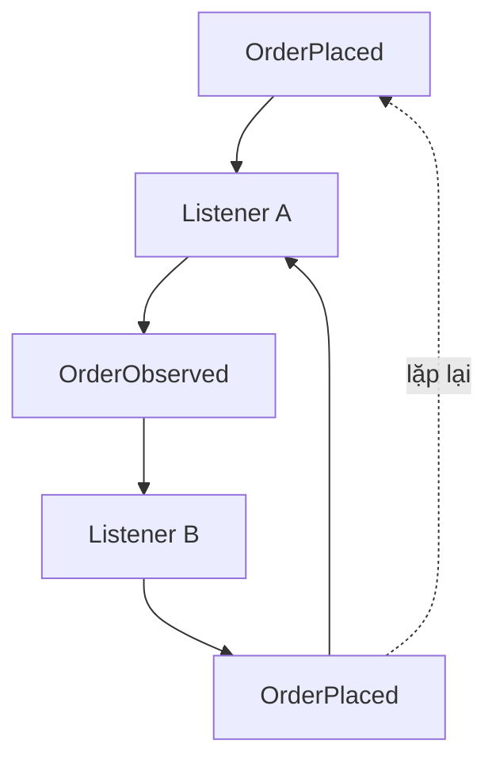
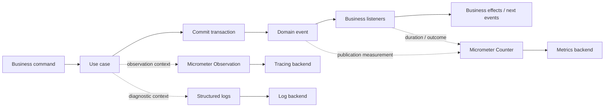
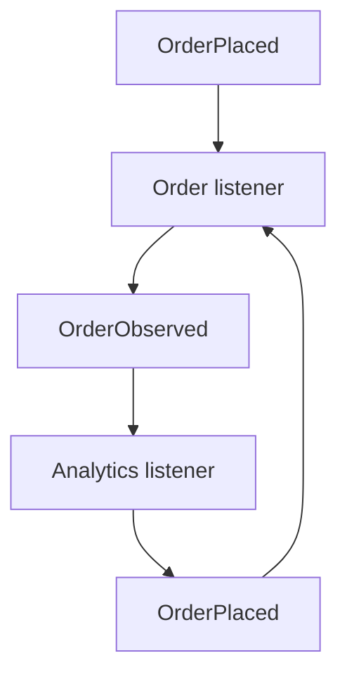
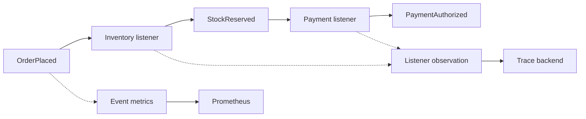

# Không để quan sát tạo vòng lặp nghiệp vụ

## 1. Mục tiêu

Quan sát ứng dụng giúp nhóm phát triển hiểu request đi qua module nào, event nào được công bố, thời gian xử lý ra sao và lỗi xuất hiện ở đâu. Trong Spring Boot, Micrometer, Spring Modulith, logging và tracing cung cấp nhiều điểm mở rộng để thu thập dữ liệu runtime.

Tuy nhiên, instrumentation cũng là code chạy trong ứng dụng. Nếu một listener chỉ để ghi metric lại phát thêm domain event, gọi use case hoặc kích hoạt retry, đường quan sát có thể làm thay đổi nghiệp vụ. Một event được publish có thể kéo theo event thứ hai, event thứ hai kích hoạt listener đầu tiên, rồi chuỗi tiếp tục. Hệ thống có thể tạo nhiều event hơn, tăng tải, lặp side effect hoặc làm transaction và retry khó kiểm soát.

**Không để quan sát tạo vòng lặp nghiệp vụ** nghĩa là thiết kế telemetry theo hướng thụ động: thu thập thông tin về hành vi đã xảy ra, không tạo thêm hành vi nghiệp vụ để chứng minh rằng mình đã quan sát. Đường metrics/logs/traces cần tách khỏi luồng command và domain event.

Bài học thuộc chương **Hiệu năng** của học phần **SPRING_MODULITH_DOCUMENTATION_OBSERVABILITY**. Học phần dùng Spring Modulith để sinh tài liệu ranh giới application module và quan sát tương tác giữa các phần trong ứng dụng Spring Boot thông qua module graph, Actuator, event metrics, tracing và context propagation.

Sau bài này, bạn có thể:

1. Phân biệt domain event, telemetry signal và business command.
2. Nhận diện vòng lặp trực tiếp và vòng lặp gián tiếp do observability tạo ra.
3. Dùng Micrometer, Observation API, logging và tracing mà không phát thêm domain event.
4. Thiết kế listener chỉ ghi nhận metric và không kích hoạt nghiệp vụ.
5. Tách retry/failure handling khỏi telemetry pipeline.
6. Kiểm tra tác động của instrumentation lên event count, transaction, latency và cardinality.
7. Viết kiểm thử để xác nhận một event không bị phát lặp bởi đường quan sát.
8. Dùng module boundaries và runbook để điều tra khi có dấu hiệu feedback loop.

> **Nguyên tắc cốt lõi:** quan sát một sự kiện là hành động đọc/ghi telemetry. Nó không được tự biến thành một yêu cầu nghiệp vụ mới. Nếu cần một hành động nghiệp vụ, phải có use case và điều kiện nghiệp vụ riêng.

## 2. Phân biệt business flow và observability flow

### 2.1. Domain event mô tả điều đã xảy ra

Domain event biểu đạt một sự kiện có ý nghĩa trong mô hình nghiệp vụ, ví dụ:

- `OrderPlaced`: một đơn hàng đã được đặt.
- `StockReserved`: hàng đã được giữ cho đơn.
- `PaymentAuthorized`: khoản thanh toán đã được xác thực.
- `ShipmentDispatched`: lô hàng đã được bàn giao cho đơn vị vận chuyển.

Domain event thường được publish sau khi một hành động nghiệp vụ xảy ra. Các module khác có thể lắng nghe để thực hiện phản ứng nghiệp vụ như giữ hàng, gửi hóa đơn hoặc cập nhật trạng thái giao hàng.

Một listener nghiệp vụ có thể tạo ra domain event tiếp theo nếu đó là bước hợp lệ trong quy trình. Ví dụ `OrderPlaced` dẫn tới `StockReserved`. Chuỗi này phải được định nghĩa trong business process và có điều kiện dừng rõ ràng.

### 2.2. Telemetry signal mô tả cách hệ thống vận hành

Telemetry signal là dữ liệu phục vụ quan sát, ví dụ:

- Counter tăng khi event được publish.
- Timer đo thời gian xử lý listener.
- Observation ghi nhận operation và context.
- Span mô tả một đoạn công việc trong trace.
- Log record ghi lại kết quả xử lý và correlation ID.

Telemetry signal không đại diện cho một yêu cầu nghiệp vụ. Người dùng không đặt hàng vì hệ thống tạo một metric; module inventory không giữ hàng vì một span được kết thúc.

### 2.3. Business command yêu cầu hệ thống thực hiện việc gì đó

Command như `PlaceOrder`, `ReserveStock` hoặc `AuthorizePayment` yêu cầu một use case thực hiện thay đổi trạng thái. Command có thể dẫn tới event sau khi hành động thành công.

Một thành phần chỉ có nhiệm vụ quan sát không nên phát command. Nếu dashboard hoặc alert cần kích hoạt hành động, hãy chuyển quyết định đó qua một workflow vận hành có quyền hạn, điều kiện và audit riêng.

### 2.4. Bảng phân biệt

| Khái niệm | Câu hỏi nó trả lời | Ví dụ | Có thay đổi trạng thái nghiệp vụ? |
| --- | --- | --- | --- |
| Domain event | Điều gì đã xảy ra? | `OrderPlaced` | Bản thân event là thông tin; listener có thể tạo side effect |
| Business command | Hệ thống cần làm gì? | `ReserveStock` | Có thể thay đổi trạng thái |
| Metric | Việc đó xảy ra bao nhiêu/lâu thế nào? | Counter `module.events.published` | Không |
| Log | Chi tiết gì đã xảy ra? | “Order placed” kèm trace ID | Không |
| Span/trace | Công việc đi qua những bước nào? | Span `orders.place` | Không |
| Alert | Điều kiện vận hành nào cần chú ý? | Event rate giảm dưới ngưỡng | Không tự thực hiện business action nếu chưa có workflow riêng |

Một event listener có thể ghi metric, nhưng metric handler không nên publish domain event. Sự khác biệt nằm ở side effect mà handler tạo ra.

## 3. Vòng lặp nghiệp vụ hình thành như thế nào?

### 3.1. Vòng lặp trực tiếp giữa các listeners

Một listener nhận event A, publish event B. Listener B lại publish event A hoặc một event kích hoạt lại listener đầu tiên. Nếu không có điều kiện dừng, chuỗi có thể chạy mãi.



Nếu `OrderObserved` chỉ được tạo để đếm event hoặc ghi log, việc đưa nó vào application event bus tạo một đường kích hoạt mới mà telemetry không cần.

### 3.2. Vòng lặp gián tiếp qua retry

Một telemetry listener gọi endpoint giám sát từ trong transaction. Endpoint timeout khiến listener thất bại. Event Publication Registry có thể ghi nhận publication chưa hoàn tất/thất bại; nếu ứng dụng cấu hình resubmission hoặc retry, lần xử lý tiếp theo lại gọi endpoint, tiếp tục timeout và làm tăng tải.

Ở đây vòng lặp không nhất thiết là event A phát lại event A. Feedback loop đến từ việc telemetry side effect làm listener thất bại, rồi retry tái thực hiện cả listener.

### 3.3. Vòng lặp qua logging/error handling

Một appender hoặc error handler ghi log. Khi log sink lỗi, handler lại ghi một log mới về lỗi của log sink. Nếu không có cơ chế chống đệ quy, hệ thống có thể tạo log vô hạn hoặc chiếm thread xử lý.

Tương tự, một listener ghi audit record bằng cách publish event audit, rồi chính audit listener lại ghi một audit event mới.

### 3.4. Vòng lặp do monitoring kích hoạt business action

Một alert thấy event rate giảm, tự động gọi use case phát một event kiểm tra. Event kiểm tra lại được tính vào cùng metric, khiến dashboard cho rằng luồng nghiệp vụ đã hồi phục dù traffic thật vẫn không có. Alert có thể tự kích hoạt chính điều kiện mà nó đang đo.

Nếu cần remediation tự động, phân biệt rõ synthetic check với business traffic, dùng metric riêng và không giả mạo event nghiệp vụ.

### 3.5. Vòng lặp do listener bắt event quá rộng

Listener nhận mọi event hoặc nhiều event không liên quan rồi phát thêm event tổng hợp. Một thay đổi nhỏ ở module khác có thể kích hoạt listener ngoài dự kiến.

Tránh listener kiểu `@EventListener(Object.class)` cho observability. Chọn đúng event type và module scope, hoặc dùng Observation/MeterRegistry để đo operation tại điểm thực thi.

## 4. Kiến trúc an toàn: telemetry là nhánh quan sát

Một luồng dễ hiểu có thể biểu diễn như sau:



Các đường nét đứt là nhánh quan sát. Chúng ghi nhận hoạt động của luồng nghiệp vụ, không publish command hoặc domain event mới.

Một handler observability có thể được gọi khi event được công bố hoặc listener hoàn tất. Handler đó có thể cập nhật meter hoặc ghi log. Hãy giữ logic ngắn, không gọi use case, không ghi dữ liệu nghiệp vụ và không phát event khác.

## 5. Các nguyên tắc thiết kế

### 5.1. Quan sát ở ranh giới operation

Đặt Observation/Timer quanh use case, request handler hoặc listener cần đo. Dùng tên operation ổn định như `orders.place`, `inventory.reserve` và `payments.authorize`.

Không tạo một event chỉ để báo rằng operation bắt đầu hoặc kết thúc nếu hệ thống không có nhu cầu nghiệp vụ với event đó. Observation API đã có lifecycle start/stop cho telemetry.

### 5.2. Không dùng ApplicationEventPublisher cho telemetry

Không inject `ApplicationEventPublisher` vào module chỉ để publish `MetricRecorded`, `TraceCreated` hoặc `OperationObserved`. Dùng `MeterRegistry`, `ObservationRegistry` hoặc logging API trực tiếp.

Nếu cần chuyển telemetry sang backend khác, dùng exporter/collector phù hợp. Không chuyển dữ liệu metric thành domain event rồi để các module nghiệp vụ lắng nghe.

### 5.3. Giữ observability handler không có business side effects

Handler chỉ quan sát nên giới hạn ở các thao tác:

- Tăng counter hoặc record timer.
- Gắn low-cardinality tags.
- Ghi structured log.
- Gắn trace/span context.
- Gửi telemetry qua exporter đã được thiết kế riêng.

Không thực hiện:

- Tạo đơn, giữ hàng hoặc authorize payment.
- Cập nhật business database.
- Gửi email/SMS cho khách hàng.
- Publish domain event hoặc command.
- Gọi module nghiệp vụ để hỏi trạng thái.
- Retry business action khi exporter lỗi.

### 5.4. Tách failure domain

Lỗi exporter, log collector hoặc trace backend không nên làm use case nghiệp vụ thất bại nếu chính sách hệ thống không quy định khác. Dùng registry/exporter có buffering và failure handling phù hợp; không gọi remote telemetry endpoint đồng bộ trong transaction.

### 5.5. Giữ cardinality hữu hạn

Dùng module identifier, event type, operation và outcome có tập giá trị giới hạn. Không gắn order ID, customer ID, request ID hoặc trace ID thành metric tags. Correlation IDs thuộc logs/traces, không thuộc chiều phân loại metric có cardinality cao.

### 5.6. Chỉ một nơi sở hữu quyết định nghiệp vụ

Nếu một event thất bại và cần retry, quyết định retry thuộc listener/use case hoặc event publication infrastructure đã cấu hình. Telemetry chỉ ghi nhận attempt, duration và failure. Đừng để metrics listener quyết định phát lại event vì nhìn thấy counter chưa tăng.
## 6. Ví dụ: instrumentation an toàn

### 6.1. Đo use case bằng Observation API

Có thể đặt Observation quanh một operation mà không publish thêm application event:

```java
@Service
class OrderApplicationService {

    private final ObservationRegistry observationRegistry;
    private final OrderService orderService;

    OrderApplicationService(
            ObservationRegistry observationRegistry,
            OrderService orderService
    ) {
        this.observationRegistry = observationRegistry;
        this.orderService = orderService;
    }

    Order place(PlaceOrderCommand command) {
        return Observation.createNotStarted(
                    "orders.place",
                    observationRegistry
                )
                .lowCardinalityKeyValue("module", "orders")
                .observe(() -> orderService.place(command));
    }
}
```

Observation có lifecycle start/stop và có thể được bridge tới metrics/tracing qua handlers đã cấu hình. Tên operation và low-cardinality key-value phải ổn định. Không thêm order ID hoặc customer ID vào low-cardinality tags.

Observation bọc use case để đo thời gian và tạo trace context. Nó không cần phát `OrderObserved` hoặc gọi một listener khác.

### 6.2. Đếm domain event bằng Counter

Nếu cần một metric riêng của ứng dụng để đếm event đã commit, có thể dùng listener chỉ cập nhật Counter:

```java
@Component
class OrderPlacementMetrics {

    private final Counter orderPlacedCounter;

    OrderPlacementMetrics(MeterRegistry registry) {
        this.orderPlacedCounter = Counter.builder("orders.placed")
                .description("Number of committed order placement events")
                .tag("module", "orders")
                .register(registry);
    }

    @TransactionalEventListener(phase = TransactionPhase.AFTER_COMMIT)
    void record(OrderPlaced event) {
        orderPlacedCounter.increment();
    }
}
```

Listener này chỉ tăng meter. Nó không inject `ApplicationEventPublisher`, không gọi `OrderService` và không ghi business database.

Vì dùng `AFTER_COMMIT`, event cần được publish trong transaction đang hoạt động để listener được gọi theo lifecycle này. Nếu event có thể được phát ngoài transaction, hãy xác định rõ semantics và chọn listener phase phù hợp.

Counter trên đo số lần listener nhận event sau commit trong process đang chạy. Nó không đảm bảo số đơn duy nhất nếu event được giao lại hoặc listener chạy lại; cũng không phải nguồn dữ liệu kế toán bền vững. Nếu Spring Modulith đã cung cấp publication counter phù hợp, cân nhắc dùng metric framework đó thay vì tạo meter trùng ý nghĩa.

### 6.3. Dùng metric có sẵn của Spring Modulith

Spring Modulith ghi nhận event publication metrics. Metric tổng hợp `module.events.published` có thể được dùng để quan sát event type/module mà không cần tạo một event telemetry mới.

Metric này phản ánh publication. Nó không chứng minh listener đã hoàn tất thành công. Nếu cần theo dõi listener completion/failure, dùng Event Publication Registry và các phép đo lifecycle phù hợp; không biến trạng thái đó thành một domain event mới chỉ để dashboard đọc.

### 6.4. Ghi log có cấu trúc

Log trực tiếp tại operation hoặc listener:

```java
private static final Logger log =
        LoggerFactory.getLogger(OrderApplicationService.class);

void logOrderPlaced(OrderPlaced event) {
    log.info(
        "Order placed: orderType={}, module={}",
        event.orderType(),
        "orders"
    );
}
```

Nếu tracing đã cấu hình, trace/span context có thể được đưa vào logging correlation pattern hoặc MDC theo convention của Spring Boot. Tránh đưa payload, email, access token hay ID nhạy cảm vào log nếu không có lý do và chính sách phù hợp.

Ghi log không cần publish `LogWritten`. Log appender chịu trách nhiệm chuyển record tới log sink.

### 6.5. Tùy chỉnh metric Spring Modulith mà không phát event

Spring Modulith có extension point `ModulithEventMetricsCustomizer` để thêm tags cho individual event metrics:

```java
public record OrderPlaced(
        String orderNumber,
        String orderType,
        SalesChannel channel
) {
}

public enum SalesChannel {
    WEB,
    STORE,
    PARTNER
}

@Bean
ModulithEventMetricsCustomizer eventMetricsCustomizer() {
    return metrics -> metrics.customize(
        OrderPlaced.class,
        (event, meter) -> meter.tags(
            "sales.channel",
            event.channel().name().toLowerCase()
        )
    );
}
```

Customizer chỉ bổ sung dimension vào meter theo extension point. Chọn giá trị có tập hữu hạn như `web`, `store`, `partner`. Không publish event, gọi use case hoặc thêm tag theo order ID.

Lưu ý: customizer này áp dụng cho individual event metrics. Không giả định tags tùy chỉnh tự động xuất hiện trên metric tổng hợp `module.events.published`.

## 7. Ví dụ vòng lặp và cách sửa

### 7.1. Sai: telemetry listener phát event mới

```java
@Component
class OrderTelemetryListener {

    private final ApplicationEventPublisher publisher;

    OrderTelemetryListener(ApplicationEventPublisher publisher) {
        this.publisher = publisher;
    }

    @EventListener
    void on(OrderPlaced event) {
        publisher.publishEvent(
            new OrderObserved(event.orderNumber())
        );
    }
}
```

Nếu `OrderObserved` được dùng chỉ để ghi metric hoặc log, event mới này không đem lại giá trị nghiệp vụ. Nó làm tăng số event publication, thêm listener dispatch và tạo khả năng phát sinh chuỗi phản ứng ngoài dự kiến.

### 7.2. Sai: event telemetry quay lại business flow

```java
@Component
class OrderObservedListener {

    private final ApplicationEventPublisher publisher;

    OrderObservedListener(ApplicationEventPublisher publisher) {
        this.publisher = publisher;
    }

    @EventListener
    void on(OrderObserved event) {
        // Ví dụ phản mẫu: phát lại business event từ telemetry event.
        publisher.publishEvent(
            new OrderPlaced(event.orderNumber())
        );
    }
}
```

Chuỗi trên có thể tạo vòng lặp không dừng nếu listener đầu tiên tiếp tục phát `OrderObserved`. Trong hệ thống thực, vòng lặp có thể đi qua nhiều module nên khó nhận ra ngay.

### 7.3. Sửa: bỏ telemetry event, ghi trực tiếp meter

```java
@Component
class OrderTelemetryListener {

    private final Counter counter;

    OrderTelemetryListener(MeterRegistry registry) {
        this.counter = Counter.builder("orders.observed")
                .tag("module", "orders")
                .register(registry);
    }

    @EventListener
    void on(OrderPlaced event) {
        counter.increment();
    }
}
```

Tên `orders.observed` ở ví dụ này là metric ứng dụng. Nếu metric muốn đo số lần event được publish, hãy chọn đúng điểm đo và semantics; listener nhận event có thể đo số lần listener nhận, không nhất thiết bằng số lần publisher gọi.

### 7.4. Sai: gọi monitoring service đồng bộ trong listener

```java
@EventListener
void on(OrderPlaced event) {
    monitoringClient.sendEvent(
        "order-placed",
        event.orderNumber()
    );
}
```

Nếu monitoring endpoint chậm hoặc timeout, listener có thể kéo dài hoặc thất bại. Khi listener nằm trong transaction hoặc event publication lifecycle, lỗi telemetry có thể ảnh hưởng thời gian xử lý và retry.

### 7.5. Sửa: dùng registry/exporter

Ghi metric vào MeterRegistry trong process. Registry/exporter chịu trách nhiệm xuất dữ liệu theo cơ chế pull hoặc push đã cấu hình. Không gọi remote backend trực tiếp từ listener nghiệp vụ.

Nếu telemetry exporter bị lỗi, ghi nhận tình trạng exporter bằng health/metrics riêng và để failure policy của telemetry pipeline xử lý. Không retry lại business command chỉ vì không gửi được metric.

## 8. Những nguồn feedback loop thường gặp

| Nguồn | Cách tạo vòng lặp | Cách ngăn chặn |
| --- | --- | --- |
| Event listener | Listener quan sát publish event mới | Ghi meter/log trực tiếp |
| Observation handler | Handler publish application event khi span kết thúc | Handler chỉ ghi telemetry |
| Metrics exporter | Mỗi lần scrape tạo domain event | Exporter chỉ đọc registry |
| Logging appender | Log lỗi của chính appender lặp vô hạn | Fallback riêng, giới hạn/loại bỏ log đệ quy |
| Retry handler | Retry toàn bộ listener vì telemetry endpoint timeout | Tách lỗi telemetry khỏi business retry |
| Alert remediation | Alert tự tạo business event để làm metric tăng | Dùng synthetic metric riêng và workflow có kiểm soát |
| Broad event listener | Bắt mọi event rồi phát event tổng hợp | Subscribe đúng type, module và purpose |
| Audit listener | Audit event lại được audit như business event | Phân loại audit pipeline và loại trừ event do chính nó tạo |

### 8.1. Observation handlers phải chỉ làm telemetry

Observation API có thể có handlers nhận notification khi observation bắt đầu, dừng hoặc xảy ra lỗi. Handler tùy chỉnh là điểm dễ vô tình thêm side effect.

Không gọi `ApplicationEventPublisher.publishEvent` từ handler chỉ để lưu observation thành event. Ghi dữ liệu vào meter, tracing exporter hoặc log sink phù hợp. Nếu cần lưu audit record theo yêu cầu pháp lý/nghiệp vụ, đó là một use case riêng với chính sách retry và ownership rõ ràng.

### 8.2. Exporter không được điều khiển business flow

Prometheus thường scrape endpoint metrics. Scrape là hoạt động đọc dữ liệu, không nên làm phát event hoặc thay đổi trạng thái. Với push exporter, việc gửi batch cũng thuộc telemetry pipeline.

Không viết endpoint `/actuator/prometheus` có logic gọi service nghiệp vụ, truy vấn từng đơn hàng hoặc phát event khi được scrape. Endpoint metrics nên phục vụ snapshot của meter registry.

### 8.3. Alert và auto-remediation cần tách biệt

Alert có thể gửi notification cho người trực. Nếu có auto-remediation, thiết kế một automation/workflow riêng:

- Có trigger rõ và chống lặp.
- Có giới hạn số lần chạy.
- Có idempotency.
- Có audit trail.
- Có điều kiện dừng và rollback.
- Có phân biệt synthetic traffic với business traffic.

Không để alert giả lập event nghiệp vụ nhằm làm dashboard xanh trở lại.
## 9. Transaction, retry và idempotency

### 9.1. Đặt điểm đo đúng lifecycle

Một event có thể được publish trước khi transaction commit. Nếu metric được tăng ngay tại thời điểm publish, nó đo publication attempt/registration theo semantics của meter. Nếu metric chỉ tăng sau commit, nó đo event notification đã đến phase sau commit trong process hiện tại.

Không dùng hai tên metric giống nhau cho hai điểm đo khác nhau. Catalog phải ghi rõ metric tăng khi publisher gọi publish, khi transaction commit, khi listener bắt đầu, khi listener hoàn tất hay khi listener thất bại. Đây là các phép đo khác nhau. Dashboard không nên gộp chúng thành một “event success count”.

### 9.2. Retry thuộc về business processing

Retry có thể cần thiết khi listener gọi dịch vụ downstream hoặc ghi dữ liệu nghiệp vụ. Retry policy cần có số lần tối đa, backoff, phân loại lỗi và trạng thái cuối cùng.

Telemetry không được quyết định retry business listener. Nếu exporter lỗi, đó là lỗi telemetry. Nếu listener không ghi được inventory, đó là lỗi xử lý nghiệp vụ. Hai lỗi cần metric, alert và retry policy riêng.

### 9.3. Listener phải idempotent khi có redelivery

Một event có thể được giao lại do crash, retry hoặc cơ chế publication registry. Listener nghiệp vụ cần có idempotency phù hợp với use case. Việc tăng metric không làm cho handler idempotent.

Nếu counter tăng mỗi lần listener được gọi, số liệu phản ánh số lần xử lý/nhận, không nhất thiết là số event duy nhất. Muốn đo số event duy nhất, cần một định danh và nguồn dữ liệu có semantics deduplication; không đưa event ID thành metric tag.

### 9.4. Không phát lại event để sửa metric

Nếu counter bị thiếu do process restart hoặc exporter mất dữ liệu, đừng phát lại domain event để “bù số”. Counter in-memory và dữ liệu event bền vững có lifecycle khác nhau.

Nếu cần số liệu chính xác để đối soát nghiệp vụ, dùng nguồn dữ liệu nghiệp vụ hoặc event store/publication registry phù hợp. Metrics chủ yếu phục vụ quan sát xu hướng và vận hành.

## 10. Async processing và context propagation

### 10.1. Async không làm telemetry thành business event

Listener có thể chạy trên executor khác thread. Observation/tracing context cần được truyền qua ranh giới async để span và correlation context còn liên kết được. Context propagation là chuyển context, không phải publish domain event.

Ví dụ, cấu hình executor có task decorator để truyền context phù hợp:

```java
@Bean
ThreadPoolTaskExecutor applicationTaskExecutor() {
    ThreadPoolTaskExecutor executor = new ThreadPoolTaskExecutor();
    executor.setCorePoolSize(4);
    executor.setMaxPoolSize(8);
    executor.setQueueCapacity(200);
    executor.setTaskDecorator(new ContextPropagatingTaskDecorator());
    executor.initialize();
    return executor;
}
```

Dùng executor và context propagation theo cấu hình Spring Boot/Micrometer của phiên bản đang chạy. Không tạo một event riêng chỉ để mang trace ID qua thread.

### 10.2. Không giữ transaction mở để chờ telemetry

Không gọi log backend, trace collector hoặc monitoring HTTP endpoint theo cách đồng bộ trong transaction nghiệp vụ. Việc chờ mạng làm tăng latency và có thể biến sự cố observability thành lỗi giao dịch.

Ưu tiên ghi vào MeterRegistry/ObservationRegistry trong process rồi để exporter chuyển dữ liệu theo cơ chế đã thiết kế. Nếu telemetry backend tạm ngừng, chính sách buffer/drop/retry thuộc telemetry pipeline.

### 10.3. Context không phải payload nghiệp vụ

Trace ID, span ID và correlation ID giúp liên kết log/trace. Chúng không nên được dùng làm domain event fields trừ khi có lý do tích hợp rõ ràng và contract được định nghĩa.

Không dùng trace ID làm metric tag. Có thể thêm trace context vào logs hoặc span links theo cấu hình tracing.

### 10.4. Tránh tự tạo span lồng nhau vô nghĩa

Nếu Observation/HTTP instrumentation đã tạo span cho một operation, không tạo thêm nhiều span tên gần giống chỉ để “đếm” mỗi callback. Chọn ranh giới span có ý nghĩa: use case, listener hoặc outbound call. Span phải mô tả công việc thực sự được thực hiện.

## 11. Kiểm thử để phát hiện vòng lặp

### 11.1. Unit test cho telemetry listener

Kiểm tra listener chỉ cập nhật meter:

```java
class OrderPlacementMetricsTest {

    @Test
    void recordsCounterWithoutCallingBusinessServices() {
        SimpleMeterRegistry registry = new SimpleMeterRegistry();
        OrderPlacementMetrics listener =
                new OrderPlacementMetrics(registry);

        listener.record(new OrderPlaced("order-42", "STANDARD", SalesChannel.WEB));

        assertThat(
            registry.get("orders.placed").counter().count()
        ).isEqualTo(1.0);
    }
}
```

Bài test này xác nhận counter tăng. Thiết kế class cũng giúp kiểm tra dependency: telemetry listener không cần `ApplicationEventPublisher`, repository nghiệp vụ hoặc service thay đổi trạng thái.

### 11.2. Integration test kiểm tra số event

Với Spring Test, có thể bật ghi nhận application events trong test context và xác minh số lần publish của domain event:

```java
@SpringBootTest
@RecordApplicationEvents
class OrderObservabilityIntegrationTest {

    @Autowired
    ApplicationEvents applicationEvents;

    @Autowired
    OrderApplicationService orderService;

    @Test
    void placingAnOrderDoesNotPublishTelemetryBusinessEvents() {
        orderService.place(new PlaceOrderCommand("order-42"));

        assertThat(applicationEvents.stream(OrderPlaced.class))
                .hasSize(1);

        assertThat(applicationEvents.stream(OrderObserved.class))
                .isEmpty();
    }
}
```

`OrderObserved` là event phản mẫu được dùng để chứng minh telemetry không cần phát event nghiệp vụ riêng. Nếu hệ thống không định nghĩa event đó, có thể thay assertion thứ hai bằng kiểm tra event type telemetry cụ thể mà nhóm muốn cấm.

### 11.3. Kiểm tra cấu trúc module

Có thể dùng Spring Modulith module verification:

```java
ApplicationModules.of(Application.class).verify();
```

Kiểm tra này giúp phát hiện vi phạm cấu trúc dependency giữa application modules và một số dependency cycles. Nó không chứng minh runtime event flow không thể lặp. Vẫn cần integration test hoặc scenario test cho event chain thực tế.

### 11.4. Kiểm thử khi telemetry backend lỗi

Mô phỏng exporter hoặc log sink chậm/ngừng hoạt động và xác nhận:

- Use case vẫn hoàn tất theo chính sách đã chọn.
- Transaction không bị giữ mở để chờ telemetry.
- Listener nghiệp vụ không retry chỉ vì exporter lỗi.
- Không có domain event mới được phát do telemetry failure.
- Metrics/logs có thể mất hoặc bị trì hoãn theo failure policy đã tài liệu hóa.

### 11.5. Kiểm thử số lần xử lý và số lần publish riêng biệt

Theo dõi riêng số lần event được publish và số lần listener bắt đầu/hoàn tất/thất bại. Không suy ra listener success từ publication counter. Khi có retry, số lần listener được gọi có thể lớn hơn số event được publish.
## 12. Điều tra dấu hiệu feedback loop khi vận hành

### 12.1. Dấu hiệu thường gặp

- Event publication rate tăng nhanh dù traffic người dùng không tăng.
- Một event type liên tục xuất hiện trong trace/log với cùng correlation context.
- Listener invocation count cao hơn nhiều so với publication count.
- Queue backlog hoặc pending event publications tăng.
- CPU/thread pool bận với listener hoặc exporter.
- Database ghi lặp cùng business state.
- Log volume tăng đột ngột, đặc biệt là log của chính error handler.
- Retry count tăng đồng thời với timeout ở telemetry backend.

Một dấu hiệu đơn lẻ chưa chứng minh có vòng lặp. Đối chiếu event type, module, trace, thời điểm deploy và queue state.

### 12.2. Quy trình chẩn đoán

1. Xác định event type có tốc độ tăng bất thường bằng metric tổng hợp.
2. Group theo `module.identifier` để tìm module phát event.
3. Mở trace mẫu và tìm chuỗi span lặp lại.
4. Đối chiếu log theo trace ID/correlation ID.
5. Kiểm tra listener nào publish event mới hoặc gọi use case.
6. Kiểm tra retry policy và trạng thái Event Publication Registry.
7. Kiểm tra exporter/log sink có timeout hoặc backlog không.
8. Tạm ngắt instrumentation/handler nghi ngờ trên môi trường kiểm thử để so sánh.
9. Sửa feedback path và thêm regression test.

### 12.3. Phân biệt business cascade hợp lệ với loop

Một chuỗi `OrderPlaced → StockReserved → PaymentAuthorized` có thể là business process hợp lệ nếu mỗi bước có điều kiện, state transition và điểm kết thúc rõ ràng.

Một chuỗi `OrderPlaced → OrderObserved → OrderPlaced` chỉ để ghi telemetry là vòng lặp thiết kế. Kiểm tra mục đích của từng event và module owner trước khi kết luận.

### 12.4. Dùng module graph và event publication registry đúng mục đích

Module graph giúp thấy module nào phụ thuộc module nào. Event Publication Registry giúp kiểm tra publication lifecycle và listener completion/failure. Metrics cho biết số lượng và tốc độ; traces cho biết đường đi của một operation; logs cho biết chi tiết từng bước.

Kết hợp các nguồn này để tìm nguyên nhân. Không yêu cầu một dashboard publication tự trả lời cả câu hỏi listener completion và business outcome.

## 13. Hiệu năng và độ tin cậy của đường quan sát

### 13.1. Giữ thao tác telemetry ngắn

Ghi counter hoặc thêm observation key-value trong process thường nhẹ hơn gọi remote service. Dù vậy, số lượng meters, tags, histogram buckets và spans vẫn có chi phí CPU, memory và network.

### 13.2. Tránh tạo meter theo từng event instance

Không tạo metric name hoặc tag theo order ID, customer ID, event UUID hay request ID. Dùng event type/module làm dimension hữu hạn; dùng trace/log để điều tra từng instance.

### 13.3. Không log toàn bộ payload

Log payload lớn có thể làm tăng I/O, chi phí lưu trữ và rủi ro lộ dữ liệu. Ghi những trường chẩn đoán cần thiết, đã chuẩn hóa và tuân thủ chính sách bảo mật.

### 13.4. Đặt sampling có chủ đích

Tracing có thể sampling để kiểm soát overhead. Đừng thay sampling bằng cách phát event nghiệp vụ giả để “giữ lại” trace. Cấu hình sampler theo policy của telemetry backend và bảo đảm trace quan trọng có khả năng được giữ lại.

### 13.5. Theo dõi chính telemetry pipeline

Có thể quan sát exporter queue, dropped spans, scrape failures và log shipping errors bằng metric riêng của telemetry pipeline. Những metric này vẫn phải là telemetry; không được kích hoạt domain command hoặc event.

## 14. Bài thực hành: loại bỏ vòng lặp do quan sát đơn hàng

### 14.1. Bối cảnh

Ứng dụng có ba module `orders`, `inventory` và `payments`. Khi đơn hàng được đặt, module orders publish `OrderPlaced`. Module inventory giữ hàng và publish `StockReserved`. Module payments authorize khoản thanh toán và publish `PaymentAuthorized`.

Nhóm muốn đo số event theo type, thời gian xử lý listener và log có trace ID. Một developer đề xuất tạo event `OrderObserved` sau mỗi event để module analytics nhận và tăng metric.

### 14.2. Phân tích thiết kế ban đầu



Đây là vòng lặp vì analytics listener phát lại domain event và kích hoạt listener ban đầu. Việc đếm metric không cần event mới.

### 14.3. Thiết kế lại

- Giữ domain events phục vụ business flow.
- Dùng `module.events.published` để quan sát publication theo event type/module.
- Dùng Observation quanh use case và listener để đo duration.
- Dùng structured logs có trace/correlation context.
- Nếu cần metric riêng, listener chỉ cập nhật MeterRegistry.
- Không gọi monitoring service đồng bộ trong transaction.
- Không publish `OrderObserved`.



### 14.4. Tiêu chí hoàn thành

1. Mỗi bước business event có mục đích và owner rõ.
2. Không có telemetry event trong event chain.
3. Publication metric tăng theo event thực tế.
4. Listener duration được đo riêng.
5. Trace liên kết được các bước qua async boundary nếu có.
6. Exporter timeout không làm business listener retry.
7. Module verification và integration tests đều đạt.
8. Dashboard phân biệt publication, listener outcome và scrape health.

## 15. Những sai lầm thường gặp

1. **Tạo event chỉ để ghi metric.** Dùng MeterRegistry hoặc Observation API.
2. **Listener telemetry gọi lại use case.** Giữ handler chỉ đọc event và ghi telemetry.
3. **Đưa remote monitoring call vào transaction.** Ghi telemetry trong process rồi export riêng.
4. **Retry business event vì exporter lỗi.** Tách failure domain và retry policy.
5. **Coi counter publication là listener success.** Đo publication và completion riêng.
6. **Dùng listener bắt mọi event.** Subscribe đúng type và scope.
7. **Dùng trace ID làm metric tag.** Giữ correlation ID trong logs/traces.
8. **Để error handler log lỗi của chính nó vô hạn.** Có fallback và recursion guard.
9. **Dùng synthetic event để làm dashboard tăng trở lại.** Tách synthetic telemetry khỏi business traffic.
10. **Cho rằng module graph không có cycle nghĩa event flow không thể lặp.** Kiểm thử runtime event chain riêng.
11. **Đo event duy nhất bằng số lần listener được gọi.** Redelivery/retry có thể làm số lần gọi lớn hơn.
12. **Thêm nhiều span cho mỗi callback.** Chọn operation boundaries có ý nghĩa.

## 16. Câu hỏi tự đánh giá

1. Domain event, business command và telemetry signal khác nhau ra sao?
2. Vì sao instrumentation cần được xem là code chạy trong application?
3. Vòng lặp trực tiếp giữa hai listeners hình thành như thế nào?
4. Exporter timeout có thể gây retry listener theo cách nào?
5. Vì sao không publish `OrderObserved` chỉ để ghi metric?
6. Observation API giúp đo operation mà không cần application event như thế nào?
7. Khi nào dùng `@TransactionalEventListener(AFTER_COMMIT)` để ghi counter?
8. Counter đó đo event duy nhất hay số lần listener được gọi?
9. Vì sao không gọi monitoring HTTP endpoint đồng bộ trong transaction?
10. Customizer của Spring Modulith bổ sung tags cho metric family nào?
11. Vì sao `module.events.published` không chứng minh listener hoàn tất?
12. Trace ID nên nằm ở metrics, logs hay traces?
13. Module verification có chứng minh runtime event flow không bị lặp không?
14. Cần kiểm thử gì khi telemetry backend ngừng hoạt động?
15. Dấu hiệu nào gợi ý event feedback loop đang xảy ra?
16. Làm sao phân biệt business event cascade hợp lệ với loop do observability?
17. Vì sao không phát lại event để bù metric bị thiếu?
18. Khi điều tra, cần kết hợp module graph, metrics, traces, logs và publication registry như thế nào?

## 17. Tài liệu tham khảo chính thức

- [Spring Modulith — Application Events](https://docs.spring.io/spring-modulith/reference/events.html): event publication registry, listener lifecycle và event processing.
- [Spring Modulith — Production-ready Features](https://docs.spring.io/spring-modulith/reference/production-ready.html): event publication metrics và observability support.
- [Spring Modulith — Application Module Verification](https://docs.spring.io/spring-modulith/reference/verification.html): kiểm tra cấu trúc module và dependency cycles.
- [Spring Boot — Observability](https://docs.spring.io/spring-boot/reference/actuator/observability.html): Observation, metrics, tracing và context propagation.
- [Micrometer Observation](https://docs.micrometer.io/micrometer/reference/observation.html): Observation lifecycle, conventions và handlers.
- [Micrometer — Counters](https://docs.micrometer.io/micrometer/reference/concepts/counters.html): cách ghi nhận số lần sự kiện xảy ra.
- [Spring Framework — Transaction-bound Events](https://docs.spring.io/spring-framework/reference/data-access/transaction/event.html): listener gắn với transaction phase.
- [Spring Framework — Application Events](https://docs.spring.io/spring-framework/reference/core/beans/context-introduction.html#context-functionality-events): publish và xử lý application events.

> **Ghi nhớ:** Đường observability nên là nhánh thụ động: đọc operation/event rồi ghi metric, log hoặc trace. Không phát domain event, không gọi use case và không retry business action chỉ vì exporter lỗi. Đo publication, listener completion và business outcome thành các phép đo riêng; kiểm tra event chain ở runtime ngay cả khi module graph đã hợp lệ.
