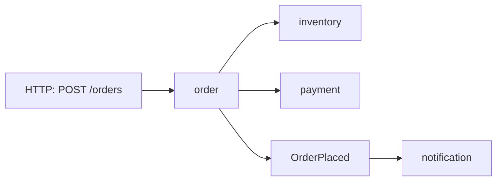
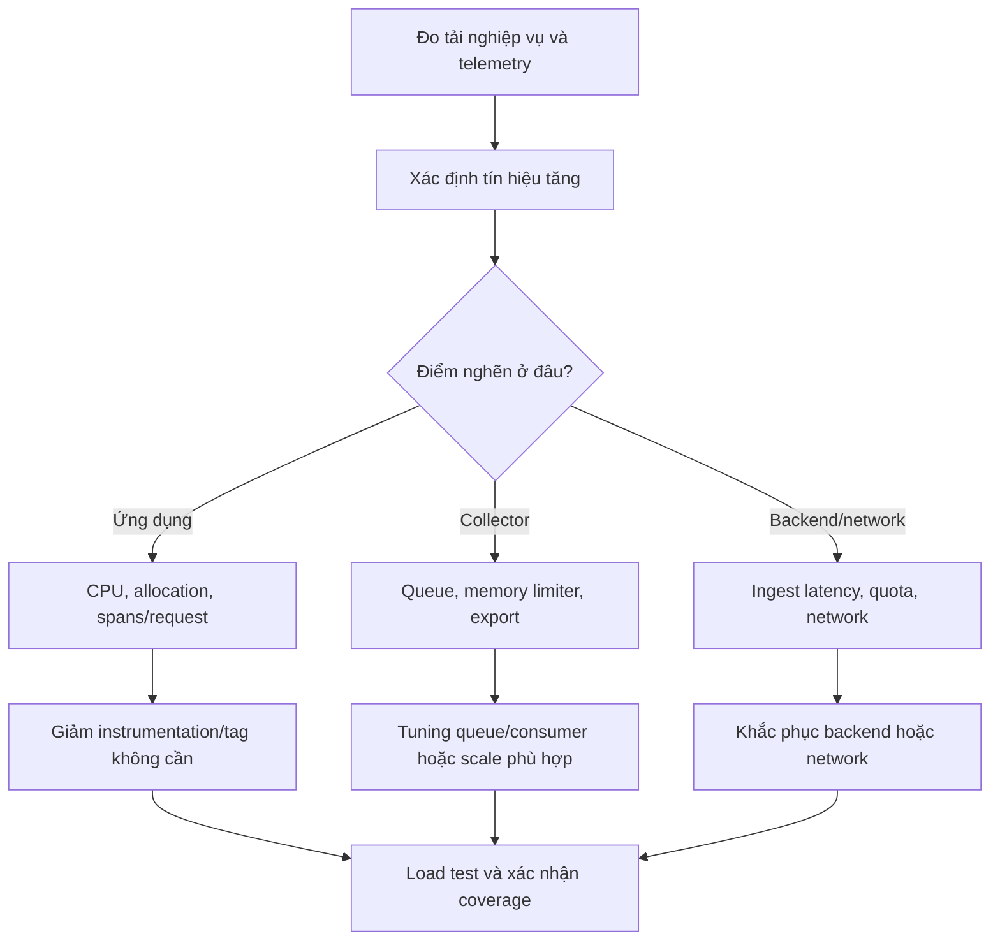

# Điều chỉnh telemetry theo tải thực tế

Một ứng dụng Spring Modulith có thể tạo nhiều loại telemetry: metrics của HTTP request, counters cho domain event, module spans, logs và traces từ database hoặc HTTP client. Khi lưu lượng tăng, số liệu giúp phát hiện vấn đề nhưng chính pipeline quan sát cũng tiêu thụ CPU, bộ nhớ, network, dung lượng lưu trữ và ngân sách của backend.

Điều chỉnh telemetry là chọn đúng tín hiệu, độ chi tiết và tần suất thu thập theo tải thật. Mục tiêu là giữ đủ dữ liệu để theo dõi SLO, nhận diện module chậm, phát hiện event bất thường và điều tra sự cố, đồng thời giới hạn lượng dữ liệu được tạo, truyền, lưu và truy vấn.

Bài thuộc chương **Hiệu năng** của học phần **SPRING_MODULITH_DOCUMENTATION_OBSERVABILITY**. Học phần dùng Spring Modulith để sinh tài liệu ranh giới application module và quan sát tương tác giữa các phần trong ứng dụng Spring Boot qua module graph, Actuator, event metrics, tracing và context propagation. Bài này tập trung xây dựng ngân sách telemetry theo tải, điều chỉnh metrics/traces/logs, kiểm soát cardinality, tối ưu Collector và lưu trữ, rồi kiểm chứng bằng load test.

Sau bài học, bạn có thể:

- Phân biệt mục tiêu và chi phí của metrics, traces, logs và module spans.
- Ước lượng telemetry volume từ request rate, số span/request và sampling.
- Chọn mức chi tiết theo tải bình thường, giờ cao điểm và tình huống sự cố.
- Giữ metrics tổng hợp đầy đủ trong khi điều chỉnh tỷ lệ trace sampling.
- Dùng event metrics của Spring Modulith mà không tạo cardinality không giới hạn.
- Điều chỉnh exporter queue, batching, retry và Collector theo số liệu thực tế.
- Phân biệt Collector quá tải với backend hoặc network quá tải.
- Thiết lập retention và kiểm thử khả năng quan sát sau khi tối ưu.

> **Phạm vi ví dụ:** Spring Boot 3.5.x, Spring Modulith 1.4.x, Micrometer, OpenTelemetry Collector và Prometheus-compatible metrics backend. Cấu hình cụ thể phụ thuộc tracer, exporter, Collector distribution và backend. Hãy xác nhận phiên bản trước khi áp dụng property hoặc cấu hình Collector.

## 1. Telemetry phải phục vụ câu hỏi vận hành

Không phải mọi dữ liệu đều có cùng mục đích. Trước khi giảm sampling hoặc tắt logger, hãy xác định câu hỏi mà đội vận hành cần trả lời.

| Tín hiệu | Câu hỏi chính | Dạng dữ liệu | Đặc tính chi phí |
| --- | --- | --- | --- |
| Metrics | Hệ thống có khỏe không? Tỷ lệ lỗi và latency thay đổi thế nào? | Counter, gauge, histogram | Tăng theo số metric và label combinations |
| Traces | Một request cụ thể đi qua những bước nào? | Trace và spans | Tăng theo request rate, spans/request và sampling |
| Logs | Điều gì đã xảy ra tại một bước xử lý? | Log events | Tăng theo log volume, message size và mức log |
| Module event metrics | Module nào đang publish event với tần suất ra sao? | Counter theo module/event | Tăng theo số event type và tag combinations |

Spring Modulith observability có thể intercept Spring components thuộc API của application module để tạo Micrometer spans. Nó cũng cung cấp metrics cho tương tác event giữa các module. Spring Boot/Micrometer kết nối các Observation với metrics và tracing handlers theo cấu hình của ứng dụng.

Một chiến lược phù hợp thường là:

- Thu metrics tổng hợp liên tục để theo dõi SLO và xu hướng.
- Dùng traces có sampling để điều tra đường đi của request.
- Ghi logs có chọn lọc, có cấu trúc và có correlation ID.
- Theo dõi event counters để nhận ra module hoặc loại event tăng bất thường.
- Chỉ tăng độ chi tiết trong khoảng thời gian và phạm vi cần điều tra.

**Không dùng một nút sampling để điều chỉnh mọi tín hiệu.** Property **management.tracing.sampling.probability** điều chỉnh tracing; nó không tự giảm Prometheus metrics, event counters hoặc application logs.

## 2. Xác định tải thực tế trước khi thay cấu hình

Một con số trung bình cả ngày có thể che mất giờ cao điểm. Hãy đo ít nhất ba trạng thái:

1. **Tải nền:** lưu lượng thông thường, ít request đồng thời.
2. **Tải cao điểm:** giờ có nhiều request, event và background jobs.
3. **Tải đột biến:** burst ngắn, retry storm, downstream chậm hoặc event backlog.

Với từng trạng thái, thu thập:

- Requests/second và concurrency.
- Số lần gọi qua module API trên mỗi request.
- Số event được publish và số listener invocation.
- Số spans/request, logs/request và kích thước trung bình.
- CPU, heap, allocation rate, GC và network của ứng dụng.
- Export queue, retry, dropped/refused telemetry ở Collector.
- Ingest rate, storage growth và query latency ở backend.

Ví dụ luồng đặt hàng:



Một request có thể gọi inventory nhiều lần và phát một event cho notification. Nếu chỉ đếm bốn module trong sơ đồ, bạn sẽ đánh giá thấp số span thực tế. Hãy lấy span count và event count từ workload đang chạy.

### Phân biệt tải nghiệp vụ và tải telemetry

Nếu CPU tăng cùng request rate nhưng span export vẫn ổn định, nguyên nhân có thể nằm ở nghiệp vụ. Nếu request rate không đổi nhưng Collector queue, exporter CPU hoặc backend ingest tăng, hãy điều tra pipeline telemetry. Hai loại tải có thể tăng đồng thời, vì vậy phải đo cả ứng dụng và hệ thống quan sát.

## 3. Ước lượng telemetry volume

Một ước lượng đơn giản giúp đặt ngân sách ban đầu.

\[
\text{module spans/s} \approx
\text{requests/s} \times
\text{module spans/request}
\]

Nếu trace sampling được áp dụng ở mức trace với xác suất p, số module spans được ghi/export kỳ vọng xấp xỉ:

\[
\text{sampled module spans/s} \approx
\text{requests/s} \times
\text{module spans/request} \times p
\]

Ví dụ:

- 120 request/giây.
- Trung bình 5 module spans/request.
- Sampling 10%.

\[
120 \times 5 = 600
\]

Ứng dụng có khoảng 600 module span invocations mỗi giây trước sampling. Với sampling 10%, số module spans được ghi/export kỳ vọng khoảng:

\[
600 \times 0.1 = 60
\]

Nếu trung bình mỗi span sau encode là 700 byte, phần module spans tương ứng khoảng 42 KB/giây, tương đương khoảng 3,6 GB/ngày trước compression và overhead của protocol. Đây chỉ là phép tính ngân sách; kích thước thực tế phụ thuộc attributes, events, resource metadata, encoding và batch.

### Tính riêng từng nguồn

Đừng gộp tất cả spans thành một con số:

| Nguồn | Cách ước lượng |
| --- | --- |
| HTTP server | Số request được instrument |
| Spring Modulith module spans | Số invocation qua component API được instrument |
| HTTP/database client | Số outbound calls trên mỗi request |
| Messaging/event listener | Số lần publish, consume và xử lý bất đồng bộ |
| Background jobs | Số lần chạy và số span trong mỗi lần chạy |

Với event listener chạy bất đồng bộ, số spans không nhất thiết nằm trong cùng trace với request gốc. Hãy đo riêng listener executions và xác nhận context propagation/correlation thực tế.

## 4. Đặt ngân sách theo giá trị quan sát

Ngân sách telemetry nên có giới hạn cho cả ứng dụng và backend:

- CPU và allocation tối đa chấp nhận được cho instrumentation.
- Số spans/giây và bytes/giây.
- Số metric time series và cardinality theo từng metric family.
- Logs/giây và kích thước log trung bình.
- Collector memory, queue capacity và export concurrency.
- Backend ingest rate, retention và dung lượng lưu trữ.
- Thời gian truy vấn dashboard và trace lookup.

Có thể dùng bảng quyết định ban đầu:

| Tình trạng | Mục tiêu quan sát | Điều chỉnh thường xem xét |
| --- | --- | --- |
| Local development | Nhìn rõ từng bước để debug | Sampling cao, dữ liệu test, trace backend cục bộ |
| Staging/load test | So sánh các mức tải và kiểm chứng instrumentation | Sampling đủ lớn để phân tích; giữ nguyên workload giữa các lần chạy |
| Production bình thường | Theo dõi SLO với chi phí ổn định | Metrics đầy đủ, trace sampling theo ngân sách, logs có chọn lọc |
| Production incident | Tăng độ chi tiết trong phạm vi có kiểm soát | Tăng sampling hoặc bật targeted diagnostics tạm thời, có thời hạn |
| Backend đang quá tải | Bảo vệ ứng dụng và pipeline | Giảm dữ liệu ưu tiên thấp, kiểm tra queue/backend, giữ tín hiệu SLO thiết yếu |

Đây là khung ra quyết định, không phải cấu hình mặc định cho mọi hệ thống. Mỗi thay đổi cần có owner, thời hạn và điều kiện rollback để tránh giữ chế độ debug tốn kém sau khi sự cố kết thúc.

## 5. Điều chỉnh metrics và module event counters

Metrics thường là tín hiệu nền cho dashboard và alert. Chúng nên tiếp tục phản ánh toàn bộ tải nghiệp vụ, kể cả khi tracing sampling thấp.

Spring Modulith 1.4 có hỗ trợ observability cho tương tác module và counter cho cross-module events. Dùng event metrics để theo dõi xu hướng publish theo module/event, ví dụ phát hiện module order tăng mạnh OrderPlaced hoặc một loại event đột ngột không còn xuất hiện.

### Giữ tag có tập giá trị hữu hạn

Các tag phù hợp thường là:

- Module identifier.
- Event type đã được định nghĩa trong code.
- Outcome hoặc status thuộc một tập giá trị cố định.
- Kênh nghiệp vụ có enum hoặc danh mục giới hạn.

Tránh đưa các giá trị không giới hạn vào metric tags:

- User ID, tenant ID nếu có số lượng rất lớn.
- Order ID, event UUID hoặc request ID.
- Email, URL đầy đủ hoặc chuỗi do người dùng nhập.
- Timestamp chính xác hoặc giá trị ngẫu nhiên.

Mỗi tổ hợp tag tạo ra một meter/time series riêng. Một counter event vốn chỉ có vài chục tổ hợp có thể tăng thành hàng triệu series nếu thêm ID riêng cho từng event.

### Custom event metric tags có kiểm soát

Spring Modulith cung cấp ModulithEventMetricsCustomizer để tùy chỉnh counter theo event type. Chỉ thêm tag nếu giá trị có cardinality thấp và có ích cho dashboard.

Ví dụ minh họa, channel là enum có tập giá trị cố định:

```java
@Configuration(proxyBeanMethods = false)
class ModulithMetricsConfiguration {

    @Bean
    ModulithEventMetricsCustomizer eventMetricsCustomizer() {
        return metrics -> metrics.customize(
            OrderPlaced.class,
            (event, counter) ->
                counter.tag("channel", event.channel().name())
        );
    }
}
```

Không thay channel bằng order ID hoặc customer ID. Nếu cần điều tra một event riêng lẻ, dùng trace/log correlation hoặc event publication record theo quy trình nghiệp vụ; không biến từng event thành metric series.

### Histogram và percentile

Histogram cho latency hữu ích khi cần p95/p99 và SLO, nhưng mỗi bucket và tag combination làm tăng số series. Chỉ bật histogram cho metric cần theo dõi phân vị; không bật rộng cho mọi observation mà chưa ước lượng cardinality.

Ví dụ bật histogram cho HTTP server requests:

```yaml
management:
  metrics:
    distribution:
      percentiles-histogram:
        http.server.requests: true
```

Kiểm tra số bucket, tag keys và series thực tế ở endpoint /actuator/prometheus. Dùng route template thay vì URL chứa ID động. Nếu backend có native histogram hoặc cách lưu histogram khác, hãy dùng convention của backend đó.

### Phân biệt event metrics và Event Publication Registry

Counter telemetry cho biết số event được publish. Event Publication Registry lưu trạng thái publication cho transactional listeners để hỗ trợ theo dõi/retry. Đây là hai cơ chế khác nhau.

Nếu registry lưu publication lâu dài, số bản ghi chưa hoàn tất hoặc bản ghi đã hoàn tất chưa purge có thể làm tăng dung lượng database và chi phí truy vấn. Hãy có chính sách purge/archive phù hợp cho registry; giảm trace sampling không làm giảm chi phí lưu trữ của registry.

## 6. Điều chỉnh trace sampling theo tải

Spring Boot mặc định lấy mẫu khoảng 10% request để tránh làm trace backend quá tải. Có thể điều chỉnh bằng property:

```yaml
management:
  tracing:
    sampling:
      probability: 0.1
```

Giá trị hợp lệ nằm trong khoảng 0.0 đến 1.0. 0.1 tương đương khoảng 10%; 1.0 lấy mẫu mọi trace theo sampler tỷ lệ; 0.0 loại bỏ trace theo sampler tỷ lệ.

Có thể externalize giá trị này theo môi trường. Local có thể chọn sampling cao để tái hiện lỗi; production chọn tỷ lệ theo số spans/giây, retention và năng lực backend. Không có tỷ lệ production đúng cho tất cả hệ thống.

### Sampling không điều chỉnh metrics

Trace sampling quyết định trace nào được ghi/export. Nó không tự giảm:

- HTTP request counters và histograms.
- Modulith event counters.
- JVM/process metrics.
- Logs do application logger phát ra.
- Bản ghi trong Event Publication Registry.

Vì vậy, nếu backend metrics quá tải, hãy điều chỉnh metric cardinality, histogram và scrape strategy. Giảm trace sampling sẽ không giải quyết được số time series quá lớn.

### Head sampling và tail sampling

Head sampling quyết định ở đầu trace, trước khi biết toàn bộ kết quả request. Nó đơn giản và ít trạng thái; xác suất sampling có thể cấu hình trong ứng dụng.

Tail sampling quyết định sau khi Collector đã nhận đủ spans của trace, nên có thể giữ lại trace lỗi hoặc chậm dựa trên kết quả cuối cùng. Nhưng tail sampling cần buffer và trạng thái theo trace, làm tăng memory/CPU và yêu cầu định tuyến các spans cùng trace tới cùng một sampler instance. Nó không phải giải pháp bật tùy tiện khi Collector đã thiếu tài nguyên.

Nếu ứng dụng đã head-sample và loại bỏ trace trước khi gửi, tail sampler không thể khôi phục các spans đã mất. Khi dùng tail sampling, cần thiết kế sampling tại SDK, Collector routing, memory limit và failure behavior cùng nhau.

### Phối hợp sampling giữa các service

Trong distributed tracing, child spans có thể tuân theo sampling decision của parent. Nếu service đầu tiên lấy mẫu 10%, service sau không thể tự lấy lại trace đã bị upstream đánh dấu không sampled theo cách tùy ý. Hãy thống nhất propagation format và sampling policy giữa các service để không tạo trace đứt đoạn.

## 7. Điều chỉnh logs theo tải

Logs thường tăng nhanh khi application ghi một dòng cho mỗi event, mỗi retry hoặc mỗi vòng lặp. Khi tải tăng gấp 10, log volume có thể tăng tương ứng hoặc cao hơn nếu xuất hiện lỗi/retry.

Một số nguyên tắc:

- Giữ log ERROR/WARN có ý nghĩa và tránh log cùng một lỗi ở mọi layer.
- Ghi một log completion có chọn lọc cho các workflow cần audit; không log mọi object/event payload.
- Dùng DEBUG/TRACE có thời hạn và giới hạn package/component.
- Dùng rate limit hoặc deduplication cho lỗi lặp lại, nhưng vẫn giữ counter/alert để biết tần suất.
- Ghi trace ID/span ID để liên kết log với trace thay vì ghi toàn bộ request.
- Dùng structured logging và allowlist fields; tránh message dài và payload.
- Giữ retention theo nhu cầu vận hành và chính sách dữ liệu.

Khi incident xảy ra, nếu cần bật DEBUG cho module payment, hãy xác định trước phạm vi, thời gian, dữ liệu giả lập hay thật, nơi log được gửi và điều kiện tắt. Tránh bật TRACE toàn bộ ứng dụng trong giờ cao điểm.

## 8. Điều chỉnh OpenTelemetry Collector theo queue và tải

Collector là một pipeline riêng. Theo dõi queue và memory để biết dữ liệu đến nhanh hơn khả năng export hay không.

Các metric quan trọng gồm:

| Collector metric | Ý nghĩa | Hành động khi tăng bất thường |
| --- | --- | --- |
| otelcol_exporter_queue_size | Số lượng đang chờ export | Xác định exporter/backend nào bị nghẽn |
| otelcol_exporter_queue_capacity | Dung lượng queue | So sánh size/capacity và memory budget |
| otelcol_exporter_enqueue_failed_spans | Span không vào được queue | Kiểm tra queue full và tốc độ export |
| otelcol_exporter_send_failed_spans | Gửi span thất bại | Kiểm tra backend, network và retry |
| otelcol_processor_refused_spans | Span bị memory limiter từ chối | Kiểm tra memory pressure và Collector capacity |

OpenTelemetry Collector guidance gợi ý xem xét scale khi queue tiến gần khoảng 60–70% capacity trong điều kiện duy trì, nhưng đây chỉ là ngưỡng tham khảo. Cần kết hợp memory, export latency, rejected spans, backend ingest và thời gian queue duy trì.

### Không scale Collector một cách máy móc

Nếu backend chậm hoặc network đã bão hòa, thêm Collector có thể làm tăng áp lực lên backend/network. Hãy xác định điểm nghẽn:

- Queue tăng và Collector CPU/memory cao: xem xét tăng tài nguyên hoặc replica Collector.
- Queue tăng nhưng Collector còn rảnh, backend latency cao: điều tra backend.
- send_failed_spans tăng: kiểm tra lỗi endpoint, authentication, quota hoặc network.
- processor_refused_spans tăng: memory limiter đang từ chối dữ liệu; xem heap, batch/queue và tải.
- Queue luôn thấp và không có drop: có thể chưa cần scale.

### Queue, retry và persistent storage

Sending queue giữ dữ liệu khi backend tạm thời không nhận được. Queue lớn hơn có thể hấp thụ burst ngắn nhưng tiêu tốn thêm RAM; nó không giải quyết tình trạng backend liên tục xử lý chậm hơn tốc độ nhận.

Với Collector gateway quan trọng, có thể dùng persistent queue/WAL nếu chấp nhận chi phí disk và vận hành. Đặt retry timeout theo thời gian gián đoạn có thể chấp nhận, đồng thời giám sát dung lượng disk. Không tăng queue vô hạn để che một backend thiếu capacity.

### Lưu ý mới về batching trong Collector

Tại thời điểm biên soạn bài (tháng 11/2026), OpenTelemetry Collector đã chính thức deprecate processor batch. Hướng được khuyến nghị cho phần lớn exporter là batching tích hợp trong sending_queue; trường hợp thật sự cần batching ở processor có thể xem queue_batch.

Ví dụ minh họa exporter-level batching theo cấu hình Collector mới:

```yaml
exporters:
  otlp:
    endpoint: otel-gateway:4317
    sending_queue:
      enabled: true
      batch:
        enabled: true

service:
  pipelines:
    traces:
      receivers: [otlp]
      exporters: [otlp]
```

Cấu hình này là khung minh họa; bổ sung TLS, authentication, retry, storage và queue sizing theo môi trường. Không copy nguyên xi nếu exporter/distribution đang dùng chưa hỗ trợ exporter-level batching.

OpenTelemetry công bố kế hoạch bật exporter-level batching mặc định ở đa số exporter trong Collector v0.171.0 dự kiến tháng 2/2027 và loại bỏ processor batch khỏi core distributions ở v0.177.0 dự kiến tháng 5/2027. Lịch có thể thay đổi theo release. Nếu pipeline hiện tại còn processors: [batch], hãy lên kế hoạch migration và kiểm tra lại queue capacity vì batching chuyển từ trước queue sang sau queue có thể thay đổi số request đang được buffer.

## 9. Quản lý cardinality và kích thước payload

Cardinality cao làm tăng số meter/time series và có thể làm ứng dụng lẫn metrics backend tốn bộ nhớ, CPU và index. Các giá trị thường gây vấn đề gồm trace ID, request ID, user ID, email, URL đầy đủ và timestamp.

| Dữ liệu | Nơi phù hợp | Không nên dùng làm |
| --- | --- | --- |
| Module name | Metric tag, span attribute | Metric name động |
| Event type hữu hạn | Event counter tag | Label chứa event UUID |
| Outcome/status | Metric tag | Chuỗi exception tùy ý |
| Trace ID | Trace store, log field, exemplar | Prometheus label |
| Request/user ID | Trace/log có kiểm soát nếu thật sự cần | Metric label |
| URL template | Metric tag | Full URL có ID động |
| Payload nghiệp vụ | Event store theo nghiệp vụ | Log/span/metric tag |

Ngoài số lượng tag combinations, kích thước span cũng quan trọng. Một span chứa nhiều attributes, events, stack trace hoặc exception message có thể làm tăng bytes/export và index cost. Hãy chỉ giữ metadata cần cho câu hỏi vận hành.

Micrometer Observation phân biệt low-cardinality và high-cardinality key values. Low-cardinality values có thể được đưa vào metrics; high-cardinality values thường chỉ phù hợp với tracing/logging backend có khả năng xử lý chúng. Đừng chuyển dữ liệu không giới hạn thành metric tags.

## 10. Retention, scrape interval và chi phí lưu trữ

Telemetry không kết thúc ở lúc export thành công. Dữ liệu được giữ càng lâu thì storage, index và query càng tốn kém.

### Metrics

- Giữ metrics tổng hợp đủ lâu để phân tích xu hướng và SLO.
- Giảm cardinality trước khi giảm độ phân giải.
- Điều chỉnh scrape interval theo tốc độ biến động và yêu cầu alert.
- Tránh scrape quá dày nếu dashboard không cần độ phân giải đó.
- Giữ histogram cho những latency cần phân tích phân vị.

### Traces

- Chọn retention theo nhu cầu điều tra incident.
- Có thể giữ trace chi tiết trong thời gian ngắn hơn metrics tổng hợp.
- Giới hạn attributes và span events không cần thiết.
- Nếu cần lưu trace lỗi lâu hơn, cân nhắc tail sampling có kiểm soát và đủ tài nguyên.

### Logs

- Tách log vận hành khỏi audit records nếu yêu cầu retention khác nhau.
- Không giữ DEBUG/TRACE lâu như log nghiệp vụ cần thiết.
- Áp dụng quyền truy cập và xóa dữ liệu theo chính sách.
- Kiểm tra cả log collector, archive và backup.

Một bảng retention cần được chủ sở hữu hệ thống xác nhận:

| Tín hiệu | Retention dự kiến | Lý do |
| --- | --- | --- |
| Metrics SLO | Theo chu kỳ báo cáo | So sánh tuần/tháng |
| Traces sampled | Theo cửa sổ điều tra | Tìm request bất thường |
| Logs INFO/WARN/ERROR | Theo runbook và audit needs | Điều tra vận hành |
| DEBUG/TRACE tạm thời | Ngắn, có thời hạn | Gỡ lỗi có kiểm soát |

Không có một số ngày retention chung cho mọi tổ chức. Hãy cân nhắc yêu cầu pháp lý, hợp đồng, ngân sách và độ nhạy dữ liệu.

## 11. Cấu hình theo môi trường và thay đổi có kiểm soát

Một cấu hình baseline có thể đặt sampling ở 10%, giữ metrics và event counters hoạt động, và dùng log level INFO:

```yaml
spring:
  application:
    name: shop-modulith

management:
  endpoints:
    web:
      exposure:
        include: health,metrics,prometheus
  tracing:
    sampling:
      probability: 0.1

logging:
  level:
    root: INFO
    com.example.shop: INFO
```

Trong local, có thể override sampling lên 1.0 để xem đầy đủ trace của dữ liệu test. Trong production, thay đổi sampling bằng externalized configuration/config server hoặc deployment environment theo quy trình của tổ chức.

Mỗi lần thay đổi nên có:

1. Giá trị trước và sau.
2. Lý do và chỉ số kích hoạt.
3. Phạm vi service/module/environment.
4. Thời hạn nếu là chế độ incident.
5. Chỉ số thành công và điều kiện rollback.
6. Người chịu trách nhiệm xác nhận.

Tránh cập nhật cấu hình đồng thời cho sampling, histogram, log level, queue và retention. Thay từng nhóm một để biết thay đổi nào tạo ra tác động.

## 12. Quy trình điều chỉnh theo tín hiệu

Dùng bảng sau để chọn hành động theo triệu chứng:

| Triệu chứng | Kiểm tra đầu tiên | Điều chỉnh có thể phù hợp |
| --- | --- | --- |
| Trace backend ingest tăng nhanh | Spans/request, sampling, span size | Giảm sampling có kiểm soát; giảm attributes không cần |
| Ứng dụng CPU tăng khi bật tracing | JFR/profiler, invocation count, allocation | Giảm span không cần, kiểm tra instrumentation và handler |
| Metrics backend có quá nhiều series | Tag cardinality, histogram buckets | Chuẩn hóa tag, bỏ tag động, giới hạn histogram |
| Event counters tăng bất thường | Event rate theo module/type | Điều tra publisher/listener; không giảm sampling để che event storm |
| Log ingest tăng mạnh | Log per request, retry/error loops, message size | Giảm log lặp, rate limit, chọn level và fields |
| Collector queue tăng | Queue size/capacity, exporter latency, memory | Xác định Collector hay backend là bottleneck trước khi scale |
| Collector refused spans | Memory limiter, heap và queue | Điều chỉnh memory/capacity, giảm tải ưu tiên thấp |
| Backend send failures tăng | Endpoint, quota, network, retry | Khắc phục backend/network; không chỉ tăng Collector replicas |
| Storage tăng nhanh | Bytes/span, retention, cardinality | Giảm payload, retention phù hợp và tag count |
| Incident cần giữ trace lỗi | Sampling strategy và Collector capacity | Cân nhắc tail sampling có thiết kế, giới hạn thời gian |

Một quy trình vận hành có thể mô tả như sau:



## 13. Bài thực hành: lập ngân sách telemetry cho luồng đặt hàng

**Bối cảnh:** ứng dụng Spring Modulith có các module order, inventory, payment và notification. Giờ cao điểm đạt 120 request/giây; một request trung bình đi qua 5 module API calls và phát một event OrderPlaced.

Thực hiện:

1. Ghi lại Spring Boot, Spring Modulith, Micrometer, tracer, Collector và backend versions.
2. Đo request rate, concurrency, module API invocations/request và event rate trong tải nền lẫn tải cao điểm.
3. Tính module spans/second trước sampling và ước lượng bytes/day theo kích thước span đo được.
4. Xác nhận metrics HTTP và Modulith event counters vẫn phản ánh đầy đủ tải khi trace sampling ở 10%.
5. Thử sampling 10%, 25% và 100% trên cùng workload; đo p95/p99, CPU, allocation, spans/s và backend ingest.
6. Kiểm tra metric tags; loại bỏ trace ID, request ID và giá trị không giới hạn khỏi metric labels.
7. Kiểm tra log volume trên mỗi request và event; loại bỏ log payload hoặc log lặp không cần thiết.
8. Quan sát Collector queue size/capacity, enqueue failures, send failures, refused spans và memory.
9. Nếu queue tăng, xác định Collector, network hay backend là điểm nghẽn trước khi thay queue hoặc tăng replica.
10. Kiểm tra Collector configuration đang dùng processor batch; nếu có, lập kế hoạch chuyển sang exporter-level batching hoặc queue_batch theo version.
11. Đặt retention riêng cho metrics, traces và logs; tính dung lượng theo ingest rate thực tế.
12. Chạy lại workload sau mỗi thay đổi và xác nhận trace vẫn có module spans quan trọng, event metrics còn đầy đủ và dashboard/alerts hoạt động.

**Tiêu chí hoàn thành:** có bảng ngân sách telemetry dựa trên số đo, sampling phù hợp với tải, metrics không bị mất vì trace sampling, cardinality nằm trong giới hạn, Collector không drop dữ liệu ngoài dự kiến và đội vận hành biết cách tăng/giảm mức quan sát khi tải thay đổi.

## Tài liệu tham khảo

- [Spring Modulith 1.4 — Production-ready Features](https://docs.spring.io/spring-modulith/reference/1.4/production-ready.html): module spans, metrics và observability support.
- [Spring Modulith 1.4 — ModulithEventMetricsCustomizer API](https://docs.spring.io/spring-modulith/docs/1.4.x/api/org/springframework/modulith/observability/ModulithEventMetricsCustomizer.html): tùy chỉnh counters cho cross-module events.
- [Spring Modulith — Working with Application Events](https://docs.spring.io/spring-modulith/reference/1.4/events.html): event publication registry, completion và housekeeping.
- [Spring Boot 3.5 — Tracing](https://docs.spring.io/spring-boot/3.5/reference/actuator/tracing.html): sampling probability và tracer configuration.
- [Spring Boot 3.5 — Common Application Properties](https://docs.spring.io/spring-boot/3.5/appendix/application-properties/index.html): property management.tracing.sampling.probability.
- [Micrometer — Observation Introduction](https://docs.micrometer.io/micrometer/reference/observation/introduction.html): Observation lifecycle, handlers và cardinality.
- [Micrometer — High Cardinality Tags Detector](https://docs.micrometer.io/micrometer/reference/concepts/high-cardinality-tags-detector.html): phát hiện meter có tag cardinality cao.
- [OpenTelemetry Collector — Scaling](https://opentelemetry.io/docs/collector/scaling/): queue, memory limiter, scale và backend bottleneck.
- [OpenTelemetry Collector — Resiliency](https://opentelemetry.io/docs/collector/resiliency/): sending queue, retry, persistent storage và data loss.
- [OpenTelemetry — Deprecating the Collector Batch Processor](https://opentelemetry.io/blog/2026/collector-batching-migration/): exporter-level batching, queue_batch và lộ trình deprecation của batch processor.

**Ghi nhớ:** điều chỉnh telemetry theo tải thực tế bắt đầu bằng đo lường. Giữ metrics tổng hợp để theo dõi SLO, chọn trace sampling theo ngân sách, ghi logs có chọn lọc, kiểm soát cardinality và chỉ scale Collector khi nó thực sự là điểm nghẽn. Sau mỗi thay đổi, chạy lại workload và xác nhận dữ liệu cần cho điều tra vẫn còn đầy đủ.
