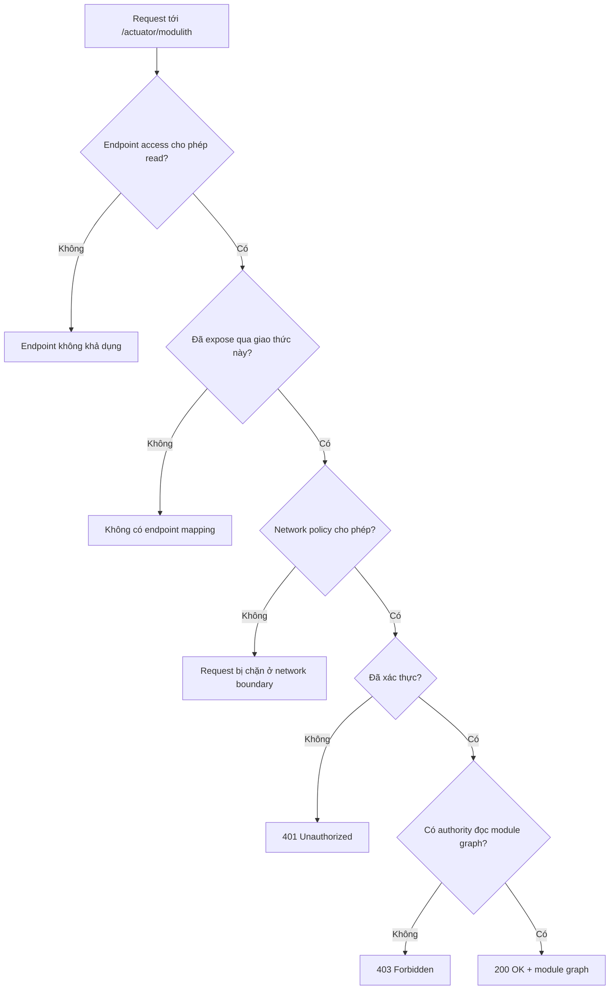

# Endpoint graph có thể tiết lộ cấu trúc hệ thống

## 1. Vì sao module graph là dữ liệu cần bảo vệ?

Spring Modulith giúp ứng dụng Spring Boot mô tả ranh giới application module và quan sát tương tác giữa các phần trong hệ thống. Module graph rất hữu ích cho kiến trúc sư và đội vận hành: nó cho biết module nào tồn tại, module nào phụ thuộc module nào và package nào thuộc từng ranh giới.

Nhưng cùng thông tin đó cũng có giá trị đối với người đang dò tìm bề mặt tấn công. Nếu endpoint Actuator công bố module graph cho người không có quyền, họ có thể suy luận:

- Các vùng nghiệp vụ chính như order, payment, identity hoặc inventory.
- Package gốc và quy ước đặt tên trong mã nguồn.
- Các dependency giữa module và những điểm kết nối đáng chú ý.
- Những ranh giới có thể chứa dữ liệu hoặc chức năng nhạy cảm.
- Các tên hiển thị, named interface hoặc loại tương tác mà ứng dụng công bố.

Ví dụ ứng dụng `shop-service` có các module `order`, `payment`, `inventory` và `customer-profile`. Kẻ tấn công biết module payment phụ thuộc identity hoặc order gọi inventory có thêm manh mối để chọn API, luồng nghiệp vụ và thành phần cần khảo sát tiếp. Module graph không trực tiếp cung cấp source code hay dữ liệu giao dịch, nhưng có thể rút ngắn đáng kể giai đoạn reconnaissance.

Bài **“Endpoint graph có thể tiết lộ cấu trúc hệ thống”** thuộc chương **Bảo mật** của **SPRING_MODULITH_DOCUMENTATION_OBSERVABILITY**. Module này hướng dẫn dùng Spring Modulith sinh tài liệu ranh giới application module và quan sát tương tác giữa các phần trong ứng dụng Spring Boot qua module graph, Actuator, event metrics, tracing và context propagation.

Sau bài học, bạn có thể:

1. Nhận diện dữ liệu kiến trúc có thể được tiết lộ qua `/actuator/modulith`.
2. Đánh giá tác động của việc công khai module graph.
3. Phân biệt endpoint access, HTTP/JMX exposure, authentication và authorization.
4. Giới hạn quyền đọc graph bằng Spring Security.
5. Bảo vệ management port bằng network boundary và TLS.
6. Kiểm tra endpoint không thể truy cập bởi caller không có quyền.
7. Cung cấp tài liệu kiến trúc đã chọn lọc cho đối tượng bên ngoài khi có nhu cầu chia sẻ.

## 2. Endpoint Modulith có thể tiết lộ những gì?

Spring Modulith cung cấp Actuator endpoint có ID `modulith`. Khi endpoint được kích hoạt và expose qua HTTP, đường dẫn mặc định là:

```http
GET /actuator/modulith
```

Endpoint trả về mô tả các application module được phát hiện và quan hệ dependency của chúng. Tùy phiên bản và nội dung module model, metadata có thể bao gồm:

| Loại thông tin | Ví dụ minh họa | Rủi ro khi công khai |
| --- | --- | --- |
| Module identifier | `payment` | Gợi ý vùng nghiệp vụ quan trọng |
| Display name | `Payment Processing` | Tiết lộ chức năng ở mức dễ hiểu |
| Base package | `com.example.shop.payment` | Tiết lộ cấu trúc package và quy ước code |
| Dependencies | `payment → identity` | Gợi ý luồng gọi và điểm tích hợp |
| Parent/nested module | `parent`, `nested` (nếu có) | Tiết lộ cấu trúc module lồng nhau |
| Kiểu dependency | `DEFAULT`, `USES_COMPONENT` hoặc `EVENT_LISTENER` | Gợi ý cơ chế tương tác giữa module |

JSON rút gọn dưới đây chỉ minh họa cấu trúc; schema thực tế phụ thuộc phiên bản Spring Modulith:

```json
{
  "payment": {
    "displayName": "Payment Processing",
    "basePackage": "com.example.shop.payment",
      "parent": null,
      "nested": [],
    "dependencies": [
      {
        "target": "identity",
        "types": ["USES_COMPONENT"]
      }
    ]
  },
  "identity": {
    "displayName": "Identity",
    "basePackage": "com.example.shop.identity",
    "dependencies": []
  }
}
```

Endpoint này không phải API đọc order, customer hoặc payment record. Tuy vậy, metadata kiến trúc vẫn có thể giúp người ngoài suy luận nơi có chức năng nhạy cảm và cách các phần liên kết với nhau. Không nên đánh đồng “không trả dữ liệu nghiệp vụ” với “không có rủi ro bảo mật”.

### 2.1. Module graph không phải sơ đồ runtime đầy đủ

Module graph mô tả cấu trúc module được phân tích từ code và metadata. Nó không tự cho biết:

- Một module đang có bao nhiêu request hoặc event mỗi giây.
- Một dependency đang hoạt động hay đang lỗi tại thời điểm hiện tại.
- Người dùng nào đã gọi module.
- Dữ liệu nào đã được đọc hoặc thay đổi.
- Một module có đang được deploy thành process riêng hay không.

Những thông tin runtime này thuộc metrics, logs, traces và hệ thống deployment. Dù vậy, cấu trúc tĩnh vẫn đủ hữu ích cho việc reconnaissance và cần được kiểm soát quyền đọc.

## 3. Threat model: ai có thể đọc graph và có thể làm gì?

Xem module graph là một tài sản thông tin nội bộ. Xác định người dùng, đường truy cập và hậu quả trước khi expose endpoint:

| Chủ thể | Nhu cầu hợp lệ | Rủi ro nếu cấp quyền quá rộng |
| --- | --- | --- |
| Developer trong nhóm | Hiểu dependency và ranh giới module | Có thể xem nhiều chi tiết hơn phạm vi công việc |
| Architect | Review module graph toàn ứng dụng | Tài liệu kiến trúc bị sao chép ra ngoài |
| SRE/on-call | Điều tra lỗi và kiểm tra cấu trúc | Endpoint quản trị bị truy cập từ mạng không tin cậy |
| Prometheus/monitoring agent | Scrape metrics cần thiết | Credential scrape có thể bị tái sử dụng để đọc endpoint khác nếu cấp quyền rộng |
| Người dùng API công khai | Thường không cần đọc graph | Có thể reconnaissance kiến trúc và chọn mục tiêu tấn công |
| Attacker có credential bị lộ | Không có nhu cầu hợp lệ | Khai thác graph để lập bản đồ hệ thống |

Các rủi ro chính:

1. **Information disclosure:** package, tên module và dependency bị lộ.
2. **Reconnaissance:** kẻ tấn công ưu tiên module chứa thanh toán, xác thực hoặc dữ liệu cá nhân.
3. **Lộ ranh giới tin cậy:** dependency có thể gợi ý module nào truy cập dữ liệu hoặc chức năng nhạy cảm.
4. **Mở rộng tác động khi credential bị lộ:** một tài khoản monitoring có quyền rộng có thể đọc thêm metadata quản trị.
5. **Rò rỉ qua môi trường phụ:** staging, preview hoặc test deployment có thể dùng cấu hình exposure lỏng hơn production.

Không cần giả định mọi module name đều là bí mật. Mức bảo vệ phụ thuộc hệ thống, chính sách tổ chức và mức độ nhạy cảm của kiến trúc. Nhưng endpoint nên có owner, audience và access policy rõ ràng.

## 4. Bốn lớp kiểm soát cần cấu hình riêng

Một endpoint Actuator chỉ an toàn khi các lớp kiểm soát phù hợp cùng được áp dụng:

| Lớp | Cấu hình/cơ chế | Vai trò |
| --- | --- | --- |
| Endpoint availability/access | `management.endpoint.modulith.access` và `management.endpoints.access.*` ở phiên bản hỗ trợ | Endpoint có được phép tồn tại và thao tác đọc hay không |
| Exposure | `management.endpoints.web.exposure.*` và `management.endpoints.jmx.exposure.*` | Endpoint có được công bố qua HTTP/JMX không |
| Authentication/authorization | Spring Security, identity provider, role/authority | Ai đang gọi và caller có quyền đọc graph không |
| Network boundary | Management port, bind address, firewall, ingress, network policy | Request có thể đi đến management server từ mạng nào |



Các lớp này không thay thế lẫn nhau:

- Expose endpoint không cấp quyền cho người dùng.
- `read-only` không xác thực caller.
- Spring Security không thể cho đọc endpoint chưa được expose.
- Management port riêng không tự tạo authorization.
- Firewall không thay thế role-based access nếu nhiều nhóm người dùng cùng truy cập management network.

## 5. Chỉ expose endpoint khi thực sự cần

Spring Boot mặc định chỉ expose endpoint `health` qua HTTP và JMX. Endpoint `modulith` chỉ xuất hiện trên giao thức tương ứng khi được cấu hình exposure. Dù vậy, cần giữ allowlist rõ ràng để tránh cấu hình môi trường khác vô tình mở rộng endpoint.

Nếu dashboard nội bộ hoặc nhóm kiến trúc cần module graph qua HTTP, dùng allowlist:

```yaml
management:
  endpoints:
    web:
      exposure:
        include: "health,modulith"
```

Trong cấu hình này, HTTP chỉ công bố health và modulith. Các endpoint như `beans`, `env`, `configprops` hoặc `heapdump` không được mở qua HTTP bởi allowlist trên.

Tránh:

```yaml
management:
  endpoints:
    web:
      exposure:
        include: "*"
```

Mở tất cả endpoint làm tăng bề mặt quản trị cần bảo vệ. Một endpoint không trực tiếp thay đổi dữ liệu vẫn có thể tiết lộ cấu hình, bean, package hoặc runtime details.

### 5.1. Nếu không cần graph ở runtime, không expose

Nếu đội kiến trúc chỉ cần module graph trong pipeline build hoặc tài liệu nội bộ, có thể không expose `modulith` qua HTTP:

```yaml
management:
  endpoints:
    web:
      exposure:
        include: "health,metrics,prometheus"
```

Module graph có thể được tạo trong quy trình build hoặc tài liệu nội bộ phù hợp. Không nhất thiết phải cung cấp một endpoint runtime cho mọi đối tượng chỉ vì framework có khả năng expose endpoint đó.

Nếu phiên bản Spring Boot hỗ trợ endpoint access properties, có thể vô hiệu hóa endpoint:

```yaml
management:
  endpoint:
    modulith:
      access: none
```

Khi dùng `management.endpoints.access.default: none`, cần cấp access rõ ràng cho endpoint vẫn muốn sử dụng. Thuộc tính access có từ Spring Boot 3.4; với phiên bản cũ hơn, dùng exposure allowlist và Spring Security.

Endpoint bị đặt access `none` sẽ bị loại khỏi application context. Nếu chỉ muốn thay đổi giao thức được expose, dùng exposure `include`/`exclude`; hai cơ chế có mục đích khác nhau.

### 5.2. Giới hạn endpoint ở read-only

Nếu cần endpoint để xem graph nhưng không cần thao tác ghi, có thể cấu hình:

```yaml
management:
  endpoints:
    access:
      default: none
    web:
      exposure:
        include: "health,modulith"
  endpoint:
    health:
      access: read-only
    modulith:
      access: read-only
```

`read-only` mô tả loại thao tác được phép trên endpoint. Nó không có nghĩa mọi người đều được phép đọc. Vẫn phải cấu hình authentication và authorization ở lớp HTTP hoặc giới hạn mạng.

## 6. Kiểm soát exposure qua JMX

`management.endpoints.web.exposure.*` chỉ điều khiển HTTP. Nếu ứng dụng bật JMX, cần kiểm tra JMX exposure riêng.

Có thể dùng allowlist:

```yaml
management:
  endpoints:
    jmx:
      exposure:
        include: "health"
```

Hoặc loại riêng Modulith khỏi JMX:

```yaml
management:
  endpoints:
    jmx:
      exposure:
        exclude: "modulith"
```

Nếu không sử dụng JMX, cân nhắc tắt JMX theo cấu hình triển khai. Không kết luận endpoint đã được bảo vệ chỉ vì URL HTTP trả về 404; endpoint có thể vẫn được expose qua giao thức khác.

## 7. Phân quyền đọc module graph bằng Spring Security

Giả sử tổ chức có role:

- `ARCHITECTURE_VIEWER`: được đọc module graph.
- `ACTUATOR_ADMIN`: được truy cập các endpoint quản trị khác theo chính sách riêng.
- `USER`: chỉ sử dụng API nghiệp vụ.

Người dùng thông thường không cần role đọc graph. Nên cấp quyền tối thiểu theo công việc, tránh dùng chung role quản trị rộng cho cả developer, monitoring và ứng dụng nghiệp vụ.

### 7.1. SecurityFilterChain riêng cho Actuator Modulith

Ví dụ với Spring Boot 3.x:

```java
package com.example.shop.config;

import org.springframework.boot.actuate.autoconfigure.security.servlet.EndpointRequest;
import org.springframework.context.annotation.Bean;
import org.springframework.context.annotation.Configuration;
import org.springframework.core.annotation.Order;
import org.springframework.security.config.Customizer;
import org.springframework.security.config.annotation.web.builders.HttpSecurity;
import org.springframework.security.web.SecurityFilterChain;

@Configuration(proxyBeanMethods = false)
class ModulithEndpointSecurity {

    @Bean
    @Order(1)
    SecurityFilterChain modulithSecurity(HttpSecurity http) throws Exception {
        http
            .securityMatcher(EndpointRequest.to("modulith"))
            .authorizeHttpRequests(authorize -> authorize
                .anyRequest().hasRole("ARCHITECTURE_VIEWER")
            )
            .httpBasic(Customizer.withDefaults());

        return http.build();
    }
}
```

Matcher theo endpoint ID giúp không phải hard-code đường dẫn `/actuator/modulith`. Cách này cũng thích ứng tốt hơn nếu management base path được đổi.

Với Spring Boot 4.x, package `EndpointRequest` được chuyển sang:

```java
import org.springframework.boot.security.autoconfigure.actuate.web.servlet.EndpointRequest;
```

Kiểm tra import theo phiên bản Boot thực tế. Quy tắc authorization vẫn có thể giữ cùng ý tưởng.

`hasRole("ARCHITECTURE_VIEWER")` kiểm tra authority `ROLE_ARCHITECTURE_VIEWER`. Nếu identity provider cấp authority không có prefix `ROLE_`, dùng `hasAuthority(...)` với đúng giá trị được cấp.

HTTP Basic trong ví dụ giúp minh họa matcher và role. Production nên tích hợp identity provider/SSO hoặc OAuth2 Resource Server theo chuẩn của tổ chức, dùng TLS và quản lý credential tập trung.

### 7.2. Bảo vệ cả API nghiệp vụ

Khi ứng dụng khai báo `SecurityFilterChain` tùy chỉnh, Spring Boot Security auto-configuration nhường quyền cấu hình HTTP security. Vì vậy cần chain riêng cho API nghiệp vụ hoặc giữ lại cấu hình bảo mật hiện có:

```java
@Configuration(proxyBeanMethods = false)
class ApplicationSecurity {

    @Bean
    @Order(2)
    SecurityFilterChain applicationSecurity(HttpSecurity http)
            throws Exception {
        http
            .authorizeHttpRequests(authorize -> authorize
                .anyRequest().authenticated()
            )
            .httpBasic(Customizer.withDefaults());

        return http.build();
    }
}
```

Đây là ví dụ tối thiểu. Trong dự án thật, giữ các chính sách hiện có như OAuth2 resource server, CSRF, CORS, session, route authorization và exception handling. Không thay toàn bộ security configuration của ứng dụng bằng ví dụ ngắn này mà chưa review.

### 7.3. Authentication provider phải cấp role từ nguồn tin cậy

Role `ARCHITECTURE_VIEWER` phải đến từ một nguồn xác thực đáng tin cậy:

- SSO/identity provider ánh xạ nhóm kiến trúc thành role.
- LDAP/Active Directory hoặc user store tập trung.
- JWT claim được converter ánh xạ thành Spring Security authority.
- UserDetailsService trong môi trường test hoặc ứng dụng nội bộ phù hợp.

Không cấp role chỉ dựa trên header tự gửi từ client, query parameter, IP header không được gateway tin cậy xác nhận hoặc tên user tự khai báo.

## 8. Tách management port và giới hạn mạng

Có thể đặt Actuator trên cổng riêng:

```yaml
server:
  port: 8080

management:
  server:
    port: 9091
  endpoints:
    web:
      exposure:
        include: "health,modulith"
```

Khi đó endpoint mặc định nằm ở:

```text
http://localhost:9091/actuator/modulith
```

Port riêng giúp áp dụng firewall, ingress, security group hoặc Kubernetes NetworkPolicy cho traffic quản trị. Tuy nhiên, port riêng không tự xác thực caller và không nên được expose ra Internet chỉ vì nó khác cổng ứng dụng.

Nếu endpoint chỉ cần truy cập cục bộ trên cùng host/network namespace:

```yaml
management:
  server:
    address: 127.0.0.1
    port: 9091
```

Chỉ bind loopback khi Prometheus, probe và công cụ quản trị chạy trong cùng network namespace hoặc có proxy local phù hợp. Nếu monitoring chạy từ pod/host khác, loopback có thể khiến scrape thất bại.

Các lớp mạng nên cân nhắc:

- Chỉ cho phép subnet hoặc workload monitoring/operations truy cập management port.
- Không publish management port qua public ingress/load balancer.
- Dùng TLS giữa client và management endpoint.
- Giới hạn source IP/workload identity theo môi trường triển khai.
- Giữ Spring Security authorization ngay cả khi network policy đã giới hạn nguồn.
- Tách quyền đọc Modulith khỏi quyền truy cập Actuator endpoint khác.

## 9. Không dùng CORS hoặc IP allowlist làm authorization

CORS là cơ chế kiểm soát browser có được phép đọc response cross-origin hay không. Nó không ngăn curl, service-to-service client hoặc attacker tự gửi HTTP request. Không dùng CORS như lớp xác thực endpoint.

IP allowlist giúp giảm nguồn có thể kết nối nhưng không xác định user/role bên trong mạng. Mạng nội bộ có thể có nhiều nhóm, workload và credential khác nhau. Kết hợp network boundary với authentication và authorization.

Tương tự, chỉ ẩn link Actuator khỏi trang web hoặc không ghi URL trong tài liệu không phải biện pháp bảo mật. Endpoint cần policy server-side.

## 10. Khi cần chia sẻ kiến trúc, tạo tài liệu đã chọn lọc

Có trường hợp đối tác, developer bên ngoài hoặc nhóm hỗ trợ cần hiểu một phần kiến trúc. Không nên cấp quyền đọc toàn bộ endpoint production chỉ để chia sẻ một vài module.

Có thể tạo một tài liệu công bố riêng:

1. Chọn đúng module và dependency cần công bố.
2. Loại package nội bộ, tên implementation và thông tin không cần thiết.
3. Dùng tên logic ở mức khái quát nếu package/domain name nhạy cảm.
4. Chỉ mô tả contract tích hợp cần thiết.
5. Review với owner và security trước khi phát hành.
6. Đặt tài liệu ở nơi có access policy phù hợp với đối tượng đọc.

Ví dụ, tài liệu cho đối tác có thể mô tả:

```text
Order API
  -> Inventory availability contract
  -> Payment authorization contract
```

Tài liệu này không cần công bố package `com.example.shop.payment.internal`, class implementation hoặc toàn bộ dependency graph trong runtime. Nếu cần chia sẻ graph, xuất một bản đã chọn lọc từ pipeline/tài liệu nội bộ và kiểm tra nội dung trước khi publish.

Không mặc định Spring Modulith tự redacts các package hoặc dependency nhạy cảm trong endpoint. Nếu cần một representation công khai, thiết kế output riêng và review nội dung trước khi đưa ra ngoài.

## 11. Kiểm thử endpoint không làm lộ graph cho caller trái phép

Kiểm thử phải bao gồm cả caller hợp lệ và không hợp lệ. Ví dụ dùng MockMvc, Spring Security Test và Actuator endpoint đã được expose trong test profile:

```groovy
dependencies {
    testImplementation "org.springframework.boot:spring-boot-starter-test"
    testImplementation "org.springframework.security:spring-security-test"
}
```

Test không xác thực:

```java
@SpringBootTest
@AutoConfigureMockMvc
class ModulithEndpointSecurityTests {

    @Autowired
    MockMvc mvc;

    @Test
    void anonymousCallerCannotReadModuleGraph() throws Exception {
        mvc.perform(get("/actuator/modulith"))
            .andExpect(status().isUnauthorized());
    }
}
```

Test đã xác thực nhưng không có role:

```java
@Test
@WithMockUser(roles = "USER")
void ordinaryUserCannotReadModuleGraph() throws Exception {
    mvc.perform(get("/actuator/modulith"))
        .andExpect(status().isForbidden());
}
```

Test role được phép:

```java
@Test
@WithMockUser(roles = "ARCHITECTURE_VIEWER")
void architectureViewerCanReadModuleGraph() throws Exception {
    mvc.perform(get("/actuator/modulith"))
        .andExpect(status().isOk())
        .andExpect(jsonPath("$.inventory").exists());
}
```

Ví dụ trên giả định module identifier `inventory` có trong test application và JSON response có key tương ứng. Điều chỉnh assertion theo graph/schema thực tế của phiên bản Spring Modulith đang dùng.

### 11.1. Kiểm thử endpoint không được expose

Nếu production policy không cần Modulith endpoint qua HTTP, test profile nên kiểm tra request không trả module graph. Status có thể là 404 khi endpoint không được expose hoặc không khả dụng; kiểm tra cấu hình Actuator theo đúng phiên bản.

```java
@Test
void moduleGraphIsNotExposedWhenNotRequired() throws Exception {
    mvc.perform(get("/actuator/modulith"))
        .andExpect(status().isNotFound());
}
```

Không kiểm tra duy nhất status code. Có thể kiểm tra response không chứa các tên module/package nội bộ trong body. Nếu có management port riêng, cần test cả management server hoặc deployment-level network policy.

### 11.2. Kiểm thử các endpoint Actuator khác

Không nên vì cấp role xem Modulith mà vô tình mở `beans`, `env` hoặc `configprops`. Kiểm tra:

| Request | Kết quả mong đợi |
| --- | --- |
| Anonymous → `/actuator/modulith` | 401 hoặc không có mapping theo policy |
| USER → `/actuator/modulith` | 403 |
| ARCHITECTURE_VIEWER → `/actuator/modulith` | 200 |
| ARCHITECTURE_VIEWER → `/actuator/env` | Không được phép/không expose |
| ARCHITECTURE_VIEWER → API nghiệp vụ | Theo role/policy API, không được tự động cấp quyền |

Kết quả thực tế phụ thuộc exposure, access properties, security chain và gateway. Test phải chạy trên cấu hình gần production nhất có thể.

## 12. Phân biệt 401, 403 và 404 khi điều tra

| HTTP status | Ý nghĩa thường gặp | Hành động |
| --- | --- | --- |
| `200 OK` | Endpoint khả dụng và caller có quyền | Kiểm tra body chỉ chứa metadata dự kiến |
| `401 Unauthorized` | Chưa xác thực hoặc credential không hợp lệ | Kiểm tra authentication entry point/token |
| `403 Forbidden` | Caller đã xác thực nhưng thiếu role/authority | Kiểm tra role mapping và request matcher |
| `404 Not Found` | Endpoint không expose, không khả dụng hoặc sai path | Kiểm tra dependency, endpoint access, exposure, base path và port |
| Connection refused/timeout | Request không tới được management server | Kiểm tra bind address, network policy, firewall và port |

Không dùng 404 như biện pháp duy nhất để “ẩn” endpoint. Một người có quyền network hoặc một giao thức khác vẫn có thể truy cập nếu endpoint được expose ở nơi khác.

## 13. Audit và vận hành quyền truy cập

Endpoint graph có thể không thay đổi thường xuyên, nhưng quyền truy cập cần được quản lý theo vòng đời nhân sự và workload:

- Ghi nhận access log cho management endpoint theo chính sách hệ thống.
- Theo dõi các request bị từ chối và nguồn truy cập bất thường.
- Cấp role qua nhóm/identity provider, tránh cấp thủ công lâu dài.
- Review danh sách `ARCHITECTURE_VIEWER` định kỳ.
- Thu hồi role khi developer/on-call đổi nhóm hoặc rời tổ chức.
- Dùng credential riêng cho monitoring; không chia sẻ token của con người.
- Giới hạn quyền monitoring vào endpoint thực sự cần scrape.
- Không ghi token, password hoặc dữ liệu nhạy cảm vào log.
- Review exposure và security chain khi thêm dependency/starter hoặc nâng Spring Boot.
- Kiểm tra cả HTTP, JMX, management port, ingress và service mesh.

Nếu endpoint được gọi qua gateway, bảo đảm gateway không xóa hoặc ghi đè thông tin identity sai cách. Không tin header role từ client nếu gateway chưa xác thực và ký/ghi nhận header đó theo thiết kế bảo mật.

## 14. Checklist bảo vệ module graph

- [ ] Xác định rõ ai cần đọc module graph và vì mục đích nào.
- [ ] Xem module identifier, display name, package và dependency là metadata nội bộ cần kiểm soát.
- [ ] Không expose `modulith` qua HTTP nếu không có nhu cầu runtime.
- [ ] Dùng allowlist cho Actuator HTTP endpoints.
- [ ] Kiểm tra JMX exposure riêng.
- [ ] Dùng endpoint access `read-only` hoặc `none` khi phiên bản Spring Boot hỗ trợ.
- [ ] Cấp role chuyên biệt như `ARCHITECTURE_VIEWER`.
- [ ] Bảo vệ cả API nghiệp vụ khi tự khai báo SecurityFilterChain.
- [ ] Dùng identity provider đáng tin cậy để cấp authority.
- [ ] Không coi CORS, URL khó đoán hoặc IP allowlist là authorization.
- [ ] Tách management port và giới hạn network source.
- [ ] Dùng TLS cho management traffic.
- [ ] Không publish management port qua public ingress.
- [ ] Tạo tài liệu kiến trúc đã chọn lọc nếu cần chia sẻ ra ngoài.
- [ ] Kiểm thử anonymous, user thường, viewer và endpoint không được expose.
- [ ] Kiểm tra body response không chứa metadata ngoài phạm vi dự kiến.
- [ ] Review role, access log và endpoint exposure định kỳ.

## 15. Tài liệu tham khảo

- [Spring Modulith — Production-ready Features](https://docs.spring.io/spring-modulith/reference/production-ready.html): endpoint `modulith`, module graph và dữ liệu được xuất.
- [Spring Boot — Actuator Endpoints](https://docs.spring.io/spring-boot/reference/actuator/endpoints.html): endpoint access, exposure, HTTP/JMX và security.
- [Spring Boot 3.5 — Actuator Endpoints](https://docs.spring.io/spring-boot/3.5/reference/actuator/endpoints.html): endpoint access properties, exposure và giới hạn quyền.
- [Spring Security — Authorize HTTP Requests](https://docs.spring.io/spring-security/reference/servlet/authorization/authorize-http-requests.html): request matcher, role và authority.
- [Spring Boot — Application Properties](https://docs.spring.io/spring-boot/appendix/application-properties/): `management.endpoints.*`, `management.endpoint.*` và management server.
- [OWASP — Information Exposure](https://owasp.org/www-community/vulnerabilities/Information_exposure): rủi ro lộ thông tin qua giao diện và phản hồi ứng dụng.
