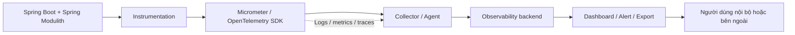
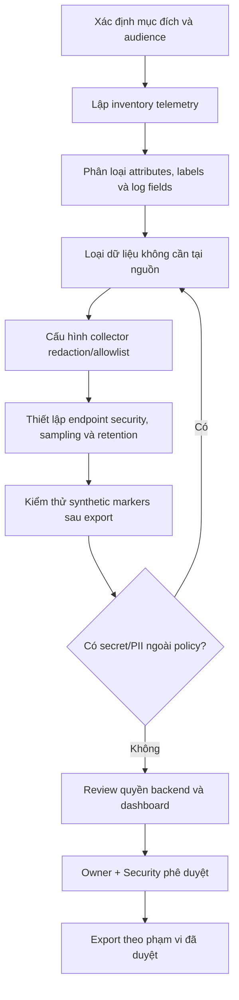

# Rà soát telemetry trước khi công khai

## 1. Vì sao cần review telemetry trước khi export?

Ứng dụng Spring Boot dùng **Spring Modulith** có thể tạo nhiều tín hiệu quan sát: module entry observations, event metrics, distributed traces, structured logs và dữ liệu Actuator. Các tín hiệu này giúp đội vận hành tìm module chậm, theo dõi event và hiểu luồng xử lý giữa các ranh giới module.

Nhưng telemetry cũng có thể chứa thông tin nội bộ hoặc dữ liệu nhạy cảm. Một log line có thể vô tình ghi email khách hàng; một span attribute có thể chứa order ID; baggage có thể mang tenant ID qua nhiều service; metric label có thể tạo hàng triệu time series; endpoint Prometheus có thể tiết lộ tên module, instance và cấu hình runtime.

Trước khi gửi telemetry đến SaaS observability, đối tác, dashboard chia sẻ hoặc một hệ thống bên ngoài, cần xác định rõ dữ liệu nào được thu thập, ai được đọc, dữ liệu được lưu ở đâu và trong bao lâu.

Ví dụ ứng dụng `shop-service` có module `order`, `payment` và `inventory`. Trace cho thấy order gọi payment và inventory; log giúp điều tra lỗi; metrics đo p95 của module entry. Nếu những tín hiệu này chứa customer email, authorization token, payment reference hoặc payload event, việc export ra backend bên ngoài có thể làm lộ dữ liệu ngoài mục tiêu quan sát.

Bài **“Rà soát telemetry trước khi công khai”** thuộc chương **Bảo mật** của **SPRING_MODULITH_DOCUMENTATION_OBSERVABILITY**. Module này hướng dẫn dùng Spring Modulith sinh tài liệu ranh giới application module và quan sát tương tác giữa các phần trong ứng dụng Spring Boot qua module graph, Actuator, event metrics, tracing và context propagation.

Sau bài học, bạn có thể:

1. Lập inventory các nguồn telemetry và nơi chúng được gửi đến.
2. Phân loại dữ liệu nhạy cảm trong metric labels, span attributes, baggage và logs.
3. Áp dụng data minimization, allowlist và redaction trước khi export.
4. Kiểm soát endpoint Actuator, Prometheus scrape và OTLP ingestion.
5. Giới hạn cardinality và tránh đưa định danh cá nhân vào metric labels.
6. Thiết lập sampling, retention và quyền truy cập theo mục đích.
7. Kiểm thử telemetry để phát hiện token, PII hoặc payload bị rò rỉ.
8. Lập checklist phê duyệt trước khi công khai dashboard hoặc kết nối observability bên ngoài.

## 2. Telemetry là một luồng dữ liệu cần được quản trị

Telemetry không chỉ là một biểu đồ. Nó là dữ liệu được tạo trong ứng dụng, xử lý bởi SDK/agent, truyền qua mạng, lưu ở backend và hiển thị cho một nhóm người dùng.



Ở mỗi chặng, dữ liệu có thể được:

- Tạo thêm thuộc tính từ request, event hoặc security context.
- Gắn service name, module identifier, instance và environment.
- Chuyển đổi format hoặc chuẩn hóa key.
- Gộp, sample, lọc hoặc enrich bởi collector.
- Lưu trong thời gian dài hơn thời gian request tồn tại.
- Chia sẻ qua dashboard, alert, API hoặc tài khoản đối tác.

Review chỉ ở code logger là chưa đủ. Cần xem cả collector processors, exporter configuration, backend access control và dashboard sharing.

### 2.1. Các loại telemetry trong Spring Modulith

| Loại | Ví dụ | Câu hỏi bảo mật |
| --- | --- | --- |
| Module entry observation | `module.invocations` Timer | Tag nào được đưa vào metric? |
| Event metrics | `module.events.published` | Có lộ event type hoặc dữ liệu nghiệp vụ trong label không? |
| Trace span | `MODULE_ENTRY` span | Attribute có chứa ID, payload hoặc dữ liệu cá nhân không? |
| Trace baggage | Tenant/correlation context | Giá trị nào được propagate qua service boundary? |
| Application logs | Structured log, MDC | Có log token, request body hoặc exception message nhạy cảm không? |
| Actuator | `/actuator/metrics`, `/actuator/prometheus`, `/actuator/modulith` | Ai có thể scrape hoặc đọc metadata? |
| Dashboard/alert | Grafana panels, notification | Ai có thể xem và URL có làm lộ filter/metadata không? |

Spring Modulith cung cấp module-level context cho observability. Nó không tự đảm bảo mọi custom metric, log hoặc span attribute trong ứng dụng đều đã được làm sạch. Phần telemetry do ứng dụng, thư viện và collector thêm vào vẫn cần review.

## 3. Lập inventory trước khi review

Trước khi thay đổi cấu hình, lập bảng luồng dữ liệu:

| Nguồn | Dữ liệu | Đích | Chủ sở hữu | Người được đọc |
| --- | --- | --- | --- | --- |
| Module entry observations | Duration, module identifier, invocation type | Prometheus/metrics backend | Platform team | SRE, developer |
| Distributed traces | Span, parent relation, attributes | OTLP collector, trace backend | Platform team | On-call, service owner |
| Application logs | Message, level, MDC, exception | Log collector/backend | Service owner | On-call, security |
| Event metrics | Publication count/status nếu có | Metrics backend | Event platform owner | Developer, SRE |
| Actuator endpoints | Health, metrics, module graph | Management network | Service owner | Monitoring/operations |
| Dashboard | Aggregated metrics and trace links | Grafana hoặc portal | Dashboard owner | Nhóm nội bộ/đối tác |

Với mỗi luồng, ghi nhận:

1. Nguồn tạo dữ liệu và instrumentation nào gắn thuộc tính.
2. Processor nào có thể enrich, filter, transform hoặc redact.
3. Giao thức và endpoint nhận dữ liệu.
4. Vùng mạng và identity dùng để xác thực.
5. Backend lưu ở quốc gia/khu vực nào theo chính sách tổ chức.
6. Retention, backup và deletion policy.
7. Nhóm người dùng, quyền export/download và khả năng chia sẻ.
8. Owner chịu trách nhiệm khi dữ liệu bị lộ hoặc cấu hình thay đổi.

Không bỏ qua telemetry của thư viện bên thứ ba. HTTP client, database instrumentation, messaging instrumentation và framework có thể thêm URL, database name, exception hoặc header vào span/log.

## 4. Phân loại dữ liệu trước khi cho phép export

Một cách thực tế là phân loại theo mức độ nhạy cảm:

| Nhóm | Ví dụ | Cách xử lý mặc định |
| --- | --- | --- |
| Public | Service display name đã được duyệt công bố | Có thể chia sẻ theo policy |
| Internal | Module identifier, environment, dependency name | Chỉ chia sẻ cho nhóm nội bộ được phép |
| Confidential | Customer ID, order ID, tenant ID, payment reference | Loại bỏ, token hóa hoặc giới hạn nghiêm ngặt theo mục đích |
| Secret | Password, API key, access token, session cookie, private key | Không ghi hoặc export; nếu lộ phải xử lý như sự cố credential |
| Regulated/personal data | Email, phone, địa chỉ, thông tin thanh toán hoặc dữ liệu cá nhân khác | Không đưa vào telemetry mặc định; xử lý theo chính sách dữ liệu và pháp lý áp dụng |

Tên module như `payment` không nhất thiết là bí mật, nhưng có thể thuộc metadata nội bộ. Việc chia sẻ phải dựa trên audience và threat model, không chỉ dựa trên việc dữ liệu có phải PII hay không.

### 4.1. Nguyên tắc data minimization

Chỉ thu thập dữ liệu cần để trả lời câu hỏi vận hành:

- Đo thời lượng bằng duration, không cần ghi request body.
- Nhóm metrics bằng module identifier, không cần customer ID.
- Điều tra một trace bằng trace ID do tracing system cấp, không cần đưa token xác thực vào baggage.
- Ghi error type và error code đã chuẩn hóa, không ghi toàn bộ exception message nếu message có thể chứa input nhạy cảm.
- Ghi route template như `/orders/{id}`, không ghi URL thực có order ID.

Nếu một thuộc tính không có use case rõ ràng, không thêm nó vào telemetry. Giảm dữ liệu ngay tại nơi tạo thường an toàn và dễ kiểm soát hơn việc cố xóa sau khi dữ liệu đã đến backend.

## 5. Rà soát metric labels và cardinality

Metric labels được lưu cùng time series và thường có thể truy vấn bởi nhiều người có quyền đọc metrics. Vì vậy, labels không phải nơi để đặt định danh từng request hoặc người dùng.

Với module entry Timer, các low-cardinality keys thường dùng gồm:

| Key | Giá trị mẫu | Đánh giá |
| --- | --- | --- |
| `module.identifier` | `inventory` | Phù hợp để nhóm theo module |
| `module.name` | `Inventory Management` | Phù hợp nếu tên không chứa thông tin nhạy cảm |
| `module.invocation-type` | `bean`, `event listener` | Tập giá trị giới hạn |
| `error` | `none`, loại exception | Kiểm tra số loại exception thực tế |

`module.method` là high-cardinality key. Nó hữu ích trong trace để biết method cụ thể, nhưng không nên mặc định đưa thành Prometheus label.

### 5.1. Không đưa dữ liệu cá nhân vào label

Tránh các label như:

```text
customer_id="customer-984132"
order_id="order-2026-0000123"
email="user@example.com"
tenant_id="tenant-83"
trace_id="4bf92f3577b34da6a3ce929d0e0e4736"
```

Các giá trị này tạo cardinality cao, làm tăng chi phí lưu trữ và có thể làm lộ dữ liệu. Nếu cần tìm một giao dịch, dùng trace/log có quyền truy cập chặt chẽ và cơ chế truy vấn theo ID phù hợp; không biến ID thành dimension metric mặc định.

### 5.2. Metric label nên dùng giá trị allowlist

Nếu thêm label nghiệp vụ, hãy dùng tập giá trị hữu hạn đã được review:

```java
enum PaymentOutcome {
    APPROVED,
    DECLINED,
    TIMEOUT,
    ERROR
}
```

Không dùng trực tiếp message từ exception hoặc dữ liệu do client gửi làm tag. Chuẩn hóa lỗi về một tập mã ổn định, giới hạn số lượng giá trị và tránh nhúng thông tin đầu vào vào tên tag.

### 5.3. Review meter filters và common tags

Kiểm tra:

- `MeterFilter` có loại bỏ meter/tag ngoài allowlist không.
- Common tags có chứa hostname, instance ID hoặc environment nhạy cảm không.
- Custom observation convention có thêm ID nghiệp vụ vào low-cardinality key không.
- Histogram có được bật trên tất cả meter không cần thiết, làm tăng số series không.
- Dashboard có cho phép query labels có dữ liệu nhạy cảm không.

Không dựa vào `MeterFilter` như lớp duy nhất để bảo vệ PII. Tốt nhất là không tạo label nhạy cảm ngay từ đầu; filter là lớp phòng vệ bổ sung.

## 6. Rà soát span attributes và trace baggage

Trace giúp theo dõi một request qua nhiều module/service. Chính khả năng liên kết này khiến một thuộc tính được thêm ở đầu request có thể đi theo trace qua nhiều thành phần và đến backend tập trung.

### 6.1. Span attributes nên có mục đích rõ ràng

Các thuộc tính thường hữu ích:

- `service.name`, `deployment.environment.name` hoặc resource attributes tương đương.
- Module identifier và invocation type.
- HTTP method, route template, status code.
- Database system/operation ở mức cần thiết.
- Error type đã chuẩn hóa.

Rà soát trước khi export:

| Thuộc tính | Rủi ro | Hướng xử lý |
| --- | --- | --- |
| `module.identifier` | Tiết lộ metadata nội bộ | Chỉ export cho audience được duyệt |
| `module.method` | Lộ tên method nội bộ, cardinality cao | Giữ trong trace có kiểm soát; không chuyển thành metric label |
| `http.url` | Có thể chứa query string hoặc ID trong path | Dùng route template, loại query nhạy cảm |
| `http.request.header.*` | Có thể chứa Authorization, Cookie, session | Không capture toàn bộ header; allowlist header an toàn |
| `db.statement` | Có thể chứa literal hoặc dữ liệu nghiệp vụ | Tắt hoặc sanitize statement; ưu tiên operation name |
| `exception.message` | Có thể chứa input hoặc secret | Dùng exception type/code, làm sạch message |
| `enduser.id` | Định danh cá nhân | Loại bỏ hoặc token hóa nếu có use case được duyệt |

Đừng bật capture toàn bộ request/response body hoặc toàn bộ HTTP headers chỉ để điều tra lỗi. Những payload này có thể chứa thông tin xác thực, dữ liệu cá nhân và bí mật nghiệp vụ.

### 6.2. Không đưa secret vào baggage

W3C Baggage có thể được propagate qua nhiều service boundary. Một giá trị baggage được thêm vào request có thể xuất hiện trong process downstream và được instrumentation đưa vào telemetry tùy cấu hình.

Không đưa các giá trị sau vào baggage:

- Authorization token, API key, cookie hoặc session token.
- Email, phone, địa chỉ hoặc tên khách hàng.
- Payment card/reference hoặc order payload.
- Dữ liệu định danh cá nhân không cần cho routing/diagnostics.

Chỉ propagate context tối thiểu, ví dụ một correlation value ngẫu nhiên đã được thiết kế cho mục đích trace liên service. Nếu ID có thể liên kết trở lại một người hoặc giao dịch, nó vẫn cần được phân loại và kiểm soát quyền truy cập.

### 6.3. Kiểm soát context propagation

Context propagation giúp giữ trace parent/child qua HTTP, messaging hoặc executor. Không đồng nghĩa phải propagate mọi custom context key.

Với Spring Boot/Micrometer Tracing:

- Giữ propagation format đã thống nhất, thường là W3C Trace Context.
- Chỉ bật baggage fields có nhu cầu thực tế.
- Cấu hình remote fields riêng nếu cần truyền qua service boundary.
- Tránh copy toàn bộ MDC hoặc security context vào baggage.
- Kiểm tra instrumentation của HTTP client và messaging có inject/extract đúng header.
- Không cho client bên ngoài tự do đặt custom baggage key được backend tin cậy như identity.

Ví dụ cấu hình chỉ khai báo một correlation field đã được duyệt (tên property có thể khác theo dòng Spring Boot và tracing bridge; kiểm tra application properties đúng phiên bản):

```yaml
management:
  tracing:
    baggage:
      remote-fields:
        - correlation-id
      correlation:
        fields:
          - correlation-id
```

Đây là ví dụ minh họa cách giới hạn field; chỉ sử dụng nếu ứng dụng thực sự cần correlation ID qua service boundary. Không dùng nó để truyền access token, customer email hoặc dữ liệu nghiệp vụ.

### 6.4. Trace sampling không phải redaction

Sampling giảm số lượng trace được giữ hoặc export. Nó không làm sạch nội dung của trace được chọn. Nếu 1% trace được sample nhưng trace đó chứa token, token vẫn bị export.

Không dùng sampling thay cho:

- Loại bỏ thuộc tính nhạy cảm.
- Giới hạn header/payload capture.
- Redaction tại instrumentation/collector.
- Access control và retention.

## 7. Rà soát application logs, MDC và exception

Logs thường chứa nhiều nội dung tự do hơn metrics và traces. Structured logging giúp truy vấn tốt hơn nhưng không tự động an toàn hơn.

### 7.1. Các trường log cần review

| Trường | Ví dụ rủi ro | Khuyến nghị |
| --- | --- | --- |
| `message` | Nội dung request hoặc payload event | Viết message theo template, không nối raw input |
| `traceId`, `spanId` | Liên kết tới trace có quyền hạn khác | Giữ khi cần correlation, kiểm soát quyền đọc backend |
| `userId`, `customerEmail` | PII hoặc identifier | Không log mặc định; dùng pseudonymous ID nếu được duyệt |
| `authorization`, `cookie` | Credential | Không log |
| `exception.message` | SQL, URL, token hoặc input nhạy cảm | Chuẩn hóa error code/type; sanitize message |
| `request.body`, `response.body` | Payload đầy đủ | Tắt mặc định; chỉ capture có chọn lọc trong môi trường được kiểm soát |
| `MDC` custom fields | Dữ liệu được copy xuyên request | Allowlist field, review nguồn và lifecycle |

### 7.2. Structured logging không thay thế data review

Ví dụ log an toàn hơn:

```java
log.warn(
    "Payment authorization failed: outcome={}, errorCode={}, traceId={}",
    outcome,
    errorCode,
    traceId
);
```

Tránh:

```java
log.warn(
    "Payment failed for customer {} with request {}",
    customerEmail,
    requestBody
);
```

Không dùng exception message không kiểm soát:

```java
catch (RuntimeException ex) {
    log.error("Payment failed: {}", ex.getMessage());
    throw ex;
}
```

Exception message có thể chứa SQL, URL, header hoặc giá trị đầu vào. Nếu cần stack trace để điều tra, giữ quyền truy cập log chặt chẽ và sanitize dữ liệu ở nguồn; không ghi credential vào exception.

### 7.3. MDC và context propagation

MDC có thể chứa trace ID, span ID và các field do ứng dụng thêm. Khi dùng executor/reactive pipeline, context có thể được propagate sang thread khác. Điều này hữu ích cho correlation nhưng cũng làm tăng phạm vi dữ liệu đi qua hệ thống.

Review:

- Field nào được đưa vào MDC?
- Field đó được tạo từ nguồn tin cậy hay input bên ngoài?
- Có chứa PII/secret không?
- Có được clear khi request kết thúc không?
- Async task có nhận context cần thiết hay copy cả context không cần thiết?
- Log encoder có tự export toàn bộ MDC map không?

Không đưa nguyên `SecurityContext`, JWT claims hoặc toàn bộ request headers vào MDC. Chỉ thêm những field đã được duyệt và cần cho truy vấn vận hành.

## 8. Redaction tại nguồn và tại collector

Ưu tiên loại bỏ dữ liệu nhạy cảm ngay tại nơi tạo telemetry. Collector processor là lớp phòng vệ bổ sung, đặc biệt hữu ích khi nhiều service gửi dữ liệu về cùng một pipeline.

### 8.1. Redact tại nguồn

Ví dụ:

- Không tạo metric label từ email hoặc customer ID.
- Không thêm token vào span attribute.
- Không log request/response body mặc định.
- Không propagate secret qua baggage.
- Dùng route template thay URL có ID thực.
- Chuẩn hóa exception thành error type/code.

Redact tại nguồn giúp dữ liệu không rời process, giảm nguy cơ xuất hiện trong queue, retry buffer hoặc log của collector.

### 8.2. Redact tại OpenTelemetry Collector

Collector có thể dùng processor để xóa hoặc biến đổi attribute trước khi export. Với OpenTelemetry Collector Contrib, các processor như `attributes`, `transform` hoặc `filter` có thể hỗ trợ các chính sách khác nhau tùy phiên bản/distribution.

Ví dụ minh họa cấu hình processor xóa một số span attributes:

```yaml
processors:
  attributes/sanitize:
    actions:
      - key: http.request.header.authorization
        action: delete
      - key: http.request.header.cookie
        action: delete
      - key: enduser.id
        action: delete

service:
  pipelines:
    traces:
      receivers: [otlp]
      processors: [attributes/sanitize, batch]
      exporters: [otlp/secure-backend]
```

Đây là ví dụ cấu trúc; xác nhận processor, semantic attribute names và cú pháp đúng với bản Collector đang chạy. Attribute do instrumentation tạo có thể dùng tên khác; phải kiểm tra payload thực tế trước khi viết rule.

Đối với log body hoặc attribute lồng nhau, cần processor hỗ trợ đúng cấu trúc và biểu thức. Không giả định xóa một attribute sẽ tự động xóa mọi bản sao của giá trị trong message, exception stack hoặc resource attributes.

### 8.3. Không chỉ xóa key có tên rõ ràng

Secret có thể bị ghi vào các trường khác nhau:

- Header `Authorization` trong span.
- Query string trong `url.full`.
- Exception message.
- Structured log message.
- Event payload được serialize.
- Baggage hoặc custom attribute.

Một chính sách redaction tốt kết hợp:

1. Allowlist attribute được phép export.
2. Delete các field nhạy cảm đã biết.
3. Transform hoặc mask dữ liệu theo quy tắc rõ ràng.
4. Kiểm thử bằng dữ liệu giả có marker nhạy cảm.
5. Kiểm tra output sau collector, không chỉ input trước collector.

Nếu backend hoặc collector lưu raw payload trước khi processor chạy, phải xem xét cả queue, disk buffer và failure path.

## 9. Review dashboard, alert và tài liệu chia sẻ

Ngay cả khi raw telemetry đã được bảo vệ, dashboard hoặc alert có thể tạo một đường rò rỉ khác.

### 12.1. Dashboard dành cho nội bộ

Trước khi cấp quyền xem dashboard:

- Giới hạn datasource permissions theo team/service.
- Kiểm tra variables không cho truy vấn tùy ý các label nhạy cảm.
- Ẩn raw trace/log panel khỏi nhóm không cần điều tra chi tiết.
- Kiểm tra link từ panel sang trace/log có giữ nguyên access control của backend.
- Giới hạn download/export nếu dữ liệu có thể chứa định danh.
- Không dùng dashboard permission rộng hơn datasource permission.
- Review annotation, dashboard description và query text để loại URL nội bộ hoặc thông tin triển khai không cần thiết.

### 12.2. Dashboard chia sẻ với đối tác hoặc công chúng

Tạo dashboard riêng, chỉ chứa aggregate đã được duyệt:

| Có thể phù hợp sau review | Không nên công khai mặc định |
| --- | --- |
| Availability theo ngày/tuần | Raw trace và span attributes |
| Latency percentile tổng hợp | Request URL có ID thực |
| Error rate theo service đã duyệt | Exception message/stack trace |
| Release status đã được phép chia sẻ | Package/module dependency nội bộ |
| SLO compliance đã tổng hợp | Customer/tenant/order identifiers |

Nếu đối tác cần thông tin về một module cụ thể, xác định module identifier đó có được phép chia sẻ không. Có thể dùng nhãn logic thay cho tên nội bộ nếu tài liệu công khai không cần lộ cấu trúc triển khai.

### 12.3. Alert notification cũng là một bản export

Email, chat, ticket và webhook có thể lưu nội dung lâu hơn trace backend. Review các trường:

- Summary và description.
- Labels được render trong template.
- Runbook/dashboard URL.
- Screenshot hoặc query result đính kèm.
- Resolved notification và incident notes.

Không đưa raw customer ID, token, request body hoặc exception message vào alert annotation. Nếu notification được gửi sang nhà cung cấp bên ngoài, áp dụng cùng data classification và retention review như telemetry backend.

## 10. Quy trình phê duyệt trước khi export

Áp dụng quy trình có thể lặp lại mỗi khi thêm exporter, đổi collector, mở dashboard hoặc thay instrumentation:



### 13.1. Nội dung của một approval record

Lưu lại:

| Trường | Nội dung |
| --- | --- |
| Purpose | Câu hỏi vận hành cần telemetry trả lời |
| Data sources | Metrics, traces, logs, events, Actuator |
| Attributes | Danh sách key được phép export |
| Exclusions | Secret/PII/payload không được export |
| Destination | Collector/backend/region |
| Audience | Nhóm user, service account và đối tác |
| Controls | TLS, authentication, RBAC, redaction, sampling |
| Retention | Thời hạn lưu, backup, deletion |
| Owner | Service owner và platform/security reviewer |
| Review date | Ngày xem xét lại hoặc khi thay đổi lớn |

Không coi việc bật exporter hoặc thêm endpoint là một thay đổi cấu hình nhỏ. Nó có thể thay đổi nơi dữ liệu được xử lý, người có thể đọc và thời gian dữ liệu tồn tại.

### 13.2. Thay đổi cần review lại

Review lại khi:

- Thêm custom span attribute, metric tag hoặc MDC field.
- Bật capture HTTP headers, request body hoặc SQL statement.
- Thêm baggage field hoặc thay propagation format.
- Thay đổi sampling policy.
- Thêm collector processor/exporter hoặc backend vendor.
- Mở dashboard public link hoặc thêm đối tác.
- Thay đổi retention, region, backup hoặc access roles.
- Nâng Spring Boot, Micrometer, OpenTelemetry instrumentation hoặc Spring Modulith làm thay đổi telemetry schema.

## 11. Xử lý khi phát hiện telemetry đã bị lộ

Nếu phát hiện secret hoặc dữ liệu nhạy cảm trong telemetry:

1. **Dừng nguồn phát sinh:** tắt field capture hoặc exporter gây lộ nếu có thể làm an toàn.
2. **Giới hạn truy cập:** thu hồi public link, giảm backend permissions và khóa token bị lộ.
3. **Đánh giá phạm vi:** xác định loại dữ liệu, thời gian, service, backend, collector queue, archive và người đã truy cập.
4. **Xử lý credential:** rotate/revoke token, API key, password hoặc certificate có nguy cơ lộ.
5. **Xóa/giới hạn bản sao:** làm theo quy trình deletion/retention của backend, replica, backup và nhà cung cấp.
6. **Thông báo đúng kênh:** phối hợp security, data owner, legal/privacy và incident response theo policy tổ chức.
7. **Sửa nguyên nhân:** thêm test marker, source-level guard và collector policy.
8. **Xác nhận khắc phục:** chạy lại test export và kiểm tra backend không còn dữ liệu bị cấm trong phạm vi có thể kiểm chứng.

Không chỉ xóa một panel hoặc sửa dashboard. Dữ liệu có thể vẫn tồn tại trong raw index, trace archive, collector queue, export file, notification hoặc backup.

## 12. Checklist thực hành

- [ ] Lập inventory nguồn telemetry, collector, backend, dashboard và audience.
- [ ] Phân loại dữ liệu public, internal, confidential, secret và personal/regulated.
- [ ] Chỉ thu thập thuộc tính cần thiết cho mục tiêu vận hành.
- [ ] Không đưa token, cookie, password hoặc private key vào telemetry.
- [ ] Không dùng email, customer ID, order ID, tenant ID hoặc trace ID làm metric label.
- [ ] Giữ `module.method` ở trace khi cần; không biến thành metric label mặc định.
- [ ] Review span attributes, HTTP headers, URL, database statement và exception.
- [ ] Giới hạn baggage fields; không propagate security context hoặc credential.
- [ ] Allowlist MDC fields và bảo đảm context được clear đúng lifecycle.
- [ ] Redact tại nguồn; dùng collector processor như lớp phòng vệ bổ sung.
- [ ] Kiểm tra processor thực sự nằm trong pipeline export.
- [ ] Bảo vệ Actuator, Prometheus scrape và OTLP receiver bằng network boundary, TLS và authentication.
- [ ] Không public management port hoặc OTLP receiver nếu không có nhu cầu được duyệt.
- [ ] Xác định sampling, retention, backup, deletion và data region.
- [ ] Phân quyền backend, dashboard, raw trace/log search và download theo vai trò.
- [ ] Không dùng public dashboard link cho raw telemetry nội bộ.
- [ ] Kiểm thử synthetic markers trong logs, metrics, traces, collector output và backend test index.
- [ ] Kiểm tra cả span con, exception, events, resource attributes và baggage.
- [ ] Review alert notification, runbook link và webhook như một kênh export dữ liệu.
- [ ] Lưu approval record và review lại khi instrumentation/exporter thay đổi.

### 8.4. Masking và hashing không tự động làm dữ liệu vô danh

Ví dụ `sha256(customerId)` vẫn tạo giá trị ổn định có thể liên kết nhiều hoạt động của cùng một khách hàng. Nếu không có salt/key hoặc nếu miền ID nhỏ, giá trị hash có thể bị dò ngược. Pseudonymization giảm khả năng nhận diện trực tiếp nhưng không nhất thiết loại bỏ nghĩa vụ bảo vệ dữ liệu.

Chỉ dùng tokenization/hash khi có mục đích rõ ràng, quản lý khóa phù hợp và review khả năng liên kết dữ liệu.

## 13. Bảo vệ Actuator, Prometheus và OTLP endpoints

Telemetry có thể bị lộ ngay cả khi log/span đã được sanitize nếu endpoint quản trị hoặc collector ingestion mở cho mạng không tin cậy.

### 9.1. Actuator exposure theo allowlist

Chỉ expose những endpoint cần cho hoạt động:

```yaml
management:
  endpoints:
    web:
      exposure:
        include: "health,metrics,prometheus"
```

Nếu cần module graph cho nhóm kiến trúc, cân nhắc cấp riêng `modulith` với authorization tương ứng. Không thêm `env`, `configprops`, `beans` hoặc `heapdump` vào allowlist chỉ để tiện debug.

Khi phiên bản Spring Boot hỗ trợ endpoint access properties, có thể đặt access mặc định là `none` và chỉ bật read cho endpoint cần thiết:

```yaml
management:
  endpoints:
    access:
      default: none
  endpoint:
    health:
      access: read-only
    metrics:
      access: read-only
    prometheus:
      access: read-only
```

Endpoint access và exposure là hai lớp khác nhau. Access `read-only` không xác thực caller; vẫn cần Spring Security và network policy. Kiểm tra đúng phiên bản Spring Boot vì endpoint access properties không có trong mọi dòng cũ.

### 9.2. Đặt management server trên network riêng

Ví dụ:

```yaml
server:
  port: 8080

management:
  server:
    port: 9091
  endpoints:
    web:
      exposure:
        include: "health,metrics,prometheus"
```

Chỉ cho phép Prometheus/monitoring workloads hoặc operations network truy cập port 9091. Không publish management port qua public ingress hoặc load balancer dành cho người dùng.

Nếu monitoring chạy trên host/pod khác, không bind loopback một cách máy móc. Chọn bind address và network policy phù hợp topology triển khai.

### 9.3. Bảo vệ Prometheus scrape

Prometheus scrape endpoint thường chứa metrics của nhiều subsystem. Nếu có thông tin nội bộ hoặc label không phù hợp, người có thể đọc endpoint sẽ thu thập được nhiều dữ liệu cùng lúc.

Kiểm soát:

- Scrape từ network segment/workload identity được phép.
- Dùng TLS và authentication phù hợp nếu endpoint đi qua mạng không tin cậy.
- Cấp credential riêng cho scraper, quyền chỉ đọc đúng endpoint cần thiết.
- Không tái sử dụng credential của người vận hành hoặc API nghiệp vụ.
- Giới hạn exposure của các endpoint khác trên cùng management server.
- Review metric labels trước khi mở dashboard hoặc API query cho nhóm rộng hơn.

### 9.4. Bảo vệ OTLP receiver và exporter

OTLP receiver nhận telemetry từ application/agent; exporter gửi telemetry tới backend. Cần bảo vệ cả hai hướng:

| Thành phần | Rủi ro | Kiểm soát |
| --- | --- | --- |
| OTLP receiver | Attacker gửi dữ liệu giả, gây DoS hoặc chèn dữ liệu độc hại | Không public receiver; TLS, authentication, network policy, rate limit |
| Collector exporter | Telemetry gửi nhầm endpoint hoặc lộ credential | TLS, secret management, egress allowlist, endpoint review |
| Collector queue/buffer | Dữ liệu nhạy cảm lưu tạm trên disk | Quyền filesystem, encryption, retention và cleanup |
| Collector debug/logging | Payload có thể xuất hiện trong log debug | Không bật verbose payload logging ở production |
| Backend ingestion API | Token có thể bị lạm dụng để gửi/đọc dữ liệu | Credential riêng, scope tối thiểu, rotate và audit |

Ví dụ cấu hình OTLP receiver không nên mở trên public interface:

```yaml
receivers:
  otlp:
    protocols:
      grpc:
        endpoint: 0.0.0.0:4317
      http:
        endpoint: 0.0.0.0:4318
```

Đoạn này chỉ minh họa listener ports. Bind `0.0.0.0` làm receiver lắng nghe trên mọi interface trong network namespace; nó **không tự bật authentication hoặc TLS**. Chỉ dùng khi network boundary chặn nguồn truy cập không tin cậy và đã cấu hình transport security tương ứng. Nếu không cần public interface, bind vào interface riêng hoặc localhost theo topology.

Không nhúng API key trực tiếp vào file cấu hình version control. Dùng secret store/secret file, giới hạn quyền đọc và rotate credential khi thay đổi owner hoặc nghi ngờ lộ.

## 14. Sampling, retention và quyền truy cập backend

### 10.1. Sampling theo mục đích

Sampling giúp kiểm soát lượng trace và chi phí. Một chính sách có thể:

- Giữ tỷ lệ thấp cho traffic thông thường.
- Giữ nhiều trace hơn cho error hoặc latency cao bằng tail sampling nếu kiến trúc collector hỗ trợ.
- Dùng sampling deterministic trong test để assertion không ngẫu nhiên.
- Giữ trace đầy đủ trong thời gian ngắn ở môi trường điều tra được kiểm soát.

Sampling không phải cơ chế xóa PII/secret. Dữ liệu nhạy cảm phải được loại bỏ trước khi sampling/export. Tail sampling cũng có thể cần buffer trace ở collector; đánh giá buffer, disk queue và quyền truy cập ở đó.

### 10.2. Retention theo loại dữ liệu

Không áp dụng một retention duy nhất cho mọi telemetry:

| Loại dữ liệu | Đặc điểm | Chính sách cần xác định |
| --- | --- | --- |
| Metrics | Aggregated time series, thường ít chi tiết cá nhân hơn | Retention theo nhu cầu SLO/capacity và chi phí |
| Traces | Chi tiết từng request/span, có thể chứa attributes nhạy cảm | Retention ngắn hơn hoặc phân tầng theo sampling/incident |
| Logs | Message và exception có thể chứa nội dung tự do | Retention theo điều tra, audit và chính sách dữ liệu |
| Collector queue | Dữ liệu chờ export/retry | Thời gian tồn tại, encryption, disk access, cleanup |
| Dashboard/export | Bản sao hoặc snapshot có thể tải xuống | Quyền chia sẻ, expiry và quy trình thu hồi |

Xác định retention, backup, deletion và legal hold với data owner/security/legal theo chính sách tổ chức. Không mặc định xóa trên dashboard đồng nghĩa dữ liệu đã bị xóa khỏi backend, replica, archive hoặc backup.

### 10.3. Phân quyền backend theo vai trò

Áp dụng quyền tối thiểu:

- Developer xem service/module thuộc phạm vi công việc.
- On-call xem trace/log cần thiết trong ca trực.
- Security/audit có quyền điều tra theo quy trình được phê duyệt.
- Dashboard công khai chỉ hiển thị aggregate đã review.
- Tài khoản export/API token có scope riêng và thời hạn phù hợp.

Kiểm tra quyền download CSV/JSON, inspect trace, raw log search, share dashboard và tạo public link. Một dashboard không có dữ liệu PII vẫn có thể tiết lộ module graph, traffic pattern, release timing hoặc incident details.

### 10.4. Không dùng dashboard public link cho telemetry nội bộ

Public link hoặc anonymous viewer có thể bỏ qua access control thông thường. Trước khi bật, kiểm tra:

- Dashboard chỉ chứa dữ liệu đã được phê duyệt công khai.
- Không có variable cho phép query raw labels hoặc internal service names.
- Panel không hiển thị trace/log snippets có định danh.
- Annotation/link không chứa credential hoặc URL nội bộ nhạy cảm.
- Người xem không thể truy cập datasource/query API ngoài phạm vi.

Nếu chỉ cần chia sẻ tình trạng dịch vụ, tạo dashboard aggregate riêng thay vì chia sẻ dashboard điều tra nội bộ.

## 15. Kiểm thử telemetry không chứa dữ liệu nhạy cảm

Review cấu hình bằng mắt là chưa đủ. Tạo test với dữ liệu giả có marker dễ tìm để kiểm tra output sau instrumentation và collector.

### 11.1. Dùng synthetic markers

Trong môi trường test, dùng marker không phải dữ liệu thật:

```text
CUSTOMER_EMAIL_MARKER@example.invalid
ACCESS_TOKEN_MARKER_DO_NOT_EXPORT
ORDER_ID_MARKER_123456
PAYLOAD_MARKER_PRIVATE
```

Đưa marker vào các nguồn có nguy cơ:

- Request header/body.
- Query parameter/path variable.
- Event payload.
- Exception message.
- MDC custom field.
- Baggage.

Gửi một request test và thu thập log, metrics, traces trước/sau collector. Kết quả mong đợi là marker nhạy cảm không xuất hiện trong dữ liệu được export; nếu marker được giữ dưới dạng giá trị đã token hóa theo policy thì phải xác minh không thể đảo ngược hoặc liên kết ngoài mục tiêu.

### 11.2. Kiểm tra span attributes

Với in-memory exporter hoặc test collector:

1. Gọi module API có request test chứa marker.
2. Thu span đã kết thúc.
3. Duyệt resource attributes, span attributes, events, links và baggage được propagate.
4. Assert không có authorization, cookie, email, raw order payload hoặc marker bị cấm.
5. Xác nhận các attribute hợp lệ như module identifier và invocation type vẫn còn.

Không chỉ kiểm tra span root. Span con từ HTTP client, database hoặc messaging instrumentation cũng có thể chứa dữ liệu.

### 11.3. Kiểm tra log output

Kiểm tra JSON log sau encoder:

- Không có header `Authorization` hoặc `Cookie`.
- Không có request/response body ngoài chính sách.
- Không có email/phone/customer ID không được duyệt.
- MDC chỉ chứa field allowlist.
- Exception message/stack không lộ credential.
- Trace ID vẫn có thể được dùng để correlation nếu policy cho phép.

Kiểm tra cả log appender và collector transform vì hai nơi có thể serialize dữ liệu khác nhau.

### 11.4. Kiểm tra metric exposition

Đọc `/actuator/prometheus` trong test/staging và tìm:

- Label có email, order ID, customer ID hoặc trace ID.
- Label value lấy từ input không kiểm soát.
- Module/method label vượt cardinality dự kiến.
- Endpoint có trả metrics ngoài allowlist.

Nếu metric không chứa PII nhưng endpoint public, dữ liệu vẫn có thể tiết lộ cấu trúc service và traffic. Kết hợp nội dung metric review với access-control test.

### 11.5. Kiểm tra collector output

Gửi synthetic marker qua collector, sau đó kiểm tra:

- Exported OTLP payload.
- Debug logs của collector trong test mode.
- Persistent queue/buffer nếu có.
- Backend test index.

Đảm bảo processor thực sự nằm trong pipeline của traces/logs/metrics cần bảo vệ. Một processor khai báo nhưng không được tham chiếu trong pipeline sẽ không lọc dữ liệu.

## 16. Tài liệu tham khảo

- [Spring Modulith — Production-ready Features](https://docs.spring.io/spring-modulith/reference/production-ready.html): module observability, module entry observations và event metrics.
- [Spring Boot — Observability](https://docs.spring.io/spring-boot/reference/actuator/observability.html): Micrometer Observation, tracing, baggage và context propagation.
- [Spring Boot — Metrics](https://docs.spring.io/spring-boot/reference/actuator/metrics.html): metric naming, tags, filters và Actuator metrics endpoint.
- [Spring Boot — Structured Logging](https://docs.spring.io/spring-boot/reference/features/logging.html): structured console/file logging và correlation fields.
- [Micrometer — Observation Components](https://docs.micrometer.io/micrometer/reference/observation/components.html): observation handlers, conventions, filters và lifecycle.
- [OpenTelemetry — Semantic Conventions](https://opentelemetry.io/docs/specs/semconv/): chuẩn hóa resource, span, HTTP, database và log attributes.
- [OpenTelemetry — Context Propagation](https://opentelemetry.io/docs/concepts/context-propagation/): trace context và baggage propagation.
- [OpenTelemetry Collector — Transform Processor](https://github.com/open-telemetry/opentelemetry-collector-contrib/tree/main/processor/transformprocessor): biến đổi và xóa telemetry attributes bằng OTTL.
- [OpenTelemetry Collector — Attributes Processor](https://github.com/open-telemetry/opentelemetry-collector-contrib/tree/main/processor/attributesprocessor): insert, update, hash và delete attributes.
- [Prometheus — Security Model](https://prometheus.io/docs/operating/security/): bảo vệ endpoints và dữ liệu monitoring.
- [OWASP — Logging Cheat Sheet](https://cheatsheetseries.owasp.org/cheatsheets/Logging_Cheat_Sheet.html): dữ liệu không nên log, bảo vệ log và retention.
- [OWASP — Secrets Management Cheat Sheet](https://cheatsheetseries.owasp.org/cheatsheets/Secrets_Management_Cheat_Sheet.html): quản lý, lưu trữ và xoay vòng secrets.
