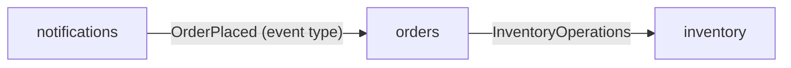
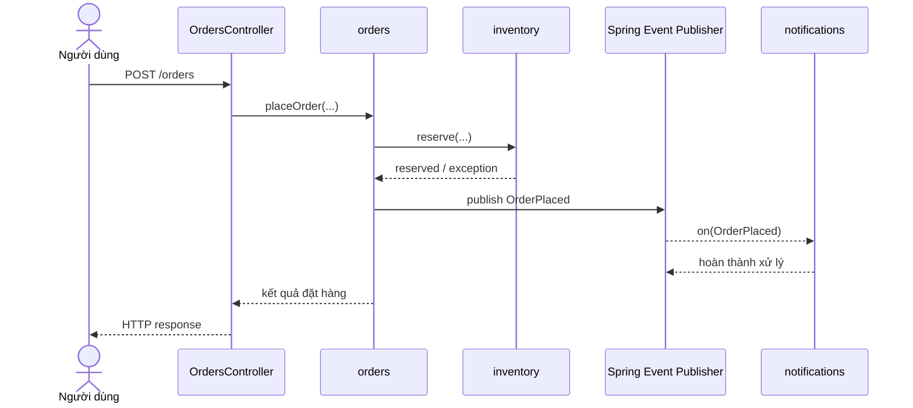

# Quan sát tương tác giữa các module trong cùng ứng dụng

Một ứng dụng Spring Boot có thể được tổ chức thành nhiều **application module** mà vẫn được triển khai như một tiến trình duy nhất. Chẳng hạn, module `orders` xử lý đơn hàng, `inventory` quản lý tồn kho, còn `notifications` gửi thông báo. Các module tương tác qua lời gọi bean, sự kiện ứng dụng và dữ liệu chia sẻ có kiểm soát. Nếu chỉ nhìn vào log HTTP hoặc biểu đồ CPU toàn ứng dụng, ta khó biết một yêu cầu đi qua module nào và sự phụ thuộc thực tế có đúng kiến trúc mong muốn không.

**Spring Modulith Documentation & Observability** giúp giải quyết vấn đề này bằng hai nguồn bằng chứng bổ sung cho nhau:

- **Tài liệu cấu trúc:** nhận diện application module, các ranh giới API và phụ thuộc giữa chúng; sinh module graph hoặc module canvas để xem kiến trúc **có thể** tương tác như thế nào.
- **Quan sát khi chạy:** dùng Spring Boot Actuator, Micrometer Observation, metrics và tracing để xem **lời gọi nào thực sự xảy ra**, thời gian ở mỗi đoạn, lỗi phát sinh ở đâu và context được truyền ra sao khi xử lý bất đồng bộ.

Bài học thuộc chương **Nhiều module**, tập trung vào quan sát tương tác **giữa các module trong cùng một ứng dụng Spring Boot**. Nó không yêu cầu tách ứng dụng thành microservice; dù một số kỹ thuật tracing cũng dùng được khi hệ thống gọi dịch vụ bên ngoài.

## 1. Phân biệt ranh giới module, quan hệ phụ thuộc và luồng thực thi

Trong mô hình mặc định phổ biến của Spring Modulith, các package trực tiếp bên dưới package chứa lớp `@SpringBootApplication` được nhận diện thành application module. Ví dụ:

```text
com.acme.shop
├── ShopApplication.java
├── orders/
│   ├── OrderService.java
│   ├── OrderPlaced.java
│   └── internal/
│       └── OrderRepositoryAdapter.java
├── inventory/
│   ├── InventoryOperations.java
│   └── internal/
│       └── InventoryService.java
└── notifications/
    └── internal/
        └── OrderNotificationListener.java
```

Trong ví dụ này, `orders`, `inventory` và `notifications` là ba module. Các kiểu đặt trong **base package** của module có thể làm API công khai của module trong mô hình mặc định; các implementation nằm dưới `internal` nên được xem là chi tiết nội bộ. Spring Modulith cũng hỗ trợ những cách khai báo ranh giới và named interface khác: phải căn cứ cấu hình thực tế của dự án khi đọc graph.

Cần phân biệt ba khái niệm:

| Khái niệm | Ý nghĩa | Công cụ/bằng chứng phù hợp |
| --- | --- | --- |
| Ranh giới module | Phần nào được sở hữu và công khai bởi module nào | Phân tích application modules và quy tắc truy cập nội bộ |
| Phụ thuộc tĩnh | Module A tham chiếu tới kiểu/bean/API của module B | `ApplicationModules`, kiểm tra kiến trúc, module graph |
| Tương tác lúc chạy | Trong một request cụ thể, component nào đã được gọi, mất bao lâu và có lỗi không | Observation, trace/span, metrics, log có correlation |

**Phụ thuộc tĩnh không phải bằng chứng một lời gọi đã xảy ra.** `orders` có thể được phép gọi `inventory`, nhưng không phải request nào cũng kiểm tra tồn kho. Ngược lại, một trace thể hiện `orders → inventory` mới cho biết luồng đó **đã xảy ra trong một lần chạy được quan sát**, chứ không chứng minh mọi nhánh xử lý hay mọi phụ thuộc có thể có của ứng dụng.

## 2. Ba hình thức tương tác giữa các module

### 2.1. Lời gọi đồng bộ qua public API

Giả sử `orders` cần giữ hàng trước khi xác nhận đơn. Thay vì inject trực tiếp `inventory.internal.InventoryService`, module `orders` gọi một interface công khai:

```java
// File thuộc base package của module inventory.
package com.acme.shop.inventory;

import java.util.UUID;

public interface InventoryOperations {
    void reserve(UUID productId, int quantity);
}
```

Implementation nằm trong nội bộ module `inventory`:

```java
package com.acme.shop.inventory.internal;

import com.acme.shop.inventory.InventoryOperations;
import java.util.UUID;
import org.springframework.stereotype.Service;

@Service
class InventoryService implements InventoryOperations {
    @Override
    public void reserve(UUID productId, int quantity) {
        // Kiểm tra và giữ hàng theo nghiệp vụ thật.
        // Có thể ném ngoại lệ nghiệp vụ nếu không đủ tồn kho.
    }
}
```

Phía `orders` chỉ biết API của `inventory`:

```java
package com.acme.shop.orders;

import com.acme.shop.inventory.InventoryOperations;
import java.util.UUID;
import org.springframework.stereotype.Service;

@Service
public class OrderService {
    private final InventoryOperations inventory;

    public OrderService(InventoryOperations inventory) {
        this.inventory = inventory;
    }

    public void placeOrder(UUID productId, int quantity) {
        inventory.reserve(productId, quantity);
        // Lưu đơn hàng sau khi xử lý các quy tắc nghiệp vụ cần thiết.
    }
}
```

Lời gọi trên là **lời gọi Java trong cùng JVM**. Spring Modulith mô tả ranh giới ứng dụng; bản thân nó không biến lời gọi này thành HTTP hoặc RPC. Vì thế, khi xem trace, ta cần hiểu các span module như những đoạn thực thi trong tiến trình chứ không suy luận có thêm network latency.

### 2.2. Tương tác qua sự kiện ứng dụng

Sau khi hoàn tất một nghiệp vụ, `orders` có thể phát `OrderPlaced` để `notifications` xử lý:

```java
package com.acme.shop.orders;

import java.util.UUID;

public record OrderPlaced(UUID orderId) {}
```

```java
package com.acme.shop.notifications.internal;

import com.acme.shop.orders.OrderPlaced;
import org.springframework.context.event.EventListener;
import org.springframework.stereotype.Component;

@Component
class OrderNotificationListener {
    @EventListener
    void on(OrderPlaced event) {
        // Ghi nhận yêu cầu gửi thông báo.
    }
}
```

Với `@EventListener` thông thường, listener mặc định chạy **đồng bộ trên thread phát sự kiện**, trừ khi cấu hình thực thi bất đồng bộ. Không được mặc định mọi event trong Spring Modulith đều là message broker hoặc background job. Nếu sử dụng `@ApplicationModuleListener`, `@TransactionalEventListener` hay `@Async`, cần ghi rõ ranh giới transaction, thời điểm xử lý và executor tương ứng vì chúng ảnh hưởng trực tiếp đến trace và ngữ nghĩa lỗi.

### 2.3. Tương tác bất đồng bộ và tiếp diễn công việc

Trong xử lý bất đồng bộ, một request có thể hoàn tất trước khi tác vụ gửi thông báo hoàn thành. Một trace HTTP đơn lẻ không nhất thiết bao trùm toàn bộ vòng đời nghiệp vụ. Hệ thống cần có cách quan sát **sự kiện đã phát**, **handler đã bắt đầu**, **handler thành công/thất bại** và **công việc còn chờ hoặc cần thử lại**, tùy hạ tầng sử dụng.

| Kiểu tương tác | Thời điểm hoàn tất phía gọi | Điều nên đo |
| --- | --- | --- |
| Method call đồng bộ | Sau khi method trả về/ném lỗi | Thời gian gọi, module nguồn/đích, lỗi |
| `@EventListener` đồng bộ | Sau khi các listener đồng bộ chạy xong | Thời gian xử lý từng listener và tác động lên request gốc |
| Listener bất đồng bộ | Có thể trước khi listener hoàn thành | Số event phát/nhận, thời gian chờ, thời gian xử lý, lỗi/retry |
| Event publication có cơ chế lưu bền | Phụ thuộc thời điểm ghi publication và thời điểm listener hoàn tất | Publication đang chờ, hoàn thành, retry; trạng thái transaction |

Không coi việc event đã được **publish** là bằng chứng nghiệp vụ phía listener đã **hoàn thành**. Nếu sử dụng Event Publication Registry của Spring Modulith, hãy theo dõi trạng thái publication thông qua cấu hình persistence và cách xử lý retry của chính ứng dụng; thư viện hỗ trợ theo dõi publication nhưng không thay thế một bảo đảm end-to-end tự động cho mọi kiểu listener và lỗi.

## 3. Sinh module graph để biết kiến trúc mong muốn

Trước khi phân tích trace, cần có **bản đồ module tĩnh**. Spring Modulith cung cấp `ApplicationModules` để phân tích cấu trúc và xác minh các ràng buộc module.

Ví dụ kiểm tra trong test:

```java
package com.acme.shop;

import org.junit.jupiter.api.Test;
import org.springframework.modulith.core.ApplicationModules;

class ArchitectureTests {

    @Test
    void modulesFollowTheirBoundaries() {
        ApplicationModules.of(ShopApplication.class).verify();
    }
}
```

`verify()` kiểm tra các quy tắc kiến trúc mà Spring Modulith hỗ trợ, chẳng hạn một module không được truy cập API nội bộ của module khác và không có chu trình phụ thuộc bị cấm. Cần xem kết quả kiểm tra và các ràng buộc `allowedDependencies` hoặc named interface đã khai báo để hiểu cụ thể vì sao một cạnh trong graph hợp lệ.

Để sinh tài liệu cấu trúc, thêm module tài liệu hóa Spring Modulith vào phạm vi test theo BOM/phiên bản phù hợp, rồi dùng `Documenter`:

```java
package com.acme.shop;

import org.junit.jupiter.api.Test;
import org.springframework.modulith.core.ApplicationModules;
import org.springframework.modulith.docs.Documenter;

class ModuleDocumentationTests {

    @Test
    void writeModuleGraph() {
        var modules = ApplicationModules.of(ShopApplication.class);

        new Documenter(modules)
            .writeModulesAsPlantUml()
            .writeIndividualModulesAsPlantUml();
    }
}
```

Các tài liệu được tạo biểu diễn **quan hệ phụ thuộc tĩnh**. Tên phương thức API, định dạng và vị trí output cần đối chiếu với phiên bản Spring Modulith đang dùng; một số bản còn hỗ trợ module canvas hoặc biểu diễn bổ sung. Kết quả sinh tài liệu nên được lưu cùng build hoặc công bố trong tài liệu nội bộ để dễ đối chiếu về sau.

Hình sau mô tả ý tưởng graph tĩnh:



Trong graph, cạnh `orders → inventory` đến từ tham chiếu API đồng bộ. `notifications → orders` có thể tồn tại do listener phụ thuộc vào **kiểu sự kiện** `OrderPlaced` của module `orders`. Dòng *phát sự kiện lúc chạy* thường đi theo chiều `orders → notifications`, nhưng chiều này khác với chiều **phụ thuộc kiểu Java**. Đây là điểm dễ gây hiểu nhầm khi so tài liệu kiến trúc với trace.

**Mục tiêu của bước này** là có một danh sách module, public API, phụ thuộc được phép và những cạnh bị cấm. Nếu kiến trúc tĩnh đã sai, cần sửa ranh giới/API trước khi dùng tracing để tối ưu lời gọi.

## 4. Kích hoạt observability cho Spring Modulith

Để quan sát tương tác lúc chạy, ứng dụng Spring Boot cần hạ tầng **Observation/tracing** và phần tích hợp dành cho Spring Modulith. Trong hệ sinh thái Spring Boot 3.x/Spring Modulith tương thích, cấu hình minh họa Maven như sau:

```xml
<dependencies>
    <dependency>
        <groupId>org.springframework.modulith</groupId>
        <artifactId>spring-modulith-starter-observability</artifactId>
    </dependency>

    <dependency>
        <groupId>org.springframework.boot</groupId>
        <artifactId>spring-boot-starter-actuator</artifactId>
    </dependency>

    <dependency>
        <groupId>io.micrometer</groupId>
        <artifactId>micrometer-tracing-bridge-otel</artifactId>
    </dependency>

    <dependency>
        <groupId>io.opentelemetry</groupId>
        <artifactId>opentelemetry-exporter-otlp</artifactId>
    </dependency>
</dependencies>
```

Các dependency trên là **ví dụ cho một stack dùng OpenTelemetry**. Dùng BOM của Spring Boot và Spring Modulith phù hợp để quản lý phiên bản; không tự ghép các release không tương thích. Nếu chọn Brave thay OpenTelemetry, dùng bridge tương ứng và một đường xuất trace phù hợp, tránh vô tình cấu hình hai tracing bridge song song. Việc thêm starter không đảm bảo collector đã chạy, span đã được lấy mẫu hoặc exporter đã gửi dữ liệu thành công.

Ví dụ `application.yml` cho môi trường thực hành với OTLP/HTTP collector:

```yaml
management:
  tracing:
    sampling:
      probability: 1.0
  otlp:
    tracing:
      endpoint: http://localhost:4318/v1/traces
  endpoints:
    web:
      exposure:
        include: health,info,metrics
```

Địa chỉ collector, tên property và exporter phụ thuộc phiên bản Spring Boot và môi trường triển khai. Mức sampling `1.0` chỉ thích hợp khi thử nghiệm có lưu lượng kiểm soát; ở production cần chính sách sampling theo chi phí, SLO và yêu cầu điều tra. Không đưa endpoint quản trị nhạy cảm ra mạng công cộng chỉ vì cần quan sát.

Phân vai các thành phần:

| Thành phần | Vai trò |
| --- | --- |
| Spring Modulith observability | Xác định ngữ cảnh module để bổ sung observation cho các tương tác được hỗ trợ giữa module |
| Micrometer Observation | Mô hình hóa công việc được quan sát và gắn thông tin low/high cardinality |
| Micrometer Tracing + bridge | Tạo và liên kết span/trace thông qua tracing backend được chọn |
| Actuator | Cung cấp thông tin vận hành, health và metrics endpoint nếu được kích hoạt/phơi bày |
| Tracing collector/backend | Nhận và hiển thị chuỗi span, giúp lọc theo service, trace ID, thời gian và lỗi |
| Metrics registry/dashboard | Lưu thống kê về số lần, độ trễ, tỷ lệ lỗi, tài nguyên; hỗ trợ cảnh báo xu hướng |

Spring Modulith có thể tạo observation khi một Spring component thuộc module này được gọi **từ module khác** qua các điểm tích hợp được hỗ trợ. Đừng mặc định mọi method Java đều có span riêng: lời gọi trực tiếp bằng `new`, self-invocation trong cùng bean, lời gọi nội bộ module, hoặc code chạy ngoài Spring container không nhất thiết được instrument tự động. Việc có span còn phụ thuộc proxy, phiên bản và cấu hình tracing.

## 5. Đọc một trace tương tác giữa nhiều module

Xét luồng người dùng tạo đơn hàng:

1. HTTP controller nhận `POST /orders`.
2. `orders.OrderService` gọi public API `inventory.InventoryOperations.reserve(...)`.
3. `orders` lưu đơn và publish `OrderPlaced`.
4. `notifications` xử lý sự kiện để gửi thông báo.

Mô tả luồng logic:



Sơ đồ trên giả định listener **đồng bộ** để minh họa. Nếu listener chạy bất đồng bộ hoặc sau transaction commit, vị trí thời gian và quan hệ giữa các span sẽ khác.

Một trace có thể được đọc theo dạng phân cấp sau (tên span chỉ mang tính minh họa):

```text
Trace abc123
└── HTTP POST /orders
    └── orders: placeOrder
        ├── inventory: reserve
        └── event: OrderPlaced
            └── notifications: on(OrderPlaced)
```

Trên backend tracing thực tế, hãy xác nhận từng span có mặt thay vì coi sơ đồ là output bảo đảm của framework. Một số thành phần chỉ tạo span riêng khi được instrument thủ công; listener async có thể tiếp tục với trace context khác nếu propagation không được cấu hình.

### Những câu hỏi một trace tốt cần trả lời

- **Đi qua module nào?** Quan sát được `orders`, `inventory`, `notifications` trong một yêu cầu cụ thể không?
- **Lời gọi nào tốn thời gian?** Thời gian nằm ở `inventory.reserve`, listener thông báo hay một dependency khác?
- **Lỗi bắt đầu ở đâu?** Lỗi thiếu hàng do module `inventory` ném, hay do `orders` xử lý sai?
- **Có bước nào thiếu không?** Controller log đã nhận request nhưng không có event handler; vì event chưa publish, bị chặn transaction, chưa chạy hoặc trace bị lấy mẫu?
- **Có bất thường về quan hệ module không?** Runtime thể hiện lời gọi ngoài dự kiến so với module graph; cần kiểm tra code path và cách instrument trước khi khẳng định vi phạm kiến trúc.

Không đánh giá hiệu năng bằng cách cộng tổng duration tất cả span con: nhiều span lồng nhau, nên việc cộng sẽ tính **lặp lại** thời gian của cùng một đoạn thực thi. Khi cần tìm điểm nghẽn, xem critical path, độ trễ riêng của mỗi span và thời gian chờ thực tế, đồng thời so với latency của request gốc.

## 6. Metrics khác trace ở điều gì?

**Trace** cho biết câu chuyện của một request được lấy mẫu. **Metrics** cho biết xu hướng ở quy mô hàng nghìn hoặc hàng triệu request. Một hệ thống quan sát được cần cả hai.

| Câu hỏi vận hành | Loại số liệu | Gợi ý phân tích |
| --- | --- | --- |
| Module nào bị gọi nhiều nhất? | Số lời gọi theo module nguồn/đích và operation | Tìm module có mức phụ thuộc vận hành cao |
| Độ trễ khi `orders` gọi `inventory` tăng? | Histogram p50/p95/p99, số lần và tỉ lệ lỗi | So trước/sau deploy, phân biệt latency trung bình và tail latency |
| Event `OrderPlaced` bị xử lý chậm? | Số event publish/start/complete/fail, processing duration, lag nếu đo được | Tách event đã nhận khỏi handler đã xử lý xong |
| Lỗi ở module nào? | Tỉ lệ exception, trạng thái nghiệp vụ, retry | Không coi mọi exception đều là lỗi hệ thống; phân loại đúng |
| Trace bị đứt khi qua async? | Tỉ lệ span có parent/correlation hợp lệ, log context | Kiểm tra propagation trên executor và đường event |
| Ứng dụng quá tải? | CPU, heap, GC, thread pool, queue, database pool | Phân biệt lỗi do module với nghẽn hạ tầng chung |

Không giả định có sẵn **tên metric cụ thể cho mọi module/event** ở tất cả phiên bản Spring Modulith. Dùng `/actuator/metrics` hoặc cấu hình exporter tương ứng để xác nhận meter thực sự được đăng ký. Nếu muốn đo event "publish/start/complete/fail" đầy đủ, có thể cần instrumentation nghiệp vụ hoặc registry bổ sung. Tên, nhãn và mức cardinality cần được thiết kế trước khi tạo dashboard.

Ví dụ tự gắn low-cardinality tag cho một observation nghiệp vụ do ứng dụng sở hữu:

```java
import io.micrometer.observation.Observation;
import io.micrometer.observation.ObservationRegistry;

public class CheckoutProbe {
    private final ObservationRegistry registry;

    public CheckoutProbe(ObservationRegistry registry) {
        this.registry = registry;
    }

    public void measure(Runnable task) {
        Observation.createNotStarted("checkout.place", registry)
            .lowCardinalityKeyValue("module", "orders")
            .observe(task);
    }
}
```

Đây là ví dụ đo **một nghiệp vụ** bên ngoài phép đo module tự động. Khi gắn thêm observation, cần tránh đếm trùng hoặc dùng cùng tên meter nhưng khác ý nghĩa. Chỉ dùng nhãn có số giá trị hạn chế cho metrics, ví dụ `module=orders|inventory`, `outcome=success|failure`. Không đưa `orderId`, email, token, payload SOAP hay UUID tùy ý làm low-cardinality tag: chúng làm bùng nổ số time series. Nếu cần correlation ở trace, dùng trace ID/log được bảo vệ hoặc high-cardinality metadata theo chính sách dữ liệu.

## 7. Truyền context qua xử lý bất đồng bộ

Context tracing thường được gắn với **thread thực thi hiện tại**. Khi một công việc chuyển từ thread HTTP sang executor của `@Async` hoặc một consumer chạy sau đó, trace ID, current span và baggage có thể bị mất nếu cơ chế chuyển context không được cấu hình phù hợp.

Ví dụ:

```text
HTTP thread
  traceId = abc123
  orders.placeOrder()
      |
      +-- submit task --> executor thread
                          notifications.send()
                          traceId = ? 
```

Hậu quả là backend tracing có thể hiển thị hai trace rời rạc dù chúng thuộc cùng một nghiệp vụ. Khi đó rất khó xác định nguyên nhân notification chậm hay đã thất bại.

Trong ứng dụng dùng Spring Framework 6.1+ và Micrometer Context Propagation tương thích, có thể dùng `ContextPropagatingTaskDecorator` cho executor được chỉ định:

```java
import org.springframework.context.annotation.Bean;
import org.springframework.context.annotation.Configuration;
import org.springframework.core.task.support.ContextPropagatingTaskDecorator;
import org.springframework.scheduling.concurrent.ThreadPoolTaskExecutor;

@Configuration
class AsyncTracingConfiguration {

    @Bean("moduleTaskExecutor")
    ThreadPoolTaskExecutor moduleTaskExecutor() {
        var executor = new ThreadPoolTaskExecutor();
        executor.setCorePoolSize(4);
        executor.setMaxPoolSize(8);
        executor.setQueueCapacity(200);
        executor.setThreadNamePrefix("module-event-");
        executor.setTaskDecorator(new ContextPropagatingTaskDecorator());
        executor.initialize();
        return executor;
    }
}
```

Ví dụ này cấu hình **một executor cụ thể**. Để nó có tác dụng, handler hoặc `@Async("moduleTaskExecutor")` thực sự phải dùng executor đó; khai báo một bean nhưng runtime chạy trên executor khác sẽ không truyền context như mong muốn. Với Spring phiên bản cũ hoặc hệ thống dùng RabbitMQ/Kafka, phải chọn cách propagation phù hợp từng executor/message transport. Đối với task chạy sau khi request context đã kết thúc, tiếp diễn có thể được biểu diễn bằng span mới hoặc span link tùy thư viện; đừng cố giữ span cha mở vô hạn chỉ để có cùng một cây trace.

Khi làm việc với event, cần cân nhắc:

1. **Thời điểm phát:** sự kiện có thể publish bên trong transaction; listener AFTER_COMMIT sẽ không chạy như listener đồng bộ ngay lúc publish.
2. **Lựa chọn executor:** listener dùng `@Async`, `@ApplicationModuleListener` hoặc cơ chế của framework có thể chạy bằng executor khác; phải kiểm tra cấu hình.
3. **Context tại thời điểm chuyển giao:** snapshot/capture phải được tạo tại nơi submit công việc để truyền đúng trace/correlation.
4. **Bảo mật và dữ liệu cá nhân:** chỉ truyền những giá trị thực sự cần; không tự động đưa credential hoặc mọi thuộc tính thread-local vào baggage.
5. **Retry:** một lần retry có thể là một attempt/span mới; cần lưu correlation ID hoặc event ID để gộp chúng vào cùng hành trình nghiệp vụ mà không làm sai quan hệ thời gian.

Context propagation giúp nối dấu vết; nó **không bảo đảm** handler được thực hiện thành công hoặc transaction được commit. Tính tin cậy của event cần được kiểm chứng riêng qua logging, persistence, trạng thái publication và chính sách retry.

## 8. Kiểm chứng kiến trúc bằng cách đối chiếu graph và trace

Sử dụng module graph làm **kỳ vọng tĩnh**, rồi dựng bảng đối chiếu với quan sát lúc chạy:

| Luồng mong đợi | Module graph | Runtime trace / metrics | Điều cần kết luận |
| --- | --- | --- | --- |
| `orders → inventory` qua API | Có cạnh phụ thuộc hợp lệ | Có span/call ở request đặt hàng | Đúng luồng đồng bộ được mong đợi |
| `orders` publish `OrderPlaced` | Kiểu event công khai; notification có phụ thuộc vào event type | Có publication và handler khi điều kiện kích hoạt đúng | Kiểm tra event đã xử lý, không chỉ đã phát |
| `notifications` xử lý async | Phụ thuộc tĩnh có thể không cho biết thread | Trace nối được hoặc có correlation event ID | Kiểm tra executor và context propagation |
| `orders` chạm `inventory.internal` | Kiểm tra kiến trúc phải phát hiện truy cập nội bộ bị cấm | Có thể vẫn chạy nếu không kiểm tra | Sửa dependency sang public API; trace không thay thế `verify()` |
| Request không có span module | Graph vẫn có thể đúng | Không có dữ liệu quan sát đủ | Kiểm tra sampling/instrumentation trước khi nói luồng không xảy ra |

Một ứng dụng có thể có **graph đúng nhưng tương tác lúc chạy không hiệu quả**: ví dụ vòng gọi lặp lại `orders → inventory` hàng trăm lần cho một batch. Ngược lại, một trace đẹp không chứng minh module không có dependency bị cấm ở nhánh code chưa được thực thi. Vì thế hai nguồn bằng chứng bổ trợ cho nhau.

### Quy trình đối chiếu từng bước

1. Chạy phép kiểm tra `ApplicationModules.of(...).verify()` trong test và sinh module graph từ đúng commit đang triển khai.
2. Chọn một use case có đầu vào xác định, ví dụ đặt một đơn với hai sản phẩm, và ghi kỳ vọng module được gọi.
3. Kích hoạt tracing/exporter và kiểm tra một trace HTTP gốc có trace ID, thời gian và kết quả.
4. Lọc span theo trace ID; xác nhận tương tác `orders → inventory` xuất hiện trong trường hợp có đặt giữ hàng.
5. Nếu có event, quan sát được phần publish và xử lý riêng; với async, kiểm tra correlation và completion.
6. So module graph với các đường thực tế, ghi nhận sự khác biệt và chỉ kết luận sau khi loại trừ sampling, thiếu instrumentation và các đường xử lý không được kích hoạt.
7. Lặp lại với lỗi thiếu hàng, ngoại lệ của handler và đường trả kết quả thành công để kiểm tra các nhánh khó thấy.

## 9. Chẩn đoán các tình huống thường gặp

### 9.1. Không có span module nhưng vẫn có HTTP span

Các khả năng cần kiểm tra:

- Chưa thêm starter observability của Spring Modulith, hoặc version giữa Spring Boot, Spring Modulith và Micrometer không tương thích.
- Module được nhận diện khác kỳ vọng; cần xác minh lại package, module graph và cách khai báo application module.
- Lời gọi đi qua `new` hoặc self-invocation, không qua điểm chặn/bean được instrument hỗ trợ.
- Tracing bridge/exporter không hoạt động, collector chưa nhận dữ liệu, hoặc sampling đã loại trace.
- Chỉ xem metric HTTP toàn ứng dụng mà chưa bật thành phần dành cho module; kỳ vọng mọi method đều có span dù framework không tự instrument ở mức đó.

Kiểm tra cả actuator health/metrics, log khởi động và tracing backend. Có thể tạm tăng sampling trong môi trường thử nghiệm, gửi một request cố định và xem trace ID có đi từ HTTP span đến module span hay không.

### 9.2. Thời gian xử lý của module tăng sau khi thêm listener

Đầu tiên xác định listener chạy đồng bộ hay bất đồng bộ. Nếu `@EventListener` đồng bộ, listener có thể kéo dài thời gian trả response vì nó chạy trên luồng phát sự kiện. Nếu listener chạy sau commit hoặc trong executor riêng, latency HTTP có thể thấp hơn trong khi độ trễ end-to-end của nghiệp vụ thông báo **không giảm**. Cần đo cả **request latency** và **thời gian event đến completion**; không tối ưu chỉ một số liệu.

### 9.3. Trace bị đứt ở bất đồng bộ

Kiểm tra executor thực sự được dùng, task decorator, tracer/context propagation library và cách capture/restore context. Nếu truyền qua broker, cần thiết lập propagation cho message headers và consumer theo cơ chế tương thích. Ghi thêm event/correlation ID để phân tích khi tracing bị sampling hoặc khi một event được retry ở thời điểm khác.

### 9.4. Module trở thành nút cổ chai

Một module có nhiều incoming call không nhất thiết bị lỗi thiết kế: có thể đó là API chủ đích dùng chung. Hãy xem:

- **Call count và fan-out:** một thao tác đặt đơn gây bao nhiêu lần truy cập `inventory`?
- **Latency distribution:** p95/p99 của lời gọi có tăng khi concurrency lớn không?
- **Lỗi và retry:** số attempt có tăng và gây khuếch đại lưu lượng không?
- **Tài nguyên chung:** nghẽn thread, database connection, cache hoặc heap ảnh hưởng nhiều module cùng lúc không?
- **Ranh giới kiến trúc:** có nên gom thao tác batch qua public API thay vì nhiều lời gọi lẻ, vẫn tuân thủ contract không?

Chỉ sau khi có dữ liệu mới quyết định điều chỉnh API, mô hình event hoặc cách xử lý nghiệp vụ.

## 10. Bảo vệ dữ liệu quan sát và duy trì chi phí hợp lý

Tracing và metrics cũng có chi phí vận hành: ghi nhận observation, tạo span, truyền dữ liệu tới collector, lưu trữ và truy vấn. Khi thêm quan sát mức module:

- Chọn **sampling** phù hợp lưu lượng thật và khả năng lưu trữ; giữ cách đo metrics ổn định để không mất xu hướng khi sampling trace.
- Dùng nhãn metrics có tập giá trị nhỏ và hữu hạn như module, operation dạng chuẩn hóa, outcome. Tránh request path chứa ID và tên operation xây từ dữ liệu người dùng.
- Giới hạn logging nội dung request/event. Không đưa mật khẩu, access token, thông tin thẻ, XML/SOAP body hoặc dữ liệu cá nhân vào span attribute chỉ để debug.
- Quản lý quyền truy cập endpoint Actuator, dashboard và trace storage; thiết lập retention phù hợp.
- Có thể cần che thông tin nhạy cảm trong exception message; bảo đảm correlation vẫn dùng được cho điều tra.
- Đo overhead quan sát khi tăng sampling hoặc thêm instrumentation tùy biến để không gây ảnh hưởng không kiểm soát đến độ trễ.

Sự tồn tại của dashboard không có nghĩa hệ thống đã quan sát đầy đủ. Cần biết **đường nào được instrument**, **đường nào bị sampling** và **thành phần nào không có metrics tự động**.

## 11. Bài thực hành: quan sát một luồng đi qua ba module

### Yêu cầu

Xây dựng hoặc dùng một ứng dụng Spring Boot gồm `orders`, `inventory` và `notifications`, với những tiêu chí sau:

1. `orders` gọi public API `InventoryOperations` để giữ hàng khi đặt đơn.
2. Khi thành công, `orders` phát `OrderPlaced`; `notifications` có listener tương ứng.
3. Có ít nhất một đường lỗi: tồn kho không đủ hoặc listener xử lý thông báo thất bại.
4. Tạo module graph, bật observability và thu được trace/log/metrics đủ để đánh giá cả đường thành công và thất bại.

### Thực hiện

**Bước 1 — Xác minh cấu trúc.** Chạy test `ApplicationModules.of(ShopApplication.class).verify()`. Sinh module graph bằng `Documenter` và ghi rõ các cạnh tĩnh. Nếu phát hiện `orders` import `inventory.internal`, sửa code để chỉ dùng public API trước khi đo.

**Bước 2 — Bật quan sát.** Khai báo starter Spring Modulith observability, Actuator, tracing bridge và exporter tương thích. Kết nối backend nhận trace; kiểm tra exporter thực sự nhận span. Với môi trường lab, có thể bật sampling 100% trong khoảng thử ngắn.

**Bước 3 — Quan sát luồng đồng bộ.** Gửi request đặt đơn hợp lệ; tìm trace gốc và sự kiện gọi `orders → inventory`. Ghi duration end-to-end, thời gian ở module `inventory`, mã kết quả và log correlation.

**Bước 4 — Quan sát event.** Ghi số event đã publish, bắt đầu xử lý, hoàn thành và thất bại. Nếu listener đồng bộ, giải thích quan hệ của nó với HTTP response latency. Nếu đổi sang async, kiểm tra executor cùng khả năng truyền trace context và đo thời gian từ publish đến completion.

**Bước 5 — Kiểm thử nhánh lỗi.** Cố ý tạo thiếu hàng hoặc lỗi gửi thông báo có kiểm soát. Chỉ ra exception bắt đầu ở module nào, có bị chuyển thành lỗi nghiệp vụ hay không, event có được phát không và handler có retry hay không.

**Bước 6 — So sánh.** Đặt module graph, trace và bảng metrics cạnh nhau; mô tả một quan hệ tĩnh **được xác nhận** bởi runtime, một quan hệ tĩnh **không được thực thi** trong ca thử, và một điểm chưa đủ dữ liệu để kết luận.

### Mẫu báo cáo kết quả

| Hạng mục | Bằng chứng cần cung cấp | Trạng thái |
| --- | --- | --- |
| Kiểm tra kiến trúc | Kết quả `verify()` và module graph cùng commit | Chưa đo |
| Đồng bộ `orders → inventory` | Trace ID, span/call duration, kết quả nghiệp vụ | Chưa đo |
| Xử lý `OrderPlaced` | Count publish/start/complete/fail và latency xử lý | Chưa đo |
| Context propagation | Correlation giữa HTTP request và listener async | Chưa đo |
| Xử lý lỗi | Bằng chứng exception/Fault, retry hoặc outcome | Chưa đo |
| Hiệu năng observability | Metrics request latency, CPU/overhead nếu đo được | Chưa đo |

Ô **Chưa đo** là chỗ dành cho kết quả thực tế, không phải kết quả giả định. Nên đính kèm cấu hình sampling, phiên bản thư viện, trace mẫu đã loại dữ liệu nhạy cảm và mô tả đường code được chạy để người khác tái lập.

### Tiêu chí hoàn thành

Người học có thể giải thích được vì sao **module graph** cho biết quan hệ phụ thuộc ở cấp kiến trúc, còn **trace/metrics** cho biết tương tác thực tế; xác định được một lời gọi đồng bộ giữa hai module, theo dõi được một event và nhận ra trường hợp mất context khi chuyển thread; đồng thời chứng minh các tương tác quan sát được không phá vỡ ranh giới module đã kiểm tra.

Khi tài liệu module, Actuator, event metrics, tracing và context propagation được dùng cùng nhau, đội phát triển có thể **kiểm chứng kiến trúc mô-đun trong lúc hệ thống vận hành**: nhìn thấy nơi tương tác diễn ra, tìm điểm chậm/lỗi, và phát hiện sự khác biệt giữa thiết kế mong muốn với đường chạy thực tế trong cùng ứng dụng Spring Boot.
