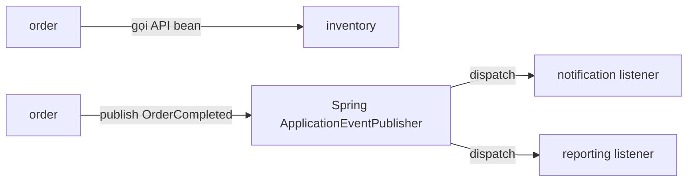
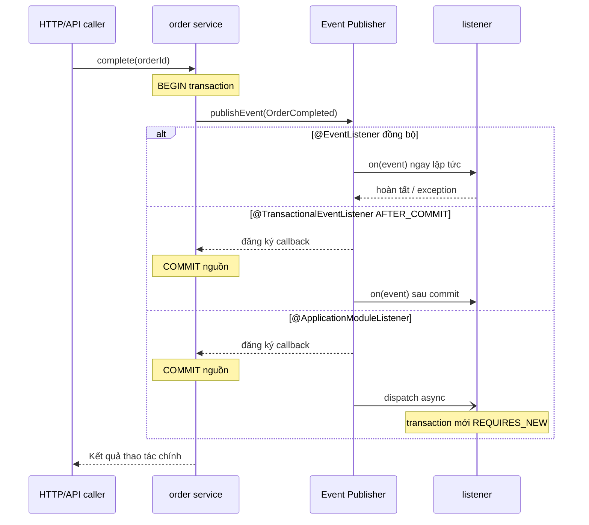
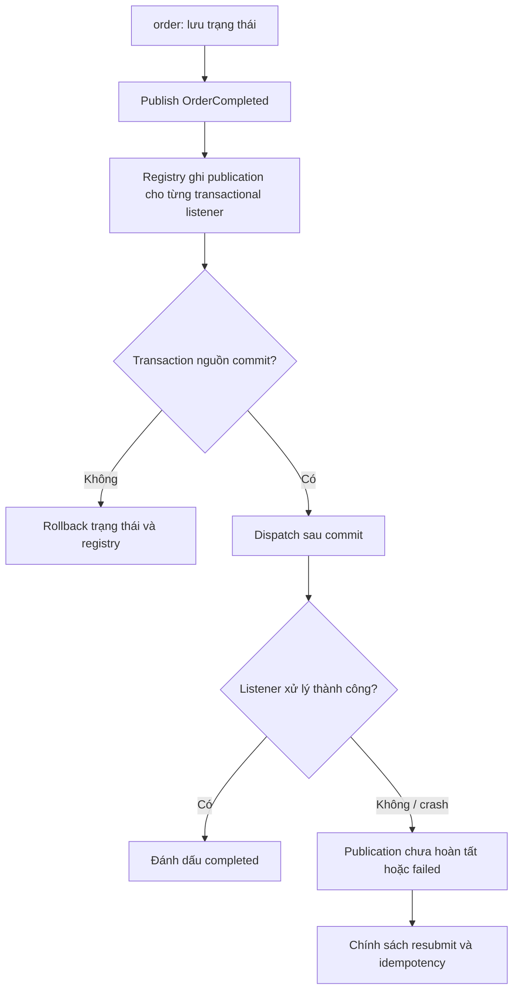
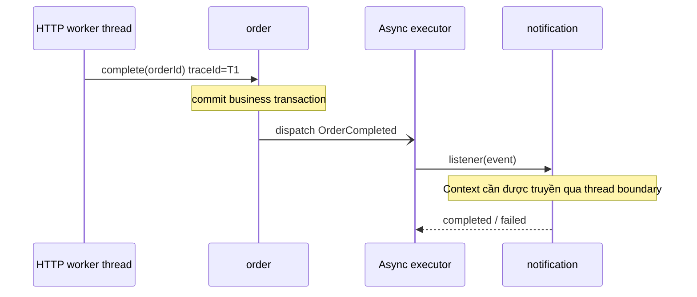

# Phân biệt gọi bean với lắng nghe event giữa nhiều application module

> **Chủ đề:** Nhiều module trong `SPRING_MODULITH_DOCUMENTATION_OBSERVABILITY`. Spring Modulith giúp tổ chức application module trong một ứng dụng Spring Boot, sinh tài liệu về ranh giới module và quan sát tương tác khi chạy qua module graph, Spring Boot Actuator, event metrics, tracing và context propagation. Bài này phân biệt **gọi trực tiếp Spring bean** và **lắng nghe application event**, từ thiết kế hợp đồng đến giao dịch, độ tin cậy và kiểm thử.

Khi tách hệ thống bán hàng thành các module `order`, `inventory`, `notification` và `reporting`, một câu hỏi kiến trúc thường xuất hiện: sau khi đơn hàng hoàn tất, module `order` nên gọi thẳng `NotificationService` hay phát `OrderCompleted` để module `notification` tự phản ứng? Hai cách đều thực thi được trong một Spring Boot process nhưng khác nhau về **ai biết ai**, **khi nào chạy**, **quyền quyết định kết quả**, **ranh giới transaction**, **khả năng xử lý lỗi** và **thông tin xuất hiện trong sơ đồ kiến trúc**.

## 1. Hai cơ chế thực chất khác nhau ở đâu?

- **Gọi bean:** một Spring bean giữ tham chiếu tới interface/bean của module khác và gọi phương thức như một lời yêu cầu: “hãy thực hiện việc này, cho tôi biết kết quả”. Thường xử lý ngay trong call stack hiện tại; bên gọi biết rõ bên cung cấp dịch vụ.
- **Phát và lắng nghe event:** module phát thông báo về một **sự kiện đã xảy ra trong miền nghiệp vụ**, ví dụ `OrderCompleted`, bằng `ApplicationEventPublisher`. Các module quan tâm tự đăng ký listener. Bên phát không cần biết số lượng hoặc danh tính các listener.
- **Event không mặc định là bất đồng bộ:** Spring `@EventListener` mặc định xử lý đồng bộ; Spring `@TransactionalEventListener` theo pha giao dịch; Spring Modulith `@ApplicationModuleListener` là tiện ích kết hợp listener sau commit, bất đồng bộ và giao dịch riêng. Không đánh đồng “dùng event” với “chạy nền”.
- **Không phải giao tiếp mạng:** cả bean call và Spring application event đều có thể hoạt động **trong cùng một JVM**. Để gửi sang ứng dụng/broker khác cần cơ chế externalization hoặc messaging riêng.

| Tiêu chí | Gọi bean trực tiếp | Event với listener đồng bộ | Event sau commit, bất đồng bộ |
|---|---|---|---|
| Ý nghĩa | Yêu cầu làm một việc | Thông báo, nhưng listener chạy ngay | Thông báo để xử lý công việc tiếp theo |
| Độ phụ thuộc | Caller phụ thuộc interface/bean của callee | Publisher phụ thuộc event type, không phụ thuộc bean listener | Tương tự event đồng bộ |
| Kết quả trả về | Có thể trả giá trị hoặc ném exception trực tiếp | `publishEvent` không trả kết quả nghiệp vụ của listener | Không có kết quả xử lý ngay cho publisher |
| Thời điểm | Ngay khi gọi phương thức | Thường ngay khi phát event | Sau commit của transaction nguồn; thực thi trên luồng khác khi async được bật |
| Giao dịch | Có thể cùng transaction nếu cấu hình phù hợp | Có thể chạy trong cùng transaction nguồn | Listener có transaction mới khi dùng `@ApplicationModuleListener` |
| Khi callee/listener lỗi | Caller biết ngay, có thể rollback | Exception đồng bộ có thể làm hỏng luồng phát và rollback | Nguồn đã commit; cần retry, giám sát, idempotency |
| Số bên nhận | Được gọi rõ ràng từng bên | Nhiều listener đăng ký | Nhiều listener đăng ký, có thể chạy độc lập |
| Thứ tự thực thi | Theo thứ tự lệnh của caller | Phụ thuộc cơ chế đăng ký/ordering, không nên dựa vào thứ tự mặc định | Không bảo đảm thứ tự hoàn thành |
| Khi phù hợp | Điều kiện bắt buộc để trả kết quả ngay | Quy trình nội bộ cần phối hợp đồng bộ và hiểu rõ lỗi | Side effect, projection, thông báo, tích hợp hậu xử lý |

**Câu hỏi quyết định:** “Để trả lời request thành công ngay lúc này, module hiện tại có *cần* kết quả từ module kia không?”. Nếu có, gọi một **public API bean** thường dễ hiểu và an toàn hơn. Nếu nghiệp vụ chính đã hoàn tất và nhiều module chỉ cần **biết điều đó để phản ứng**, event là ứng viên hợp lý.

## 2. Ranh giới application module vẫn tồn tại với cả hai cách

Spring Modulith suy ra các application module từ cấu trúc package (mặc định các package con trực tiếp dưới package chứa `@SpringBootApplication`). Ví dụ:

```text
com.acme.shop
├── ShopApplication.java
├── order                       # API public của order
│   ├── OrderManagement.java
│   ├── OrderCompleted.java     # Event contract được publish
│   └── internal
│       └── JpaOrderRepository.java
├── inventory                   # API public của inventory
│   ├── InventoryReservations.java
│   └── internal
│       └── InventoryReservationService.java
├── notification
│   ├── OrderNotificationListener.java
│   └── internal
│       └── NotificationDelivery.java
└── reporting
    └── OrderProjectionListener.java
```

Với mô hình module mặc định, loại public ở **package gốc** của một module được xem là API phơi ra cho các module khác. Loại trong `.internal` hoặc package con thông thường là nội bộ, dù khai báo Java `public`. Có thể dùng `@NamedInterface` để chủ động xuất những nhóm API trong subpackage; việc này nên được mô tả và kiểm chứng bằng công cụ Spring Modulith, không coi mọi bean `@Component` là được phép dùng xuyên module.

Hai quan hệ nhìn từ **module graph**:



Mũi tên runtime publish và dispatch cho biết **hướng chạy**. Trong biểu đồ **phụ thuộc mã nguồn**, `notification` cần biết kiểu `order.OrderCompleted`, vì vậy có **dependency kiểu event listener từ notification sang order**; ngược lại `order` không cần import `NotificationService`. Event giúp giảm coupling giữa publisher và consumer, **không xóa mọi phụ thuộc compile-time**. Muốn tránh import kiểu sự kiện từ một module khác cần thiết kế contract chia sẻ/named interface riêng.

## 3. Trường hợp gọi bean: cần kết quả tức thời để quyết định

Giả sử `order` chỉ được xác nhận nếu `inventory` đặt giữ hàng thành công. `inventory` công bố interface ở package API:

```java
// com/acme/shop/inventory/InventoryReservations.java
package com.acme.shop.inventory;

import java.util.UUID;

public interface InventoryReservations {
    boolean reserveFor(UUID orderId);
}
```

Module `inventory` có thể cài đặt interface này bằng bean trong package nội bộ; `order` chỉ import interface public:

```java
// com/acme/shop/order/OrderManagement.java
package com.acme.shop.order;

import com.acme.shop.inventory.InventoryReservations;
import java.util.UUID;
import org.springframework.stereotype.Service;
import org.springframework.transaction.annotation.Transactional;

@Service
public class OrderManagement {
    private final InventoryReservations inventory;
    private final OrderRepository orders;

    public OrderManagement(InventoryReservations inventory, OrderRepository orders) {
        this.inventory = inventory;
        this.orders = orders;
    }

    @Transactional
    public void confirm(UUID orderId) {
        if (!inventory.reserveFor(orderId)) {
            throw new IllegalStateException("Không đủ tồn kho");
        }
        orders.markConfirmed(orderId);
    }
}
```

Ở ví dụ, `OrderRepository` là cổng truy cập dữ liệu thuộc module `order` (phải được triển khai trong dự án); `InventoryReservations` là bean/API do module `inventory` cung cấp. Phương thức `confirm` có thể phản hồi lỗi ngay khi không đặt giữ được hàng. Nếu cả hai thao tác dùng cùng transaction manager và propagation phù hợp (ví dụ `REQUIRED`), lời gọi bean qua Spring proxy có thể tham gia một transaction cơ sở dữ liệu. **Đừng suy từ `@Transactional` rằng mọi side effect hay các cơ sở dữ liệu độc lập đều có thể rollback nguyên tử.** Gọi HTTP, gửi email hoặc ghi vào DB khác đòi hỏi mô hình nhất quán riêng.

**Điểm mạnh:** hợp đồng rõ (tham số, kiểu trả về, exception), dễ debug, phù hợp kiểm soát invariant và lưu vết trong một luồng. **Điểm đổi lại:** `order` biết `InventoryReservations` và sẽ phụ thuộc module `inventory` khi tạo context/test; gọi nối tiếp nhiều bean làm tăng thời gian đáp ứng và mức liên kết.

## 4. Trường hợp lắng nghe event: phản ứng với sự kiện nghiệp vụ

Giả sử đơn hàng đã được xác nhận, các module `notification` và `reporting` cần gửi xác nhận và cập nhật thống kê. Công việc này không quyết định việc đơn hàng có được chấp nhận hay không.

Định nghĩa event ở API của module **sở hữu sự kiện**:

```java
// com/acme/shop/order/OrderCompleted.java
package com.acme.shop.order;

import java.time.Instant;
import java.util.UUID;

public record OrderCompleted(UUID orderId, Instant occurredAt) { }
```

Module `order` chỉ phụ thuộc `ApplicationEventPublisher` của Spring:

```java
// com/acme/shop/order/OrderCompletionService.java
package com.acme.shop.order;

import java.time.Instant;
import java.util.UUID;
import org.springframework.context.ApplicationEventPublisher;
import org.springframework.stereotype.Service;
import org.springframework.transaction.annotation.Transactional;

@Service
public class OrderCompletionService {
    private final OrderRepository orders;
    private final ApplicationEventPublisher events;

    public OrderCompletionService(OrderRepository orders, ApplicationEventPublisher events) {
        this.orders = orders;
        this.events = events;
    }

    @Transactional
    public void complete(UUID orderId) {
        orders.markCompleted(orderId);
        events.publishEvent(new OrderCompleted(orderId, Instant.now()));
    }
}
```

Ở đây `Instant.now()` đơn giản để minh họa, hệ thống cần thời gian có thể tiêm `Clock` phục vụ test. `OrderRepository` là dependency nghiệp vụ có sẵn trong module; nội dung code tập trung vào tương tác chéo module.

Module `notification` đăng ký listener mà không cần được `order` gọi trực tiếp:

```java
// com/acme/shop/notification/OrderNotificationListener.java
package com.acme.shop.notification;

import com.acme.shop.order.OrderCompleted;
import org.springframework.modulith.events.ApplicationModuleListener;
import org.springframework.stereotype.Component;

@Component
class OrderNotificationListener {
    private final NotificationDelivery notifications;

    OrderNotificationListener(NotificationDelivery notifications) {
        this.notifications = notifications;
    }

    @ApplicationModuleListener
    void on(OrderCompleted event) {
        notifications.enqueueOnce(event.orderId());
    }
}
```

`NotificationDelivery` ở đây là dịch vụ nội bộ có thao tác `enqueueOnce` **idempotent** (chỉ tạo một yêu cầu gửi cho mỗi `orderId`, được chống trùng bằng ràng buộc dữ liệu). Việc chuyển yêu cầu sang hệ thống gửi email có thể xử lý riêng với retry. Đây là thiết kế ví dụ; `@ApplicationModuleListener` tự nó không khiến một thao tác gửi email ngoài DB trở nên exactly-once.

Thêm listener `reporting` cùng xử lý `OrderCompleted` không buộc sửa `OrderCompletionService`. Đây là lợi ích quan trọng khi nhiều module cần tự mở rộng phản ứng với cùng một sự kiện.

## 5. Ba loại listener và ảnh hưởng tới transaction

Điểm dễ sai nhất khi học event giữa các module là nhầm **đăng ký listener** với **lựa chọn transaction boundary**.

### 5.1. `@EventListener`: mặc định đồng bộ, chạy khi publish

```java
@EventListener
public void on(OrderCompleted event) {
    auditService.record(event.orderId());
}
```

Với `ApplicationEventMulticaster` mặc định của Spring, listener được gọi ngay trong luồng publish. Nếu publisher đang ở transaction, listener đồng bộ thường chạy trong transaction đó. Một `RuntimeException` có thể truyền về phía publisher, ảnh hưởng rollback theo cấu hình transaction. Đây là **phối hợp đồng bộ qua event**, chứ không tạo ranh giới lỗi giống hàng đợi bất đồng bộ. Có thể cấu hình multicaster khác, vì vậy luôn xác nhận cấu hình thực tế.

### 5.2. `@TransactionalEventListener`: xử lý theo pha transaction

```java
@TransactionalEventListener(phase = TransactionPhase.AFTER_COMMIT)
public void on(OrderCompleted event) {
    // Chạy sau khi transaction nguồn đã commit.
}
```

Pha mặc định là `AFTER_COMMIT`; còn có `BEFORE_COMMIT`, `AFTER_ROLLBACK`, `AFTER_COMPLETION`. Nếu không có transaction đang hoạt động, listener thông thường **không được gọi**, trừ khi chọn `fallbackExecution = true`. `AFTER_COMMIT` **không đồng nghĩa bất đồng bộ**: listener vẫn có thể chạy ở cùng luồng sau commit nếu không bật `@Async`. Một lỗi ở thời điểm này không thể rollback commit đã xong.

Một lưu ý kỹ thuật: khi thực hiện ghi DB trong listener `AFTER_COMMIT`, hãy mở một transaction mới nếu cần; những tài nguyên giao dịch cũ có thể vẫn còn gắn với luồng, nhưng thay đổi sau commit không được bảo đảm commit thêm lần nữa.

### 5.3. `@ApplicationModuleListener`: cấu hình thuận tiện của Spring Modulith

```java
@ApplicationModuleListener
public void on(OrderCompleted event) {
    // Tương đương về ý nghĩa với async transactional event listener,
    // làm việc trong transaction riêng.
}
```

Annotation này kết hợp **`@Async`**, **`@TransactionalEventListener`** và **`@Transactional(propagation = REQUIRES_NEW)`**. Ý định: nghiệp vụ nguồn commit thành công, sau đó module khác có thể chạy bất đồng bộ với transaction riêng. Cần kiểm tra async executor/`@EnableAsync` và cấu hình transaction phù hợp để bảo đảm chạy đúng như dự kiến. Listener có thể chạy trễ, lặp lại khi retry và hoàn thành không theo thứ tự phát; logic phải chịu được những tình huống này.

### 5.4. So sánh theo mốc thời gian



Sơ đồ minh họa ba **lựa chọn thay thế nhau**, không có nghĩa một listener cùng lúc chạy cả ba nhánh. Trong trường hợp `@EventListener`, exception có thể làm lời gọi gốc thất bại; trong hai trường hợp sau commit, caller không thể dựa vào listener để quyết định kết quả request vừa hoàn thành.

| Tình huống | Gọi bean trong transaction | `@EventListener` mặc định | `@TransactionalEventListener(AFTER_COMMIT)` | `@ApplicationModuleListener` |
|---|---|---|---|---|
| Transaction nguồn rollback trước commit | Bean đã được gọi, hiệu ứng DB cùng transaction được rollback | Listener có thể đã chạy; DB cùng transaction được rollback | Không nhận event ở pha AFTER_COMMIT | Không xử lý ở pha AFTER_COMMIT |
| Listener thất bại | Caller trực tiếp biết lỗi | Có thể tác động transaction nguồn | Nguồn đã commit | Nguồn đã commit, cần phục hồi hậu xử lý |
| Cần kết quả ngay | Có | Không có kiểu trả kết quả cho publisher | Không | Không |
| Thread và tracing | Thường chung luồng | Thường chung luồng | Có thể chung luồng | Bất đồng bộ, phải xử lý context propagation |

## 6. Độ tin cậy: event trong process chưa phải hàng đợi bền vững

Đối với event nhận **sau commit**, tồn tại cửa sổ lỗi: database của `order` đã commit, nhưng process dừng hoặc listener lỗi trước khi hoàn tất công việc phụ. Chỉ thêm `@Async` không đóng được cửa sổ này.

Spring Modulith cung cấp **Event Publication Registry** để ghi nhận từng publication cho các transactional listener vào kho lưu trữ phù hợp **trong transaction nghiệp vụ gốc**. Khi xử lý thành công, publication tương ứng được đánh dấu hoàn thành; khi lỗi, bản ghi còn lại để phục hồi. Registry mặc định theo dõi các listener có `@TransactionalEventListener` (kể cả annotation bao hàm nó, như `@ApplicationModuleListener`), chứ không tự bảo đảm mọi `@EventListener` đều được ghi bền vững.



Các starter bền vững được chọn **theo hạ tầng lưu trữ**, ví dụ:

```xml
<!-- Ví dụ ứng dụng dùng JDBC để lưu Event Publication Registry -->
<dependency>
    <groupId>org.springframework.modulith</groupId>
    <artifactId>spring-modulith-starter-jdbc</artifactId>
</dependency>
```

Các lựa chọn khác gồm `spring-modulith-starter-jpa`, `spring-modulith-starter-mongodb` và `spring-modulith-starter-neo4j`. Cần đồng bộ phiên bản theo BOM tương thích và kiểm tra schema, transaction manager, serializer, chính sách dọn dữ liệu/backup. Khi dùng JDBC/JPA, nên quản trị bảng publication bằng migration thay vì phụ thuộc vào khởi tạo schema tự động trong mọi môi trường.

**Phân biệt bảo đảm:**

1. Registry giúp khôi phục việc giao event tới listener khi process gặp lỗi hoặc listener thất bại; **không** bảo đảm từng side effect ngoài hệ thống thực hiện đúng một lần.
2. Cơ chế retry/resubmission có thể giao event **nhiều lần**. Consumer cần idempotency key (chẳng hạn `orderId` kết hợp loại hành động), unique constraint và chiến lược xử lý bản ghi trùng.
3. Từ Spring Modulith 2.x, lifecycle publication có thêm trạng thái, hỗ trợ nhận diện publication đang xử lý, đã thành công hay thất bại. Tính năng và property khác nhau theo version, nên đối chiếu đúng bản thư viện sử dụng.
4. Có thể cấu hình `spring.modulith.events.republish-outstanding-events-on-restart` để bật phát lại khi khởi động, nhưng không bật một cách mù quáng ở cụm nhiều instance: một instance khác có thể vẫn đang xử lý publication. Với production, cần cơ chế resubmit/claim và giám sát phù hợp.
5. Nếu module cần gửi event ra Kafka/RabbitMQ hoặc ứng dụng khác, dùng event externalization/outbox phù hợp; application event nội bộ **không tự đi qua broker**.

Ví dụ: Listener phát email và process crash sau khi email thực sự gửi nhưng trước khi registry đánh dấu hoàn tất. Khi retry, email có nguy cơ gửi hai lần. Tránh dùng thao tác `mailSender.send` trực tiếp mà không có kiểm soát; tạo một yêu cầu gửi với khóa duy nhất hoặc cơ chế idempotency phía đích, sau đó chuyển cho worker gửi có giám sát.

## 7. Tại sao “event giúp giảm phụ thuộc” nhưng chưa chắc giải quyết mọi bài toán?

So sánh một yêu cầu thực tế:

| Câu hỏi nghiệp vụ | Chọn cách tiếp cận | Lý do |
|---|---|---|
| Có đủ tồn kho để chấp nhận đơn hay không? | Gọi bean API `InventoryReservations` | Cần câu trả lời ngay để chấp nhận hoặc từ chối |
| Đơn đã thanh toán, cần phát hành báo cáo và thông báo | Phát `OrderPaid`; các module tự lắng nghe | Công việc phụ, nhiều subscriber, không nên kéo dài transaction nguồn |
| Tính giá dựa trên bảng giá của module `pricing` | Gọi bean API truy vấn | Cần giá trị để tính kết quả giao dịch |
| Làm mới read model sau khi đơn được tạo | Event sau commit | Chấp nhận eventual consistency, chịu được trễ và retry |
| Thực thi quy trình nhiều bước cần kiểm soát nhất quán | Phân tích orchestration/state machine hoặc saga | Event đơn thuần không cung cấp kết quả đồng bộ và rollback xuyên module |
| Ghi audit bắt buộc không được mất | Transaction DB phù hợp hoặc event registry có thiết kế bền vững | Không dựa vào async listener thuần để bảo đảm ghi nhận |

Một event nên biểu thị **sự kiện ở thì quá khứ**: `OrderPlaced`, `PaymentCaptured`, `InventoryReserved`. Tên `SendConfirmationEmail` hoặc `ReduceInventory` mang nghĩa **mệnh lệnh**, thường hợp hơn khi gọi API rõ ràng, nếu nghiệp vụ không có chủ đích tạo command bus riêng. Payload chỉ chứa dữ liệu tối thiểu và định danh bền vững; tránh gửi JPA entity đang quản lý hoặc object có lazy proxy. Khi xử lý sau commit trên luồng khác, listener phải tải lại trạng thái cần thiết trong transaction mới.

**Hai hệ quả thiết kế:** (1) Một module không nên “nghe event do chính nó muốn người khác phát” để lén chi phối logic quan trọng. (2) Một listener không nên phụ thuộc thứ tự hoàn thành của listener khác; nếu có thứ tự bắt buộc, hãy mô hình hóa các trạng thái/sự kiện nối tiếp hoặc một coordinator rõ ràng.

## 8. Kiểm chứng dependency bằng Spring Modulith và module graph

Graph tĩnh và sơ đồ tài liệu cho thấy API bean dependency và dependency do listener tham chiếu kiểu event. Chúng giúp phát hiện một thay đổi code vô tình đưa `order` trở lại phụ thuộc vào bean nội bộ của `notification`.

```java
import com.acme.shop.ShopApplication;
import org.junit.jupiter.api.Test;
import org.springframework.modulith.core.ApplicationModules;
import org.springframework.modulith.docs.Documenter;

class ArchitectureDocumentationTests {
    private final ApplicationModules modules =
        ApplicationModules.of(ShopApplication.class);

    @Test
    void verifiesBoundaries() {
        modules.verify();
    }

    @Test
    void writesModuleDocumentation() {
        new Documenter(modules)
            .writeModulesAsPlantUml()
            .writeIndividualModulesAsPlantUml()
            .writeModuleCanvases();
    }
}
```

`ApplicationModules.verify()` kiểm tra, trong số các quy tắc khác, **không có vòng phụ thuộc module**, chỉ truy cập API được công khai và tuân thủ `@ApplicationModule(allowedDependencies = ...)` khi có khai báo. Ví dụ giới hạn module `notification` được phép phụ thuộc API của `order`:

```java
// com/acme/shop/notification/package-info.java
@org.springframework.modulith.ApplicationModule(
    allowedDependencies = "order"
)
package com.acme.shop.notification;
```

Nếu module `notification` bắt đầu inject một bean `order.internal.JpaOrderRepository`, việc đó vi phạm ranh giới, kể cả bean kia là `public`. Ngược lại, `notification` **được phép** lắng nghe `order.OrderCompleted` khi event type được xuất từ API của `order`. Nếu module dùng named interface, cấu hình allowlist phải xét tên giao diện được công bố cho phù hợp.

`Documenter` có thể tạo sơ đồ C4/UML component và **Application Module Canvas** thể hiện Spring components, event được publish và các event listener, qua đó dễ review hiệu ứng của thay đổi thiết kế. Tài liệu tĩnh cho thấy **quan hệ có thể xảy ra theo code**; không chứng minh listener đã chạy hoặc xử lý thành công ở production.

## 9. Phân biệt bean call và event listener qua Actuator

Với cấu hình Spring Modulith production support tương thích, endpoint `modulith` của Spring Boot Actuator có thể mô tả cấu trúc application module. Chẳng hạn tài liệu của Spring Modulith 2.2 có artifact `spring-modulith-starter-insight` (gom actuator và observability). Khi cấu hình expose/safety phù hợp, endpoint là:

```text
GET /actuator/modulith
```

Một phần response minh họa **hai loại dependency khác nhau**:

```json
{
  "order": {
    "basePackage": "com.acme.shop.order",
    "displayName": "Order",
    "dependencies": [
      { "target": "inventory", "types": ["USES_COMPONENT"] }
    ]
  },
  "notification": {
    "basePackage": "com.acme.shop.notification",
    "displayName": "Notification",
    "dependencies": [
      { "target": "order", "types": ["EVENT_LISTENER"] }
    ]
  }
}
```

Đây là **JSON minh họa**, không phải output đã chạy của ví dụ trên. Spring Modulith có các giá trị `DEFAULT`, `USES_COMPONENT` và `EVENT_LISTENER` cho dependency type. Một quan hệ giữa hai module có thể gồm nhiều loại cùng lúc, vì code vừa tham chiếu type vừa dùng bean/listener. Cần hiểu hướng của `target` là **module mà module hiện tại phụ thuộc vào**, không nhất thiết là mũi tên điều khiển runtime từ publisher sang consumer.

Endpoint Actuator cần được cấu hình mở qua management exposure và bảo vệ bằng authorization; không công khai sơ đồ package/module của hệ thống cho người không có quyền. Đối chiếu module graph trước và sau thay đổi để xác nhận một module không phụ thuộc vào nội bộ của module khác. Đây là **architecture observability**, khác với đo số event đã được xử lý.

## 10. Metrics, tracing và context propagation khi tương tác

Spring Modulith observability có thể sinh **Micrometer spans** cho các phương thức Spring component thuộc API module được gọi xuyên ranh giới. Trong tài liệu 2.2, module-entry span có các tag như:

| Tag | Tác dụng |
|---|---|
| `module.identifier` | Định danh application module |
| `module.name` | Tên module |
| `module.invocation-type` | Phân biệt lời gọi `bean` và `event listener` |
| `module.method` | Phương thức được thực thi |

Điều này giúp phát hiện một flow thực sự đi qua module `order` → `inventory` bằng bean hay đi tới `notification` qua event listener. Traces chỉ hiển thị các lần thực thi được thu thập theo sampling và cấu hình exporter; **không dùng trace thay cho kiểm chứng graph tĩnh**.

Spring Modulith còn cung cấp event metrics, ví dụ:

- `module.events.published`: counter tổng số application event được publish, có tag như `module.event.type`, `module.identifier`, `module.name`.
- `module.events.published.$moduleIdentifier.$simpleEventTypeName`: counter chi tiết theo kiểu event/module, có thể mở rộng tag qua API tùy chỉnh.

**Counter publish không phải counter listener thành công.** Một event có thể có ba listener, một listener thất bại và một listener chạy lại; số publish không phản ánh số xử lý hoàn tất hoặc độ trễ hàng đợi. Muốn đánh giá độ tin cậy cần thêm metrics cho incomplete/failed publications, số lần retry, tuổi của publication còn tồn đọng và thời gian xử lý listener.



**Context propagation:** `@ApplicationModuleListener` có thể chạy trên thread khác nên các giá trị dạng `ThreadLocal` (trace context, MDC, locale, security context) không tự động xuất hiện nguyên vẹn. Tích hợp Micrometer Tracing/Context Propagation, executor có `TaskDecorator` phù hợp hoặc cơ chế propagation được Spring Boot version hiện tại hỗ trợ; sau đó **đo thử** xem span listener có nối về trace nguồn hay thành trace riêng và correlation ID có hiện đúng hay không. Không dùng `ThreadLocal` chứa dữ liệu nghiệp vụ làm contract giữa các module; đưa dữ liệu thực sự cần thiết vào event payload hoặc tra cứu qua id.

Quản lý **cardinality** của metrics: không gắn `orderId`, `userId` hoặc email làm tag của counter; đặt định danh giao dịch vào trace/log có kiểm soát và hạn chế dữ liệu nhạy cảm.

## 11. Test hai cách tương tác bằng Spring Modulith

### 11.1. Test module khi gọi bean

Với dependency bean xuyên module, `@ApplicationModuleTest` ở mode `STANDALONE` chỉ khởi động module đang test; nếu `order` cần `InventoryReservations`, phải mock public interface đó hoặc chủ động chọn `BootstrapMode.DIRECT_DEPENDENCIES`. Test chỉ giữ bean phụ thuộc có ý nghĩa, tránh mở toàn bộ application context để che coupling.

```java
// Minh họa ý tưởng test order khi inventory là collaborator ngoài module
@ApplicationModuleTest
class OrderManagementTests {
    @MockitoBean
    InventoryReservations inventory;

    @Autowired
    OrderManagement orders;

    // Arrange inventory.reserveFor(id) thành true/false;
    // gọi orders.confirm(id), assert kết quả ngay hoặc exception.
}
```

Ví dụ này là **khung test**; để chạy cần fixture repository, import JUnit, Mockito và Spring Test tương thích phiên bản. `@MockitoBean` là cách mock phổ biến trên các bản Spring Framework/Spring Boot mới, còn dự án Boot cũ có thể dùng `@MockBean` theo phiên bản. Test bean call nên xác nhận kết quả ngay của caller và trạng thái DB sau transaction.

### 11.2. Test publisher thực sự đã phát event

Spring Modulith hỗ trợ `PublishedEvents` để không phải lắng nghe thủ công trong test. Ví dụ minh họa với fixture đơn hàng đã được tạo:

```java
@ApplicationModuleTest
class OrderEventsTests {
    @Autowired
    OrderCompletionService service;

    @Test
    void completesAndPublishes(PublishedEvents events) {
        UUID orderId = UUID.randomUUID();
        // Trước lời gọi sau, tạo một đơn hàng fixture với orderId trong DB test.

        service.complete(orderId);

        var published = events.ofType(OrderCompleted.class)
            .matching(OrderCompleted::orderId, orderId);
        assertThat(published).hasSize(1);
    }
}
```

Đoạn test là **mẫu có chỗ thay fixture**, cần bổ sung import JUnit, `org.springframework.modulith.test.PublishedEvents`, AssertJ và dữ liệu đơn hàng hợp lệ. Nó chứng minh module `order` đã publish đúng một event trong lần chạy test; chưa chứng minh `notification` đã xử lý event thành công.

### 11.3. Test listener bất đồng bộ bằng `Scenario`

`Scenario` trong `spring-modulith-starter-test` cho phép đưa stimulus vào transaction rồi chờ event hoặc state change, tránh dùng `Thread.sleep` có thời gian cố định.

```java
@ApplicationModuleTest
class NotificationModuleTests {

    @Autowired
    NotificationDelivery notifications;

    @Test
    void createsNotificationAfterOrderCompleted(Scenario scenario) {
        UUID id = UUID.randomUUID();

        scenario.publish(new OrderCompleted(id, Instant.now()))
            .andWaitForStateChange(() -> notifications.findByOrderId(id))
            .andVerify(saved -> assertThat(saved).isNotNull());
    }
}
```

Điều kiện: `findByOrderId` trả `null` hoặc `Optional.empty()` khi chưa có dữ liệu và trả đối tượng khi listener lưu xong; môi trường test có async/transaction và hạ tầng `NotificationDelivery` hoạt động. `Scenario.publish(...)` chạy stimulus trong transaction phục vụ transactional listener. **Điểm cần lưu ý:** các side effect của stimulus được commit thật trong DB test và không nhất thiết rollback cùng transaction test; dùng fixture cleanup/unique id, hoặc API `andCleanup` khi cần.

Test lỗi nên mô phỏng listener thất bại một lần và thành công ở lần thử kế tiếp, sau đó xác nhận publication được hoàn tất, không tạo bản ghi trùng. Test kiến trúc cần giữ `ApplicationModules.verify()` trong CI và kiểm tra thay đổi module graph khi thêm bean dependency.

## 12. Lỗi thiết kế phổ biến và dấu hiệu nhận biết

| Dấu hiệu | Vấn đề thực chất | Cách xử lý |
|---|---|---|
| `OrderService` inject nhiều service từ `billing`, `notification`, `analytics` | Caller biết quá nhiều bên hậu xử lý | Phát event cho các side effect không quyết định kết quả |
| Gọi `publishEvent()` rồi chờ “listener trả về true” | Event không có response contract | Gọi interface bean khi cần quyết định ngay; hoặc thiết kế state machine bất đồng bộ |
| `@EventListener` được coi là async | Mặc định Spring chạy đồng bộ | Chọn rõ listener type/async executor và test transaction |
| `@TransactionalEventListener` không chạy trong unit test | Không có transaction đang hoạt động | Dùng `Scenario` hoặc thực sự tạo transaction; kiểm tra `fallbackExecution` |
| Thay bean call bằng event nhưng vẫn yêu cầu cùng rollback | Transaction boundary đã đổi | Giữ phối hợp đồng bộ hoặc thiết kế eventual consistency/saga |
| Listener gửi email hai lần khi restart | Retry có thể thực thi lại side effect | Idempotency key và lưu tiến độ gửi bền vững |
| Graph vẫn cho thấy dependency `notification` → `order` | Consumer cần import event type | Đây là dependency hợp lệ tới API event; kiểm tra không import nội bộ |
| Không thấy trace giữa các module | Thiếu instrumentation/exporter hoặc context propagation qua async | Kiểm tra dependency observability, sampling và executor |
| `module.events.published` tăng nhưng tác vụ chưa xong | Đo event được phát, không đo xử lý thành công | Kết hợp publication states, failed count, latency và backlog |
| Thứ tự listener thỉnh thoảng đổi | Không có bảo đảm thứ tự xử lý đồng thời | Thiết kế không phụ thuộc thứ tự hoặc dùng orchestration có trạng thái |

## 13. Bài tập ứng dụng: lựa chọn theo kết quả cần bảo đảm

Một ứng dụng Spring Boot gồm ba module `checkout`, `inventory` và `loyalty`. Khi thanh toán:

1. `checkout` phải xác nhận tồn kho trong tối đa 200 ms, nếu thiếu thì trả lỗi HTTP ngay.
2. Đơn hàng đã xác nhận cần cộng điểm `loyalty`, cho phép trễ vài giây.
3. Nếu cập nhật điểm gặp lỗi, không được làm đảo ngược đơn hàng đã thanh toán; có thể retry nhưng không được cộng điểm hai lần.
4. Nhóm kiến trúc muốn kiểm tra xem `checkout` có vô tình gọi bean nội bộ của `loyalty` hay không và phân biệt `USES_COMPONENT` với `EVENT_LISTENER` khi vận hành.

**Một thiết kế phù hợp:**

- `checkout` gọi một API bean public của `inventory` để lấy kết quả giữ hàng trước khi xác nhận (hoặc dùng mô hình đặt giữ có transaction phù hợp nếu tồn kho ở DB khác).
- Trong transaction xác nhận đơn, `checkout` phát `CheckoutCompleted(orderId, ...)`.
- `loyalty` lắng nghe bằng `@ApplicationModuleListener`; chọn Event Publication Registry với persistence phù hợp và bảo đảm cộng điểm idempotent theo `orderId`.
- Viết test kết quả trả về của `inventory`, `PublishedEvents` của `checkout`, `Scenario` cho `loyalty` và test retry/idempotency.
- Chạy `ApplicationModules.verify()`; sinh tài liệu bằng `Documenter`; quan sát graph ở `/actuator/modulith`, traces với `module.invocation-type` và số publication chưa hoàn thành.

**Tiêu chí hoàn thành:** request thanh toán vẫn trả kết quả đúng khi `loyalty` tạm lỗi; không nhân đôi điểm khi retry; `checkout` không phụ thuộc bean `loyalty`; biểu đồ module và trace giải thích được cả đường gọi đồng bộ lẫn đường event; có cảnh báo cho publication tồn đọng.

## 14. Những nguyên tắc cần nhớ

1. **Gọi bean** là yêu cầu trực tiếp, phù hợp với kết quả tức thời và invariant bắt buộc. Chỉ truy cập API được module công bố.
2. **Lắng nghe event** là phản ứng với điều đã xảy ra. Publisher không phải biết consumer, nhưng consumer vẫn có thể phụ thuộc compile-time vào loại event public.
3. **Event không tự là async, durable hoặc exactly-once.** Phân biệt rõ `@EventListener`, `@TransactionalEventListener` và `@ApplicationModuleListener`.
4. **Transaction quyết định khi nào lỗi được nhìn thấy.** Phối hợp sau commit đòi hỏi retry, idempotency và quan sát publication.
5. **Module graph và runtime traces trả lời các câu hỏi khác nhau:** graph nói module **được phép/phụ thuộc** vào đâu; traces nói **lần thực thi cụ thể** đã đi đâu; metrics cho biết xu hướng chứ không tự chứng minh thành công nghiệp vụ.

## 15. Tài liệu tham khảo

- [Spring Modulith — Fundamentals](https://docs.spring.io/spring-modulith/reference/fundamentals.html): API module, module boundary, dependency và named interfaces.
- [Spring Modulith — Working with Application Events](https://docs.spring.io/spring-modulith/reference/events.html): event listener, `@ApplicationModuleListener`, registry, resubmission, test publication.
- [Spring Modulith — Verifying Application Module Structure](https://docs.spring.io/spring-modulith/reference/verification.html): `ApplicationModules.verify()`.
- [Spring Modulith — Documenting Application Modules](https://docs.spring.io/spring-modulith/reference/documentation.html): `Documenter`, module graph, module canvas.
- [Spring Modulith — Production-ready Features](https://docs.spring.io/spring-modulith/reference/production-ready.html): Actuator `modulith`, event metrics và observability spans.
- [Spring Modulith — Integration Testing Application Modules](https://docs.spring.io/spring-modulith/reference/testing.html): `@ApplicationModuleTest`, `PublishedEvents`, `Scenario` và bootstrap modes.
- [Spring Framework — Transaction-bound Events](https://docs.spring.io/spring-framework/reference/data-access/transaction/event.html): ý nghĩa `@TransactionalEventListener` và các transaction phase.

Các tên dependency, properties và mức hỗ trợ observability thay đổi theo **phiên bản Spring Modulith/Spring Boot**. Ví dụ về Actuator và event metrics trong bài dựa trên tài liệu Spring Modulith **2.2.x**; khi làm việc với 1.x hoặc 2.x khác, đối chiếu reference trùng phiên bản project trước khi sao chép cấu hình.
