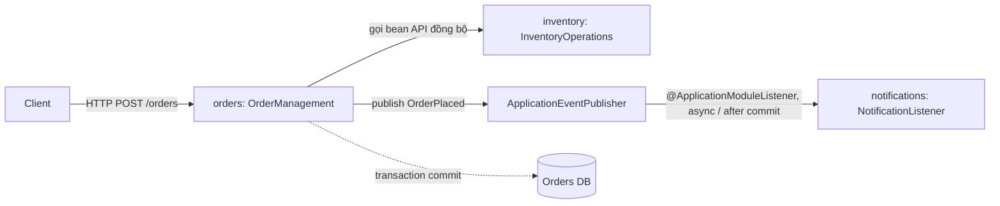
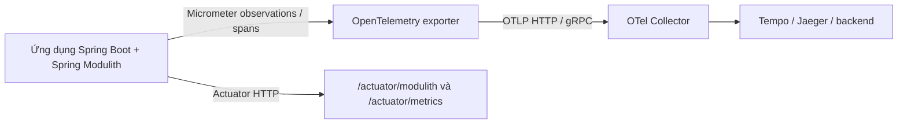

# Trace một luồng đi qua nhiều module

Một ứng dụng Spring Boot được chia thành nhiều application module vẫn thường chạy trong **một tiến trình JVM**. Vì vậy, khi yêu cầu đi từ `orders` sang `inventory`, rồi phát sự kiện để `notifications` xử lý, không có HTTP call giữa các module để công cụ distributed tracing tự nhận ra tất cả ranh giới. Spring Modulith giúp hiển thị **ranh giới module** và tạo observability spans tại các điểm tương tác, kết hợp với Micrometer Tracing, Spring Boot Actuator và trace backend để trả lời: *một yêu cầu đã đi qua những module nào, mất bao lâu ở mỗi điểm, và luồng bất đồng bộ có còn được liên kết với yêu cầu ban đầu hay không?*

Đây là bài thuộc chương **Nhiều module** của `SPRING_MODULITH_DOCUMENTATION_OBSERVABILITY`: dùng Spring Modulith để sinh tài liệu ranh giới application module, quan sát tương tác trong ứng dụng Spring Boot và kiểm chứng kiến trúc qua module graph, Actuator, event metrics, tracing, context propagation.

## 1. Tình huống: một đơn hàng đi qua ba module

Xét ứng dụng bán hàng có ba application module:

- **`orders`**: nhận HTTP POST tạo đơn, lưu trạng thái đơn và phát sự kiện `OrderPlaced`.
- **`inventory`**: cung cấp public API `InventoryOperations` để giữ hàng; `orders` gọi đồng bộ qua Spring bean.
- **`notifications`**: nhận sự kiện `OrderPlaced` sau khi transaction tạo đơn commit, rồi gửi thông báo bất đồng bộ.



*Giả định*: transaction manager đã được cấu hình, lời gọi giữ hàng và lưu đơn có cơ chế nhất quán phù hợp với nghiệp vụ. Đồ thị minh họa quan hệ module; tính nhất quán giao dịch thực tế phải được thiết kế riêng nếu `inventory` và `orders` dùng kho dữ liệu hoặc transaction độc lập.

Trên trace backend, chúng ta muốn quan sát được một tuyến tương tự:

```text
Trace <trace-id>
└─ HTTP SERVER POST /orders
   └─ orders / OrderManagement.place(...)
      └─ inventory / InventoryOperations.reserve(...)
   └─ [sau commit] notifications / NotificationListener.on(...)
      [chỉ còn cùng trace khi context được truyền đúng thời điểm]
```

Các span trên đây thể hiện **hình dạng mong đợi** chứ không cam kết tên span hoặc cấu trúc parent-child chính xác ở mọi phiên bản. Spring Modulith ghi nhận các lời gọi đi vào **module API** và các event listener được instrument; nó không tự sinh một span cho mỗi phương thức Java. Span bên trong một module chỉ xuất hiện khi thư viện hoặc ứng dụng có instrumentation tương ứng.

### Ba câu hỏi cần phân biệt

| Câu hỏi | Công cụ phù hợp | Điều có thể kết luận |
|---|---|---|
| Module nào **được phép** phụ thuộc module nào? | `ApplicationModules`, module graph, `verify()` | Quan hệ tĩnh và quy tắc ranh giới ở thời điểm phân tích |
| Những module nào **thực sự chạy** trong request này? | Micrometer trace, Spring Modulith module spans | Đường đi thực tế của yêu cầu đã được lấy mẫu và instrument |
| Bao nhiêu sự kiện được phát và listener có xử lý thành công? | Event metrics, application logs, Event Publication Registry khi cấu hình | Số lượng phát sự kiện và tình trạng giao nhận/xử lý; metric publish không đồng nghĩa xử lý hoàn tất |

Một trace không thay thế kiểm thử kiến trúc: nó chỉ thấy đường thực thi đã xảy ra, trong phạm vi instrumentation và sampling. Ngược lại, module graph có thể có dependency hợp lệ nhưng request cụ thể không đi qua dependency đó.

## 2. Chuẩn bị dự án và cấu trúc module

Ví dụ dùng **Spring Boot 4.x + Spring Modulith 2.x**, Java và Gradle. Cấu hình phiên bản thực tế nên được kiểm soát bằng Spring Boot BOM cùng Spring Modulith BOM, phù hợp với tổ hợp phiên bản dự án. Phần phụ thuộc cốt lõi:

```groovy
dependencies {
    implementation("org.springframework.boot:spring-boot-starter-web")
    implementation("org.springframework.boot:spring-boot-starter-data-jpa")

    // Actuator + Spring Modulith module endpoint + module observability.
    runtimeOnly("org.springframework.modulith:spring-modulith-starter-insight")

    // Micrometer Tracing + OpenTelemetry exporter qua Spring Boot 4.
    implementation("org.springframework.boot:spring-boot-starter-opentelemetry")
}
```

`spring-modulith-starter-insight` cung cấp tích hợp Actuator và observability của Spring Modulith; `spring-boot-starter-opentelemetry` cung cấp tracing và cơ chế export tương ứng Spring Boot 4. Các thư viện không tự tạo một collector: cần chạy OpenTelemetry Collector, Tempo, Jaeger hoặc backend tương thích để nhận dữ liệu.

**Khác biệt phiên bản cần kiểm tra:**

| Hệ phiên bản | Điểm cấu hình thường gặp |
|---|---|
| Spring Boot 4.x + Spring Modulith 2.x | `spring-modulith-starter-insight` hoặc `spring-modulith-observability-core`; Spring Boot 4 cung cấp `spring-boot-starter-opentelemetry` |
| Spring Boot 3.x + Spring Modulith 1.x | `spring-modulith-starter-insight` hoặc `spring-modulith-observability`; cấu hình Micrometer Tracing bridge/exporter theo hướng dẫn Boot 3 |
| Chỉ có Spring Boot Actuator | Quan sát HTTP/JVM/metrics cơ bản; **chưa mặc nhiên có spans theo module** nếu thiếu observability của Spring Modulith |

Tránh sao chép nguyên bộ artifact hoặc property từ Boot 4 sang Boot 3; đặc biệt tên dependency và cấu hình context propagation có thay đổi theo thế hệ.

Cấu trúc package đặt mỗi module ở package gốc trực tiếp dưới package ứng dụng:

```text
com.example.shop
├── ShopApplication.java
├── orders
│   ├── OrderController.java
│   ├── OrderManagement.java
│   └── OrderPlaced.java
├── inventory
│   ├── InventoryOperations.java
│   └── internal
│       └── InventoryManagement.java
└── notifications
    └── NotificationListener.java
```

Theo mô hình module mặc định của Spring Modulith, `orders`, `inventory` và `notifications` là ba application module. Package gốc của mỗi module là **API mặc định**; các lớp trong `inventory.internal` là nội bộ. Vì thế, `orders` phụ thuộc `inventory.InventoryOperations` thay vì inject trực tiếp `inventory.internal.InventoryManagement`.

Khởi động Spring Boot và bật xử lý bất đồng bộ:

```java
package com.example.shop;

import org.springframework.boot.SpringApplication;
import org.springframework.boot.autoconfigure.SpringBootApplication;
import org.springframework.scheduling.annotation.EnableAsync;

@SpringBootApplication
@EnableAsync
public class ShopApplication {

    public static void main(String[] args) {
        SpringApplication.run(ShopApplication.class, args);
    }
}
```

## 3. Xây dựng luồng qua ranh giới module

Đầu tiên, `inventory` công bố một interface trong package API:

```java
package com.example.shop.inventory;

public interface InventoryOperations {
    void reserve(String sku, int quantity);
}
```

Một implementation của interface có thể nằm trong `inventory.internal` và được đánh dấu `@Service`. Trong hệ thống thực tế, method `reserve()` kiểm tra tồn kho, ghi reservation và phát sinh exception nghiệp vụ khi không đủ hàng.

`orders` chứa event type công khai để các module khác có thể đăng ký nhận:

```java
package com.example.shop.orders;

import java.util.UUID;

public record OrderPlaced(UUID orderId) {}
```

Service nghiệp vụ tạo đơn:

```java
package com.example.shop.orders;

import java.util.UUID;

import org.springframework.context.ApplicationEventPublisher;
import org.springframework.stereotype.Service;
import org.springframework.transaction.annotation.Transactional;

import com.example.shop.inventory.InventoryOperations;

@Service
public class OrderManagement {

    private final InventoryOperations inventory;
    private final ApplicationEventPublisher events;

    public OrderManagement(InventoryOperations inventory,
                           ApplicationEventPublisher events) {
        this.inventory = inventory;
        this.events = events;
    }

    @Transactional
    public UUID place(String sku, int quantity) {
        inventory.reserve(sku, quantity); // orders -> inventory (sync)

        UUID orderId = UUID.randomUUID();
        // Giả định: persist Order tại đây trong transaction hiện tại.

        events.publishEvent(new OrderPlaced(orderId));
        return orderId;
    }
}
```

Bộ điều khiển HTTP gọi `OrderManagement`, tạo ra entry span cho inbound HTTP request khi tracing được cấu hình. `orders` gọi `inventory` thông qua public API; đây là vị trí Spring Modulith có thể sinh module span mô tả lần vượt ranh giới.

Module `notifications` xử lý event:

```java
package com.example.shop.notifications;

import com.example.shop.orders.OrderPlaced;
import org.slf4j.Logger;
import org.slf4j.LoggerFactory;
import org.springframework.modulith.events.ApplicationModuleListener;
import org.springframework.stereotype.Component;

@Component
public class NotificationListener {

    private static final Logger log =
            LoggerFactory.getLogger(NotificationListener.class);

    @ApplicationModuleListener
    public void on(OrderPlaced event) {
        log.info("Handling OrderPlaced for orderId={}", event.orderId());
        // Gọi adapter gửi email/thông báo, kèm retry/idempotency phù hợp.
    }
}
```

`@ApplicationModuleListener` là shortcut của Spring Modulith cho listener transactional chạy bất đồng bộ và có transaction mới (tương đương tổ hợp `@Async`, `@TransactionalEventListener` và `@Transactional(REQUIRES_NEW)`). Listener thường bắt đầu sau khi transaction publish event commit. Nếu transaction tạo đơn rollback, listener theo pha sau commit sẽ không xử lý event đó.

**Lưu ý chạy thử:** ví dụ cố tình rút gọn phần entity/repository, implementation `InventoryOperations` và transaction manager. Để chạy được end-to-end, cần bổ sung các thành phần đó; muốn kiểm tra trace, các hoạt động phải thực sự được thực thi qua Spring beans và có request HTTP gửi đến ứng dụng.

## 4. Bật tracing, Actuator và xuất dữ liệu

Một `application.yml` mẫu cho **Spring Boot 4.x** trong môi trường phát triển:

```yaml
spring:
  application:
    name: shop-modulith
  task:
    execution:
      propagate-context: true

management:
  endpoints:
    web:
      exposure:
        include: health,info,modulith,metrics
  tracing:
    sampling:
      probability: 1.0
  opentelemetry:
    otlp:
      endpoint: http://localhost:4318
```

Các dòng trên có ý nghĩa:

1. `spring.application.name` giúp nhận diện ứng dụng trong tracing backend và logs.
2. `spring.task.execution.propagate-context: true` cho phép Spring Boot 4 lan truyền observation/tracing context qua `AsyncTaskExecutor` do Boot tự cấu hình, đặc biệt quan trọng với `@Async`.
3. `management.tracing.sampling.probability: 1.0` lấy mẫu 100% để dễ kiểm chứng **ở môi trường phát triển**. Production phải điều chỉnh tỷ lệ lấy mẫu theo tải, chi phí lưu trữ và yêu cầu bảo mật.
4. `management.opentelemetry.otlp.endpoint` định nghĩa **base URL** của OTLP HTTP collector trong Spring Boot 4; cơ chế export có thể nối thêm đường dẫn signal như `/v1/traces`. Nếu cấu hình riêng `management.opentelemetry.tracing.export.otlp.endpoint`, cần kiểm tra endpoint đầy đủ theo loại transport.
5. `management.endpoints.web.exposure.include` chỉ mở endpoint cần dùng trong dev. Production cần giới hạn mạng, xác thực và quyền truy cập Actuator; đặc biệt `/actuator/modulith` tiết lộ cấu trúc bên trong ứng dụng.

Không nhầm ba thành phần:



Actuator cung cấp thông tin cấu trúc và metric trực tiếp qua HTTP quản trị. Trace backend dùng để xem chuỗi span và độ trễ theo thời gian. Thấy endpoint `/actuator/modulith` hoạt động **không chứng minh** rằng exporter đã gửi spans thành công.

### Kiểm tra Actuator và metrics

Sau khi chạy ứng dụng:

```bash
curl -s http://localhost:8080/actuator/modulith
curl -s http://localhost:8080/actuator/metrics
curl -s http://localhost:8080/actuator/metrics/module.events.published
```

Endpoint `/actuator/modulith` mô tả các module, `displayName`, `basePackage`, dependencies và loại phụ thuộc. Các loại dependency thường gồm `DEFAULT`, `USES_COMPONENT`, `EVENT_LISTENER`.

Với quan sát sự kiện, Spring Modulith có thể ghi nhận:

- `module.events.published`: bộ đếm sự kiện domain được publish, có tag như `module.identifier`, `module.name` và `module.event.type`.
- `module.events.published.<moduleIdentifier>.<simpleEventTypeName>`: metric theo loại sự kiện cụ thể (tên được tạo theo module và event).
- Module entry span có thuộc tính như `module.identifier`, `module.name`, `module.method`, `module.invocation-type` (ví dụ `bean` hoặc `event listener`).

Metric có thể chưa xuất hiện nếu chưa có sự kiện được publish hoặc chưa có instrumentation/registry phù hợp. Trong Prometheus, tên metric thường được chuẩn hóa; không nên giả định tên hiển thị giống hệt tên Micrometer.

**Đừng diễn giải số sự kiện được publish thành số email đã gửi thành công.** Để theo dõi kết quả xử lý listener, cần metrics nghiệp vụ, tracing các bước gửi thông báo và Event Publication Registry (nếu ứng dụng đã bật lưu bền vững).

## 5. Cách đọc trace của một request cụ thể

Thực hiện một lời gọi tạo đơn, ví dụ:

```bash
curl -X POST http://localhost:8080/orders \
  -H 'Content-Type: application/json' \
  -d '{"sku":"BOOK-123","quantity":1}'
```

Lệnh trên giả định ứng dụng có `OrderController` khai báo `POST /orders` và map payload sang `OrderManagement.place(...)`. Khi test, dùng một order ID/correlation ID xác định để dễ tìm trong log, thay vì chỉ dựa vào timestamp.

Trong trace UI:

1. Tìm service `shop-modulith` và request `POST /orders`.
2. Mở trace và xác định **root/server span**; xem `traceId`, thời gian bắt đầu, duration, trạng thái lỗi.
3. Tìm span tại public API `orders` rồi span vượt ranh giới sang `inventory`. Kiểm tra tag `module.identifier` hoặc `module.name`.
4. Kiểm tra có span của listener `notifications` hay không. Nếu listener được thực thi sau commit, nó có thể bắt đầu sau khi HTTP response đã trả về.
5. Nếu listener xuất hiện ở trace khác, đối chiếu log, `orderId`, parent span và context propagation trước khi kết luận mất dữ liệu.
6. So sánh thời gian xử lý và số lần invocation; một event được xử lý lại có thể xuất hiện trong nhiều lần chạy, thậm chí thuộc các trace khác nhau.

Bảng kỳ vọng:

| Ranh giới | Dấu hiệu trên trace | Cần điều tra khi |
|---|---|---|
| HTTP → `orders` | HTTP server span và module entry span nếu API được instrument | Chỉ thấy HTTP span, thiếu `orders` dù đã bật insight |
| `orders` → `inventory` | Module span có `module.identifier` của `inventory` | Thấy log reserve nhưng không có span module, hoặc gọi trực tiếp lớp nội bộ |
| Publish `OrderPlaced` | Event metric tăng; có thể có spans ở code xử lý liên quan | Metric không tăng dù publisher đã thực thi |
| Event → `notifications` | Listener span/log có liên hệ với order/trace | Trace bị tách ở executor, listener không chạy hoặc retry chạy phiên sau |
| Notification → external HTTP | HTTP client span và context propagation ra dịch vụ ngoài | Traces tách khi dùng HTTP client tự tạo không được instrument |

### Parent-child span không phải trình tự nghiệp vụ tuyệt đối

Hai span thuộc cùng một trace không có nghĩa toàn bộ công việc ở cùng một database transaction hoặc thread. Một listener chạy sau commit có thể có span khởi đầu muộn; một retry sau khởi động lại không thể được bảo đảm có chung trace context trong bộ nhớ với HTTP request ban đầu.

Khi so sánh độ trễ, chú ý:

- **Duration của span** tính theo khoảng thời gian của span, không nhất thiết bằng CPU time.
- **Total trace duration** có thể bao gồm khoảng trống giữa các bước bất đồng bộ.
- **Thiếu span** có thể do sampling, instrumentation, propagation, exporter hoặc điểm gọi không nằm trên module API; chưa đủ căn cứ để khẳng định method không chạy.
- **Có span thành công** không chứng minh side effect nghiệp vụ thành công nếu code bắt exception rồi trả kết quả “success”.

## 6. Context propagation: giữ trace xuyên qua thread

Micrometer thường lưu context hiện hành gắn với thread (qua `ThreadLocal` và các cơ chế context tương ứng). Khi `@Async` đưa công việc sang thread pool, thread mới không tự kế thừa đầy đủ observation context. Kết quả thường gặp:

```text
HTTP thread                   Async worker
traceId = aaa                 traceId = bbb  (hoặc trống)
orders.place() -- publish --> NotificationListener.on()
       |                         |
       +---- mất parent/context --+
```

Để giải quyết đúng ở Spring Boot 4, khi dùng `AsyncTaskExecutor` Boot tự cấu hình, bật:

```yaml
spring:
  task:
    execution:
      propagate-context: true
```

Nếu **tự cấu hình executor**, gắn `ContextPropagatingTaskDecorator` vào executor thực sự được `@Async` sử dụng:

```java
import org.springframework.context.annotation.Bean;
import org.springframework.context.annotation.Configuration;
import org.springframework.core.task.support.ContextPropagatingTaskDecorator;
import org.springframework.scheduling.concurrent.ThreadPoolTaskExecutor;

@Configuration
class AsyncTracingConfiguration {

    @Bean(name = "taskExecutor")
    ThreadPoolTaskExecutor taskExecutor() {
        ThreadPoolTaskExecutor executor = new ThreadPoolTaskExecutor();
        executor.setCorePoolSize(4);
        executor.setMaxPoolSize(12);
        executor.setQueueCapacity(200);
        executor.setThreadNamePrefix("module-events-");
        executor.setTaskDecorator(new ContextPropagatingTaskDecorator());
        executor.initialize();
        return executor;
    }
}
```

Ví dụ dùng `taskExecutor` làm executor mặc định cho `@Async` trong cấu hình thông thường; nếu ứng dụng có `@Async("anotherExecutor")` hoặc `AsyncConfigurer` riêng, **phải cấu hình đúng executor được sử dụng**, kể cả executor do thư viện tạo.

`ContextPropagatingTaskDecorator` bắt và khôi phục observation context quanh tác vụ; không nên tự copy thủ công `MDC` rồi bỏ qua trace scope. Điều đó dễ dẫn đến log có `traceId` nhưng span không có parent đúng, hoặc rò rỉ MDC sang tác vụ tiếp theo khi không cleanup.

### Trường hợp Reactor, HTTP client và broker

- **Reactor:** nếu dùng reactive pipeline, kiểm tra cấu hình `spring.reactor.context-propagation: auto` và điểm chuyển scheduler. Spring Reactor `Context` không đồng nhất với `ThreadLocal`.
- **Outbound HTTP:** sử dụng `RestClient.Builder` hoặc `WebClient.Builder` do Spring Boot tự cấu hình để instrumentation tự thêm trace context vào headers. Client được tạo độc lập có thể không có instrumentation.
- **Message broker:** muốn trace chạy qua Kafka/RabbitMQ/queue phải truyền và khôi phục context qua message headers bằng instrumentation tương ứng; truyền object event trong JVM khác với gửi message qua broker.
- **Scheduled job/replay:** khi tác vụ được chạy lại từ database hoặc lúc application restart, context của HTTP request cũ đã kết thúc; đặt **business correlation ID** bền vững để nối sự kiện và kết quả xử lý, thay vì giả định mọi lần xử lý đều có cùng trace ID.

Khi quyết định propagation, nên kiểm thử bằng cách so sánh `traceId` của log tại `OrderManagement.place` và `NotificationListener.on` trong ít nhất một request được lấy mẫu 100%. Sau đó thử bắn nhiều request đồng thời để phát hiện nhầm context giữa các thread.

## 7. Tracing và Event Publication Registry có nhiệm vụ khác nhau

`@ApplicationModuleListener` chạy bất đồng bộ sau commit, nên có rủi ro: ứng dụng crash hoặc listener thất bại sau khi transaction gốc đã hoàn tất. Tracing chỉ cho thấy đã xảy ra gì trong phạm vi dữ liệu thu thập; **nó không bảo đảm delivery**.

Spring Modulith có **Event Publication Registry** để ghi nhận việc phát sự kiện cho listener transactional và hỗ trợ phục hồi các publication chưa hoàn tất, khi ứng dụng được cấu hình persistence phù hợp (ví dụ starter JDBC/JPA). Dữ liệu registry giúp trả lời:

- Sự kiện nào đã được ghi nhận cho listener cụ thể?
- Listener đã hoàn tất hay còn chờ/lỗi?
- Có cần resubmit publication hay không, và đã được thử mấy lần?
- Có publication cũ bị treo sau crash hoặc deployment không?

Ở Spring Modulith 2.x, registry có mô hình lifecycle cho publication; các trạng thái có thể bao gồm `PUBLISHED`, `PROCESSING`, `COMPLETED`, `FAILED`, `RESUBMITTED` (cùng các trạng thái tùy phiên bản). Không mặc định rằng cơ chế lưu bền vững đã được bật chỉ vì có `@ApplicationModuleListener`.

Bảng phân loại:

| Tín hiệu | Phát hiện được | Không bảo đảm |
|---|---|---|
| Module span | Method API/listener được thực thi và khoảng thời gian quan sát | Transaction đã commit hoặc thông báo đã đến người nhận |
| `module.events.published` | Số lần ứng dụng publish event (theo instrumentation/metric hiện có) | Mỗi listener xử lý đúng một lần |
| Event Publication Registry | Publication theo listener, trạng thái xử lý và khả năng phục hồi | Exactly-once side effect ở dịch vụ ngoài |
| Business correlation ID / idempotency key | Tra cứu cùng một đơn qua retry, trace khác hoặc restart | Tự động điều khiển retry hay chống gửi trùng nếu không có cơ chế idempotency |

Với gửi email, thanh toán hoặc xuất kho, listener có thể được gọi lại. Hãy thiết kế handler idempotent dựa trên key nghiệp vụ và ghi nhận trạng thái thực thi của side effect. Đừng lấy `traceId` làm khóa idempotency: cùng một nghiệp vụ có thể chạy qua nhiều trace khác nhau.

## 8. Dùng module graph đối chiếu với luồng đang chạy

Để tránh chỉ tin vào trace, kết hợp kiểm thử module graph. Trong test source set có Spring Modulith test support thích hợp, có thể tạo mô hình module:

```java
import org.junit.jupiter.api.Test;
import org.springframework.modulith.core.ApplicationModules;

class ModuleArchitectureTests {

    @Test
    void moduleBoundariesAreValid() {
        ApplicationModules.of(ShopApplication.class).verify();
    }
}
```

`verify()` kiểm tra các quy tắc mô-đun do Spring Modulith hỗ trợ (chẳng hạn dependency bất hợp lệ và chu kỳ tùy cấu hình). Ví dụ test yêu cầu đúng dependency Spring Modulith cho API core/test và class `ShopApplication` sẵn có trong project.

Muốn sinh tài liệu mô tả graph để review:

```java
import org.junit.jupiter.api.Test;
import org.springframework.modulith.core.ApplicationModules;
import org.springframework.modulith.docs.Documenter;

class ModuleDocumentationTests {

    @Test
    void writeModuleGraph() {
        var modules = ApplicationModules.of(ShopApplication.class);
        new Documenter(modules)
                .writeModulesAsPlantUml()
                .writeModuleCanvases();
    }
}
```

`Documenter` nằm trong dependency tài liệu Spring Modulith dùng cho test/build; kết quả mặc định là các snippet/diagram tài liệu build, không phải runtime trace. Sử dụng module graph, `/actuator/modulith` và trace để đối chiếu:

1. Graph/Actuator cho biết `orders` có dependency `USES_COMPONENT` đến `inventory` và `notifications` có dependency `EVENT_LISTENER` đến event của `orders` (tùy cách code được tổ chức).
2. Trace của POST /orders cho biết tuyến `orders → inventory` có chạy không, mất bao lâu.
3. Metrics và listener trace/log cho biết event có được phát và xử lý hay không.
4. Nếu trace thể hiện lời gọi vào lớp nội bộ của module khác, quay lại kiểm tra dependency rule; trace là tín hiệu để điều tra chứ không thay thế `verify()`.

## 9. Kịch bản kiểm thử để xác minh trace xuyên module

| Kịch bản | Cách tạo | Kết quả cần quan sát |
|---|---|---|
| Đồng bộ qua API | POST tạo đơn hợp lệ, `orders` gọi `InventoryOperations` | Có module span của `inventory` và không phát sinh boundary violation |
| Bất đồng bộ sau commit | Tạo đơn thành công, đợi listener xử lý | Event metric tăng, `notifications` có log/span; relation với trace gốc phụ thuộc propagation |
| Mất context ở `@Async` | Tạm dùng executor không gắn decorator trong test | Listener có thể thiếu parent trace hoặc khác trace ID; phục hồi khi cấu hình decorator |
| Transaction rollback | Gây lỗi trước commit | Listener `@ApplicationModuleListener` theo after-commit không xử lý event rollback |
| Listener thất bại | Giả lập lỗi gửi email | Có lỗi ở span/log; nếu bật registry thì publication chưa hoàn tất/failed có thể được xử lý theo cơ chế retry |
| Chạy lại sau restart | Resubmit publication đã lưu | Có thể có trace mới, nhưng `orderId`/correlation ID vẫn nối được lịch sử |
| Sampling thấp | Giảm probability trong staging | Một số request không hiện trong trace UI nhưng metric/log vẫn có thể ghi nhận |
| Nhiều request song song | 50 đơn hàng với orderId khác nhau | Không nhầm trace/log của đơn A sang listener của đơn B |
| Bật Actuator | GET `/actuator/modulith` | JSON mô tả đúng module và quan hệ tĩnh; endpoint được bảo vệ |

### Chẩn đoán khi trace bị đứt

**Chỉ thấy HTTP span, thiếu span module.** Kiểm tra `spring-modulith-starter-insight` hoặc observability artifact theo phiên bản, đảm bảo instrumentation được kích hoạt, method đi qua Spring-managed bean proxy và thực sự vượt module API. Self-invocation bên trong cùng bean không phải một lần gọi đi qua proxy mới.

**Không thấy trace trên backend.** Kiểm tra sampling, endpoint OTLP, credentials, collector, exporter queue và sai khác giữa cổng 4317 (OTLP gRPC thường dùng) với cổng 4318 (OTLP HTTP thường dùng). Endpoint Actuator hoạt động không chứng minh network export đã thành công.

**Listener có log nhưng trace ID trống/khác.** Kiểm tra `@EnableAsync`, executor thực tế, task decorator hoặc `spring.task.execution.propagate-context`, xử lý qua broker/job và thời điểm listener được kích hoạt. Đối chiếu cùng `orderId` trước khi kết luận sự kiện bị thất lạc.

**Nhiều span trùng tên hoặc độ trễ bị tính hai lần.** Kiểm tra instrumentation tự động của Spring Modulith và các annotation `@Observed`/`@NewSpan` tự thêm vào cùng một method. Không cần gắn `@Observed` lên mọi module API nếu Spring Modulith đã tạo spans đúng nhu cầu.

**Metric sự kiện tăng nhưng không thấy thông báo.** Phân biệt publish, dispatch, listener execution và side effect. Kiểm tra Event Publication Registry, listener exception, retry/idempotency và trạng thái external API.

**Một request tạo nhiều trace.** Kiểm tra propagation tại task/broker boundary, sampling, replay sau restart và việc client hoặc job chủ động tạo trace mới. Hãy dùng business correlation ID để tổng hợp thành một hành trình nghiệp vụ khi không thể duy trì một trace liên tục.

## 10. Quy trình áp dụng trong hệ thống doanh nghiệp

1. **Chốt kiến trúc:** xác định module graph, public APIs, event contracts, luồng đồng bộ và các điểm chạy async; thêm kiểm thử `ApplicationModules.verify()`.
2. **Bật tín hiệu nền:** Actuator, module insights, Micrometer Tracing, exporter và backend nhận trace tương thích với phiên bản Boot/Modulith.
3. **Chọn một luồng có ý nghĩa:** ví dụ POST đơn hàng → giữ tồn kho → phát sự kiện → gửi thông báo. Gắn `orderId`/correlation ID để đối chiếu log.
4. **Bật sampling trong môi trường thử nghiệm:** chọn tỷ lệ đủ cao để theo dõi tuyến đầy đủ; xác minh module spans và tag.
5. **Kiểm tra propagation:** qua `@Async`, Reactor, HTTP client, broker và scheduled/replay; sử dụng TaskDecorator hoặc cơ chế chính thức tương ứng.
6. **Kiểm tra tính tin cậy:** đối chiếu event publish metric với kết quả listener, Event Publication Registry, retry và idempotency.
7. **Đo nghẽn cổ chai:** xác định module span chậm, tách thời gian I/O khỏi xử lý nội bộ; so sánh p95/p99 và error rate trước/sau thay đổi.
8. **Chốt quản trị dữ liệu:** hạn chế gắn thông tin cá nhân, email, token hoặc ID có số lượng giá trị vô hạn làm metric labels; bảo vệ Actuator và trace backend; điều chỉnh sampling, retention phù hợp tải.

### Checklist tự đánh giá

- [ ] Có sơ đồ module và hiểu rõ sự khác nhau giữa module dependency tĩnh với trace runtime.
- [ ] Có ít nhất một HTTP request tạo được trace chứa span đi qua module API.
- [ ] Xác minh `/actuator/modulith` và metrics sự kiện; hiểu rằng metric publish không chứng minh listener hoàn tất.
- [ ] Kiểm thử `@ApplicationModuleListener` sau commit và trường hợp rollback.
- [ ] Có context propagation đúng ở executor thực tế và không lẫn trace giữa các request song song.
- [ ] Có business correlation ID/idempotency cho listener có thể retry hoặc replay.
- [ ] Có kịch bản khi span bị thiếu do sampling, exporter hoặc instrumentation.
- [ ] Đã kiểm tra module boundaries với `ApplicationModules.verify()` và bảo vệ endpoint quản trị.

### Tài liệu tham khảo chính thức

- [Spring Modulith — Production-ready Features (Actuator, module spans, event metrics)](https://docs.spring.io/spring-modulith/reference/production-ready.html)
- [Spring Modulith — Working with Application Events](https://docs.spring.io/spring-modulith/reference/events.html)
- [Spring Modulith — Documenting Application Modules](https://docs.spring.io/spring-modulith/reference/documentation.html)
- [Spring Boot — Tracing](https://docs.spring.io/spring-boot/reference/actuator/tracing.html)
- [Spring Boot — Observability và Context Propagation](https://docs.spring.io/spring-boot/reference/actuator/observability.html)
