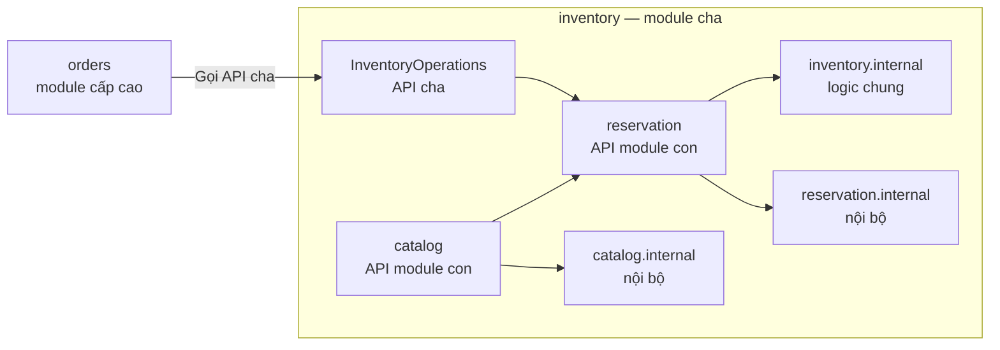
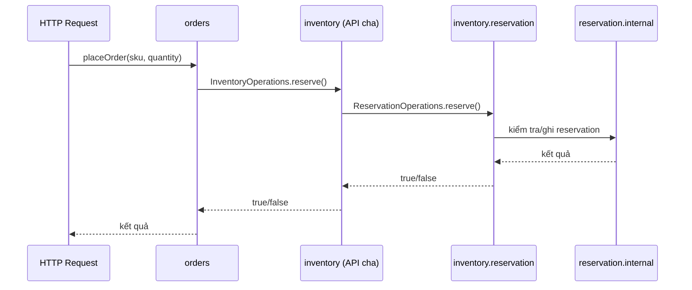

# Xử lý module lồng nhau

Khi một ứng dụng Spring Boot lớn dần, một **application module** có thể trở nên quá rộng: module `inventory` ban đầu chỉ quản lý tồn kho, nhưng dần chứa quản lý danh mục, giữ hàng, kiểm kê và đồng bộ kho. Đặt tất cả vào một package làm ranh giới nội bộ khó nhìn thấy; tách tất cả thành các module ngang hàng lại có thể khiến kiến trúc cấp cao quá phân mảnh. **Nested application module** của Spring Modulith giúp mô hình hóa các phần độc lập **bên trong** một module cha, đồng thời vẫn kiểm soát các quan hệ phụ thuộc.

Bài thuộc chương **Nhiều module** của **SPRING_MODULITH_DOCUMENTATION_OBSERVABILITY**. Trong phạm vi sử dụng Spring Modulith để sinh tài liệu ranh giới application module và quan sát tương tác trong Spring Boot, chúng ta sẽ thiết kế module cha/con, xác minh module graph, lập tài liệu bằng `Documenter`, xem quan hệ cha/con trên Actuator và nhận diện dấu vết tương tác qua metrics/tracing. Bài cũng giải thích vấn đề context propagation khi xử lý sự kiện bất đồng bộ.

> **Điều kiện phiên bản:** Spring Modulith hỗ trợ *nested application modules* từ **1.3**. Kiểm tra phiên bản Spring Modulith thực tế trước khi sao chép ví dụ; các API và dependency cho tài liệu, Actuator và observability cần tương thích với Spring Boot/Spring Framework đang dùng. Không phải thư mục con nào cũng tự động được nhận diện là một nested module.

## 1. Mục tiêu học tập

Hoàn thành bài, bạn có thể:

1. Phân biệt subpackage nội bộ, application module cấp cao và nested application module.
2. Dùng `@ApplicationModule` trên `package-info.java` để khai báo module lồng nhau một cách tường minh.
3. Thiết kế API của module cha, API của module con và các package `internal` theo đúng phạm vi truy cập.
4. Tạo mô hình `ApplicationModules`, chạy `verify()` và kiểm tra rằng ranh giới thực tế khớp kiến trúc dự định.
5. Sinh sơ đồ và module canvas, đọc thông tin parent/nested của Actuator, đối chiếu với trace và event metrics khi vận hành.
6. Xử lý tình huống refactor hoặc debug khi các package lồng nhau bị phát hiện sai, xuất hiện phụ thuộc vòng hoặc mất trace context.

## 2. Ba khái niệm dễ nhầm lẫn

Spring Modulith tạo mô hình logic từ **cấu trúc Java package**, chứ không đồng nhất trực tiếp với Maven module, Gradle subproject, Java Platform Module System (JPMS) hoặc các service triển khai độc lập.

| Khái niệm | Ví dụ | Ý nghĩa |
|---|---|---|
| Application module cấp cao | `com.acme.shop.inventory` | Theo cơ chế phát hiện mặc định, đây là package con trực tiếp của package chứa `@SpringBootApplication` |
| Subpackage nội bộ | `com.acme.shop.inventory.internal` | Là phần triển khai của `inventory`; **không tự trở thành application module độc lập** |
| Nested application module | `com.acme.shop.inventory.reservation` với `@ApplicationModule` | Trở thành module con nằm trong `inventory`, có API và các phần nội bộ riêng |
| Subpackage nội bộ của module con | `com.acme.shop.inventory.reservation.internal` | Là phần triển khai riêng của `reservation`, không phải API công khai của module con |

Với cấu trúc phổ biến:

```text
com.acme.shop
├── ShopApplication.java
├── inventory/                        ← application module cấp cao
│   ├── InventoryOperations.java      ← API cấp cha
│   ├── internal/                     ← nội bộ của inventory
│   ├── reservation/                  ← nested module (có @ApplicationModule)
│   │   ├── package-info.java
│   │   ├── ReservationOperations.java
│   │   └── internal/                 ← nội bộ của reservation
│   └── catalog/                      ← nested module (có @ApplicationModule)
│       ├── package-info.java
│       ├── CatalogQueries.java
│       └── internal/
└── orders/                           ← application module cấp cao khác
    └── OrderPlacement.java
```

Ta có hai module cấp cao `inventory` và `orders`. Bên trong `inventory` là hai module con `reservation` và `catalog`. Các package `internal` không phải module độc lập; chúng được quản lý theo ranh giới của module chứa chúng.

Một ứng dụng có thể tiếp tục có mức lồng sâu hơn, nhưng **không nên tạo cây nhiều tầng chỉ vì Java cho phép tạo package con**. Chỉ đánh dấu nested module khi phần đó có trách nhiệm đủ rõ, API ổn định và có lợi ích thực tế từ việc kiểm tra quan hệ phụ thuộc.

## 3. Quy tắc phát hiện module

### 3.1. Cơ chế mặc định

Với ứng dụng có main package `com.acme.shop`:

```java
package com.acme.shop;

import org.springframework.boot.SpringApplication;
import org.springframework.boot.autoconfigure.SpringBootApplication;

@SpringBootApplication
public class ShopApplication {
    public static void main(String[] args) {
        SpringApplication.run(ShopApplication.class, args);
    }
}
```

Spring Modulith mặc định coi các subpackage trực tiếp như `inventory` và `orders` là application module cấp cao. Với các subpackage sâu hơn, ví dụ `inventory.internal` hoặc `orders.persistence`, chúng thuộc module tương ứng, trừ khi có cấu hình đặc biệt.

**Đừng nhầm:** chỉ tạo `inventory.reservation` và đặt class vào đó **chưa đủ** để Spring Modulith nhận diện `reservation` là nested module. Muốn phần này có ranh giới riêng, phải khai báo tường minh:

```java
// File: com/acme/shop/inventory/reservation/package-info.java
@org.springframework.modulith.ApplicationModule
package com.acme.shop.inventory.reservation;
```

Tương tự:

```java
// File: com/acme/shop/inventory/catalog/package-info.java
@org.springframework.modulith.ApplicationModule
package com.acme.shop.inventory.catalog;
```

Ở đây không cần dùng `@ApplicationModule` trên `inventory` và `orders` nếu giữ chiến lược phát hiện **mặc định**. Việc annotation ở hai package con đánh dấu ranh giới nested module; annotation không tạo thêm process, database hay network hop.

### 3.2. Khi dùng chiến lược `explicitly-annotated`

Spring Modulith có lựa chọn chỉ nhận các module được khai báo tường minh:

```properties
spring.modulith.detection-strategy=explicitly-annotated
```

Nếu chọn chiến lược này, cần khai báo cả những module cấp cao mà ứng dụng muốn phát hiện, ví dụ `com.acme.shop.inventory` và `com.acme.shop.orders`, bên cạnh các module con. Không giả định cơ chế mặc định và chiến lược khai báo tường minh sẽ tạo ra hai đồ thị giống nhau.

Tùy yêu cầu tổ chức, có thể tùy biến `ApplicationModuleDetectionStrategy`. Tuy nhiên, chiến lược riêng ảnh hưởng trực tiếp đến mô hình kiến trúc, tài liệu và cả khả năng quan sát ở runtime. Hãy cố định cách phát hiện và sử dụng nhất quán giữa test, tài liệu được sinh và cấu hình ứng dụng chạy thật.

### 3.3. Quyết định module lồng nhau hay subpackage nội bộ?

Dùng nested module khi phần bên trong:

- Có **năng lực nghiệp vụ tương đối độc lập**, chẳng hạn đặt giữ tồn kho và tra cứu danh mục.
- Cần **API giữa các thành phần** của module cha, thay vì cho chúng truy cập sâu vào mọi implementation.
- Có mức độ thay đổi, người phụ trách hoặc invariant khác nhau và muốn được thể hiện trên module graph.
- Cần nhìn thấy phụ thuộc, event hoặc thời gian xử lý theo ranh giới nhỏ hơn module cha.

Giữ subpackage `internal` khi phần đó chỉ là cách tổ chức implementation, như repository adapter, mapping, helper, persistence hay một nhóm class không có hợp đồng dùng chung. Lạm dụng nested module sẽ làm số quan hệ phụ thuộc và tài liệu tăng lên mà không đem lại thêm thông tin kiến trúc.

## 4. Quy tắc truy cập giữa module cha, module con và module khác

Từ Spring Modulith 1.3, một nested module có quan hệ đặc biệt với module cha và các module con cùng cấp.

| Quan hệ | Quy tắc cần áp dụng |
|---|---|
| `inventory` → API của `inventory.reservation` | Được phép; module cha có thể sử dụng API của module con |
| `inventory.reservation` → `inventory.internal` | Nested module có thể tham chiếu cả phần nội bộ của module cha |
| `inventory.catalog` → API của `inventory.reservation` | Được phép sử dụng các kiểu được module con cùng cấp **expose** |
| `inventory.catalog` → `inventory.reservation.internal` | Tránh phụ thuộc vào nội bộ module con cùng cấp; ranh giới kiểm chứng sẽ bảo vệ phần internal |
| `orders` → API công khai ở `inventory` | Được phép khi không có ràng buộc phụ thuộc khác cấm |
| `orders` → `inventory.reservation` | Không được phép truy cập trực tiếp API nested module theo ranh giới lồng nhau mặc định |
| `orders` → `inventory.internal` | Không được phép truy cập nội bộ module khác |
| `inventory.reservation` → API công khai của `orders` | Có thể tham chiếu API của module cấp cao khác nếu phù hợp quy tắc phụ thuộc và không tạo vòng |

Điều này tạo thành **ranh giới tổng thể ở module cha** và **ranh giới chi tiết giữa các module con**.



Sơ đồ chỉ minh họa **một luồng phụ thuộc hợp lệ**; không nhất thiết mọi dự án có hai module con đều phải tạo các cạnh như vậy. Chú ý rằng `orders` gọi API `InventoryOperations` do module cha cung cấp, rồi module cha điều phối tới `reservation`. Cách này duy trì bề mặt công khai ổn định dù cách chia module con được thay đổi.

**Phân biệt API và mức truy cập Java:** một class `public` trong `reservation.internal` vẫn có thể được Java import từ package khác, nhưng điều đó **không có nghĩa** nó là API hợp lệ theo Spring Modulith. Trách nhiệm của `ApplicationModules.verify()` là phát hiện những tham chiếu vượt ranh giới này.

## 5. Ví dụ xây dựng module cha và module con

### 5.1. Module cha cung cấp hợp đồng đơn giản cho bên ngoài

API ở package gốc của module `inventory`:

```java
// File: com/acme/shop/inventory/InventoryOperations.java
package com.acme.shop.inventory;

public interface InventoryOperations {
    boolean reserve(String sku, int quantity);
}
```

`orders` chỉ cần biết nghiệp vụ “đặt giữ hàng”, không cần biết phần giữ hàng nằm trong package nào. Điều này giảm phụ thuộc vào cấu trúc lồng nhau của `inventory`.

### 5.2. Nested module định nghĩa API riêng

```java
// File: com/acme/shop/inventory/reservation/ReservationOperations.java
package com.acme.shop.inventory.reservation;

public interface ReservationOperations {
    boolean reserve(String sku, int quantity);
}
```

API này phục vụ module cha và những module con cùng cấp được phép dùng nó. Nếu không có nhu cầu giao tiếp giữa các thành phần nội bộ, có thể chưa cần tạo interface; nested module nên được thiết kế theo trách nhiệm chứ không theo khuôn bắt buộc mỗi package đều có interface.

### 5.3. Đặt quy tắc dùng chung ở phần nội bộ của cha

```java
// File: com/acme/shop/inventory/internal/StockPolicy.java
package com.acme.shop.inventory.internal;

import org.springframework.stereotype.Component;

@Component
public class StockPolicy {
    public boolean isValidQuantity(int quantity) {
        return quantity > 0;
    }
}
```

`StockPolicy` là class `public` để có thể được tham chiếu từ package khác trong cùng vùng `inventory`, nhưng vẫn thuộc `inventory.internal`. Theo quy tắc nested module, phần tử của module con có thể dùng loại nội bộ của cha. **Đây không phải giấy phép cho `orders` hoặc module cấp cao khác import `StockPolicy`.**

### 5.4. Implementation ở phần nội bộ của module con

```java
// File: com/acme/shop/inventory/reservation/internal/ReservationService.java
package com.acme.shop.inventory.reservation.internal;

import com.acme.shop.inventory.internal.StockPolicy;
import com.acme.shop.inventory.reservation.ReservationOperations;
import org.springframework.stereotype.Service;

@Service
class ReservationService implements ReservationOperations {

    private final StockPolicy policy;

    ReservationService(StockPolicy policy) {
        this.policy = policy;
    }

    @Override
    public boolean reserve(String sku, int quantity) {
        // Chỉ minh họa liên kết các lớp:
        // cần bổ sung kiểm tra SKU, tồn kho, transaction, cạnh tranh ghi ...
        return sku != null && !sku.isBlank()
                && policy.isValidQuantity(quantity);
    }
}
```

Đây là code minh họa **ranh giới module**, không phải triển khai thực tế thuật toán giữ kho. Hệ thống sản xuất cần tính đúng nhất quán của tồn kho và xử lý cạnh tranh giao dịch. Spring Modulith không tự giải quyết transactional consistency chỉ vì class được đặt trong nested module.

### 5.5. Module cha điều phối module con

```java
// File: com/acme/shop/inventory/internal/InventoryFacade.java
package com.acme.shop.inventory.internal;

import com.acme.shop.inventory.InventoryOperations;
import com.acme.shop.inventory.reservation.ReservationOperations;
import org.springframework.stereotype.Service;

@Service
class InventoryFacade implements InventoryOperations {

    private final ReservationOperations reservations;

    InventoryFacade(ReservationOperations reservations) {
        this.reservations = reservations;
    }

    @Override
    public boolean reserve(String sku, int quantity) {
        return reservations.reserve(sku, quantity);
    }
}
```

Bên ngoài có thể injection bằng interface công khai `InventoryOperations`, còn implementation `InventoryFacade` ở vùng nội bộ của module cha. Module cha chịu trách nhiệm biến kiến trúc chi tiết bên trong thành một API đơn giản cho các module ngang hàng.

### 5.6. Module khác chỉ biết API của module cha

```java
// File: com/acme/shop/orders/OrderPlacement.java
package com.acme.shop.orders;

import com.acme.shop.inventory.InventoryOperations;
import org.springframework.stereotype.Service;

@Service
public class OrderPlacement {

    private final InventoryOperations inventory;

    public OrderPlacement(InventoryOperations inventory) {
        this.inventory = inventory;
    }

    public boolean place(String sku, int quantity) {
        return inventory.reserve(sku, quantity);
    }
}
```

**Tình huống sai ranh giới:**

```java
// Không nên viết trong com.acme.shop.orders:
import com.acme.shop.inventory.reservation.ReservationOperations;

// orders đang bỏ qua API của inventory để vào thẳng module con.
```

Nếu `orders` cần một khả năng mới từ `reservation`, hãy cân nhắc mở rộng contract ở `inventory` hoặc thiết kế lại boundary đã được thống nhất. Không sửa package chỉ nhằm qua được compiler.

## 6. Hiểu `@NamedInterface` khi có module lồng nhau

Spring Modulith phân biệt API mặc định của một module (thường là public types trong base package) với **named interfaces** cho những phần API chủ động được công bố từ package con.

Ví dụ trong module cha cần công bố một nhóm SPI cho module khác:

```java
// File: com/acme/shop/inventory/spi/package-info.java
@org.springframework.modulith.NamedInterface("spi")
package com.acme.shop.inventory.spi;
```

Phần được đánh dấu sẽ là named interface của module phù hợp theo quy tắc phân tích package. Một module khác có thể giới hạn dependency theo cách viết như `inventory :: spi` trong `allowedDependencies` nếu thực sự cần.

Lưu ý ba giới hạn:

1. **Named interface không đồng nghĩa với nested module.** Package `inventory.spi` chỉ vì có `@NamedInterface` không tự trở thành application module độc lập.
2. **Nested module không tự trở thành API công khai của module cha.** Một API của `inventory.reservation` vẫn chịu quy tắc module con, dù các kiểu của nó được khai báo `public`.
3. **`allowedDependencies` không phải công cụ sửa mọi lỗi boundary.** Nó giới hạn những dependency được phép theo cấu trúc đã mô hình hóa; trước hết phải xác định đúng module và nơi công bố API.

Cấu trúc nested module thường hữu ích khi muốn phần `reservation` phục vụ parent hoặc sibling, còn những client ngoài `inventory` đi qua một facade cấp cha. Nếu muốn giao tiếp rộng hơn, cần xem lại khả năng phần đó phải trở thành module ngang hàng thay vì vô tình mở toàn bộ nội bộ.

## 7. Kiểm chứng mô hình bằng `ApplicationModules`

### 7.1. Kiểm tra dependency và ranh giới

Trong test source của ứng dụng, có thể tạo test với `spring-modulith-starter-test` (hoặc các dependency tương ứng của phiên bản dự án):

```java
package com.acme.shop;

import org.junit.jupiter.api.Test;
import org.springframework.modulith.core.ApplicationModules;

class ArchitectureTests {

    @Test
    void moduleBoundariesAreValid() {
        ApplicationModules.of(ShopApplication.class).verify();
    }
}
```

`verify()` kiểm tra các quy tắc kiến trúc gồm:

- Không có chu trình phụ thuộc giữa những application module được phát hiện.
- Không tham chiếu tới nội bộ của module khác qua những ranh giới bị hạn chế.
- Tuân thủ `allowedDependencies` nếu module đã khai báo danh sách phụ thuộc cho phép.
- Các quy tắc mở rộng khác nếu dependency/extension tương ứng được cấu hình.

Cần phân biệt **chu trình phụ thuộc ở module level** với việc các method có thể gọi lẫn nhau. Một đồ thị module có phụ thuộc vòng vẫn đáng xử lý, ngay cả khi test nghiệp vụ trước mắt thành công.

### 7.2. Chứng minh package thực sự được nhận diện là module con

Một test bổ sung có thể truy vấn theo package và quan hệ cha/con:

```java
package com.acme.shop;

import static org.assertj.core.api.Assertions.assertThat;

import org.junit.jupiter.api.Test;
import org.springframework.modulith.core.ApplicationModules;

class NestedModuleDetectionTests {

    @Test
    void reservationIsNestedInsideInventory() {
        ApplicationModules modules =
                ApplicationModules.of(ShopApplication.class);

        var inventory = modules.getModuleForPackage(
                "com.acme.shop.inventory").orElseThrow();
        var reservation = modules.getModuleForPackage(
                "com.acme.shop.inventory.reservation").orElseThrow();

        assertThat(modules.getParentOf(reservation))
                .contains(inventory);

        modules.verify();
    }
}
```

`getParentOf(…)` có mặt trong các API hỗ trợ nested module từ Spring Modulith 1.3. Test này giúp tránh một lỗi âm thầm: cấu trúc folder nhìn như nested module nhưng framework vẫn nhận toàn bộ package như một phần nội bộ của parent.

**Khi bài test phát hiện sai:** kiểm tra annotation trên đúng `package-info.java`, package declaration, root package của Spring Boot application và chiến lược phát hiện đang dùng. Nếu package `reservation` không có class được scan/import hoặc định nghĩa bị loại khỏi mô hình do cấu hình đặc biệt, cần kiểm tra phạm vi code trong môi trường test.

### 7.3. Negative test để chứng minh ranh giới hoạt động

Trong một nhánh thử nghiệm, đổi `OrderPlacement` sang injection `ReservationOperations` trực tiếp. Chạy lại `ArchitectureTests`; tùy phiên bản và cách cấu hình, `verify()` phải phát hiện vi phạm truy cập tới nested module khi module bên ngoài không được phép sử dụng nó.

Sau đó phục hồi dependency qua `InventoryOperations` và chạy lại. Không giữ nguyên đoạn mã vi phạm chỉ để test âm thành công. Mục đích là chứng minh **quy tắc được kiểm**, tránh tình trạng test luôn xanh vì phần tử đã vô tình bị phát hiện cùng một module.

## 8. Sinh module graph và tài liệu ranh giới

Một mục tiêu trọng tâm của **SPRING_MODULITH_DOCUMENTATION_OBSERVABILITY** là giúp kiến trúc luôn được thể hiện bằng tài liệu tạo từ code thay vì sơ đồ vẽ tay đã lỗi thời.

Sử dụng `Documenter` của Spring Modulith trong test chuyên sinh tài liệu:

```java
package com.acme.shop;

import org.junit.jupiter.api.Test;
import org.springframework.modulith.core.ApplicationModules;
import org.springframework.modulith.docs.Documenter;

class ModuleDocumentationTests {

    @Test
    void generateArchitectureDocumentation() {
        ApplicationModules modules =
                ApplicationModules.of(ShopApplication.class);

        modules.verify();

        new Documenter(modules)
                .writeModulesAsPlantUml()
                .writeIndividualModulesAsPlantUml()
                .writeModuleCanvases();
    }
}
```

Thông thường tài liệu được tạo dưới thư mục `spring-modulith-docs` trong output build của dự án; đường dẫn chính xác phụ thuộc cấu hình build và phiên bản. `writeModulesAsPlantUml()` tạo sơ đồ toàn hệ thống; `writeIndividualModulesAsPlantUml()` tạo góc nhìn từng module; `writeModuleCanvases()` ghi nhận bean, event và các thông tin mô-đun hữu ích dưới dạng bảng. Muốn tài liệu tổng hợp có các liên kết tới artifact đã sinh, có thể dùng `writeDocumentation()` phù hợp với phiên bản.

Khi đọc các artifact:

1. Tìm `inventory` và xác minh bên trong nó có các nested module dự định như `reservation`, `catalog`.
2. Đối chiếu các cạnh phụ thuộc giữa module cha, module con và `orders` với dependency đã phê duyệt.
3. So module canvas của `inventory` và `reservation` để hiểu bean/API/event đang được gắn vào ranh giới nào.
4. Đưa việc tạo artifact vào CI hoặc quy trình tài liệu; khi thay package/annotation, review diff của đồ thị với thay đổi code.

**Lưu ý:** sơ đồ là biểu diễn mô hình Spring Modulith; định dạng và mức chi tiết hiển thị phụ thuộc tùy chọn/phiên bản của `Documenter`. Không lấy việc “trên ảnh nhìn có ô con” làm chứng cứ duy nhất. Test `getParentOf(…)` cùng kết quả `verify()` là nguồn kiểm tra kiến trúc có thể tự động hóa.

## 9. Quan sát module lồng nhau qua Actuator

Spring Modulith cung cấp thông tin module ở runtime thông qua Spring Boot Actuator, thường dưới endpoint `/actuator/modulith`.

Để sử dụng, ứng dụng cần dependency tương thích của Spring Modulith Actuator và Spring Boot Actuator (hoặc starter tích hợp nếu phiên bản đang dùng cung cấp). Trong môi trường thử nghiệm có thể bật endpoint theo cấu hình tương ứng:

```yaml
management:
  endpoints:
    web:
      exposure:
        include: health,info,modulith
```

Đọc từ máy có quyền trong môi trường dev/test:

```bash
curl --fail --silent http://localhost:8080/actuator/modulith
```

Kết quả là JSON mô tả các module. Những trường có ích cho việc chẩn đoán cấu trúc lồng nhau gồm:

| Thuộc tính JSON | Ý nghĩa |
|---|---|
| Key của đối tượng module | Định danh kỹ thuật của module được nhận diện |
| `basePackage` | Java package gốc của module |
| `displayName` | Tên hiển thị của module |
| `parent` (nếu có) | Định danh module cha |
| `nested` (nếu có) | Danh sách định danh các module con |
| `dependencies[]` | Các dependency ra ngoài module và loại dependency |

Các định danh thực tế phụ thuộc quy tắc nhận diện module; **không nên đoán chuỗi module ID chỉ từ đường dẫn folder**. Khi kiểm tra:

- Module `inventory` phải có danh sách module con như thiết kế.
- Các module con phải có `parent` chỉ đúng module cha.
- Không có cạnh phụ thuộc không mong đợi từ `orders` vào phần nội bộ của `inventory`.
- Mô hình tại runtime phải phù hợp với mô hình được xác minh trong CI.

Endpoint chứa **metadata kiến trúc** có thể tiết lộ cấu trúc nội bộ. Trong production, chỉ expose endpoint sau xác thực/ủy quyền hoặc trên management network riêng; không công khai tùy tiện trên Internet.

Nếu CI nhìn thấy nested module nhưng runtime không thấy, kiểm tra tính nhất quán của dependency và cấu hình phát hiện module. **Một chiến lược phát hiện được đăng ký chỉ trong test source có thể không được runtime sử dụng**; hãy đưa cấu hình cần thiết vào production source theo hướng dẫn Spring Modulith và kiểm tra lại Actuator.

## 10. Tracing: quan sát tương tác thật qua ranh giới module

Tài liệu và `verify()` phản ánh phụ thuộc tĩnh; tracing cho biết **lời gọi và sự kiện đã thực sự diễn ra** khi ứng dụng chạy.

Các module do Spring Modulith nhận diện có thể được instrument ở ranh giới API thông qua observability support, tạo Micrometer spans. Thư viện và tên artifact có khác biệt theo dòng phiên bản; ở dòng mới có `spring-modulith-observability-core` hoặc starter Insight tương ứng. Đồng thời, ứng dụng cần hạ tầng Micrometer tracing và exporter/collector phù hợp với giải pháp quan sát của tổ chức.

Một luồng minh họa:



Khi có instrumentation và tracing backend đầy đủ, các span giúp quan sát nơi nhận lời gọi, thời gian xử lý và luồng qua API module. Thông tin span có thể chứa các thuộc tính như:

- `module.identifier`: định danh module.
- `module.name`: tên hiển thị.
- `module.invocation-type`: kiểu gọi, ví dụ bean invocation hay event listener.
- `module.method`: method thực thi.

**Không khẳng định mọi method trong `internal` đều có span riêng.** Instrumentation Spring Modulith tập trung vào tương tác tại những phần API được nhận diện. Nếu mục tiêu là đo sâu một truy vấn database, một thao tác I/O hoặc method private, cần thêm instrumentation thích hợp tại chính thao tác đó.

### 10.1. Khi trace không thấy nested module

Kiểm tra theo thứ tự:

1. `ApplicationModules` có phát hiện nested module không? Xác minh bằng test/Actuator.
2. Bean được gọi có thuộc bề mặt API mà instrumentation theo dõi không?
3. Lời gọi có đi qua Spring bean proxy hay chỉ là self-invocation trong cùng object?
4. Ứng dụng đã thêm observability dependency, bridge Micrometer Tracing và exporter phù hợp chưa?
5. Sampling, cấu hình collector, security policy hoặc context propagation có khiến span mất liên kết không?

Một sơ đồ đúng không bảo đảm trace đầy đủ, và trace thiếu cũng không tự chứng minh module structure sai. Hai nguồn thông tin bổ sung cho nhau.

## 11. Event metrics và context propagation

Nested module thường giao tiếp nội bộ bằng method call; với luồng nghiệp vụ kéo dài hoặc các phần không cần đồng bộ, có thể dùng **application events**. Spring Modulith hỗ trợ quan sát event publication bằng metrics; các ví dụ từ các phiên bản hiện hành gồm:

- Counter `module.events.published` cho các event phát ra.
- Counter chuyên biệt theo module và loại event như `module.events.published.$moduleIdentifier.$simpleEventTypeName`.
- Những thuộc tính/nhãn hữu ích như `module.identifier`, `module.name` và `module.event.type`.

Có thể kiểm tra metrics trên monitoring backend (hoặc Actuator metrics nếu ứng dụng được cấu hình phù hợp), nhưng **tên series xuất ra có thể được chuẩn hóa/biến đổi bởi registry** như Prometheus. Cần đối chiếu tên gốc và tên xuất thực tế; không lấy số lượng counter làm bằng chứng duy nhất rằng consumer đã xử lý thành công.

### 11.1. Thiết kế event type đúng ranh giới

Nếu `orders` cần nhận một sự kiện liên quan đến tồn kho, event type nên nằm ở phần API mà `orders` được phép sử dụng, chẳng hạn:

```java
// File: com/acme/shop/inventory/StockReserved.java
package com.acme.shop.inventory;

public record StockReserved(String sku, int quantity) {}
```

Module con `reservation` có thể publish event này, còn `orders` tham chiếu event công khai của `inventory`. Đừng đặt event mà `orders` phải import trực tiếp trong `inventory.reservation.internal`: điều đó khiến subscriber gắn chặt với implementation và thường phá ranh giới module.

Nếu event cần được xử lý không đồng bộ, hãy xác định rõ cơ chế `@EventListener`/`@TransactionalEventListener`, transaction boundary, khả năng xử lý lặp, sự kiện thất bại và chiến lược bảo đảm giao nhận. Nested module không mặc nhiên bảo đảm durable delivery hoặc exactly-once processing.

### 11.2. Tại sao có thể mất trace khi xử lý bất đồng bộ?

Giả sử `orders` phát event sau khi hoàn thành nghiệp vụ. Một listener ở module khác dùng `@Async`, chạy trên thread pool. **ThreadLocal trace context của thread phát sự kiện không tự động hiện diện trên mọi thread xử lý sau đó.** Nếu executor không chuyển context, các span của event listener có thể xuất hiện như một trace tách biệt hoặc thiếu parent.

Các giải pháp cần đánh giá theo phiên bản Spring Boot/Micrometer:

1. Dùng cơ chế context propagation phù hợp với executor và framework đang sử dụng (chẳng hạn `ContextPropagatingTaskDecorator` trên Spring Framework hỗ trợ).
2. Bảo đảm executor thực sự thực thi listener/`@Async` đã gắn decorator, không chỉ khai báo một bean mà không được dùng.
3. Kiểm trace ID, span parent-child hoặc span links theo đúng ngữ nghĩa luồng đồng bộ/bất đồng bộ.
4. Truyền correlation identifier nghiệp vụ qua event khi cần tra cứu độc lập với sampling/tracing; tránh dựa toàn bộ vào `ThreadLocal`.

Ví dụ **riêng cho môi trường sử dụng Spring Framework có `ContextPropagatingTaskDecorator`**, cần điều chỉnh cấu hình executor/`@Async` theo ứng dụng:

```java
import org.springframework.context.annotation.Bean;
import org.springframework.context.annotation.Configuration;
import org.springframework.core.task.support.ContextPropagatingTaskDecorator;
import org.springframework.scheduling.concurrent.ThreadPoolTaskExecutor;

@Configuration
class AsyncExecutionConfiguration {

    @Bean(name = "moduleEventExecutor")
    ThreadPoolTaskExecutor moduleEventExecutor() {
        ThreadPoolTaskExecutor executor = new ThreadPoolTaskExecutor();
        executor.setCorePoolSize(4);
        executor.setMaxPoolSize(8);
        executor.setQueueCapacity(100);
        executor.setThreadNamePrefix("module-event-");
        executor.setTaskDecorator(new ContextPropagatingTaskDecorator());
        executor.initialize();
        return executor;
    }
}
```

Để dùng executor này cho tác vụ bất đồng bộ, cấu hình ứng dụng phải bật `@EnableAsync` và trỏ `@Async("moduleEventExecutor")` tới đúng bean, hoặc chọn cơ chế đăng ký executor tương ứng với event multicaster. Mã trên **chỉ mô tả executor**, chưa tự làm listener chạy bất đồng bộ và chưa thay thế việc cấu hình Micrometer observation/tracing/exporter.

**Cẩn trọng với PII:** không gắn orderId, customerId hoặc payload event có độ phân biệt cao thành metric tags. Chúng có thể gây bùng nổ cardinality và rò rỉ thông tin. Ưu tiên module identifier và event type làm nhãn; lưu thông tin tra cứu chi tiết ở log có kiểm soát hoặc trace attribute theo chính sách dữ liệu.

## 12. Kiểm thử module con ở phạm vi phù hợp

`@ApplicationModuleTest` của Spring Modulith cho phép bootstrap một module và lựa chọn cách thêm các dependency:

| Chế độ | Phạm vi |
|---|---|
| `STANDALONE` | Chỉ module được test (mặc định) |
| `DIRECT_DEPENDENCIES` | Module được test cùng các module mà nó phụ thuộc trực tiếp |
| `ALL_DEPENDENCIES` | Module được test cùng toàn bộ cây dependency theo mô hình |

Một test đặt trong package của module cần kiểm tra có thể dùng:

```java
package com.acme.shop.inventory.reservation;

import org.junit.jupiter.api.Test;
import org.springframework.modulith.test.ApplicationModuleTest;

@ApplicationModuleTest
class ReservationIntegrationTests {

    @Test
    void startsModuleContext() {
        // Thêm assertions về bean/API/nghiệp vụ khi triển khai thực tế.
    }
}
```

Chế độ bootstrap mặc định không bảo đảm đủ mọi bean mà implementation cần, đặc biệt khi module con sử dụng type ở module cha hoặc một module khác. Trong trường hợp đó, phân biệt:

- **Lỗi kiến trúc:** một reference bị `verify()` cấm. Không mở rộng bootstrap để che giấu vi phạm này.
- **Thiếu bean hợp lệ trong test:** dependency qua API được phép nhưng test chỉ bootstrap một phần. Có thể dùng mock hoặc chọn bootstrap mode phù hợp.
- **Sai mô hình module:** annotation/detection khiến test chạy phạm vi khác dự kiến. Quay lại test `getParentOf(…)` trước khi sửa business code.

Một bộ kiểm thử hữu ích gồm test kiến trúc, test cho từng API module con, test tích hợp từ module cha đi qua nested module và test sự kiện/tracing khi có xử lý bất đồng bộ. Những test kiến trúc nhanh nên chạy trong CI; test có Actuator/exporter cần môi trường tích hợp phù hợp.

## 13. Các lỗi thường gặp khi xử lý module lồng nhau

| Hiện tượng | Nguyên nhân có thể | Cách kiểm tra và xử lý |
|---|---|---|
| Package con không xuất hiện như module | Chưa có `@ApplicationModule` ở `package-info.java`; chiến lược detection không phù hợp | Truy vấn `getModuleForPackage`, `getParentOf` và rà soát annotation |
| `verify()` báo truy cập internal | Module khác import class ở `*.internal` hoặc vào nested API từ bên ngoài cha | Chuyển dependency qua API đúng ranh giới, cân nhắc facade |
| Xuất hiện chu trình giữa module con | Hai phần cần gọi logic của nhau theo hai chiều | Tách trách nhiệm, chuyển logic chung lên cha hoặc dùng event khi thích hợp |
| `orders` cần class trong `reservation` | Thiết kế API cấp cha chưa đáp ứng use case | Cung cấp operation/sự kiện công khai ở `inventory` |
| Đồ thị quá rối sau khi tách nested | Tạo module cho các package helper không có boundary rõ | Gộp các package kỹ thuật thành `internal` |
| CI và Actuator báo module khác nhau | Cấu hình detection khác giữa test và runtime | Căn chỉnh config/dependency trong source thực thi |
| Trace không hiện module con | Chưa có instrumentation, API không đi qua proxy, sampling hoặc context propagation | Xác minh model trước, rồi kiểm observation pipeline |
| Metric event có nhưng trạng thái nghiệp vụ chưa cập nhật | Event đã publish nhưng listener thất bại/đang chờ | Kiểm event handling, transaction, retry và error handling |
| Test `STANDALONE` lỗi thiếu bean | Dependency hợp lệ nằm ngoài phạm vi bootstrap | Dùng mock hoặc dependency bootstrap mode phù hợp |
| Mở module bằng `Type.OPEN` làm hết lỗi | Mở ranh giới rộng thay vì sửa dependency | Chỉ dùng OPEN có chủ đích, chủ yếu khi chuyển đổi ứng dụng cũ |

`@ApplicationModule(type = Type.OPEN)` có thể hữu ích ở một giai đoạn chuyển tiếp từ mã legacy; nhưng trong kiến trúc mô-đun mới, hãy ưu tiên ranh giới đóng và API rõ ràng. Nếu dùng OPEN, cần ghi lại lý do và kế hoạch thu hẹp phụ thuộc.

## 14. Quy trình refactor một module lớn thành nhiều module con

1. **Vẽ baseline:** chạy `ApplicationModules.of(…).verify()` (nếu hệ thống đã sạch) và sinh module graph, module canvas. Ghi lại dependency, các API hiện đang dùng và event giao tiếp.
2. **Chọn trách nhiệm để tách:** ví dụ `inventory.reservation` và `inventory.catalog`. Phần khác như persistence adapter vẫn là `internal` nếu không có hợp đồng mô-đun riêng.
3. **Định nghĩa API:** quyết định use case nào do `InventoryOperations` cấp cha công bố; API nào chỉ phục vụ parent/sibling.
4. **Đặt package và annotation:** tạo `package-info.java` với `@ApplicationModule` tại đúng base package của module con; giữ package root application ổn định.
5. **Chuyển implementation:** class của module con về vùng tương ứng; tránh để module ngang hàng import internal class hoặc nested API trực tiếp.
6. **Kiểm kiến trúc:** chạy `verify()` và test quan hệ parent/nested; xử lý vi phạm theo nghiệp vụ, không vô hiệu hóa rules để có build xanh.
7. **Cập nhật tài liệu:** sinh lại module graph và canvases; review thay đổi đối với các API, module identifiers và dependency.
8. **Kiểm runtime:** xem `/actuator/modulith` trong môi trường test; so parent/nested/dependencies với kết quả trong CI.
9. **Kiểm observability:** tạo luồng thử qua API cha → module con, đo spans/metrics khi đã bật instrumentation; thử async nếu ứng dụng sử dụng.
10. **Triển khai có giám sát:** theo dõi latency, event processing và lỗi sau refactor; so với baseline trước khi quyết định hoàn tất.

Một refactor tốt thường **không buộc client bên ngoài đổi API của module cha**. Nếu phần module con được công bố thành API mới, phải xem xét versioning và ảnh hưởng của những module tiêu thụ thay vì coi đây chỉ là thay đổi package.

## 15. Tình huống thực tế: cần nested module hay module ngang hàng?

Giả sử hệ thống có các thành phần:

- `inventory.catalog`: đọc thông tin danh mục tồn kho.
- `inventory.reservation`: giữ số lượng để phục vụ đặt hàng.
- `orders`: lập đơn và cần giữ hàng trước khi xác nhận.

Phương án A: `orders` gọi trực tiếp `inventory.reservation.ReservationOperations`. Cách này làm `orders` phụ thuộc cấu trúc nội bộ của `inventory` và trái với mục tiêu dùng nested module làm phần thực thi bên trong cha.

Phương án B: `orders` gọi `InventoryOperations.reserve(…)`, bên trong cha điều phối sang `reservation`. Sơ đồ chính vẫn đơn giản: `orders → inventory`; module chi tiết có thể được quan sát và tài liệu hóa bên trong `inventory`. Đây là lựa chọn thường phù hợp nếu `reservation` thuộc vòng đời nghiệp vụ tồn kho.

Phương án C: tách `reservation` thành module cấp cao ngang hàng với `inventory` và `orders`. Cách này phù hợp hơn nếu giữ hàng là một bounded context riêng có API độc lập cho nhiều phần hệ thống, team ownership riêng và quy tắc phụ thuộc rõ ràng.

Chọn theo **hợp đồng và tính độc lập của nghiệp vụ**, không theo số dòng code. Spring Modulith cung cấp công cụ kiểm chứng thiết kế đó; công cụ không tự quyết định bounded context thay cho nhóm phát triển.

## 16. Bài thực hành có kiểm chứng

**Yêu cầu:** tự xây một ứng dụng Spring Boot nhỏ với `inventory`, `orders`, hai nested module `inventory.reservation` và `inventory.catalog`.

Thực hiện theo các mốc:

1. Tạo package tree như mục 2. Ban đầu bỏ `@ApplicationModule` khỏi `reservation` và chạy test nhận diện; ghi lại module nào được tìm thấy.
2. Thêm annotation đúng `package-info.java` rồi xác nhận `getParentOf(reservation)` trả về `inventory`.
3. Triển khai `InventoryOperations` như ví dụ và để `orders` chỉ phụ thuộc vào API cha.
4. Cố ý thêm một tham chiếu từ `orders` vào `inventory.reservation.internal`, chạy `verify()` để thấy vi phạm, rồi phục hồi thiết kế đúng.
5. Sinh PlantUML và module canvas, ghi lại hình ảnh trước/sau khi đánh dấu nested module.
6. Bật Actuator tại mạng thử nghiệm, kiểm JSON để thấy `parent` và `nested`.
7. Nếu môi trường có tracing và metrics, gọi một use case đi qua `orders → inventory → reservation`; đối chiếu những span thực sự được tạo. Nếu thêm event handler bất đồng bộ, kiểm correlation và propagation.
8. Trả lời: có nên đổi `reservation` thành module cấp cao không? Đưa ra lý do dựa trên dependency, API tiêu thụ và quyền sở hữu nghiệp vụ.

### Tiêu chí chấm kết quả

| Tiêu chí | Hoàn thành khi |
|---|---|
| Phát hiện chính xác | Test xác nhận module con và module cha đúng |
| Boundary hợp lệ | `ApplicationModules.verify()` đạt ở thiết kế cuối |
| Không phụ thuộc ngược | `orders` chỉ gọi API cha hoặc API cấp cao đã được phê duyệt |
| Tài liệu rõ ràng | Module graph và canvas phản ánh đúng phân chia mới |
| Runtime nhất quán | Actuator cùng mô hình với test |
| Quan sát phù hợp | Trace/metric phản ánh luồng được instrument; async context được xử lý nếu có |
| Có thử nghiệm âm | Một vi phạm truy cập được phát hiện trước khi sửa |

## 17. Checklist rà soát khi bàn giao

- [ ] Phiên bản Spring Modulith có hỗ trợ nested application modules (từ 1.3).
- [ ] Các subpackage nội bộ và nested module được phân biệt có chủ đích.
- [ ] Mỗi nested module có `@ApplicationModule` tại package thích hợp.
- [ ] Cấu hình chiến lược phát hiện nhất quán giữa local test, CI và runtime.
- [ ] Module cha cung cấp API công khai ổn định; module ngang hàng không truy cập nội bộ của cha hoặc con.
- [ ] `verify()` kiểm soát cycle, truy cập internal và danh sách phụ thuộc được phép.
- [ ] Tài liệu từ `Documenter` được sinh lại sau mỗi thay đổi cấu trúc module.
- [ ] Actuator cho thấy parent/nested/dependencies đúng và được bảo vệ truy cập.
- [ ] Tracing/event metrics được cấu hình và kiểm thử ở những boundary cần quan sát.
- [ ] Context propagation được xử lý đối với event listener/luồng bất đồng bộ.
- [ ] Không có metric tag hoặc trace attribute chứa dữ liệu nhạy cảm không cần thiết.

## Tài liệu tham khảo

- [Spring Modulith — Fundamentals: Nested Application Modules](https://docs.spring.io/spring-modulith/reference/fundamentals.html): cách nhận diện, annotation và quy tắc truy cập module cha/con.
- [Spring Modulith — Verifying Application Module Structure](https://docs.spring.io/spring-modulith/reference/verification.html): `ApplicationModules.verify()` và quy tắc phụ thuộc.
- [Spring Modulith — Documenting Application Modules](https://docs.spring.io/spring-modulith/reference/documentation.html): sinh module graph, PlantUML và module canvases.
- [Spring Modulith — Production-ready Features](https://docs.spring.io/spring-modulith/reference/production-ready.html): Actuator, tracing và event metrics.
- [Spring Modulith — Integration Testing Application Modules](https://docs.spring.io/spring-modulith/reference/testing.html): `@ApplicationModuleTest` và bootstrap modes.

**Ghi nhớ:** một package con chỉ là cách tổ chức mã; **nested application module** là một ranh giới kiến trúc được khai báo, được Spring Modulith kiểm chứng và có thể xuất hiện trong tài liệu/quan sát runtime. Khi xử lý module lồng nhau, hãy giữ API module cha rõ ràng cho bên ngoài, dùng API của module con ở đúng phạm vi và xác nhận cấu trúc bằng `ApplicationModules`, `Documenter` và Actuator.
