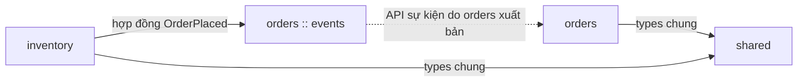
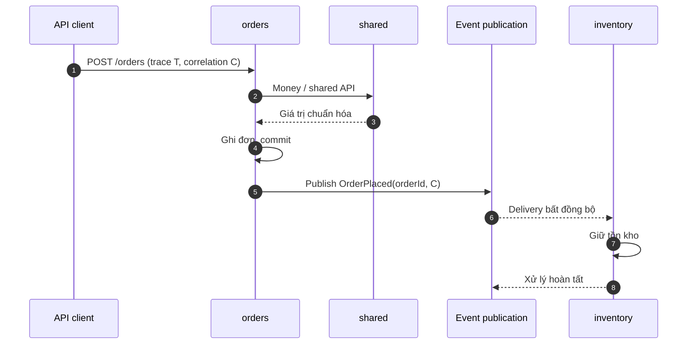

# Module dùng chung và tác động tới telemetry

Trong một ứng dụng Spring Boot có nhiều **application module**, một số kiểu dữ liệu và năng lực kỹ thuật cần được nhiều module sử dụng. Đưa mọi thứ vào một package `shared` có thể giúp tái sử dụng nhanh, nhưng cũng dễ tạo một điểm phụ thuộc quá lớn, làm mờ ranh giới nghiệp vụ và khiến **telemetry** (log, metrics, traces) khó giải thích. Bài này dùng **Spring Modulith** để thiết kế và kiểm chứng module dùng chung, sau đó quan sát tương tác giữa các module khi hệ thống vận hành.

Đây là nội dung thuộc phần **Nhiều module** của `SPRING_MODULITH_DOCUMENTATION_OBSERVABILITY`. Bạn sẽ thực hành đọc **module graph**, công bố mô hình qua **Actuator**, thiết kế **event metrics**, dùng **tracing** để theo dõi lời gọi đồng bộ/bất đồng bộ và duy trì **context propagation** qua các ranh giới thực thi. Mục tiêu không chỉ là sinh một sơ đồ đẹp: sơ đồ phải phản ánh phụ thuộc thực tế, còn số liệu vận hành phải cho biết điểm giao tiếp nào đang chậm, lỗi hoặc khó duy trì.

## 1. Kết quả cần đạt và tình huống mẫu

Giả sử ứng dụng quản lý đơn hàng có ba module:

- `orders`: nhận và xác nhận đơn hàng; phát sự kiện `OrderPlaced`.
- `inventory`: tiếp nhận `OrderPlaced` để giữ hàng; không gọi ngược API nội bộ của `orders`.
- `shared`: chứa một số kiểu dữ liệu ổn định và quy ước dùng chung như `Money` hoặc `CorrelationId`; không sở hữu vòng đời đơn hàng hay tồn kho.

Yêu cầu triển khai:

1. Khai báo `shared` là **shared application module** có chủ đích; nêu rõ vì sao một kiểu thuộc `shared` thay vì `orders` hoặc `inventory`.
2. Dùng Spring Modulith tạo/kiểm tra sơ đồ module, ngăn truy cập package `internal` của module khác và giới hạn phụ thuộc theo API công khai.
3. Bật Spring Boot Actuator và khả năng quan sát module; kiểm chứng metadata đã công bố và phạm vi bảo vệ endpoint.
4. Quan sát lời gọi đồng bộ và sự kiện bất đồng bộ, phân biệt **metrics theo module** với **business metrics**.
5. Giữ trace/correlation context khi chuyển thread hoặc qua hàng đợi; nhận biết giới hạn của propagation.
6. Xây dựng bộ kiểm thử kiến trúc và kịch bản vận hành có thể phát hiện module dùng chung đang trở thành “nút thắt”.

### Hai loại bằng chứng cần tách biệt

| Bằng chứng | Trả lời câu hỏi nào? | Ví dụ |
|---|---|---|
| **Cấu trúc tại thời điểm build** | Module nào được phép phụ thuộc module nào? | `ApplicationModules.verify()`; diagram/Canvas. |
| **Telemetry tại runtime** | Tương tác có thực sự diễn ra, bao nhiêu lần, mất bao lâu, có lỗi không? | Actuator, metrics, spans, event publication status. |

Một module graph hợp lệ **không** chứng minh hệ thống chạy ổn. Ngược lại, trace đẹp **không** đảm bảo phụ thuộc mã nguồn đã được kiểm soát.

## 2. “Module dùng chung” nghĩa là gì?

**Application module** trong Spring Modulith thường được xác định từ package trực tiếp bên dưới package ứng dụng gốc. Mỗi module có API công khai tại package gốc và các phần triển khai ở package con. Package con không tự động trở thành API công khai; chỉ nên được truy cập từ module khác khi đã công bố bằng **named interface** hoặc quy ước kiến trúc phù hợp.

Một **shared module** là application module có API được nhiều module khác phép dùng. Khái niệm này khác với một thư mục `util` tùy tiện và khác với việc cho phép tất cả module gọi lẫn nhau.

| Nên cân nhắc đặt trong `shared` | Nên để module sở hữu nghiệp vụ giữ |
|---|---|
| Value object chung, ít biến động như `Money` nếu thực sự có cùng ngữ nghĩa. | `Order`, `OrderPolicy`, `Reservation` và trạng thái nghiệp vụ riêng. |
| Hợp đồng kỹ thuật nhỏ, ổn định và được dùng rộng. | Repository, service điều phối, transaction phục vụ riêng `orders`/`inventory`. |
| Chuẩn định dạng/correlation ID mà nhiều thành phần phải đọc. | Logic “đặt hàng cần giữ tồn kho”, quy tắc giảm giá của một domain. |
| API đã có chủ sở hữu, tài liệu và kiểm thử tính tương thích. | Các lớp chỉ được hai nơi dùng do chưa thống nhất ngữ nghĩa. |

**Dấu hiệu sai kiến trúc:** `shared` bắt đầu import `orders`, `inventory`; có bean `SharedBusinessService` gọi nhiều repository; hoặc mọi module phải phụ thuộc `shared` chỉ để sử dụng một phương thức log đơn giản.

### 2.1. Sơ đồ phụ thuộc mong muốn



Trong mã, `inventory` biết **hợp đồng sự kiện công khai** `orders :: events` nhưng không biết `orders.internal`. `orders` không cần biết sự kiện được tiêu thụ bởi module nào. Việc thay đổi cơ chế giữ hàng trong `inventory` không buộc sửa `orders`.

## 3. Tạo ranh giới và kiểm tra module graph

Ví dụ cấu trúc package:

```text
com.acme.shop
├── ShopApplication.java
├── shared
│   └── Money.java
├── orders
│   ├── package-info.java
│   ├── OrderService.java
│   ├── events
│   │   ├── package-info.java
│   │   └── OrderPlaced.java
│   └── internal
│       └── OrderRepository.java
└── inventory
    ├── package-info.java
    ├── InventoryEventHandler.java
    └── internal
        └── ReservationRepository.java
```

### 3.1. Khai báo shared module ở ứng dụng

```java
package com.acme.shop;

import org.springframework.boot.SpringApplication;
import org.springframework.boot.autoconfigure.SpringBootApplication;
import org.springframework.modulith.Modulith;

@Modulith(sharedModules = "shared")
@SpringBootApplication
public class ShopApplication {
    public static void main(String[] args) {
        SpringApplication.run(ShopApplication.class, args);
    }
}
```

Trong cách bố trí này, `shared` là **tên module**, tương ứng package `com.acme.shop.shared`. Khi cấu trúc module được tùy biến hoặc đổi cách xác định tên module, cần kiểm tra tên thực tế qua mô hình `ApplicationModules` trước khi gán vào `sharedModules`.

Ví dụ value object tối giản trong API chung:

```java
package com.acme.shop.shared;

import java.math.BigDecimal;
import java.util.Currency;
import java.util.Objects;

public record Money(BigDecimal amount, Currency currency) {
    public Money {
        Objects.requireNonNull(amount, "amount");
        Objects.requireNonNull(currency, "currency");
        if (amount.signum() < 0) {
            throw new IllegalArgumentException("amount must be non-negative");
        }
    }
}
```

Kiểu này chỉ mang cấu trúc và bất biến của giá trị tiền; chưa tự động có quy tắc làm tròn, quy đổi tỷ giá hoặc logic tính giá của một nghiệp vụ. Nếu các domain có quy tắc về tiền khác nhau, hãy tách kiểu theo ngữ cảnh thay vì mở rộng `Money` thành một “siêu API”.

### 3.2. Giới hạn dependency bằng package-info.java

`orders/package-info.java`:

```java
@org.springframework.modulith.ApplicationModule(
    allowedDependencies = { "shared" }
)
package com.acme.shop.orders;
```

`orders/events/package-info.java`:

```java
@org.springframework.modulith.NamedInterface("events")
package com.acme.shop.orders.events;
```

`inventory/package-info.java`:

```java
@org.springframework.modulith.ApplicationModule(
    allowedDependencies = { "shared", "orders :: events" }
)
package com.acme.shop.inventory;
```

Điều này diễn đạt rõ: `inventory` chỉ có thể sử dụng API thuộc named interface `orders :: events` của `orders` và module dùng chung `shared`. Nó **không** được import `orders.internal.OrderRepository`. Việc khai báo allowed dependencies là rào chắn được kiểm tra ở mức kiến trúc; phạm vi truy cập của Java vẫn tuân theo `public`/package-private.

Ví dụ sự kiện công khai:

```java
package com.acme.shop.orders.events;

public record OrderPlaced(
        String orderId,
        String correlationId) {
}
```

Chỉ đưa vào sự kiện những dữ liệu mà consumer cần; không chuyển nguyên entity JPA qua ranh giới module. `correlationId` là mã phục vụ điều tra vận hành, không thay thế `orderId` hoặc khóa idempotency.

### 3.3. Kiểm chứng kiến trúc và sinh tài liệu

Một kiểm thử JUnit 5 sử dụng `ApplicationModules`:

```java
package com.acme.shop;

import org.junit.jupiter.api.Test;
import org.springframework.modulith.core.ApplicationModules;

class ModuleArchitectureTest {

    @Test
    void dependenciesFollowModuleBoundaries() {
        ApplicationModules.of(ShopApplication.class).verify();
    }
}
```

Để viết tài liệu module, bổ sung thư viện tài liệu Spring Modulith trong phạm vi test và dùng `Documenter`:

```java
package com.acme.shop;

import org.junit.jupiter.api.Test;
import org.springframework.modulith.core.ApplicationModules;
import org.springframework.modulith.docs.Documenter;

class ModuleDocumentationTest {

    @Test
    void generateModuleDocumentation() {
        var modules = ApplicationModules.of(ShopApplication.class);
        modules.verify();
        new Documenter(modules).writeDocumentation();
    }
}
```

Đọc diagram/Canvas để xác nhận tên module, phần tử công khai và các mũi tên phụ thuộc. Đường dẫn kết quả, định dạng và cách cấu hình `Documenter` tùy phiên bản; đặt báo cáo ở thư mục artifact build và lưu bản được kiểm duyệt trong tài liệu kiến trúc.

**Bài tập phá ranh giới:** thêm tạm một import `orders.internal.OrderRepository` vào `inventory`. `verify()` phải phát hiện vi phạm. Sau đó xóa import; thiết kế liên lạc qua `OrderPlaced` hoặc API công khai phù hợp. Nếu kiểm tra không phát hiện, hãy xem lại các annotation `@ApplicationModule`, vị trí package và cách scan module.

## 4. Từ module graph đến tín hiệu vận hành

Khi một request HTTP vào `orders`, ứng dụng có thể đi qua controller, application service, `shared` và database. Sau khi transaction của `orders` commit, sự kiện được gửi sang `inventory`. Hai dạng tương tác này cần quan sát khác nhau.



**Diễn giải từ dữ liệu:**

- Module graph cho biết `orders → shared` và `inventory → orders :: events` là quan hệ mã nguồn được phép.
- Trace cho biết request nào đi qua các thành phần, khoảng thời gian xử lý và quan hệ parent/child **khi context còn liên tục**.
- Metrics cho biết số lượt xử lý, tỷ lệ lỗi và phân phối độ trễ theo chiều ổn định (module, loại sự kiện, kết quả).
- Event publication registry (nếu được cấu hình lưu bền vững) cho biết các lần phát hành/lắng nghe chưa hoàn tất và hỗ trợ khôi phục theo chính sách.

Đừng đồng nhất mũi tên trên graph với một span. Không phải lần gọi method nào cũng cần span và không phải span nào cũng tương ứng một cạnh module; đặc biệt các method nhỏ trong `shared` nếu đều được instrument sẽ gây nhiễu lớn.

## 5. Kích hoạt Actuator và khả năng quan sát Spring Modulith

Các dependency điển hình cho ứng dụng dùng Spring Boot, Spring Modulith và Micrometer:

```xml
<!-- Đặt trong <dependencies>; quản lý version qua Spring Boot và
     Spring Modulith BOM phù hợp với phiên bản dự án. -->
<dependency>
    <groupId>org.springframework.boot</groupId>
    <artifactId>spring-boot-starter-actuator</artifactId>
</dependency>
<dependency>
    <groupId>org.springframework.modulith</groupId>
    <artifactId>spring-modulith-starter-actuator</artifactId>
</dependency>
<dependency>
    <groupId>org.springframework.modulith</groupId>
    <artifactId>spring-modulith-starter-observability</artifactId>
</dependency>
```

Để gửi traces tới backend quan sát, ứng dụng còn cần bridge Micrometer Tracing (ví dụ OTel hoặc Brave) và exporter phù hợp với stack; chỉ thêm starter observability **không** đồng nghĩa mọi span đã được xuất sang hệ thống tập trung. Các starter và cấu hình chi tiết phụ thuộc dòng phiên bản Spring Boot/Modulith: kiểm tra dependency tree, log khởi động và tài liệu tương ứng với BOM đang dùng.

Ví dụ cấu hình môi trường phát triển:

```yaml
management:
  endpoints:
    web:
      exposure:
        include: health,info,metrics,prometheus,applicationmodules
  endpoint:
    health:
      show-details: when_authorized
  tracing:
    sampling:
      probability: 1.0
```

`prometheus` chỉ có nếu ứng dụng thêm registry Prometheus tương ứng. `management.tracing.sampling.probability: 1.0` phù hợp quan sát một bài lab nhưng thường quá tốn chi phí/ dữ liệu ở production. Giữ tỷ lệ thấp hơn theo lưu lượng và yêu cầu vận hành thực tế.

Kiểm tra sau khi khởi động:

```bash
curl -i http://localhost:8080/actuator/health
curl -i http://localhost:8080/actuator/applicationmodules
curl -i http://localhost:8080/actuator/metrics
```

Endpoint `applicationmodules` (khi phiên bản/điều kiện cấu hình hỗ trợ) cung cấp metadata application module theo Spring Modulith. Hãy đối chiếu danh sách module và quan hệ phụ thuộc với `Documenter`. Nếu trả 404, kiểm tra starter Actuator của Modulith, dependency version, tên endpoint và cấu hình exposure trước khi kết luận ứng dụng không có module.

**An toàn vận hành:** chỉ để lộ các endpoint quản trị trên cổng/mạng nội bộ được xác thực; metadata module cũng tiết lộ cấu trúc ứng dụng. Không công khai `/actuator/**` ra internet chỉ vì lab dùng `curl`. Trong production, tách management port, áp dụng xác thực/ủy quyền và chỉ expose endpoint cần thiết.

## 6. Shared module ảnh hưởng metrics và traces như thế nào?

Giả sử sau khi đưa `CurrencyNormalizer` vào `shared`, cả `orders` và `inventory` đều gọi nó 20.000 lần/phút. Hai kiểu thiết kế quan sát cho ra tín hiệu rất khác:

| Kiểu instrument | Điều nhìn thấy | Hạn chế |
|---|---|---|
| Tạo span cho từng lần gọi helper `shared` | Chi tiết thời gian từng method | Trace phình to, chi phí cao, che mất đường đi nghiệp vụ. |
| Ghi timer ở thao tác module có ý nghĩa | `orders.placeOrder` hoặc `inventory.reserve` chậm bao nhiêu | Khó biết helper nào chậm nếu không thêm profiling hoặc phép đo có chủ đích. |
| Tạo span ở ranh giới/khâu xử lý event | Quan hệ nghiệp vụ giữa các module | Phải phân biệt span được framework tạo sẵn với span tự tạo. |
| Metrics số lượt event thành công/thất bại | Tổng quan về sức khỏe tích hợp | Cần định nghĩa “thành công” rõ: handler trả về, transaction commit hay publication hoàn tất. |

### 6.1. Quy tắc đặt tên và cardinality

Các tag cho metrics nên có tập giá trị giới hạn và tương đối ổn định: `source.module`, `target.module`, `event.type`, `result`. Không đặt `orderId`, `customerId`, `correlationId`, URL có path parameter hoặc stack trace vào tag. Nếu 100.000 order tạo 100.000 giá trị tag, hệ thống time-series có thể tạo rất nhiều series và tiêu thụ tài nguyên lớn.

**Chọn nơi gắn nhãn:** ghi `source.module=orders` ở lúc phát event và `consumer.module=inventory` ở lúc tiêu thụ. Không cố đo mọi lời gọi sang `shared` vì sẽ trộn độ trễ helper với độ trễ nghiệp vụ. Log/trace có thể chứa correlation ID dạng thuộc tính có cardinality cao theo chính sách logging, nhưng vẫn phải kiểm soát PII và chi phí.

### 6.2. Một phép đo nghiệp vụ bằng Micrometer Observation

`ObservationRegistry` là API chung để tạo observation và có thể kết nối tới metrics/tracing theo cấu hình:

```java
package com.acme.shop.inventory;

import com.acme.shop.orders.events.OrderPlaced;
import io.micrometer.observation.Observation;
import io.micrometer.observation.ObservationRegistry;
import org.springframework.stereotype.Service;

@Service
public class InventoryReservationService {

    private final ObservationRegistry observations;

    public InventoryReservationService(ObservationRegistry observations) {
        this.observations = observations;
    }

    public void reserve(OrderPlaced event) {
        Observation.createNotStarted("inventory.reserve", observations)
            .lowCardinalityKeyValue("source.module", "orders")
            .lowCardinalityKeyValue("target.module", "inventory")
            .observe(() -> reserveAtomically(event.orderId()));
    }

    private void reserveAtomically(String orderId) {
        // TODO: transaction + repository + idempotency theo orderId
    }
}
```

Đoạn này chỉ minh họa điểm quan sát; `reserveAtomically` phải được hiện thực bằng nghiệp vụ và transaction thật. Tên `inventory.reserve` là tên do ứng dụng đặt, không phải tên metric mà Spring Modulith cam kết tự tạo. Nếu Spring Modulith đã instrument boundary này, cân nhắc chỉ thêm key-value vào observation hiện có để tránh double instrumentation. Cách gắn tag/thu thập chính xác cần được kiểm tra bằng trace và metric exporter thực tế.

### 6.3. Đếm event có kiểm soát

Ví dụ counter cho **nỗ lực xử lý** một event:

```java
package com.acme.shop.inventory;

import io.micrometer.core.instrument.Counter;
import io.micrometer.core.instrument.MeterRegistry;
import org.springframework.stereotype.Component;

@Component
public class InventoryEventMetrics {
    private final MeterRegistry registry;

    public InventoryEventMetrics(MeterRegistry registry) {
        this.registry = registry;
    }

    public void processedAttempt(String result) {
        Counter.builder("shop.module.event.attempts")
            .tag("consumer.module", "inventory")
            .tag("event.type", "OrderPlaced")
            .tag("result", result) // Chỉ truyền "success" hoặc "failure"
            .register(registry)
            .increment();
    }
}
```

Tách hai loại số đo:

- **Attempt metrics:** bao gồm lần retry; dùng để đo áp lực, sự cố xử lý.
- **Business completion metrics:** đếm kết quả đã commit duy nhất theo `orderId`, lấy từ trạng thái bền vững hoặc phát metric ở điểm xác nhận commit; không đếm một lần mỗi attempt.

Một listener có thể chạy lại sau lỗi hoặc restart, nên `attempts{result="success"}` không đương nhiên bằng số đơn hàng đã giữ hàng thành công. Tên meter và tag phải được định nghĩa trong tài liệu telemetry của ứng dụng và giữ ổn định khi triển khai dashboard.

## 7. Quan sát sự kiện giữa các module

Spring Modulith cung cấp cơ chế ứng dụng dựa trên Spring events; `@ApplicationModuleListener` giúp định nghĩa listener cho sự kiện module theo ngữ nghĩa transaction và bất đồng bộ của Spring Modulith.

Ví dụ listener ở `inventory`:

```java
package com.acme.shop.inventory;

import com.acme.shop.orders.events.OrderPlaced;
import org.springframework.modulith.events.ApplicationModuleListener;
import org.springframework.stereotype.Component;

@Component
public class InventoryEventHandler {

    private final InventoryReservationService reservations;

    public InventoryEventHandler(InventoryReservationService reservations) {
        this.reservations = reservations;
    }

    @ApplicationModuleListener
    public void on(OrderPlaced event) {
        reservations.reserve(event);
    }
}
```

Ở phía `orders`, nghiệp vụ có thể phát sự kiện sau khi lưu đơn:

```java
package com.acme.shop.orders;

import com.acme.shop.orders.events.OrderPlaced;
import org.springframework.context.ApplicationEventPublisher;
import org.springframework.stereotype.Service;
import org.springframework.transaction.annotation.Transactional;

@Service
public class OrderService {
    private final ApplicationEventPublisher events;

    public OrderService(ApplicationEventPublisher events) {
        this.events = events;
    }

    @Transactional
    public void placeOrder(String orderId, String correlationId) {
        // TODO: kiểm tra và persist đơn hàng trước khi phát event
        events.publishEvent(new OrderPlaced(orderId, correlationId));
    }
}
```

**Điểm cần phân biệt:**

1. `@ApplicationModuleListener` làm cho listener xử lý sự kiện theo mô hình module, thường sau commit của giao dịch phát và qua xử lý bất đồng bộ. Sự kiện không phải một HTTP request mới; vòng đời trace có thể bị tách.
2. Nếu bật **event publication registry** với backend lưu bền vững tương ứng, Spring Modulith có thể ghi nhận các publication đến listener và đánh dấu hoàn tất. Chỉ có `ApplicationEventPublisher` mà không cấu hình persistence thì không có bảo đảm chống mất event qua quá trình crash tương đương message broker.
3. Lỗi listener phải có chính sách retry/resubmission phù hợp. Handler phải idempotent theo `orderId` hoặc ID publication, đặc biệt khi publication được phát lại.
4. Nếu lệnh `placeOrder` không thực sự lưu dữ liệu trong một transaction, hành vi của listener ràng buộc transaction có thể khác kỳ vọng. Luôn có test tích hợp với transaction manager của dự án.

Trong môi trường có nhiều instance, publication registry phục vụ độ bền và khả năng khôi phục cho cơ chế event của Modulith; nó không biến `ApplicationEventPublisher` thành hệ thống message broker liên tiến trình đầy đủ. Với yêu cầu fan-out bên ngoài ứng dụng, nghiên cứu các cơ chế event externalization/ broker phù hợp và thiết kế định danh, correlation theo hợp đồng event.

## 8. Tracing và context propagation

**Trace context** thường bao gồm `traceId`, `spanId` và thông tin propagation theo chuẩn đang dùng (ví dụ W3C Trace Context). **Correlation ID** có thể do ứng dụng định nghĩa để tra cứu log/tình trạng nghiệp vụ và tồn tại dài hơn vòng đời một trace.

### 8.1. Gọi đồng bộ trong cùng thread

Với instrumentation phù hợp, lời gọi từ controller vào `orders` rồi tới thành phần khác chạy đồng bộ có thể cùng trace context hiện hành. Có thể gắn các thuộc tính có cardinality cao vào **span/tracing metadata** khi cần tìm một tác vụ cụ thể, nhưng không chuyển chúng thành tag metric.

Khi logs được cấu hình chèn `traceId/spanId` vào MDC, việc tìm log theo trace đơn giản hơn. Tuy nhiên, mức độ log và masking vẫn cần thực thi; không đưa token, địa chỉ, dữ liệu khách hàng vào span attribute mặc định.

### 8.2. Bất đồng bộ đổi thread

`ThreadLocal` và MDC không tự truyền sang thread pool mới. Với Spring Framework 6.1+ và Micrometer Context Propagation tương thích, có thể dùng `ContextPropagatingTaskDecorator` cho executor chịu trách nhiệm xử lý `@Async`:

```java
package com.acme.shop;

import java.util.concurrent.Executor;
import org.springframework.context.annotation.Bean;
import org.springframework.context.annotation.Configuration;
import org.springframework.core.task.support.ContextPropagatingTaskDecorator;
import org.springframework.scheduling.annotation.EnableAsync;
import org.springframework.scheduling.concurrent.ThreadPoolTaskExecutor;

@Configuration
@EnableAsync
class AsyncObservabilityConfig {

    @Bean(name = "taskExecutor")
    Executor taskExecutor() {
        var executor = new ThreadPoolTaskExecutor();
        executor.setCorePoolSize(4);
        executor.setMaxPoolSize(8);
        executor.setThreadNamePrefix("module-events-");
        executor.setTaskDecorator(new ContextPropagatingTaskDecorator());
        executor.initialize();
        return executor;
    }
}
```

Decorator này chỉ áp dụng cho tác vụ chạy qua executor đã cấu hình và những context có accessor được đăng ký. Nếu listener dùng executor khác, Reactor, virtual thread, scheduler hoặc message broker, cần kiểm tra propagation riêng cho đường đi đó. Tránh tự sao chép toàn bộ MDC vào một map toàn cục vì dễ rò rỉ context giữa các tác vụ tái sử dụng thread.

### 8.3. Event bền vững và hàng đợi tách tiến trình

Khi event được lưu trong database rồi **phát lại sau restart**, trace hiện tại có thể đã kết thúc. Không giả định `spanId` của thread ban đầu còn hợp lệ. Thay vào đó:

- Gửi `correlationId` trong payload/metadata sự kiện đã được kiểm soát, giúp nối các log của cùng nghiệp vụ.
- Nếu sử dụng broker/HTTP, truyền trace context bằng header propagation do thư viện tracing hỗ trợ; phía consumer trích xuất context và bắt đầu span theo chính sách.
- Với replay hoặc xử lý lâu sau khi producer kết thúc, cân nhắc tạo trace mới kèm liên kết (span link) hoặc correlation ID, không cố kéo dài vô hạn span gốc.
- Khi publish sang đối tác, không để lộ các baggage key chứa thông tin nhạy cảm. Giữ kích thước header nhỏ, quy tắc lọc baggage rõ ràng.

### 8.4. Dấu hiệu context propagation bị lỗi

| Triệu chứng | Kiểm tra |
|---|---|
| Log `orders` có traceId nhưng log `inventory` không có | Listener có chạy qua executor được decorate? Có tracing bridge và accessor cần thiết? |
| Hai module có hai traceId nhưng cùng correlationId | Có ranh giới async/restart/broker hoặc propagation header không được truyền. |
| Một thread xử lý sau mang correlationId của đơn trước | Có leak ThreadLocal/MDC khi tái sử dụng thread? |
| Span `shared` chiếm phần lớn trace và che mất nghiệp vụ | Có instrument helper quá chi tiết hay duplicate observation? |
| Có event publication pending dù metrics báo “success” | Counter đang đo attempt, không đo trạng thái đã commit/đã hoàn tất. |

## 9. Tối ưu telemetry để không biến shared module thành nút cổ chai

### 9.1. Đặt ownership cho telemetry

Dù `shared` cung cấp `CorrelationId` hoặc tiện ích đo lường, **mỗi module nghiệp vụ phải sở hữu ý nghĩa event, phép đo và kết quả của mình**. Đừng để một service `shared` tự đo tất cả thao tác bằng cách đọc các entity của `orders` và `inventory`; cách đó tạo phụ thuộc ngược, vi phạm ranh giới và khiến sửa một module ảnh hưởng toàn hệ thống.

Một quy ước hữu ích:

| Thành phần | Quyền và trách nhiệm |
|---|---|
| `shared` | Kiểu chung ổn định, hợp đồng correlation/context tối thiểu; không biết repository của domain. |
| `orders` | Metric cho xác nhận đơn; phát `OrderPlaced` với payload đã thống nhất. |
| `inventory` | Metric cho giữ hàng, retry, thất bại; quản lý idempotency của event consumer. |
| Platform/observability configuration | Exporter, sampling, security Actuator, chuẩn tên metric, dashboard và giới hạn cardinality. |

### 9.2. Tránh các lỗi thường gặp

- **Đưa mọi hợp đồng vào `shared`:** các event riêng của `orders` nên đặt ở `orders.events`; consumer phụ thuộc vào named interface được công bố.
- **Instrument từng lời gọi nhỏ:** sampling và span ở ranh giới có ý nghĩa sẽ cho tín hiệu tốt hơn hàng ngàn span helper.
- **Suy số giao dịch thành công từ số event delivery:** phải có idempotency và phân biệt attempt, commit, completion.
- **Chỉ chạy kiểm thử `verify()`:** kiểm thử này phát hiện dependency sai nhưng không chứng minh propagation đúng hoặc endpoint Actuator được bảo vệ.
- **Ghi ID động làm metric tag:** dùng correlation ID trong log/span theo chính sách, tránh nổ cardinality của time-series.
- **Nhầm “shared module” với “global state”:** singleton mutable state dùng chung giữa module vẫn có thể tạo data race và tăng coupling.

## 10. Bài thực hành tổng hợp

Thực hiện các bước dưới đây trên ứng dụng `com.acme.shop`; mỗi bước có đầu ra quan sát được.

### Bước 1 — Khai báo module và kiểm tra graph

Tạo ba module `orders`, `inventory`, `shared`, dùng `@Modulith(sharedModules = "shared")` và `@NamedInterface("events")`. Chạy `ApplicationModules.verify()`. Viết thêm một test cố ý vi phạm ranh giới khi học, quan sát lỗi rồi loại bỏ code vi phạm.

**Kết quả:** module graph chỉ chứa các phụ thuộc đã thiết kế; `inventory` không truy cập `orders.internal`.

### Bước 2 — Sinh tài liệu kiến trúc

Chạy `Documenter(modules).writeDocumentation()` và đối chiếu sơ đồ với mã nguồn. Mô tả tại sao `Money` thuộc `shared`, còn `OrderPlaced` nằm tại `orders.events`; ghi rõ ai chịu trách nhiệm duy trì từng public API.

**Kết quả:** một sơ đồ có thể dùng để review dependency trong PR.

### Bước 3 — Bật Actuator và observability

Thêm Actuator, Spring Modulith Actuator/Observability cùng Micrometer tracing/exporter cần thiết. Gọi `/actuator/applicationmodules` từ môi trường có quyền, đối chiếu với `Documenter`. Gửi một request đặt hàng và kiểm tra có thể tìm trace/log tương ứng.

**Kết quả:** có metadata module tại runtime (nếu tính năng có mặt trong stack được chọn) và có trace được gửi tới backend quan sát.

### Bước 4 — Phát và tiêu thụ event

`orders` publish `OrderPlaced(orderId, correlationId)` trong transaction. `inventory` xử lý bằng `@ApplicationModuleListener`, cập nhật trạng thái giữ hàng có idempotency. Thử gửi cùng event hai lần và kích hoạt lỗi có chủ đích trong listener.

**Kết quả:** business state nhất quán, không giữ hàng trùng; có ghi nhận attempt, kết quả và publication chưa hoàn tất nếu registry đã cấu hình.

### Bước 5 — Đo và theo dõi propagation

Bật `ContextPropagatingTaskDecorator` trên đúng executor, đối chiếu traceId, correlationId ở hai module. Thử tắt decorator trong bài lab để thấy sự thay đổi, sau đó khôi phục. Nếu có broker hoặc replay sau restart, ghi nhận trường hợp một correlation ID nối nhiều trace.

**Kết quả:** giải thích được vì sao một thao tác có thể có nhiều span/trace; tìm được cả dòng xử lý qua log và event ID.

### Bước 6 — Kiểm soát quy mô telemetry

Sinh nhiều orderId duy nhất nhưng giữ cố định tập tag `event.type`, `source.module`, `consumer.module` và `result`. Kiểm tra số series metrics không tăng theo số đơn. So sánh trace có và không có span của helper `shared`.

**Kết quả:** dashboard phản ánh ranh giới nghiệp vụ với chi phí đo lường kiểm soát được.

## 11. Ma trận kiểm chứng và câu hỏi tự đánh giá

| Test | Điều kiện / hành động | Kỳ vọng |
|---|---|---|
| MOD-01 | `ApplicationModules.verify()` trên cấu trúc đúng | Pass. |
| MOD-02 | `inventory` import `orders.internal` | Fail với dependency violation. |
| MOD-03 | Xem sơ đồ sinh ra và Actuator | Có `orders`, `inventory`, `shared` cùng quan hệ phù hợp. |
| TEL-01 | Đặt hàng thành công | Có dấu vết request và xử lý sự kiện (theo khả năng instrumentation/config). |
| TEL-02 | Tắt context propagation tại executor | Có thể mất trace context trên luồng async; correlation ID vẫn có trong event payload. |
| TEL-03 | Bật lại propagation trên đúng executor | Context liên tục hơn tại đường đi được hỗ trợ; kiểm tra trace thực tế. |
| EVT-01 | Hai lần nhận `OrderPlaced` cùng `orderId` | Không tạo hai lần giữ hàng; attempt có thể tăng 2. |
| EVT-02 | Listener lỗi rồi phát lại publication | Có trạng thái để khôi phục nếu registry lưu bền vững đã được bật. |
| MET-01 | Tạo 1.000 `orderId` khác nhau | Số chiều metrics không tăng theo orderId. |
| SEC-01 | Người dùng ngoài mạng quản trị truy cập Actuator | Bị từ chối theo chính sách an toàn. |

Câu hỏi ôn tập:

1. Vì sao việc khai báo `sharedModules` không cho phép tùy tiện import `orders.internal`?
2. Khi nào `OrderPlaced` nên thuộc `orders.events` thay vì chuyển vào `shared`?
3. Một mũi tên dependency trên module graph có nhất thiết phải tạo một tracing span không?
4. Vì sao counter số lần xử lý event có thể lớn hơn số lần nghiệp vụ đã commit?
5. `ContextPropagatingTaskDecorator` giải quyết vấn đề gì; khi nào vẫn cần propagation qua broker hoặc correlation ID riêng?
6. Khi một trace bị đứt giữa `orders` và `inventory`, bạn kiểm tra thứ tự nào: executor, thread context, tracing bridge, headers hay replay?
7. Nếu số series tăng theo số đơn hàng, cần sửa metric tag như thế nào?
8. Tại sao endpoint Actuator cung cấp thông tin module vẫn cần xác thực và giới hạn truy cập?

### Tiêu chí nghiệm thu

Bài thực hành đạt yêu cầu khi người đọc có thể **chứng minh ranh giới module bằng kiểm thử và tài liệu**, **xem metadata qua Actuator**, **giải thích metrics/traces của lời gọi và event** và **chứng minh idempotency, correlation/context propagation** trong các trường hợp đồng bộ, bất đồng bộ và phát lại. Module `shared` chỉ giữ những hợp đồng ổn định dùng chung; các module nghiệp vụ tiếp tục sở hữu trạng thái và ý nghĩa telemetry của chúng.

**Ghi chú phiên bản:** Các annotation và API minh họa dùng khái niệm Spring Modulith, Spring Boot, Micrometer và Spring Framework phổ biến; tên starter, mức hỗ trợ Actuator, đường dẫn sinh tài liệu, phiên bản `ContextPropagatingTaskDecorator` và tính năng event publication có thể khác giữa các dòng phát hành. Khi triển khai một dự án cụ thể, khóa BOM tương thích, kiểm tra dependency resolution, chạy test/module graph và xác minh tín hiệu runtime thay vì suy ra từ cấu hình mẫu.
