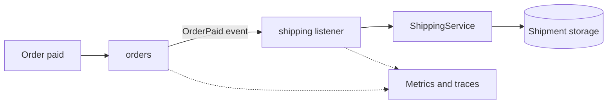
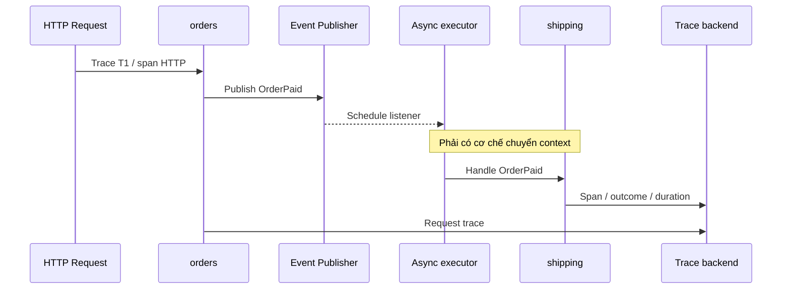

# Giám sát module mới sau khi thêm vào hệ thống

## 1. Vì sao cần giám sát ngay khi thêm module?

Trong ứng dụng Spring Boot chia theo **application module**, việc thêm một package, vài bean và một endpoint chưa chứng minh module mới đã tích hợp đúng. Module đó có thể vô tình phụ thuộc vào lớp nội bộ của module khác, phát ra sự kiện nhưng không có bên nhận, xử lý chậm sau khi triển khai, hoặc làm mất thông tin trace ở ranh giới bất đồng bộ.

Bài học nằm trong chương **Nhiều module** của học phần **SPRING_MODULITH_DOCUMENTATION_OBSERVABILITY**: dùng **Spring Modulith** để mô tả ranh giới application module, sinh tài liệu **module graph** và quan sát tương tác trong ứng dụng Spring Boot qua **Actuator**, **event metrics**, **tracing** và **context propagation**. Trọng tâm là thiết lập quy trình theo dõi **một module vừa được thêm** và có bằng chứng rằng kiến trúc cũng như hoạt động runtime vẫn đúng.

Sau bài này, bạn sẽ có thể:

1. Phát hiện module mới trong mô hình của Spring Modulith, xem ranh giới và quan hệ phụ thuộc bằng kiểm tra kiến trúc và sơ đồ.
2. Triển khai quan sát runtime cho điểm vào, điểm ra và các sự kiện của module; phân biệt cấu trúc tĩnh với lưu lượng thực tế.
3. Theo dõi sự kiện thành công, thất bại, xử lý lặp và thời gian xử lý, đồng thời liên kết log/trace qua ranh giới module và thread.
4. Đối chiếu trạng thái trước/sau khi triển khai module, xử lý lỗi phổ biến và xây dựng tiêu chí nghiệm thu có thể kiểm chứng.

### 1.1. Ba lớp bằng chứng cần thu thập

| Lớp | Câu hỏi | Công cụ / bằng chứng |
|---|---|---|
| Kiến trúc tĩnh | Spring Modulith có nhận ra module mới, các dependency có đúng quy tắc? | `ApplicationModules`, `verify()`, sơ đồ PlantUML, module tests |
| Hoạt động runtime | Request/event có chạy vào module, gọi những module nào, mất bao lâu? | Spring Modulith observability, Micrometer Observation, trace/span, log |
| Vận hành | Module có xử lý đúng, bị lỗi hay backlog sự kiện không? | Actuator health/metrics, metrics nghiệp vụ, Event Publication Registry, dashboard và cảnh báo |

**Quan trọng:** module graph thể hiện **quan hệ được phát hiện từ mã nguồn**, không chứng minh tất cả quan hệ đều được thực thi tại runtime. Ngược lại, trace chứng minh luồng đã chạy trong một phiên giao dịch, nhưng không thay thế việc xác minh toàn bộ quy tắc phụ thuộc.

## 2. Kịch bản: thêm module shipping vào ứng dụng bán hàng

Ứng dụng mẫu có package gốc `com.example.shop` và các module mặc định được nhận diện từ các **subpackage trực tiếp** của package gốc:

```text
com.example.shop
├── ShopApplication
├── orders
│   ├── api
│   │   ├── OrderPaid.java
│   │   └── package-info.java
│   └── internal
│       └── OrderService.java
├── catalog
│   └── ...
└── shipping                    <-- module mới
    ├── package-info.java
    ├── ShippingEventHandler.java
    ├── ShippingService.java
    └── internal
        └── ShipmentRepository.java
```

Trong thiết kế này:

- `orders` phát sự kiện công khai `OrderPaid` sau khi đơn được thanh toán.
- `shipping` lắng nghe sự kiện, tạo yêu cầu giao hàng đúng một lần theo `orderId`, ghi thời gian xử lý và trạng thái.
- `shipping` chỉ phụ thuộc vào API công khai của `orders`; không được truy cập trực tiếp `orders.internal.OrderService` hay repository nội bộ.
- Module mới phải xuất hiện trong sơ đồ và được tìm thấy trong trace của luồng xử lý sau khi triển khai.

Luồng lý tưởng:



Ví dụ dùng **event-driven integration** để giảm phụ thuộc trực tiếp. Nếu hệ thống cần gọi đồng bộ qua interface API, bạn vẫn áp dụng quy trình giám sát tương tự nhưng thời gian xử lý và lỗi sẽ nằm trên đường request thay vì transaction event listener.

## 3. Khai báo ranh giới module và kiểm tra phụ thuộc

### 3.1. Công khai API giữa các module

Spring Modulith cho phép khai báo named interface để module khác được phép phụ thuộc vào một phần API có chủ đích.

```java
// src/main/java/com/example/shop/orders/api/package-info.java
@org.springframework.modulith.NamedInterface("api")
package com.example.shop.orders.api;
```

Định nghĩa sự kiện thuộc API này:

```java
package com.example.shop.orders.api;

import java.time.Instant;
import java.util.UUID;

public record OrderPaid(UUID orderId, Instant paidAt) {}
```

Giới hạn phụ thuộc của module `shipping`:

```java
// src/main/java/com/example/shop/shipping/package-info.java
@org.springframework.modulith.ApplicationModule(
    allowedDependencies = "orders::api"
)
package com.example.shop.shipping;
```

Cú pháp `orders::api` nghĩa là phụ thuộc tới named interface `api` của module `orders`. Tên module được Spring Modulith suy ra theo cấu trúc ứng dụng trong ví dụ này; nếu thay đổi chiến lược phát hiện module hoặc tên module, phải cập nhật cấu hình tương ứng.

Các nguyên tắc:

- Một API liên module phải là **hợp đồng ổn định**. Không đưa các lớp repository hoặc entity nội bộ vào `orders.api` chỉ để vượt qua kiểm tra.
- Dependency tới `orders.internal` là dấu hiệu phá ranh giới, kể cả code vẫn biên dịch và ứng dụng vẫn chạy.
- Với ứng dụng có layout phức tạp, có thể dùng chiến lược phát hiện module hoặc cấu hình ranh giới khác. Hãy xác nhận module thực tế được phát hiện, không suy luận chỉ từ cấu trúc thư mục.
- Named interface và `allowedDependencies` thể hiện chính sách kiến trúc; chúng không phải cơ chế phân quyền runtime hoặc một sandbox để cô lập bộ nhớ.

### 3.2. Kiểm chứng tự động và tài liệu hóa module graph

Thêm `spring-modulith-starter-test` vào test dependencies, rồi kiểm tra cấu trúc:

```java
package com.example.shop;

import org.junit.jupiter.api.Test;
import org.springframework.modulith.core.ApplicationModules;

class ModuleArchitectureTests {

    @Test
    void architectureRemainsValid() {
        ApplicationModules modules =
            ApplicationModules.of(ShopApplication.class);

        modules.verify();
    }
}
```

`modules.verify()` kiểm tra các ràng buộc kiến trúc do Spring Modulith phát hiện, bao gồm những phụ thuộc bị cấm hoặc vòng phụ thuộc. Nếu thêm `shipping` dẫn đến vòng `orders → shipping → orders`, bạn cần đưa hợp đồng vào API thích hợp hoặc thay giao tiếp trực tiếp bằng sự kiện; không tắt kiểm tra để khiến build xanh.

Sinh sơ đồ tài liệu bằng `Documenter` (cần module tài liệu hóa/đồ thị tương ứng trong test classpath):

```java
package com.example.shop;

import org.junit.jupiter.api.Test;
import org.springframework.modulith.core.ApplicationModules;
import org.springframework.modulith.docs.Documenter;

class ModuleDocumentationTests {

    @Test
    void generateArchitectureDocumentation() {
        ApplicationModules modules =
            ApplicationModules.of(ShopApplication.class);

        new Documenter(modules)
            .writeModulesAsPlantUml()
            .writeIndividualModulesAsPlantUml();
    }
}
```

Các API trên mang tính minh họa theo các phiên bản Spring Modulith có `Documenter`. Đối chiếu dependency tương ứng với phiên bản Spring Modulith thực tế (thường dùng `spring-modulith-docs` trong test) và kiểm tra nơi build xuất các artifact. Có thể dùng PlantUML để render sơ đồ PNG/SVG trong tài liệu kiến trúc, hoặc dùng tài liệu thành phần mà `Documenter` hỗ trợ ở phiên bản dự án.

**Tiêu chí đạt:** đồ thị có node `shipping`; cạnh hợp lệ hướng tới `orders::api` hoặc quan hệ xuất phát từ hợp đồng đã định nghĩa; không xuất hiện phụ thuộc tới `orders.internal`. Lưu đồ thị phát sinh vào kết quả CI để có thể so sánh với baseline trước khi thêm module.

### 3.3. Chạy kiểm thử riêng module

`@ApplicationModuleTest` giúp nạp Spring test context tập trung vào module đang kiểm tra. Trong cùng package module `shipping`:

```java
package com.example.shop.shipping;

import org.junit.jupiter.api.Test;
import org.springframework.modulith.test.ApplicationModuleTest;
import org.springframework.modulith.test.ApplicationModuleTest.BootstrapMode;

@ApplicationModuleTest(mode = BootstrapMode.DIRECT_DEPENDENCIES)
class ShippingModuleTests {

    @Test
    void moduleContextStarts() {
        // Context được tạo cho shipping và các dependency trực tiếp.
        // Thêm assert trên ShippingService / event handler tùy hệ thống.
    }
}
```

Kiểm thử context chỉ chứng minh cấu hình có thể khởi động. Cần bổ sung kiểm thử về kết quả xử lý sự kiện, giao dịch, quyền truy cập và quy tắc nghiệp vụ. Dùng `STANDALONE` khi module đủ độc lập; `DIRECT_DEPENDENCIES` khi cần các phụ thuộc trực tiếp; `ALL_DEPENDENCIES` khi luồng tích hợp yêu cầu đầy đủ đồ thị phụ thuộc.

## 4. Trang bị khả năng quan sát cho module mới

### 4.1. Chọn dependency phù hợp với stack

Ví dụ Gradle Kotlin DSL (thay `<compatible-version>` bằng bản Spring Modulith tương thích với Spring Boot/JDK của dự án; không trộn các bản major không tương thích):

```kotlin
dependencies {
    implementation(platform(
        "org.springframework.modulith:spring-modulith-bom:<compatible-version>"
    ))

    implementation("org.springframework.modulith:spring-modulith-starter-core")
    implementation("org.springframework.modulith:spring-modulith-starter-insight")
    implementation("org.springframework.boot:spring-boot-starter-actuator")

    // Chọn một tracing bridge/exporter tương thích với Spring Boot.
    implementation("io.micrometer:micrometer-tracing-bridge-otel")
    runtimeOnly("io.opentelemetry:opentelemetry-exporter-otlp")

    testImplementation("org.springframework.modulith:spring-modulith-starter-test")
    testImplementation("org.springframework.modulith:spring-modulith-docs")
}
```

`spring-modulith-starter-insight` cung cấp tích hợp quan sát module trong những phiên bản có starter này. Nó phối hợp với Spring Boot Actuator/Micrometer để quan sát các tương tác qua ranh giới module. **Không giả định mọi method nội bộ đều tạo span**: phụ thuộc vào instrumented bean, kiểu gọi, cấu hình observation và sampling.

Các nhóm thành phần cần phân biệt:

| Thành phần | Nhiệm vụ | Không tự đảm bảo |
|---|---|---|
| Spring Modulith module model | Phân vùng code và quan hệ module | Health hoặc hiệu năng runtime |
| Spring Modulith observability | Quan sát tương tác module qua bean/framework được hỗ trợ | Bao phủ mọi method, mọi thread và giao tiếp ngoài JVM |
| Spring Boot Actuator | Endpoint để lấy health, metrics và thông tin quản trị | Dashboard hoặc cảnh báo tự động |
| Micrometer Observation/Tracing | Ghi nhận observation, span và trace context | Xuất trace nếu chưa có tracing bridge/exporter |
| Micrometer MeterRegistry | Metrics đếm, timer, gauge | Biết trạng thái nghiệp vụ nếu bạn chưa instrument |
| Event Publication Registry | Theo dõi và khôi phục các event publication được hỗ trợ | Exactly-once delivery cho mọi loại event và side effect |

Tùy phiên bản, một số starter mang theo dependency bắc cầu; đối chiếu dependency graph để tránh trùng bridge/exporter hoặc metric backend.

### 4.2. Actuator và cấu hình theo môi trường

Ví dụ cấu hình an toàn để phát triển/quan sát ở môi trường có lớp bảo vệ phù hợp:

```yaml
management:
  endpoints:
    web:
      exposure:
        include: health,info,metrics,prometheus
  endpoint:
    health:
      probes:
        enabled: true
  tracing:
    sampling:
      probability: 0.1
```

- `/actuator/health`: kiểm tra trạng thái ứng dụng; nếu dùng Kubernetes có thể dùng các health probe theo cấu hình.
- `/actuator/metrics`: khám phá meter **thực sự** được đăng ký; `/actuator/metrics/{meterName}` tra cứu một meter.
- `/actuator/prometheus`: chỉ có nếu thêm Micrometer Prometheus registry tương thích.
- Traces cần tracing bridge và exporter/collector hoạt động; lấy mẫu 10% chỉ là ví dụ, phải điều chỉnh theo lưu lượng và nhu cầu tìm lỗi.

Một số phiên bản/tích hợp Spring Modulith còn có Actuator endpoint thể hiện cấu trúc module, thường được biết với tên `modulith` khi dependency Actuator tương ứng hiện diện. Hãy kiểm tra danh sách endpoint được đăng ký và tài liệu phiên bản ứng dụng trước khi mở public. **Không suy luận rằng endpoint runtime nào cũng được tự động expose chỉ vì đã thêm core starter.**

Không mở toàn bộ actuator endpoints ra Internet. Đặt chúng trên mạng quản trị/port quản trị hoặc bảo vệ bằng Spring Security, TLS và phân quyền phù hợp. Tránh cấu hình `show-details: always` trên môi trường public khi thông tin nội bộ không cần công khai.

### 4.3. Thiết lập baseline trước khi triển khai

Khi hệ thống chưa có `shipping`, lưu lại:

- Đồ thị module, danh sách phụ thuộc và kết quả `modules.verify()`.
- Baseline request rate, error rate và latency của các luồng `orders` đang chạy.
- Event publication pending/failed đã có, nếu ứng dụng sử dụng Event Publication Registry.
- Lưu lượng trace và tỷ lệ sampling; mức log; phiên bản ứng dụng và cấu hình collector.

Sau khi thêm module, lấy lại cùng khoảng thời gian và điều kiện tải tương đương. Nếu có traffic theo giờ, so sánh cùng thời điểm hoặc cùng cohort; một khoảng ngắn sau deploy có thể không đủ dữ liệu để kết luận.

## 5. Quan sát luồng xử lý sự kiện qua module shipping

### 5.1. Phát sự kiện từ module orders

Event được công bố sau khi logic cập nhật đơn hàng đã thực hiện trong transaction nghiệp vụ:

```java
package com.example.shop.orders.internal;

import com.example.shop.orders.api.OrderPaid;
import java.time.Instant;
import java.util.UUID;
import org.springframework.context.ApplicationEventPublisher;
import org.springframework.stereotype.Service;
import org.springframework.transaction.annotation.Transactional;

@Service
class OrderPaymentService {

    private final ApplicationEventPublisher publisher;
    private final OrderRepository orders;

    OrderPaymentService(
            ApplicationEventPublisher publisher,
            OrderRepository orders) {
        this.publisher = publisher;
        this.orders = orders;
    }

    @Transactional
    public void markPaid(UUID orderId) {
        orders.markPaid(orderId);
        publisher.publishEvent(new OrderPaid(orderId, Instant.now()));
    }
}
```

`OrderRepository` và cách chuyển trạng thái là nghiệp vụ minh họa. Trong triển khai thực tế, cần chống phát sự kiện trùng do người gọi retry hoặc callback thanh toán lặp. Nếu business transaction rollback, phải hiểu rõ giai đoạn phát và nhận event cũng như cách Event Publication Registry ghi nhận publication.

### 5.2. Nhận sự kiện và thêm chỉ số nghiệp vụ

`@ApplicationModuleListener` là cách thuận tiện để định nghĩa asynchronous transactional event listener giữa các module Spring Modulith. Ví dụ sau kết hợp `ObservationRegistry` và `MeterRegistry` để đo riêng quá trình xử lý:

```java
package com.example.shop.shipping;

import com.example.shop.orders.api.OrderPaid;
import io.micrometer.core.instrument.MeterRegistry;
import io.micrometer.core.instrument.Timer;
import io.micrometer.observation.Observation;
import io.micrometer.observation.ObservationRegistry;
import org.springframework.modulith.events.ApplicationModuleListener;
import org.springframework.stereotype.Service;

@Service
class ShippingEventHandler {

    private final ShippingService shipping;
    private final ObservationRegistry observations;
    private final MeterRegistry metrics;

    ShippingEventHandler(
            ShippingService shipping,
            ObservationRegistry observations,
            MeterRegistry metrics) {
        this.shipping = shipping;
        this.observations = observations;
        this.metrics = metrics;
    }

    @ApplicationModuleListener
    void on(OrderPaid event) {
        Timer.Sample sample = Timer.start(metrics);
        String outcome = "success";

        Observation observation = Observation.start(
            "app.shipping.handle-order-paid", observations);
        observation.lowCardinalityKeyValue("module", "shipping");

        try (Observation.Scope scope = observation.openScope()) {
            // Repository cần ràng buộc unique(orderId) hoặc cơ chế
            // idempotency tương đương, vì event có thể được nhận lại.
            shipping.createShipmentIfAbsent(event.orderId());
        } catch (RuntimeException ex) {
            outcome = "error";
            observation.error(ex);
            throw ex; // Không nuốt lỗi: registry/retry phải thấy thất bại.
        } finally {
            observation.stop();
            sample.stop(Timer.builder("app.module.shipping.processing")
                .tag("operation", "handle-order-paid")
                .tag("outcome", outcome)
                .register(metrics));
        }
    }
}
```

Vì được gọi từ module khác, observer do Spring Modulith thiết lập có thể bổ sung thông tin ranh giới module. Observation tự tạo trong ví dụ giúp có tên và ngữ nghĩa nghiệp vụ thống nhất kể cả khi mức tự động instrument khác nhau giữa phiên bản.

**Cần chú ý:**

- Không gắn `orderId`, `traceId`, email, phone, timestamp hay exception message làm **metric tag**: cardinality sẽ tăng theo số đơn và gây bùng nổ series. Dùng các tag hữu hạn như `operation` và `outcome`.
- Đặt `orderId` vào log có kiểm soát hoặc span attribute nếu chính sách dữ liệu cho phép. Nếu hệ thống có yêu cầu riêng về dữ liệu nhạy cảm, dùng mã đã che/ẩn danh.
- `success` trong ví dụ nghĩa là lời gọi method hoàn thành không ném `RuntimeException`; **không tự đồng nghĩa** giao hàng đã được vận chuyển thành công. Để đo trạng thái nghiệp vụ, thêm metric `shipment.created`, `shipment.failed` hay query repository.
- `Timer` ghi nhận một measurement ngay cả khi code ném lỗi. Sau đó bạn có thể quan sát latency theo outcome và phát hiện thất bại nhanh bất thường hoặc tác vụ treo.
- Nếu cần phân biệt nghiệp vụ `duplicate_skipped` với `created`, `ShippingService` nên trả enum kết quả và tạo tag có tập giá trị hữu hạn. Tránh coi việc bỏ qua trùng là lỗi.

### 5.3. Event Publication Registry và độ tin cậy

Spring Modulith có **Event Publication Registry** để theo dõi việc giao sự kiện tới những transactional event listener được hỗ trợ. Khi cấu hình phần lưu trữ tương ứng (ví dụ JDBC/JPA, tùy stack) và transaction manager đúng, registry có thể ghi nhận publication, đánh dấu đã xử lý và hỗ trợ resubmission những publication chưa hoàn tất.

Hãy phân biệt các khái niệm:

| Khái niệm | Cần kiểm tra |
|---|---|
| Event được phát | `ApplicationEventPublisher.publishEvent(...)` đã được gọi trong transaction phù hợp |
| Event được đăng ký | Registry đã lưu publication cho listener được hỗ trợ và storage/transaction đúng |
| Listener được kích hoạt | Spring đã giao event tới đúng listener; lịch sử log/trace có dấu vết |
| Listener hoàn tất | Registry ghi nhận thành công, không còn publication pending tương ứng |
| Hiệu ứng nghiệp vụ đúng | Shipment được tạo một lần; không gửi email/vận đơn trùng khi retry |

Registry không tự làm cho side effect thành **exactly once**. Chạy lại publication hoặc retry sau lỗi mạng có thể khiến listener thấy sự kiện thêm lần nữa; cần **idempotent consumer** và khóa duy nhất trong dữ liệu.

Nếu tích hợp registry, phải chọn module lưu trữ thích hợp với phiên bản Spring Modulith đang dùng (chẳng hạn starter hỗ trợ JDBC hoặc JPA), thiết lập schema/transaction và kiểm thử crash/restart. Hãy lấy pending/incomplete publications từ **repository API thực tế của phiên bản** hoặc metric tự xây từ dữ liệu registry, không mặc định đoán có một endpoint Actuator hoặc tên metric có sẵn cho mọi phiên bản.

### 5.4. Định nghĩa bộ metric tối thiểu

| Metric | Loại | Mục đích | Thu thập |
|---|---|---|---|
| `app.module.shipping.processing` | Timer | Latency xử lý `OrderPaid` theo `outcome` | Code ở mục 5.2 |
| `app.module.shipping.created` | Counter | Số shipment mới được tạo | Tăng trong service khi insert thành công |
| `app.module.shipping.duplicate` | Counter | Event hợp lệ bị bỏ qua vì đã có shipment | Tăng trong nhánh idempotency |
| `app.module.shipping.pending` | Gauge | Số publication chưa hoàn tất hoặc công việc chờ | Đọc từ repository/queue có thẩm quyền |
| `app.module.shipping.failures` | Counter | Lỗi được phân loại có giới hạn | Instrument exception/handler |

Đây là **tên metric đề xuất do ứng dụng tự định nghĩa**, không phải lời khẳng định Spring Modulith tự phát hành những tên này. Khi sử dụng Prometheus, tên có thể được chuyển đổi theo quy ước registry (ví dụ timer có series `_count` và `_sum`); kiểm tra output thực tế.

Đừng dùng mỗi counter lỗi để phát hiện backlog. Event thất bại nhưng tiếp tục retry cần thêm **pending age** (độ tuổi sự kiện chưa hoàn tất) và **tỷ lệ hoàn tất**; một sự kiện treo lâu có thể đáng chú ý hơn một spike lỗi thoáng qua.

## 6. Tracing và context propagation qua ranh giới module

### 6.1. Phân biệt tương tác đồng bộ và bất đồng bộ

Trong cùng một thread, nhiều instrumentation của Micrometer tự đọc context hiện tại, nên span con thường có thể liên hệ với span cha. Khi `@ApplicationModuleListener` chuyển xử lý sang executor/thread khác, các biến dạng `ThreadLocal` (MDC, trace context, security context) **không được kế thừa đáng tin cậy theo mặc định**.



Nếu mất context, dấu hiệu thường thấy là shipping có trace mới rời rạc, log thiếu `traceId` hoặc event handler có các span không liên hệ với request đã phát sinh event. Tuy vậy, một số luồng xử lý message được thiết kế bất đồng bộ nên dùng **span link** thay vì quan hệ parent-child trực tiếp; đánh giá theo hợp đồng tracing đã chọn.

### 6.2. Dùng ContextPropagatingTaskDecorator

Với Spring Framework hỗ trợ `ContextPropagatingTaskDecorator` (Spring Framework 6.1+), có thể gắn decorator vào executor dùng cho asynchronous event handling:

```java
package com.example.shop;

import org.springframework.context.annotation.Bean;
import org.springframework.context.annotation.Configuration;
import org.springframework.core.task.support.ContextPropagatingTaskDecorator;
import org.springframework.scheduling.concurrent.ThreadPoolTaskExecutor;

@Configuration
class AsyncObservationConfig {

    @Bean(name = "applicationTaskExecutor")
    ThreadPoolTaskExecutor applicationTaskExecutor() {
        ThreadPoolTaskExecutor executor = new ThreadPoolTaskExecutor();
        executor.setCorePoolSize(4);
        executor.setMaxPoolSize(8);
        executor.setQueueCapacity(200);
        executor.setThreadNamePrefix("modulith-event-");
        executor.setTaskDecorator(new ContextPropagatingTaskDecorator());
        executor.initialize();
        return executor;
    }
}
```

Đây là **một lựa chọn cấu hình**, không phải luôn cần tạo bean tên `applicationTaskExecutor`. Tên executor được event listener hay `@Async` sử dụng phụ thuộc cấu hình Spring Boot/`AsyncConfigurer`/qualifier của dự án; phải xác minh listener thực sự chạy trên executor đã gắn decorator. Nếu framework đã cấu hình executor propagation, tránh tạo thêm bean gây thay đổi điều phối thread.

Khi dùng Micrometer Context Propagation, phải có `ThreadLocalAccessor` phù hợp cho các context cần mang qua thread và kiểm thử việc capture/restore. Không tự ý truyền toàn bộ security context hoặc thông tin nhạy cảm sang tác vụ nền khi không có yêu cầu nghiệp vụ và chính sách rõ ràng.

### 6.3. Test việc nối trace và MDC

Một bài kiểm thử tracing có ý nghĩa cần:

1. Gửi request có trace context hoặc tạo parent observation.
2. Trong `orders`, phát `OrderPaid` và để `shipping` chạy trên executor thực tế.
3. Bắt observation/span do test tracer/collector nhận được; xác minh mối liên hệ với parent hoặc span link theo cấu hình.
4. Đối chiếu log của `orders` và `shipping` theo traceId/correlationId, xác minh không bị mất context giữa các task.
5. Chạy thêm hai sự kiện song song với ID khác nhau và chắc chắn metadata không bị rò giữa hai lần xử lý trên thread pool.

Không dùng mỗi MDC như bằng chứng về correctness của tracing: log có thể giữ cùng traceId do tự gán, nhưng trace backend vẫn thiếu span, hoặc ngược lại.

### 6.4. Nên tìm gì trên hệ thống trace?

Với một đơn thanh toán cụ thể, tìm:

- Request HTTP hoặc message consumer khởi phát thao tác thanh toán.
- Span thao tác của `orders` và span xử lý `shipping` nếu instrumentation hiện tại tạo ra.
- Thời gian và trạng thái của từng đoạn; exception event khi thất bại.
- Mã nghiệp vụ có kiểm soát để tra cứu một event cụ thể, nếu được phép ghi vào span attribute.
- Tên module trong các tên operation/attribute theo phiên bản instrumentation, thay vì đoán một attribute key cố định.

Nếu trace chỉ có parent request mà không có `shipping`, kiểm tra lần lượt: listener có thực chạy không, bridge/exporter có được cấu hình không, sampling có drop không, propagation có được cấu hình đúng executor không, rồi mới kết luận lỗi instrumentation module.

## 7. Quy trình giám sát khi triển khai module mới

### 7.1. Trước merge: kiểm tra kiến trúc và hành vi

**Bước 1 — Đọc module graph.** Xác nhận node `shipping`, các quan hệ được phép, không có vòng phụ thuộc và không gọi API nội bộ. Lưu bản đồ vào artifact CI để review thay đổi kiến trúc trong pull request.

**Bước 2 — Chạy module verification.** `ApplicationModules.verify()` phải PASS. Nếu FAIL, mở báo cáo cụ thể và xử lý dependency gây lỗi; không thay thế bằng nhận xét chủ quan rằng module vẫn chạy.

**Bước 3 — Chạy module test.** Kiểm thử handler tạo shipment từ `OrderPaid`, bỏ qua event trùng và phản ứng đúng khi repository lỗi. Với integration test, kiểm tra transaction và registry publication; mock test đơn thuần không thay thế được kiểm thử commit/rollback.

**Bước 4 — Định nghĩa chỉ số.** Ghi lại tên meter và tag thực tế, bảng dashboard, trigger cảnh báo; xác định trường hợp `success` khác với trạng thái giao hàng cuối cùng.

### 7.2. Sau deploy: xác minh trong môi trường quan sát

**Bước 5 — Kiểm tra runtime startup.** Spring Boot khởi động, bean handler được đăng ký, actuator health/readiness OK. Khi cần kiểm chứng cấu trúc runtime, kiểm tra endpoint quản trị/module report **nếu có**; không mở endpoint nhạy cảm chỉ để phục vụ kiểm tra.

**Bước 6 — Bắn traffic có kiểm soát.** Phát một `OrderPaid` hợp lệ, một sự kiện trùng, một sự kiện gây lỗi mô phỏng; truy vết ID của từng luồng. So sánh cả database và trace/metrics, không chỉ HTTP response.

**Bước 7 — Kiểm tra dashboard.** Meter `app.module.shipping.processing` xuất hiện ở `/actuator/metrics`; latency và outcome đúng; counter tạo shipment tăng theo số bản ghi thực sự được tạo; backlog/failed publication phản ánh đúng trạng thái.

**Bước 8 — Kiểm tra propagation.** Xác minh đường trace từ `orders` sang `shipping` hoặc span link được chấp nhận; log đủ thông tin tra cứu xuyên thread. Gửi nhiều event đồng thời để phát hiện rò context.

**Bước 9 — Quan sát giai đoạn rollout.** Theo dõi baseline và các ngưỡng trong một cửa sổ hợp lý với tần suất sự kiện. Khi bất thường, sử dụng metric → trace → log → trạng thái registry để xác định lỗi trước khi thay đổi kiến trúc.

### 7.3. Một dashboard tối thiểu

Một dashboard vận hành cho module mới nên có 4 vùng:

| Vùng | Biểu đồ / dữ liệu | Giải đáp |
|---|---|---|
| Lưu lượng | Event vào, shipment created, duplicate skipped theo phút | Module có được sử dụng thật không? |
| Chất lượng | Error rate và pending/incomplete publications | Có lỗi, kẹt hoặc retry liên tục không? |
| Độ trễ | p50/p95/p99 processing duration, pending age | Chậm trong xử lý hay chờ đến lượt? |
| Tương tác | Trace samples, module dependency graph phiên bản hiện tại | Module gọi ai và lỗi ở đoạn nào? |

Gợi ý **ngưỡng minh họa**, cần hiệu chỉnh bằng baseline và SLO của hệ thống:

- Tỷ lệ lỗi xử lý `OrderPaid` trên 1% trong 10 phút khi có tối thiểu 100 sự kiện: cảnh báo điều tra.
- p95 latency xử lý tăng hơn 2 lần so với baseline cùng mức tải: kiểm tra DB, lock hoặc phụ thuộc.
- Sự kiện pending lâu hơn 15 phút: cảnh báo dù tổng error rate chưa cao.
- Module mới tạo dependency không được phép: thất bại ngay ở CI.

Dùng **request count floor** để tránh alert sai khi có 1 lỗi trong 1 request. Với hệ thống ít giao dịch, theo dõi số lượng tuyệt đối và pending age có thể hữu ích hơn tỷ lệ phần trăm.

## 8. Các tình huống sự cố và cách phân tích

### 8.1. Module mới không xuất hiện trong module graph

**Dấu hiệu:** test kiến trúc chạy nhưng báo cáo không có `shipping`.

Kiểm tra lớp entrypoint `ShopApplication` thuộc package gốc đúng không; `shipping` có nằm dưới root phù hợp với chiến lược phát hiện module không; code có dùng custom detection strategy hay nested module không; `ApplicationModules.of(...)` đang nhận đúng Spring Boot application class không.

Không kết luận module bị thiếu chỉ vì endpoint actuator không hiển thị, vì endpoint có thể chưa được cài hoặc chưa được expose.

### 8.2. Module xuất hiện nhưng `verify()` thất bại

**Dấu hiệu:** dependency cycle hoặc truy cập API internal của `orders`.

Sửa bằng cách chuyển hợp đồng dùng chung vào đúng API/named interface, giới hạn dependency và tách phối hợp bằng sự kiện nếu phù hợp. Kiểm tra dependency được phép thay vì mở rộng `allowedDependencies` một cách vô điều kiện.

### 8.3. Listener không nhận `OrderPaid`

**Dấu hiệu:** thấy event được phát nhưng shipping không tạo shipment, meter không tăng.

Kiểm tra bean được Spring quản lý, annotation `@ApplicationModuleListener`, loại sự kiện, transaction đã commit, executor còn thread, bean listener có được nạp trong context, và cơ chế event publication có lưu được hay không. Phân biệt event được publish nhưng transaction rollback với event được giao và listener ném lỗi.

### 8.4. Event hoàn tất nhiều lần hoặc shipment bị trùng

**Dấu hiệu:** event retry hoặc duplicate publication làm tăng bản ghi vận chuyển.

Đặt khóa unique cho `orderId` hoặc business event ID, dùng upsert/insert-if-absent trong transaction, tránh side effect ngoài DB trước khi xác nhận idempotency. Tách metric `received`, `created` và `duplicate`; chỉ số nhận event có thể cao hơn số shipment được tạo.

### 8.5. Metric có dữ liệu nhưng trace không nối được

Kiểm tra tracing bridge/exporter, sampling, exporter endpoint, context propagation trên executor và các adapter message transport. Micrometer metrics và tracing là hai đường quan sát khác nhau: một timer có thể ghi dữ liệu khi trace bị sample out.

### 8.6. Actuator health xanh nhưng nghiệp vụ hỏng

Health cho biết trạng thái hệ thống theo `HealthIndicator` được cấu hình, không chứng minh mọi event đang xử lý. Tạo chỉ số hoặc health check riêng cho thành phần thực sự quan trọng khi cần, tránh để health phụ thuộc vào thao tác tốn kém hoặc một truy vấn backlog toàn bảng mỗi lần probe.

### 8.7. Bảng xử lý sự cố nhanh

| Triệu chứng | Nơi kiểm tra đầu tiên | Giả thuyết cần loại trừ |
|---|---|---|
| Không thấy `shipping` trong PlantUML | `ApplicationModules.of(...)`, detection strategy | Sai package hoặc mô hình module |
| `verify()` fail | Violation report | Vòng phụ thuộc, truy cập internal package |
| Không có meter mới | `/actuator/metrics`, code instrumentation | Handler chưa chạy, registry chưa đăng ký |
| Không có trace module | Tracing bridge, exporter, sampling | Không gửi span hoặc span bị drop |
| Trace bị tách sau `@ApplicationModuleListener` | Executor và context decorator | Mất context khi qua thread |
| Backlog tăng nhưng ít lỗi | Event Publication Registry, độ tuổi pending | Listener chưa chạy, executor bão hòa, transaction không hoàn tất |
| Nhiều shipment cho cùng order | Unique constraint, idempotency | Event redelivery/retry tạo side effect lặp |
| Grafana có quá nhiều series | Metric tags | Đưa ID động vào low-cardinality labels |

## 9. Kiểm thử tổng hợp có thể chấm được

Thực hiện một tình huống hoàn chỉnh từ `orders` đến `shipping`. Nên chuẩn bị cơ sở dữ liệu thử nghiệm, tracing backend hoặc in-memory test tracer, Micrometer registry và event listener thật. Kiểm tra bằng điều kiện đầu vào và bằng chứng đầu ra cụ thể.

| Test | Hành động | Bằng chứng bắt buộc |
|---|---|---|
| T1 — module discovery | Chạy `ApplicationModules.of(...).verify()` | PASS, có module `shipping` |
| T2 — ranh giới | Cho `shipping` import lớp trong `orders.internal` | Kiểm tra kiến trúc phát hiện vi phạm (test âm) |
| T3 — luồng chuẩn | Publish `OrderPaid(id=A)` trong transaction commit | 1 shipment A, có measurement success |
| T4 — idempotency | Publish lại cùng event A | Vẫn 1 shipment A, có chỉ số duplicate |
| T5 — lỗi repository | Mô phỏng lỗi khi tạo shipment B | Không báo success sai; event incomplete có thể được quan sát/khôi phục theo cấu hình |
| T6 — rollback | Rollback transaction phát event C | Listener transactional sau commit không tạo shipment C |
| T7 — context propagation | Publish A và B đồng thời qua executor thật | Trace liên kết đúng; log không lẫn trace IDs |
| T8 — regression | Chạy luồng cũ của `orders` và `catalog` | Không tăng lỗi, latency hoặc dependency ngoài dự kiến |

Với test âm T2, hãy đưa vi phạm vào một thay đổi kiểm thử tạm/fixture, xác nhận `verify()` phát hiện rồi bỏ fixture. Không commit dependency vi phạm vào ứng dụng.

### 9.1. Những gì **không** đủ để tuyên bố thành công

- Build xanh nhưng không chạy module verification.
- Sơ đồ có `shipping` nhưng không có một request/event nào đi qua module.
- HTTP 200 cho lệnh thanh toán, trong khi transaction listener bất đồng bộ chưa hoàn tất.
- Log có `orderId` nhưng không có liên hệ trace xuyên module.
- Counter `processed` tăng, nhưng database có hai shipment cùng một order.
- Chỉ nhìn `/actuator/health` mà không đo event failures hoặc pending age.

### 9.2. Tiêu chí nghiệm thu cuối cùng

**Kiến trúc:** Spring Modulith phát hiện `shipping`; module graph được sinh, review và lưu; `verify()` PASS; chỉ sử dụng interface liên module được phép.

**Hành vi:** `OrderPaid` tạo shipment một lần; khi thiếu điều kiện, retry hoặc rollback cho kết quả đúng; registry (nếu được bật) có trạng thái publication giải thích được.

**Quan sát:** có metric lưu lượng, thời gian xử lý, lỗi, duplicate và pending; trace/log truy được ít nhất một luồng `orders → shipping`, kể cả qua executor; không sử dụng ID động làm metric tag.

**Vận hành:** Actuator và exporter đáp ứng cấu hình môi trường; dashboard/alert có baseline, ngưỡng và cách phản ứng; cơ chế quan sát không phơi bày thông tin bí mật hoặc endpoint quản trị ra công khai.

## 10. Câu hỏi tự kiểm tra và mở rộng

1. Tại sao một module xuất hiện trong sơ đồ PlantUML vẫn có thể đang **không nhận sự kiện** nào khi chạy?
2. Nếu `@ApplicationModuleListener` được gọi lại sau lỗi, điều kiện nào giúp tạo đúng một shipment?
3. Vì sao `traceId` không nên là tag của `Timer`, trong khi lại hữu ích khi truy vấn trace/log?
4. Một span `shipping` có trace ID khác request gốc; những bước xác minh nào cần thực hiện trước khi kết luận lỗi Spring Modulith?
5. Bạn sẽ đặt cảnh báo thế nào nếu lưu lượng rất thấp nhưng có một event pending suốt nhiều giờ?
6. Việc thay `allowedDependencies` thành danh sách rất rộng có thể che giấu vấn đề kiến trúc gì?

**Bài mở rộng:** thêm module `notifications` nhận `ShipmentCreated` từ `shipping`, tạo graph mới, đo thời gian từ `OrderPaid` đến `ShipmentCreated` và từ `ShipmentCreated` đến thông báo được gửi, quan sát các span bất đồng bộ và xử lý retry không gửi thông báo trùng. So sánh quan hệ kiến trúc và luồng runtime ở hai bản triển khai.

### Tài liệu đọc thêm

- Spring Modulith Reference: https://docs.spring.io/spring-modulith/reference/
- Spring Modulith — Fundamentals, Application Modules và Verifying Application Module Structure: https://docs.spring.io/spring-modulith/reference/fundamentals.html
- Spring Modulith — Production-ready Features / Observability: https://docs.spring.io/spring-modulith/reference/production-ready.html
- Spring Boot Actuator and Micrometer Observability: https://docs.spring.io/spring-boot/reference/actuator/observability.html
- Spring Framework — `ContextPropagatingTaskDecorator`: https://docs.spring.io/spring-framework/docs/current/javadoc-api/org/springframework/core/task/support/ContextPropagatingTaskDecorator.html
