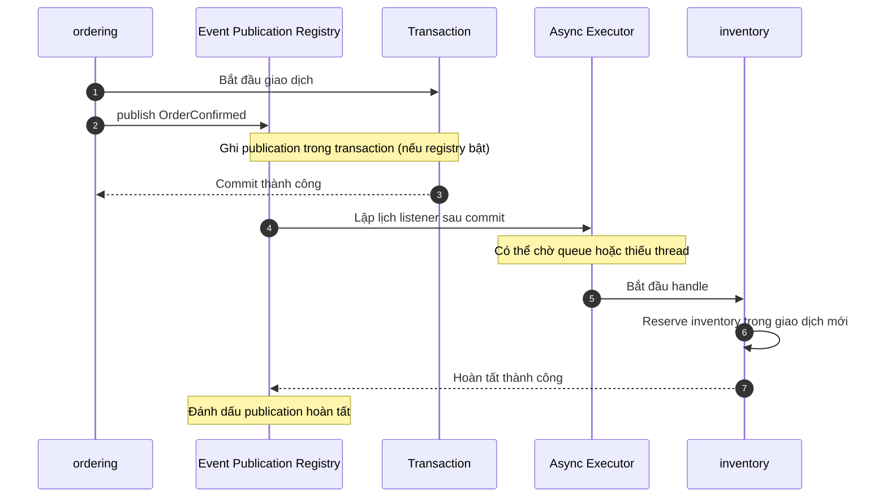

# Khoảng cách thời gian giữa publish và handle

> **Chương:** Sự kiện bất đồng bộ  
> **Phạm vi:** Spring Modulith Documentation & Observability (`SPRING_MODULITH_DOCUMENTATION_OBSERVABILITY`)  
> **Trọng tâm:** Đo, giải thích và kiểm soát độ trễ từ khi một application module phát sự kiện đến khi application module khác bắt đầu xử lý.

## 1. Bài toán: publish thành công nhưng handler chưa chạy

Trong ứng dụng Spring Boot thiết kế theo module, `ordering` có thể phát sự kiện `OrderConfirmed` và `inventory` đăng ký một listener để giữ hàng. Nhờ sự kiện, `ordering` không phải gọi trực tiếp dịch vụ nội bộ của `inventory`; ranh giới module rõ ràng hơn và xử lý sau đó có thể diễn ra bất đồng bộ.

Tuy nhiên, **publish không đồng nghĩa handle đã hoàn tất**, và thậm chí không đồng nghĩa handler đã bắt đầu. Một yêu cầu HTTP có thể nhận phản hồi xác nhận đơn hàng lúc 09:00:00, trong khi `inventory` chỉ bắt đầu xử lý lúc 09:00:02 vì đang chờ giao dịch commit, chờ executor có thread rảnh hoặc chờ ứng dụng khôi phục sau sự cố.

Khoảng cách này đáng đo vì nó tác động đến tính cập nhật của dữ liệu giữa các module:

- Người dùng thấy “đơn đã xác nhận” nhưng số lượng tồn kho chưa cập nhật.
- Một listener mất nhiều thời gian để **được chạy** dù logic của nó thực thi nhanh.
- Metric “đã publish bao nhiêu event” tăng đều, trong khi backlog hoặc số event chưa được xử lý cũng tăng.
- Các span truy vết của publisher và handler có thể nằm trên thread khác hoặc thuộc những lần chạy khác nhau, nên khó nhận ra điểm chậm.

Mục tiêu của bài là định nghĩa thời gian đúng, đo được bằng metric, giải thích qua trace/log, rồi tìm nguyên nhân khi độ trễ lớn. Đây là **quan sát hành vi runtime** của ranh giới application module, bổ sung cho module graph và tài liệu cấu trúc được Spring Modulith tạo ra.

## 2. Mô hình thời gian: cần đo bốn mốc

Dùng các mốc sau cho **một lần phát sự kiện**:

| Mốc | Ký hiệu | Ý nghĩa |
|---|---|---|
| Publish | `t_publish` | Lúc publisher gọi `publishEvent(...)`, hoặc thời điểm ứng dụng gắn vào payload ngay trước lệnh gọi |
| Commit | `t_commit` | Giao dịch nghiệp vụ thành công; listener `AFTER_COMMIT` đủ điều kiện chạy |
| Handle start | `t_start` | Listener bắt đầu phương thức xử lý trên thread thực thi |
| Handle end | `t_end` | Listener kết thúc lần xử lý (thành công hoặc thất bại) |

Một mốc phụ `t_dispatch` là lúc tác vụ được đưa vào executor; muốn tính chính xác thời gian chờ hàng đợi phải đo mốc này tại executor hoặc thông qua instrument tương ứng.

```text
Thread giao dịch nghiệp vụ                         Thread xử lý bất đồng bộ
    |
    |--- t_publish: publishEvent(event)
    |    (Event Publication Registry ghi nhận trong transaction nếu bật)
    |
    |--- t_commit: commit thành công
    |       |
    |       +---- lập lịch / xếp hàng vào executor -----+
    |                                                  |
    |                                                  +-- t_start: handler bắt đầu
    |                                                      |  xử lý nghiệp vụ
    |                                                  +-- t_end: hoàn tất / thất bại
```

Các công thức đo:

\[
L_{\text{publish→start}} = t_{\text{start}} - t_{\text{publish}}
\]

\[
L_{\text{publish→end}} = t_{\text{end}} - t_{\text{publish}}
\]

\[
T_{\text{handle}} = t_{\text{end}} - t_{\text{start}}
\]

Khi có đủ mốc phụ, có thể tiếp tục chia nhỏ `L_publish→start` thành thời gian từ publish đến commit và thời gian từ commit đến handler bắt đầu. **Đây là các phép đo khác nhau**; không gộp chung khi đặt SLO.

Ví dụ:

| Mốc | Giá trị |
|---|---|
| `t_publish` | 09:00:00.000 |
| `t_commit` | 09:00:00.120 |
| `t_start` | 09:00:01.800 |
| `t_end` | 09:00:01.950 |

Kết quả: `publish→start = 1.800 ms`, `handle = 150 ms`, `publish→end = 1.950 ms`. Nếu chỉ đo thời gian thực thi handler (`150 ms`), bạn sẽ bỏ sót **1.800 ms** trì hoãn trước khi nghiệp vụ ở `inventory` bắt đầu. Trong ví dụ này, khoảng `120 ms` đầu thuộc giai đoạn giao dịch trước commit và khoảng `1.680 ms` còn lại thuộc giai đoạn sau commit đến khi handler bắt đầu; chưa đủ dữ liệu để khẳng định toàn bộ `1.680 ms` là thời gian nằm trong queue.

**Mốc thời gian có hai mục đích khác nhau:** sử dụng `Instant` theo UTC khi cần lưu mốc vào sự kiện và so sánh giữa các lần chạy; sử dụng bộ đếm đơn điệu như `System.nanoTime()` hoặc `Timer.Sample` khi đo thời lượng thao tác trên cùng tiến trình. NTP hoặc đồng hồ máy chủ bị chỉnh có thể làm lệch phép tính từ các timestamp tuyệt đối; cần giám sát sai lệch thời gian và dùng cùng một `Clock` có thể thay thế trong test.

## 3. Vì sao Spring Modulith tạo ra khoảng cách này?

`@ApplicationModuleListener` của Spring Modulith tổng hợp các annotation theo hướng tích hợp module bằng sự kiện:

```java
@Async
@Transactional(propagation = Propagation.REQUIRES_NEW)
@TransactionalEventListener
```

Về mặt hành vi, listener kiểu này chạy bất đồng bộ, được kích hoạt dựa trên **kết quả giao dịch nguồn** (mặc định là sau commit của `@TransactionalEventListener`) và mở giao dịch mới để xử lý. Bởi vậy:

1. Publisher chạy trong giao dịch nguồn, phát event trong giao dịch và tiếp tục công việc của mình.
2. Nếu giao dịch nguồn rollback, listener `AFTER_COMMIT` không xử lý event đó.
3. Sau commit, lời gọi listener được thực thi theo cấu hình asynchronous executor; handler có thể bắt đầu muộn hơn.
4. Handler chạy trong một giao dịch riêng, và lỗi xử lý không thể “rollback ngược” giao dịch nguồn đã commit.
5. Nếu dùng **Event Publication Registry có persistence**, sự kiện được ghi nhận để có thể phát hiện/chạy lại những listener chưa hoàn tất; registry không tự làm cho mọi thao tác ngoại vi thành “exactly once”.

Lưu ý `ApplicationEventPublisher.publishEvent(...)` là cơ chế **phát sự kiện trong ứng dụng**, không phải lời bảo đảm rằng mọi listener đã chạy xong khi lệnh trả về. Ngoài ra, `@TransactionalEventListener` mặc định yêu cầu một giao dịch đang hoạt động; nếu phát ngoài transaction và không thiết lập cơ chế fallback thích hợp, listener có thể **không được kích hoạt**.

### Event Publication Registry đứng ở đâu?

Spring Modulith có thể ghi một bản ghi cho **mỗi listener giao dịch phù hợp**, lưu cùng giao dịch nghiệp vụ ban đầu. Khi listener xử lý thành công, registry đánh dấu publication tương ứng hoàn tất; xử lý thất bại hoặc ngắt giữa chừng để lại dấu vết phục vụ phát hiện và khôi phục. Để có tính bền vững qua restart, cần chọn starter/store registry thích hợp (chẳng hạn JDBC hoặc JPA) và cấu hình cơ sở dữ liệu, không chỉ đặt annotation.

Trong Spring Modulith **2.x**, lifecycle của event publication có trạng thái như `PUBLISHED`, `PROCESSING`, `COMPLETED`, `FAILED` (và các trạng thái phục hồi tương ứng tùy phiên bản). Với phiên bản **1.x**, cách biểu diễn và API truy vấn có thể khác; nên đối chiếu tài liệu theo BOM dự án trước khi xây dashboard. Dù dùng version nào, không đồng nhất “đã được publish” với “đã xử lý thành công”.



Sơ đồ minh họa **thứ tự logic**; cơ chế dispatch và cập nhật trạng thái cụ thể phụ thuộc phiên bản và cấu hình Spring Modulith.

## 4. Ví dụ xuyên suốt: module `ordering` và `inventory`

Giả sử dự án Spring Boot dùng Java 17+ cùng Spring Modulith. Package gốc `com.example.shop` có hai application module `ordering` và `inventory`. Module `ordering` chỉ công bố event qua API của mình; `inventory` được phép phụ thuộc vào **kiểu event công khai** đó, không đi vào implementation nội bộ của `ordering`.

### 4.1. Payload cần mang theo dấu thời gian ổn định

```java
package com.example.shop.ordering;

import java.time.Instant;
import java.util.UUID;

public record OrderConfirmed(
        UUID eventId,
        UUID orderId,
        Instant publishedAt) {
}
```

`eventId` xác định **một sự kiện nghiệp vụ** xuyên suốt các lần giao lại, `orderId` xác định đối tượng liên quan, còn `publishedAt` cho phép đo tuổi sự kiện khi listener bắt đầu chạy. Nếu có nhiều listener, chúng cùng nhìn một `publishedAt` nhưng có `t_start` khác nhau. Không dùng `eventId` hoặc `orderId` làm metric tag vì số lượng giá trị có thể tăng vô hạn; dùng chúng trong log có kiểm soát hoặc hệ thống tra cứu.

### 4.2. Publisher phát event trong transaction

```java
package com.example.shop.ordering;

import java.time.Clock;
import java.util.UUID;
import org.springframework.context.ApplicationEventPublisher;
import org.springframework.stereotype.Service;
import org.springframework.transaction.annotation.Transactional;

@Service
public class OrderService {
    private final ApplicationEventPublisher publisher;
    private final OrderRepository orders;
    private final Clock clock;

    public OrderService(ApplicationEventPublisher publisher,
                        OrderRepository orders, Clock clock) {
        this.publisher = publisher;
        this.orders = orders;
        this.clock = clock;
    }

    @Transactional
    public void confirm(UUID orderId) {
        orders.markConfirmed(orderId); // API repository nghiệp vụ minh họa
        publisher.publishEvent(
            new OrderConfirmed(UUID.randomUUID(), orderId, clock.instant()));
    }
}
```

`OrderRepository.markConfirmed(...)` là phương thức của repository ví dụ; triển khai cụ thể thuộc ứng dụng. Dấu `publishedAt` được chụp gần lúc gọi `publishEvent`, **không phải thời điểm commit**. Do đó độ trễ tính từ `publishedAt` bao gồm cả phần còn lại của giao dịch nguồn.

Khai báo `Clock` dùng chung để dễ thay thế trong bài test:

```java
@Bean
Clock eventClock() {
    return Clock.systemUTC();
}
```

### 4.3. Listener tính độ trễ bắt đầu và thời gian xử lý

```java
package com.example.shop.inventory;

import com.example.shop.ordering.OrderConfirmed;
import io.micrometer.core.instrument.MeterRegistry;
import io.micrometer.core.instrument.Timer;
import java.time.Clock;
import java.time.Duration;
import org.springframework.modulith.events.ApplicationModuleListener;
import org.springframework.stereotype.Component;

@Component
public class InventoryListener {

    private final Clock clock;
    private final MeterRegistry metrics;
    private final InventoryService inventory;

    public InventoryListener(
            Clock clock, MeterRegistry metrics, InventoryService inventory) {
        this.clock = clock;
        this.metrics = metrics;
        this.inventory = inventory;
    }

    @ApplicationModuleListener
    public void handle(OrderConfirmed event) {
        Duration publishToStart =
            Duration.between(event.publishedAt(), clock.instant());

        if (publishToStart.isNegative()) {
            metrics.counter("app.module.event.clock_anomaly",
                "event", "OrderConfirmed").increment();
        } else {
            metrics.timer("app.module.event.publish_to_start",
                "event", "OrderConfirmed",
                "listener", "InventoryListener")
                .record(publishToStart);
        }

        Timer.Sample handleSample = Timer.start(metrics);
        String outcome = "success";
        try {
            // reserveOnce phải idempotent theo eventId, dùng transaction hiện tại.
            inventory.reserveOnce(event.orderId(), event.eventId());
        } catch (RuntimeException ex) {
            outcome = "failure";
            throw ex; // Để registry nhận biết việc xử lý thất bại.
        } finally {
            handleSample.stop(Timer.builder("app.module.event.handle_duration")
                .tag("event", "OrderConfirmed")
                .tag("listener", "InventoryListener")
                .tag("outcome", outcome)
                .register(metrics));
        }
    }
}
```

Đây là mã minh họa phần tích hợp, giả định `InventoryService.reserveOnce(...)` đã được triển khai. Các metric là **metric tùy biến của bài thực hành**, không phải metric mà Spring Modulith tự động tạo ra. Tên event và listener trong tag phải lấy từ danh mục nhỏ, ổn định; dữ liệu người dùng, mã đơn hàng và exception message không được đưa vào metric label.

Hai `Timer` phục vụ hai câu hỏi khác nhau:

| Metric | Bắt đầu đo | Kết thúc đo | Phát hiện |
|---|---|---|---|
| `app.module.event.publish_to_start` | Timestamp từ event | Dòng đầu handler | Event bị trễ trước khi bắt đầu |
| `app.module.event.handle_duration` | Ngay trước nghiệp vụ handler | Khi invocation kết thúc | Handler chậm hoặc phụ thuộc bên ngoài chậm |
| `app.module.event.clock_anomaly` | Không áp dụng | Khi phát hiện timestamp tương lai | Sai lệch đồng hồ/dữ liệu thời gian |

`Timer.Sample` đo thời lượng theo cơ chế đồng hồ đo của Micrometer, phù hợp với thời gian thực thi. Khoảng `publish_to_start` dùng `Instant` vì phải mang timestamp qua biên publish–handle.

**Giới hạn đo lường:** metric `publish_to_start` chỉ được ghi khi handler **đã bắt đầu**. Nếu event mắc kẹt mãi ở trạng thái chưa xử lý, metric này **không bao giờ có sample** của event đó. Để phát hiện event bị bỏ lại, cần đo thêm **backlog, trạng thái registry và tuổi publication cũ nhất**.

## 5. Executor và context propagation

Tốc độ worker ảnh hưởng trực tiếp `publish→start`. Ví dụ: handler cần 200 ms/kiện; nếu một executor chỉ có hai worker mà 100 event đến đồng thời, những event cuối sẽ phải chờ đáng kể. Tăng worker có thể giảm queue nhưng cũng tăng tải database/API phụ thuộc; không tăng không giới hạn.

Một cấu hình minh họa dùng executor có số luồng và queue hữu hạn. Yêu cầu Spring Framework hỗ trợ `ContextPropagatingTaskDecorator` và dependency Micrometer Context Propagation phù hợp:

```java
package com.example.shop;

import java.util.concurrent.Executor;
import org.springframework.context.annotation.Bean;
import org.springframework.context.annotation.Configuration;
import org.springframework.core.task.support.ContextPropagatingTaskDecorator;
import org.springframework.scheduling.annotation.AsyncConfigurer;
import org.springframework.scheduling.annotation.EnableAsync;
import org.springframework.scheduling.concurrent.ThreadPoolTaskExecutor;

@Configuration
@EnableAsync
public class EventAsyncConfig implements AsyncConfigurer {

    @Bean
    public ThreadPoolTaskExecutor moduleEventExecutor() {
        ThreadPoolTaskExecutor executor = new ThreadPoolTaskExecutor();
        executor.setCorePoolSize(4);
        executor.setMaxPoolSize(8);
        executor.setQueueCapacity(100);
        executor.setThreadNamePrefix("module-event-");
        executor.setTaskDecorator(new ContextPropagatingTaskDecorator());
        executor.initialize();
        return executor;
    }

    @Override
    public Executor getAsyncExecutor() {
        return moduleEventExecutor();
    }
}
```

`AsyncConfigurer` chọn executor mặc định cho `@Async`, trong đó có `@ApplicationModuleListener`. Vì `moduleEventExecutor()` là một `@Bean` trong lớp `@Configuration` theo cơ chế proxy bean thông thường, phương thức trên nhận singleton đã khai báo. Nếu ứng dụng đã tùy chỉnh `@Async` theo cách khác, cần điều chỉnh để không vô tình ghi đè executor chung của toàn hệ thống.

`ContextPropagatingTaskDecorator` hỗ trợ chuyển observation/tracing context từ thread gửi sang thread xử lý **khi thư viện và accessor được cấu hình tương ứng**; nó không bảo đảm tự động truyền mọi loại `ThreadLocal` hay security principal. Một event khôi phục sau khi ứng dụng restart sẽ không còn `ThreadLocal` của request ban đầu. Muốn nối nghiệp vụ xuyên restart, lưu `eventId`/`correlationId` bền vững trong event hoặc metadata thích hợp.

Chú ý ba cấu hình điều tiết:

- **Core/max pool size:** quy định số nhiệm vụ xử lý đồng thời.
- **Queue capacity:** quy định số nhiệm vụ được phép chờ tại executor; hàng đợi lớn có thể giấu vấn đề bằng cách làm tuổi event tăng.
- **Rejection policy:** khi queue đầy, việc lập lịch có thể bị từ chối; cần giám sát lỗi này và có cơ chế khôi phục dựa trên registry. Không âm thầm nuốt lỗi hoặc chuyển mọi tác vụ sang chạy trên thread publisher nếu điều đó trái với yêu cầu bất đồng bộ.

Đồng thời, HTTP request trả thành công **không phải** là tín hiệu rằng công việc sau commit đã hoàn tất. Mô hình tương tác người dùng phải thừa nhận trạng thái nhất quán cuối cùng (*eventual consistency*).

## 6. Metrics của Spring Modulith và phần còn thiếu

Spring Modulith có cơ chế quan sát interaction giữa application module bằng Micrometer, cung cấp span cho những lời gọi xuyên module và metric về event được publish. Tài liệu Spring Modulith mô tả:

- Counter tổng `module.events.published` với các tag module/event.
- Counter cho một loại event trong module, theo mẫu `module.events.published.<moduleIdentifier>.<simpleEventTypeName>`.
- Span cho các tương tác module khi bật observability và có tracing backend phù hợp.

Các counter trên trả lời câu hỏi **bao nhiêu sự kiện được phát**, nhưng **không tự thay thế** `publish_to_start`, `handle_duration`, số publication thất bại và tuổi backlog. Để theo dõi thời gian, cần ghi custom timing tại điểm phù hợp như ví dụ trước, hoặc instrument trực tiếp event registry/executor nếu cần phân rã chi tiết hơn.

Ví dụ một lần chạy:

| Chỉ số | Quan sát | Suy luận ban đầu |
|---|---|---|
| `module.events.published` tăng đều | Nguồn phát hoạt động | Chưa biết listener đã xử lý |
| `publish_to_start` p95 tăng | Event đến listener muộn | Kiểm tra commit, queue, retry và tài nguyên |
| `handle_duration` p95 tăng | Phần xử lý thực thi chậm | Kiểm tra DB/API/lock bên trong handler |
| Registry outstanding tăng | Số event chưa được hoàn tất tăng | Cần kiểm tra trạng thái, khả năng phục hồi và tuổi publication |
| Executor active=max, queue gần đầy | Worker đang bão hòa | Hạn chế nguồn phát, tối ưu handler hoặc điều chỉnh concurrency |

Để đọc metrics qua Actuator, cần `spring-boot-starter-actuator`, một `MeterRegistry` thích hợp và cấu hình exposing endpoint; ví dụ truy vấn `/actuator/metrics/module.events.published` hoặc `/actuator/metrics/app.module.event.publish_to_start`. Với Prometheus, tên metric có thể được chuẩn hóa thành dạng có dấu gạch dưới và hậu tố phù hợp; không áp dụng trực tiếp tên hiển thị trong Actuator làm tên truy vấn PromQL mà chưa kiểm tra dữ liệu xuất thực tế.

**Module graph và runtime:** tài liệu module graph cho biết `inventory` được phép phụ thuộc vào event API của `ordering`; trace chỉ ra tương tác nào thực sự xảy ra; metric cho biết xảy ra **khi nào và chậm bao nhiêu**. Ba nguồn chứng cứ này bổ sung lẫn nhau.

## 7. Kết nối trace giữa publisher và listener

Trace cung cấp “đường đi” của một yêu cầu qua module, nhưng cần hiểu khác biệt giữa **liên hệ nhân quả** và **chạy trên cùng thread**.

Khi HTTP request xác nhận đơn hàng, span xử lý request có thể đã kết thúc trước lúc listener thực thi. Nếu context không được truyền sang executor, span trong `inventory` có thể xuất hiện thành trace độc lập; log trong listener cũng có thể thiếu trace ID của request gốc. Khi Spring Modulith observability được bật, các tương tác module có thể có span, nhưng tính liên tục của trace qua thread còn phụ thuộc cấu hình Micrometer/Spring và tracing exporter.

Trong luồng xử lý ngắn cùng tiến trình:

1. Bật dependency observability của Spring Modulith tương thích với BOM và có backend tracer (OpenTelemetry hoặc Brave).
2. Đảm bảo executor xử lý `@Async` truyền Micrometer observation context, chẳng hạn bằng `ContextPropagatingTaskDecorator`.
3. Kiểm tra trace trong Jaeger/Zipkin/Tempo/Grafana: span publisher, chờ bất đồng bộ và span listener. Khoảng trắng giữa các span **gợi ý** chờ đợi nhưng chưa đủ xác định là queue hay commit nếu không có thêm mốc.
4. Ghi `eventId`, `event type`, `listener`, `attempt`, `outcome` dưới dạng log field hoặc span attribute có kiểm soát. Không đưa `orderId`, email hay dữ liệu cá nhân vào metric tag có cardinality cao.

Ví dụ log có cấu trúc:

```text
time=09:00:00.000 level=INFO module=ordering
  operation=event_published eventType=OrderConfirmed eventId=... traceId=...

time=09:00:01.800 level=INFO module=inventory
  operation=event_handle_started eventType=OrderConfirmed eventId=...
  ageMs=1800 traceId=...

time=09:00:01.950 level=INFO module=inventory
  operation=event_handle_finished eventType=OrderConfirmed eventId=...
  result=success durationMs=150 traceId=...
```

Các giá trị là dữ liệu giả, chỉ minh họa cách kết hợp timestamp và identifier. Trong hệ thống thật, việc tạo log nên dùng structured logging và tránh log payload nghiệp vụ đầy đủ. `eventId` giúp nối các dòng log **kể cả khi tracing context bị mất** sau restart. Với event được phát lại sau khi ứng dụng khởi động lại, không kỳ vọng `ThreadLocal` hoặc span cha trong JVM cũ còn tồn tại: hãy liên hệ bằng ID trong payload, hoặc trace link khi instrumentation hỗ trợ.

Về kiến trúc, **module graph** thể hiện quan hệ tĩnh `ordering → inventory` qua event, **trace** cho thấy lần tương tác đã xảy ra, còn **publish-to-handle metric** chỉ ra độ trễ. Kết hợp cả ba mới phân biệt được sai lệch kiến trúc với sự cố vận hành.

## 8. Khi xử lý thất bại, khái niệm “lag” thay đổi

Một handler có thể không chạy ngay, chạy rồi thất bại, sau đó được retry. Lúc này cần phân biệt:

| Đại lượng | Cách định nghĩa | Dùng để đánh giá |
|---|---|---|
| *First-start lag* | Từ `publishedAt` đến lần handle **đầu tiên** bắt đầu | Mức độ kịp thời khi delivery bình thường |
| *Attempt age* | Từ `publishedAt` đến lúc bắt đầu **mỗi lần thử** | Tuổi sự kiện đang được retry hoặc khôi phục |
| *Completion latency* | Từ `publishedAt` đến lần handle **thành công** kết thúc | Mức chậm thực sự của nhất quán nghiệp vụ |
| *Backlog age* | `now - publishedAt` của publication chưa hoàn tất | Phát hiện event kẹt mà listener chưa ghi metric |
| *Processing duration* | Từ lúc một lần handle bắt đầu đến lúc kết thúc | Sức khỏe của logic nghiệp vụ và phụ thuộc |

Với ví dụ ở mục 4, `app.module.event.publish_to_start` ghi **một sample mỗi lần handler được gọi**. Nếu cùng event được gọi lại sau 20 phút, sample mới là khoảng 20 phút, khiến phân phối `p99` phản ánh cả cơ chế phục hồi. Điều này có ích cho đánh giá tuổi event, nhưng không phù hợp nếu bạn muốn chỉ đo queue wait của lần thử đầu. Khi cần cả hai góc nhìn, lấy thêm attempt count và trạng thái từ Event Publication Registry (theo API đúng version) để phân nhóm `first` / `retry` với tag có tập giá trị hữu hạn.

### Registry hỗ trợ recovery ra sao?

Khi bật store của Event Publication Registry, Spring Modulith giữ bản ghi publication theo listener. Nếu listener lỗi, ứng dụng có thể phát hiện publication chưa hoàn tất và thực hiện resubmit. Một số phiên bản cung cấp thuộc tính:

```properties
spring.modulith.events.republish-outstanding-events-on-restart=true
```

Thuộc tính minh họa cơ chế **tự phát lại khi restart**, không thay cho chính sách retry/backoff/giám sát liên tục. Theo phiên bản Spring Modulith 2.x, có lifecycle giúp phân biệt event mới phát, đang xử lý, thất bại và hoàn tất; các API về staleness/resubmission thay đổi theo version. Trước khi dùng property hay chính sách để triển khai, phải đối chiếu version Spring Modulith đang khóa trong dự án và kiểm thử dữ liệu registry thật.

Khi nhiều event vẫn chưa hoàn tất, hãy quan sát ít nhất **số bản ghi outstanding**, **tuổi bản ghi cũ nhất**, **số lần thử**, **lý do thất bại** và **trạng thái xử lý**. Những chỉ số này có thể phải tạo metric riêng từ API của registry hoặc query an toàn tại persistence store; đừng giả định counters event publication mặc định đã bao hàm chúng.

### Idempotency là điều kiện thực tế cho retry

Một event có thể được xử lý hơn một lần, nhất là khi handler đã tạo tác dụng phụ nhưng ứng dụng chết trước khi ghi nhận hoàn tất. Ví dụ:

```text
09:00:00  OrderConfirmed E-123 được publish
09:00:01  InventoryListener bắt đầu lần 1
09:00:02  Đã ghi reservation, tiến trình bị dừng đột ngột
09:05:00  Registry phát lại E-123
09:05:01  InventoryListener bắt đầu lần 2
```

Nếu `reserveOnce(orderId, eventId)` bỏ qua event đã xử lý và bảo đảm tính duy nhất bằng transaction cùng dữ liệu nghiệp vụ (ví dụ unique constraint trên `eventId`), lần 2 không tạo reservation trùng. Nếu handler gọi API bên ngoài, phải có thêm idempotency key ở phía nhận hoặc thiết kế outbox/compensation thích hợp; transaction nội bộ **không tự bảo đảm exactly-once** cho side effect bên ngoài.

Sự kiện lớn tuổi không nhất thiết đồng nghĩa executor chậm: có thể đó là **retry sau lỗi**, một luồng sau restart, hoặc giao dịch nguồn bị chậm. Dashboard phải có cả trạng thái registry để tránh kết luận sai.

## 9. Thiết lập SLO và cảnh báo có ý nghĩa

Không có ngưỡng “đúng” cho mọi module. Ví dụ tích hợp xác nhận đơn hàng với giữ hàng:

| Đại lượng | SLO minh họa | Nếu vượt |
|---|---|---|
| First-start lag | p95 dưới 500 ms, p99 dưới 2 giây trong tải bình thường | Kiểm tra commit delay, executor, thread pool, dependency |
| Handle duration | p95 dưới 300 ms | Kiểm tra DB lock, truy vấn chậm, gọi HTTP trong handler |
| Publication outstanding | Không tăng liên tục trong 10 phút | Kiểm tra lỗi listener, độ trễ khôi phục và tốc độ tiêu thụ |
| Tuổi publication cũ nhất chưa hoàn tất | Dưới 30 giây khi hệ thống khỏe | Cảnh báo sớm event kẹt/failed/recovery bị tắt |
| Số event thất bại | Không có lỗi kéo dài không được khôi phục | Kiểm tra exception và chính sách resubmit |

Đây là các giá trị **minh họa**, cần điều chỉnh theo SLA sản phẩm, lưu lượng và đặc tính hệ thống. Với hệ thống chỉ phát vài event/giờ, phân vị p99 trong cửa sổ 5 phút dễ nhiễu; nên kết hợp tuổi backlog, ngưỡng theo event quan trọng và cửa sổ quan sát đủ dài.

Một cảnh báo tốt cần phân biệt các trường hợp:

- `publish_to_start` tăng, `handle_duration` ổn định: nghi vấn đang **chờ** trước handler.
- Cả hai tăng: dependency của handler chậm có thể chiếm thread, từ đó kéo queue wait tăng theo.
- Counter published tăng nhưng lượng completed không tăng: nghi vấn listener hỏng, không được kích hoạt hoặc registry bị kẹt.
- Metric lag trông “đẹp” nhưng backlog cũ tồn tại: có thể handler chưa bắt đầu, nên không phát sinh sample để đo lag.
- Một số event retry lâu năm làm p99 tăng đột biến: phân biệt attempt age với first-start lag trước khi mở rộng pool.

Khi xuất Prometheus, cấu hình histogram/SLO bucket tương ứng với metric tùy biến qua Micrometer/Spring Boot để tính phân vị phía server, và kiểm tra series thực tế trước khi viết PromQL. Không ước lượng “queue duration” chỉ bằng `publish_to_start` nếu chưa tách thời gian commit và dispatch.

## 10. Kế hoạch kiểm thử theo thời gian và vòng đời sự kiện

Kiểm thử asynchronous event cần chờ **kết quả observable**, không kiểm tra ngay sau `publishEvent`. Một bài test `assert...` thực hiện lập tức dễ thất bại ngẫu nhiên do lịch chạy thread. `Thread.sleep(...)` cố định cũng làm test chậm và thiếu ổn định.

Spring Modulith cung cấp `Scenario` cho `@ApplicationModuleTest` để publish/stimulate trong transaction và chờ event hoặc state change. Ví dụ rút gọn (giả định đã có `ReservationQuery` và model domain trong ứng dụng):

```java
@ApplicationModuleTest
class InventoryIntegrationTests {

    @Autowired
    ReservationQuery reservations;

    @Test
    void reservesAfterOrderConfirmed(Scenario scenario) {
        UUID orderId = UUID.randomUUID();

        scenario.publish(new OrderConfirmed(
                    UUID.randomUUID(), orderId, Instant.now()))
            .andWaitForStateChange(
                () -> reservations.findByOrderId(orderId))
            .andVerify(reservation ->
                assertThat(reservation).isPresent());
    }
}
```

`Scenario.publish` chạy publication trong transaction để transactional listener có cơ hội được kích hoạt. `andWaitForStateChange` đợi trạng thái nghiệp vụ mong đợi thay vì phụ thuộc tốc độ máy test. Dùng import của `org.springframework.modulith.test.Scenario`, `@ApplicationModuleTest`, JUnit 5 và thư viện assertion phù hợp với dự án. Đây là **sườn kiểm thử tích hợp**, cần triển khai `ReservationQuery` và dữ liệu cần thiết. Nếu state trả về `Optional`, `Scenario` xem `Optional` không rỗng là tín hiệu hoàn tất.

Để kiểm tra riêng độ trễ, cần các bài test có điều khiển thời gian/độ song song. Dưới đây là ma trận tối thiểu:

| Tình huống | Cách tạo tình huống | Kết quả cần chứng minh |
|---|---|---|
| Giao dịch commit bình thường | Publish trong `@Transactional`, commit | Handler chạy sau commit; ghi `publish_to_start` không âm |
| Giao dịch rollback | Publish rồi làm transaction thất bại | Listener `AFTER_COMMIT` không xử lý event |
| Không có transaction | Publish khi không có giao dịch | Listener không chạy theo mặc định; xác minh đúng điều kiện kích hoạt |
| Executor bận | Dùng `CountDownLatch` giữ worker và gửi thêm event | `publish_to_start` tăng, trong khi `handle_duration` của tác vụ sau vẫn ngắn |
| Handler chậm | Cho dependency giả lập chậm trong handler | `handle_duration` tăng; hàng đợi có thể tăng theo |
| Handler ném exception | Giả lập lỗi và dùng persistent registry | Event chưa được ghi nhận hoàn tất, có thể khôi phục theo cấu hình |
| Replay sau sự cố | Khởi động lại app với store bền vững và chính sách phù hợp | Idempotency giữ một kết quả nghiệp vụ dù handler có thể chạy lại |
| Đồng hồ sai | Cung cấp `Clock` kiểm thử với timestamp tương lai | Không ghi duration âm; tăng counter clock anomaly |
| Context propagation | Ghi traceId ở publisher và listener trong môi trường test | Xác minh correlation/trace context mong đợi trên thread khác |
| Event chưa từng bắt đầu | Tạo outstanding publication mà không dispatch được | Metric backlog báo tồn đọng dù handler timer không có sample |

Dùng `CountDownLatch`, executor kiểm soát được hoặc `Clock` test để tạo trạng thái xác định, thay vì đo độ trễ theo thời gian thực trên máy CI rồi so sánh với ngưỡng mili-giây cứng. Với kiểm thử recovery, cần store registry thật (cơ sở dữ liệu test), không dùng mock đơn giản chỉ xác nhận `publishEvent(...)` đã được gọi. Tách kiểm thử *publication*, *delivery*, *timing* và *recovery* để khi fail biết chính xác lớp nào gặp vấn đề.

## 11. Quy trình chẩn đoán khi publish→handle tăng đột ngột

Một cách xử lý sự cố theo chứng cứ:

1. **Xác nhận phạm vi:** event nào, listener nào, application module nào bị ảnh hưởng? So sánh thời điểm metric tăng với thay đổi lưu lượng hoặc release gần nhất.
2. **Xem publication registry:** có bao nhiêu outstanding/failed/processing? Tuổi event cũ nhất bao nhiêu? Có retry liên tục hay chưa được xử lý lần nào?
3. **So sánh các timer:** `publish_to_start` tăng một mình hay `handle_duration` cũng tăng? Nếu cái sau tăng, trace của handler để khoanh vùng DB, lock, network.
4. **Kiểm tra thread/queue:** pool active, queue depth, task rejected, CPU, GC, connection pool và số request tới dependency. Sự cố ở dependency có thể dồn tác vụ và gây chậm dây chuyền.
5. **Kiểm tra transaction nguồn:** commit/lock có kéo dài không, listener có đúng `AFTER_COMMIT`, có publish ngoài transaction hoặc rollback bất ngờ không?
6. **Kiểm tra context và version:** traceId có bị đứt vì chuyển thread không? Event payload có timestamp hợp lệ? Registry và executor đang chạy theo đúng cấu hình Spring Modulith/Spring Boot hiện tại?
7. **Khôi phục có kiểm soát:** xử lý nguyên nhân, bật/resubmit publication theo cơ chế hỗ trợ của version và giám sát backlog giảm dần; bảo đảm idempotency trước khi retry hàng loạt.

Ví dụ: `published` tăng từ 100 lên 1.000 event/phút, `handle_duration` vẫn 50 ms nhưng `publish_to_start` p95 từ 100 ms lên 8 giây, pool active luôn chạm `max=8` và queue gần 100. Kết quả này phù hợp với **áp lực xếp hàng**. Hành động trước mắt có thể là giới hạn nguồn phát và tăng khả năng tiêu thụ sau khi đo tải dependency; thiết kế lâu dài cần kiểm soát độ đồng thời, độ ưu tiên và cơ chế backpressure.

Ví dụ khác: publish chỉ 20 event/phút, pool rảnh nhưng backlog `FAILED` tích lũy, handler log báo lỗi ràng buộc dữ liệu. Tăng pool sẽ không sửa nguyên nhân: phải giải quyết lỗi dữ liệu và chính sách retry.

## 12. Các nhầm lẫn thường gặp

| Nhận định nhầm | Diễn giải chính xác |
|---|---|
| `publishEvent()` trả về nghĩa là handler đã chạy | Với listener async, handler có thể chỉ được lập lịch sau commit và chạy muộn |
| Có event counter thì đo được độ trễ xử lý | Counter published đếm lượt phát, không đo thời gian handler bắt đầu |
| Handler chạy 20 ms thì hệ thống đáp ứng trong 20 ms | Có thể phải chờ hàng giây trước lúc handler bắt đầu |
| `@ApplicationModuleListener` tự bảo đảm tất cả event không bao giờ mất | Muốn phục hồi qua lỗi/restart cần registry bền vững, cấu hình recovery và kiểm thử |
| Truyền traceId qua thread là đủ cho retry sau restart | Context `ThreadLocal` không tồn tại qua restart; cần ID tương quan bền vững |
| Retry an toàn vì dùng transaction riêng | Transaction riêng không ngăn side effect bên ngoài lặp; handler phải idempotent |
| Queue càng lớn càng tốt | Queue lớn có thể tăng publish-to-start lag và tiêu tốn bộ nhớ, che giấu overload |
| Không thấy lag lớn thì không có event kẹt | Event chưa bắt đầu sẽ không phát ra sample từ timer trong handler |

### Bài tập tự kiểm tra

1. Một event publish lúc 10:00:00.000, commit lúc 10:00:00.300, handle bắt đầu lúc 10:00:02.000 và kết thúc lúc 10:00:02.050. Tính `publish→start`, `handle duration` và phần thời gian sau commit nhưng trước handle. Vì sao không thể kết luận phần đó đều nằm ở queue?
2. Một event bị retry lần hai sau 15 phút: metric nào nên phản ánh tuổi từ lúc publish, metric nào phản ánh thời gian chạy riêng của lần hai?
3. Một dashboard có `publish_to_start p95 = 90 ms` nhưng 200 outstanding publication đã tồn tại từ 30 phút trước. Vì sao p95 không phản ánh sự cố? Bạn cần thêm metric hoặc truy vấn nào?
4. Tại sao cần `eventId` cho idempotency và dùng field đó trong log/traces thay vì metric tag?
5. Khi bật `ContextPropagatingTaskDecorator` mà trace của event hồi phục sau restart vẫn bị đứt, nên dựa vào dữ liệu nào để nối các lần xử lý?
6. Nếu `@TransactionalEventListener` không chạy khi publisher ở ngoài transaction, cần sửa điểm nào trong flow của publisher trước khi quy kết đó là “queue lag”?

**Kết quả đạt yêu cầu:** Người học nêu đúng các mốc thời gian, tự đo được `publish_to_start` và `handle_duration`, quan sát event published/traces/module boundaries, kiểm tra backlog từ registry và xây được kịch bản kiểm thử ít nhất cho commit, rollback, queue wait, lỗi handler và replay. Khi điều tra sự cố, phải phân biệt chậm **trước khi handler bắt đầu** với chậm **trong khi handler đang thực thi**.

### Tài liệu tham khảo

- [Spring Modulith — Working with Application Events](https://docs.spring.io/spring-modulith/reference/events.html): `@ApplicationModuleListener`, transaction semantics, Event Publication Registry, retry và lifecycle.
- [Spring Modulith — Production-ready Features](https://docs.spring.io/spring-modulith/reference/production-ready.html): module observability, Micrometer spans và published-event metrics.
- [Spring Modulith — Integration Testing Application Modules](https://docs.spring.io/spring-modulith/reference/testing.html): `Scenario`, `@ApplicationModuleTest`, chờ event/state change.
- [Spring Framework — Observability Support](https://docs.spring.io/spring-framework/reference/integration/observability.html): giới hạn observation cho application event và context propagation.
- [Spring Boot — Actuator Observability](https://docs.spring.io/spring-boot/reference/actuator/observability.html): tracing, executor, Micrometer Context Propagation và exporter.

> **Lưu ý tương thích:** Spring Modulith, Spring Boot và Spring Framework có nhiều nhánh phiên bản; API registry, tên starter và một số property thay đổi theo bản phát hành. Ví dụ trong bài dùng phong cách Java/Spring hiện đại và cần đối chiếu BOM thực tế trước khi đưa vào dự án sản xuất.
