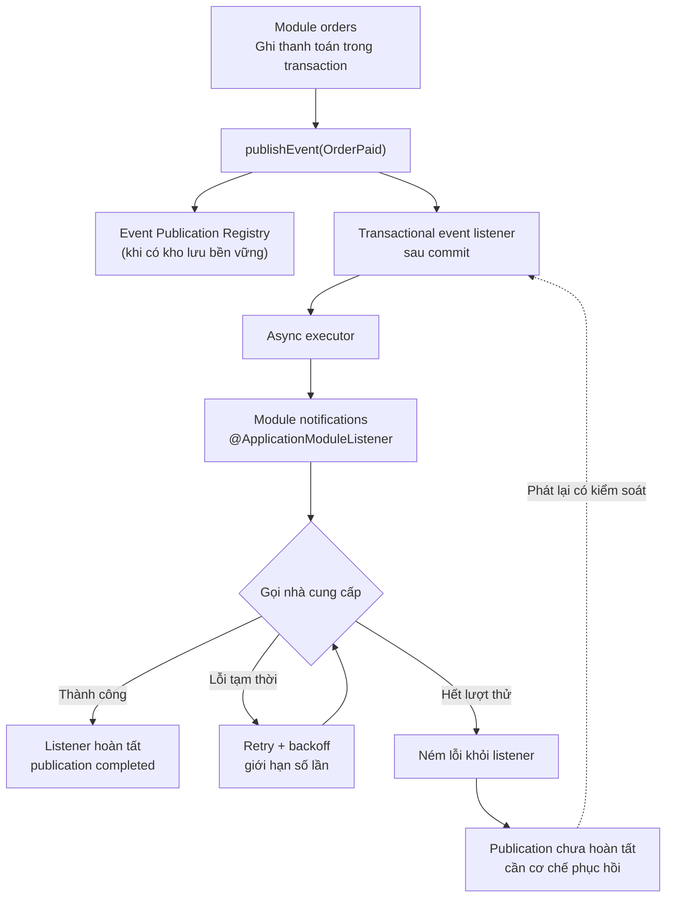

# Event retry và ảnh hưởng đến metrics

## 1. Bài toán: Một sự kiện có thể được xử lý nhiều lần

Trong ứng dụng Spring Boot tổ chức theo **Spring Modulith**, các application module giao tiếp qua sự kiện để giảm phụ thuộc trực tiếp. Mô-đun `orders` phát `OrderPaid` sau khi ghi nhận thanh toán; mô-đun `notifications` nhận sự kiện và gọi một nhà cung cấp gửi thông báo. Nếu phía nhà cung cấp trả HTTP 503 hoặc kết nối bị ngắt, listener cần xử lý lỗi sao cho nghiệp vụ không mất thông báo và hệ thống quan sát được chuyện gì đã xảy ra.

Đây là phần thực hành thuộc **Sự kiện bất đồng bộ** của module `SPRING_MODULITH_DOCUMENTATION_OBSERVABILITY`. Bên cạnh việc mô tả ranh giới application module và module graph, module học này dùng **Actuator, event metrics, tracing và context propagation** để kiểm chứng tương tác giữa các mô-đun khi ứng dụng vận hành. Với sự kiện bất đồng bộ, nếu không phân biệt một sự kiện nghiệp vụ với các lần gọi listener, biểu đồ metrics rất dễ dẫn đến kết luận sai.

Mục tiêu sau bài học:

- Phân biệt **retry trong một lần listener được gọi** với **phát lại một publication chưa hoàn tất** sau lỗi hoặc khởi động lại.
- Hiểu vai trò của transactional event listener, **Event Publication Registry** và việc listener phải báo lỗi đúng cách.
- Thiết kế retry có giới hạn, backoff, phân loại lỗi và **idempotency** để an toàn khi xử lý trùng.
- Định nghĩa metrics tách biệt **event**, **invocation**, **attempt**, **retry**, **success/failure** và **backlog**.
- Dùng Micrometer, Spring Boot Actuator, Prometheus và tracing để tìm nguyên nhân retry tăng; kiểm chứng bằng unit/integration test có lỗi giả lập.

### 1.1. Sơ đồ dòng sự kiện



Biểu đồ trên mô tả **hai cấp phục hồi**. Vòng từ `H` về `F` là các attempt trong *một lần gọi* listener. Đường từ `J` về `C` là một *lần gọi listener mới* khi publication còn dang dở được phát lại. Hai cấp này làm tăng counters theo những cách khác nhau.

## 2. Những khái niệm cần phân biệt

| Thuật ngữ | Ý nghĩa | Ví dụ |
| --- | --- | --- |
| **Domain event** | Một sự kiện nghiệp vụ có định danh ổn định | `OrderPaid(eventId=E-42)` |
| **Publication** | Công việc chuyển một event cho một listener cụ thể; một event có thể có nhiều publication | `E-42 → NotificationListener` |
| **Invocation** | Một lần listener bắt đầu chạy; một publication có thể tạo nhiều invocation khi phát lại | Listener chạy lúc 10:00 và chạy lại lúc 10:05 |
| **Attempt** | Một lần thực sự gọi thao tác dễ thất bại trong invocation | Gọi API lần 1, 2, 3 |
| **Retry** | Attempt bổ sung sau attempt trước đó thất bại; theo cách đếm trong bài, retry = attempt thứ 2 trở đi | 3 attempts = 2 retries |
| **Completed publication** | Listener đã hoàn tất thành công và hệ thống ghi nhận điều đó | Gọi API thành công, listener return bình thường |
| **Outstanding/incomplete publication** | Publication đã ghi nhận nhưng chưa hoàn tất thành công | Listener ném exception sau ba attempts |
| **Duplicate delivery** | Cùng event được đưa tới listener nhiều lần hoặc side effect đã thực hiện mà kết quả không được ghi nhận | Timeout sau khi bên nhận đã gửi thông báo |

**Một sự kiện không đồng nghĩa một lần gọi API.** Ví dụ một `OrderPaid` được listener thực thi lần đầu với 3 attempts thất bại; sau restart, hệ thống phát lại publication và listener thành công ngay ở attempt đầu. Tổng cộng có **1 domain event, 1 publication, 2 invocations, 4 attempts, 2 retries nội bộ, 1 invocation lỗi và 1 invocation thành công**. Không thể lấy số attempts làm số đơn hàng đã thanh toán.

Một sự kiện có thể kích hoạt nhiều listeners. Chẳng hạn `OrderPaid` được `notifications` và `loyalty` cùng xử lý, thì có thể tạo hai công việc xuất bản riêng biệt. Vì thế backlog và kết quả xử lý thường phải đo theo **publication + listener**, trong khi domain event là đơn vị nghiệp vụ.

## 3. Spring Modulith xử lý lỗi listener như thế nào?

### 3.1. Phát sự kiện trong transaction

Một luồng điển hình:

```java
package com.example.orders;

import java.util.UUID;
import org.springframework.context.ApplicationEventPublisher;
import org.springframework.stereotype.Service;
import org.springframework.transaction.annotation.Transactional;

public record OrderPaid(UUID eventId, String orderId) {}

@Service
class OrderPaymentService {

    private final ApplicationEventPublisher events;
    private final OrderRepository orders;

    OrderPaymentService(ApplicationEventPublisher events,
                        OrderRepository orders) {
        this.events = events;
        this.orders = orders;
    }

    @Transactional
    public void markPaid(String orderId) {
        orders.markPaid(orderId); // Cập nhật dữ liệu nghiệp vụ
        events.publishEvent(new OrderPaid(UUID.randomUUID(), orderId));
    }
}
```

`OrderRepository` ở đây là cổng truy cập dữ liệu của ứng dụng. Ví dụ giả định nó đã tồn tại và `markPaid` cập nhật bản ghi trong transaction hiện tại. Sự kiện mang `eventId` ổn định để client và consumer có thể nhận diện khi bị gửi lặp. Không tự tạo một `eventId` mới cho mỗi lần retry.

Nếu listener được cấu hình xử lý **sau khi transaction commit**, nó sẽ không thực thi business side effect khi transaction ghi thanh toán rollback. Sự kiện được publish *bên trong* transaction không có nghĩa rằng một lệnh gọi HTTP từ listener cũng nằm trong cùng transaction; ranh giới transaction, executor và tính bền vững cần xem riêng.

### 3.2. `@ApplicationModuleListener` và publication registry

Spring Modulith cung cấp annotation tiện ích `@ApplicationModuleListener` cho listener sự kiện bất đồng bộ. Theo cơ chế thông thường, annotation này kết hợp lắng nghe sự kiện theo transaction, thực thi bất đồng bộ và transaction riêng cho việc xử lý listener. Nó phù hợp để tách mô-đun phát sự kiện khỏi mô-đun tiêu thụ.

```java
package com.example.notifications;

import com.example.orders.OrderPaid;
import org.springframework.modulith.events.ApplicationModuleListener;
import org.springframework.stereotype.Component;

@Component
class PaymentNotificationListener {

    private final NotificationDelivery delivery;

    PaymentNotificationListener(NotificationDelivery delivery) {
        this.delivery = delivery;
    }

    @ApplicationModuleListener
    public void on(OrderPaid event) {
        delivery.send(event); // Phải ném lỗi khi chưa hoàn thành
    }
}
```

Khi tích hợp **Event Publication Registry** với kho lưu phù hợp (JPA/JDBC hoặc công nghệ do phiên bản Spring Modulith đang dùng hỗ trợ), một publication đến transactional listener có thể được lưu bền vững, và chỉ được đánh dấu hoàn tất sau khi listener xử lý thành công.

Hãy phân biệt ba trạng thái:

1. **Publish/commit thành công:** transaction nghiệp vụ commit, hệ thống ghi nhận các publication thuộc phạm vi được hỗ trợ.
2. **Listener thành công:** phương thức listener hoàn tất bình thường; registry có thể ghi nhận publication là completed.
3. **Listener thất bại:** exception thoát khỏi listener; publication có thể còn ở trạng thái incomplete để phục hồi.

Điều kiện **“có thể”** là quan trọng: độ bền vững thực tế phụ thuộc vào dependency event publication repository, cách cấu hình transaction, loại listener và phiên bản framework. `@Async` đơn thuần hay một event publisher trong bộ nhớ **không tự biến việc gửi event thành durable messaging**. Cần kiểm tra cấu hình và bảng lưu event publications thực sự của ứng dụng.

**Không coi việc có registry là đồng nghĩa hệ thống luôn tự retry mãi mãi.** Việc tìm và phát lại incomplete publications có thể được khởi động theo cấu hình, API, lịch chạy hoặc cơ chế vận hành của phiên bản đang dùng. Hãy kiểm tra hành vi phục hồi thật của hệ thống bằng integration test; tuyệt đối không giả định có retry vô hạn hoặc replay tự động ở mọi bản Spring Modulith.

### 3.3. Một lỗi nguy hiểm: nuốt exception

```java
@ApplicationModuleListener
public void on(OrderPaid event) {
    try {
        gateway.send(event);
    } catch (Exception ex) {
        log.error("Notify failed: {}", event.eventId(), ex);
        // NGUY HIỂM: return bình thường dù gửi chưa thành công
    }
}
```

Khi listener chỉ log rồi return, lớp quản lý publication không có cơ sở biết side effect đã thất bại; publication có thể bị đánh dấu **completed**. Counter “handler success” có thể tăng trong khi thông báo đã mất. Log không thay thế được tín hiệu lỗi.

Sửa bằng cách chỉ catch lỗi có thể xử lý hoàn chỉnh; nếu không giải quyết được sau retry, **ném exception ra ngoài**:

```java
@ApplicationModuleListener
public void on(OrderPaid event) {
    delivery.send(event); // Retry hết số lần sẽ ném exception
}
```

Cũng cần cẩn thận với `@Recover` của Spring Retry: nếu hàm recover chỉ log rồi return thành công, listener bề ngoài vẫn hoàn tất. Có thể dùng recover để đưa vào hàng đợi xử lý lỗi **nếu đó là kết quả nghiệp vụ được định nghĩa rõ và đã bền vững**; nếu mục tiêu là giữ publication incomplete để phát lại, recover phải phát tín hiệu thất bại tương ứng.

## 4. Thiết kế retry: giới hạn, backoff và phân loại lỗi

Một retry policy không thể chỉ là “thấy exception thì thử lại”. Cần trả lời:

- **Lỗi nào tạm thời?** Timeout, HTTP 429, HTTP 503, mất kết nối ngắn hạn; retry có thể giúp.
- **Lỗi nào lâu dài?** Payload sai schema, thiếu quyền truy cập cố định, dữ liệu bất hợp lệ, request bị từ chối theo nghiệp vụ; retry thường chỉ tạo thêm tải.
- **Bao nhiêu lần và trong bao lâu?** Ví dụ 3 attempts với backoff 200 ms và 400 ms; có giới hạn timeout cho từng HTTP request.
- **Có idempotency không?** Nhà cung cấp có thể đã xử lý request nhưng client chỉ thấy timeout.
- **Khi hết attempts thì sao?** Exception ra khỏi listener; kiểm tra publication còn dang dở và có quy trình phục hồi rõ ràng.

**Exponential backoff** giảm tần suất gọi khi dịch vụ đối tác quá tải. **Jitter** (độ lệch ngẫu nhiên) giúp nhiều instance tránh đồng loạt retry cùng thời điểm. Nếu các sự kiện kéo dài hàng phút hoặc hàng giờ, đừng giữ thread worker ngủ liên tục trong backoff; nên dùng lịch phát lại/queue phù hợp và giữ giới hạn tốc độ.

### 4.1. Cấu hình Spring Retry

Một cách đơn giản là dùng `RetryTemplate` ở tầng gọi bên ngoài. Bean độc lập giúp mã handler tách chính sách retry khỏi logic sự kiện, đồng thời cho phép đếm từng attempt.

Ví dụ Spring Boot sử dụng dependency `org.springframework.retry:spring-retry` (để dependency management của dự án quyết định phiên bản):

```java
package com.example.notifications;

import org.springframework.context.annotation.Bean;
import org.springframework.context.annotation.Configuration;
import org.springframework.retry.support.RetryTemplate;

@Configuration
class DeliveryRetryConfig {

    @Bean
    RetryTemplate notificationRetryTemplate() {
        return RetryTemplate.builder()
                .maxAttempts(3)                      // Kể cả attempt đầu tiên
                .exponentialBackoff(200, 2.0, 2_000) // Milliseconds
                .retryOn(TransientDeliveryException.class)
                .build();
    }
}
```

Mã này nhắm đến **Spring Retry phiên bản hỗ trợ `RetryTemplate.builder()`**. Khi dùng một phiên bản khác, hãy đối chiếu API builder hoặc dùng `RetryPolicy`/`BackOffPolicy` tương đương. `maxAttempts(3)` nghĩa là tối đa **3 lần gọi**, không phải “thử lần đầu + 3 lần retry”.

Nếu không có jitter trong builder của phiên bản dùng, có thể cấu hình backoff policy riêng; mục tiêu là tránh thundering herd khi nhiều sự kiện cùng thất bại. Một số phương thức retry có thể thực hiện cùng một transaction listener; không nên để các thao tác ghi DB thất bại trong attempt trước làm hỏng transaction của attempt sau. Khi retry gồm các thay đổi DB quan trọng, cân nhắc transaction độc lập cho từng attempt hoặc cơ chế retry ở mức invocation.

### 4.2. Listener gọi dịch vụ được đo metrics

Ví dụ đầy đủ về đơn vị đo `attempt`, `retry`, `invocation` và `duration`:

```java
package com.example.notifications;

import com.example.orders.OrderPaid;
import io.micrometer.core.instrument.MeterRegistry;
import io.micrometer.core.instrument.Timer;
import org.springframework.retry.support.RetryTemplate;
import org.springframework.stereotype.Service;

interface DownstreamNotifier {
    // Đối tác nhận eventId làm idempotency key.
    void notifyPaid(String eventId, String orderId);
}

class TransientDeliveryException extends RuntimeException {
    TransientDeliveryException(String message) {
        super(message);
    }
}

@Service
public class NotificationDelivery {

    private static final String HANDLER = "payment-notification";

    private final DownstreamNotifier client;
    private final RetryTemplate retry;
    private final MeterRegistry meters;

    public NotificationDelivery(DownstreamNotifier client,
                                RetryTemplate notificationRetryTemplate,
                                MeterRegistry meters) {
        this.client = client;
        this.retry = notificationRetryTemplate;
        this.meters = meters;
    }

    public void send(OrderPaid event) {
        Timer.Sample sample = Timer.start(meters);

        try {
            retry.execute(context -> {
                int attemptNumber = context.getRetryCount() + 1;

                meters.counter(
                        "demo.event.delivery.attempts",
                        "handler", HANDLER).increment();

                if (attemptNumber > 1) {
                    meters.counter(
                            "demo.event.delivery.retries",
                            "handler", HANDLER).increment();
                }

                // Timeout sau khi đối tác đã nhận vẫn có thể xảy ra.
                // Vì vậy client phải truyền cùng eventId trong mọi attempt.
                client.notifyPaid(
                        event.eventId().toString(),
                        event.orderId());

                return null;
            });

            meters.counter(
                    "demo.event.delivery.invocations",
                    "handler", HANDLER,
                    "result", "success").increment();

        } catch (RuntimeException ex) {
            meters.counter(
                    "demo.event.delivery.invocations",
                    "handler", HANDLER,
                    "result", "error").increment();

            // Bắt buộc để registry còn biết invocation thất bại.
            throw ex;

        } finally {
            sample.stop(meters.timer(
                    "demo.event.delivery.invocation.duration",
                    "handler", HANDLER));
        }
    }
}
```

Ở đây `Timer` đo **tổng thời gian một invocation**, bao gồm các lần backoff và gọi đối tác, còn counter `attempts` tăng cho **mỗi lần thực sự gọi** `notifyPaid`. Counter `retries` chỉ tăng từ attempt thứ hai. Counter `invocations` tăng đúng **một** lần khi invocation kết thúc; có nhãn kết quả `success` hoặc `error`.

**Phân loại lỗi nằm ở adapter `DownstreamNotifier`**, chẳng hạn biến timeout và HTTP 503 thành `TransientDeliveryException`; HTTP 400 do payload sai thành exception khác, không thuộc tập retry. Ví dụ cố ý không triển khai HTTP adapter vì cách ánh xạ lỗi phụ thuộc giao thức và đối tác. Nếu adapter trả về một `boolean` hoặc response “failed” mà không ném exception, `RetryTemplate` sẽ coi attempt đó thành công; phải có quy ước báo lỗi rõ ràng.

Trong mã thực tế, nên bảo đảm tên bean `notificationRetryTemplate` được inject đúng khi có nhiều `RetryTemplate`, có thể dùng `@Qualifier`. Chỉ ghi thêm nhãn metrics thuộc tập giá trị có giới hạn như `handler` và `result`; không gắn `eventId`, `orderId`, stack trace hoặc URL chứa tham số vào metric tag.

### 4.3. Cẩn thận khi đặt retry trong listener bất đồng bộ

`@ApplicationModuleListener` đã quản lý vòng đời một listener invocation. Khi `RetryTemplate` nằm **bên trong** phương thức nghiệp vụ được listener gọi, tất cả attempts thuộc một invocation:

- Nếu attempt thứ 2 thành công, phương thức return, publication được xem là hoàn tất.
- Nếu cả 3 attempts thất bại, exception rời listener, publication có thể còn incomplete.
- Nếu incomplete publication được phát lại, listener bắt đầu **một invocation mới**; số attempts trong `RetryTemplate` lại đếm từ 1.
- Tăng `maxAttempts` một cách tùy ý có thể gây quá tải đối tác và làm nghẽn thread pool bất đồng bộ.

Không phối hợp nhiều tầng retry mà không tính ngân sách. Ví dụ HTTP client tự thử 3 lần, `RetryTemplate` thử 3 lần, replay registry tiếp tục gọi lại: một event có thể phát sinh **9 request mạng trong một invocation**, rồi còn nhiều request nữa khi replay. Retry metrics ở ví dụ đếm attempts tại `RetryTemplate`, không nhìn thấy từng retry ngầm bên trong HTTP client; hãy quyết định một tầng chịu trách nhiệm retry hoặc instrument cả các tầng khi thực sự cần.

## 5. Idempotency: tiền đề để retry an toàn

Retry giúp nâng khả năng hoàn tất, nhưng cũng có thể thực hiện side effect **nhiều lần**. Giả sử đối tác đã nhận thông báo và gửi email, nhưng response HTTP bị mất: client thấy timeout, gọi lại, rồi email bị gửi hai lần. Hệ thống có durable publication vẫn có khả năng phát lại trùng khi việc đánh dấu completed gặp lỗi sau khi side effect đã xảy ra.

Do đó nên thiết kế theo **at-least-once delivery**, và yêu cầu consumer/đối tác đảm bảo **idempotent side effect** khi nghiệp vụ không cho phép trùng:

- Dùng một `eventId` cố định do publisher tạo, hoặc khóa nghiệp vụ ổn định như `paymentId`, truyền trong mọi attempt/replay.
- Nếu đối tác hỗ trợ idempotency key, sử dụng khóa ấy trong request, không tự sinh lại ở mỗi lần retry.
- Ở consumer nội bộ, lưu dấu đã xử lý theo tổ hợp `(handler, eventId)` với unique constraint khi có thể thực hiện side effect và ghi dấu trong **cùng transaction**.
- Với side effect ở hệ thống ngoài, ghi dấu trong DB nội bộ không tự tạo được atomic transaction với HTTP. Phải kết hợp idempotency ở phía nhận hoặc reconciliation nếu yêu cầu exactly-once trên thực tế.
- Đo **duplicates suppressed** riêng, ví dụ `demo.event.delivery.duplicates`; không đếm một duplicate bị bỏ qua là một business delivery mới.

Một mẫu bảng chống trùng cho PostgreSQL:

```sql
CREATE TABLE processed_event (
    handler_name VARCHAR(100) NOT NULL,
    event_id UUID NOT NULL,
    processed_at TIMESTAMPTZ NOT NULL DEFAULT now(),
    PRIMARY KEY (handler_name, event_id)
);
```

**Không** thêm bản ghi “đã xử lý” rồi mới gọi hệ thống ngoài mà không có cơ chế phục hồi: nếu tiến trình chết giữa hai hành động, lần replay có thể thấy bản ghi chống trùng và bỏ qua một side effect chưa hề thực hiện. Với API ngoài, idempotency key được phía nhận đảm bảo hoặc một outbox/dispatch state machine có reconciliation sẽ thích hợp hơn.

## 6. Event retry làm metrics thay đổi ra sao?

### 6.1. Minh họa bằng dữ liệu cụ thể

Giả sử theo dõi `PaymentNotificationListener` với retry tối đa 3 attempts. Các con số là **minh họa**, không phải metrics tự sinh sẵn của Spring Modulith:

| Diễn biến | Domain events | Invocations | Attempts | Retries | Invocation success | Invocation error |
| --- | ---: | ---: | ---: | ---: | ---: | ---: |
| Event A thành công ngay | 1 | 1 | 1 | 0 | 1 | 0 |
| Event B lỗi 1 lần, thành công lần 2 | 1 | 1 | 2 | 1 | 1 | 0 |
| Event C lỗi đủ 3 lần, publication còn incomplete | 1 | 1 | 3 | 2 | 0 | 1 |
| Event C được phát lại rồi thành công ngay | 0 sự kiện mới | 1 | 1 | 0 | 1 | 0 |
| **Tổng** | **3** | **4** | **7** | **3** | **3** | **1** |

Đọc đúng bảng:

- Có **3 sự kiện nghiệp vụ**, nhưng **7 attempts** gọi đối tác. Nếu lấy 7 làm số thanh toán, dashboard phóng đại hoạt động nghiệp vụ.
- Có **4 invocations** vì C được chạy lại; tỷ lệ invocation lỗi là **1/4**, không có nghĩa “25% domain events bị mất”. Sau replay, cả A/B/C đều đã hoàn thành.
- **3 retries** được ghi theo lần thử bên trong invocation; nếu định nghĩa “retry” bao gồm cả replay, phải dùng **một metric riêng cho redelivery** và nêu rõ cách đếm.
- Trong lúc C chưa được replay, backlog publication của listener này tăng thêm 1; sau replay thành công backlog giảm 1. Counter tích lũy không tự giảm, nên backlog phải được đo từ trạng thái hiện tại (gauge/query).

### 6.2. Thiết kế bộ metrics

| Metric đề xuất | Kiểu | Khi tăng / cách đo | Diễn giải |
| --- | --- | --- | --- |
| `demo.event.delivery.attempts` | Counter | Mỗi attempt gọi đối tác | Khối lượng gửi, có thể lớn hơn số event |
| `demo.event.delivery.retries` | Counter | Attempt thứ 2 trở đi trong cùng invocation | Tần suất retry nội bộ |
| `demo.event.delivery.invocations{result=success/error}` | Counter | Khi listener invocation kết thúc | Kết quả của mỗi lần listener chạy |
| `demo.event.delivery.invocation.duration` | Timer | Thời gian toàn invocation, kể cả backoff | Độ trễ listener nhìn từ caller |
| `demo.event.delivery.duplicates` | Counter | Consumer phát hiện event đã xử lý và bỏ qua | Dấu hiệu redelivery hoặc duplicate input |
| `demo.event.publications.outstanding` | Gauge | Số publication chưa completed từ kho registry | Backlog hiện tại cần phục hồi |
| `demo.event.publications.oldest.age` | Gauge | Tuổi của publication chưa completed lâu nhất | Độ nghiêm trọng của backlog |
| `demo.event.delivery.recoveries` | Counter | Một publication được phát lại thành công; cần instrument điểm replay | Mức độ phục hồi sau thất bại |

Các metric `publications.*` và `recoveries` ở bảng là **đề xuất tùy chỉnh**, không khẳng định Spring Modulith xuất sẵn tất cả những tên này. Muốn đo backlog/age, cần lấy dữ liệu chính xác từ API của event publication registry được phiên bản đó cung cấp hoặc từ kho bền vững qua một adapter, theo cách tránh truy vấn nặng. Không đọc trực tiếp bảng riêng của framework như một giao diện ổn định nếu có API được hỗ trợ.

Ví dụ định nghĩa “mức retry” theo attempt trong một cửa sổ:

\[
\text{Retry ratio} =
\frac{\text{số attempt có thứ tự} > 1}
     {\text{tổng số attempts}}
\]

Với bảng ví dụ, tỷ lệ retry trên tổng attempt là `3/7 ≈ 42,9%`. Giá trị này đo mức tải tăng thêm do retry, **không** đo tỷ lệ event mất hoặc tỷ lệ sự kiện thành công.

Một metric khác là **invocation error ratio**:

\[
\text{Invocation error ratio} =
\frac{\text{invocations kết thúc bằng exception}}
     {\text{tất cả invocations đã kết thúc}}
\]

Trong bảng: `1/4 = 25%`. Các bài toán có replay cần thêm metrics về **outstanding publication**, **tuổi backlog** và **số side effect nghiệp vụ duy nhất** để biết hệ thống cuối cùng đã hoàn tất hay chưa.

### 6.3. Vì sao “success rate” dễ bị đọc sai?

Một số cách đếm sai thường gặp:

1. Đếm attempt thành công là event thành công: nhiều attempts của cùng event bị trộn với nhau.
2. Đếm tất cả exception ở từng attempt là “event failed”: event có thể thành công ở lần retry sau.
3. Counter success chỉ tăng khi request HTTP trả 200 nhưng bên nhận xử lý bất đồng bộ và cuối cùng lại từ chối: tên success nên được đặt theo **điều gì đã được xác nhận**.
4. Dùng `process uptime` hoặc số lượng event xử lý của một instance làm số lũy kế toàn hệ thống: restart và scaling sẽ khiến phép so sánh trực tiếp sai nếu không dùng rate và aggregation phù hợp.
5. Chỉ quan sát counters: counter đã tăng không giảm sau khi backlog được giải quyết, nên không thay thế được gauge trạng thái.

Vì vậy, cần mô tả “success” theo từng cấp: *request mạng thành công*, *listener invocation thành công*, *publication được đánh dấu completed*, hay *business side effect được đối tác xác nhận*. Không gộp các khái niệm này vào một metric `events_success_total` mơ hồ.

## 7. Quan sát với Spring Boot Actuator, Micrometer và Prometheus

Các dependency thường cần (ví dụ Gradle Kotlin DSL; sử dụng BOM/phối hợp phiên bản Spring Boot–Spring Modulith tương thích với dự án):

```kotlin
dependencies {
    implementation("org.springframework.modulith:spring-modulith-starter-core")
    // Chọn event publication repository phù hợp với dự án,
    // ví dụ starter có hỗ trợ JPA trong phiên bản đang dùng.
    implementation("org.springframework.modulith:spring-modulith-starter-jpa")

    implementation("org.springframework.modulith:spring-modulith-observability")
    implementation("org.springframework.boot:spring-boot-starter-actuator")
    implementation("org.springframework.retry:spring-retry")
    implementation("io.micrometer:micrometer-registry-prometheus")

    testImplementation("org.springframework.boot:spring-boot-starter-test")
}
```

Tùy phiên bản, tên artifact starter/storage hoặc cách kích hoạt registry có thể khác; cần sử dụng tài liệu và BOM tương ứng với version đã chốt. Việc thêm dependency không thay thế cho kiểm tra publisher transaction, bảng lưu publication và scheduler/republication policy. Nếu ứng dụng dùng JDBC thay vì JPA, chọn repository phù hợp thay vì mang thêm JPA chỉ để dùng ví dụ.

Trong môi trường kiểm thử hoặc mạng nội bộ được bảo vệ, có thể mở Actuator endpoints:

```yaml
management:
  endpoints:
    web:
      exposure:
        include: health,info,metrics,prometheus
  metrics:
    tags:
      application: order-service
```

Dùng `GET /actuator/metrics` để tìm tên meter, sau đó truy vấn tên `demo.event.delivery.attempts` nhằm xem số đo và tags. Với Prometheus registry, xuất dữ liệu tại `/actuator/prometheus` nếu endpoint được bật. **Không để endpoint quan sát không được bảo vệ trên Internet**; chính sách truy cập phải khớp hạ tầng triển khai.

Micrometer chuyển tên dạng chấm sang quy ước Prometheus. Ví dụ counters trong mã được xuất với dạng thường gặp như `demo_event_delivery_attempts_total` và `demo_event_delivery_retries_total`; Timer `demo.event.delivery.invocation.duration` xuất chuỗi `..._seconds_count` và `..._seconds_sum`. Tên chính xác hãy kiểm tra ngay trên `/actuator/prometheus` vì conventions và registry version có thể khác.

Một số truy vấn PromQL minh họa:

```promql
# Số attempts mỗi giây của từng handler
sum by (handler) (
  rate(demo_event_delivery_attempts_total[5m])
)

# Tỷ lệ retry attempt / tổng attempts trong 5 phút
sum(rate(demo_event_delivery_retries_total[5m]))
/
clamp_min(sum(rate(demo_event_delivery_attempts_total[5m])), 0.001)

# Invocation thất bại mỗi giây theo handler
sum by (handler) (
  rate(demo_event_delivery_invocations_total{result="error"}[5m])
)

# Thời gian trung bình mỗi invocation trong cửa sổ 5 phút
sum(rate(demo_event_delivery_invocation_duration_seconds_sum[5m]))
/
clamp_min(
  sum(rate(demo_event_delivery_invocation_duration_seconds_count[5m])),
  0.001
)
```

Các mẫu này chỉ có ý nghĩa khi bộ đo được đăng ký và đủ dữ liệu trong cửa sổ quan sát. Histogram p95 của Timer đòi hỏi cấu hình publish histogram/SLO buckets trước; mặc định có thể chỉ có `count` và `sum`. Cân nhắc cho dashboard theo từng `handler`, theo `result` và theo application module, đồng thời theo dõi backlog bằng gauge thực sự.

### 7.1. Tag cardinality và chi phí vận hành

Prometheus tạo time series cho mỗi tổ hợp nhãn. `handler=payment-notification`, `result=success/error`, `module=notifications` là tập hữu hạn có thể kiểm soát. Gắn `eventId`, `customerId`, `orderId` hoặc exception message làm label sẽ tạo số lượng chuỗi tăng theo lượng giao dịch, dễ làm tăng chi phí bộ nhớ và độ trễ truy vấn.

Định danh cụ thể vẫn rất có ích nhưng nên được lưu trong **structured logs** và **trace/span attributes** theo chính sách dữ liệu và bảo mật, ví dụ:

```text
timestamp=... level=WARN module=notifications
eventId=7d0d... handler=payment-notification
attempt=2 result=retryable_error
exceptionType=TransientDeliveryException traceId=...
```

Tính toán metric nên dùng nhãn `exception.category=timeout/overloaded/invalid/unknown` được chuẩn hóa, không dùng chuỗi exception động. Nếu phát lại cùng event nhiều lần, các logs nối bằng `eventId` giúp phân biệt từng invocation ngay cả sau khi ứng dụng restart.

## 8. Tracing và context propagation khi retry

Cơ chế async làm một sự kiện xử lý trên **thread khác** với nơi phát. Nếu không có context propagation, `traceId`/`spanId` hoặc MDC correlation có thể mất khi listener chạy. Khi một request khởi tạo nhiều event, thiếu ngữ cảnh sẽ khiến khó tìm đường đi qua module graph và phân tích vì sao notification retry tăng.

Một cấu hình minh họa cho Spring Framework phiên bản có `ContextPropagatingTaskDecorator`:

```java
package com.example.config;

import java.util.concurrent.Executor;
import org.springframework.context.annotation.Configuration;
import org.springframework.core.task.support.ContextPropagatingTaskDecorator;
import org.springframework.scheduling.annotation.AsyncConfigurer;
import org.springframework.scheduling.annotation.EnableAsync;
import org.springframework.scheduling.concurrent.ThreadPoolTaskExecutor;

@Configuration
@EnableAsync
class AsyncEventExecutorConfig implements AsyncConfigurer {

    @Override
    public Executor getAsyncExecutor() {
        var executor = new ThreadPoolTaskExecutor();
        executor.setThreadNamePrefix("modulith-events-");
        executor.setCorePoolSize(4);
        executor.setMaxPoolSize(8);
        executor.setQueueCapacity(200);
        executor.setTaskDecorator(new ContextPropagatingTaskDecorator());
        executor.initialize();
        return executor;
    }
}
```

Ở đây `AsyncConfigurer` đưa executor được trang trí vào cơ chế `@Async`, còn `ContextPropagatingTaskDecorator` hỗ trợ truyền observation/tracing context được Micrometer quản lý. Cần dependency context propagation/observation và bridge tracing phù hợp; để có traces xuất ra ngoài, dự án phải cấu hình exporter (ví dụ OTLP) và sampling. **Kiểm tra trace thực tế** trước khi tin rằng tất cả context được mang qua.

Ranh giới của propagation:

- **Trong cùng process**, propagation có thể nối context tại thời điểm enqueue task sang thread executor.
- **Sau restart hoặc replay một publication đã lưu**, thread-local context ban đầu không còn; không thể dựa vào decorator để phục hồi trace cha từ process cũ.
- **Qua hệ thống ngoài**, cần chuẩn truyền trace context tương ứng (ví dụ W3C Trace Context) nếu đầu nhận hỗ trợ; correlation nghiệp vụ phải có `eventId`/`correlationId` ổn định trong payload hoặc metadata lưu bền.
- Không dùng `ThreadLocal` truyền mặc định giữa threads nếu không có cơ chế capture/restore phù hợp; một thread pool còn có nguy cơ giữ lại MDC từ task trước nếu context không được dọn đúng.

Để phân tích retry bằng traces, cấu trúc span hữu ích có thể là `orders.markPaid` → `notifications.onOrderPaid` → `notifications.notifyPartner`. Gắn thuộc tính có tập giá trị nhỏ như `module.name`, `event.type`, `retry.attempt`, `outcome`; thuộc tính `eventId`, nếu chính sách cho phép, phục vụ tra cứu từng giao dịch trong trace/log nhưng **không trở thành metric tag**. Spring Modulith observability hỗ trợ quan sát tương tác module tùy phiên bản và cấu hình; không nên giả định mọi custom retry attempt tự động có span riêng. Nếu cần, tạo Observation/span quanh thao tác client hoặc instrument HTTP client để nhìn thấy từng attempt.

Module documentation/graph cho biết **mô-đun nào có thể tương tác**, còn metrics/traces cho biết **trong vận hành đã tương tác thế nào, chậm hoặc thất bại ở đâu**. Khi tần suất retry tăng mạnh ở `notifications`, đối chiếu module graph với trace call chain để tìm dependency thực sự đang gây lỗi, thay vì chỉ nhìn log cục bộ của listener.

## 9. Kiểm thử retry và ảnh hưởng metrics

### 9.1. Unit test kiểm tra đúng số lần gọi

Test `NotificationDelivery` riêng biệt: dùng `SimpleMeterRegistry`, gateway giả lập lỗi hai lần rồi thành công, và retry không ngủ lâu để test chạy ổn định.

```java
package com.example.notifications;

import com.example.orders.OrderPaid;
import io.micrometer.core.instrument.simple.SimpleMeterRegistry;
import java.util.UUID;
import java.util.concurrent.atomic.AtomicInteger;
import org.junit.jupiter.api.Test;
import org.springframework.retry.support.RetryTemplate;

import static org.junit.jupiter.api.Assertions.assertEquals;
import static org.junit.jupiter.api.Assertions.assertThrows;

class NotificationDeliveryTest {

    private RetryTemplate fastRetry() {
        return RetryTemplate.builder()
                .maxAttempts(3)
                .fixedBackoff(1) // Chỉ 1 ms trong test
                .retryOn(TransientDeliveryException.class)
                .build();
    }

    @Test
    void retriesTwiceThenSucceedsAndReportsMetrics() {
        var calls = new AtomicInteger();
        DownstreamNotifier gateway = (eventId, orderId) -> {
            if (calls.incrementAndGet() < 3) {
                throw new TransientDeliveryException("Temporary HTTP 503");
            }
        };

        var meters = new SimpleMeterRegistry();
        var delivery = new NotificationDelivery(gateway, fastRetry(), meters);
        var event = new OrderPaid(UUID.randomUUID(), "ORD-42");

        delivery.send(event);

        assertEquals(3, calls.get());
        assertEquals(3.0,
                meters.get("demo.event.delivery.attempts")
                      .tag("handler", "payment-notification")
                      .counter().count());
        assertEquals(2.0,
                meters.get("demo.event.delivery.retries")
                      .tag("handler", "payment-notification")
                      .counter().count());
        assertEquals(1.0,
                meters.get("demo.event.delivery.invocations")
                      .tags("handler", "payment-notification", "result", "success")
                      .counter().count());
        meters.close();
    }

    @Test
    void exhaustedRetriesLeaveFailureVisibleToCaller() {
        var calls = new AtomicInteger();
        DownstreamNotifier gateway = (eventId, orderId) -> {
            calls.incrementAndGet();
            throw new TransientDeliveryException("Service unavailable");
        };

        var meters = new SimpleMeterRegistry();
        var delivery = new NotificationDelivery(gateway, fastRetry(), meters);

        assertThrows(TransientDeliveryException.class,
                () -> delivery.send(
                        new OrderPaid(UUID.randomUUID(), "ORD-42")));

        assertEquals(3, calls.get());
        assertEquals(1.0,
                meters.get("demo.event.delivery.invocations")
                      .tags("handler", "payment-notification", "result", "error")
                      .counter().count());
        meters.close();
    }
}
```

Các assertions kiểm tra một contract rõ ràng: ba calls, hai retries, một invocation success trong case đầu; ba calls, một invocation error trong case thứ hai. Test này **chưa** chứng minh registry lưu incomplete publication hoặc khả năng replay sau restart.

### 9.2. Integration test phục hồi publication sau lỗi

Để kiểm tra thực sự có durability, hãy dựng integration test với **event publication repository thật** (test database/JPA/JDBC phù hợp) và **transaction thật**:

1. Đăng ký một listener có lần đầu ném `TransientDeliveryException` cho event có `eventId` cố định; publish event trong transaction và commit.
2. Xác minh listener đã được gọi và publication cho listener còn **incomplete** trong registry. Không dùng `Thread.sleep` tùy tiện để đoán async đã xử lý; sử dụng cơ chế chờ có timeout và điều kiện kiểm tra.
3. Gọi cơ chế phục hồi/publication resubmission được **phiên bản Spring Modulith của dự án hỗ trợ**, hoặc tạo lần khởi động lại thực tế nếu đó là đường vận hành. Đừng giả lập bằng cách tự gọi trực tiếp phương thức listener rồi gọi đó là replay.
4. Cho lần gọi kế tiếp thành công; xác minh publication chuyển sang completed, không còn outstanding, và **side effect nghiệp vụ chỉ xuất hiện một lần** nhờ idempotency.
5. Kiểm tra metrics: invocations có thể là 2, attempts tùy retry policy; backlog cuối cùng là 0, kể cả khi có counter error ở lần trước.

Cần thử thêm hệ thống vừa gọi API đối tác thành công nhưng bị mất phản hồi. Nếu phía đối tác dùng idempotency key, hai request có cùng `eventId` phải cho một side effect; nếu không hỗ trợ, phải có chính sách reconciliation rõ ràng.

### 9.3. Test về observability

Bộ test metrics/tracing nên xác minh:

- **Không retry** cho lỗi permanent, **có retry** cho lỗi transient đã whitelist.
- Không có counter labels động chứa ID; số time series hữu hạn khi tạo hàng nghìn events.
- Exception thoát listener sau khi hết retry; không có đường code catch rồi return.
- Executor truyền observation context qua một task bất đồng bộ (nếu ứng dụng đã bật tracing và decorator).
- Khi replay sau restart, `eventId` vẫn giữ nguyên dù `traceId` gốc không còn.
- Dashboard nhận thấy retry ratio tăng mà không tự suy ra số event mới tăng.
- Gauge backlog phản ánh trạng thái registry, kể cả khi quy trình phục hồi bị tắt.

## 10. Vận hành: từ chỉ số đến hành động

Một cách trực quan để điều tra lỗi:

| Tín hiệu | Giả thuyết thường gặp | Cần kiểm tra |
| --- | --- | --- |
| `attempts` tăng, `retries` tăng, `invocations/error` thấp | Lỗi tạm thời nhưng retry cứu được | Latency đối tác, HTTP 429/503, chi phí backoff và tải |
| `retries` tăng, `invocations/error` tăng, backlog tăng | Retry nội bộ không đủ, publication còn dang dở | Đối tác down, timeout, chính sách replay, tuổi backlog |
| `success` tăng, `duplicates` tăng | Redelivery hoạt động nhưng side effect bị nhận lặp | Event ID, khóa chống trùng, xử lý lại sau restart |
| `invocation.duration` p95 tăng, `attempts` không tăng | Thao tác chậm ngay ở attempt đầu | Thread pool, downstream latency, DB contention |
| `invocations` giảm, backlog tăng | Consumer không lấy/không hoàn thành công việc | Async executor, queue saturation, transaction, scheduler |
| Traces đứt giữa publisher và listener | Không propagate context hoặc replay từ process cũ | TaskDecorator, observation bridge, correlation ID bền vững |

### 10.1. Một số cảnh báo đáng theo dõi

Không nên bắt đầu bằng một ngưỡng cố định cho mọi dịch vụ. Chọn threshold theo SLO và lưu lượng thực, nhưng nên có cảnh báo cho:

- **Outstanding publications > 0 quá lâu**, đặc biệt khi tuổi publication cũ nhất vượt mục tiêu xử lý.
- **Retry rate tăng vượt baseline** trong một cửa sổ đủ mẫu.
- **Invocation error ratio tăng đồng thời backlog tăng**.
- **P95/P99 invocation duration vượt ngân sách latency**, đặc biệt khi backoff hoặc downstream timeout kéo dài.
- **Bất thường số duplicate side effects** (nếu có thể đo ở hệ thống nghiệp vụ), không chỉ duplicate attempts.

Ngưỡng backlog bằng 0 tuyệt đối có thể gây báo động giả ở hệ thống luôn có công việc đang xử lý. Tốt hơn là theo dõi **tuổi oldest incomplete publication**, thời gian tồn tại liên tục và tốc độ hoàn tất theo từng handler.

### 10.2. Checklist điều tra sự cố

1. Xác định `handler` hoặc module có error rate và retry rate tăng.
2. Mở trace cho một event thất bại; so sánh thời gian ở listener, retry backoff và HTTP client.
3. Phân loại exception thành lỗi transient/permanent; đối chiếu policy retry và timeout.
4. Kiểm tra publication trong registry, các bản incomplete và cơ chế phát lại của phiên bản hiện tại.
5. Xác minh idempotency key được giữ nguyên khi retry/replay; nếu có khả năng gửi trùng, đánh giá side effect thực tế.
6. Chỉ phát lại thủ công có kiểm soát khi biết hậu quả nghiệp vụ và khả năng idempotent; sau đó kiểm tra backlog giảm.
7. Điều chỉnh retry budget, executor, rate limit hoặc xử lý đối tác theo nguyên nhân; xác nhận metrics đã trở lại baseline.

Khi hệ thống có nhiều application module, dùng module graph/tài liệu kiến trúc để biết consumer và downstream dependency nào bị tác động; dùng Actuator metrics để đo phạm vi lỗi và tracing để lần theo từng chuỗi xử lý.

## 11. Bài thực hành tổng hợp

**Bối cảnh:** Mô-đun `orders` phát 100 sự kiện `OrderPaid`, mô-đun `notifications` có retry tối đa 3 attempts. Có 80 sự kiện thành công ở lần đầu; 15 sự kiện thành công ở attempt thứ 2; 5 sự kiện thất bại cả 3 attempts. Sau khi đối tác phục hồi, cả 5 sự kiện incomplete được phát lại và thành công ở attempt đầu.

Hãy xác định các metrics theo định nghĩa của bài:

| Giai đoạn | Events mới | Invocations | Attempts | Retries nội bộ | Invocation success | Invocation error |
| --- | ---: | ---: | ---: | ---: | ---: | ---: |
| Xử lý ban đầu | 100 | 100 | `80×1 + 15×2 + 5×3 = 125` | `15×1 + 5×2 = 25` | 95 | 5 |
| Phát lại 5 incomplete events | 0 | 5 | 5 | 0 | 5 | 0 |
| **Tổng** | **100** | **105** | **130** | **25** | **100** | **5** |

Sau khi tất cả đã xử lý thành công, backlog của listener này trở về **0**. Nếu tính retry ratio trên toàn bộ quá trình là `25/130 ≈ 19,23%`; invocation error ratio là `5/105 ≈ 4,76%`. Đừng diễn giải `5` invocation errors là `5` sự kiện bị mất vĩnh viễn: chính 5 publication đó đã được phát lại thành công. Con số “100 success” ở đây là **invocation success**, tình cờ bằng số domain events duy nhất vì giả thiết không có lần replay thành công trùng; trong tình huống khác chúng có thể khác nhau.

Tự triển khai:

1. Định nghĩa `OrderPaid(eventId, orderId)`, phát trong transaction của `orders`; xây `@ApplicationModuleListener` ở `notifications`.
2. Cấu hình `RetryTemplate` giới hạn 3 attempts với backoff, phân biệt lỗi HTTP 503 và payload không hợp lệ.
3. Instrument `attempts`, `retries`, `invocations{result}` và `invocation.duration` bằng `MeterRegistry`.
4. Thêm idempotency key ổn định ở phía đối tác giả; chứng minh timeout sau khi đối tác xử lý không làm side effect chạy hai lần.
5. Kết nối publication registry bền vững và thử khởi động lại/republish incomplete events; đo backlog trước và sau.
6. Mở Actuator/Prometheus trong môi trường test, xem tên meter thực tế và viết truy vấn tốc độ retry.
7. Bật tracing và context propagation cho executor; đối chiếu trace trước/sau restart với `eventId` trong log.
8. Vẽ lại ranh giới `orders` → `notifications` trong module graph; giải thích counters và traces giúp xác minh tương tác mô-đun ra sao.

### Câu hỏi tự đánh giá

1. Vì sao cùng một event có thể tạo 3 attempts nhưng chỉ 1 invocation?
2. Tại sao listener log exception rồi return có thể khiến hệ thống **mất cơ hội phục hồi** publication?
3. Retry trong `RetryTemplate` khác gì với việc registry phát lại incomplete publication?
4. Khi HTTP request timeout sau khi bên nhận đã hoàn tất, điều gì ngăn lần retry tạo side effect trùng?
5. Tại sao không dùng `eventId` làm Prometheus label nhưng vẫn nên ghi eventId vào log?
6. Trường hợp nào retry ratio cao nhưng tỷ lệ completed publications vẫn tốt? Trường hợp nào backlog mới thực sự đáng báo động?
7. Vì sao context propagation trong executor không thể tự khôi phục trace cha khi replay sau restart?
8. Cần kiểm thử nào để chứng minh durability thật, thay vì chỉ chứng minh một phương thức Java có thể được gọi lần hai?

Một triển khai retry tốt không dừng ở việc “thử lại cho đến khi hết lỗi”. Trong Spring Modulith, tính đáng tin cậy đòi hỏi **publication có thể được phục hồi**, **side effect an toàn khi xử lý lặp**, và **metrics phân biệt đúng đơn vị đo**. Khi kết hợp module graph, Actuator, tracing, context propagation và các phép thử theo tình huống lỗi, đội vận hành mới đánh giá chính xác tính ổn định của tương tác giữa các application module.
