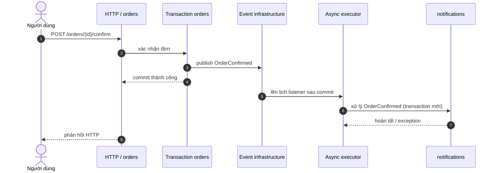
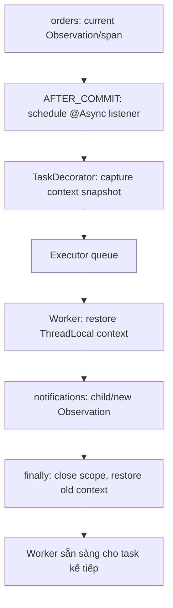

# Context propagation qua event infrastructure

Trong ứng dụng Spring Boot tổ chức bằng **Spring Modulith**, một nghiệp vụ có thể bắt đầu ở module `orders`, phát sự kiện `OrderConfirmed` và được xử lý bất đồng bộ ở module `notifications`. Cả hai module vẫn chạy trong **cùng ứng dụng**, nhưng handler sự kiện có thể chạy trên thread khác, trong transaction khác và thậm chí được phát lại sau khi ứng dụng khởi động lại. Nếu thiếu **context propagation**, trace dễ bị chia thành nhiều đoạn rời rạc, log trong listener mất `traceId` và việc truy tìm một nghiệp vụ xuyên các module trở nên khó khăn.

Bài học thuộc chương **Sự kiện bất đồng bộ** của **Spring Modulith Documentation & Observability**. Mục tiêu là hiểu cơ chế truyền ngữ cảnh qua hạ tầng sự kiện Spring, cấu hình executor và Micrometer để nối các quan sát, kiểm tra luồng event khi có transaction, retry và restart, đồng thời giữ được ranh giới application module khi vận hành.

> **Phạm vi:** “context” ở đây chủ yếu là **observability context** (Observation, trace/span, thông tin log/correlation được chọn). Không nên suy luận rằng truyền context cũng tự động truyền transaction, persistence context, quyền truy cập người dùng hay mọi `ThreadLocal` sang thread khác.

## 1. Vì sao event bất đồng bộ làm đứt mạch quan sát?

Xét luồng:



Thứ tự thông điệp trong sơ đồ chỉ thể hiện luồng logic. Việc listener hoàn thành trước hay sau phản hồi HTTP phụ thuộc vào lịch chạy và tải của executor. Điểm cốt lõi là **listener không còn chạy trong cùng call stack/transaction** như người phát.

Ở phương thức đồng bộ, một `ThreadLocal` thường vẫn truy cập được bởi các method được gọi tiếp trên cùng thread. Nhưng khi Spring chuyển công việc sang thread trong pool:

```text
http-nio-8080-exec-2                        module-events-3
  current traceId = 1a2b...                 current traceId = ? 
  current Observation = HTTP request        current Observation = ?
  MDC["traceId"] = 1a2b...                  MDC["traceId"] = ?
            │                                        ▲
            └── publish / schedule ─────────────────┘
```

Không có cơ chế copy/restore thích hợp, `current Observation` ở worker có thể là `null`; một span sinh trong listener có thể trở thành **trace mới**, log thiếu ID hoặc ngữ cảnh của task trước vẫn tồn tại nếu ứng dụng tự thao tác `ThreadLocal` sai cách.

**Context propagation có hai thời điểm khác nhau:** tại **điểm bàn giao**, chụp những giá trị được cho phép truyền; tại **điểm thực thi**, phục hồi các giá trị đó trong scope của task, sau đó trả lại trạng thái thread khi task kết thúc. Điều này tạo ra mối liên hệ quan sát giữa publisher và handler.

## 2. Phân loại ngữ cảnh trước khi truyền

Không phải mọi thông tin đang gắn với request đều có cùng vòng đời.

| Dữ liệu | Ví dụ | Có nên truyền sang listener? | Lưu ý |
| --- | --- | --- | --- |
| Trace/span context | trace ID, span ID, trace flags | Có, nếu tiếp diễn cùng chuỗi xử lý có quan hệ nhân quả | Dùng tracing bridge và propagation đã cấu hình |
| Micrometer Observation | current observation | Có, khi muốn observation trong handler liên hệ với tác vụ nguồn | Không giữ observation nguồn mở vô thời hạn |
| Logging correlation | MDC `traceId`, `spanId`, correlation ID | Có chọn lọc; ưu tiên tracer tích hợp log | Custom MDC cần cơ chế accessor hoặc khôi phục rõ ràng |
| Baggage/tracing metadata | tenant/correlation label có chính sách | Chỉ chọn giá trị nhỏ, an toàn và cần thiết | Không tùy tiện gửi PII hoặc secret theo baggage |
| Event identity | `eventId`, `orderId`, timestamp | **Phải là dữ liệu nghiệp vụ/bản ghi bền** nếu cần đối chiếu qua retry/restart | Có trong event payload, không phụ thuộc `ThreadLocal` |
| Transaction context | `TransactionSynchronizationManager`, JPA `EntityManager` | **Không** | Listener nên có transaction riêng khi cần ghi dữ liệu |
| HTTP request context | Servlet request, response, session | Thông thường **không** | Request có thể đã kết thúc khi listener chạy |
| Security context | `SecurityContextHolder`, token hiện hành | Không truyền mù quáng | Thiết kế lại quyền cho tác vụ nền; truyền actor ID đã kiểm chứng nếu cần |

Spring Modulith định nghĩa **ranh giới và luồng tích hợp giữa module**; Micrometer/Spring Boot xử lý phần observability context. Hai cơ chế kết hợp với nhau, nhưng **Spring Modulith không biến các giá trị trong `ThreadLocal` thành dữ liệu bền** để dùng qua restart.

### Tách trace ID khỏi event ID

Một `traceId` mô tả đường thực thi được ghi nhận bởi tracing backend, có thể chịu sampling và giới hạn thời gian lưu trữ. Một `eventId` mô tả **một lần phát sự kiện nghiệp vụ**, cần ổn định qua retry và có thể lưu cùng bản ghi publication. Không dùng trace ID làm khóa idempotency duy nhất của sự kiện.

Trong luồng xử lý ngay sau commit, handler có thể nằm trong cùng distributed trace với request gốc. Khi event được phát lại **sau khi restart**, current Observation lúc phát gốc không còn trong bộ nhớ. Listener lúc này nên tạo observation mới, liên kết bằng `eventId` hoặc correlation ID bền vững. Nếu tracing backend hỗ trợ **span link**, có thể liên hệ với trace xuất phát bằng metadata được lưu có chủ đích; không dựng một span cha giả đang còn sống.

## 3. Các dạng listener và thời điểm chuyển giao context

Spring Framework và Spring Modulith có nhiều cách tiêu thụ event:

| Cách dùng | Thread thực thi | Transaction | Yêu cầu về propagation |
| --- | --- | --- | --- |
| `@EventListener` mặc định | Thường ngay trên thread publish | Có thể nằm trong transaction gốc | Nếu không đổi thread, context hiện hành thường sẵn có |
| `@Async @EventListener` | Executor bất đồng bộ | Không tự động tham gia transaction nguồn | Task executor cần truyền context khi muốn giữ trace |
| `@TransactionalEventListener` (mặc định `AFTER_COMMIT`) | Callback sau commit, thường thread gốc nếu không thêm async | Phản ứng theo transaction nguồn; không mặc định có transaction ghi mới | Xác định context còn có mặt ở thời điểm callback |
| `@Async @TransactionalEventListener` | Executor sau khi có commit | Tác vụ async độc lập với transaction nguồn | Chụp context ở nơi thực sự lên lịch task |
| `@ApplicationModuleListener` | Listener async | Sau commit và có transaction riêng (`REQUIRES_NEW`) | Executor phù hợp, truyền observation/context và có correlation bền |

`@ApplicationModuleListener` là annotation thuận tiện của Spring Modulith, kết hợp `@Async`, `@TransactionalEventListener` và `@Transactional(propagation = REQUIRES_NEW)`. Khi xử lý thành công, listener thực hiện phần nghiệp vụ của chính nó trong transaction khác, độc lập với transaction đặt đơn. Đây **không phải** cơ chế kế thừa transaction từ publisher.

**Lưu ý về commit:** `@TransactionalEventListener` mặc định phụ thuộc vào transaction đang tồn tại khi publish. Nếu publish ngoài transaction và không chủ động bật `fallbackExecution` theo chính sách ứng dụng, listener sẽ không chạy như một callback sau commit. Khi kiểm thử, không dùng test transaction luôn rollback rồi kết luận listener bị mất context; phải kiểm tra commit thực sự.

**Lưu ý về multicaster:** Khi thay `ApplicationEventMulticaster` để phát event bất đồng bộ ở mức toàn cục, một số listener gắn với transaction có yêu cầu thực thi trên thread gốc. Không mặc định mọi event listener sẽ được chuyển sang executor đã cấu hình; xác minh luồng dispatch của từng loại listener và phiên bản Spring Framework.

## 4. Ví dụ xuyên module: đơn hàng và thông báo

Giả sử project Spring Boot có cấu trúc:

```text
com.acme.shop
├── ShopApplication.java
├── orders
│   ├── OrderConfirmed.java
│   ├── OrderService.java
│   └── internal
│       └── OrderRepository.java
└── notifications
    └── internal
        ├── NotificationListener.java
        └── NotificationSender.java
```

Sự kiện được đặt trong API của module `orders` để các module có thể lắng nghe mà không tham chiếu đến class `orders.internal`. Định nghĩa một event có danh tính ổn định:

```java
package com.acme.shop.orders;

import java.time.Instant;
import java.util.UUID;

public record OrderConfirmed(
        UUID eventId,
        UUID orderId,
        Instant occurredAt
) {}
```

Module `orders` publish sau khi thay đổi dữ liệu nghiệp vụ trong transaction:

```java
package com.acme.shop.orders;

import java.time.Clock;
import java.time.Instant;
import java.util.UUID;
import org.springframework.context.ApplicationEventPublisher;
import org.springframework.stereotype.Service;
import org.springframework.transaction.annotation.Transactional;

@Service
public class OrderService {
    private final ApplicationEventPublisher events;
    private final OrderOperations operations;
    private final Clock clock;

    public OrderService(ApplicationEventPublisher events,
                        OrderOperations operations, Clock clock) {
        this.events = events;
        this.operations = operations;
        this.clock = clock;
    }

    @Transactional
    public void confirm(UUID orderId) {
        operations.markConfirmed(orderId);
        events.publishEvent(new OrderConfirmed(
                UUID.randomUUID(), orderId, Instant.now(clock)));
    }
}
```

`OrderOperations` ở đây là **API nghiệp vụ minh họa của chính module orders**; cần cung cấp implementation thật, ràng buộc dữ liệu và bean `Clock` trong ứng dụng. Sự kiện này cần được phát **bên trong transaction thực sự** để listener `AFTER_COMMIT` chỉ tiếp nhận khi transaction gốc commit thành công.

Ở module `notifications`, xử lý và quan sát một lần chạy:

```java
package com.acme.shop.notifications.internal;

import com.acme.shop.orders.OrderConfirmed;
import io.micrometer.observation.Observation;
import io.micrometer.observation.ObservationRegistry;
import org.slf4j.MDC;
import org.springframework.modulith.events.ApplicationModuleListener;
import org.springframework.stereotype.Component;

@Component
class NotificationListener {
    private final NotificationSender sender;
    private final ObservationRegistry observations;

    NotificationListener(NotificationSender sender,
                         ObservationRegistry observations) {
        this.sender = sender;
        this.observations = observations;
    }

    @ApplicationModuleListener
    void on(OrderConfirmed event) {
        try (var eventId = MDC.putCloseable(
                "eventId", event.eventId().toString())) {
            Observation.createNotStarted(
                    "shop.order.notification.handle", observations)
                .lowCardinalityKeyValue("module", "notifications")
                .highCardinalityKeyValue("event.id",
                        event.eventId().toString())
                .observe(() -> sender.sendForOrder(event.orderId()));
        }
    }
}
```

Đây là ví dụ **khung xử lý**, cần có `NotificationSender` thật và cấu hình logger/metrics. `Observation.observe(...)` tạo scope cho tác vụ handler. Nếu tại đó có current observation được truyền từ nguồn, observation mới có thể được gắn quan hệ với trace hiện tại tùy tracing bridge; nếu không có, nó vẫn đo handler và có thể khởi tạo trace mới. `event.id` là **high-cardinality metadata** dành cho truy vết, không được đưa thành nhãn metric có cardinality thấp.

Giữ exception từ `sender.sendForOrder(...)` nổi lên để hạ tầng xử lý sự kiện biết listener thất bại. Chỉ log lỗi rồi nuốt exception có thể khiến hệ thống hiểu nhầm handler đã hoàn thành; tùy cấu hình Spring Modulith, điều đó ảnh hưởng trạng thái trong Event Publication Registry và khả năng retry.

## 5. Cấu hình tracing và executor để truyền context

### 5.1. Các thành phần cần có

Trong một ứng dụng Spring Boot dùng Micrometer và Spring Modulith, các thành phần thường gồm:

| Thành phần | Mục đích |
| --- | --- |
| `spring-modulith-starter-observability` | Quan sát tương tác qua ranh giới application module và domain events khi được hỗ trợ |
| `spring-boot-starter-actuator` | Health, metrics và nền tảng observability |
| Micrometer Tracing bridge (OpenTelemetry hoặc Brave) | Chuyển Observation thành span/context tracing |
| Exporter và backend phù hợp | Thu thập trace để tìm theo trace ID, error và module |
| Micrometer Context Propagation | Chụp/khôi phục giá trị được đăng ký qua các `ThreadLocalAccessor` |
| `ContextPropagatingTaskDecorator` | Bọc công việc trong `TaskExecutor` để khôi phục context ở worker thread |

Sử dụng BOM tương thích với phiên bản Spring Boot/Spring Modulith; chọn **một** tracing bridge và một cấu hình exporter thực sự hoạt động. Chỉ bổ sung dependency mà chưa có tracer hoặc chưa mở scope Observation phù hợp sẽ không tự tạo ra đường trace hoàn chỉnh.

Ví dụ cấu hình executor trên Spring Framework **6.1+**:

```java
package com.acme.shop;

import org.springframework.context.annotation.Bean;
import org.springframework.context.annotation.Configuration;
import org.springframework.core.task.support.ContextPropagatingTaskDecorator;
import org.springframework.scheduling.annotation.EnableAsync;
import org.springframework.scheduling.concurrent.ThreadPoolTaskExecutor;

@Configuration(proxyBeanMethods = false)
@EnableAsync
class EventExecutorConfiguration {

    @Bean("taskExecutor")
    ThreadPoolTaskExecutor taskExecutor() {
        var executor = new ThreadPoolTaskExecutor();
        executor.setCorePoolSize(4);
        executor.setMaxPoolSize(8);
        executor.setQueueCapacity(200);
        executor.setThreadNamePrefix("module-event-");
        executor.setTaskDecorator(
                new ContextPropagatingTaskDecorator());
        executor.initialize();
        return executor;
    }
}
```

Bean tên `taskExecutor` là lựa chọn mặc định quen thuộc cho `@Async` khi không có executor được chỉ định hoặc cấu hình `AsyncConfigurer` khác. **Phải kiểm tra listener `@ApplicationModuleListener` thực sự chạy trên executor này**, nhất là khi ứng dụng đã có nhiều `TaskExecutor`, custom `AsyncConfigurer` hoặc những cấu hình tự động khác. Nếu dùng `@Async("customExecutor")` ở phương thức khác, cần decorator trên **chính customExecutor** đó.

`ContextPropagatingTaskDecorator` tạo snapshot tại lúc task được decorate/schedule và phục hồi vào lúc `Runnable` chạy. Khi task hoàn tất, scope được đóng để khôi phục context cũ của worker thread. Nó đặc biệt hữu ích cho Observation và logging context, nhưng chỉ truyền những giá trị có **accessor đã được đăng ký**; không có nghĩa mọi `ThreadLocal` đều được sao chép.

Một số phiên bản Spring Boot hỗ trợ cấu hình tự động propagation cho executor qua property riêng. Kiểm tra tài liệu của **phiên bản đang dùng**, đồng thời tránh bọc chồng nhiều decorator vì có thể tăng overhead và làm khó việc kiểm tra context.

### 5.2. Mô hình capture và restore



Nếu ngay tại thời điểm callback sau commit **không còn observation/span hiện hành**, decorator không thể tự khôi phục một context đã biến mất; nó chỉ có thể chụp những gì thật sự còn ở thời điểm schedule. Khi cần bảo đảm quan hệ nhân quả qua một khoảng thời gian dài, phải thiết kế correlation metadata bền riêng, thay vì mong chờ `ThreadLocal` tồn tại.

### 5.3. Tự truyền context khi dùng executor không thuộc Spring

Một tác vụ được gửi qua `ExecutorService` tự tạo, callback trong thư viện bên thứ ba hoặc scheduler riêng có thể không đi qua `ThreadPoolTaskExecutor`. Khi đó có thể dùng API `ContextSnapshotFactory` của Micrometer Context Propagation:

```java
import io.micrometer.context.ContextSnapshotFactory;
import java.util.concurrent.Executor;

public final class ContextAwareDispatch {
    private final Executor executor;
    private final ContextSnapshotFactory snapshots =
            ContextSnapshotFactory.builder().build();

    public ContextAwareDispatch(Executor executor) {
        this.executor = executor;
    }

    public void submit(Runnable work) {
        // Chụp ở thread NƠI SUBMIT, khi context còn đang active.
        var snapshot = snapshots.captureAll();
        executor.execute(() -> {
            try (var scope = snapshot.setThreadLocals()) {
                work.run();
            }
        });
    }
}
```

Đây là ví dụ cho tác vụ **trong cùng tiến trình và cùng vòng đời runtime**. Cần có accessors phù hợp được đăng ký trong `ContextRegistry` (trong ứng dụng Spring Boot, kiểm tra auto-configuration đã làm điều đó hay chưa). Scope bằng `try-with-resources` là thiết yếu để worker thread không mang context của request trước sang task sau. Không dùng thêm wrapper thủ công nếu executor đã có decorator hoạt động tương đương.

**Không serialize `ContextSnapshot` vào event, database hoặc message broker.** Snapshot là cấu trúc runtime dùng để chuyển ngữ cảnh trong bộ nhớ; không phải hợp đồng lưu trữ lâu dài hoặc giao thức truyền trace qua quá trình khởi động lại.

## 6. Propagation qua nhiều ranh giới: thread, transaction, process

Sự kiện có thể đi qua các ranh giới khác nhau, và mỗi ranh giới đòi hỏi một kỹ thuật:

| Ranh giới | Giải pháp observability | Điều không được giả định |
| --- | --- | --- |
| Method đồng bộ trong cùng thread | Scope hiện hành của Observation/tracer | Không cần span mới cho mọi method |
| `@Async` trong cùng JVM | Decorated executor hoặc manual ContextSnapshot | Không mặc định tự propagate mọi context |
| Listener chạy sau commit | Chụp context khi schedule, giữ event identity bền | Không có chung transaction nguồn |
| Retry ngay trong JVM | Event ID ổn định; scope/span cho từng attempt | Retry không đồng nghĩa tiếp tục nguyên trạng span cũ |
| Publication replay sau restart | Event metadata/correlation ID lưu bền; trace mới hoặc span link theo thiết kế | `ThreadLocal`, HTTP request và snapshot cũ không còn |
| Broker / tiến trình khác | Inject/extract chuẩn trace context qua message headers, bên cạnh event ID | TaskDecorator trong JVM không thay thế message propagation |

Ví dụ, việc gửi event qua Kafka/RabbitMQ cần **carrier headers** và cơ chế inject/extract thích hợp nếu muốn truyền distributed trace. Còn sự kiện nội bộ Spring Modulith được phát lại từ Event Publication Registry phải đối chiếu qua metadata đã lưu. Không đồng nhất hai cơ chế này.

### Transaction mới khác trace được tiếp nối

Giả sử `OrderService.confirm()` ghi đơn trong transaction A và phát sự kiện. Listener `@ApplicationModuleListener` bắt đầu transaction B sau khi A commit. Nếu trace được truyền thành công, hai đoạn thực thi có thể **thuộc cùng trace**, nhưng:

- Transaction A đã hoàn thành; listener không được phép đọc hoặc ghi thông qua persistence context của A.
- Transaction B có commit/rollback riêng, không làm rollback lại A.
- Exception trong B cần phản ánh vào kết quả xử lý event và cơ chế retry, chứ không đảo ngược HTTP response đã trả thành công.
- Một trace chung chỉ nói lên **quan hệ thực thi**; nó không chứng minh dữ liệu ở hai transaction đã đạt exactly-once hay tính nhất quán tức thời.

Để vận hành bền vững, người dùng phải hiểu cả **transaction boundary** lẫn **context boundary**. Chúng là hai vấn đề độc lập.

## 7. Khi Event Publication Registry lưu và phát lại event

Spring Modulith hỗ trợ **Event Publication Registry** để theo dõi publication dành cho các transactional event listener được hỗ trợ. Khi publisher phát event trong transaction, registry có thể lưu bản ghi cho từng listener cùng transaction nghiệp vụ; khi listener hoàn thành thành công, publication được đánh dấu hoàn thành. Hành vi chi tiết phụ thuộc module lưu trữ registry, cấu hình và phiên bản đang dùng.

Đây là điểm cần phân biệt khi nói đến context propagation:

1. Registry có thể lưu **event đã serialize**, listener đích và thông tin trạng thái publication. Nó **không tự động lưu current Observation hay MDC của HTTP thread** theo cách có thể phục hồi sau khi tiến trình chết.
2. Khi khởi động lại, bản ghi còn chờ có thể được xử lý lại tùy cấu hình resubmission. Trong một số phiên bản Spring Modulith, việc tự phát lại khi restart là **tùy chọn**, không nên giả định mặc định.
3. Một event xử lý lại có thể tạo **attempt/trace mới**. Hãy liên kết bằng `eventId` bền và, nếu cần, `correlationId` hoặc tracing link được lưu có kiểm soát.
4. Listener phải **idempotent** hoặc có cơ chế loại trùng được kiểm chứng, vì event delivery/retry không đồng nghĩa exactly-once ở side effect bên ngoài (email, API thanh toán, broker...).
5. Phải có metrics/log theo dõi publication chờ xử lý, thất bại, thử lại và hoàn thành. Tên trạng thái, API quản lý và chính sách đánh dấu stale thay đổi theo phiên bản.

Các bản Spring Modulith mới (dòng **2.x**) có mô hình trạng thái publication chi tiết hơn như `PUBLISHED`, `PROCESSING`, `COMPLETED`, `FAILED` và `RESUBMITTED`; trên các bản cũ cần tham khảo API/tài liệu tương ứng, không dùng tên trạng thái mới như thể chúng luôn tồn tại.

### Ví dụ về correlation sau restart

```text
Lần chạy 1:
  trace A -> orders.confirm -> publish OrderConfirmed(eventId=E-42)
                                  |
                                  +-- registry lưu publication
  [tiến trình dừng trước khi listener hoàn tất]

Lần chạy 2:
  [không còn ThreadLocal/trace A trong bộ nhớ]
  registry phát lại E-42 -> trace B -> notifications.handle

Tra cứu liên kết:
  eventId E-42 -> publication record -> attempt(s) -> trace A / trace B
```

`E-42`, `trace A` và `trace B` chỉ là mã minh họa. Muốn tìm lại quan hệ này, phải **thu và lưu event ID trong log/trace/registry có chủ đích**, không mong tracing backend tự suy ra từ hai process khác nhau.

Nếu chính sách vận hành yêu cầu lưu `traceparent` trong metadata event, hãy xác minh độ tin cậy của nguồn, định dạng trace context và chính sách liên kết. Truyền lại trace context cũ qua một khoảng thời gian dài có thể gây hiểu nhầm về latency của request gốc; dùng **span link** hoặc metadata correlation có thể diễn đạt đúng hơn ngữ nghĩa phát lại.

## 8. Quan sát bằng Actuator, event metrics và tracing

Để biết propagation đã hoạt động, không chỉ quan sát "log có traceId". Nên kết hợp ba nguồn:

| Nguồn | Câu hỏi có thể trả lời | Bẫy thường gặp |
| --- | --- | --- |
| Module graph/documentation | Module nào phụ thuộc được phép vào module nào? | Graph tĩnh không cho biết một event cụ thể đã được xử lý |
| Actuator/Micrometer metrics | Có bao nhiêu event được publish, mức lỗi và độ trễ handler? | Event count không tự chứng minh handler hoàn thành |
| Tracing/log có correlation | Một event đi từ publisher sang listener nào, qua thread nào, lỗi ở đâu? | Sampling hoặc thiếu propagation khiến trace có vẻ đứt |
| Event Publication Registry | Publication đã hoàn thành, đang chờ, thất bại hoặc cần phát lại? | Trạng thái không phản ánh đầy đủ side effect ngoài DB nếu listener thiếu idempotency |

Tùy phiên bản và starter observability, Spring Modulith cung cấp metrics về domain events đã publish, ví dụ family `module.events.published` và các counter gắn với event/module. Xác minh **tên meter hiện có trong runtime** bằng `/actuator/metrics` hoặc metrics backend trước khi viết dashboard; không mặc định mọi phiên bản sinh metric `handler.completed` hoặc `handler.failed`.

Đề xuất các metric nghiệp vụ tự đo khi cần:

- `event.handler.duration`: timer từ lúc handler bắt đầu đến lúc hoàn thành/thất bại.
- `event.handler.attempts`: số lần xử lý của từng loại event/consumer.
- `event.handler.failures`: counter phân loại lỗi theo nhóm có cardinality thấp.
- `event.publication.age` hoặc queue lag nếu backend thực sự cung cấp thời điểm publish/ready/processing.
- `executor.active`, queue size, rejected tasks và thread usage để tìm nghẽn ngoài nghiệp vụ.

Các tên trên là **thiết kế metric đề xuất**, không khẳng định metric được tạo tự động. Tag nên có `module=notifications`, `event.type=OrderConfirmed`, `outcome=success|failure`. Không đưa `eventId`, `orderId` hoặc `traceId` làm nhãn metric cardinality thấp; đặt chúng vào log/trace metadata với quyền truy cập phù hợp.

### Một trace mong đợi và một trace bị đứt

Khi executor được cấu hình và callback còn active context:

```text
trace 7f21...
  HTTP POST /orders/{id}/confirm
    orders.confirm
      publish OrderConfirmed
        notifications.handle   [async; có quan hệ trace hợp lệ]
```

Khi mất context ở ranh giới thread, có thể thấy:

```text
trace 7f21...
  HTTP POST /orders/{id}/confirm
    orders.confirm

trace 3c90...   [root khác]
  notifications.handle [eventId giống nhau, trace cha không nối]
```

Tên span và cấu trúc cây ở đây là ví dụ. Quan hệ parent-child sau commit có thể khác tùy thời điểm tạo span, loại Observation được instrument và cơ chế tracing. Mục tiêu kiểm chứng là **có quan hệ nhân quả/correlation đúng với thiết kế**, không ép mọi listener phải xuất hiện trong cùng một cây trace bất kể thời gian sống.

## 9. Kiểm thử propagation và hành vi khi xảy ra lỗi

Nên kiểm tra cả đường thành công lẫn các tình huống làm context biến mất.

| Tình huống | Phép thử | Kết quả cần quan sát |
| --- | --- | --- |
| Event đồng bộ | Publish với `@EventListener` thông thường | Listener chạy trong context hiện hành khi cùng thread |
| Async có decorator | Publish trong transaction, commit rồi listener chạy trên executor đã chọn | Handler có observation hoặc trace correlation đúng; context được cleanup |
| Async không decorator (môi trường lab) | Tắt propagation có chủ đích, giữ workload tương đương | Thấy trace/log mất liên hệ nếu runtime không có cơ chế propagation khác |
| Transaction rollback | Publish trong transaction rồi rollback | Listener `AFTER_COMMIT` không xử lý event như commit thành công |
| Listener lỗi | Cho sender ném exception có kiểm soát | Observation/log ghi lỗi; trạng thái publication và cơ chế retry phản ánh thất bại |
| Executor quá tải | Làm đầy queue trong môi trường thử nghiệm | Có metric rejected/queue; không khẳng định lỗi chỉ do propagation |
| Thread pool reuse | Cho hai event với correlation khác nhau chạy liên tiếp trên một worker | Không bị rò context/event ID từ task trước |
| Replay sau restart | Lưu publication chưa hoàn tất, khởi động lại và kích hoạt resubmit theo cấu hình | Event ID vẫn đúng; trace mới được correlation hợp lý |
| Tracing sampling | Giảm sampling và chạy lại | Metrics vẫn dùng để quan sát tổng thể; sự vắng mặt trace có thể do sampling |

### Cách kiểm tra không bị đánh lừa

**1. Xác minh listener thực sự async.** Ghi tên thread lúc publish và lúc handler bắt đầu trong lab; nếu luôn ở một thread, hãy xem lại executor/cấu hình `@Async`. Một test có thể chạy đồng bộ vì proxy không được áp dụng hoặc do cấu hình thử nghiệm khác production.

**2. Xác minh listener thực sự chạy sau commit.** Không chỉ gọi trực tiếp `listener.on(event)` trong unit test, vì như vậy bỏ qua hoàn toàn hạ tầng Spring Event và transaction. Dùng integration test có database/transaction thật, hoặc cơ chế `Scenario` của Spring Modulith Testing ở phiên bản phù hợp, và đợi handler với timeout hữu hạn.

**3. Xác minh context trong đúng scope.** Bên trong publisher và handler, lấy `ObservationRegistry.getCurrentObservation()` hoặc current span từ tracer. Đối chiếu quan hệ trace ID khi có tracing bridge; không so object identity của hai Observation khác nhau. Trước/sau việc xử lý event, kiểm tra log correlation và absence of leaked MDC/context ở worker.

**4. Kiểm tra fail/retry có chủ đích.** Handler có thể bị gọi lại; dùng cùng `eventId` trong mọi attempt, ghi attempt/outcome và bảo đảm side effect không bị làm lặp. Không chấp nhận test chỉ kiểm tra "không ném exception" mà thiếu kiểm chứng kết quả.

**5. Ghi điều kiện thực nghiệm.** Lưu phiên bản JDK/Spring Boot/Spring Modulith/Micrometer, tên executor, số thread, sampling rate, implementation Event Publication Registry và cách phát lại. Các yếu tố này quyết định kỳ vọng đúng.

### Ví dụ kiểm tra thủ công ngay trong listener

Để chẩn đoán ở môi trường lab, có thể log giá trị context quan sát được:

```java
import io.micrometer.observation.ObservationRegistry;
import org.slf4j.Logger;
import org.slf4j.LoggerFactory;

class EventContextProbe {
    private static final Logger log =
            LoggerFactory.getLogger(EventContextProbe.class);

    private final ObservationRegistry observations;

    EventContextProbe(ObservationRegistry observations) {
        this.observations = observations;
    }

    void inspect(String phase) {
        var current = observations.getCurrentObservation();
        log.info("phase={} thread={} observationPresent={}",
                phase,
                Thread.currentThread().getName(),
                current != null);
    }
}
```

`observationPresent=true` chỉ xác nhận **có observation hiện hành**, chưa chứng minh nó có đúng trace parent hay trace ID. Khi cần đánh giá propagation, thu thập trace từ exporter/tracing backend và đối chiếu correlation với event ID. Tránh ghi dữ liệu mật hoặc payload nghiệp vụ vào log thử nghiệm.

## 10. Những lỗi cấu hình hay gặp

### 10.1. Có trace HTTP, nhưng handler thành root trace mới

Kiểm tra lần lượt:

1. Có Micrometer tracing bridge/exporter và collector nhận trace thật không?
2. Task thực tế đi qua executor nào? Có `ContextPropagatingTaskDecorator` trên executor đó không?
3. Accessor tương ứng đã đăng ký với `ContextRegistry` chưa? Context còn active khi task được schedule không?
4. Có thành phần event infrastructure chuyển thread trước khi đến executor được instrument không?
5. Handler chạy ngay sau commit hay do publication **replay sau restart**? Nếu replay, dùng event ID thay vì giả định có parent span gốc.

Nếu chỉ có thông tin logs từ handler nhưng không có trace root, kiểm tra cả sampling, log pattern và tên service/namespace khi tìm kiếm.

### 10.2. Log hiển thị nhầm trace ID của request trước

Nguyên nhân thường đến từ đoạn code tự `MDC.put()` mà không cleanup, `InheritableThreadLocal` trong thread pool, hoặc wrapper sai scope. Dùng `MDC.putCloseable()` hoặc `try/finally`, để decorator tự restore và viết test chạy hai event liên tiếp trên cùng worker.

Không dùng `InheritableThreadLocal` như một giải pháp chung cho thread pool: worker được tái sử dụng nên giá trị có thể lỗi thời hoặc lộ sang tác vụ không liên quan.

### 10.3. Listener không chạy dù publish đã gọi

Kiểm tra có transaction commit, đúng event type và phương thức nhận, listener đã được Spring quản lý, `@EnableAsync`/proxy có hiệu lực và exception không bị nuốt. Với `@TransactionalEventListener`, publish ngoài transaction có thể bị bỏ qua theo mặc định. Kiểm tra registry và logs để phân biệt **không đăng ký publication**, **chưa được dispatch**, **đã dispatch nhưng lỗi**.

### 10.4. Có trace thông suốt nhưng notification vẫn xử lý trùng

Context propagation chỉ giải quyết liên kết quan sát. Nó **không tạo tính idempotent**. Cần dùng `eventId` hoặc business key cùng transaction phù hợp để loại trùng side effect; cân nhắc trạng thái publication, sự cố giữa thao tác bên ngoài và ghi trạng thái hoàn thành, cũng như chính sách retry. Một event có thể hoàn thành gửi email nhưng ứng dụng dừng trước khi đánh dấu publication xong.

### 10.5. Số metric tăng đột biến sau khi thêm context

Kiểm tra việc gắn `traceId`/`orderId` vào nhãn metrics, tạo span trên mỗi method nhỏ hoặc cố copy toàn bộ context cho hàng triệu task rất ngắn. `ContextPropagatingTaskDecorator` có overhead; chỉ instrument tại các boundary có ý nghĩa, dùng sampling hợp lý và kiểm tra cardinality.

## 11. Bảo mật khi truyền context

Không được xem việc copy current thread state như một phương thức cấp quyền cho công việc nền.

- **SecurityContext:** nếu listener cần hành động “thay mặt người dùng”, hãy dùng danh tính và chính sách ủy quyền đã định nghĩa, kiểm tra tính hợp lệ tại thời điểm xử lý. Không tự mang nguyên access token hoặc principal có quyền cao vào hàng đợi/replay.
- **Baggage:** chỉ chứa metadata cần thiết với giới hạn kích thước và chính sách bảo vệ. Baggage có thể truyền qua HTTP/message header; tránh PII, secret, token và định danh nội bộ nhạy cảm.
- **MDC/log:** phải cleanup trong thread pool; chuẩn hóa field để điều tra mà không log tràn dữ liệu.
- **Actuator/trace backend:** áp dụng kiểm soát truy cập, retention và bảo vệ dữ liệu; hạn chế việc xuất thông tin event payload/raw stack trace nhạy cảm.
- **Tracing header bên ngoài:** không mặc định tin tưởng hoàn toàn trace context từ client không kiểm soát; chính sách tiếp nhận, ghi nhận và liên kết cần tuân thủ hạ tầng observability của tổ chức.

Đặc biệt, transaction/DB connection/JPA session phải do listener quản lý theo vòng đời riêng. Truyền nhầm các đối tượng đó qua thread có thể gây lỗi đồng thời và làm mất tính nhất quán.

## 12. Bài thực hành: nối trace cho event qua hai module

### Đề bài

Một ứng dụng Spring Boot có hai module `orders` và `notifications`. `orders` phát `OrderConfirmed` trong transaction, còn `notifications` sử dụng `@ApplicationModuleListener` để thực hiện tác vụ bên ngoài. Người học cần quan sát từ HTTP request đến handler, xử lý cả trường hợp rollback và retry.

### Các bước

1. **Tạo module và event:** đặt `OrderConfirmed(eventId, orderId, occurredAt)` trong API module `orders`. Viết listener ở `notifications.internal`, chỉ import event API công khai.
2. **Kiểm tra kiến trúc:** dùng `ApplicationModules.of(ShopApplication.class).verify()` và module graph để xác nhận ranh giới; graph cho biết phụ thuộc tĩnh, không phải trace thời gian chạy.
3. **Bật observability:** thêm starter Modulith, Actuator, bridge/exporter tracing tương thích. Kiểm tra collector nhận được HTTP trace rồi mới thử async event.
4. **Cấu hình executor:** gắn `ContextPropagatingTaskDecorator` vào executor thật mà `@ApplicationModuleListener` sử dụng. Ghi thread name và observation hiện hành ở điểm publish, schedule (nếu instrument) và handler.
5. **Chạy luồng thành công:** xác nhận transaction `orders` commit, listener chạy transaction mới, cùng `eventId` xuất hiện trong log/trace và trace relationship đúng kỳ vọng khi context còn hiệu lực.
6. **Chạy rollback:** gây lỗi trước commit; kiểm tra handler `AFTER_COMMIT` không xử lý event như ca thành công.
7. **Chạy listener thất bại:** mô phỏng lỗi sender, quan sát state/counter và retry theo chính sách registry; không nuốt exception.
8. **Chạy replay:** lưu publication chưa hoàn thành rồi khởi động lại trong môi trường có hỗ trợ registry/resubmission. Kiểm tra vẫn tìm được mọi attempt theo `eventId` dù trace cũ không được giữ trong `ThreadLocal`.
9. **Kiểm tra cleanup:** gửi hai event khác ID lên cùng worker, xác minh trace/log không bị trộn và context sau task không bị rò.

### Bảng kết quả cần điền

| Ca thử | Thread publisher → listener | Event ID ổn định? | Quan hệ trace | Publication/handler outcome |
| --- | --- | --- | --- | --- |
| Thành công sau commit | Chưa đo | Chưa đo | Chưa đo | Chưa đo |
| Async thiếu propagation (lab) | Chưa đo | Chưa đo | Chưa đo | Chưa đo |
| Rollback transaction nguồn | Chưa đo | Chưa đo | Chưa đo | Chưa đo |
| Listener lỗi rồi retry | Chưa đo | Chưa đo | Chưa đo | Chưa đo |
| Replay sau restart | Chưa đo | Chưa đo | Chưa đo | Chưa đo |
| Hai task chạy trên cùng worker | Chưa đo | Chưa đo | Chưa đo | Chưa đo |

Không điền giá trị giả định vào bảng; kèm trace/log có correlation đã loại bỏ dữ liệu nhạy cảm, commit ID, phiên bản các thư viện, cấu hình executor/sampling và thông tin Event Publication Registry.

### Tiêu chí hoàn thành

Người học phải giải thích và chứng minh được:

- Vì sao `@ApplicationModuleListener` chạy sau commit, bất đồng bộ và trong transaction riêng.
- Ngữ cảnh nào được Micrometer Context Propagation chụp/khôi phục qua executor, thời điểm chụp và cách cleanup.
- Khi nào listener giữ quan hệ trace với publisher, và khi nào cần dùng event ID/trace link vì context runtime đã mất.
- Cách quan sát publication, handler success/failure và retry bằng tracing, Actuator/metrics, log correlation và registry.
- Việc có chung trace **không** bảo đảm business transaction dùng chung, event xử lý exactly-once hay side effect không bị trùng.

## Tài liệu tham khảo

- [Spring Modulith — Working with Application Events](https://docs.spring.io/spring-modulith/reference/events.html): `@ApplicationModuleListener`, transactional listeners và Event Publication Registry.
- [Spring Modulith — Production-ready Features](https://docs.spring.io/spring-modulith/reference/production-ready.html): observability module và event metrics.
- [Spring Boot — Observability](https://docs.spring.io/spring-boot/reference/actuator/observability.html): Micrometer, tracing và context propagation.
- [Spring Framework — ContextPropagatingTaskDecorator](https://docs.spring.io/spring-framework/docs/current/javadoc-api/org/springframework/core/task/support/ContextPropagatingTaskDecorator.html): cơ chế truyền context khi đổi thread.
- [Micrometer Context Propagation — Purpose](https://docs.micrometer.io/context-propagation/reference/purpose.html): `ContextRegistry`, `ThreadLocalAccessor` và `ContextSnapshot`.

Đối với Spring Modulith, **module graph** cho biết cấu trúc và phụ thuộc, còn **tracing, event metrics và correlation bền** cho biết sự kiện thực tế đi qua những module nào. Thiết kế context propagation đúng giúp giữ mối liên hệ giữa các đoạn xử lý bất đồng bộ, đồng thời phân biệt chính xác giới hạn của một trace đang chạy với vòng đời lâu dài của một sự kiện nghiệp vụ.
