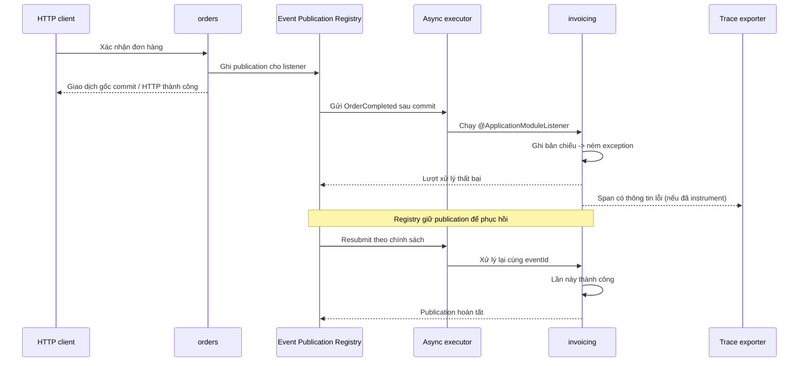
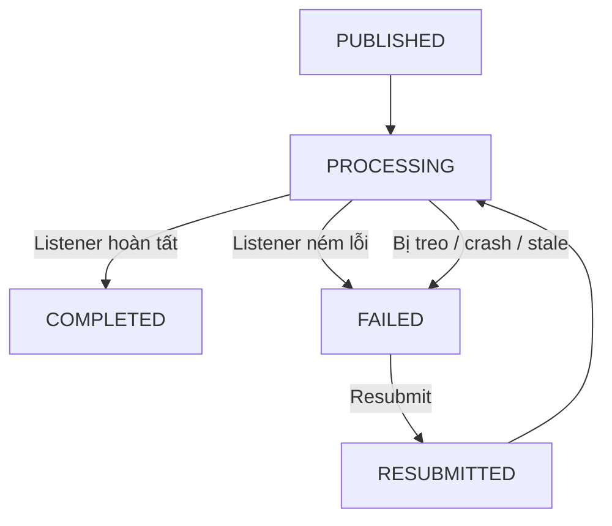

# Event listener lỗi và trạng thái span

## 1. Mục tiêu của bài học

Trong hệ thống Spring Boot chia thành nhiều application module, một sự kiện nghiệp vụ được phát ra ở mô-đun này có thể được xử lý bất đồng bộ tại mô-đun khác. Khi listener gặp lỗi, câu hỏi quan trọng không chỉ là *“Có exception hay không?”* mà còn là:

- Giao dịch gốc đã hoàn tất chưa? Dữ liệu nghiệp vụ của listener đã commit hay rollback?
- Spring Modulith đã ghi nhận lần phát sự kiện cho listener đó ở trạng thái nào? Có thể gửi lại không?
- Trace có span cho lượt xử lý lỗi không? Span đó ghi `ERROR`, `UNSET` hay không xuất hiện?
- Context (trace ID, MDC) có đi qua thread bất đồng bộ và còn tồn tại khi retry sau khi khởi động lại ứng dụng không?

Bài **Event listener lỗi và trạng thái span** thuộc chương **Sự kiện bất đồng bộ** của học phần **SPRING_MODULITH_DOCUMENTATION_OBSERVABILITY**. Học phần dùng Spring Modulith để tài liệu hóa ranh giới application module, xem module graph và quan sát tương tác khi Spring Boot chạy thông qua Actuator, event metrics, tracing và context propagation. Trọng tâm bài này là **xác định chính xác trạng thái lỗi của một listener từ ba nguồn độc lập: event publication registry, transaction và tracing**.

Sau bài học, bạn có thể viết listener ném lại lỗi đúng cách, giải thích một trace thành công có đồng nghĩa với event xử lý xong hay không, truy vết các lượt xử lý/retry và xây dựng kiểm thử có chủ ý cho trường hợp lỗi.

## 2. Kịch bản: một sự kiện đi qua hai module

Giả sử ứng dụng có hai application module:

- `orders`: xác nhận đơn hàng và phát sự kiện `OrderCompleted`.
- `invoicing`: nhận sự kiện để ghi bản chiếu dữ liệu phục vụ lập hóa đơn.

Phần xử lý hóa đơn có thể lỗi vì database tạm thời không truy cập được. Đó là lỗi **sau khi** đơn hàng đã được xác nhận, nên không mong rollback giao dịch đặt hàng chỉ vì một listener bất đồng bộ thất bại.



Điều kiện then chốt: ứng dụng phải **bật event publication registry với kho lưu trữ bền vững** phù hợp. Riêng `@Async` hoặc `@ApplicationModuleListener` không làm cho sự kiện tự động an toàn sau crash nếu cơ chế lưu publication chưa được cấu hình đúng.

### 2.1. Ví dụ sự kiện và publisher

```java
package com.example.orders;

import java.util.UUID;

// Payload bất biến, có eventId để nhận diện cùng một sự kiện qua nhiều lần thử.
public record OrderCompleted(UUID eventId, UUID orderId) {}
```

```java
package com.example.orders;

import java.util.UUID;
import org.springframework.context.ApplicationEventPublisher;
import org.springframework.stereotype.Service;
import org.springframework.transaction.annotation.Transactional;

@Service
public class OrderService {

    private final OrderRepository orders; // Repository do ứng dụng cung cấp
    private final ApplicationEventPublisher events;

    public OrderService(OrderRepository orders, ApplicationEventPublisher events) {
        this.orders = orders;
        this.events = events;
    }

    @Transactional
    public void complete(UUID orderId) {
        var order = orders.findById(orderId).orElseThrow();
        order.markCompleted();
        orders.save(order);
        events.publishEvent(new OrderCompleted(UUID.randomUUID(), orderId));
    }
}
```

Khi dùng cơ chế transactional event listener mặc định, listener chạy trong pha `AFTER_COMMIT` của transaction gốc. Nếu transaction gốc rollback, không có lượt xử lý sau commit như ở sơ đồ. Mỗi sự kiện có `eventId` riêng và `eventId` **không đổi khi gửi lại**, giúp nhận ra yêu cầu bị xử lý lặp.

## 3. Ba trạng thái khác nhau cần quan sát

Không nên dùng một trường `status` duy nhất để kết luận tất cả. Các trạng thái trả lời những câu hỏi khác nhau:

| Nguồn | Câu hỏi được trả lời | Giá trị ví dụ |
|---|---|---|
| Transaction của publisher | Thay đổi đơn hàng ban đầu đã commit chưa? | `COMMITTED`, `ROLLED_BACK` (khái niệm nghiệp vụ) |
| Transaction của listener | Thay đổi bản chiếu do listener thực hiện đã commit chưa? | `COMMITTED`, `ROLLED_BACK` |
| Event publication registry | Publication dành cho listener đã hoàn tất hay cần khôi phục? | `PUBLISHED`, `PROCESSING`, `FAILED`, `COMPLETED`… |
| Trace span | *Lượt thực thi đang quan sát* có được ghi nhận là lỗi không? | OpenTelemetry `UNSET`, `ERROR`, đôi khi `OK` |

**Điểm dễ nhầm:** `FAILED` trong event registry là trạng thái của một publication; `ERROR` trên span là trạng thái của một **lần thực thi**. Một event có thể có một lượt `ERROR` rồi một lượt xử lý sau `UNSET` và cuối cùng publication trở thành `COMPLETED`. Hai lượt có thể thuộc hai trace khác nhau.

### 3.1. Vòng đời publication theo phiên bản Spring Modulith

Từ **Spring Modulith 2.0**, event publication có vòng đời tường minh:



Từ **Spring Modulith 2.2**, có thêm `ABANDONED` khi chính sách quyết định ngừng gửi lại một publication lỗi. Với Spring Modulith **1.x**, tài liệu và API chú trọng phân biệt *completed* với *incomplete*; không áp dụng máy móc các enum trạng thái 2.x cho phiên bản 1.x.

Cần chú ý ba trường hợp:

1. **Listener ném exception:** publication có thể chuyển sang `FAILED` (2.x); bản ghi lỗi được giữ để phục hồi theo chính sách.
2. **Process chết giữa lượt chạy:** không nhất thiết có span hoàn chỉnh hoặc exception được bắt. Publication có thể mắc ở `PROCESSING`; phiên bản 2.x có cơ chế đánh dấu stale khi được cấu hình.
3. **Listener hoàn tất thành công:** publication trở thành `COMPLETED`, hoặc bị xóa/chuyển sang archive tùy completion mode. Không thấy bản ghi ở bảng “chưa hoàn tất” không đủ để kết luận thành công nếu chưa biết cấu hình lưu trữ.

Event Publication Registry theo dõi publication **cho từng listener đích**. Một event được hai listener tiêu thụ có thể có một publication `COMPLETED` và một publication `FAILED`.

### 3.2. Trạng thái của một span OpenTelemetry

Một span đại diện cho thao tác có mốc bắt đầu/kết thúc, trace ID, span ID và thuộc tính. Với OpenTelemetry:

| Trạng thái | Ý nghĩa | Diễn giải |
|---|---|---|
| `UNSET` | Chưa đặt trạng thái tường minh | Thường là kết quả bình thường của thao tác hoàn tất, **không có nghĩa chưa chạy** |
| `ERROR` | Thao tác được ghi nhận lỗi | Phải có instrumentation báo lỗi cho span tương ứng |
| `OK` | Thành công được đặt tường minh | Không phải mọi instrumentation đều đặt `OK`; việc không có `OK` không chứng minh thất bại |

**Một exception không tự động biến mọi span thành `ERROR`.** Hành vi phụ thuộc phạm vi instrumentation, exception có được quan sát hay bị bắt nuốt, và việc exporter/bridge chuyển dữ liệu sang backend. Với Micrometer Observation, gọi `observation.error(ex)` là cách rõ ràng để báo lỗi cho vòng đời Observation, sau đó `stop()` để kết thúc. Trong một số hệ thống, instrumentation tự nhận biết exception thoát khỏi method; cần kiểm tra thay vì suy đoán.

Span `ERROR` cũng không đồng nghĩa HTTP request ban đầu lỗi: nếu HTTP đã trả 200 trước khi listener bất đồng bộ thất bại thì có thể **HTTP span bình thường** nhưng **listener span lỗi**.

## 4. Thiết lập Spring Modulith và observability

### 4.1. Các thành phần cần có

Đối với ứng dụng Spring Boot dùng Spring Modulith, nhóm phụ thuộc có thể gồm:

| Mục đích | Dependency/điều kiện |
|---|---|
| Cấu trúc module và event | `spring-modulith-starter-core` |
| Publication bền vững | Chọn starter tương ứng như `spring-modulith-starter-jdbc` hoặc `spring-modulith-starter-jpa` và cấu hình database |
| Module graph tại runtime + observability | `spring-modulith-starter-insight`; hoặc `spring-modulith-actuator` và `spring-modulith-observability-core` |
| Micrometer & monitoring | Spring Boot Actuator, Micrometer Tracing bridge (OpenTelemetry hoặc Brave), exporter tương ứng |
| Qua ranh giới thread | Micrometer Context Propagation và `TaskDecorator` cho executor đã chọn |
| Kiểm thử | `spring-modulith-starter-test`, Spring Test, một tracing/test registry phù hợp |

Chọn **các phiên bản tương thích với Spring Boot** theo BOM được sử dụng; không trộn các phiên bản 1.x và 2.x tùy ý. Ví dụ cấu hình ở phần sau mô tả API có trong Spring Framework 6.1+ và Spring Modulith 2.x; với stack cũ hơn, cần điều chỉnh theo API của phiên bản thực tế.

Nếu chưa có tracing bridge, `ObservationRegistry` vẫn có thể hoạt động và tạo metric, nhưng không bảo đảm xuất hiện span ở Zipkin/Tempo/Jaeger. Nếu thiếu event registry bền vững, không có bằng chứng đáng tin cậy rằng event lỗi còn có thể phục hồi sau restart.

### 4.2. Đọc module graph và metric

Spring Modulith Insight/Actuator có thể cung cấp `GET /actuator/modulith` để xem module và dependencies. Loại phụ thuộc `EVENT_LISTENER` chỉ ra tương tác kiến trúc qua sự kiện; nó **không thể hiện trạng thái thành công của từng event**.

Khi bật observability, Spring Modulith có thể phát span cho lời gọi đi qua module API; module entry span thường có những key như:

- `module.identifier`
- `module.name`
- `module.method`
- `module.invocation-type` (ví dụ `event listener`)

Metric `module.events.published` và các metric dạng `module.events.published.<module>.<event-type>` đếm **lượt phát sự kiện**. Chúng không phải là counter của listener thành công. Muốn theo dõi tỷ lệ thất bại, thời gian xử lý hay hàng đợi chưa hoàn tất cần thêm Observation/metric cho lượt xử lý và theo dõi event registry.

Actuator phải được cho phép expose theo cấu hình Spring Boot và được bảo vệ quyền truy cập phù hợp; không coi một endpoint quản trị là endpoint công khai bắt buộc.

## 5. Cài đặt listener có instrumentation lỗi

### 5.1. `@ApplicationModuleListener` hoạt động như thế nào?

Annotation `org.springframework.modulith.events.ApplicationModuleListener` kết hợp cách tiếp cận:

- `@TransactionalEventListener`: xử lý sự kiện ở pha sau commit theo mặc định.
- `@Async`: đưa việc xử lý sang executor khác.
- `@Transactional(propagation = REQUIRES_NEW)`: mỗi lượt xử lý có transaction độc lập.

Điều này tách vòng đời xử lý của `invoicing` ra khỏi transaction của `orders`. Transaction gốc thành công **không bảo đảm** listener sẽ thành công sau đó.

### 5.2. Mẫu listener ghi nhận exception và ném lại

Ví dụ dùng Java 17+, Spring Boot, Micrometer Observation và Spring Modulith. Giả định ứng dụng có `InvoiceProjectionService` và đã cấu hình `ObservationRegistry` cùng tracing handler phù hợp:

```java
package com.example.invoicing;

import com.example.orders.OrderCompleted;
import io.micrometer.observation.Observation;
import io.micrometer.observation.ObservationRegistry;
import org.slf4j.Logger;
import org.slf4j.LoggerFactory;
import org.springframework.modulith.events.ApplicationModuleListener;
import org.springframework.stereotype.Component;

@Component
public class InvoiceEventListener {

    private static final Logger log =
        LoggerFactory.getLogger(InvoiceEventListener.class);

    private final InvoiceProjectionService projections;
    private final ObservationRegistry observationRegistry;

    public InvoiceEventListener(
            InvoiceProjectionService projections,
            ObservationRegistry observationRegistry) {
        this.projections = projections;
        this.observationRegistry = observationRegistry;
    }

    @ApplicationModuleListener
    public void on(OrderCompleted event) {

        Observation observation = Observation
            .createNotStarted("invoicing.order-completed.process",
                              observationRegistry)
            .lowCardinalityKeyValue("listener", "invoice-projection")
            .lowCardinalityKeyValue("event.type", "OrderCompleted")
            // eventId có giá trị riêng cho từng event: chỉ log/tracing,
            // không đưa làm low-cardinality tag của metric.
            .start();

        try (Observation.Scope ignored = observation.openScope()) {
            projections.applyOnce(event.eventId(), event.orderId());
            log.info("Invoice projection applied, eventId={}", event.eventId());

        } catch (RuntimeException ex) {
            // Báo lỗi cho Micrometer; tracing handler có thể đặt span ERROR.
            observation.error(ex);
            log.error("Invoice projection failed, eventId={}",
                      event.eventId(), ex);

            // BẮT BUỘC cho cơ chế registry thấy lượt xử lý thất bại.
            throw ex;

        } finally {
            observation.stop();
        }
    }
}
```

**Phạm vi ví dụ:** Observation thủ công đo **thân method `on(…)`**. Transaction interceptor của `@ApplicationModuleListener` có thể commit sau khi body của method trả về; nếu commit thất bại ở lớp transaction phía ngoài, custom span ở đây có thể đã kết thúc mà chưa thấy lỗi commit. Tương tự, lỗi xảy ra trước khi method được gọi (deserialize/dispatch/executor) không nằm trong span này. Khi cần định nghĩa “listener thành công” bao gồm cả commit, hãy quan sát transaction/registry và instrument ở ranh giới bao trùm transaction phù hợp với thứ tự AOP advisor.

Với `spring-modulith-observability-core`, có thể đã tồn tại module entry span; custom span chỉ nên thêm khi thật sự cần thời gian và thông tin của công đoạn cụ thể. Có thể giữ span module entry làm span cha của custom span nếu tracing context hiện hành được đưa vào đúng luồng.

### 5.3. Tránh nuốt lỗi

Đoạn sau là một lỗi thiết kế:

```java
@ApplicationModuleListener
public void on(OrderCompleted event) {
    try {
        projections.applyOnce(event.eventId(), event.orderId());
    } catch (Exception ex) {
        log.error("Cannot process {}", event.eventId(), ex);
        // Không ném lại: framework có thể coi listener xử lý thành công.
    }
}
```

Kết quả nguy hiểm: log chứa lỗi nhưng method trả về bình thường; registry có thể đánh dấu `COMPLETED`, còn publication không được chọn để retry. Nếu phía application tự đặt span `ERROR` nhưng nuốt exception, càng có khả năng xuất hiện **span lỗi + registry hoàn tất**. Mối quan hệ giữa các tín hiệu phải được hiểu theo phạm vi của chúng, không suy ra trạng thái này từ trạng thái kia.

Nếu lỗi đã được khắc phục ngay trong method bằng fallback thực sự và nghiệp vụ **được chấp nhận là hoàn tất**, việc không ném lại có thể đúng; cần chủ động thiết kế rõ điều kiện thành công, phân biệt lỗi tạm thời với tình huống nghiệp vụ từ chối có chủ đích.

### 5.4. Bảo đảm xử lý lặp an toàn

Retry thường có thể gọi lại cùng event nhiều lần. Áp dụng **idempotency** trong cùng transaction với tác động nghiệp vụ:

```java
@Service
public class InvoiceProjectionService {

    private final ProcessedEventRepository processedEvents;
    private final InvoiceProjectionRepository invoices;

    public InvoiceProjectionService(
            ProcessedEventRepository processedEvents,
            InvoiceProjectionRepository invoices) {
        this.processedEvents = processedEvents;
        this.invoices = invoices;
    }

    // Được gọi trong transaction REQUIRES_NEW của @ApplicationModuleListener.
    public void applyOnce(UUID eventId, UUID orderId) {
        if (processedEvents.existsByEventId(eventId)) {
            return; // Retry trùng: không áp dụng nghiệp vụ lần nữa.
        }

        invoices.upsertFromOrder(orderId);
        processedEvents.save(new ProcessedEvent(eventId));
    }
}
```

Repository và entity `ProcessedEvent` ở đây là thành phần tự xây dựng; database cần **unique constraint** trên `eventId` để tránh hai lượt xử lý đồng thời vượt qua kiểm tra `exists`. Việc ghi “đã xử lý” và cập nhật projection cần nằm trong cùng một transaction. Đối với tác động ngoài database (gửi email, gọi hệ thống thanh toán), cần cơ chế chống trùng ở phía đích, inbox/outbox hoặc idempotency key thích hợp.

## 6. Propagate trace context qua `@Async`

### 6.1. Vì sao listener mất trace cha?

Thread xử lý HTTP request thường có trace/span hiện hành trong ThreadLocal. Khi `@Async` đưa listener vào pool khác, context không tự xuất hiện trên worker thread nếu executor không được cấu hình. Hậu quả:

- Listener tạo ra **root span** mới hoặc không có trace context, khó ghép với request gốc.
- Log của listener thiếu `traceId`/`spanId` do MDC không được đưa qua thread.
- Span lỗi của listener vẫn có thể tồn tại, nhưng không nằm trong trace của thao tác phát sự kiện.

Spring Framework 6.1+ cung cấp `ContextPropagatingTaskDecorator` hỗ trợ việc mang Observation/ThreadLocal logging context vào task. Ví dụ cấu hình một executor được Spring `@Async` sử dụng:

```java
package com.example.config;

import java.util.concurrent.Executor;
import org.springframework.context.annotation.Bean;
import org.springframework.context.annotation.Configuration;
import org.springframework.core.task.support.ContextPropagatingTaskDecorator;
import org.springframework.scheduling.annotation.EnableAsync;
import org.springframework.scheduling.concurrent.ThreadPoolTaskExecutor;

@Configuration
@EnableAsync
public class AsyncEventConfiguration {

    @Bean(name = "taskExecutor")
    public Executor taskExecutor() {
        ThreadPoolTaskExecutor executor = new ThreadPoolTaskExecutor();
        executor.setThreadNamePrefix("modulith-events-");
        executor.setCorePoolSize(4);
        executor.setMaxPoolSize(8);
        executor.setQueueCapacity(100);
        executor.setTaskDecorator(new ContextPropagatingTaskDecorator());
        executor.initialize();
        return executor;
    }
}
```

Cần xác minh **executor thực tế** mà `@ApplicationModuleListener` đang dùng; nếu dự án khai báo nhiều executor hoặc có `AsyncConfigurer`, bean tên `taskExecutor` có thể không phải executor được chọn. Context propagation cũng cần các context accessor tương ứng được đăng ký và Micrometer Context Propagation có mặt trên classpath.

**Giới hạn:** decorator chụp context khi task được submit; nếu event được gửi lại nhiều giờ sau hoặc sau khi ứng dụng restart, trace context gốc trong bộ nhớ không còn. Khi đó tạo trace mới cho lượt retry và dùng `eventId` trong log/span attribute để nối các lần thực thi. Không hứa hẹn một trace liên tục xuyên qua crash/restart.

### 6.2. Minh họa trace có lỗi rồi retry

Ví dụ hai lượt xử lý cùng `eventId=ev-42`:

```text
traceId = T-100
  orders.complete                       status=UNSET
    invoicing.order-completed.process  status=ERROR
      exception.type=DataAccessResourceFailureException
      eventId=ev-42

[event publication: FAILED; lần xử lý 1]

traceId = T-900   // lượt retry sau khi khôi phục, có trace mới
  invoicing.order-completed.process  status=UNSET
    eventId=ev-42

[event publication: COMPLETED; lần xử lý 2]
```

Đây là **dữ liệu mô phỏng**, không phải định dạng xuất mặc định của tracing backend. Trên giao diện quan sát, span thành công có thể hiển thị “success”, “unset” hoặc không có nhãn status. Không nên lấy việc mọi span đều “OK” làm yêu cầu nghiệm thu.

Nếu cần làm rõ liên hệ giữa các trace, dùng `eventId`/`publicationId` trong structured log và span attribute (high cardinality) theo chính sách bảo mật và giới hạn lưu trữ; **không** dùng từng `eventId` làm nhãn của counter/timer.

## 7. Retry publication và ý nghĩa đối với span

### 7.1. Hai cơ chế có vai trò khác nhau

**Event Publication Registry** lưu trạng thái để còn có thể gửi lại cho listener. **Trace exporter** thu thập bằng chứng cho từng lượt thực thi. Việc lưu được một span `ERROR` không làm event tự retry; ngược lại registry có thể retry thành công ngay cả khi tracing sampling không xuất span nào.

Trong Spring Modulith 2.x, ví dụ thao tác resubmit thủ công các publication `FAILED`:

```java
import java.time.Duration;
import org.springframework.modulith.events.FailedEventPublications;
import org.springframework.modulith.events.ResubmissionOptions;
import org.springframework.stereotype.Component;

@Component
public class FailedEventRecovery {

    private final FailedEventPublications failed;

    public FailedEventRecovery(FailedEventPublications failed) {
        this.failed = failed;
    }

    // Gọi từ công cụ vận hành / job có kiểm soát và phân quyền.
    public void resubmitEligible() {
        failed.resubmit(
            ResubmissionOptions.defaults()
                .withBatchSize(25)
                .withMaxInFlight(4)
                .withMinAge(Duration.ofSeconds(30))
        );
    }
}
```

API `FailedEventPublications` và `ResubmissionOptions` được đưa vào Spring Modulith 2.0. Với Spring Modulith 1.x, dùng API `IncompleteEventPublications` và các overload phù hợp version. Không coi lệnh này là “retry đúng một lần”: mỗi lần resubmit có thể phát sinh execution khác và vẫn có thể gặp lỗi.

Có thể bật:

```properties
spring.modulith.events.republish-outstanding-events-on-restart=true
```

Nhưng **mặc định là `false`**. Tự động phát lại khi restart thường không phù hợp nếu nhiều instance đang cùng chạy: một instance có thể vẫn đang xử lý publication mà instance kia muốn gửi lại. Hãy xây dựng chính sách chọn publication đủ cũ, giới hạn số việc chạy đồng thời và kiểm tra tính idempotent.

Đối với Spring Modulith 2.x, staleness monitor có thể đánh dấu `PUBLISHED`/`PROCESSING`/`RESUBMITTED` quá hạn thành `FAILED` nếu cấu hình duration khác 0. Với phiên bản 2.2+, một số publication có thể trở thành `ABANDONED` theo chính sách. Không đặt thời gian stale ngắn hơn thời gian xử lý hợp lệ của listener.

### 7.2. Lỗi có thể xuất hiện ở nhiều điểm

| Điểm xảy ra lỗi | Registry | Span thường quan sát được | Việc cần làm |
|---|---|---|---|
| Publisher rollback trước commit | Không có lượt sau commit tương ứng | HTTP/publisher span có thể báo lỗi | Kiểm tra transaction gốc |
| Listener ném exception trong body | Publication lỗi/chưa hoàn tất | Span listener `ERROR` nếu được ghi nhận đúng | Giữ exception, chuẩn bị retry |
| Listener nuốt exception | Có thể `COMPLETED` dù nghiệp vụ chưa xong | Có thể `ERROR` hoặc `UNSET` | Sửa ngữ nghĩa thành công/lỗi |
| Commit transaction của listener thất bại | Publication vẫn có thể chưa hoàn tất | Span custom bao quanh *method body* có thể đã kết thúc bình thường | Quan sát transaction + registry |
| Process chết trước khi span kết thúc | Publication có thể dở dang/stale | Span có thể không xuất hiện | Kiểm tra stale/khôi phục sau crash |
| Retry thành công | `COMPLETED` hoặc được lưu theo completion mode | Một lượt span mới, thường `UNSET` | Kiểm tra idempotency và lịch sử retry |
| Không có trace do sampling/exporter | Registry vẫn ghi nhận trạng thái | Không thấy span | Kiểm tra cấu hình sampling/exporter |

Đặc biệt, khi listener chỉ là một method trong transaction advice, *thành công của thân method* không chắc là *thành công của commit*. Đừng chỉ đo thời gian đến lúc method return để kết luận toàn bộ event đã hoàn tất.

## 8. Quan sát lỗi bằng log, metrics và span

### 8.1. Mã định danh và phân loại dữ liệu

Log cấu trúc nên chứa:

```json
{
  "module": "invoicing",
  "listener": "InvoiceEventListener",
  "eventType": "OrderCompleted",
  "eventId": "ev-42",
  "attempt": 1,
  "outcome": "failed",
  "exceptionType": "DataAccessResourceFailureException",
  "traceId": "T-100",
  "spanId": "S-3"
}
```

Dữ liệu chỉ là ví dụ. `attempt` cần lấy từ registry hoặc ứng dụng quản lý thử lại; không tự suy từ số thứ tự log nếu có nhiều instance.

| Giá trị | Phù hợp làm metric tag? | Vị trí phù hợp |
|---|---|---|
| `module`, `listener`, `eventType` | Có, nếu tập giá trị được kiểm soát | Low-cardinality metric tags/span attributes |
| `outcome=success|error` | Có | Metric tag/structured log |
| `exceptionType` | Có điều kiện (loại exception hữu hạn) | Metric tag, span/log |
| `eventId`, `orderId` | Không | Structured log / trace attribute có kiểm soát |
| `traceId`, `spanId` | Không | Log correlation / tracing |
| Nội dung payload đầy đủ | Không | Chỉ khi đã che dữ liệu nhạy cảm và có mục đích rõ ràng |

### 8.2. Những chỉ số vận hành hữu ích

- **Tốc độ phát event:** `module.events.published` từ Spring Modulith; metric này tự nó chưa nói listener xử lý thành công.
- **Thời gian xử lý listener:** timer từ Observation `invoicing.order-completed.process` nếu đăng ký meter ObservationHandler phù hợp.
- **Tỷ lệ xử lý lỗi:** đếm số lượt `outcome=error` trên tổng lượt xử lý, hoặc metric `error` do Micrometer Observation tạo.
- **Tồn đọng registry:** số publication đang `FAILED` hoặc chưa hoàn tất, tuổi của publication cũ nhất, số lần xử lý lặp.
- **Độ trễ nghiệp vụ:** thời gian từ khi event được phát đến lúc publication `COMPLETED`, tính từ persisted timestamps nếu có.
- **Tỷ lệ trace bị thiếu:** kiểm tra sampling và lỗi exporter trước khi dùng số trace để kết luận tổng event.

Trong Micrometer, `DefaultMeterObservationHandler` có thể tạo timer gắn tag `error` dựa trên `observation.error(ex)`. Khi đặt alert, ghép metric lỗi với tồn đọng registry để phân biệt một lỗi được phục hồi nhanh với sự cố kéo dài.

### 8.3. Đọc trace để kiểm chứng ranh giới mô-đun

Khi mở trace, tìm module entry span có `module.invocation-type=event listener`, xác định mô-đun phát và mô-đun nhận. Đối chiếu với module graph của Spring Modulith: graph cho biết **phụ thuộc ở mức kiến trúc** còn trace cho biết **đường thực thi thực tế**.

Nếu thấy span listener mang tên mô-đun sai hoặc thiếu module identifier, kiểm tra phạm vi package được Spring Modulith nhận diện là application module, việc instrument method có qua Spring proxy hay không, và cấu hình observability. Nếu span xuất hiện nhưng không nối với HTTP span, kiểm tra executor/task decorator và thời điểm context được submit.

## 9. Kiểm thử có chủ đích các trạng thái lỗi

Các bài test chỉ assert “đã publish sự kiện” chưa chứng minh được listener thất bại đã được giữ lại hoặc span đã được đặt `ERROR`. Cần kiểm thử từng lớp:

### 9.1. Kiểm thử đơn vị: listener không nuốt exception

Đây là một kiểm thử logic đơn giản, không chạy AOP/async/registry:

```java
import static org.junit.jupiter.api.Assertions.assertThrows;
import static org.mockito.Mockito.*;

import io.micrometer.observation.ObservationRegistry;
import java.util.UUID;
import org.junit.jupiter.api.Test;

class InvoiceEventListenerTest {

    @Test
    void failureMustEscapeListenerBody() {
        InvoiceProjectionService projection =
            mock(InvoiceProjectionService.class);
        UUID eventId = UUID.randomUUID();
        UUID orderId = UUID.randomUUID();

        doThrow(new IllegalStateException("Database unavailable"))
            .when(projection).applyOnce(eventId, orderId);

        var listener = new InvoiceEventListener(
            projection,
            ObservationRegistry.create());

        assertThrows(IllegalStateException.class,
            () -> listener.on(new OrderCompleted(eventId, orderId)));

        verify(projection).applyOnce(eventId, orderId);
    }
}
```

Nếu test này vẫn pass sau khi listener bắt lỗi rồi bỏ qua, test đang có vấn đề; mục tiêu là chứng minh exception đi ra khỏi method. `ObservationRegistry.create()` chưa có tracing handler nên **không kiểm tra được span status**.

### 9.2. Kiểm thử tích hợp: publication thất bại rồi phục hồi

Dùng `@ApplicationModuleTest` hoặc `@SpringBootTest` với một registry repository thực/embedded phù hợp, service giả lập có thể ép lỗi lần đầu và thành công lần thứ hai.

1. Gọi publisher qua một Spring bean đã được proxy bằng `@Transactional`. Transaction phải **commit thật**; test mặc định rollback có thể khiến `@TransactionalEventListener` không bao giờ chạy. Có thể dùng `TransactionTemplate` hoặc tổ chức test không bọc rollback.
2. Ép `InvoiceProjectionService.applyOnce` ném exception ở lượt đầu; dùng cơ chế chờ có timeout (`Awaitility`/`Scenario` của Spring Modulith) vì listener chạy bất đồng bộ.
3. Quan sát rằng transaction gốc đã commit; listener thất bại; publication còn ở registry (với 2.x, trạng thái `FAILED` sau khi xử lý lỗi hoàn tất), và projection chưa được ghi.
4. Gỡ lỗi, gọi API resubmit phù hợp; chờ publication chuyển `COMPLETED` và projection xuất hiện **đúng một lần**.
5. Đọc các span mà in-memory tracer/exporter ghi nhận: lượt đầu có error được record; lượt sau hoàn tất bình thường; ghi nhận việc trace ID có thể khác nhau.
6. Gửi cùng `eventId` thêm lần nữa và kiểm tra unique constraint/idempotency chặn tác động lặp.

**Không dùng `Thread.sleep` với thời gian đoán mò để kết luận async xử lý xong.** Chờ điều kiện cụ thể có giới hạn thời gian và đọc trạng thái registry sau khi kết thúc transaction listener.

### 9.3. Kiểm thử span status

Với hệ thống dùng OpenTelemetry, có thể sử dụng in-memory span exporter (trong test dependency của OpenTelemetry SDK), cấu hình tỷ lệ sampling đủ để ghi nhận các span test, rồi assert:

- Span cho lượt listener bị lỗi có `ERROR` **khi instrumentation được cấu hình đặt trạng thái lỗi**.
- Exception được record thành event/attribute phù hợp; log có `eventId` và trace ID.
- Lượt retry có span riêng và kết thúc bình thường (thường `UNSET`; không bắt buộc `OK`).
- Nếu dùng custom Observation như mục 5.2, tên `invoicing.order-completed.process` phải tồn tại đúng một lần mỗi lượt, được `stop()` trong cả thành công và lỗi.

Nếu tracer chưa nối vào `ObservationRegistry` hoặc trace bị sampling loại bỏ, test không nên suy rằng method không chạy. Kiểm tra cài đặt instrumentation riêng và trạng thái nghiệp vụ bằng registry.

### 9.4. Ma trận kiểm thử tổng hợp

| Trường hợp | Publisher | Listener | Registry kỳ vọng | Span kỳ vọng |
|---|---|---|---|---|
| Bình thường | Commit | Thành công | `COMPLETED` | Listener kết thúc, thường `UNSET` |
| Listener lỗi | Commit | Ném exception | `FAILED` hoặc incomplete tùy phiên bản | `ERROR` nếu ghi nhận lỗi |
| Bắt lỗi rồi nuốt | Commit | Method trả bình thường | Có thể `COMPLETED` | Không suy ra từ registry |
| Publisher rollback | Rollback | Không chạy sau commit | Không có publication được commit cho lượt này | Không có listener span tương ứng |
| Retry thành công | Đã commit từ trước | Thành công ở lần 2 | `COMPLETED` | Span mới; có thể trace mới |
| App crash khi đang xử lý | Commit | Bị dừng giữa chừng | Incomplete/stale theo policy | Span có thể thiếu |
| Context không propagate | Commit | Vẫn có thể chạy | Không bị đổi bởi trace | Span mồ côi/root mới |
| Span không export | Commit | Có thể thành công/lỗi | Registry phản ánh trạng thái riêng | Không có bản ghi để xem |
| Commit listener bị lỗi | Commit | Method đã return | Chưa thể coi là hoàn tất | Body span có thể không `ERROR` |
| Publication được đánh dấu `ABANDONED` (2.2+) | Commit | Đã lỗi và hết cơ hội retry theo policy | `ABANDONED` | Lịch sử span lỗi có thể tồn tại |

Thực nghiệm phải xác nhận **phiên bản Spring Modulith**, completion mode và loại kho registry trước khi assert tên trạng thái cụ thể.

## 10. Những lỗi chẩn đoán thường gặp

### “Listener log exception nhưng registry ghi COMPLETED”

Kiểm tra `catch` có bỏ qua exception không; có fallback đã xử lý xong theo tiêu chí nghiệp vụ không; listener có thực sự chạy thông qua proxy `@ApplicationModuleListener` không; registry có đăng ký đúng listener đó không. Lỗi được ghi log mà không ném lại thường bị framework coi là method thành công.

### “Trace có ERROR nhưng đơn hàng trả 200”

Đây có thể là đúng theo thiết kế: giao dịch publisher commit và phản hồi HTTP trước khi listener bất đồng bộ lỗi. Theo dõi trạng thái projection và registry để xác định tác động nghiệp vụ, không đổi HTTP 200 của transaction trước thành 500 hồi tố.

### “Listener lỗi nhưng không thấy ERROR span”

Quan sát có thể chưa bật, tracing bridge/exporter bị thiếu, sampling loại bỏ span, exception xảy ra ngoài phạm vi instrumentation, hoặc exception đã được xử lý và không được báo bằng `observation.error(ex)`. Cần xác minh chỗ gọi `error()`, `stop()` và bộ xuất trace.

### “Span SUCCESS/UNSET nhưng registry FAILED”

Method body có thể hoàn tất rồi transaction commit thất bại, hoặc span chỉ bao một bước thành công trong khi lớp ngoài lỗi. Kiểm tra thời điểm span kết thúc, transaction advice, sự kiện listener được bao bọc và log từ Event Publication Registry.

### “Sau khi restart, listener có traceId khác”

Một lượt retry qua registry sau restart là một lần thực thi mới, không thể tự khôi phục ThreadLocal trace context cũ. Dùng `eventId` hoặc một khóa tương quan được lưu bền vững để ghép lịch sử nhiều trace.

### “Một sự kiện chạy hai lần hoặc hai instance cùng xử lý”

Kiểm tra resubmission policy, việc bật tự gửi lại khi restart trong môi trường nhiều replica, và idempotency ở database. Bảo đảm tác động nghiệp vụ là idempotent ngay cả khi registry có cơ chế đánh dấu đang xử lý.

## 11. Bài thực hành và tiêu chí nghiệm thu

**Bài tập:** Tạo hai module `orders` và `invoicing`. Khi xác nhận đơn hàng, phát `OrderCompleted(eventId, orderId)`; listener ghi projection vào database. Trong lần đầu, cố ý tạo lỗi tạm thời từ repository của `invoicing`.

Các kết quả cần thu thập:

1. Một bản đồ module hoặc dữ liệu `/actuator/modulith` cho thấy phụ thuộc qua `EVENT_LISTENER`.
2. Bằng chứng transaction `orders` đã commit trong khi listener lỗi.
3. Log có `eventId`, trace ID và stack trace của listener; span lượt lỗi được quan sát với `ERROR` khi instrumentation đã bật.
4. Bằng chứng publication còn khả năng phục hồi trong registry; sử dụng trạng thái `FAILED` nếu triển khai Spring Modulith 2.x phù hợp.
5. Sau resubmit, projection được tạo **một lần**, publication hoàn tất và có span lượt thử mới.
6. Thử tắt context propagation trên executor rồi bật lại để so sánh cấu trúc trace; xác nhận việc kết nối trace qua `@Async` phụ thuộc cấu hình.
7. Giả lập commit lỗi hoặc crash giữa chừng để nhận ra vì sao thành công của method/span không đủ khẳng định publication hoàn tất.

**Tiêu chí đạt:** giải thích được sự khác nhau giữa `FAILED` của publication với `ERROR` của span; không nuốt exception ngoài ý muốn; có chính sách retry/idempotency; đọc được log, metric và trace theo đúng phạm vi; tái lập được ít nhất một tình huống thành công sau retry.

## 12. Nguồn tài liệu chính thức

- [Spring Modulith – Working with Application Events](https://docs.spring.io/spring-modulith/reference/events.html): `@ApplicationModuleListener`, Event Publication Registry, trạng thái và resubmission.
- [Spring Modulith – Production-ready Features](https://docs.spring.io/spring-modulith/reference/production-ready.html): module actuator, module entry spans, event publication metrics.
- [Spring Modulith – Configuration Properties](https://docs.spring.io/spring-modulith/reference/appendix.html): cấu hình completion, restart republish và staleness.
- [Micrometer – Observation Components](https://docs.micrometer.io/micrometer/reference/observation/components.html): vòng đời Observation và `observation.error(ex)`.
- [Spring Framework – Observability Support](https://docs.spring.io/spring-framework/reference/integration/observability.html): event listeners và context propagation.
- [Spring Framework – ContextPropagatingTaskDecorator](https://docs.spring.io/spring-framework/docs/current/javadoc-api/org/springframework/core/task/support/ContextPropagatingTaskDecorator.html): decorator cho task chạy trên thread khác.
- [OpenTelemetry – Tracing API](https://opentelemetry.io/docs/specs/otel/trace/api/): ý nghĩa `UNSET`, `ERROR` và `OK`.
