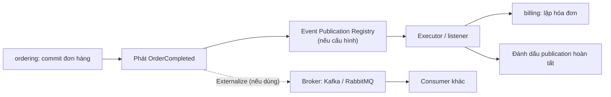
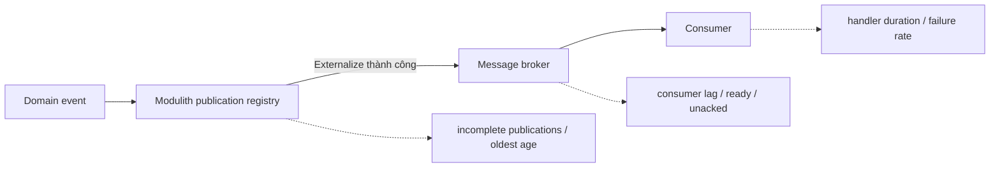

# Đo backlog hoặc độ trễ xử lý nếu hạ tầng cung cấp

## 1. Mục tiêu và phạm vi

Trong **SPRING_MODULITH_DOCUMENTATION_OBSERVABILITY**, Spring Modulith giúp mô tả ranh giới application module và quan sát tương tác giữa chúng thông qua module graph, Spring Boot Actuator, event metrics và tracing. Khi các module giao tiếp bằng **sự kiện bất đồng bộ**, một yêu cầu nghiệp vụ có thể thành công ở module phát sự kiện nhưng công việc ở module nhận vẫn đang chờ, đang chạy hoặc đã lỗi. Vì vậy, ở chương **Sự kiện bất đồng bộ**, cần học cách đo **backlog** và **độ trễ xử lý** để phát hiện sự tích tụ công việc trước khi tác động tới người dùng.

Điều kiện quan trọng trong tên bài là **“nếu hạ tầng cung cấp”**: không phải mọi cơ chế phát sự kiện của Spring đều có hàng đợi bền vững hoặc số liệu backlog tự động. Phải xác định sự kiện đang đi qua executor trong JVM, Event Publication Registry của Spring Modulith hay message broker (Kafka, RabbitMQ, v.v.) trước khi chọn thước đo.

Sau bài học, bạn có thể:

- Phân biệt số sự kiện đã phát, số publication chưa hoàn tất, số tác vụ đang đợi executor và consumer lag của message broker.
- Định nghĩa thời gian chờ trước khi listener bắt đầu và thời gian listener thực thi.
- Tận dụng metric/tracing sẵn có của Spring Modulith; bổ sung Micrometer khi muốn đo backlog hoặc latency chưa được cung cấp.
- Xây dashboard và cảnh báo dựa trên **số lượng + tuổi công việc chờ + tốc độ xử lý**, tránh diễn giải sai một con số đơn lẻ.

## 2. Đường đi của sự kiện và nơi có thể phát sinh backlog

Ví dụ hệ thống đặt hàng có module `ordering` phát `OrderCompleted`; module `billing` nghe sự kiện để lập hóa đơn sau khi giao dịch đặt hàng commit.



Sơ đồ mô tả **các nhánh tùy cấu hình**, không ngụ ý mọi sự kiện đều phải đi qua registry hoặc broker. Một ứng dụng có thể chỉ dùng `ApplicationEventPublisher`, hoặc bật Event Publication Registry để lưu dấu phát sự kiện theo listener, hoặc externalize sự kiện sang broker. Điểm chờ và cơ chế đo khác nhau ở từng nhánh.

| Hạ tầng | Đại lượng có thể đo | Giới hạn diễn giải |
|---|---|---|
| `ApplicationEventPublisher` với listener đồng bộ | Số lần phát, thời gian thực thi listener | Không có backlog hàng đợi bất đồng bộ |
| `@Async` / `@ApplicationModuleListener` dùng thread pool | Queue depth, active threads, thời gian chờ thực thi (nếu executor/metrics hỗ trợ) | Queue trong bộ nhớ không bền vững; chỉ đo đúng executor thực sự được dùng |
| Spring Modulith Event Publication Registry | Số publication chưa hoàn tất, tuổi publication cũ nhất, trạng thái/thử lại nếu phiên bản hỗ trợ | **Chưa hoàn tất ≠ đang chờ trong queue**; có thể bao gồm đang xử lý và lỗi |
| Kafka | Consumer lag theo partition/consumer group, thời gian xử lý, tuổi message nếu có timestamp phù hợp | Lag thường tính theo offset, không tự tương đương số giây chờ |
| RabbitMQ | Messages ready, unacknowledged, consumer rate, message age nếu có cơ chế đo | Ready và unacked là hai trạng thái khác nhau |
| Hệ thống task/job riêng | Queued, running, failed, oldest queued age | Phụ thuộc API và semantics của task scheduler |

**Nguyên tắc:** đặt tên metric theo thứ mình thật sự quan sát. `incomplete_publications` không nên được hiển thị thành `queue_depth` nếu nó bao gồm cả lỗi đã tồn tại nhiều ngày.

## 3. Phân biệt backlog, lag và thời gian xử lý

Giả sử một sự kiện có các mốc:

- `t0`: nghiệp vụ tạo/phát sự kiện.
- `t1`: publication được lưu vào registry hoặc message được chấp nhận bởi broker.
- `t2`: listener/consumer bắt đầu xử lý.
- `t3`: xử lý nghiệp vụ hoàn tất thành công và được ghi nhận.

Các thước đo cần phân biệt:

| Thước đo | Công thức gần đúng | Trả lời câu hỏi |
|---|---|---|
| **Backlog count** | Số việc chưa được hoàn tất tại thời điểm quan sát | Còn bao nhiêu việc tồn đọng? |
| **Oldest outstanding age** | `now - t1` của mục chưa hoàn tất cũ nhất | Công việc cũ nhất đã tồn tại bao lâu? |
| **Start lag / queue wait** | `t2 - t1` | Một công việc phải chờ bao lâu trước khi chạy? |
| **Processing duration** | `t3 - t2` | Listener xử lý mất bao lâu? |
| **End-to-end completion latency** | `t3 - t0` | Từ thời điểm nghiệp vụ tạo sự kiện đến hoàn tất mất bao lâu? |
| **Failure/retry rate** | Số lỗi hoặc lần gửi lại theo thời gian | Tồn đọng phát sinh từ lỗi hay từ tải lớn? |

`t0` có thể được gắn vào domain event, `t1` do registry/broker ghi, còn `t2`/`t3` phải được instrument ở listener hoặc ở middleware. Nếu dùng thời điểm tạo event trước khi transaction commit để tính `t2 - t0`, kết quả **bao gồm cả thời gian chờ commit**, không phải thời gian xếp hàng thuần túy. Nếu event đi qua nhiều máy, cần đồng bộ đồng hồ; khoảng thời gian đo bằng `Instant` xuyên máy có sai số do clock skew. Đo duration trong cùng tiến trình nên ưu tiên đồng hồ đơn điệu (ví dụ `Timer.Sample`).

Tăng backlog không nhất thiết do lỗi: khi tốc độ đến `λ` lớn hơn tốc độ xử lý `μ`, hàng đợi có xu hướng tăng với tốc độ xấp xỉ `λ - μ`. Chẳng hạn, nếu nhận 120 việc/phút nhưng chỉ xử lý được 90 việc/phút, tồn đọng tăng khoảng 300 việc sau 10 phút, nếu tải và năng lực xử lý giữ nguyên. Khi đánh giá, luôn so sánh throughput và failure rate cùng backlog.

## 4. Spring Modulith cung cấp gì sẵn?

### 4.1. Metrics sự kiện và observability giữa các module

Với Spring Modulith observability được kích hoạt, các counter điển hình gồm:

- `module.events.published`: tổng số domain event được phát, có các tag như `module.event.type` và `module.identifier`.
- `module.events.published.<moduleIdentifier>.<simpleEventTypeName>`: counter riêng cho loại sự kiện/module (tên cụ thể phụ thuộc identifier và event).
- Spans khi gọi vào application module hoặc listener, với thuộc tính như `module.identifier`, `module.invocation-type`, `module.method`.

Các counter này đo **publication**, không chứng minh listener đã chạy xong. `/actuator/modulith` chủ yếu cho biết cấu trúc và quan hệ phụ thuộc giữa application module, không phải endpoint backlog mặc định.

Ví dụ khai báo Gradle cho ứng dụng dùng Spring Modulith 2.x với BOM tương thích (chọn đúng biến thể theo stack Spring Boot của dự án):

```groovy
dependencies {
    runtimeOnly("org.springframework.modulith:spring-modulith-starter-insight")
    implementation("org.springframework.boot:spring-boot-starter-actuator")
    runtimeOnly("io.micrometer:micrometer-registry-prometheus")

    // Chỉ thêm một starter registry phù hợp công nghệ lưu trữ:
    implementation("org.springframework.modulith:spring-modulith-starter-jdbc")
}
```

`spring-modulith-starter-insight` gộp khả năng Actuator/observability của Modulith; muốn xuất metrics ra Prometheus cần registry phù hợp. Để dùng Event Publication Registry bền vững, chọn đúng một starter `spring-modulith-starter-jdbc`, `-jpa`, `-mongodb` hoặc `-neo4j` theo công nghệ đang sử dụng và bảo đảm schema/transaction được cấu hình. Phụ thuộc và phiên bản cần được quản lý bằng Spring Boot/Spring Modulith BOM tương thích.

Ví dụ cấu hình endpoint trong `application.yml`:

```yaml
management:
  endpoints:
    web:
      exposure:
        include: health,info,metrics,prometheus,modulith
```

Chỉ mở các endpoint quan sát phù hợp mạng nội bộ và cơ chế bảo vệ đang dùng; việc bật exporter không đồng nghĩa đã có đủ **backlog** và **processing lag**. Quan sát metric thực tế tại `/actuator/metrics` hoặc `/actuator/prometheus` sau khi ứng dụng phát sự kiện, và kiểm tra các tên, tag mà phiên bản đang chạy xuất ra.

### 4.2. Event Publication Registry

Khi ứng dụng sử dụng registry, Spring Modulith lưu một publication **cho từng transactional listener được đăng ký**, trong bối cảnh giao dịch phát sự kiện. Khi listener xử lý thành công, publication được ghi nhận hoàn tất. Nếu listener lỗi hoặc tiến trình gặp sự cố, có thể còn các publication chưa hoàn tất để xử lý lại.

Spring Modulith 2.0+ có lifecycle rõ ràng hơn, bao gồm `PUBLISHED`, `PROCESSING`, `COMPLETED`, `FAILED`, `RESUBMITTED`; từ 2.2 có thêm `ABANDONED`. API hiện hành có `EventPublicationRegistry.findIncompletePublications()` và `findIncompletePublicationsOlderThan(Duration)`. Vì các trạng thái không hoàn tất có ý nghĩa khác nhau, hãy cân nhắc theo dõi riêng pending/processing/failed thay vì gộp chúng thành “queue”.

Registry có thể trả lời **“bao nhiêu lần phát tới listener vẫn chưa được đánh dấu hoàn tất?”**, nhưng nó không đo trực tiếp độ sâu hàng đợi của `@Async`, cũng không thay thế consumer lag của Kafka hay RabbitMQ. Một sự kiện có ba listener có thể tạo ra **ba publication**; khi đó ba mục chưa hoàn tất không có nghĩa là ba domain event độc lập.

## 5. Ví dụ đo số publication chưa hoàn tất và tuổi mục cũ nhất

Dưới đây là cách **bổ sung metric tùy biến** khi bạn đã cấu hình Event Publication Registry. Ví dụ đọc toàn bộ publication chưa hoàn tất nên phù hợp với môi trường học tập hoặc lượng publication nhỏ. Ở production có backlog lớn, nên xây truy vấn aggregate/index phù hợp với repository/bộ lưu trữ và lấy mẫu theo lịch; tránh quét/deserialize toàn bộ event ở mỗi lần Prometheus scrape.

```java
import java.time.Duration;
import java.time.Instant;
import java.util.concurrent.atomic.AtomicInteger;
import java.util.concurrent.atomic.AtomicLong;

import io.micrometer.core.instrument.Gauge;
import io.micrometer.core.instrument.MeterRegistry;
import org.springframework.modulith.events.core.EventPublicationRegistry;
import org.springframework.scheduling.annotation.Scheduled;
import org.springframework.stereotype.Component;

@Component
public class EventPublicationBacklogMetrics {

    private final EventPublicationRegistry publications;

    // Gauge đọc giá trị mẫu gần nhất, không truy vấn CSDL khi mỗi lần scrape.
    private final AtomicInteger incomplete = new AtomicInteger();
    private final AtomicLong oldestSeconds = new AtomicLong();
    private final AtomicLong lastSuccessfulSampleEpoch = new AtomicLong();

    public EventPublicationBacklogMetrics(
            EventPublicationRegistry publications,
            MeterRegistry meters) {

        this.publications = publications;

        Gauge.builder("app.modulith.publications.incomplete",
                        incomplete, AtomicInteger::get)
                .description("Event publications not marked completed")
                .register(meters);

        Gauge.builder("app.modulith.publications.oldest.age",
                        oldestSeconds, AtomicLong::get)
                .baseUnit("seconds")
                .description("Age of oldest incomplete event publication")
                .register(meters);

        Gauge.builder("app.modulith.publications.last.sample",
                        lastSuccessfulSampleEpoch, AtomicLong::get)
                .baseUnit("seconds")
                .description("Epoch second of last successful metric sampling")
                .register(meters);
    }

    // Yêu cầu ứng dụng bật @EnableScheduling tại cấu hình phù hợp.
    @Scheduled(fixedDelay = 30_000)
    public void sample() {
        var items = publications.findIncompletePublications();
        Instant now = Instant.now();

        long maxAge = items.stream()
                .mapToLong(item -> Math.max(0L, Duration.between(
                        item.getPublicationDate(), now).getSeconds()))
                .max()
                .orElse(0L);

        incomplete.set(items.size());
        oldestSeconds.set(maxAge);
        lastSuccessfulSampleEpoch.set(now.getEpochSecond());
    }
}
```

Để lịch chạy hoạt động, bật scheduling trong cấu hình ứng dụng:

```java
import org.springframework.context.annotation.Configuration;
import org.springframework.scheduling.annotation.EnableScheduling;

@Configuration
@EnableScheduling
class SchedulingConfiguration {}
```

**Ý nghĩa:** ba Gauge là **metric ứng dụng tự định nghĩa**, không phải tên metric có sẵn của Spring Modulith. Đặt chúng trong dashboard với chú thích “ước lượng theo lần lấy mẫu gần nhất”. Khi query thất bại, mẫu cũ có thể còn hiển thị; `last.sample` giúp phát hiện metric bị đứng. Cần theo dõi lỗi công việc lấy mẫu, quyền truy cập datastore và tần suất phù hợp với tải.

Để xem publication quá tuổi, có thể dùng `findIncompletePublicationsOlderThan(Duration.ofMinutes(5))`. Đây là phép lọc theo **thời điểm phát**, không phân biệt publication đang xử lý lâu với publication bị lỗi. Với Spring Modulith 2.0+, API trạng thái và thông tin attempt cho phép thiết kế giám sát phân loại chính xác hơn nếu ứng dụng cần.

### Lưu ý về tính nhất quán của số liệu

- Mẫu đo tại hai thời điểm không phải snapshot tuyệt đối của toàn hệ thống nhiều instance; các bản ghi có thể đổi trạng thái ngay trong lúc truy vấn.
- Nếu mọi instance đều đăng ký cùng một Gauge lấy dữ liệu từ **registry chung**, không được `sum` các Gauge đó theo instance: sẽ đếm trùng. Có thể truy vấn qua một metric exporter duy nhất hoặc tính theo partition/ownership đã định nghĩa.
- Số publication chưa hoàn tất có thể bao gồm trạng thái `PROCESSING`, `FAILED` hoặc `ABANDONED` tùy phiên bản và cách lưu trữ; ghi rõ định nghĩa lọc trong dashboard.
- Dữ liệu publication hoàn tất còn lưu hay bị xóa tùy `spring.modulith.events.completion-mode` (`update`, `delete`, `archive`). Muốn đo lịch sử thời gian hoàn tất, phải có nguồn dữ liệu phù hợp thay vì mặc định assume record luôn tồn tại.

## 6. Đo độ trễ trước khi listener chạy và thời gian listener thực thi

Với `@ApplicationModuleListener`, listener bất đồng bộ được thực hiện sau commit trong giao dịch riêng. Có thể gắn timestamp vào domain event và dùng Micrometer Timer ở module nhận. Ví dụ dưới đây đo:

1. `start.lag`: từ lúc tạo event (`occurredAt`) đến lúc bắt đầu listener, **bao gồm** thời gian trước commit.
2. `handle.duration`: thời gian chạy phần công việc trong listener. Nó **không nhất thiết gồm cả bước commit** hoặc chi phí registry đánh dấu hoàn tất sau khi method trả về.

Giả sử event được chia sẻ dưới dạng một public API của module `ordering`:

```java
import java.time.Instant;
import java.util.UUID;

// Khởi tạo event với Instant.now() tại thời điểm phát trong nghiệp vụ.
public record OrderCompleted(UUID orderId, Instant occurredAt) {}
```

Listener ở module `billing`:

```java
import java.time.Duration;
import java.time.Instant;
import java.util.concurrent.TimeUnit;

import io.micrometer.core.instrument.MeterRegistry;
import io.micrometer.core.instrument.Timer;
import org.springframework.modulith.events.ApplicationModuleListener;
import org.springframework.stereotype.Component;

@Component
public class BillingOnOrderCompleted {

    private final BillingService billingService;
    private final MeterRegistry meters;

    public BillingOnOrderCompleted(BillingService billingService,
                                   MeterRegistry meters) {
        this.billingService = billingService;
        this.meters = meters;
    }

    @ApplicationModuleListener
    public void on(OrderCompleted event) {
        long lagMillis = Math.max(0L,
                Duration.between(event.occurredAt(), Instant.now()).toMillis());

        Timer.builder("app.modulith.event.listener.start.lag")
                .description("Time from event creation to listener start")
                .tag("listener", "billing")
                .tag("event", "OrderCompleted")
                .publishPercentileHistogram()
                .register(meters)
                .record(lagMillis, TimeUnit.MILLISECONDS);

        Timer.Sample execution = Timer.start(meters);
        boolean success = false;
        try {
            billingService.createInvoice(event.orderId());
            success = true;
        } finally {
            execution.stop(Timer.builder("app.modulith.event.listener.handle")
                    .tag("listener", "billing")
                    .tag("event", "OrderCompleted")
                    .tag("outcome", success ? "success" : "failure")
                    .publishPercentileHistogram()
                    .register(meters));
        }
    }
}
```

Trong ví dụ, để mã minh họa tập trung vào quan sát, `BillingService` là dịch vụ nghiệp vụ đã tồn tại. Phải để exception được ném ra khi xử lý thất bại; nếu bắt lỗi rồi nuốt lỗi, registry có thể hiểu listener đã thành công và đánh dấu publication hoàn tất sai. Timer `finally` vẫn ghi nhận thời gian thất bại, giúp so sánh thành công và lỗi.

**Giới hạn:** metric `start.lag` dùng timestamp nhúng trong sự kiện, nên phụ thuộc clock và khả năng serialize field `Instant` qua registry. Với phân tích chính xác thời gian chỉ chờ trong executor, hãy instrument thời điểm enqueue/dequeue của **chính executor**; không suy ra queue wait chỉ từ `occurredAt`. Nếu yêu cầu latency tới **sau khi transaction của listener commit**, cần instrument tại ranh giới hoàn tất giao dịch hoặc đối chiếu publication completion timestamp từ hạ tầng lưu trữ.

Không gắn `orderId`, customer ID, trace ID hay UUID của từng event làm tag của Timer/Gauge; chúng tạo cardinality gần như không giới hạn. Có thể đặt chúng trong log/tracing có kiểm soát, còn metric chỉ dùng nhãn ít biến thể như `module`, `event type`, `listener`, `outcome`.

## 7. Nếu ứng dụng có executor hoặc broker

### 7.1. Executor trong JVM

Với `ThreadPoolTaskExecutor` được cấu hình làm executor cho listener, các thuộc tính như active thread count, queue size và pool size có thể giúp xác định nút thắt. Tuy nhiên:

- Cần xác minh `@ApplicationModuleListener` thực sự chạy trên executor đó, thay vì một executor khác do `@Async` chọn.
- Queue size là **số task đang đợi trong bộ nhớ**, không tính task đang chạy; các executor không sử dụng queue không có metric backlog tương đương.
- Nếu tiến trình bị dừng, task chờ trong queue có thể mất; Event Publication Registry (nếu có) là cơ chế khác dùng để theo dõi publication chưa hoàn tất và hỗ trợ phục hồi.
- Điều chỉnh pool size/queue capacity phải đi cùng backpressure, giới hạn đồng thời và thử nghiệm overload; queue không giới hạn có thể tăng độ trễ và áp lực bộ nhớ.

### 7.2. Kafka, RabbitMQ hoặc hệ thống message khác

Với Kafka, đối chiếu `consumer lag` theo consumer group/partition với throughput và thời gian xử lý; nhiều record chưa consume không tự nói rõ tuổi của event. Với RabbitMQ, xem cùng lúc `messages_ready` và `messages_unacknowledged`: một queue có ít ready nhưng nhiều unacked có thể đang kẹt ở consumer.

Đối với externalization bằng Spring Modulith, tồn đọng có thể nằm ở **hai đoạn**: publication chưa được externalize thành công trong registry và message đã đến broker nhưng consumer ở dịch vụ khác chưa xử lý. Đếm ở cả hai đoạn rồi cộng lại có thể đếm cùng một nghiệp vụ hai lần. Trên dashboard hãy hiển thị riêng từng chặng, có tên rõ ràng và xác định trách nhiệm của từng module.



## 8. Dashboard và cảnh báo có ý nghĩa

Một dashboard thực tiễn cho `ordering → billing` nên có các nhóm sau:

| Nhóm | Chỉ số | Hướng diễn giải |
|---|---|---|
| Sản lượng | `module.events.published` theo thời gian | Sự kiện đầu vào có đang tăng đột biến không? |
| Tồn đọng | Incomplete publication count và oldest age | Khối lượng/tuổi công việc chưa hoàn tất có đang tăng không? |
| Độ trễ | p50/p95/p99 start lag và handler duration | Chậm vì chờ hay vì xử lý? |
| Lỗi/phục hồi | Failed publication, retry attempts, resubmission rate nếu có | Tồn đọng có phát sinh từ lỗi lặp lại không? |
| Tài nguyên | Executor active threads, queue depth, broker consumer lag | Điểm nghẽn thực sự nằm ở đâu? |
| Tracing | Module invocation spans, event/listener correlation | Có thể truy từ một sự kiện đến listener liên quan không? |

Một số biểu thức PromQL minh họa (tên sau khi export phải được kiểm tra thực tế):

```promql
# Tốc độ phát event trong 5 phút, metric publication built-in.
sum(rate(module_events_published_total[5m]))

# Số publication chưa hoàn tất, metric do ví dụ tự định nghĩa.
max(app_modulith_publications_incomplete)

# Tuổi publication chưa hoàn tất cũ nhất.
max(app_modulith_publications_oldest_age_seconds)

# P95 từ histogram Timer start lag ở ví dụ, theo listener.
histogram_quantile(
  0.95,
  sum by (le, listener) (
    rate(app_modulith_event_listener_start_lag_seconds_bucket[5m])
  )
)
```

Ở đây `max(...)` chỉ có ý nghĩa khi mọi instance đọc **cùng một registry chung** và phát metric trùng nội dung. Nếu đã chia sharding/partition, phải aggregate đúng theo ownership. Tên Prometheus của Micrometer Timer có hậu tố `_seconds_bucket` khi histogram được bật, còn tên metric và label có thể thay đổi theo naming convention hoặc exporter; luôn xác minh bằng dữ liệu thật.

Các ngưỡng cảnh báo minh họa cần được hiệu chỉnh theo SLA:

- **Cảnh báo sớm:** oldest age vượt 2 phút liên tục trong 5 phút **và** số publication chưa hoàn tất tăng theo thời gian.
- **Cảnh báo khẩn:** oldest age vượt SLA xử lý hóa đơn (ví dụ 10 phút) hoặc nhiều publication ở trạng thái failed, dù lưu lượng mới thấp.
- **Cảnh báo metric hỏng:** timestamp `last.sample` không thay đổi sau nhiều chu kỳ, vì dashboard giữ giá trị cũ có thể tạo cảm giác backlog đang ổn.
- **Cảnh báo tải:** executor queue tăng và active threads đạt giới hạn trong khi p95 handler duration tăng.

Không dùng một ngưỡng cố định cho mọi môi trường: thời gian gửi email marketing có thể được tính bằng phút, còn xác nhận thanh toán có thể yêu cầu giây. Cân nhắc lịch cao điểm, batch job theo giờ, retry/backoff chủ đích và kế hoạch bảo trì.

## 9. Tracing, context propagation và bảo vệ dữ liệu

Spring Modulith observability cung cấp span cho tương tác giữa application module, bao gồm các cuộc gọi vào listener. Spans giúp xác định module nào gây chậm, nhưng **không bảo đảm** có thể tính mọi độ trễ của queue hoặc nối trace xuyên luồng nếu context không được truyền.

Trong Spring Boot, context propagation phụ thuộc cách cấu hình executor và phiên bản framework. Với `@Async` chạy qua executor do bạn tự cấu hình, có thể sử dụng `ContextPropagatingTaskDecorator`; với executor do Spring Boot auto-configure, kiểm tra thuộc tính `spring.task.execution.propagate-context` ở phiên bản tương ứng. Nếu không truyền trace context qua ranh giới async, span listener có thể xuất hiện thành trace riêng, khiến hành trình từ module phát đến module nhận khó theo dõi.

Không đưa payload sự kiện nhạy cảm, token, thông tin thanh toán hoặc định danh cá nhân vào metric tags/tracing attributes. Dùng event ID trong log đã bảo vệ khi cần đối soát và giữ metadata metric có cardinality thấp.

## 10. Tình huống chẩn đoán

**Tình huống A — Số publication chưa hoàn tất tăng, executor vẫn ít việc.** Kiểm tra các publication bị lỗi hoặc kẹt trạng thái, transaction, registry/DB và chính sách resubmit. Không kết luận cần tăng thread pool khi chưa xác định chúng có đang ở queue thực sự hay không.

**Tình huống B — Executor queue tăng, số publication chưa hoàn tất cũng tăng.** Có thể listener nhận nhanh hơn xử lý; kiểm tra active threads, downstream database/API, lock contention, p95 handler duration và giới hạn concurrency.

**Tình huống C — Counter event tăng đều, không có backlog metric.** Counter chỉ chứng minh sự kiện đã phát. Cần bật nguồn số liệu phù hợp (registry, executor hoặc broker); không thể suy ra backlog bằng cách chỉ nhìn `module.events.published`.

**Tình huống D — Consumer lag bằng 0 nhưng người dùng chưa thấy hóa đơn.** Có thể message đã được nhận nhưng công việc vẫn chạy hoặc lỗi trong listener, hoặc có chặng externalization khác. Đối chiếu handler success, business state và log tương quan.

**Tình huống E — Oldest age tăng mãi sau một sự cố cũ.** Một publication failed tồn tại lâu có thể giữ oldest age cao ngay cả khi luồng mới bình thường. Phân tách các trạng thái, đo riêng pending/failed/abandoned và xử lý nguyên nhân lỗi; không chỉ reset chỉ số.

## 11. Bài thực hành kiểm chứng

1. Xây hai module `ordering` và `billing`; publish `OrderCompleted` và xử lý bằng `@ApplicationModuleListener`, kèm Event Publication Registry dùng kho lưu trữ phù hợp.
2. Thêm Micrometer metric theo ví dụ: incomplete count, oldest age, start lag và handler duration.
3. Chạy 20 sự kiện bình thường, kiểm tra các counter và Timer xuất hiện; sau khi hoàn thành, incomplete count tiến về 0 (nếu registry đánh dấu và thu thập đúng).
4. Cố ý thêm độ trễ tại `BillingService`; kiểm tra handler duration tăng, executor có thể có backlog khi concurrency đủ lớn.
5. Tạo lỗi có chủ đích ở một số sự kiện, quan sát incomplete/failed publication tăng; sau đó khôi phục listener và thử cơ chế resubmit theo phiên bản đang dùng.
6. So sánh thời điểm metric được cập nhật trước và sau khi ứng dụng restart, kiểm tra ý nghĩa durability của registry và lựa chọn `republish-outstanding-events-on-restart`; không bật auto republish tùy tiện ở hệ thống nhiều instance.
7. Nếu có Kafka/RabbitMQ, bổ sung consumer lag/ready/unacked và xác định rõ mỗi metric đo đoạn nào.

**Kết quả đạt yêu cầu:** bạn có thể giải thích vì sao số publication chưa hoàn tất khác độ sâu hàng đợi, chỉ ra chặng đang gây chậm, phân biệt lỗi với quá tải, và đo được ít nhất một chỉ số backlog/latency từ hạ tầng thật sự đang chạy.

## 12. Checklist đưa vào vận hành

- [ ] Đã xác định rõ event chạy đồng bộ, `@Async`, registry hay broker và mỗi metric thuộc chặng nào.
- [ ] Đã phân biệt incomplete publication, pending task, in-progress task và failed publication.
- [ ] Đã ghi rõ timestamp bắt đầu/kết thúc cho start lag, processing duration và end-to-end latency.
- [ ] Metrics được kiểm tra tên/tag thực tế ở Actuator/Prometheus; có giới hạn cardinality.
- [ ] Việc thu thập metric không gây truy vấn quét CSDL quá tốn kém hoặc đếm trùng khi nhiều instance cùng đọc registry.
- [ ] Có dashboard theo dõi count, oldest age, throughput, latency p95/p99 và failure rate.
- [ ] Có cảnh báo cho metric không cập nhật, backlog già, xử lý lỗi kéo dài và overload.
- [ ] Có quy trình xử lý failed publication/retry an toàn, đặc biệt với side effect cần idempotency.
- [ ] Đã kiểm thử context propagation/tracing giữa luồng và quyền truy cập observability endpoint.

### Tài liệu tham khảo

- [Spring Modulith — Working with Application Events](https://docs.spring.io/spring-modulith/reference/events.html)
- [Spring Modulith — Production-ready Features, Observability Metrics](https://docs.spring.io/spring-modulith/reference/production-ready.html)
- [Spring Modulith — `EventPublicationRegistry` JavaDoc](https://docs.spring.io/spring-modulith/docs/current/api/org/springframework/modulith/events/core/EventPublicationRegistry.html)
- [Spring Modulith — `ApplicationModuleListener` JavaDoc](https://docs.spring.io/spring-modulith/docs/current/api/org/springframework/modulith/events/ApplicationModuleListener.html)
- [Spring Boot — Observability and Context Propagation](https://docs.spring.io/spring-boot/reference/actuator/observability.html)
- [Spring Modulith — Configuration Appendix](https://docs.spring.io/spring-modulith/reference/appendix.html)
