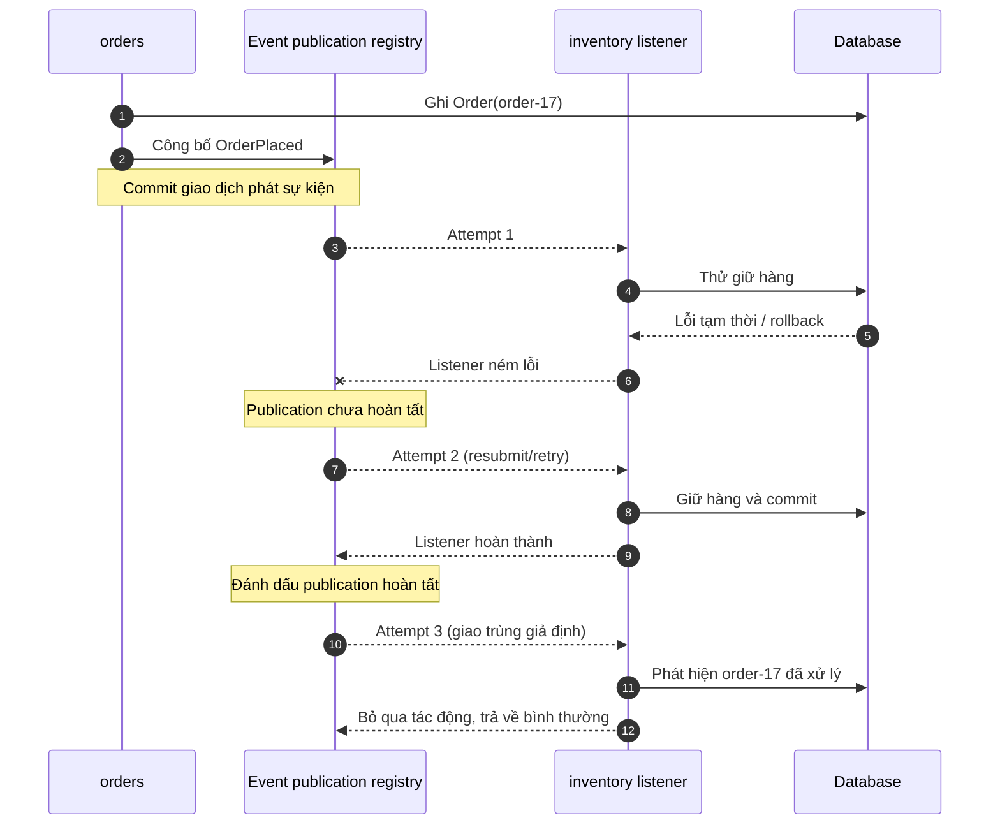
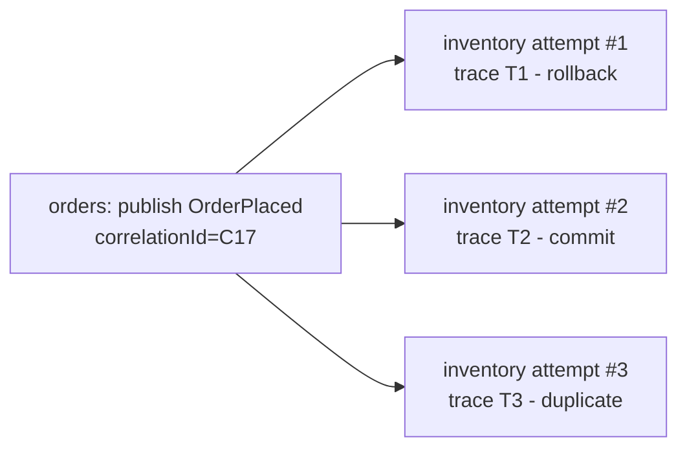

# Thiết kế metric không đếm sai khi retry sự kiện bất đồng bộ

Trong hệ thống dùng **Spring Modulith**, một sự kiện nghiệp vụ có thể được xử lý nhiều lần: listener gặp lỗi, tác vụ được retry, ứng dụng khởi động lại hoặc người vận hành phát lại một event publication chưa hoàn tất. Nếu cứ tăng bộ đếm `orders.processed` mỗi lần listener chạy, dashboard có thể hiển thị **ba đơn hàng thành công** dù thực tế chỉ có **một đơn hàng** được xử lý. Bài này trình bày cách thiết kế telemetry để phân biệt **nỗ lực xử lý** với **kết quả nghiệp vụ duy nhất**, từ đó giữ số liệu chính xác khi xảy ra retry.

Bài học thuộc chương **Sự kiện bất đồng bộ** của module `SPRING_MODULITH_DOCUMENTATION_OBSERVABILITY`. Bạn sẽ sử dụng ranh giới application module và event publication của Spring Modulith, đo lường qua **Micrometer/Actuator**, liên hệ **tracing** và **context propagation**, đồng thời sử dụng dữ liệu lưu bền vững để kiểm chứng số liệu. Trọng tâm là thiết kế ý nghĩa của từng metric trước khi viết mã; cấu hình exporters hay vẽ dashboard chỉ có ích sau khi xác định được **đơn vị đếm** và **thời điểm hoàn thành**.

## 1. Bài toán: một sự kiện, nhiều lần chạy listener

Xét ứng dụng có hai application module:

- `orders` nhận lệnh đặt hàng, lưu đơn trong giao dịch rồi phát `OrderPlaced`.
- `inventory` lắng nghe `OrderPlaced` để giữ số lượng hàng tương ứng.

Ứng dụng phát đúng **một sự kiện** cho đơn `order-17`, nhưng listener có thể được gọi ba lần:

| Thứ tự | Diễn biến | Kết quả ghi bền vững |
|---|---|---|
| Lần 1 | Listener bắt đầu, lỗi tạm thời trước commit; transaction rollback | Chưa có giữ hàng |
| Lần 2 | Retry, giữ hàng thành công và commit | Một bản ghi giữ hàng |
| Lần 3 | Phát lại cùng sự kiện; kiểm tra idempotency thấy đơn đã xử lý | Vẫn một bản ghi giữ hàng |

Giả sử metric cập nhật đúng tại mỗi lần vào listener:

| Thước đo | Giá trị | Cách hiểu chính xác |
|---|---:|---|
| `listener.attempts` | 3 | Có ba lần **bắt đầu** xử lý, gồm retry |
| `listener.threw` | 1 | Có một lần thân listener ném ngoại lệ |
| `listener.returned` | 2 | Hai lần thân listener trở về bình thường, có cả một lần trùng |
| `listener.duplicates` | 1 | Một lần payload được nhận lại và bỏ qua tác động |
| **`business.reservations_confirmed`** | **1** | Chỉ một kết quả nghiệp vụ được commit |

Nếu ta đặt tên counter đo tại điểm vào listener là `reservations_confirmed`, số liệu sẽ sai ngay cả khi code xử lý nghiệp vụ hoàn toàn đúng.

### 1.1. Bốn đơn vị đếm không được đánh đồng

**Event**: sự kiện logic, thường có `eventId` ổn định khi cùng publication được phát lại.

**Attempt**: một lần consumer bắt đầu thực thi, kể cả lần thứ hai hoặc thứ ba của cùng sự kiện.

**Publication**: bản ghi hệ thống ghi nhận việc cần chuyển một sự kiện cho một listener. Một event có thể được giao cho nhiều listener; một publication có thể trải qua nhiều lần gửi/xử lý.

**Business effect**: tác động nghiệp vụ đã được lưu bền vững, ví dụ một đơn hàng được giữ hàng thành công. Đơn vị này thường được khóa bằng `orderId` hoặc khóa idempotency, có thể khác `eventId`.

Quyết định đầu tiên trong thiết kế metric là chọn đơn vị trong bốn khái niệm trên. Không đặt cùng tên metric cho các đơn vị khác nhau.

## 2. Hiểu cơ chế retry và ranh giới giao dịch

Spring Modulith tổ chức ứng dụng thành các module có ranh giới rõ ràng. `orders` có thể phát domain event bằng Spring `ApplicationEventPublisher`; `inventory` xử lý thông qua `@ApplicationModuleListener`. Với cấu hình và phiên bản phù hợp, annotation này hỗ trợ cách xử lý bất đồng bộ gắn với transaction và cơ chế event publication registry.



Sơ đồ minh họa các trạng thái có thể xảy ra, **không có nghĩa Spring Modulith tự động retry theo lịch cố định hoặc luôn tạo attempt thứ ba**. Thời điểm resubmit, chính sách retry, nơi lưu publication và cách đánh dấu completion phụ thuộc cấu hình và cách vận hành của ứng dụng.

Đặc biệt lưu ý **khoảng hở sau commit**: có thể nghiệp vụ đã commit thành công, nhưng tiến trình chết trước khi publication được đánh dấu hoàn tất. Khi restart, cùng publication được xử lý lại. Vì thế, **listener phải idempotent dù đã sử dụng persistent event publication registry**.

### 2.1. “Thành công” xảy ra ở đâu?

| Mốc | Điều có thể khẳng định | Điều chưa thể khẳng định |
|---|---|---|
| Vừa vào listener | Một attempt bắt đầu | Chưa có tác động nghiệp vụ |
| Method trả về | Thân method không ném lỗi | Transaction bao ngoài đã commit hay chưa |
| Giao dịch nghiệp vụ commit | Thay đổi database đã được xác nhận | Registry đã đánh dấu publication hoàn tất hay chưa |
| Registry ghi completion | Publication được đánh dấu xong theo cơ chế registry | Bất kỳ hệ thống ngoài DB đã xử lý đúng một lần hay chưa |
| Dashboard nhận metric | Một điểm đo đã được xuất và thu thập | Dữ liệu metric là nguồn sự thật giao dịch |

Do đó, counter trong listener chỉ nên mô tả **attempt** hoặc **hành vi listener**. Các số liệu “đơn hàng được xác nhận”, “giữ hàng thành công duy nhất” cần có **nguồn dữ liệu giao dịch đã commit**.

## 3. Thiết kế bộ metric theo ý nghĩa, không theo tên method

Với hệ thống mẫu, ta định nghĩa ba nhóm:

| Nhóm | Tên metric minh họa | Loại | Nguồn dữ liệu / đơn vị |
|---|---|---|---|
| Vận hành listener | `shop.event.listener.attempts` | Counter | Mỗi lần listener bắt đầu |
| Vận hành listener | `shop.event.listener.terminations` | Counter | Method `returned` hoặc `threw` |
| Vận hành listener | `shop.event.listener.duration` | Timer | Độ trễ **mỗi attempt** |
| Tình trạng publication | `shop.event.publications.pending` | Gauge | Publication chưa hoàn tất theo registry |
| Nghiệp vụ | `shop.inventory.reservations.confirmed` | Số đếm từ DB | Số `orderId` duy nhất ở trạng thái `CONFIRMED` |
| Nghiệp vụ | `shop.inventory.reservations.rejected` | Số đếm từ DB | Số `orderId` duy nhất ở trạng thái `REJECTED` |
| Nghiệp vụ | `shop.inventory.reservation.completion.latency` | Thống kê theo sự kiện duy nhất | Thời gian từ lúc tạo yêu cầu đến **kết quả cuối cùng được ghi nhận** |

Tên trên là **quy ước của ví dụ**, không phải tên metric mặc định được Spring Modulith bảo đảm cung cấp. Bộ exporter có thể chuẩn hóa tên khác nhau; kiểm tra tên thực tế tại `/actuator/metrics` hoặc backend.

**Quy tắc cốt lõi:**

- Counter trên đường chạy listener đo **attempt**, có thể lớn hơn số sự kiện.
- Đo lường số nghiệp vụ duy nhất dựa trên bản ghi có **unique key** và transaction, không dùng counter thường trong listener làm nguồn sự thật.
- Một lỗi có thể tạo nhiều attempt thất bại, nhưng vẫn chỉ là **một yêu cầu nghiệp vụ** chưa hoàn tất.
- Kết quả nghiệp vụ `REJECTED` vẫn có thể là một **xử lý thành công về kỹ thuật**: listener trả về bình thường, nhưng đơn hàng không được giữ hàng.
- Độ trễ của từng attempt khác với thời gian đầu-cuối của yêu cầu, vốn bao gồm chờ retry.

### 3.1. Định nghĩa SLI và công thức chính xác

Ví dụ tính tỷ lệ giữ hàng thành công theo đơn hàng trong một khoảng thời gian:

\[
\text{Tỷ lệ xác nhận} =
\frac{\text{Số orderId duy nhất có kết quả CONFIRMED}}
{\text{Số orderId duy nhất có kết quả CONFIRMED hoặc REJECTED}}
\]

Tỷ lệ này cần lấy cùng phạm vi thời gian, cùng loại dịch vụ và cùng định nghĩa terminal state. Những đơn `PENDING` chưa có kết quả phải được theo dõi riêng, không tự động coi là thành công.

Để đo sức khỏe listener:

\[
\text{Tỷ lệ attempt ném lỗi} =
\frac{\text{Số attempt kết thúc bằng ngoại lệ}}
{\text{Tổng số attempt được quan sát}}
\]

Đây là tỷ lệ **attempt**, không phải tỷ lệ **đơn hàng thất bại**. Khi retry mạnh, mẫu số và tử số đều tăng; do đó không dùng tỷ lệ này thay cho business success rate.

## 4. Xây dựng ví dụ Spring Modulith với khóa idempotency

Cấu trúc tối thiểu:

```text
com.acme.shop
├── ShopApplication.java
├── orders
│   ├── OrderService.java
│   └── events
│       ├── package-info.java
│       └── OrderPlaced.java
└── inventory
    ├── InventoryEventListener.java
    ├── InventoryReservationService.java
    └── InventoryAttemptMetrics.java
```

Module `orders` công bố hợp đồng `orders :: events` cho `inventory`, thay vì cho consumer truy cập entity hoặc repository nội bộ. Ví dụ kiểm soát phụ thuộc trong `inventory/package-info.java`:

```java
@org.springframework.modulith.ApplicationModule(
    allowedDependencies = { "orders :: events" }
)
package com.acme.shop.inventory;
```

File `orders/events/package-info.java`:

```java
@org.springframework.modulith.NamedInterface("events")
package com.acme.shop.orders.events;
```

### 4.1. Event có định danh rõ ràng

```java
package com.acme.shop.orders.events;

import java.time.Instant;
import java.util.UUID;

public record OrderPlaced(
        UUID eventId,
        String orderId,
        String sku,
        int quantity,
        Instant occurredAt,
        String correlationId) {
}
```

Giải thích cách dùng các ID:

- `eventId`: định danh sự kiện logic, giữ ổn định khi phát lại cùng publication.
- `orderId`: khóa **nghiệp vụ** để tránh giữ hàng hai lần cho cùng đơn. Đây là khóa idempotency chính trong ví dụ.
- `correlationId`: nối log và trace giữa các bước; **không** phải khóa chống xử lý trùng.
- `occurredAt`: thời điểm nghiệp vụ tạo sự kiện; có thể dùng để tính thời gian hoàn tất đầu-cuối nếu các đồng hồ được đồng bộ.

Một đơn hàng đôi khi phát nhiều event có `eventId` khác nhau (do sửa lỗi publisher hoặc thay đổi workflow). Nếu ràng buộc nghiệp vụ là “mỗi đơn chỉ được giữ hàng một lần”, dedup chỉ theo `eventId` **không đủ**. Trong trường hợp một đơn có thể giữ hàng cho nhiều dòng sản phẩm, khóa đúng phải là `(orderId, lineId)` hoặc một reservation ID; ví dụ này cố ý giả định **một đơn có một SKU** để dùng `orderId`.

### 4.2. Publisher bên `orders`

```java
package com.acme.shop.orders;

import com.acme.shop.orders.events.OrderPlaced;
import java.time.Clock;
import java.util.UUID;
import org.springframework.context.ApplicationEventPublisher;
import org.springframework.stereotype.Service;
import org.springframework.transaction.annotation.Transactional;

@Service
public class OrderService {

    private final ApplicationEventPublisher publisher;
    private final Clock clock;

    public OrderService(ApplicationEventPublisher publisher, Clock clock) {
        this.publisher = publisher;
        this.clock = clock;
    }

    @Transactional
    public void placeOrder(String orderId, String sku,
                           int quantity, String correlationId) {
        // TODO: validate, lưu đơn hàng theo orderId trong transaction.
        var event = new OrderPlaced(
            UUID.randomUUID(), orderId, sku, quantity,
            clock.instant(), correlationId);
        publisher.publishEvent(event);
    }
}
```

Đoạn minh họa cần một bean `Clock` và repository lưu đơn thật. Sự kiện được publish trong transaction, để listener dạng transaction event chỉ xử lý khi transaction phát đã commit theo cấu hình phù hợp. Nên bảo đảm quá trình tạo `eventId` và publication là nhất quán; một lần phát lại publication cũ không sinh `eventId` mới.

## 5. Chống xử lý trùng bằng dữ liệu giao dịch

Không có cách đáng tin cậy để “sửa số đếm” chỉ bằng `AtomicInteger` hoặc cache trong JVM: restart, nhiều instance và retry có thể làm mất trạng thái. Với ví dụ giữ hàng, định nghĩa ràng buộc ở **cơ sở dữ liệu**.

### 5.1. Schema minh họa PostgreSQL

```sql
CREATE TABLE inventory_stock (
    sku TEXT PRIMARY KEY,
    available_quantity INTEGER NOT NULL
        CHECK (available_quantity >= 0)
);

CREATE TABLE inventory_reservation (
    order_id TEXT PRIMARY KEY,
    sku TEXT NOT NULL,
    quantity INTEGER NOT NULL CHECK (quantity > 0),
    state TEXT NOT NULL
        CHECK (state IN ('PENDING', 'CONFIRMED', 'REJECTED')),
    created_at TIMESTAMPTZ NOT NULL DEFAULT now(),
    completed_at TIMESTAMPTZ
);

CREATE INDEX inventory_reservation_completed_idx
    ON inventory_reservation (completed_at, state);
```

Trong thiết kế này, `PRIMARY KEY(order_id)` là **hàng rào idempotency**. Với hai thread cùng nhận `order-17`, PostgreSQL xử lý xung đột khóa duy nhất trong transaction; chỉ một transaction có thể tạo bản ghi cho khóa đó. Nếu transaction đầu rollback, transaction còn lại có thể tiếp tục tạo bản ghi.

`PENDING` được tạo bên trong cùng transaction, sau đó phải được chuyển sang `CONFIRMED` hoặc `REJECTED` trước commit. Ví dụ không chủ trương commit riêng bản ghi `PENDING`; nếu mở rộng thành workflow nhiều bước, cần bổ sung state machine và cơ chế khôi phục rõ ràng.

### 5.2. Service thực hiện tác động đúng một lần

```java
package com.acme.shop.inventory;

import com.acme.shop.orders.events.OrderPlaced;
import java.util.Map;
import org.springframework.jdbc.core.JdbcTemplate;
import org.springframework.stereotype.Service;
import org.springframework.transaction.annotation.Transactional;

@Service
public class InventoryReservationService {

    public enum Result { CONFIRMED, REJECTED, DUPLICATE }

    private final JdbcTemplate jdbc;

    public InventoryReservationService(JdbcTemplate jdbc) {
        this.jdbc = jdbc;
    }

    @Transactional
    public Result apply(OrderPlaced event) {
        if (event.quantity() <= 0) {
            throw new IllegalArgumentException("Invalid quantity");
        }

        int inserted = jdbc.update("""
            INSERT INTO inventory_reservation
                (order_id, sku, quantity, state)
            VALUES (?, ?, ?, 'PENDING')
            ON CONFLICT (order_id) DO NOTHING
            """,
            event.orderId(), event.sku(), event.quantity());

        if (inserted == 0) {
            Map<String, Object> stored = jdbc.queryForMap("""
                SELECT sku, quantity
                FROM inventory_reservation
                WHERE order_id = ?
                """, event.orderId());

            String storedSku = (String) stored.get("sku");
            int storedQty = ((Number) stored.get("quantity")).intValue();

            if (!event.sku().equals(storedSku)
                    || event.quantity() != storedQty) {
                throw new IllegalStateException(
                    "Order id reused with different payload");
            }
            return Result.DUPLICATE;
        }

        int changed = jdbc.update("""
            UPDATE inventory_stock
            SET available_quantity = available_quantity - ?
            WHERE sku = ? AND available_quantity >= ?
            """,
            event.quantity(), event.sku(), event.quantity());

        String nextState = (changed == 1) ? "CONFIRMED" : "REJECTED";
        jdbc.update("""
            UPDATE inventory_reservation
            SET state = ?, completed_at = now()
            WHERE order_id = ?
            """, nextState, event.orderId());

        return (changed == 1) ? Result.CONFIRMED : Result.REJECTED;
    }
}
```

**Điều bảo đảm sự đúng đắn:**

1. `ON CONFLICT (order_id) DO NOTHING` ngăn ghi hai reservation cho cùng khóa trong database.
2. `UPDATE inventory_stock ... AND available_quantity >= ?` giảm tồn kho có điều kiện, ngăn số lượng âm khi nhiều đơn khác nhau cạnh tranh cùng SKU.
3. Insert reservation, giảm tồn kho và cập nhật trạng thái cùng một transaction. Nếu xảy ra lỗi trước commit, mọi thay đổi rollback.
4. Khi nhận lại đơn đã xử lý, hàm trả `DUPLICATE` mà không giảm tồn kho lần nữa. Nếu cùng `orderId` nhưng nội dung khác, báo xung đột hợp đồng.
5. Kết quả `REJECTED` khi hết hàng là trạng thái nghiệp vụ cuối cùng, **không** phải lỗi kỹ thuật cần retry vô hạn. Nếu sản phẩm yêu cầu chờ nhập kho rồi thử lại, đó là một workflow khác và phải định nghĩa lại trạng thái/khoá tương ứng.

Đây là ví dụ PostgreSQL, giả định một order có một SKU, một transaction manager bao trùm các câu SQL và dữ liệu đầu vào đã được xác thực. Khi sử dụng RDBMS khác, cú pháp UPSERT và cơ chế khóa cần thay thế phù hợp. Đối với ngoại lệ không thể phục hồi do dữ liệu mâu thuẫn, cần dead-letter/điều tra có kiểm soát; đừng cấu hình retry vô hạn.

## 6. Đo attempts đúng nghĩa với Micrometer

Các counter sau phục vụ **chẩn đoán hành vi listener**, không thay thế truy vấn kết quả nghiệp vụ.

### 6.1. Bộ đo tại module `inventory`

```java
package com.acme.shop.inventory;

import io.micrometer.core.instrument.Counter;
import io.micrometer.core.instrument.MeterRegistry;
import io.micrometer.core.instrument.Timer;
import org.springframework.stereotype.Component;

@Component
public class InventoryAttemptMetrics {

    private final MeterRegistry registry;

    public InventoryAttemptMetrics(MeterRegistry registry) {
        this.registry = registry;
    }

    public void started() {
        Counter.builder("shop.event.listener.attempts")
            .description("Listener invocations started")
            .tag("consumer.module", "inventory")
            .tag("event.type", "OrderPlaced")
            .register(registry)
            .increment();
    }

    public void terminated(String outcome) {
        // outcome chỉ lấy từ tập cố định: returned / threw
        Counter.builder("shop.event.listener.terminations")
            .tag("consumer.module", "inventory")
            .tag("event.type", "OrderPlaced")
            .tag("outcome", outcome)
            .register(registry)
            .increment();
    }

    public Timer.Sample startTimer() {
        return Timer.start(registry);
    }

    public void finishTimer(Timer.Sample sample, String outcome) {
        sample.stop(Timer.builder("shop.event.listener.duration")
            .tag("consumer.module", "inventory")
            .tag("event.type", "OrderPlaced")
            .tag("outcome", outcome)
            .register(registry));
    }
}
```

`Counter.builder(...).register(registry)` trả về meter đã đăng ký theo tên/tags; ứng dụng không nên tự tạo một counter per order hoặc per correlation ID. Các timer ở đây đo thời gian **mỗi attempt**, vì vậy histogram/percentile của chúng cũng phản ánh retry.

### 6.2. Listener của Spring Modulith

```java
package com.acme.shop.inventory;

import com.acme.shop.orders.events.OrderPlaced;
import org.springframework.modulith.events.ApplicationModuleListener;
import org.springframework.stereotype.Component;

@Component
public class InventoryEventListener {

    private final InventoryReservationService reservations;
    private final InventoryAttemptMetrics metrics;

    public InventoryEventListener(InventoryReservationService reservations,
                                  InventoryAttemptMetrics metrics) {
        this.reservations = reservations;
        this.metrics = metrics;
    }

    @ApplicationModuleListener
    public void on(OrderPlaced event) {
        metrics.started();
        var timer = metrics.startTimer();
        String termination = "returned";

        try {
            var result = reservations.apply(event);
            // result là CONFIRMED, REJECTED hoặc DUPLICATE.
            // Không tăng business-success counter ở đây.
        } catch (RuntimeException ex) {
            termination = "threw";
            throw ex; // Giữ exception để registry/handler ghi nhận thất bại.
        } finally {
            metrics.terminated(termination);
            metrics.finishTimer(timer, termination);
        }
    }
}
```

**Giới hạn quan trọng:** `returned` ở đây có nghĩa là **thân listener đã chạy đến cuối**, không bảo đảm mọi transaction bao ngoài đã commit và publication được đánh dấu hoàn tất. Annotation và thứ tự advisor AOP có thể khiến commit diễn ra sau khối `finally`. Do đó chỉ đặt nhãn `returned`/`threw`; không đặt nhãn `committed` dựa trên đoạn mã này.

Các metric trong memory/exporter là **best effort**: nếu process chết trước khi scrape hoặc gửi lên backend, có thể mất một attempt. Nếu process bị dừng trước khi chạy khối `finally`, tổng số `terminations` có thể thấp hơn `attempts`. Đây là lý do chúng thích hợp cho telemetry vận hành nhưng không phải sổ cái nghiệp vụ hay báo cáo tài chính.

### 6.3. Có cần counter riêng cho duplicate không?

Có thể thêm `shop.event.listener.duplicates` khi `result == DUPLICATE`, nhưng phải chú thích rõ đây là **số attempt bị nhận trùng**, không phải số event logic trùng nhau. Một publication được replay nhiều lần sẽ tiếp tục tăng counter. Chỉ đo duplicate nếu đội vận hành thực sự cần chẩn đoán retry; đừng diễn giải nó thành “số đơn bị lỗi”.

Tương tự, metric dạng `result=CONFIRMED` bên trong listener cho biết một lần thực thi **trả về kết quả CONFIRMED** ở tầng Java; nó vẫn không thay thế số bản ghi `CONFIRMED` đã commit.

## 7. Lấy business metrics từ nguồn bền vững

**Cách an toàn nhất để trả lời “bao nhiêu đơn đã được giữ hàng thành công?”** trong bài lab là truy vấn bảng `inventory_reservation` **sau commit**, không cộng counter theo callback.

Ví dụ các truy vấn PostgreSQL:

```sql
-- Số đơn được giữ hàng thành công tính đến thời điểm truy vấn:
SELECT COUNT(*) AS reservations_confirmed
FROM inventory_reservation
WHERE state = 'CONFIRMED';

-- Số đơn bị từ chối do không đủ tồn kho:
SELECT COUNT(*) AS reservations_rejected
FROM inventory_reservation
WHERE state = 'REJECTED';

-- Số kết quả duy nhất theo giờ hoàn tất UTC:
SELECT
    date_trunc('hour', completed_at AT TIME ZONE 'UTC') AS hour_utc,
    state,
    COUNT(*) AS unique_orders
FROM inventory_reservation
WHERE completed_at >= :from_time
  AND completed_at < :to_time
  AND state IN ('CONFIRMED', 'REJECTED')
GROUP BY 1, 2
ORDER BY 1, 2;
```

Đối với schema này, `order_id` là primary key nên `COUNT(*)` bằng số orderId duy nhất trong từng trạng thái. Nếu lưu một dòng cho mỗi lần attempt, truy vấn tương đương phải dựa vào bảng kết quả riêng có khóa duy nhất hoặc định nghĩa `COUNT(DISTINCT order_id)` phù hợp với business semantics.

### 7.1. Gauge và counter khác nhau thế nào?

- **Gauge** biểu diễn trạng thái tại thời điểm đo, ví dụ tổng số reservation đang `CONFIRMED` hoặc số publication đang pending. Gauge có thể tăng/giảm nếu dữ liệu được hủy hoặc dọn dẹp.
- **Counter** biểu diễn số sự kiện tích lũy mà một process quan sát được; bị reset khi process restart hoặc thay instance, backend dùng rate/increase theo quy tắc thu thập.
- **Dữ liệu lịch sử theo giờ** cần nguồn bền vững có timestamp và trạng thái chuẩn; không suy ra lịch sử chính xác chỉ từ gauge hiện tại.

Nếu bảng giữ lại mọi reservation, `COUNT(*) WHERE state='CONFIRMED'` là tổng trạng thái hiện tại. Nếu nghiệp vụ có hủy/hoàn lại hàng, báo cáo “tổng số từng được xác nhận” và “số đang có hiệu lực” là **hai chỉ số khác nhau**; hãy thêm audit/state transition table, đừng dùng một tên cho cả hai.

### 7.2. Có thể xuất số liệu từ database lên Prometheus không?

Có, nhưng phải xác định ý nghĩa: đưa `COUNT(*)` hiện tại thành một **gauge** có thể scrape là phép đo snapshot, không phải counter chính xác theo từng event. Với báo cáo lịch sử quan trọng, nên dùng truy vấn/bảng tổng hợp trên database, job reconciliation hoặc pipeline analytics có cơ chế cập nhật idempotent.

Nếu cần luồng “business event completed” sang hệ thống ngoài DB, có thể ghi **outbox record cùng transaction** với reservation, có `event_id`/`order_id` duy nhất. Consumer downstream vẫn phải deduplicate vì truyền/ack tới hệ thống ngoài có thể bị lặp; gọi một thao tác publish thành công chưa đồng nghĩa metric hệ thống đích nhận đúng một lần.

Không thể có một giao dịch nguyên tử chung giữa commit database và tăng counter trong bộ nhớ thông thường. Thứ tự nào cũng có cửa sổ lỗi:

```text
A. increment counter -> DB commit thất bại
   => Counter báo thành công ảo.

B. DB commit thành công -> process chết trước increment
   => Counter bỏ sót kết quả thật.

C. DB commit thành công -> publication chưa được đánh dấu hoàn tất
   => Retry có thể increment một lần nữa.
```

Do đó, để làm **nguồn sự thật**, hãy dùng transaction/unique key và đối soát sau commit.

## 8. Metric cho event publication registry

Event publication registry của Spring Modulith (khi cấu hình persistence tương thích) giúp theo dõi publication chờ listener hoàn tất. **Publication pending** là dấu hiệu cần điều tra, nhưng không nhất thiết chứng minh nghiệp vụ chưa commit: có thể tác động đã thành công, chỉ thiếu bước đánh dấu completion.

Gợi ý các SLI vận hành:

| Tên gợi ý | Định nghĩa cần thống nhất |
|---|---|
| `publications.pending` | Số publication chưa được ghi nhận hoàn tất tại thời điểm đo |
| `publications.oldest.age` | Tuổi publication pending lâu nhất |
| `publications.resubmitted` | Số nỗ lực operator/job yêu cầu phát lại publication |
| `publications.completed` | Số publication đã được registry xác nhận hoàn tất; phân biệt với business completion |
| `listener.attempts` | Số lần listener bắt đầu chạy |

Không giả định mọi phiên bản Modulith tự cung cấp các metric này hay một API Actuator cố định để đọc chúng. Cần xem chính xác backend event publication đã cấu hình (JDBC/JPA/khác), khả năng truy vấn/trạng thái của phiên bản đang dùng, rồi tạo gauge/query thích hợp. Trong hệ thống nhiều instance, không cộng toàn bộ snapshot pending giống nhau từ từng instance; truy vấn tổng tập trung hoặc ghi nhãn instance và chỉ dùng một source cho thống kê cụm.

**Alert hữu ích** thường dựa trên `pending_age` và tốc độ hoàn tất hơn là một giá trị pending tức thời. Ví dụ, backlog tạm tăng trong vài giây khi traffic bùng lên là bình thường; pending tồn tại lâu hơn ngưỡng SLO cần báo động. Phải phân biệt event lỗi không thể retry với lỗi tạm thời để tránh phát lại vô hạn.

## 9. Tracing và correlation khi một event có nhiều attempt

Metric có tính tổng hợp, nên không nên gắn `eventId`, `orderId` hoặc `correlationId` thành tag. Nhưng muốn điều tra vì sao attempts tăng, người vận hành cần truy vết **một event cụ thể**.

### 9.1. Luồng trace có thể thay đổi qua retry



Ba attempt có thể thuộc cùng trace nếu framework truyền context liên tục, hoặc thuộc nhiều trace nếu chạy sau restart, trên thread/executor khác hay qua broker. Không dùng quy tắc “cùng traceId thì cùng event” hoặc “khác traceId thì sự kiện khác nhau”.

Thiết kế log có cấu trúc nên chứa:

- `eventId`, `orderId`, `correlationId` (theo chính sách dữ liệu và phân quyền truy cập log);
- tên module `orders`/`inventory`, loại event và kết quả attempt;
- `traceId` và `spanId` khi có trace context;
- lý do lỗi ở mức an toàn, không ghi bí mật, token hoặc thông tin nhạy cảm.

Nếu dùng Micrometer Tracing và logging MDC integration, cần kiểm tra rằng trace context thực sự được propagated qua executor `@Async`. Với Spring Framework/Micrometer Context Propagation tương thích, có thể cấu hình `ContextPropagatingTaskDecorator` trên đúng executor. Cơ chế propagation qua message broker cần thư viện/header riêng; khi replay sau restart, correlation ID nghiệp vụ thường hữu ích hơn việc cố kéo dài trace đã kết thúc.

### 9.2. Cardinality: ranh giới của metrics

Đặt tag **có tập giá trị hữu hạn**:

```text
consumer.module = inventory
event.type      = OrderPlaced
outcome         = returned | threw
business.state  = CONFIRMED | REJECTED
```

Không đặt:

```text
orderId         = order-17, order-18, ... (tăng theo đơn)
eventId         = <UUID cho từng sự kiện>
correlationId   = <UUID cho từng request>
exception       = <toàn bộ exception message>
```

Nếu mỗi đơn hàng tạo ra một tập time series mới, chi phí lưu trữ và query tăng rất nhanh. Muốn tìm đơn cụ thể, dùng log/traces hoặc truy vấn dữ liệu nghiệp vụ; giữ metrics phục vụ tổng hợp.

## 10. Thiết lập Actuator và quan sát metric thực tế

Một ứng dụng Spring Boot có thể thêm:

```xml
<!-- Spring Boot quản lý phiên bản Micrometer và Actuator.
     Spring Modulith dùng BOM tương thích với Boot của dự án. -->
<dependency>
    <groupId>org.springframework.boot</groupId>
    <artifactId>spring-boot-starter-actuator</artifactId>
</dependency>
<dependency>
    <groupId>org.springframework.modulith</groupId>
    <artifactId>spring-modulith-starter-observability</artifactId>
</dependency>
<dependency>
    <groupId>org.springframework.boot</groupId>
    <artifactId>spring-boot-starter-jdbc</artifactId>
</dependency>
```

Để dùng event publication registry bền vững, cần thêm các dependency persistence tương ứng với phiên bản Spring Modulith đang chạy (ví dụ mô hình JDBC/JPA được hỗ trợ), cấu hình datasource và migration riêng. Chỉ có starter observability hoặc Actuator không đồng nghĩa đã bật persistent registry, tracing exporter, Prometheus registry hay retry scheduler.

Cấu hình phát triển tối thiểu:

```yaml
management:
  endpoints:
    web:
      exposure:
        include: health,info,metrics
```

Với Prometheus, thêm registry phù hợp và expose `prometheus` trong môi trường được phép. Với tracing, thêm bridge/exporter và cấu hình sampling. Thực tế nên bảo vệ Actuator ở cổng/mạng quản trị và xác thực các endpoint nhạy cảm.

Kiểm tra:

```bash
curl -s http://localhost:8080/actuator/metrics
curl -s http://localhost:8080/actuator/metrics/shop.event.listener.attempts
curl -s http://localhost:8080/actuator/metrics/shop.event.listener.terminations
curl -s http://localhost:8080/actuator/metrics/shop.event.listener.duration
```

Nếu metric không xuất hiện, có thể listener chưa chạy, meter chưa được đăng ký hoặc endpoint chưa expose. Kiểm tra log và dependency tree trước khi kết luận code đã mất sự kiện. Một số backend triển khai exporter theo chu kỳ, nên nhìn thấy meter tại Actuator không bảo đảm dữ liệu đã được lưu lên backend.

## 11. Kiểm thử retry, concurrency và tính đúng đắn của báo cáo

Giả lập các trạng thái sau với database thực (ví dụ PostgreSQL qua Testcontainers) và đo cả **row count** lẫn attempt metrics. Unit test chỉ mock repository không thể chứng minh ràng buộc unique dưới concurrency.

| Mã | Kịch bản | Kết quả nghiệp vụ | Kết quả metrics kỳ vọng |
|---|---|---|---|
| RET-01 | Một event xử lý bình thường | Một `CONFIRMED` | attempts tăng 1 |
| RET-02 | Lỗi trước commit, sau đó retry thành công | Một `CONFIRMED` | attempts tăng 2; có một attempt `threw` |
| RET-03 | Phát lại đúng event sau commit | Vẫn một `CONFIRMED` | attempts tăng 1; duplicate có thể tăng |
| RET-04 | Hai consumer cùng nhận `orderId`, cùng SKU/quantity | Một reservation, tồn kho chỉ giảm một lần | Có thể có 2 attempts; không có 2 kết quả |
| RET-05 | Hai consumer khác orderId nhưng cùng SKU, tồn kho đủ cho một | Một `CONFIRMED`, một `REJECTED` | Hai attempts; business results có hai dòng với state khác |
| RET-06 | Cùng `orderId` nhưng SKU/quantity khác | Không ghi thêm reservation | Báo xung đột; không được coi là duplicate thành công |
| RET-07 | DB commit thành công, process chết trước ack completion | Retry không giảm tồn kho nữa | Attempt tăng theo lần chạy mới; business count giữ nguyên |
| RET-08 | Process crash trước lần scrape/export metrics | Dữ liệu nghiệp vụ vẫn đúng sau commit | Counter attempt có thể mất; không dùng làm nguồn tài chính |
| RET-09 | 1.000 orderId khác nhau | 1.000 kết quả duy nhất theo DB (nếu đủ stock) | Số time series không tăng theo orderId |

### 11.1. Kịch bản định lượng cụ thể

Chuẩn bị `inventory_stock(sku='BOOK', available_quantity=5)`. Gửi một `OrderPlaced(orderId='order-17', sku='BOOK', quantity=1)`. Cố ý tạo lỗi tạm thời trong lần đầu trước commit; sau đó cho retry và phát lại một lần nữa.

Mong muốn khi truy vấn:

```sql
SELECT order_id, sku, quantity, state
FROM inventory_reservation
WHERE order_id = 'order-17';
-- 1 row: order-17 | BOOK | 1 | CONFIRMED

SELECT available_quantity
FROM inventory_stock
WHERE sku = 'BOOK';
-- 4 (chỉ giảm một lần)
```

Nếu đầu quá trình `attempts=0` và telemetry không mất lần nào, sau ba lần gọi listener có `attempts=3`, `terminations{outcome="threw"}=1` và `terminations{outcome="returned"}=2`. Trong triển khai thực, các counter của một instance có thể reset sau restart; so sánh giá trị phải tính đến phạm vi instance và thời gian thu thập.

### 11.2. Kiểm thử tính đúng của metric bằng dữ liệu chuẩn

Viết một test tích hợp hoặc báo cáo reconciliation lấy `COUNT(*)` từ `inventory_reservation`, so với số nghiệp vụ mà dashboard hiển thị trong cùng khoảng thời gian và trạng thái. Nếu dashboard dựa vào counter listener và cho kết quả khác, cần sửa **định nghĩa metric** hoặc nguồn dữ liệu; đừng “bù trừ” dựa trên giả định mỗi event chỉ retry tối đa N lần.

Đối với tình huống concurrency, test nên chạy thực sự hai transaction song song, đợi cả hai kết thúc và kiểm tra số lượng còn lại. Tránh giả lập bằng cách gọi tuần tự hai lần, vì như vậy không kiểm tra race condition.

## 12. Những cách đếm sai thường gặp

| Cách làm | Vì sao sai | Cách thay thế |
|---|---|---|
| `counter.increment()` ngay khi vào listener và đặt tên `orders.completed` | Retry tạo thêm số “thành công” | Đặt tên `attempts`; lấy completed từ DB |
| Tăng counter khi method trả về | Commit có thể diễn ra sau khi method trả về | Ghi business result trong transaction, truy vấn sau commit |
| Dựa vào `eventId` mà bỏ qua `orderId` | Hai event khác ID vẫn có thể tạo cùng một tác động | Dùng business idempotency key đúng domain |
| Dựa vào cache cục bộ để deduplicate | Cache mất khi restart, không phối hợp nhiều instance | Unique constraint / durable inbox trong transaction |
| Gọi listener nhận `REJECTED` là technical failure | Từ chối hợp lệ vẫn là kết quả nghiệp vụ cuối cùng | Tách business outcome và handler termination |
| Đếm publication completion thành đơn hoàn tất | Một event có nhiều subscriber; ack có thể trễ/được phát lại | Tách metric publication và kết quả nghiệp vụ |
| Gắn ID động vào metric tags | Cardinality tăng theo số sự kiện | ID ở log/trace; metric tags cố định |
| Dùng timer từng attempt cho latency đầu-cuối | Retry và thời gian chờ bị bỏ sót | Lưu `occurredAt`/`completedAt` và đo end-to-end |
| Nuốt exception để không bị retry | Có thể làm registry đánh dấu publication đã hoàn tất dù DB chưa đúng | Chỉ xử lý ngoại lệ có chủ đích; giữ lỗi tạm thời để retry |
| Retry mọi lỗi vô hạn | Lỗi dữ liệu hoặc xung đột không tự hết | Phân loại lỗi, giới hạn retry và đường xử lý thủ công |

## 13. Bài thực hành và tiêu chí nghiệm thu

Thực hiện trên ứng dụng Spring Boot có Spring Modulith, hai module `orders` và `inventory`:

1. **Định nghĩa đơn vị đếm.** Viết tài liệu riêng cho `attempts`, `terminations`, `pending`, `business CONFIRMED` và `business REJECTED`; nêu nguồn dữ liệu và thời điểm cập nhật.
2. **Tạo event và listener.** Phát `OrderPlaced` trong transaction từ `orders`, xử lý bằng `@ApplicationModuleListener` ở `inventory`; áp dụng cấu hình event publication persistence nếu muốn kiểm thử replay sau restart.
3. **Bảo vệ tác động nghiệp vụ.** Tạo database schema có `PRIMARY KEY(order_id)` và cập nhật tồn kho có điều kiện. Kiểm tra idempotency ngay cả khi có hai instance.
4. **Thêm telemetry vận hành.** Đo attempt counter và timer qua Micrometer; dùng tập tag cố định, giữ correlation/event ID trong log/trace.
5. **Tạo báo cáo nghiệp vụ.** Truy vấn bảng reservation theo trạng thái/thời gian và giải thích vì sao số kết quả không đổi khi replay.
6. **Thử lỗi có chủ đích.** Cho transaction đầu rollback, retry rồi gửi duplicate; quan sát ba attempts nhưng chỉ một `CONFIRMED`.
7. **Đánh giá quan sát tại runtime.** Xem metric qua Actuator, kiểm tra event publication pending/completed theo backend đã bật, đối chiếu trace của các attempt và tránh đưa endpoint quản trị ra ngoài.

**Sản phẩm cần nộp:** mã publisher/listener, schema và service idempotent, định nghĩa meter, truy vấn business metrics, kết quả RET-01 đến RET-09 cùng giải thích cách tránh đếm trùng. Cần chứng minh số liệu bằng truy vấn database và tình huống lỗi thật, không chỉ ảnh dashboard.

### Câu hỏi tự kiểm tra

1. Vì sao `attempts=3` không mâu thuẫn với `confirmed=1`?
2. Vì sao hoàn tất thân listener chưa thể khẳng định transaction đã commit?
3. Nếu commit thành công nhưng process chết trước khi registry ghi completion, một replay có thể xảy ra theo đường nào?
4. Vì sao dedup theo `eventId` chưa chắc đúng với ràng buộc “mỗi đơn đặt hàng giữ kho đúng một lần”?
5. Metrics nào nên đếm cả retry, metrics nào phải dựa vào dữ liệu transaction?
6. Tại sao thời gian mỗi attempt và độ trễ đầu-cuối của business operation là hai chỉ số khác nhau?
7. Khi một instance restart, điều gì xảy ra với counter in-memory và vì sao điều đó không làm thay đổi số đơn đã hoàn tất trong database?
8. Nếu tăng `orderId` vào tag của Micrometer counter, chi phí hệ thống quan sát thay đổi thế nào?
9. Khi registry báo pending nhưng bảng reservation đã có `CONFIRMED`, bạn cần kiểm tra bước nào?
10. Trường hợp lỗi thiếu tồn kho có nên retry vô hạn như lỗi kết nối database tạm thời không? Vì sao?

**Điểm cần ghi nhớ:** retry là tính chất bình thường của xử lý sự kiện bất đồng bộ. Một hệ thống đo lường tốt mô tả trung thực cả **khối lượng attempt** lẫn **kết quả nghiệp vụ duy nhất**. Spring Modulith, Actuator, tracing và Micrometer giúp bạn nhìn thấy đường đi của event; transaction, unique key và dữ liệu bền vững mới là căn cứ để khẳng định tác động đã diễn ra đúng một lần theo quy tắc nghiệp vụ.
