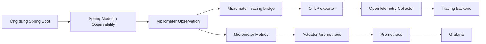

# Profile production với sampling phù hợp

> **Chương:** Cấu hình môi trường  
> **Phạm vi module:** `SPRING_MODULITH_DOCUMENTATION_OBSERVABILITY` — sử dụng Spring Modulith để tài liệu hóa ranh giới application module và quan sát tương tác trong ứng dụng Spring Boot.  
> **Mục tiêu:** Cấu hình môi trường **production** có khả năng theo dõi module graph, Actuator, event metrics, tracing và context propagation mà vẫn kiểm soát chi phí thu thập telemetry.

## 1. Tình huống thực tế: vì sao production cần sampling?

Giả sử hệ thống bán hàng viết bằng Spring Boot được chia thành các application module `order`, `inventory`, `payment` và `notification`. Spring Modulith mô tả ranh giới module, xác minh quan hệ phụ thuộc và hỗ trợ quan sát những tương tác giữa chúng. Khi ứng dụng chạy, kỹ sư vận hành muốn biết: yêu cầu xác nhận đơn hàng đi qua module nào, một event chuyển sang listener nào, phần nào bị chậm và lỗi xuất hiện ở đâu.

Trong môi trường phát triển, ghi gần như mọi trace rất hữu ích vì ít lưu lượng. Production có thể xử lý hàng nghìn yêu cầu mỗi giây; nếu xuất tất cả span, hệ thống phát sinh thêm CPU, network, lưu trữ và chi phí cho tracing backend. **Sampling** chọn một phần trace để xuất, giúp duy trì khả năng điều tra mà giới hạn tài nguyên.

Không nên đồng nhất ba nguồn dữ liệu quan sát:

| Nguồn dữ liệu | Câu hỏi trả lời | Có bị giảm trực tiếp bởi `management.tracing.sampling.probability`? |
|---|---|---|
| **Metrics** (Micrometer/Actuator, counter, timer, histogram) | Bao nhiêu event được phát, tỷ lệ lỗi, độ trễ p95/p99, backlog đang tăng? | **Không.** Trace sampling không tự thay đổi phép ghi metrics; vẫn cần cấu hình meter và backend đúng |
| **Traces** (span của request và tương tác module) | Một lần xử lý cụ thể đi qua module nào, mất bao lâu ở mỗi bước? | **Có.** Tỷ lệ lấy mẫu ảnh hưởng những trace/span được ghi và xuất |
| **Logs** (application logs có `traceId`, `eventId`) | Lỗi gì, ID nghiệp vụ nào, hành động đã diễn ra lúc nào? | **Không tự động.** Log level, masking và chính sách log riêng quyết định lượng log |

Một hệ thống có 5% trace vẫn có thể thu thập counters và histograms cho **toàn bộ** yêu cầu nếu instrumentation không chủ động lọc metric. Vì vậy SLO và cảnh báo production nên dựa chủ yếu vào metrics đầy đủ; traces được dùng để khảo sát những lần xử lý được chọn.

**Kết quả học tập:** sau bài này, bạn có thể thiết kế profile production riêng, chọn sampling theo lưu lượng và rủi ro, xuất traces qua OTLP, giới hạn Actuator an toàn, kiểm tra span của Spring Modulith, nhận biết chỗ trace mất liên kết khi chạy async, và đánh giá lại sampling bằng dữ liệu vận hành.

## 2. Sampling là gì và không phải là gì?

Trong tracing, mỗi request hoặc luồng nghiệp vụ có thể hình thành một **trace** gồm nhiều **span**: HTTP server span, DB span và span tương tác application module. Với sampling theo xác suất ở đầu luồng (*head-based sampling*), quyết định giữ hay loại một trace thường được đưa ra sớm, khi root span được tạo.

Ví dụ:

```text
Người dùng -> HTTP /orders/42/confirm
                 |
                 v
       TraceId = 7cf...    Root span: HTTP server
          /      |      \
         v       v       v
     order   inventory   payment
       |        |          |
       +---- event listener |
                  |
             notification

  Sampling: giữ trace này?  YES => có thể xuất các span
                               NO => không có đủ span để điều tra từ tracing backend
```

Ví dụ một request có 12 span. Khi chọn giữ **10% trace**, mục tiêu thống kê là chọn khoảng một trên mười **root trace đủ điều kiện**, rồi các span con thường tuân theo quyết định của span cha. Tỷ lệ 10% **không** có nghĩa là mỗi span được chọn độc lập với xác suất 10% hoặc cứ đúng 10 request thì có một trace được ghi.

Các khái niệm cần phân biệt:

- **Head-based / probability sampling:** quyết định sớm, chi phí thấp và dễ quản lý; nhược điểm là lỗi hiếm hoặc request rất chậm có thể không được chọn.
- **Parent-based sampling:** một service thường tôn trọng quyết định sampling trong trace context được truyền từ upstream, để tránh mất liên kết giữa các service. Sampling cấu hình tại service vì thế không nhất thiết cho tỷ lệ thực tế đúng bằng giá trị cài đặt khi có nhiều nguồn request.
- **Tail-based sampling:** collector/backend quyết định sau khi thấy thông tin thực thi của trace, nhờ đó có thể ưu tiên lỗi hoặc request chậm. Cần bộ nhớ và cửa sổ giữ trace, và phải có **đủ span tới collector** trước khi ra quyết định.
- **Filtering:** loại telemetry theo loại endpoint/span hoặc policy riêng; không phải cùng một hành vi với xác suất sampling.

Đặt `management.tracing.sampling.probability: 0.1` trong Spring Boot là một cách cấu hình xác suất lấy mẫu trace ở phía ứng dụng. Nếu ứng dụng đã **bỏ span tại nguồn**, collector phía sau không thể “khôi phục” span để lấy mẫu theo độ trễ; muốn làm tail sampling thực sự, phải điều chỉnh kiến trúc sampling từ nguồn đến collector.

### Ví dụ ước tính chi phí theo lưu lượng

Giả định application xử lý **100 request/giây**, mỗi request tạo trung bình **12 span**, chạy liên tục 24 giờ và mỗi request tạo đúng một trace gốc độc lập.

| Sampling xác suất | Trace kỳ vọng mỗi ngày | Span kỳ vọng mỗi ngày |
|---|---:|---:|
| 100% (`1.0`) | 8.640.000 | 103.680.000 |
| 10% (`0.1`) | 864.000 | 10.368.000 |
| 5% (`0.05`) | 432.000 | 5.184.000 |
| 1% (`0.01`) | 86.400 | 1.036.800 |

Công thức tính để **lập kế hoạch**:

\[
\text{Traces/day} \approx \text{requests/sec} \times 86\,400 \times p
\]

\[
\text{Spans/day} \approx \text{traces/day} \times \text{spans/trace}
\]

Trong thực tế, async listener, scheduled jobs, incoming parent context, batch processing và traffic không đồng đều đều làm con số khác dự báo. Phải kiểm tra số span/traces đã **export thành công** và chi phí ghi nhận thực tế của backend. Sampling là điều khiển **mức độ chi tiết quan sát**, không thay thế load testing hoặc giới hạn tài nguyên ở ứng dụng.

## 3. Chọn sampling cho các profile

Dùng các profile `local`, `test`, `staging` và `production` để điều chỉnh telemetry theo mục đích môi trường:

| Môi trường | Mức trace khởi điểm gợi ý | Mục đích | Điều kiện đi kèm |
|---|---|---|---|
| `local` | `1.0` | Xem đầy đủ luồng module, gỡ lỗi thuận tiện | Dữ liệu thử, ít traffic |
| `test` | `1.0` hoặc tracing in-memory | Kiểm thử liên kết span, context propagation | Không phụ thuộc collector thực khi chạy unit test |
| `staging` | `0.5`–`1.0` tùy tải | Kiểm thử tích hợp và kiểm tra deployment | Theo dõi tải thử và giới hạn lưu trữ |
| `production` | Bắt đầu thử với `0.05` hoặc `0.1`, sau đó hiệu chỉnh | Cân bằng khả năng điều tra và chi phí | Dựa vào traffic, SLO, lỗi hiếm, dung lượng và ngân sách telemetry |

Các tỷ lệ trên là **gợi ý ban đầu**, không phải mặc định bắt buộc của Spring Modulith hay tỷ lệ chuẩn cho mọi doanh nghiệp. Hệ thống ít sự kiện quan trọng có thể cần tỷ lệ cao hơn; hệ thống rất nhiều request có thể cần thấp hơn và tăng độ chọn lọc ở collector. Đặt **ngưỡng phê duyệt** và quy trình điều chỉnh riêng cho production.

Chọn tỷ lệ nên dựa trên:

1. **Lưu lượng thực:** requests/second, events/second, tổng span xuất mỗi ngày, giờ cao điểm.
2. **Độ dài trace:** một request có thể tạo 5 hoặc 100 span tùy kiến trúc; chỉ dựa trên số request là thiếu.
3. **Đặc điểm lỗi:** lỗi cực hiếm có thể không xuất hiện trong sample ngẫu nhiên thấp.
4. **Mục tiêu điều tra:** cần trace một request cụ thể, phân tích module boundary hay quan sát độ trễ tổng thể?
5. **Giới hạn tài nguyên:** CPU, network, exporter queue, collector, retention và chi phí backend.
6. **Yêu cầu bảo mật:** span attribute có thể chứa dữ liệu nhạy cảm; giảm sampling **không thay thế** việc loại dữ liệu cần bảo vệ.

Một cách làm hợp lý là khởi đầu với tỷ lệ có kiểm soát, đo dữ liệu thu được, rồi điều chỉnh theo **kết quả đo**. Không bật 100% trace production lâu dài chỉ vì đang thiếu một trace cần gỡ lỗi.

## 4. Thiết lập cấu hình Spring Boot theo profile

Spring Boot cho phép đặt cấu hình chung trong `application.yml` và cấu hình môi trường trong `application-{profile}.yml`. Khi profile `production` được kích hoạt, cấu hình dành riêng cho production được áp dụng theo thứ tự ưu tiên property source của Spring Boot. Các biến môi trường hoặc đối số triển khai có thể ghi đè giá trị profile.

Ví dụ cấu trúc logic:

```text
src/main/resources/
  application.yml
  application-local.yml
  application-staging.yml
  application-production.yml
```

### 4.1. `application.yml`: cấu hình chung

```yaml
spring:
  application:
    name: shop-modulith

management:
  endpoints:
    web:
      exposure:
        include: "health,info"
  endpoint:
    health:
      probes:
        enabled: true
      show-details: never
  metrics:
    tags:
      application: ${spring.application.name}
```

Ví dụ không bật công khai toàn bộ endpoint Actuator. Endpoint nào cần mở phụ thuộc hệ thống giám sát và phân quyền. `management.endpoint.health.show-details: never` tránh tiết lộ thông tin thành phần nội bộ qua health endpoint khi không có chính sách truy cập chi tiết.

### 4.2. `application-local.yml`: quan sát chi tiết khi phát triển

```yaml
management:
  tracing:
    sampling:
      probability: 1.0
  endpoints:
    web:
      exposure:
        include: "health,info,metrics,prometheus"
```

Dùng profile local trong môi trường có dữ liệu thử. `probability: 1.0` yêu cầu sampling giữ mọi trace gốc đủ điều kiện tại service, nhưng exporter vẫn phải hoạt động và backend phải tiếp nhận thành công mới có thể xem các trace ấy.

### 4.3. `application-production.yml`: sampling phù hợp production

Ví dụ minh họa cho **Spring Boot 3.x với Micrometer Tracing và OTLP exporter**. Đối chiếu tên property với phiên bản Spring Boot và Spring Modulith trong BOM của dự án trước khi dùng ở nhánh khác:

```yaml
management:
  tracing:
    sampling:
      probability: ${TRACING_SAMPLE_RATE:0.10}

  otlp:
    tracing:
      endpoint: ${OTLP_TRACES_ENDPOINT:http://otel-collector:4318/v1/traces}

  endpoints:
    web:
      exposure:
        include: "health,info,prometheus"

  endpoint:
    health:
      probes:
        enabled: true
      show-details: never

  metrics:
    tags:
      application: ${spring.application.name}
      environment: production
```

Ý nghĩa từng cấu hình:

| Thuộc tính | Vai trò |
|---|---|
| `management.tracing.sampling.probability` | Xác suất giữ root trace, có giá trị từ `0.0` đến `1.0` |
| `${TRACING_SAMPLE_RATE:0.10}` | Mặc định 10%, cho phép người vận hành cấu hình từ môi trường |
| `management.otlp.tracing.endpoint` | Địa chỉ nhận OTLP HTTP traces của collector; ví dụ này dùng `/v1/traces` |
| `management.endpoints.web.exposure.include` | Chỉ công bố các Actuator endpoint cần dùng |
| `management.endpoint.health.probes.enabled` | Bật nhóm health probe phục vụ liveness/readiness khi tích hợp hạ tầng |
| `management.metrics.tags.*` | Gắn tag ít thay đổi để phân biệt ứng dụng/môi trường trong metrics |

Dòng `environment: production` là giá trị nhãn của metric trong **file profile production**, không phải chỉ thị kích hoạt profile. Không ghi `spring.profiles.active: production` vào chính `application-production.yml`; cấu hình profile đang hoạt động phải được chỉ định từ bên ngoài (hoặc nguồn cấu hình chung thích hợp). Ví dụ khi triển khai:

```bash
SPRING_PROFILES_ACTIVE=production
TRACING_SAMPLE_RATE=0.10
OTLP_TRACES_ENDPOINT=http://otel-collector:4318/v1/traces
```

Đây là minh họa **các biến môi trường**, không phải script có thể chạy nguyên xi trong mọi shell. Trong Kubernetes, Docker Compose, systemd hoặc hệ thống CI/CD, cần khai báo chúng ở phần environment tương ứng. Để đổi sampling theo tình huống, có thể cung cấp `TRACING_SAMPLE_RATE=0.05` trong cấu hình deployment và thực hiện rolling restart; không giả định thay đổi biến môi trường sẽ tác động tức thì đến JVM đang chạy.

> Lưu ý tương thích: hệ sinh thái Spring Boot có thể thay đổi cách cấu hình exporter giữa các phiên bản. Tên `management.otlp.tracing.endpoint` áp dụng cho mô hình cấu hình Boot 3.x của ví dụ; nếu dùng nhánh khác, đối chiếu tài liệu chính thức tương ứng, không tự sao chép property rồi giả định exporter đã gửi trace.

### 4.4. Quy tắc ưu tiên và rủi ro vận hành

Ví dụ production đang đặt `0.10` trong YAML nhưng có biến môi trường `TRACING_SAMPLE_RATE=0.05`, kết quả sẽ là sampling `0.05` thông qua placeholder. Đây là cách điều chỉnh theo môi trường mà không sửa package ứng dụng.

Cần tránh các lỗi cấu hình sau:

- Vô tình kích hoạt `local` và `production` cùng lúc, khiến cấu hình lấy mẫu phụ thuộc thứ tự ưu tiên không mong muốn.
- Ghi thẳng hostname collector, thông tin xác thực hoặc endpoint nhạy cảm trong tài liệu hoặc log. Địa chỉ trong ví dụ chỉ là hostname giả định của môi trường triển khai.
- Dùng `0.0` rồi nghĩ rằng Actuator metrics sẽ tắt theo. Chỉ trace sampling bị tác động trực tiếp.
- Đặt `1.0` để “bắt tất cả lỗi production” mà không dự báo chi phí và khả năng nhận tải của collector.
- Mở `env`, `configprops`, `loggers`, `heapdump` hoặc Actuator wildcard `*` qua mạng công cộng mà không có kiểm soát truy cập thích hợp.

## 5. Các dependency cần thiết cho observability

Ví dụ Gradle Kotlin DSL cho ứng dụng Spring Boot 3.x / Spring Modulith thuộc một BOM tương thích:

```kotlin
dependencies {
    implementation("org.springframework.modulith:spring-modulith-starter-observability")
    implementation("org.springframework.boot:spring-boot-starter-actuator")

    implementation("io.micrometer:micrometer-tracing-bridge-otel")
    runtimeOnly("io.opentelemetry:opentelemetry-exporter-otlp")

    runtimeOnly("io.micrometer:micrometer-registry-prometheus")
}
```

BOM của Spring Boot/Spring Modulith quản lý phiên bản; không tự phối trộn các artifact phát hành không tương thích. Tùy starter và phiên bản, một vài dependency có thể đã được kéo vào qua transitive dependency. Kiểm tra dependency graph trong dự án để tránh thêm exporter/bridge trùng nhau; đoạn trên cho thấy **những vai trò** cần có chứ không khẳng định mọi ứng dụng phải khai báo chính xác tất cả artifact.

Luồng dữ liệu điển hình:



**Điểm quan trọng:** trace sampling điều tiết phần được chuyển qua nhánh tracing, còn nhánh metrics tiếp tục ghi dữ liệu khi instrumentation và registry còn hoạt động. Phần module graph được sinh từ **cấu trúc mã nguồn**; sampling production không làm biến mất dependency tĩnh trong tài liệu module. Việc xác minh ranh giới bằng `ApplicationModules.verify()` hoặc kiểm thử module cũng không phụ thuộc tỷ lệ trace.

Với hệ thống phức tạp, ngoài traces và metrics, vẫn cần log có định danh tương quan để truy ra các event không nằm trong sample.

## 6. Quan sát tương tác giữa các application module khi lấy mẫu

Spring Modulith nhận diện **application module** qua package structure và mô tả dependency của chúng. Với starter observability, những tương tác được instrument có thể sinh observation/span giúp xác định module phát sinh công việc, module nhận và thời gian xử lý. Nhiều phiên bản Spring Modulith cũng cung cấp **event publication metrics**, phục vụ theo dõi sự kiện được phát.

Ví dụ luồng nghiệp vụ:

```text
HTTP request: POST /orders
       |
       v
+----------------------+
| Application module   |
| order                |
| confirmOrder()       |
+----------------------+
       |
       | OrderConfirmed event
       v
+----------------------+
| Application module   |
| inventory            |
| @ApplicationModule   |
| Listener             |
+----------------------+
       |
       v
  Reserve inventory
```

Trong module graph, `inventory` được phép phụ thuộc vào API công khai của `order` để nhận sự kiện. Ở runtime:

- **Module graph** cho biết **những quan hệ nào được thiết kế/cho phép**, không cho biết sự kiện đã thực sự xử lý trong production hay chưa.
- **Published-event counter** cho biết **có bao nhiêu sự kiện được phát**, không chứng minh listener tương ứng đã hoàn tất.
- **Span của module interaction** cho biết một trace được lấy mẫu đã đi qua vùng nào và thời gian tương ứng; nếu trace không được chọn thì backend không có toàn bộ chuỗi span ấy.
- **Timer/counter nghiệp vụ do ứng dụng thêm** có thể phản ánh kết quả listener, lỗi, thời gian xếp hàng và backlog với phạm vi quan sát rộng hơn tracing.

Những tính năng sẵn có và tên meter có thể khác giữa các nhánh Spring Modulith. Khi viết dashboard, hãy mở `/actuator/metrics` trong môi trường được phép hoặc quan sát bản xuất Prometheus để **xác nhận tên metric thực tế** trước khi dùng; không dựa vào tên suy đoán từ tên package.

### Sampling và độ tin cậy của quyết định kiến trúc

Giả sử production phát 10.000 `OrderConfirmed` trong một giờ. Hệ thống cấu hình 10% trace, nên tracing backend chỉ có thể cung cấp những trace được giữ lại. Không được lấy “900 trace thành công trên 1.000 trace đã thu” làm tỷ lệ xử lý thành công của **toàn bộ 10.000 event** nếu chưa biết cách chọn mẫu, số event có trace và quá trình xử lý không đồng đều.

Để theo dõi kết quả nghiệp vụ, nên có các chỉ số độc lập:

| Chỉ số | Nguồn hợp lý | Có bị ảnh hưởng khi trace sampling giảm? |
|---|---|---|
| `events_published_total` | Counter publish, hoặc meter Spring Modulith tương đương | Không trực tiếp |
| `events_handled_total{outcome=...}` | Counter tại listener / registry | Không trực tiếp |
| `event_handle_duration` | Micrometer `Timer` trong handler | Không trực tiếp |
| `event_publish_to_start` | Timer đo tuổi event lúc listener bắt đầu | Không trực tiếp |
| `event_outstanding` | Gauge/truy vấn Event Publication Registry | Không trực tiếp |
| Tracing spans module `order → inventory` | Micrometer Tracing + exporter | Có |

Các tên viết dạng `events_*` ở đây là **tên mô tả**, không phải cam kết Spring Modulith tự tạo tất cả meter đó. Khi tự tạo meter, dùng tên ổn định, thống nhất đơn vị và dashboard xuất thực tế; ví dụ `app.module.event.handle.duration` để Micrometer xuất `app_module_event_handle_duration_seconds_*` ở Prometheus (tên cụ thể phụ thuộc kiểu meter, exporter và cấu hình).

### Ranh giới module vẫn cần kiểm chứng độc lập

Sampling **không** thay thế việc tạo documentation và kiểm tra module structure. Có thể sử dụng `ApplicationModules.of(Application.class).verify()` hoặc cơ chế test của Spring Modulith để phát hiện dependency không hợp lệ khi CI chạy, rồi xuất module graph trong quy trình tài liệu hóa. Trong production, span có thể thiếu vì sampling; do đó không thể dùng “không thấy edge trong trace” để kết luận “hai module không phụ thuộc nhau”.

## 7. Bất đồng bộ: sampling, event metrics và context propagation

Vấn đề nổi bật ở Spring Modulith là event thường được xử lý sau giao dịch nguồn, trên thread khác. `@ApplicationModuleListener` là cách khai báo listener tích hợp tiện dụng; bản chất của nó kết hợp transactional event listener và thực thi async trong một giao dịch riêng.

```java
package com.example.shop.inventory;

import com.example.shop.order.OrderConfirmed;
import org.springframework.modulith.events.ApplicationModuleListener;
import org.springframework.stereotype.Component;

@Component
class InventoryEventListener {

    private final InventoryService inventory;

    InventoryEventListener(InventoryService inventory) {
        this.inventory = inventory;
    }

    @ApplicationModuleListener
    void on(OrderConfirmed event) {
        inventory.reserveOnce(event.eventId(), event.orderId());
    }
}
```

`reserveOnce` là API nghiệp vụ minh họa, phải được triển khai **idempotent** theo `eventId`: listener có thể nhận lại sự kiện khi hệ thống khôi phục sau lỗi. Một publication đã được xử lý nhưng ứng dụng dừng trước lúc registry đánh dấu hoàn tất có thể bị phát lại; trace sampling không tác động đến yêu cầu idempotency này.

Nếu tracing context không đi qua executor, publisher và listener có thể có trace khác nhau hoặc listener thiếu trace ID. Điều này có thể **trông giống** “trace bị thiếu vì sampling” nhưng thực chất là **mất context khi đổi thread**.

### Cấu hình executor có context propagation

Ví dụ Spring Framework 6.1+ hỗ trợ `ContextPropagatingTaskDecorator`; dùng phiên bản tương thích với Spring Boot và Micrometer Context Propagation. Trong ứng dụng thực, cần chọn rõ executor nào chạy `@Async` và giám sát queue, số thread, rejection.

```java
package com.example.shop.config;

import java.util.concurrent.Executor;
import org.springframework.context.annotation.Bean;
import org.springframework.context.annotation.Configuration;
import org.springframework.core.task.support.ContextPropagatingTaskDecorator;
import org.springframework.scheduling.annotation.AsyncConfigurer;
import org.springframework.scheduling.annotation.EnableAsync;
import org.springframework.scheduling.concurrent.ThreadPoolTaskExecutor;

@Configuration
@EnableAsync
public class AsyncModuleConfig implements AsyncConfigurer {

    @Bean
    public ThreadPoolTaskExecutor moduleEventExecutor() {
        ThreadPoolTaskExecutor pool = new ThreadPoolTaskExecutor();
        pool.setCorePoolSize(4);
        pool.setMaxPoolSize(8);
        pool.setQueueCapacity(200);
        pool.setThreadNamePrefix("module-events-");
        pool.setTaskDecorator(new ContextPropagatingTaskDecorator());
        pool.initialize();
        return pool;
    }

    @Override
    public Executor getAsyncExecutor() {
        return moduleEventExecutor();
    }
}
```

Ví dụ trên giả định đây là executor mặc định cho các `@Async` cần quan sát. Trong dự án đã có nhiều executor, phải tích hợp vào cấu hình thực tế và kiểm tra nó thực sự được Spring sử dụng. `ContextPropagatingTaskDecorator` hỗ trợ lan truyền context mà Micrometer/Spring đã đăng ký; nó **không tự động mang theo mọi `ThreadLocal`, không khôi phục span từ trace đã bị bỏ** và không kéo dài request context qua lần khởi động lại ứng dụng.

### Quyết định lấy mẫu khi handler chạy async

Với một trace đã được chọn ở publisher, context propagation giúp listener liên hệ với trace gốc, để backend nhìn thấy tương tác giữa các application module. Với trace bị loại ở publisher, việc giữ nguyên ngữ cảnh thường giữ nguyên quyết định không xuất span. Với event được retry sau restart, context trong bộ nhớ của request trước đã mất; cần **`eventId`/`correlationId` bền vững** trong payload hoặc metadata để nối log và dữ liệu nghiệp vụ, thay vì dựa hoàn toàn vào `traceId`.

Nên tách các mốc nghiệp vụ:

```text
t_publish: order gọi publishEvent(...)
t_commit: giao dịch nguồn commit
t_handle_start: inventory listener bắt đầu
t_handle_end: inventory listener kết thúc
```

Tạo metric `publish_to_start` và `handle_duration` trực tiếp trong listener để đo độ trễ ngay cả khi trace không được giữ. Ví dụ helper:

```java
Duration age = Duration.between(event.publishedAt(), clock.instant());

if (!age.isNegative()) {
    metrics.timer(
        "app.module.event.publish_to_start",
        "event", "OrderConfirmed",
        "listener", "InventoryEventListener"
    ).record(age);
} else {
    metrics.counter(
        "app.module.event.clock_anomaly",
        "event", "OrderConfirmed"
    ).increment();
}
```

Ví dụ giả định kiểu `OrderConfirmed` có field `Instant publishedAt` do publisher ghi ngay trước `publishEvent`, và `Clock clock`, `MeterRegistry metrics` đã được inject. Khoảng tuổi này **bao gồm cả thời gian giao dịch nguồn**, không hoàn toàn là thời gian xếp hàng executor. `Timer` chỉ ghi khi handler **bắt đầu**; một event mắc kẹt chưa chạy sẽ không xuất hiện trong timer, nên cần đo thêm **số và tuổi các Event Publication Registry entry chưa hoàn tất**.

### Khi nào cần giám sát registry?

Spring Modulith Event Publication Registry có thể giúp theo dõi những publication của transactional event listener chưa hoàn tất và phục hồi tùy cấu hình store/version. Đây là nguồn dữ liệu tốt để xác định event bị chậm hoặc bị lỗi, nhất là khi sampling thấp.

Với application cần phục hồi qua restart, lựa chọn persistence store (JDBC/JPA hoặc phương án được phiên bản hỗ trợ) là điều kiện cần. Không giả định chỉ cần `@ApplicationModuleListener` thì mọi event đã bền vững; phải kiểm thử cấu hình registry và hành vi retry thực tế.

Gợi ý quan sát ở production:

- Publication còn outstanding và tuổi của bản ghi lâu nhất.
- Số publication thất bại, đang xử lý, hoàn tất và số lần retry (theo API/trạng thái version).
- Timer `publish_to_start`, `handle_duration`, gắn nhãn event/listener có tập giá trị hữu hạn.
- Số tác vụ executor đang chạy, queue depth, rejected tasks và khả năng phục hồi sau crash.

**Nguyên tắc:** giảm tỷ lệ trace không được làm giảm năng lực nhận biết event thất bại hay bị kẹt. Những tình huống đó phải có metrics/log/registry đủ dùng để cảnh báo ngay cả khi trace của event không được chọn.

## 8. Chọn mức lấy mẫu khi cần điều tra lỗi hiếm

Nếu chỉ dùng head-based sampling 1% và lỗi xuất hiện ở 0,01% request, rất có thể nhiều khoảng thời gian không có **trace lỗi** dù metrics ghi nhận lỗi. Việc phát hiện lỗi không được phụ thuộc hoàn toàn vào trace sampling.

Có ba chiến lược phổ biến:

| Chiến lược | Cách sử dụng | Đánh đổi |
|---|---|---|
| **Xác suất cố định trong ứng dụng** | `management.tracing.sampling.probability` cho production | Đơn giản, chi phí dự báo dễ; có thể bỏ lỡ lỗi hiếm |
| **Ưu tiên theo loại luồng/endpoint trước khi quyết định** | Cấu hình sampler nâng cao phù hợp thư viện, tập trung những luồng quan trọng | Cần quản trị logic, đồng nhất parent context, tránh sampling bias |
| **Tail sampling tại collector** | Collector giữ dữ liệu tạm rồi ưu tiên trace lỗi/chậm | Cần khả năng tiếp nhận đủ span ban đầu; tăng chi phí xử lý/lưu đệm |

Với tail sampling, không thể để 99% trace đã bị loại ở application rồi kỳ vọng collector “chọn lại” trace lỗi bị thiếu. Cần thiết kế luồng trace từ đầu, xét traffic và chính sách tải của collector. Khi phải truy một sự kiện cụ thể, log có `eventId` và dữ liệu registry vẫn là căn cứ để biết event xảy ra và kết quả ra sao.

Một số gợi ý quyết định:

- Tăng sampling tạm thời ở **một deployment nhỏ hoặc một tuyến điều tra giới hạn** khi có quy trình kiểm soát chi phí.
- Ưu tiên metrics đầy đủ cho SLO, business errors và alerting; chỉ dùng sampled traces để tìm nguyên nhân.
- Thiết kế `span.name` và các attribute phù hợp module/operation; không đưa mã đơn hàng hoặc thông tin cá nhân vào tên span.
- Phối hợp sampling giữa entry service và downstream service để tránh trace bị đứt. Nếu có incoming W3C `traceparent`, phải hiểu tracer có tôn trọng sampled flag từ upstream hay không.
- Theo dõi exporter dropped spans và collector rejected spans để phân biệt **do sampling** với **do telemetry pipeline bị lỗi**.

### Cảnh báo về cardinality

Một tag metric như `module=inventory`, `event=OrderConfirmed`, `listener=InventoryEventListener` có cardinality hữu hạn và dễ quản trị. `orderId=...`, `eventId=...`, `customerEmail=...`, `traceId=...` là các giá trị rất đa dạng, dễ làm hệ thống metrics phình lớn. Đặt chúng trong log hoặc trace attribute **sau khi áp dụng quy tắc bảo vệ dữ liệu**; không thêm vào metric label.

Sampling trace không làm giảm độ phình series của metrics nếu bạn đã gắn tag có cardinality cao. Do đó cấu hình sampling đúng phải đi cùng kiểm soát tag/attribute riêng.

## 9. Bảo vệ Actuator và telemetry ở production

Chỉ cần bật tracing và Actuator là chưa đủ để triển khai an toàn. Production nên có các lớp bảo vệ sau:

**Mạng và xác thực.** Giới hạn `/actuator/prometheus` cho Prometheus/agent trong mạng giám sát bằng network policy, ingress hoặc firewall; đừng xuất công khai toàn bộ management endpoints. Với Spring Security, dùng `SecurityFilterChain` bảo vệ chính xác các endpoint Actuator đã cho phép. Một management port riêng có thể giúp vận hành, nhưng vẫn cần kiểm soát truy cập thực tế của mạng. Không dựa vào “cổng khác” như một cơ chế xác thực.

**Vận chuyển và bí mật.** Khi collector/agent nằm ngoài trust boundary, dùng TLS/mTLS hoặc xác thực exporter theo hạ tầng. Đưa token/credential vào secret management; không hard-code trong `application-production.yml`, không in header xác thực vào log.

**Nội dung telemetry.** Một span có thể mang URL, query params, SQL statement hoặc exception details. Áp dụng chính sách masking/redaction theo thư viện instrumentation đang sử dụng. Không đưa dữ liệu người dùng hoặc payload sự kiện vào module span attribute chỉ để tiện tra cứu.

**Kiểm soát lưu lượng và lỗi exporter.** Export thường chạy bất đồng bộ và có queue/batch riêng. Khi collector chậm hoặc mất kết nối, cần có timeout, giới hạn queue/bộ nhớ và chính sách drop dữ liệu để không làm gián đoạn nghiệp vụ. Theo dõi số span được tạo, được xuất, bị drop hoặc bị backend từ chối (các meter và tên cụ thể phụ thuộc exporter).

**Bảo vệ log.** Khi trace sampling thấp, kỹ sư có xu hướng tăng log level để điều tra. Cần kiểm soát `DEBUG`/`TRACE`, thời gian bật, retention và dữ liệu nhạy cảm; tránh bật logging toàn bộ HTTP body, SQL bind values hoặc nội dung event trong production.

**Độ chính xác của dashboard.** Nếu collector mất dữ liệu, số trace giảm không có nghĩa là ít traffic hoặc lỗi đã biến mất. Luôn đối chiếu metrics nghiệp vụ, số trace exported và sức khỏe telemetry pipeline.

## 10. Kiểm chứng profile trước khi triển khai

Một profile production đúng phải thỏa đồng thời **cấu hình được áp dụng**, **telemetry thực sự được xuất** và **dữ liệu quan sát giúp điều tra**. Đọc một file YAML hoặc thấy ứng dụng khởi động thành công mới chỉ xác nhận được một phần.

### 10.1. Kiểm thử property và precedence

Ví dụ kiểm tra ứng dụng có nhận biến môi trường override mức sampling của profile production (đoạn test dùng Spring Boot Test, JUnit 5 và AssertJ):

```java
import static org.assertj.core.api.Assertions.assertThat;

import org.junit.jupiter.api.Test;
import org.springframework.beans.factory.annotation.Autowired;
import org.springframework.boot.test.context.SpringBootTest;
import org.springframework.core.env.Environment;
import org.springframework.test.context.ActiveProfiles;

@SpringBootTest(properties = "TRACING_SAMPLE_RATE=0.05")
@ActiveProfiles("production")
class ProductionObservabilityProfileTest {

    @Autowired
    Environment environment;

    @Test
    void usesProductionSampleRateOverride() {
        Double probability = environment.getProperty(
            "management.tracing.sampling.probability", Double.class);

        assertThat(probability).isEqualTo(0.05);
    }
}
```

Đây là một test kiểm tra **property resolution**, chưa xác nhận tracer/exporter thực sự dùng giá trị đó. Nếu ứng dụng có cấu hình `Sampler` tùy biến ghi đè sampling mặc định, phải kiểm tra bean sampler và kết quả trace ở mức tích hợp. Các test khác nên bảo đảm không có profile local đồng thời được kích hoạt, Actuator exposure đúng chính sách và backend telemetry có thể nhận dữ liệu.

### 10.2. Kiểm tra đường đi của trace

Dùng một môi trường thử có luồng `order → inventory` và dữ liệu giả; từng bước:

1. Khởi động ứng dụng với profile `staging`, đặt tỷ lệ sampling cao trong khoảng kiểm thử có kiểm soát (ví dụ `1.0`).
2. Gửi vài request tạo `OrderConfirmed`, kiểm tra HTTP span, span tương tác module và listener trên tracing backend nếu instrumentation tương ứng có mặt.
3. Xác nhận span quan trọng có tên rõ ràng và không chứa thông tin nhạy cảm. Đối chiếu cùng `eventId` trong structured logs và state của Event Publication Registry.
4. Lặp lại với `TRACING_SAMPLE_RATE=0.10`; gửi **nhiều** root request độc lập rồi đo tỷ lệ trace đã export/thu nhận. Kết quả sẽ dao động theo xác suất, và còn phụ thuộc quyết định upstream, lỗi exporter, retention và các loại trace phát sinh khác.
5. Thử xử lý bất đồng bộ trên thread executor; xác minh quan hệ trace/context hoặc correlation ID mong đợi. Kiểm tra riêng trường hợp listener được phục hồi sau restart.
6. Ngắt collector hoặc cấu hình endpoint giả trong môi trường thử; theo dõi lỗi exporter, queue/drop và kiểm tra đường nghiệp vụ tiếp tục hoạt động theo thiết kế.

Nếu `p=0.10` và có 1.000 trace gốc độc lập, số được chọn kỳ vọng khoảng 100, **không bắt buộc đúng 100**. Không dùng vài request đơn lẻ để kết luận cấu hình sampling không hoạt động. Tách số “được sampler chọn”, số “export thành công” và số “backend nhận/hiển thị” khi hệ thống có khả năng instrument các mốc đó.

### 10.3. Kiểm tra Actuator và Prometheus

Trong môi trường được phép truy cập management endpoint, kiểm tra:

```http
GET /actuator/health
GET /actuator/prometheus
```

`/actuator/prometheus` chỉ có khi registry Prometheus đã được cấu hình và endpoint được exposure phù hợp. Nếu trả `404`, có thể thiếu dependency, endpoint chưa được expose hoặc đường dẫn bị thay đổi; nếu trả `401/403`, cần xem chính sách xác thực/quyền truy cập. Không giải quyết bằng cách bật `include: "*"` trên production.

Một `Timer` Micrometer tùy biến, ví dụ:

```java
Timer.builder("app.module.event.handle.duration")
    .tag("module", "inventory")
    .tag("listener", "InventoryEventListener")
    .publishPercentileHistogram()
    .register(meterRegistry)
    .record(Duration.ofMillis(120));
```

Trong hệ thống thực, gọi `.record(...)` với thời lượng **thực đo tại handler**, không ghi cố định `120 ms` như ví dụ. Nếu histogram đã được bật, Prometheus thường xuất các series mang hậu tố `_bucket`, `_count` và `_sum`, có thể được truy vấn tương tự:

```promql
histogram_quantile(
  0.95,
  sum by (le, module) (
    rate(app_module_event_handle_duration_seconds_bucket[10m])
  )
)
```

Đoạn PromQL là minh họa cho meter tùy biến ở trên. Chỉ dùng khi dữ liệu exporter thực sự có histogram buckets với nhãn `module`; nếu tên hay nhãn khác, chỉnh truy vấn theo series xuất thực. **Không lấy p95 tính từ sampled spans để thay thế p95 của toàn bộ request** khi dùng làm SLO.

### 10.4. Ma trận kiểm thử cấu hình

| Tình huống | Chuẩn bị | Kỳ vọng |
|---|---|---|
| Production mặc định | Chỉ kích hoạt profile `production`, không override tỷ lệ | Property sampling là `0.10` |
| Override từ deployment | `TRACING_SAMPLE_RATE=0.05` | Property hiệu lực là `0.05` |
| Profile local | Chỉ kích hoạt `local` | Property sampling là `1.0` |
| Tỷ lệ không hợp lệ | Cung cấp số âm, lớn hơn `1.0` hoặc chuỗi không phải số | Cấu hình bị từ chối/khởi động lỗi hoặc bị phát hiện bởi validation triển khai; không chấp nhận âm thầm |
| Collector hoạt động | Exporter có đúng endpoint và credential | Backend nhận một số trace đúng trace context |
| Collector unavailable | Chặn kết nối exporter trong môi trường thử | Quan sát được lỗi/drop; nghiệp vụ không phụ thuộc bắt buộc vào việc exporter thành công |
| HTTP request → async listener | Có sự kiện, executor dùng task decorator | Correlation/trace context phù hợp, không làm mất event metrics |
| Event recovery sau restart | Persistent registry và listener idempotent | Xử lý lại an toàn; truy được `eventId`, kể cả trace gốc không tồn tại |
| Dashboard latency | Sampling thấp, meter Timer không bị tắt | Histogram/count tiếp tục phản ánh các lần xử lý được đo |
| Actuator bên ngoài vùng giám sát | Thử truy cập từ mạng không được phép | Không truy cập được endpoint nội bộ |
| Thu thập dữ liệu nhạy cảm | Phát request với dữ liệu giả có trường cần che | Span/log/metric không xuất trường cần che |

Các property về sampling có phạm vi `0.0..1.0`; cách Spring Boot/tracer phản ứng chính xác với giá trị ngoài phạm vi tùy phiên bản và API, nên nên dùng **validation ở pipeline triển khai** trước khi thay đổi production. Ví dụ quy tắc tổ chức có thể yêu cầu `0.01 ≤ p ≤ 0.20`, ngoài ra cho phép thay đổi tạm thời theo quy trình sự cố được phê duyệt.

## 11. Dashboard và cảnh báo cho production

Một dashboard ứng dụng Spring Modulith nên ghép ba góc nhìn:

| Nhóm | Panel minh họa | Câu hỏi |
|---|---|---|
| Sức khỏe nghiệp vụ | Throughput, error rate, latency theo endpoint/module | Chức năng hiện có đang đáp ứng SLO không? |
| Event flow | Events published, handled success/failure, outstanding, oldest publication age | Module nào phát nhanh hơn khả năng xử lý? Có event kẹt không? |
| Tracing pipeline | Trace export rate, collector errors/drops, traces per request, sampling config đang dùng | Telemetry có còn đủ để điều tra không? |

Trước khi thiết kế dashboard, phải xác định meter sẵn có của phiên bản Spring Modulith đang chạy và meter nghiệp vụ tùy biến cần thêm. Ví dụ published-event metric **không đủ** cho biết event đã xử lý thành công; phải có timer/counter listener hoặc registry.

### Khi nào cảnh báo?

Đặt ngưỡng từ nhu cầu nghiệp vụ và số liệu thật. Ví dụ:

- p95 thời gian `OrderConfirmed` từ publish đến handler start vượt **2 giây** trong cửa sổ 10 phút, đồng thời lưu lượng event đủ lớn.
- Outstanding publications tăng liên tục và tuổi publication cũ nhất vượt **60 giây**.
- Handle failures tăng trong 5 phút, hoặc retry nhiều lần cho cùng loại event.
- Collector export failure hoặc rejected spans tăng bất thường so với baseline.
- Số event được publish vẫn tăng nhưng lượng xử lý thành công giảm; cần điều tra executor/registry.

Những con số trên là **ngưỡng thảo luận minh họa**, không phải mặc định Spring Modulith. Nên điều chỉnh theo SLA, giao dịch nghiệp vụ và độ đồng thời thực tế.

Đặc biệt, **không dùng số trace giảm như tín hiệu ứng dụng đang ít lỗi hơn**: có thể vừa thay sampling `0.10 → 0.01`, collector quá tải hoặc context propagation bị mất.

## 12. Quy trình đổi tỷ lệ sampling an toàn

Một thay đổi sampling production nên có mục tiêu và tiêu chí quay lại rõ ràng:

1. **Đo baseline:** throughput, số span trung bình/trace, số span được nhận mỗi giây, chi phí lưu trữ, exporter failure, CPU, GC và độ trễ ứng dụng.
2. **Đặt mục tiêu:** ví dụ tăng khả năng điều tra một luồng giao dịch hiếm, hoặc giảm dung lượng traces đang vượt ngân sách. Xác định cần metrics, traces hay logs để giải quyết.
3. **Ước tính:** dùng công thức phần 2 và cộng thêm headroom cho giờ cao điểm, batch jobs và biến động số span/trace.
4. **Triển khai theo giai đoạn:** đổi biến môi trường `TRACING_SAMPLE_RATE` trên một phạm vi có kiểm soát rồi rolling restart nếu deployment cần. Kiểm tra giá trị cấu hình hiệu lực.
5. **Đối chiếu:** so sánh số span exporter gửi, collector nhận, storage ingest và mức tiêu thụ tài nguyên; metrics nghiệp vụ không được biến mất vì giảm tracing.
6. **Đánh giá chất lượng:** người vận hành còn đủ trace đại diện cho luồng trọng yếu không, sự cố hiếm có được phát hiện qua metrics/logs không, các trace async có giữ context không?
7. **Ghi nhận và quay lại:** cập nhật runbook, ghi lại người quyết định và mục đích; nếu collector quá tải hoặc dấu vết điều tra kém đi, áp dụng lại tỷ lệ trước đó theo quy trình.

Ví dụ bạn tăng tỷ lệ từ `0.05` lên `0.20`: lượng trace **kỳ vọng** tăng khoảng bốn lần nếu các điều kiện khác không đổi. Điều này có thể gây thay đổi lớn ở backend. Vì vậy cần kiểm tra capacity ngay cả khi tốc độ request của ứng dụng không tăng.

Không điều chỉnh sampling bằng cách cập nhật trực tiếp trong file JAR đã đóng gói hoặc mở endpoint thay đổi property không được kiểm soát. Với hệ thống phục vụ nhiều tenant hoặc service, hãy quy định rõ service nào làm sampling root, service nào tôn trọng upstream `traceparent` và exporter nào là nguồn dữ liệu chính.

## 13. Sự cố thường gặp và cách xác định nguyên nhân

| Triệu chứng | Khả năng cần kiểm tra | Cách xử lý |
|---|---|---|
| Không thấy trace nào dù profile production đã bật | Thiếu tracing bridge/exporter, endpoint sai, network lỗi, `p=0.0`, parent context không sampled | Kiểm tra dependency và cấu hình, test với tỉ lệ cao có kiểm soát, kiểm tra exporter logs/collector |
| Traces ít hơn tỷ lệ dự kiến | Statistical variance, upstream parent-based sampling, exporter drops, trace được tạo từ nguồn không phải HTTP | Đo nhiều request gốc độc lập; đối chiếu sampler/exporter/collector |
| Metrics vẫn có nhưng traces trống | Sampling thấp, exporter lỗi hoặc không có tracing implementation | Phân biệt metric registry với tracing pipeline; kiểm tra đầu ra riêng |
| Chỉ thấy span HTTP, thiếu span module | Spring Modulith observability chưa hoạt động, instrumentation không bao phủ interaction, context không được truyền | Kiểm tra starter, điểm instrument và các span được hỗ trợ theo version |
| Listener có traceId khác publisher | Async executor không propagate context hoặc event retry sau restart | Kiểm tra decorator, trace context và correlation ID bền vững |
| Một event không có sample `publish_to_start` | Event chưa được handler gọi, rollback hoặc listener không được kích hoạt | Kiểm tra transaction, outstanding publication và handler registration |
| Traces hiển thị bình thường nhưng backend đầy nhanh | Sampling/traffic/span-per-trace cao, attribute quá nhiều, retention dài | Giảm chi tiết ở nguồn, điều chỉnh rate/retention, giới hạn attribute |
| Actuator `/prometheus` trả 404 | Thiếu registry hoặc endpoint exposure | Thêm dependency, xác minh configuration và security |
| Actuator `/prometheus` trả 403 | Chưa có quyền giám sát | Cấp quyền đúng mạng/tài khoản, không công khai endpoint |
| SLO p95 thay đổi sau khi giảm sampling | Dùng p95 từ sampled spans hoặc thay đổi metric instrumentation | Chuyển SLO sang histogram/timer metrics đầy đủ và xác minh series |

### Phân tích tình huống

**Tình huống A:** Production có 0,05 sampling, 500 event/giây. Counter `OrderConfirmed` tăng đều, nhưng metric backlog cũng tăng nhanh; tracing backend có quá ít span listener để chẩn đoán. Không nên lập tức đặt `p=1.0` cho toàn bộ traffic. Hãy xem trạng thái publication, queue executor, lỗi listener và timer nghiệp vụ trước; sau đó tăng sampling trong phạm vi giới hạn nếu cần quan sát trace chi tiết.

**Tình huống B:** Sau một release, tracing backend không nhận thêm span nhưng `/actuator/prometheus` vẫn có HTTP metrics và event counters; người dùng không báo lỗi. Khả năng cần kiểm tra là exporter URL, authentication, network tới collector hoặc sampling bị đổi về `0.0`. Đây là lỗi telemetry pipeline; không suy ra rằng application không còn request.

**Tình huống C:** Một event được xử lý lại sau restart. Có log `eventId` trước và sau restart nhưng trace ID khác nhau. Đây có thể là hành vi bình thường: context trong bộ nhớ đã mất và lần xử lý lại có trace mới. Nếu registry báo event chưa hoàn tất, người vận hành có thể nối các lần thử bằng `eventId`; dữ liệu log và registry phải đủ để giải thích tiến trình nghiệp vụ.

## 14. Bài tập thực hành và tiêu chí hoàn thành

### Bài tập 1 — Cấu hình production

Trong một ứng dụng Spring Boot có module `order`, `inventory`, `payment`, hãy tạo profile `production` với trace sampling mặc định `0.10`, xuất OTLP qua collector và công bố đúng Actuator endpoints cần cho vận hành. Dùng biến môi trường để đổi sampling thành `0.05` mà không sửa mã nguồn. Kiểm chứng giá trị profile hiệu lực bằng test hoặc một phép kiểm tra cấu hình có quyền.

### Bài tập 2 — Quan sát một sự kiện bất đồng bộ

Tạo một event `OrderConfirmed(eventId, orderId, publishedAt)` và listener dùng `@ApplicationModuleListener`. Bổ sung timer `publish_to_start`, timer thời gian handle và metric outstanding từ Event Publication Registry nếu phiên bản hỗ trợ. Kiểm tra trace context khi listener chạy trên thread khác và khi event được retry sau restart.

### Bài tập 3 — Lựa chọn tỷ lệ dựa trên budget

Hệ thống có trung bình 200 request/giây, mỗi trace 15 span và ngân sách nhận tối đa 15 triệu span/ngày. Giả định một root trace/request và tất cả trace có kích thước trung bình như nhau. Tính tỷ lệ tối đa gần đúng:

\[
p_{\max} \approx \frac{15\,000\,000}{200 \times 86\,400 \times 15} \approx 0.058
\]

Tỷ lệ 5% là điểm khởi đầu hợp lý **trong giả định bài toán**; cần để headroom cho giờ cao điểm và các loại span khác trước khi vận hành thật. Giải thích vì sao ngay cả khi ngân sách đủ 5%, hệ thống vẫn cần metrics lỗi và backlog độc lập với sampling.

### Tiêu chí đạt

Bài thực hành hoàn thành khi:

- Cấu hình Spring Boot kích hoạt profile production từ môi trường, có xác suất lấy mẫu **rõ ràng, có thể override**, và ứng dụng có tracing bridge/exporter/registry phù hợp.
- Có thể xác nhận trace của những lần xử lý được lấy mẫu, và **phân biệt** trace không được lấy mẫu với dữ liệu bị mất do exporter/collector.
- Metrics thiết yếu của application module, event, độ trễ và backlog vẫn được thu thập theo thiết kế dù production không giữ mọi trace.
- Context propagation hoạt động ở luồng async được hỗ trợ; event retry sau restart vẫn được liên hệ qua identifier nghiệp vụ bền vững.
- Management endpoint và dữ liệu telemetry được kiểm soát truy cập, bảo vệ dữ liệu nhạy cảm và giới hạn chi phí.
- Có quy trình tăng/giảm sampling dựa trên số liệu, cùng cách quay lại tỷ lệ trước đó khi cần.

### Tài liệu tham khảo

1. [Spring Boot Reference — Profiles](https://docs.spring.io/spring-boot/reference/features/profiles.html): cách kích hoạt profile và dùng file cấu hình theo môi trường.
2. [Spring Boot Reference — Tracing](https://docs.spring.io/spring-boot/reference/actuator/tracing.html): `management.tracing.sampling.probability`, Micrometer Tracing và các exporter.
3. [Spring Boot Reference — Metrics](https://docs.spring.io/spring-boot/reference/actuator/metrics.html): Micrometer, Actuator và Prometheus.
4. [Spring Modulith Reference — Production-ready Features](https://docs.spring.io/spring-modulith/reference/production-ready.html): observability và thông tin interaction của các application module.
5. [Spring Modulith Reference — Application Events](https://docs.spring.io/spring-modulith/reference/events.html): asynchronous listener và Event Publication Registry.
6. [Spring Framework Reference — Observability](https://docs.spring.io/spring-framework/reference/integration/observability.html): Observation, tracing context và các lưu ý propagation.
7. [OpenTelemetry — Sampling](https://opentelemetry.io/docs/concepts/sampling/): các chiến lược và ý nghĩa của xác suất lấy mẫu.

> **Lưu ý phiên bản:** các ví dụ property/exporter tập trung vào Spring Boot 3.x và nhóm thư viện Jakarta/Micrometer tương thích. Với Spring Boot hoặc Spring Modulith ở nhánh khác, cần đối chiếu tên property, starter, lifecycle registry và API hiện hành từ tài liệu chính thức; không suy diễn chỉ dựa vào cấu hình cũ.
