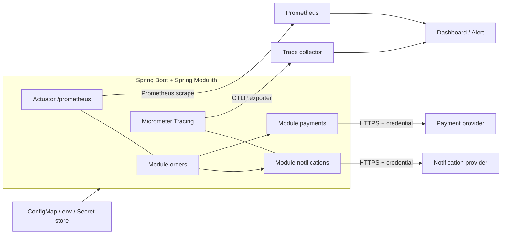
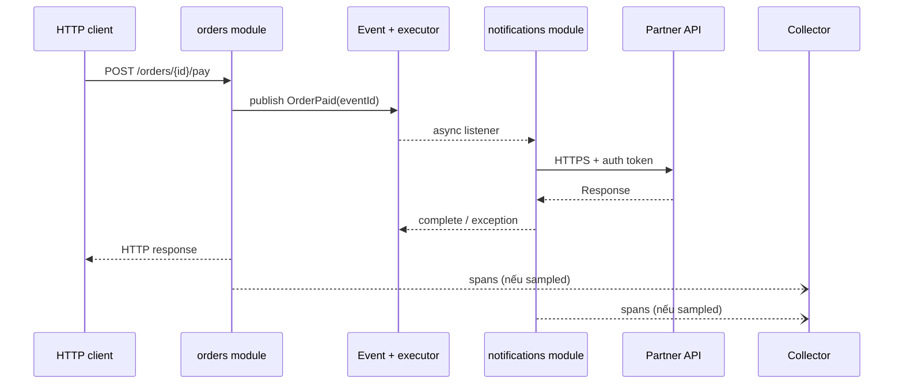

# Quản lý endpoint, credential và tag môi trường

## 1. Vì sao cấu hình môi trường là một phần của observability?

Trong ứng dụng Spring Boot xây dựng theo **Spring Modulith**, module graph cho biết ranh giới kiến trúc: mô-đun nào cung cấp API, mô-đun nào phụ thuộc mô-đun nào, và tương tác có phù hợp thiết kế không. Khi ứng dụng chạy thực tế, **Actuator, metrics, tracing và context propagation** bổ sung góc nhìn động: request và sự kiện đi qua mô-đun nào, có lỗi hay chậm ở đâu, và hành vi khác nhau thế nào giữa các môi trường.

Một nguồn sai lệch thường gặp là cấu hình **endpoint**, **credential** và **tag môi trường** thiếu nhất quán. Chẳng hạn, mô-đun `notifications` trên production vẫn trỏ tới notification sandbox; token collector đã hết hạn khiến traces biến mất; `/actuator/prometheus` bị mở công khai; hoặc metrics `staging` và `prod` không có nhãn phân biệt nên dashboard trộn dữ liệu.

Bài học **“Quản lý endpoint, credential và tag môi trường”** thuộc chương **Cấu hình môi trường** của module `SPRING_MODULITH_DOCUMENTATION_OBSERVABILITY`. Mục tiêu là biến ba nhóm cấu hình này thành những thành phần có chủ sở hữu, vòng đời, kiểm thử và chính sách bảo mật rõ ràng.

Sau bài học, bạn có thể:

1. Phân biệt endpoint nghiệp vụ, management endpoint và điểm thu thập telemetry.
2. Tách giá trị `local/dev/staging/prod` trong khi dùng cùng một artifact Spring Boot.
3. Ràng buộc cấu hình bằng `@ConfigurationProperties`, kiểm tra lỗi ngay từ lúc khởi động.
4. Cấp credential qua secret store hoặc cơ chế injection an toàn, tránh lộ qua log/trace/config dump.
5. Gắn tag môi trường cho metrics có kiểm soát cardinality; phân biệt metric tags với trace attributes.
6. Bảo vệ Actuator, kiểm tra kết nối collector và xác minh cấu hình tại thời điểm triển khai.

### 1.1. Bức tranh tổng thể



**Application module trong Spring Modulith không tự trở thành một dịch vụ mạng.** `orders` giao tiếp với `notifications` qua Java API hoặc sự kiện nội bộ thường không cần URL HTTP riêng. Endpoint được quản lý ở đây chủ yếu là **ranh giới ứng dụng với hệ thống ngoài**, **cổng quản trị/quan sát** và **collector xuất telemetry**. Không thêm HTTP giữa các module chỉ để có “endpoint cho từng module”.

## 2. Phân loại endpoint trước khi cấu hình

| Loại endpoint | Ví dụ | Hướng kết nối | Credential hoặc kiểm soát truy cập | Cách kiểm chứng |
| --- | --- | --- | --- | --- |
| **Inbound business** | `/api/orders`, webhook | Client → ứng dụng | JWT/OAuth2, mTLS, policy theo yêu cầu | HTTP + security integration test |
| **Outbound integration** | `https://inventory.example.internal` | Adapter của module → đối tác | Bearer token, OAuth2 client, mTLS | Contract test + smoke test |
| **Management** | `/actuator/health`, `/actuator/prometheus` | Probe/Prometheus → ứng dụng | Mạng riêng, RBAC/firewall, security chain | Test quyền truy cập/status |
| **Trace export** | `https://collector.example.internal/v1/traces` | Ứng dụng → OTLP collector | Token, mTLS hoặc workload identity | Kiểm tra spans tới backend |
| **Khác** | OTLP metrics/log exporter | Ứng dụng → backend | Theo giao thức/backend | Tín hiệu end-to-end |

Với một URL cần xét **scheme, host, port, path, DNS, TLS trust, timeout, authentication, retry và proxy**. Thay host đúng nhưng giữ certificate hoặc token thuộc môi trường khác vẫn có thể gây lỗi.

**OTLP traces và Prometheus metrics thường có chiều kết nối khác nhau:** ứng dụng *đẩy* spans đến collector, còn Prometheus *kéo* metrics từ `/actuator/prometheus`. Không gom thành một URL observability nếu backend thực sự dùng hai giao thức.

### 2.1. Ma trận môi trường

| Thuộc tính | Local | Dev | Staging | Production |
| --- | --- | --- | --- | --- |
| Endpoint đối tác | Mock `localhost` | Sandbox dev | Sandbox/near-prod | Endpoint production qua TLS |
| Endpoint Actuator | Loopback, debug tùy nhu cầu | Mạng nội bộ | Mạng giám sát riêng | Mạng giám sát riêng, chỉ route cần thiết |
| Trace collector | Local hoặc tắt | Collector dev | Collector staging | Collector prod |
| Credential | Giá trị giả | Secret dev | Secret staging | Secret prod, quyền tối thiểu |
| Metric tag `environment` | `local` | `dev` | `staging` | `prod` |
| Sampling traces | Cao nếu cần debug | Phù hợp tải thử nghiệm | Theo mô phỏng tải | Theo SLO, lưu lượng và chi phí |

Ma trận là **ví dụ thiết kế**, không phải mặc định của framework. Mỗi môi trường cần có chủ sở hữu, quy tắc truy cập và bước xác minh triển khai. Tên Spring profile không tự áp đặt quyền truy cập mạng hay vòng đời secret.

## 3. Tổ chức cấu hình Spring Boot theo môi trường

### 3.1. Dùng cùng binary, thay cấu hình khi triển khai

Một build Spring Boot nên có thể chạy tại `dev`, `staging` và `prod`; URL kết nối và secret được cung cấp khi deploy. Spring Boot nhận properties từ `application.yml`, file theo profile, biến môi trường, system properties, command-line arguments hoặc nguồn cấu hình mở rộng. Khi một key được khai báo ở nhiều nơi, **property source có thứ tự ưu tiên cao hơn ghi đè nguồn thấp hơn**; phải kiểm tra thứ tự cụ thể của phiên bản Spring Boot đang chạy khi debug.

Ví dụ `application.yml` sau minh họa Spring Boot **3.x + Actuator/Micrometer Tracing**:

```yaml
spring:
  application:
    name: order-platform

integrations:
  notification:
    base-url: ${NOTIFICATION_BASE_URL}
    connect-timeout: ${NOTIFICATION_CONNECT_TIMEOUT:2s}
    read-timeout: ${NOTIFICATION_READ_TIMEOUT:5s}

management:
  endpoints:
    web:
      exposure:
        include: health,info,prometheus
  endpoint:
    health:
      probes:
        enabled: true
  metrics:
    tags:
      application: ${spring.application.name}
      environment: ${DEPLOYMENT_ENV}
      region: ${DEPLOYMENT_REGION}
  tracing:
    sampling:
      probability: ${TRACING_SAMPLE_PROBABILITY:0.10}
  otlp:
    tracing:
      endpoint: ${OTLP_TRACES_ENDPOINT}
```

Các biến có vai trò khác nhau:

- `NOTIFICATION_BASE_URL` là endpoint nghiệp vụ; thiếu giá trị phải được phát hiện trước khi xử lý event đầu tiên.
- `NOTIFICATION_CONNECT_TIMEOUT`/`NOTIFICATION_READ_TIMEOUT` là ngân sách kết nối và nhận dữ liệu, **cần được truyền thật vào HTTP client**; khai báo YAML tự nó chưa làm HTTP client áp dụng timeout.
- `DEPLOYMENT_ENV` và `DEPLOYMENT_REGION` là tag ổn định cho các meter của Micrometer.
- `TRACING_SAMPLE_PROBABILITY` từ 0 đến 1 quy định xác suất lấy mẫu traces, không bảo đảm mọi sự kiện đều có trace.
- `OTLP_TRACES_ENDPOINT` là URL tương thích với protocol/collector, ví dụ đường dẫn `/v1/traces` cho OTLP HTTP/protobuf.

Các biến không có mặc định được yêu cầu khi cấu hình tương ứng bật. Với local hoặc test không dùng collector, cấu hình exporter được tắt/bỏ một cách tường minh theo profile và dependency thực tế; **không âm thầm gửi telemetry sang hạ tầng thật**. Những property dưới `management.otlp.tracing` có thể thay đổi giữa các major version Spring Boot, nên kiểm tra documentation của version đang sử dụng trước khi áp dụng.

Ví dụ `application-local.yml` cho môi trường phát triển:

```yaml
integrations:
  notification:
    base-url: http://127.0.0.1:9090
management:
  tracing:
    sampling:
      probability: 1.0
```

Cấp `DEPLOYMENT_ENV=local`, `DEPLOYMENT_REGION=local` và `OTLP_TRACES_ENDPOINT=http://localhost:4318/v1/traces` nếu chạy một collector local. Nếu không có collector, cấu hình tracing/exporter cần được điều chỉnh để phù hợp local test.

Ví dụ `application-prod.yml` chỉ chứa giá trị chính sách **không bí mật**:

```yaml
management:
  server:
    port: 8081
  endpoints:
    web:
      exposure:
        include: health,info,prometheus
  tracing:
    sampling:
      probability: 0.05
```

Port `8081` là ví dụ. Nếu chuyển management sang cổng riêng, readiness probe, Service/Ingress, Prometheus scraping và firewall phải cùng trỏ đến cổng mới. Management port riêng **không tự cung cấp authentication hay network isolation**.

Kích hoạt profile từ môi trường triển khai, ví dụ `SPRING_PROFILES_ACTIVE=staging` hoặc `prod`. Không đặt `spring.profiles.active=prod` cố định trong cấu hình chung, rồi để unit test có thể chạy nhầm cấu hình sản xuất. Trên Kubernetes, dùng ConfigMap cho URL/tham số không bí mật và Secret/external secret store cho credential; kiểm tra service account và quyền truy cập ở từng môi trường.

### 3.2. Ràng buộc cấu hình typed và fail-fast

Một URL sai có thể chỉ phát lộ sau khi listener nhận sự kiện đầu tiên. Dùng `@ConfigurationProperties` để gom các giá trị có liên quan và kiểm tra sớm.

```java
package com.example.notifications.infrastructure;

import java.net.URI;
import java.time.Duration;

import jakarta.validation.constraints.NotNull;
import org.springframework.boot.context.properties.ConfigurationProperties;
import org.springframework.validation.annotation.Validated;

@Validated
@ConfigurationProperties(prefix = "integrations.notification")
public record NotificationClientProperties(
        @NotNull URI baseUrl,
        @NotNull Duration connectTimeout,
        @NotNull Duration readTimeout) {

    public NotificationClientProperties {
        if (baseUrl != null &&
                (baseUrl.getHost() == null ||
                 (!"http".equalsIgnoreCase(baseUrl.getScheme()) &&
                  !"https".equalsIgnoreCase(baseUrl.getScheme())))) {
            throw new IllegalArgumentException(
                    "Notification base-url must be an absolute HTTP(S) URL");
        }
        if (connectTimeout != null &&
                (connectTimeout.isNegative() || connectTimeout.isZero())) {
            throw new IllegalArgumentException(
                    "connect-timeout must be positive");
        }
        if (readTimeout != null &&
                (readTimeout.isNegative() || readTimeout.isZero())) {
            throw new IllegalArgumentException(
                    "read-timeout must be positive");
        }
    }
}
```

`Duration.isNegative()` và `isZero()` dùng được trên Java 17. `@NotNull` cần Bean Validation (thường qua `spring-boot-starter-validation`). Đăng ký properties bean bằng `@ConfigurationPropertiesScan` tại ứng dụng hoặc `@EnableConfigurationProperties(NotificationClientProperties.class)` tại cấu hình thích hợp:

```java
package com.example;

import org.springframework.boot.SpringApplication;
import org.springframework.boot.autoconfigure.SpringBootApplication;
import org.springframework.boot.context.properties.ConfigurationPropertiesScan;

@SpringBootApplication
@ConfigurationPropertiesScan
public class OrderPlatformApplication {
    public static void main(String[] args) {
        SpringApplication.run(OrderPlatformApplication.class, args);
    }
}
```

Đặt adapter và properties trong module `notifications`; composition root Spring Boot làm nhiệm vụ scanning/wiring. Module `orders` không cần biết endpoint gửi notification, vì thế không kéo dependency của HTTP adapter sang `orders`. Đây là cách cấu hình phục vụ **ranh giới application module** vốn được Spring Modulith lập tài liệu và xác minh.

Kiểm tra scheme `https` cho production theo policy riêng; parse URI thành công **không** chứng minh hostname, chứng chỉ, DNS hoặc đường mạng an toàn. Local mock có thể chạy `http://127.0.0.1` nhưng production phải tuân thủ TLS và trusted CA.

## 4. Quản lý credential như một vòng đời bảo mật

### 4.1. Phân loại credential

| Dạng | Sử dụng | Cách bảo quản |
| --- | --- | --- |
| API/Bearer token | Provider, OTLP collector có auth | Secret store/secret injection, scope nhỏ |
| OAuth2 client secret | Client credentials cho tích hợp | Secret store, rotate theo chính sách |
| TLS private key/mTLS cert | Xác thực hai chiều với đối tác | Secret volume/keystore, kiểm soát quyền đọc |
| Trust store/CA | Xác minh server và certificate chain | Quản lý phiên bản, hết hạn, trust policy |
| Database password | JDBC/JPA event publication repository | Secret store và tài khoản quyền tối thiểu |

**Credential là dữ liệu nhạy cảm, còn endpoint URL và tag môi trường thường là cấu hình không bí mật**; tuy vậy URL có thể chứa query token, user info hoặc host nội bộ nhạy cảm, nên vẫn phải review trước khi log.

Ví dụ cấp token cho adapter qua môi trường, không commit giá trị thật:

```java
package com.example.notifications.infrastructure;

import org.springframework.beans.factory.annotation.Value;
import org.springframework.stereotype.Component;

@Component
public class NotificationAuth {
    private final String bearerToken;

    public NotificationAuth(
            @Value("${NOTIFICATION_BEARER_TOKEN}") String bearerToken) {
        if (bearerToken == null || bearerToken.isBlank()) {
            throw new IllegalArgumentException(
                    "Missing notification credential");
        }
        this.bearerToken = bearerToken;
    }

    public String authorizationHeader() {
        return "Bearer " + bearerToken;
    }

    // Không sinh toString() chứa bearerToken.
}
```

Adapter HTTP chỉ sử dụng `authorizationHeader()` khi xây request, không ghi log giá trị header. Đây là ví dụ binding cơ bản; nếu cần rotate token thường xuyên, chọn OAuth2 client/provider credential hoặc secret provider có cơ chế cache + refresh thích hợp, tránh giữ mãi token nạp từ startup.

**Không đặt token trong query URL** như `?apiKey=...` nếu đối tác có hỗ trợ header; URL có thể bị ghi vào access logs, reverse proxy, traces hoặc bảng điều khiển. Nếu giao thức bên ngoài buộc dùng query token, cần chính sách làm sạch dữ liệu trên tất cả tầng.

### 4.2. Credential cho OTLP exporter

Traces có thể được gửi tới collector bằng OTLP. Khi collector cần Bearer token, ví dụ cấu hình Spring Boot 3.x với exporter hỗ trợ header:

```yaml
management:
  otlp:
    tracing:
      endpoint: ${OTLP_TRACES_ENDPOINT}
      headers:
        Authorization: "Bearer ${OTLP_ACCESS_TOKEN}"
```

Token `OTLP_ACCESS_TOKEN` được cấp từ secret store tại deployment; không đưa giá trị thật vào Git. Có collector dùng mTLS hoặc workload identity không cần Bearer token: áp dụng chính xác cơ chế xác thực của hạ tầng, thay vì cài thêm một header sai. Kiểm tra property keys, protocol và yêu cầu headers theo version Boot/collector.

Ứng dụng **không xuất được trace có thể vẫn xử lý nghiệp vụ bình thường**. Do đó cần quan sát riêng exporter: HTTP 401/403, TLS handshake, queue của exporter, log/metric SDK/collector và smoke test xác nhận span thực sự hiện trên backend. Tăng sampling không khắc phục lỗi authentication.

### 4.3. Rotation, cấp quyền và thu hồi

Mỗi credential nên có **chủ sở hữu, phạm vi quyền, môi trường, nơi lưu, thời hạn, cách rotate và cách thu hồi**. Quy trình rotation:

1. Cấp credential mới tại hệ thống đích với quyền tối thiểu cho môi trường tương ứng.
2. Cập nhật secret store; cho workload nhận credential mới bằng restart/refresh an toàn.
3. Kiểm tra HTTP integration và collector hoạt động với credential mới; theo dõi 401/403 và tỉ lệ lỗi.
4. Thu hồi credential cũ sau khi toàn bộ instance đã chuyển đổi.
5. Lưu lại change ID hoặc secret version trong audit log, **không log token/khóa bí mật**.

Biến môi trường không tự cập nhật giá trị trong process khi secret bị đổi. File secret được mount cũng chưa chắc làm HTTP client hoặc SSL context tự reload; phải kiểm tra lifecycle của client và kế hoạch rollout. Tách secret của `dev`, `staging`, `prod` để một token bị lộ không mở rộng quyền sang các môi trường khác.

### 4.4. Chống rò rỉ qua observability

Các endpoint `/actuator/env`, `/actuator/configprops`, thread dump, HTTP debug logging và tracing có thể vô tình phơi bày cấu hình hoặc dữ liệu request. Spring Boot có cơ chế che các giá trị nhạy cảm trong một số endpoint, nhưng **không thể thay thế việc kiểm soát truy cập**.

Quy tắc thực hành:

- Không public `env`, `configprops`, `heapdump`, `threaddump`, `loggers`.
- Không ghi `Authorization`, `Cookie`, token, private key, certificate private material vào metrics, traces hay logs.
- Không ghi `toString()` của record chứa secret vào log khi bắt exception binding.
- Redact header và body trước khi bật HTTP client logging; chỉ log host/path đã được làm sạch.
- Hạn chế RBAC và network tới secret store, exporter, collector theo service account.
- Không disable SSL hostname validation hoặc trust manager để xử lý nhanh lỗi certificate; phải giải quyết trust store, SAN, certificate chain và expiry.

## 5. Thiết kế tag môi trường cho metrics

### 5.1. Tag là chiều phân tích, không phải kho lưu mọi thuộc tính

Một counter `integration.requests` chỉ ghi nhận số request. Khi thêm tags, dashboard có thể trả lời: request đó từ môi trường nào, module nào, kết quả gì, và khu vực nào. Micrometer gọi đây là **tags**; Prometheus dùng khái niệm tương ứng **labels**.

| Tag | Giá trị mẫu | Cardinality | Khuyến nghị |
| --- | --- | --- | --- |
| `application` | `order-platform` | Thấp | Dùng common tag nhất quán |
| `environment` | `local/dev/staging/prod` | Thấp | Luôn có tại môi trường chia sẻ |
| `region` | `ap-southeast-1` | Thấp | Dùng tên vùng chuẩn |
| `module` | `orders/notifications/payments` | Thấp, hữu hạn | Hữu ích cho đồ thị kiến trúc |
| `operation` | `send-notification` | Thấp nếu whitelist | Định nghĩa tên thao tác ổn định |
| `outcome` | `success/error/timeout` | Thấp | Chuẩn hóa giá trị |
| `exception.type` | Danh sách lỗi đã chuẩn hóa | Trung bình | Cân nhắc cho metric quan trọng |
| `eventId`, `orderId` | UUID/ID từng sự kiện | **Rất cao** | **Không dùng làm metric tag** |
| `fullUrl`, `exception.message` | URL/query, lỗi động | **Rất cao + có thể nhạy cảm** | Không dùng làm metric tag |

Ví dụ một dịch vụ chạy ở 3 môi trường, 4 module, 6 operation và 3 outcome có thể tạo tới **3 × 4 × 6 × 3 = 216** chuỗi cho *mỗi metric*, chưa tính instance, status và histogram buckets. Nếu thêm `orderId` với hàng triệu giá trị, Prometheus có thể không chịu được lượng time series.

**Common tags** trong `management.metrics.tags` áp dụng cho meter được đăng ký qua cấu hình Micrometer của Spring Boot:

```yaml
management:
  metrics:
    tags:
      application: ${spring.application.name}
      environment: ${DEPLOYMENT_ENV}
      region: ${DEPLOYMENT_REGION}
```

Sau đó instrument thao tác cụ thể bằng tags **không trùng common tags**:

```java
package com.example.notifications.infrastructure;

import io.micrometer.core.instrument.MeterRegistry;
import org.springframework.stereotype.Component;

@Component
public class NotificationMetrics {
    private final MeterRegistry registry;

    public NotificationMetrics(MeterRegistry registry) {
        this.registry = registry;
    }

    public void completed(String outcome) {
        if (!"success".equals(outcome)
                && !"error".equals(outcome)
                && !"timeout".equals(outcome)) {
            throw new IllegalArgumentException("Unsupported outcome");
        }

        registry.counter(
                "app.integration.requests",
                "module", "notifications",
                "operation", "send-notification",
                "outcome", outcome)
                .increment();
    }
}
```

Tên `app.integration.requests` là **metric tùy chỉnh** minh họa, không phải meter có sẵn của Spring Modulith. Ví dụ khóa danh sách `outcome` để ngăn giá trị động lọt vào tag. Không đưa raw response message hoặc URL vào `outcome`. Nếu dùng một `MeterRegistry` không đi qua auto-configuration trong unit test, common tags từ application YAML có thể không tồn tại: cần kiểm tra cấu hình test hoặc gắn tags đúng cách.

**Quy ước tên metric:** Micrometer thường biểu diễn counter này thành `app_integration_requests_total` trong Prometheus. Tên thực tế cần được quan sát từ `/actuator/prometheus` vì naming conventions khác nhau giữa registry/phiên bản.

### 5.2. Tag cho kiến trúc Spring Modulith

Đối với hệ thống có các application module `orders`, `payments`, `notifications`, hãy dùng một tập tên module ổn định. Nếu module được đổi tên theo lần deploy, dashboard/alerts cũng phải được cập nhật. Có thể kết hợp các chiều:

- `module=notifications`: module sở hữu logic xử lý.
- `operation=send-notification`: hành động có thể gây lỗi.
- `outcome=error`: kết quả đã chuẩn hóa.
- `environment=prod`: giá trị do deployment cung cấp dưới dạng common tag.

Dùng **module graph** hoặc sơ đồ kiến trúc đã sinh của Spring Modulith để xác định những module và tương tác hợp lệ. Observability runtime có thể instrument các tương tác này nếu dependency/cấu hình phù hợp; **không mặc định giả định Spring Modulith tự sinh mọi metric tùy chỉnh hoặc tự gắn tag `module` cho meter của ứng dụng**.

Nếu module `notifications` được gọi từ sự kiện bất đồng bộ `OrderPaid`, ta có thể đo số lần xử lý, retry và độ trễ theo một `event.type` đã chuẩn hóa, chẳng hạn `order-paid`, nhưng không dùng `event.id` làm tag. Trùng event sau restart có thể làm counter attempts tăng; cần định nghĩa rõ **event nghiệp vụ**, **listener invocation** và **retry attempt** khi đặt tên meter.

### 5.3. Truy vấn Prometheus theo môi trường

Khi ứng dụng đã xuất và Prometheus đã scrape được metrics, các truy vấn minh họa:

```promql
# Request/giây của module notifications theo môi trường
sum by (environment) (
  rate(app_integration_requests_total{
    module="notifications",
    operation="send-notification"
  }[5m])
)

# Tỉ lệ lỗi của các request notification (5 phút)
sum by (environment) (
  rate(app_integration_requests_total{
    module="notifications",
    outcome="error"
  }[5m])
)
/
clamp_min(
  sum by (environment) (
    rate(app_integration_requests_total{
      module="notifications"
    }[5m])
  ),
  0.001
)
```

PromQL là ví dụ dựa trên meter tùy chỉnh phía trên. Hãy xác minh tên và labels thật bằng `/actuator/prometheus` trước khi đưa vào dashboard. Với cửa sổ ít dữ liệu, tỉ lệ có thể rất nhiễu; chọn cửa sổ và ngưỡng cảnh báo phù hợp SLO, không suy luận chỉ từ vài request.

**Không gộp `environment` bằng cách bỏ nhãn trong aggregation** khi muốn xem riêng staging và prod. Có thể gom theo `application`/`region` để đối chiếu, nhưng tránh high-cardinality trong cả dashboard queries.

## 6. Tag của metrics khác gì attributes của traces?

Metric tag là một chiều của chuỗi thời gian tổng hợp. Trace/span attributes là dữ liệu đi kèm từng hoạt động cụ thể, thường được backend traces lập chỉ mục hoặc truy vấn. Cả hai đều có chi phí và có thể chứa dữ liệu nhạy cảm, nhưng cách sử dụng khác nhau:

| Dữ liệu | Metric tag | Trace/span attribute | Structured log |
| --- | --- | --- | --- |
| `environment`, `region` | Phù hợp | Phù hợp nếu cấu hình resource/span | Phù hợp |
| `module`, `operation` | Phù hợp | Phù hợp | Phù hợp |
| `outcome` chuẩn hóa | Phù hợp | Phù hợp | Phù hợp |
| `eventId`/`orderId` | Không | Chỉ khi chính sách dữ liệu cho phép và có mục tiêu điều tra | Thường dùng correlation, kiểm soát PII |
| Bearer token, password | **Tuyệt đối không** | **Tuyệt đối không** | **Tuyệt đối không** |
| Stack trace đầy đủ | Không | Chỉ khi có sampling/retention phù hợp | Có thể ở log bảo vệ, sau khi redact |

`management.metrics.tags` gắn common tags cho **Micrometer meters**; **không mặc nhiên tạo resource attributes của OpenTelemetry traces**. Nếu muốn thống nhất tên service/environment trên traces, cấu hình OpenTelemetry Resource/Observation/Tracing theo cách tương thích với bridge/exporter và version đang dùng; xác nhận kết quả từ backend, không giả định chỉ nhờ một property metrics là đủ.

### 6.1. Tracing của tương tác module

Ví dụ: controller gọi module `orders`; sau commit, event `OrderPaid` kích hoạt `notifications` gửi request HTTP sang đối tác. Ở góc nhìn runtime, tracing giúp biết mỗi đoạn mất bao lâu, gặp lỗi nào và có context propagation hay không.



Với listener bất đồng bộ, truyền tracing context từ thread publisher sang thread executor cần cơ chế propagation phù hợp. Trên các phiên bản Spring Framework hỗ trợ `ContextPropagatingTaskDecorator`, có thể cấu hình executor cho `@Async`:

```java
package com.example.config;

import java.util.concurrent.Executor;
import org.springframework.context.annotation.Configuration;
import org.springframework.core.task.support.ContextPropagatingTaskDecorator;
import org.springframework.scheduling.annotation.AsyncConfigurer;
import org.springframework.scheduling.annotation.EnableAsync;
import org.springframework.scheduling.concurrent.ThreadPoolTaskExecutor;

@Configuration
@EnableAsync
class AsyncTracingConfiguration implements AsyncConfigurer {

    @Override
    public Executor getAsyncExecutor() {
        var executor = new ThreadPoolTaskExecutor();
        executor.setThreadNamePrefix("modulith-events-");
        executor.setCorePoolSize(4);
        executor.setMaxPoolSize(8);
        executor.setQueueCapacity(200);
        executor.setTaskDecorator(new ContextPropagatingTaskDecorator());
        executor.initialize();
        return executor;
    }
}
```

Cấu hình cần Micrometer Context Propagation/Observation và tracing bridge phù hợp, cũng như exporter nếu gửi traces ra ngoài. `@ApplicationModuleListener` trong Spring Modulith thường kết hợp cách xử lý sự kiện theo transaction với `@Async`; kiểm tra executor thực sự được sử dụng bởi listener trong ứng dụng, nhất là khi có nhiều executors.

Context propagation **trong process** không tự khôi phục trace cha sau khi restart hoặc publication được phát lại vào một thời điểm sau đó. Dùng `eventId`/`correlationId` bền vững trong payload hoặc publication metadata để nối các lần xử lý trong log/trace; không lấy ID đó làm metric tag.

### 6.2. Dependencies quan sát theo version

Một cấu hình Gradle Kotlin DSL thường gặp với **Spring Boot 3.x / Spring Modulith tương thích**:

```kotlin
dependencies {
    implementation("org.springframework.modulith:spring-modulith-starter-core")
    implementation("org.springframework.modulith:spring-modulith-observability")
    implementation("org.springframework.boot:spring-boot-starter-actuator")

    // Chọn bridge tương thích với tracing backend và BOM dự án.
    implementation("io.micrometer:micrometer-tracing-bridge-otel")
    implementation("io.opentelemetry:opentelemetry-exporter-otlp")

    runtimeOnly("io.micrometer:micrometer-registry-prometheus")
}
```

Tùy phiên bản và cấu hình, Spring Boot có thể cung cấp starter/exporter hoặc property khác; **không đưa các dependency minh họa vào dự án chỉ vì bài học** nếu hệ thống đã chọn Zipkin, OpenTelemetry SDK thuần hoặc collector khác. Phải đồng bộ Spring Boot BOM, Spring Modulith BOM, Micrometer và OpenTelemetry, tránh tự ghép phiên bản không tương thích. Mục tiêu của bài là quản lý endpoint/credential/tag, không buộc mọi hệ thống sử dụng cùng một stack telemetry.

## 7. Actuator: endpoint phải vừa quan sát được vừa được bảo vệ

Spring Boot Actuator cung cấp health, metrics và các endpoint chẩn đoán. Bật HTTP exposure bằng `management.endpoints.web.exposure.include` **chỉ quyết định endpoint nào được công bố qua web**, chưa tự định nghĩa đầy đủ quyền truy cập mạng hoặc authentication. Khi bổ sung Spring Security, cần kiểm tra **SecurityFilterChain** của chính ứng dụng và quy tắc authorization cho Actuator.

Một cấu hình production định hướng an toàn:

```yaml
management:
  server:
    port: 8081
  endpoints:
    web:
      base-path: /actuator
      exposure:
        include: health,info,prometheus
  endpoint:
    health:
      probes:
        enabled: true
      show-details: never
```

Giới hạn ingress cho cổng `8081` chỉ từ kubelet/probe và hệ thống giám sát; nếu cần authentication cho `prometheus`, cấu hình phù hợp với cơ chế scrape (service account, TLS, network policy, proxy hoặc bearer token), tránh expose trực tiếp cho Internet. Endpoint `info` có thể chứa build metadata; xét dữ liệu nào cần công bố.

**Khuyến nghị phân quyền tối thiểu:**

- Health liveness/readiness chỉ cần thông tin cần thiết cho probe; health detail có thể bị giới hạn với người quản trị.
- `prometheus` chỉ dành cho scraper được phép.
- `metrics` (Actuator JSON metrics) có thể hữu ích khi debug nhưng chỉ bật trong mạng có kiểm soát; không cần bật nếu Prometheus endpoint đã đủ cho vận hành.
- `env`, `configprops`, `heapdump` và các endpoint nhạy cảm khác không cần exposure ngoài trừ khi có quy trình bảo vệ nghiêm ngặt.
- Nếu management chạy cùng cổng business HTTP, security rules phải phân biệt `/actuator/**` và routes nghiệp vụ; nếu chạy cổng riêng vẫn cần policy mạng.

Ví dụ kiểm tra bằng `curl` từ mạng nội bộ được cấp quyền:

```bash
curl -i http://127.0.0.1:8081/actuator/health
curl -i http://127.0.0.1:8081/actuator/prometheus
```

Các lệnh chỉ là ví dụ; cổng thực có thể khác và endpoint `prometheus` trả 404 nếu thiếu Prometheus registry hoặc chưa expose. `401/403` có thể là **kết quả đúng** nếu client kiểm tra không có quyền; xác minh cả request được phép và không được phép. Không dùng cách tắt security để biến bài smoke test thành xanh.

### 7.1. Phân biệt tình trạng hoạt động

`/actuator/health` trả UP không đủ kết luận mọi endpoint ngoài, token và exporter đều hợp lệ. Một ứng dụng có thể sống khỏe nhưng không gửi được traces vì token collector đã hết hạn. Cần kiểm tra theo từng năng lực:

- **Liveness:** process còn vận hành.
- **Readiness:** ứng dụng sẵn sàng nhận lưu lượng theo tiêu chí của hệ thống.
- **Integration connectivity:** DNS/TLS/credential/timeout cho đối tác, kiểm thử có giới hạn để tránh gây side effect.
- **Telemetry pipeline:** registry có metrics, scraper truy cập được, collector nhận spans và dashboard đọc đúng môi trường.
- **Application module health:** luồng events/queries qua các module không bị backlog hoặc mất dữ liệu.

Không đẩy mọi lỗi collector không thiết yếu vào readiness nếu điều đó sẽ gây vòng restart làm mất thêm dữ liệu; đánh giá tác động nghiệp vụ theo SLO. Ngược lại, nếu một dependency bắt buộc không thể truy cập, cần có tín hiệu rõ và chính sách nhận traffic phù hợp.

## 8. Kiểm tra cấu hình bằng test và smoke test

### 8.1. Kiểm tra property binding

Ví dụ kiểm tra Spring Boot bind URL và timeouts bằng cùng đường cấu hình sẽ dùng khi ứng dụng chạy. Vì bài minh họa có placeholders bắt buộc, test cung cấp giá trị giả **cho đúng các key cần thiết**:

```java
package com.example.notifications.infrastructure;

import java.net.URI;
import java.time.Duration;
import org.junit.jupiter.api.Test;
import org.springframework.beans.factory.annotation.Autowired;
import org.springframework.boot.test.context.SpringBootTest;

import static org.junit.jupiter.api.Assertions.assertEquals;

@SpringBootTest(properties = {
        "NOTIFICATION_BASE_URL=http://127.0.0.1:9090",
        "NOTIFICATION_CONNECT_TIMEOUT=3s",
        "NOTIFICATION_READ_TIMEOUT=6s",
        "NOTIFICATION_BEARER_TOKEN=fake-test-token",
        "DEPLOYMENT_ENV=test",
        "DEPLOYMENT_REGION=local",
        "OTLP_TRACES_ENDPOINT=http://127.0.0.1:4318/v1/traces"
})
class NotificationConfigurationTest {

    @Autowired
    NotificationClientProperties properties;

    @Test
    void bindsEnvironmentProperties() {
        assertEquals(URI.create("http://127.0.0.1:9090"),
                properties.baseUrl());
        assertEquals(Duration.ofSeconds(3),
                properties.connectTimeout());
        assertEquals(Duration.ofSeconds(6),
                properties.readTimeout());
    }
}
```

Đây là test cho **binding cấu hình**; nó không mở đường mạng tới notification provider hoặc collector. Nếu `@SpringBootTest` toàn ứng dụng nạp thêm database/queue thật, hãy dùng test slice hoặc ApplicationContextRunner để cô lập binding. Test production policy riêng phải xác minh HTTP endpoint bị từ chối hoặc HTTPS được áp dụng, và những biến bắt buộc thiếu sẽ khiến startup fail theo kỳ vọng.

### 8.2. Kiểm tra endpoint và credential ở từng lớp

| Lớp | Mục tiêu | Cách thực hiện | Không được suy diễn |
| --- | --- | --- | --- |
| Unit test | Phân loại tag/outcome, parse URL, timeout | `SimpleMeterRegistry`, mock client | Không chứng minh network/TLS |
| Boot config test | Đọc env/profile/`@ConfigurationProperties` | `@SpringBootTest` hoặc `ApplicationContextRunner` | Không chứng minh token thật hợp lệ |
| HTTP mock test | Adapter gửi đúng auth header, timeout và path | Mock HTTP server trong test | Không chứng minh đối tác production có sẵn |
| Actuator integration | Endpoint cần thiết có/không có và quyền truy cập đúng | Web integration test theo security config | Không chứng minh scraper bên ngoài reach được |
| Staging smoke test | DNS, TLS, token và collector thực hoạt động | Request hạn chế + trace canary | Không chứng minh mọi tình huống nghiệp vụ |
| Production canary | Route, credential, tag đúng môi trường | Triển khai nhỏ, quan sát metrics/traces/logs | Không tự xác nhận dữ liệu khách hàng tuyệt đối an toàn |

Một smoke test hoàn chỉnh nên gắn **deployment environment tag**, gửi một hoạt động có mã correlation giả, rồi kiểm tra cùng một khoảng thời gian trên Prometheus và tracing backend. Nếu metric hiện `environment=staging` nhưng trace lại vào collector prod, môi trường telemetry chưa được tách đúng.

### 8.3. Kiểm tra cardinality và dữ liệu nhạy cảm

Không chỉ assert rằng metric tồn tại. Hãy đo số time series trước/sau một batch các sự kiện có ID khác nhau. Với meter chỉ dùng `module`, `operation` và `outcome` cố định, tạo thêm 10.000 `eventId` **không** nên tạo 10.000 tổ hợp label mới.

Gửi một request test có header `Authorization: Bearer REDACT_ME_TEST` rồi kiểm tra logs/traces có chứa chuỗi ấy hay không; nếu có, sửa redaction trước khi bật verbose instrumentation ở production. Dùng token giả không có quyền, không dùng credential thật làm fixture.

## 9. Quy trình triển khai và xử lý sự cố

### 9.1. Checklist trước khi phát hành

1. **Endpoint:** kiểm tra outbound URLs, TLS, hostname, timeout, port/path và khả năng truy cập từ môi trường đích; không còn URL sandbox ở production.
2. **Credential:** kiểm tra nguồn secret, scope, expiry, rotation, không tồn tại giá trị thật trong Git và startup có hành vi rõ khi thiếu secret.
3. **Actuator:** chỉ expose những route cần thiết; thử cả truy cập được phép và bị từ chối; scraper/probe đúng port.
4. **Metrics:** các tag `application`, `environment` và `region` thống nhất; module/operation/outcome theo danh sách ổn định; không có ID hoặc token trong tags.
5. **Tracing:** exporter đúng collector, protocol và credential; có đủ spans theo sampling; context propagation hoạt động qua listener bất đồng bộ khi được hỗ trợ.
6. **Module graph:** các dependency quan sát thấy tương ứng ranh giới Spring Modulith được cho phép; module adapter sở hữu endpoint và credential của mình.
7. **Rollback:** thay đổi config/secret có cách quay lại an toàn; biết thứ tự rollout nhiều replica và thời điểm thu hồi token cũ.

### 9.2. Bảng chẩn đoán

| Triệu chứng | Nguyên nhân có thể | Điều cần kiểm tra |
| --- | --- | --- |
| Ứng dụng fail startup, báo thiếu placeholder | Biến môi trường/secret chưa được inject | Property sources, scope, profile, tên env |
| Ứng dụng chạy nhưng gửi notification lỗi 401 | Token sai/hết hạn/khác môi trường | Secret version, auth header, scope |
| HTTP client lỗi PKIX/TLS | Trust store hoặc certificate chain không đúng | CA, hostname/SAN, mTLS, expiry |
| `/actuator/prometheus` trả 404 | Thiếu registry, chưa expose, sai cổng/base-path | Dependency Prometheus, config management |
| `/actuator/prometheus` trả 403 | Security policy chặn scraper | Service identity, network policy, auth |
| Metric của staging nằm trên dashboard prod | Tag/cấu hình scrape hoặc datasource không tách môi trường | `environment` label, scrape job, tenant |
| Collector không có spans nhưng metrics bình thường | Exporter endpoint/token/protocol/sampling lỗi | OTLP logs, 401/403, sampling, collector pipeline |
| Mỗi event tạo thêm time series | Metric tags chứa ID động | List labels, meter instrumentation, cardinality |
| Trace bị đứt khi async listener chạy | Không truyền context giữa threads | Executor, TaskDecorator, Micrometer bridge |
| Trace sau restart có ID mới | Context cũ không còn sau replay | Dùng event/correlation ID bền vững để liên kết |

**Cách đặt vấn đề khi điều tra:** Hãy xác định tín hiệu nào bị sai (business request, metrics, trace hay log), sau đó kiểm tra endpoint và credential tương ứng. Không vì “không thấy trace” mà kết luận sự kiện đã mất; cần đối chiếu với publication registry, metrics và dữ liệu nghiệp vụ.

## 10. Bài tập tình huống tổng hợp

**Bối cảnh:** Ứng dụng `order-platform` có ba application module: `orders`, `payments` và `notifications`. Production chạy ở region `ap-southeast-1`. `notifications` gọi đối tác ngoài và phát sinh sự kiện bất đồng bộ; ứng dụng dùng Prometheus metrics và OTLP tracing.

Kịch bản lỗi:

- Sau rollout, dashboard Prometheus trộn dữ liệu `staging` và `prod`.
- `notifications` vẫn gửi HTTP thành công nhưng trace của module biến mất.
- Một thành viên nhóm đề xuất gắn `orderId` vào mọi metric label để dễ debug.
- Một secret collector đã được rotate nhưng các pod cũ chưa restart.

Hãy xử lý theo thứ tự:

1. Xác định common tags `application=order-platform`, `environment=prod` và `region=ap-southeast-1` từ deployment config; kiểm tra nhãn thật ở Prometheus.
2. Kiểm tra `OTLP_TRACES_ENDPOINT` trỏ tới collector production, authentication có hợp lệ không, sampling và exporter có bật không.
3. Xác nhận credential mới đã tới **mọi pod**; nếu client nạp secret từ env khi startup, rollout lại pod theo chính sách zero-downtime, sau đó thu hồi token cũ.
4. Không thêm `orderId` vào metric labels. Giữ `module`/`operation`/`outcome` trong metrics; dùng `eventId` hoặc `orderId` trong logs/traces khi phù hợp policy dữ liệu.
5. Chạy smoke test qua một event/HTTP call có ID giả, đối chiếu metric theo `environment` và trace ở đúng collector.
6. Đối chiếu module graph: outbound notification adapter vẫn thuộc `notifications`; không chuyển URL/credential lên `orders` chỉ để thuận tiện cấu hình.
7. Viết cảnh báo cho collector authentication failures và các dashboards có thiếu nhãn `environment` để phát hiện lỗi tương tự.

**Kết quả mong đợi:** Production không gọi sai endpoint, credential mỗi môi trường độc lập, Actuator chỉ phục vụ các client được phép, metrics có nhãn phân biệt ổn định, traces đến đúng backend và có đủ correlation để lần theo tương tác giữa các application module.

### Câu hỏi tự đánh giá

1. Vì sao module Java nội bộ trong Spring Modulith thường không cần một HTTP endpoint riêng?
2. `management.endpoints.web.exposure.include=prometheus` đã đủ bảo vệ dữ liệu giám sát chưa?
3. Khi `/actuator/health` vẫn UP mà traces biến mất, nên kiểm tra endpoint và credential nào trước?
4. Nếu `management.metrics.tags.environment` đã được cấu hình, có thể khẳng định mọi span trong tracing backend tự có environment không? Vì sao?
5. Một secret thay đổi trong secret manager có nhất thiết được mọi process Java áp dụng ngay không?
6. Vì sao `eventId` hữu ích trong logs nhưng nguy hiểm với Prometheus cardinality?
7. Khi sử dụng `@ApplicationModuleListener`, cần xác minh gì để trace context đi qua executor?
8. Cần kiểm thử nào để phát hiện ứng dụng trên production đang gọi nhầm notification sandbox?
9. Tại sao một lỗi collector authentication không nhất thiết đồng nghĩa với lỗi nghiệp vụ?
10. Đối chiếu module graph với metrics và traces giúp phát hiện loại lệch kiến trúc hoặc cấu hình nào?

**Nguyên tắc vận hành:** Endpoint phải trỏ đúng hệ thống, credential phải được cấp và thay đổi an toàn, còn tag môi trường phải giúp phân biệt tín hiệu mà không gây bùng nổ time series. Khi được tổ chức quanh ranh giới application module và kiểm tra ở cả cấu hình lẫn runtime, ba thành phần này tạo nền tảng để tài liệu kiến trúc Spring Modulith, Actuator metrics và distributed tracing phản ánh đúng hệ thống đang vận hành.

