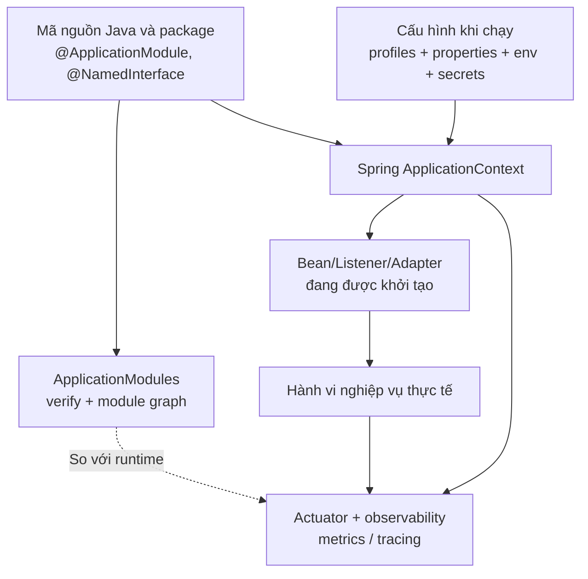
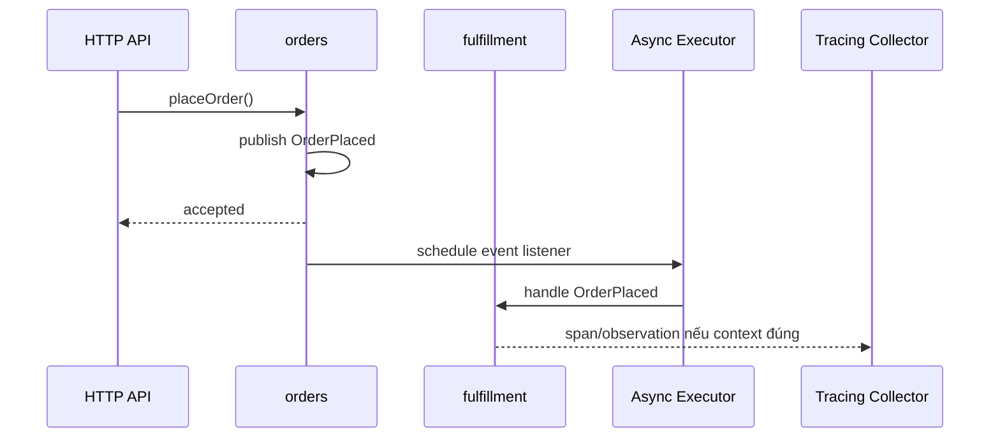
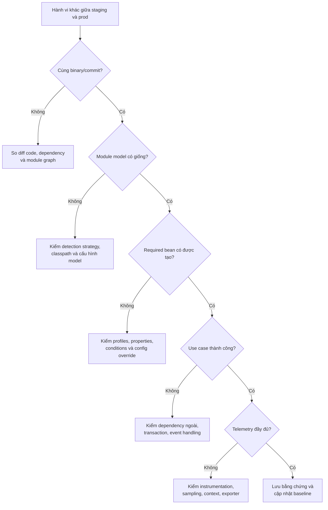

# Kiểm soát khác biệt giữa cấu hình và code

Trong một ứng dụng Spring Boot được tổ chức theo Spring Modulith, cấu trúc mã nguồn có thể tuân thủ hoàn toàn ranh giới *application module*, nhưng hệ thống vẫn hoạt động khác nhau giữa máy lập trình, staging và production. Chẳng hạn, sơ đồ mô-đun đều thể hiện `orders → inventory`, trong khi một listener xử lý sự kiện được khởi tạo ở staging nhưng biến mất ở production do một cấu hình profile. Một tình huống khác: sự kiện vẫn được phát, nhưng tracing không nối được các span do luồng bất đồng bộ thiếu **context propagation**.

Bài học **Kiểm soát khác biệt giữa cấu hình và code** thuộc chương **Cấu hình môi trường** của **SPRING_MODULITH_DOCUMENTATION_OBSERVABILITY**. Nội dung kết hợp Spring Modulith để sinh tài liệu ranh giới application module, Spring Boot Actuator để nhìn trạng thái ứng dụng, Micrometer để quan sát event metrics và tracing, cùng quy trình kiểm chứng cấu hình khi triển khai. Mục tiêu là biến khác biệt giữa **kiến trúc mong đợi**, **cấu hình được nạp** và **hành vi thực tế** thành thứ có thể kiểm tra, giải thích và giám sát.

> Các package, service, URL, tệp YAML và giá trị trong ví dụ chỉ dành cho học tập. Tùy dòng phiên bản Spring Boot/Spring Modulith, tên artifact và cách bật một endpoint hoặc instrumentation có thể khác nhau; cần dùng dependency cùng hệ phiên bản. Ví dụ Java giả định Spring Boot 3.x, Jakarta Bean Validation và JDK hỗ trợ `record`. Không đưa mật khẩu hoặc token thật vào tài liệu hay nhật ký.

## 1. Kết quả cần đạt

Sau bài học, bạn có thể:

1. Phân biệt phần nào của kiến trúc phải được kiểm soát trong code và phần nào được phép thay đổi theo cấu hình môi trường.
2. Chỉ ra các nguồn gây *configuration drift*: profile, property source, biến môi trường, ConfigData, bean condition, endpoint exposure, sampling và cách triển khai.
3. Dùng `ApplicationModules.verify()` để kiểm tra ranh giới tĩnh và dùng Spring context tests để kiểm tra bean thực sự xuất hiện ở từng môi trường.
4. So module graph/canvas được sinh từ code với thông tin Actuator, event metrics và tracing khi ứng dụng vận hành.
5. Chẩn đoán tình huống tài liệu kiến trúc đúng nhưng tác vụ liên module không chạy hoặc trace bị đứt.
6. Thiết lập bộ tiêu chí nghiệm thu cho thay đổi cấu hình trước khi đẩy lên production.

## 2. Vì sao cấu hình có thể khác với code?

Có ba tầng sự thật bổ sung cho nhau:



**Tầng kiến trúc tĩnh:** Spring Modulith phân tích package và các khai báo như `@ApplicationModule`, `@NamedInterface` hoặc quy tắc `allowedDependencies`. Mô hình này trả lời “module nào tồn tại, công bố API gì và module nào được phép phụ thuộc module nào?”.

**Tầng cấu hình runtime:** Spring Boot ghép nhiều property source, active profiles và bean conditions để tạo `ApplicationContext`. Tầng này trả lời “adapter, listener, executor và exporter nào **thực sự được tạo** trong tiến trình đang chạy?”.

**Tầng vận hành:** Spring Modulith Actuator, Micrometer meters, traces, logs và phép thử nghiệp vụ trả lời “có request/event nào được xử lý, mất bao lâu, lỗi ở chặng nào?”. Dữ liệu vận hành không tự thay thế kiểm tra ranh giới tĩnh.

Kết luận cần ghi nhớ: **một `verify()` thành công không bảo đảm cấu hình runtime đúng**, và **một lần gọi nghiệp vụ thành công không chứng minh đồ thị phụ thuộc module hợp lệ**. Cần kiểm tra cả hai.

### 2.1. Các kiểu khác biệt thường gặp

| Kiểu khác biệt | Ví dụ | Tác động |
|---|---|---|
| Kiến trúc/code drift | Class ở `orders` import một class `inventory.internal` | Vi phạm ranh giới dù code compile |
| Detection drift | Test/CI và runtime dùng chiến lược phát hiện module khác nhau | Module graph, Actuator và phạm vi instrumentation không khớp |
| Configuration drift | Staging bật listener, production tắt bằng property | Event được publish nhưng không có người xử lý |
| Wiring drift | Bean `@ConditionalOnProperty` bị loại khỏi context | Thiếu adapter hoặc xuất hiện implementation khác |
| Observability drift | Sampling/registry/exporter khác giữa hai môi trường | Có hoạt động nghiệp vụ nhưng thiếu trace hoặc meter |
| Infrastructure drift | Collector, broker, firewall, credential, DNS khác | Module vẫn đúng nhưng giao tiếp/vận hành lỗi |
| Documentation drift | Diagram được sinh từ commit cũ | Tài liệu không mô tả binary đang deploy |

Không gộp toàn bộ trường hợp thành “lỗi cấu hình”. Muốn sửa đúng, phải biết khác biệt nằm ở tầng nào.

## 3. Xác định nguồn sự thật cho từng loại quyết định

Trước khi viết cấu hình, nhóm cần phân quyền rõ quyết định nào thuộc kiến trúc và quyết định nào được phép thay đổi lúc triển khai.

| Quyết định | Nguồn sự thật thích hợp | Cách kiểm soát |
|---|---|---|
| Package nào là application module | Code, annotation, detection strategy thống nhất | `ApplicationModules.of(…).verify()` |
| API được module công bố | Public types, `@NamedInterface` và contract | Test kiến trúc + review module canvas |
| Module nào được phép gọi module nào | `allowedDependencies` và kiến trúc đã duyệt | Test kiến trúc + diff diagram |
| Môi trường dùng endpoint HTTP nào | ConfigData, môi trường triển khai | Validated `@ConfigurationProperties` + smoke test |
| Adapter nào hoạt động trong từng profile | `@Profile` / `@ConditionalOnProperty` | Context test theo profile |
| Có phải xử lý event hay không | Chính sách nghiệp vụ và cấu hình đã duyệt | Kiểm bean listener + test event end-to-end |
| Endpoint Actuator nào được expose | Config runtime, network/authorization | Kiểm actual endpoint trên đúng môi trường |
| Mức tracing sampling và exporter | Cấu hình observability và collector | Trace smoke test + exporter health |
| Secret, keystore, token | Secret manager/biến môi trường được bảo vệ | Kiểm có mặt và quyền truy cập; không xuất giá trị |

**Nguyên tắc thiết kế:** cấu hình có thể đổi địa chỉ, timeout, ngưỡng, sampling hoặc implementation tùy môi trường trong **phạm vi hành vi đã được kiểm thử**. Không nên dùng profile để âm thầm đổi hợp đồng API hoặc vượt qua ranh giới module. Nếu cần chuyển một thành phần thành module độc lập, thực hiện như thay đổi kiến trúc có review và migration.

## 4. Ví dụ xuyên suốt: ứng dụng đơn hàng

Giả sử ứng dụng có ba module cấp cao:

```text
com.example.shop
├── ShopApplication.java
├── orders/
│   ├── package-info.java
│   ├── OrderPlaced.java
│   └── internal/
│       └── OrderService.java
├── inventory/
│   ├── InventoryOperations.java
│   └── internal/
│       └── InventoryService.java
└── fulfillment/
    ├── FulfillmentOperations.java
    └── internal/
        ├── FulfillmentListener.java
        ├── DeliveryGateway.java
        └── HttpDeliveryGateway.java
```

Ứng dụng được chia theo trách nhiệm nghiệp vụ: `orders` phát sự kiện khi đơn hàng được đặt, `inventory` quản lý tồn kho, `fulfillment` thực hiện giao hàng. Spring Modulith được dùng để xác minh phụ thuộc và sinh tài liệu. Bean listener và gateway có thể được bật/tắt tùy điều kiện trong runtime.

### 4.1. Định nghĩa ranh giới trong code

Ví dụ `package-info.java` của module `orders`:

```java
@org.springframework.modulith.ApplicationModule(
    allowedDependencies = "inventory"
)
package com.example.shop.orders;
```

Đây là ràng buộc ở cấp mô hình kiến trúc: nếu một class trong `orders` bắt đầu tham chiếu module khác ngoài những dependency được phép, kiểm tra Spring Modulith phải phát hiện vi phạm. Tùy thiết kế, có thể bỏ `allowedDependencies` nếu chưa cần giới hạn chặt; không dùng nó chỉ để chặn những lỗi runtime như thiếu bean hoặc kết nối mạng.

Ví dụ sự kiện được công bố ở package API của `orders`:

```java
// com/example/shop/orders/OrderPlaced.java
package com.example.shop.orders;

import java.util.UUID;

public record OrderPlaced(UUID orderId) {}
```

Đặt event type trong API mà các module khác được phép truy cập; không giấu một contract liên module trong `orders.internal`.

Lớp khởi động cơ bản:

```java
package com.example.shop;

import org.springframework.boot.SpringApplication;
import org.springframework.boot.autoconfigure.SpringBootApplication;
import org.springframework.boot.context.properties.ConfigurationPropertiesScan;

@SpringBootApplication
@ConfigurationPropertiesScan
public class ShopApplication {

    public static void main(String[] args) {
        SpringApplication.run(ShopApplication.class, args);
    }
}
```

Đặt `ShopApplication` ở package gốc nhất quán giúp tránh việc scan khác nhau giữa kiểm thử và tiến trình thật. Nếu dự án dùng chiến lược phát hiện module tùy biến, phải đăng ký và chạy giống nhau trong test lẫn runtime; đừng đặt cấu hình cốt lõi chỉ trong test source.

### 4.2. Khóa kiến trúc bằng một test riêng

```java
package com.example.shop;

import org.junit.jupiter.api.Test;
import org.springframework.modulith.core.ApplicationModules;

class ArchitectureTests {

    @Test
    void respectsModuleBoundaries() {
        ApplicationModules.of(ShopApplication.class).verify();
    }
}
```

Test này chạy trên code, kiểm tra ranh giới module và các phụ thuộc theo model Spring Modulith. Nó không cần giả lập một endpoint HTTP thực tế. Nếu test xanh, ta có **bằng chứng về kiến trúc tĩnh**, chưa có bằng chứng rằng listener, exporter hay gateway đã được tạo trong production profile.

## 5. Định nghĩa cấu hình có kiểu dữ liệu và validate sớm

Cấu hình dạng string rải rác trong nhiều class rất khó so sánh và dễ sai tên key. Spring Boot khuyến khích gom các nhóm property vào `@ConfigurationProperties` có kiểu dữ liệu.

Một contract cấu hình cho adapter của `fulfillment`:

```java
package com.example.shop.fulfillment.internal;

import java.time.Duration;
import jakarta.validation.constraints.NotBlank;
import jakarta.validation.constraints.NotNull;
import jakarta.validation.constraints.Pattern;
import org.springframework.boot.context.properties.ConfigurationProperties;
import org.springframework.validation.annotation.Validated;

@ConfigurationProperties(prefix = "shop.delivery")
@Validated
public record DeliveryProperties(
        @NotBlank
        @Pattern(regexp = "http|stub")
        String channel,

        @NotNull
        Duration timeout
) {}
```

Để Bean Validation hoạt động, dự án cần dependency validation tương thích, chẳng hạn Spring Boot Validation starter. `@ConfigurationPropertiesScan` trên ứng dụng giúp đăng ký record này. Khi channel thiếu hoặc không thuộc tập được hỗ trợ, binding/validation có thể khiến khởi động thất bại với lỗi cấu hình rõ ràng, thay vì đợi request đầu tiên.

File cấu hình cơ sở `application.yml` có thể chứa các giá trị **không bí mật**:

```yaml
spring:
  application:
    name: shop

shop:
  delivery:
    channel: http
    timeout: 5s

management:
  endpoints:
    web:
      exposure:
        include: health,info
  tracing:
    sampling:
      probability: 0.1
```

Trong môi trường phát triển, `application-dev.yml` có thể chọn gateway giả lập:

```yaml
shop:
  delivery:
    channel: stub
    timeout: 1s

management:
  endpoints:
    web:
      exposure:
        include: health,info,modulith,metrics
```

Trong production, `application-prod.yml` khóa hành vi quan trọng:

```yaml
shop:
  delivery:
    channel: http
    timeout: 3s

management:
  endpoints:
    web:
      exposure:
        include: health,info
```

Các file trên chỉ là ví dụ về các property trong từng profile. Mức tracing sampling cần được chọn theo lưu lượng, chi phí và nhu cầu điều tra; đặt `0.1` không bảo đảm trace mọi request. `modulith` và `metrics` chỉ tồn tại nếu dependency/auto-configuration tương ứng được thêm vào ứng dụng, và mức exposure còn phụ thuộc security của Actuator.

### 5.1. Quy tắc nguồn cấu hình

Spring Boot hợp nhất nhiều nguồn như `application.yml`, `application-{profile}.yml`, config import, biến môi trường, command-line arguments và các nguồn từ nền tảng triển khai. Nguồn có độ ưu tiên cao hơn có thể ghi đè giá trị thấp hơn theo quy tắc property source của Spring Boot.

Do đó, một giá trị trong Git **không đồng nghĩa** với giá trị thực tế khi ứng dụng chạy. Ví dụ, biến môi trường `SHOP_DELIVERY_CHANNEL` có thể ghi đè `shop.delivery.channel` nếu nền tảng triển khai truyền vào. Cần kiểm tra giá trị hiệu lực trong `Environment` hoặc binding của ứng dụng, đồng thời bảo vệ thông tin nhạy cảm.

Ngoài ra, **profile được kích hoạt tại runtime** phải được xác minh. Đừng suy ra active profile chỉ từ tên thư mục deployment hoặc tên máy. Theo cách triển khai thông thường, `SPRING_PROFILES_ACTIVE=prod` kích hoạt cấu hình production, nhưng có thể có nhiều profile và nguồn cấu hình bổ sung.

### 5.2. Không chứa bí mật trong tài liệu kiến trúc

Password, token, private key, thông tin kết nối nhạy cảm cần được quản lý qua secret manager hoặc hệ thống cung cấp secret. Trong log/diff cấu hình, chỉ ghi **tên key, nguồn cấu hình, sự hiện diện và trạng thái validate**. Nếu cần xác nhận hai môi trường có cùng chứng chỉ hay cấu hình bí mật, dùng metadata an toàn như issuer, expiry hoặc fingerprint được phép chia sẻ theo chính sách; không dump nguyên giá trị.

## 6. Phân biệt bean condition với ranh giới application module

Spring Boot quyết định bean nào xuất hiện dựa trên `@Profile`, `@ConditionalOnProperty`, `@ConditionalOnClass` và các điều kiện khác. Spring Modulith vẫn coi cấu trúc package/module là ranh giới kiến trúc.

Ví dụ hai implementation của một cổng kết nối:

```java
// Mã minh họa: mỗi top-level type đặt trong file riêng
package com.example.shop.fulfillment.internal;

interface DeliveryGateway {
    String transportName();
}

// Adapter dùng cho môi trường thực
@org.springframework.stereotype.Component
@org.springframework.boot.autoconfigure.condition.ConditionalOnProperty(
    prefix = "shop.delivery",
    name = "channel",
    havingValue = "http"
)
class HttpDeliveryGateway implements DeliveryGateway {
    @Override
    public String transportName() {
        return "http";
    }
}

// Adapter kiểm thử/chạy local
@org.springframework.stereotype.Component
@org.springframework.context.annotation.Profile({"dev", "test"})
@org.springframework.boot.autoconfigure.condition.ConditionalOnProperty(
    prefix = "shop.delivery",
    name = "channel",
    havingValue = "stub"
)
class StubDeliveryGateway implements DeliveryGateway {
    @Override
    public String transportName() {
        return "stub";
    }
}
```

Trong dự án thật, `HttpDeliveryGateway` cần HTTP client, credential phù hợp và hành vi kết nối thực sự. Ở đây hai class chỉ minh họa cơ chế condition. Ưu điểm của thiết kế là:

- `shop.delivery.channel=http` chọn adapter HTTP.
- `shop.delivery.channel=stub` chỉ tạo stub khi active profile là `dev` hoặc `test`.
- Production profile vô tình đặt `channel=stub` sẽ không có `DeliveryGateway`. Nếu một service bắt buộc inject interface này, ứng dụng **fail fast khi khởi động** thay vì im lặng sử dụng stub trong production.
- Dù bean nào được tạo, cả hai implementation vẫn nằm trong cùng vùng nội bộ của module `fulfillment`; đổi profile không tự tạo thêm application module.

Để fail fast thực sự, phải có một consumer bắt buộc inject gateway hoặc một bài test kiểm tra số lượng adapter; chỉ khai báo condition không bảo đảm lỗi xuất hiện nếu không ai cần bean đó.

### 6.1. Tránh silent fallback

Một lỗi thường gặp là viết:

```java
@ConditionalOnMissingBean(DeliveryGateway.class)
DeliveryGateway defaultGateway() {
    return new NoOpDeliveryGateway();
}
```

Nếu bean thật bị thiếu vì cấu hình, fallback có thể khiến ứng dụng vẫn khởi động và bỏ qua nghiệp vụ. `NoOpDeliveryGateway` trong đoạn trên chỉ là một tên minh họa. Nếu fallback thực sự hợp lệ, cần công bố rõ policy và test cho từng profile. Với hành vi bắt buộc ở production, ưu tiên lỗi khởi động rõ ràng hơn im lặng mất xử lý.

### 6.2. Kiểm soát option chưa được hỗ trợ

Chỉ có annotation `@Pattern(regexp = "http|stub")` thì chưa đủ phân biệt chính sách môi trường. Production còn phải bảo đảm `channel=http` và có đúng một adapter hoạt động. Hai tiêu chí này sẽ được kiểm bằng test ở phần sau, thay vì hy vọng người triển khai không đặt nhầm profile.

## 7. Hai nhóm kiểm thử phải đi cùng nhau

### 7.1. Kiểm tra bất biến của kiến trúc

Giữ bài test `ApplicationModules.of(ShopApplication.class).verify()` ở phần 4 trong CI. Nếu cần tài liệu trực quan, sinh module graph cùng commit build:

```java
package com.example.shop;

import org.junit.jupiter.api.Test;
import org.springframework.modulith.core.ApplicationModules;
import org.springframework.modulith.docs.Documenter;

class ModuleDocumentationTests {

    @Test
    void documentVerifiedModules() {
        ApplicationModules modules =
                ApplicationModules.of(ShopApplication.class);

        modules.verify();

        new Documenter(modules)
                .writeModulesAsPlantUml()
                .writeIndividualModulesAsPlantUml()
                .writeModuleCanvases();
    }
}
```

Các artifact do `Documenter` tạo phản ánh mô hình module phát hiện từ code. Đường dẫn output và format phụ thuộc cấu hình/phiên bản build; nên lưu hoặc đính kèm tài liệu như build artifact và gắn với commit ID. Tránh cho sơ đồ ở wiki tồn tại độc lập mà không biết nó được sinh từ bản code nào.

### 7.2. Kiểm tra wiring ở từng profile

Thêm integration test cho production profile:

```java
package com.example.shop;

import static org.assertj.core.api.Assertions.assertThat;

import com.example.shop.fulfillment.FulfillmentOperations;
import org.junit.jupiter.api.Test;
import org.springframework.beans.factory.annotation.Autowired;
import org.springframework.boot.test.context.SpringBootTest;
import org.springframework.context.ApplicationContext;
import org.springframework.test.context.ActiveProfiles;

@SpringBootTest(properties = "shop.delivery.channel=http")
@ActiveProfiles("prod")
class ProductionWiringTests {

    @Autowired
    ApplicationContext context;

    @Test
    void fulfillmentApiIsAvailable() {
        assertThat(context.getBeansOfType(
                FulfillmentOperations.class)).hasSize(1);
    }
}
```

Ví dụ giả định ứng dụng đã có bean triển khai `FulfillmentOperations`, nên test này là khuôn kiểm tra cho ứng dụng đầy đủ. Trong lab tối giản chỉ có interface gateway, hãy thay assertion bằng kiểm tra bean gateway ở một test cùng package được phép truy cập.

Bổ sung test cho dev và production với các điều kiện khác nhau, đặc biệt những bean mà luồng nghiệp vụ bắt buộc phải có. Không chỉ thử `@ActiveProfiles("test")` rồi coi đó là bằng chứng cho production; hai môi trường có thể kích hoạt các condition khác nhau.

### 7.3. Phân biệt những câu hỏi mà từng test trả lời

| Loại kiểm tra | Câu hỏi được trả lời | Giới hạn |
|---|---|---|
| `verify()` | Có phụ thuộc vòng, truy cập nội bộ hoặc vi phạm ranh giới? | Không biết bean nào được tạo ở production |
| `@SpringBootTest` + profile | ApplicationContext có đúng bean/cấu hình cần thiết? | Không chứng minh DNS, broker, collector thật hoạt động |
| `@ApplicationModuleTest` | Có bootstrap và kiểm thử một module trong phạm vi mong muốn? | Phạm vi slice có thể khác context production |
| Contract/integration test | Một use case liên module có thành công với adapter thật? | Không bảo đảm mọi feature flag và tải production |
| Runtime smoke test | Binary đang chạy có đáp ứng hành vi và health mong đợi? | Chỉ phản ánh đường đi được kiểm tra |

**Nguyên tắc:** test kiến trúc không thay thế test cấu hình; test cấu hình không thay thế đo hành vi và tracing khi đã triển khai.

## 8. Kiểm chứng bằng Actuator và module metadata

Spring Modulith có Actuator endpoint cung cấp thông tin mô hình module khi dependency/auto-configuration phù hợp đã được thêm. Với Spring Boot Actuator, endpoint thường được truy cập ở `/actuator/modulith` nếu được expose. Ở môi trường dev/test có quyền, ví dụ:

```yaml
management:
  endpoints:
    web:
      exposure:
        include: health,info,modulith,metrics,conditions,configprops
```

**Chỉ dùng phạm vi exposure rộng này trong môi trường kiểm soát truy cập.** Endpoint `conditions` và `configprops` có thể tiết lộ cấu trúc ứng dụng và metadata cấu hình; cần authentication, authorization, management network riêng và các quy tắc sanitize. Trong production, ưu tiên expose tối thiểu cần thiết.

Lệnh xem metadata:

```bash
curl --fail --silent \
  http://localhost:8080/actuator/modulith

# Kiểm tình trạng ứng dụng:
curl --fail --silent \
  http://localhost:8080/actuator/health
```

Cần xem:

- Danh sách module và base package có giống build đã kiểm tra không.
- `dependencies` và các thông tin về parent/nested module (nếu có) có trùng mô hình kiến trúc dự kiến không.
- Version và build của tiến trình đang phục vụ có khớp commit sinh tài liệu không.
- Nếu endpoint không tồn tại, xác minh dependency Spring Modulith Actuator, cách expose, đường dẫn management và security trước khi kết luận là “ứng dụng không có module”.

**Giới hạn quan trọng:** `/actuator/modulith` hiển thị mô hình module, không phải danh sách mọi bean đã khởi tạo hay mọi property hiệu lực. Muốn điều tra condition, xem `/actuator/conditions`; muốn xem binding properties, dùng `/actuator/configprops` có kiểm soát; muốn biết service thật có xử lý được event, phải có integration/operational test.

### 8.1. So sánh giữa môi trường mà không lộ secret

Thiết kế một bản chụp kiểm toán (*configuration evidence*) chỉ lưu:

| Dữ liệu | Ví dụ | Cách thu thập |
|---|---|---|
| Artifact ID | Commit SHA / image digest | Metadata build/deployment |
| Active profiles | `prod` | App metadata/config có kiểm soát |
| Module IDs/dependencies | `orders → inventory` | `ApplicationModules` + Actuator |
| Required bean presence | `fulfillmentListener = present` | Context test / conditions |
| Config contract | `shop.delivery.channel=http` | `@ConfigurationProperties` đã validate; chỉ key phi nhạy cảm |
| Endpoint exposure | `health, info` | Actuator/discovery theo quyền |
| Tracing availability | exporter reachable / span được thu nhận | Smoke test trên collector |
| Event behavior | publish, receive, failure counts | Metrics/logs/traces theo chính sách |

Bản chụp có thể dùng trong CI, triển khai và audit. Tập trung vào **những thuộc tính được phép khác nhau**; không nên ép tất cả môi trường có cùng URL, timeout hoặc tỷ lệ sampling nếu đó là quyết định vận hành có lý do.

## 9. Event metrics: cùng code nhưng số liệu có thể khác

Spring Modulith có hỗ trợ observability cho tương tác module và event publication thông qua Micrometer. Tùy phiên bản và registry, có thể xuất các metric liên quan đến event được publish, thường được mô tả bằng tên logic như `module.events.published` và thông tin module/loại event.

Khi đọc metric, phải xác định:

1. Có dependency instrumentation/observability tương thích không?
2. Meter registry và exporter có được khởi tạo ở profile hiện tại không?
3. Event thật sự được publish hay chỉ được tạo thành Java object?
4. Metric đã được scrape/ship thành công tới backend chưa?
5. Tên/tags sau khi registry xuất ra có bị biến đổi không (ví dụ tên Prometheus khác tên Micrometer logic)?
6. Sampling hoặc filter trong telemetry pipeline có làm mất dữ liệu cần kiểm không?

Có thể thăm dò bằng endpoint metrics khi đã cấu hình và bảo vệ truy cập:

```bash
curl --fail --silent \
  http://localhost:8080/actuator/metrics

# Dùng nếu meter logic tương ứng đã được đăng ký:
curl --fail --silent \
  http://localhost:8080/actuator/metrics/module.events.published
```

Không coi việc meter chưa hiện là bằng chứng chắc chắn “không có event”; có thể chưa có event nào được phát hoặc instrumentation chưa hoạt động.

Quan trọng hơn: **counter của sự kiện được publish không tự chứng minh listener đã xử lý thành công**. Nếu listener bị loại khỏi context bởi cấu hình, publisher vẫn có thể tăng counter mà không có tác vụ nghiệp vụ mong đợi. Phải kết hợp counter với metric xử lý, traces, log tương quan hoặc kiểm tra trạng thái nghiệp vụ.

## 10. Tracing và context propagation theo cấu hình

Spring Modulith observability có thể tạo các span ở ranh giới tương tác module khi instrumentation phù hợp được bật. Micrometer Tracing nối các span, còn exporter/collector giúp tra cứu chúng ở môi trường vận hành.

Giả sử use case:



Ở staging, tracing có thể cho thấy span `orders` và `fulfillment` liên kết. Ở production, với cùng một binary, span của listener có thể xuất hiện trong trace khác hoặc không tới collector vì:

- Listener chạy trên thread pool nhưng **trace context không được propagate** sang thread mới.
- Executor thực tế không phải executor đã cấu hình task decorator.
- Observability/tracing bridge hoặc exporter khác giữa hai môi trường.
- Sampling ratio thấp, nên request cụ thể không được thu thập.
- Network/credential của collector lỗi, trong khi nghiệp vụ vẫn xử lý bình thường.
- Luồng gọi không đi qua ranh giới API/bean được instrumentation theo dõi.

Một cách thiết lập executor có context propagation trên các dòng Spring Framework hỗ trợ:

```java
package com.example.shop.config;

import org.springframework.context.annotation.Bean;
import org.springframework.context.annotation.Configuration;
import org.springframework.core.task.support.ContextPropagatingTaskDecorator;
import org.springframework.scheduling.annotation.EnableAsync;
import org.springframework.scheduling.concurrent.ThreadPoolTaskExecutor;

@Configuration
@EnableAsync
class AsyncConfig {

    @Bean("businessEventsExecutor")
    ThreadPoolTaskExecutor businessEventsExecutor() {
        ThreadPoolTaskExecutor executor = new ThreadPoolTaskExecutor();
        executor.setCorePoolSize(4);
        executor.setMaxPoolSize(8);
        executor.setQueueCapacity(200);
        executor.setTaskDecorator(
                new ContextPropagatingTaskDecorator());
        executor.setThreadNamePrefix("business-event-");
        executor.initialize();
        return executor;
    }
}
```

Khi dùng `@Async("businessEventsExecutor")` hoặc cấu hình event multicaster phù hợp, ứng dụng phải chắc chắn **luồng xử lý thực sự sử dụng executor trên**. Đoạn mã này không tự thay đổi mọi listener và không thay thế Micrometer context-propagation dependency. Nếu dùng Spring Modulith event publication với cơ chế riêng, cần kiểm cơ chế dispatch và cấu hình executor thực tế của phiên bản đang chạy.

Đối với event qua broker hoặc tiến trình khác, chỉ trang trí executor trong một JVM chưa đủ; cần propagation qua message headers theo chuẩn/thư viện được sử dụng, và không tự động tin metadata từ nguồn không đáng tin cậy. Correlation ID nghiệp vụ hữu ích để truy vết khi sampling hoặc network làm thiếu trace.

## 11. Ca thực hành: module graph đúng nhưng listener không chạy ở production

### 11.1. Thiết lập triệu chứng

Ứng dụng phát `OrderPlaced` từ module `orders`; module `fulfillment` có listener để khởi tạo giao hàng. Sau triển khai:

- Architecture test `verify()` thành công.
- Module graph và `/actuator/modulith` vẫn mô tả các module như dự kiến.
- Ở staging, đơn hàng tạo ra tác vụ giao hàng.
- Ở production, đơn hàng được ghi thành công nhưng không phát sinh tác vụ.
- Bộ đếm event publish có thể vẫn tăng, trong khi không có trace xử lý của listener.

Một đoạn code làm phát sinh khác biệt:

```java
package com.example.shop.fulfillment.internal;

import com.example.shop.orders.OrderPlaced;
import org.springframework.boot.autoconfigure.condition.ConditionalOnProperty;
import org.springframework.context.event.EventListener;
import org.springframework.stereotype.Component;

@Component
@ConditionalOnProperty(
    prefix = "shop.fulfillment",
    name = "listener-enabled",
    havingValue = "true"
)
class FulfillmentListener {

    @EventListener
    void on(OrderPlaced event) {
        // Minh họa: gọi application service để khởi tạo giao hàng.
        // Trong ứng dụng thật, cần idempotency và error handling.
    }
}
```

Staging cấu hình:

```yaml
shop:
  fulfillment:
    listener-enabled: true
```

Production vô tình nhận override từ deployment:

```yaml
shop:
  fulfillment:
    listener-enabled: false
```

`@ConditionalOnProperty` khiến bean `FulfillmentListener` **không được tạo** trong production. Việc phụ thuộc Java giữa module `fulfillment` và API event `orders` vẫn còn trong mã nguồn, nên module graph và `verify()` vẫn có thể không thay đổi.

### 11.2. Chẩn đoán theo thứ tự có bằng chứng

| Bước | Kiểm tra | Ý nghĩa |
|---|---|---|
| 1 | So commit/image digest staging và production | Nếu khác binary, chưa thể quy tất cả cho cấu hình |
| 2 | So active profile và property effective của `shop.fulfillment.listener-enabled` | Xác nhận giá trị được Spring Boot nạp |
| 3 | Xem condition evaluation trong context/Actuator `conditions` | Bean listener có bị loại vì condition không? |
| 4 | Kiểm event publisher, tên event và transaction boundary | Event có phát theo đường nghiệp vụ thật không? |
| 5 | So bean listener và kết quả xử lý, metrics/traces | Phân biệt thiếu listener với listener chạy nhưng lỗi |
| 6 | Chạy lại request với request ID/đơn hàng test có kiểm soát | Xác nhận hành vi trước và sau khi sửa |

Nếu đã biết listener không được đăng ký vì property là `false`, **không cần sửa cấu trúc Java package** hoặc nới `allowedDependencies`. Sửa config/deployment về giá trị đã phê duyệt và bảo đảm cấu hình đó được kiểm soát, rồi chạy lại test với production profile.

### 11.3. Chặn tái phát bằng context test

Đặt một test kiểm tra chính sách production:

```java
package com.example.shop;

import static org.assertj.core.api.Assertions.assertThat;

import org.junit.jupiter.api.Test;
import org.springframework.beans.factory.annotation.Autowired;
import org.springframework.boot.test.context.SpringBootTest;
import org.springframework.context.ApplicationContext;
import org.springframework.test.context.ActiveProfiles;

@SpringBootTest
@ActiveProfiles("prod")
class FulfillmentProductionTests {

    @Autowired
    ApplicationContext context;

    @Test
    void fulfillmentListenerMustExist() {
        assertThat(context.containsBean("fulfillmentListener"))
                .isTrue();
    }
}
```

Tên bean `fulfillmentListener` trong ví dụ do quy tắc đặt tên component mặc định của Spring; nếu ứng dụng chỉ định tên bean khác, test phải điều chỉnh. Để test bắt đúng drift trong deployment thực tế, cần cấp các property đã dùng khi triển khai hoặc kiểm tra cấu hình manifest/rendered config tương ứng; **test chạy với file `application-prod.yml` trong Git không thể tự biết một environment variable production đã ghi đè nó**.

Nếu việc tắt listener là hành vi được phép trong một môi trường bảo trì, hãy khai báo chính sách đó rõ ràng và có test riêng. Còn nếu mọi production deployment bắt buộc xử lý sự kiện, không nên cho phép cờ `listener-enabled=false` đi qua quy trình phát hành.

### 11.4. Phân biệt lỗi listener với lỗi tracing

Sau khi listener xuất hiện, nếu tác vụ giao hàng hoàn tất nhưng trace vẫn thiếu, chuyển sang kiểm tra executor, sampling, instrumentation và exporter. Việc chỉnh cờ listener và chỉnh tracing là **hai vấn đề khác nhau**. Để kiểm tra sửa lỗi, cần một kết quả nghiệp vụ quan sát được (ví dụ tác vụ giao hàng được tạo) cùng với bằng chứng telemetry phù hợp.

## 12. Sơ đồ quyết định khi nghi ngờ config drift



Thứ tự điều tra giúp hạn chế những thay đổi không liên quan. Một listener thiếu bean không được sửa bằng tăng tỷ lệ trace sampling; một collector lỗi không được sửa bằng nới ranh giới giữa các module.

## 13. Quy trình phát hành có kiểm soát

Quy trình có thể áp dụng cho cấu hình Spring Boot/Spring Modulith khi nhiều môi trường và nhiều nhóm cùng vận hành:

1. **Xác định bất biến kiến trúc:** giữ module list, API và allowed dependencies trong source control. Chạy `ApplicationModules.verify()` ở CI.
2. **Khai báo contract cấu hình:** dùng `@ConfigurationProperties`, validate giá trị và phân biệt các option chỉ dành cho dev/test với option bắt buộc ở production.
3. **Kiểm từng profile:** kiểm các condition quan trọng qua context tests, đặc biệt adapter, listener, event publication registry, executor và HTTP client.
4. **Sinh tài liệu theo build:** lưu PlantUML/module canvas cùng commit và version, tránh dùng diagram cũ trong biên bản phát hành.
5. **So rendered config khi deploy:** xác minh active profiles, tên key và giá trị phi nhạy cảm đã được hệ thống triển khai thực sự nạp. Không chỉ review YAML gốc.
6. **Smoke test qua runtime:** xác nhận health, một use case liên module, listener/event, connectivity và một trace trong trường hợp có instrumentation.
7. **Đối chiếu metadata:** nếu có quyền, kiểm `/actuator/modulith`, conditions và metrics để hiểu runtime có khớp kiến trúc/expectation không.
8. **Quan sát sau triển khai:** theo dõi lỗi xử lý event, latency giữa module, timeout, queue backlog và exporter/collector. Định nghĩa ngưỡng quay lui theo mức độ ảnh hưởng nghiệp vụ.
9. **Lưu bản ghi có thể tái hiện:** artifact ID, profile, config checksum/metadata an toàn, thời điểm, kết quả test và người/phương thức phê duyệt.

**Không dùng cùng một bản cấu hình cho mọi môi trường một cách máy móc.** Mỗi khác biệt hợp lệ cần có mục đích, giới hạn và test. Ngược lại, một giá trị có thể ảnh hưởng tới tính đúng nghiệp vụ (như bật listener bắt buộc) phải được kiểm như một yêu cầu, không chỉ là một “feature toggle”.

### 13.1. Ma trận kỳ vọng tối thiểu

| Thành phần | Dev | Staging | Production |
|---|---|---|---|
| Module boundary validation | PASS | PASS | PASS với cùng binary |
| Module graph so với code | Khớp | Khớp | Khớp |
| Delivery adapter | `stub` được phép | `http` | `http` bắt buộc |
| Fulfillment listener | Bật ở integration test | Bật | Bật |
| Actuator Modulith | Có thể expose nội bộ | Expose hạn chế | Expose hạn chế hoặc không qua web |
| Trace sampling | Có thể cao để debug | Theo nhu cầu test | Theo ngân sách/khả năng quan sát |
| Async trace propagation | Kiểm nếu có async | Kiểm | Kiểm |
| Credentials và secrets | Secret test | Secret staging | Secret production |

Mục “expose hạn chế” cần được hiểu cùng với network policy và authorization; bật endpoint chỉ vì bảng kỳ vọng yêu cầu quan sát sẽ là thiết kế kém nếu chưa có quyền truy cập phù hợp.

## 14. Các sai lầm cần tránh

**“Build xanh nghĩa là production đúng.”** Build xanh chứng minh một tập kiểm tra đã chạy đạt; nó không có quyền quan sát biến môi trường, secret hay broker đang dùng ở production. Bổ sung validation khi startup và smoke test khi deploy.

**“Module graph thay đổi khi bật/tắt bean.”** Graph phân tích cấu trúc code/module, còn bean conditions ảnh hưởng wiring tại runtime. Muốn xem bean có mặt hay không, cần Spring context/Actuator conditions hoặc phép thử nghiệp vụ.

**“Actuator Modulith thay thế mọi endpoint khác.”** Metadata module không chứa tất cả thông tin condition, secret, meter, span hay trạng thái network. Kết hợp đúng nguồn: `modulith`, `health`, `metrics`, `conditions`, logs/traces trong phạm vi được phép.

**“Có metric published nghĩa là event đã được xử lý.”** Publish và processing là hai bước có thể tách rời, nhất là trong xử lý async. Cần quan sát kết quả subscriber, failure handling, transaction và các bằng chứng nghiệp vụ.

**“Không thấy span tức là code chưa chạy.”** Sampling, context propagation và exporter có thể làm thiếu trace. Đối chiếu request/correlation ID, metric nghiệp vụ và log có kiểm soát.

**“Tất cả property phải giống giữa staging và production.”** Endpoint URL, secret, sampling hay timeout thường khác nhau có chủ đích. Cần so **chính sách và invariant**, không buộc các giá trị cụ thể phải trùng nhau.

**“Đổi profile để giải quyết kiến trúc.”** `@Profile` có thể đổi bean nhưng không sửa dependency vượt ranh giới hay chu trình module. Những vi phạm như vậy cần refactor code/module.

## 15. Bài thực hành tự kiểm tra

Dùng ứng dụng mô phỏng ở trên để thực hiện:

1. Tạo ba module `orders`, `inventory`, `fulfillment` với sự kiện `OrderPlaced` trong API `orders`. Chạy `ApplicationModules.verify()` và ghi kết quả.
2. Tạo hai profile `dev` và `prod`. Ở dev, `shop.delivery.channel=stub`; ở prod là `http`. Kiểm tra bean gateway mà Spring tạo trong từng context.
3. Tạo `FulfillmentListener` với `@ConditionalOnProperty` như phần 11. Bật listener ở staging, tắt ở production test, rồi mô tả sự khác biệt giữa module graph và hành vi.
4. Đọc report `conditions` (trong môi trường có quyền) và xác nhận lý do listener bị loại khỏi context. Bật lại rồi kiểm thử xử lý sự kiện thành công.
5. Sinh module graph và module canvas. Kiểm tra rằng việc bật/tắt listener không làm thay đổi các ranh giới module trong code.
6. Bật instrumentation và thử xử lý sự kiện qua một executor bất đồng bộ. So sánh trace trước/sau khi cấu hình context propagation đúng.
7. Tạo một bảng so sánh dev/staging/prod, lưu commit/image version, active profile, required bean presence và kết quả nghiệp vụ. Loại bỏ giá trị nhạy cảm trước khi chia sẻ.

### Câu hỏi kiểm tra hiểu bài

- Vì sao `ApplicationModules.verify()` có thể thành công dù một listener không xuất hiện trong ApplicationContext?
- Khi `/actuator/modulith` giống giữa hai môi trường nhưng chỉ một môi trường có traces, nên kiểm tra lớp nào tiếp theo?
- Nếu production dùng `shop.delivery.channel=stub` qua environment variable, cần phát hiện ở bước nào để hạn chế ảnh hưởng?
- Vì sao không nên dùng một counter event publication để khẳng định dữ liệu đã được xử lý xong?
- Khi cần bật chế độ bảo trì tạm thời làm listener dừng hoạt động, cần lưu lại điều gì để đây là thay đổi được kiểm soát?

## 16. Checklist trước khi bàn giao

- [ ] Có test `ApplicationModules.verify()`; phạm vi module và detection strategy được cố định.
- [ ] Module graph/canvas được sinh từ đúng commit hoặc image triển khai.
- [ ] Các giá trị có ảnh hưởng nghiệp vụ được bind và validate bằng `@ConfigurationProperties` hoặc cơ chế tương đương.
- [ ] Không dùng stub/no-op ngầm trong production nếu nghiệp vụ yêu cầu adapter thật.
- [ ] Những bean condition quan trọng được kiểm theo profile; runtime có đúng listener, adapter và executor.
- [ ] Đã xác nhận active profiles và nguồn override trong môi trường thật.
- [ ] Actuator endpoints được giới hạn quyền, không làm lộ secrets và chỉ expose theo nhu cầu.
- [ ] Event metrics được hiểu đúng theo publish/processing; có kiểm chứng kết quả listener.
- [ ] Tracing/exporter/sampling và context propagation được kiểm cho luồng đồng bộ hoặc bất đồng bộ liên quan.
- [ ] Có smoke test, bằng chứng nghiệm thu, baseline và điều kiện quay lui khi cấu hình sai.

## Tài liệu tham khảo

- [Spring Modulith — Fundamentals](https://docs.spring.io/spring-modulith/reference/fundamentals.html): định nghĩa application module, named interfaces và quy tắc ranh giới.
- [Spring Modulith — Verification](https://docs.spring.io/spring-modulith/reference/verification.html): kiểm tra đồ thị phụ thuộc.
- [Spring Modulith — Documenting Application Modules](https://docs.spring.io/spring-modulith/reference/documentation.html): tạo sơ đồ và module canvas.
- [Spring Modulith — Production-ready Features](https://docs.spring.io/spring-modulith/reference/production-ready.html): Actuator và observability.
- [Spring Boot — Externalized Configuration](https://docs.spring.io/spring-boot/reference/features/external-config.html): thứ tự property sources, profiles và `@ConfigurationProperties`.
- [Spring Boot — Actuator Endpoints](https://docs.spring.io/spring-boot/reference/actuator/endpoints.html): expose và bảo vệ endpoint.

**Điều cốt lõi:** kiến trúc module được kiểm chứng từ code, còn hành vi khi chạy phụ thuộc cấu hình thực tế và cách Spring tạo bean. Muốn kiểm soát khác biệt giữa hai phần này, hãy kết hợp **test ranh giới module + test theo profile + kiểm tra cấu hình hiệu lực + quan sát metrics/traces trong runtime**. Đó là cách giữ tài liệu Spring Modulith đồng bộ với hoạt động thực tế của một hệ thống Spring Boot.
