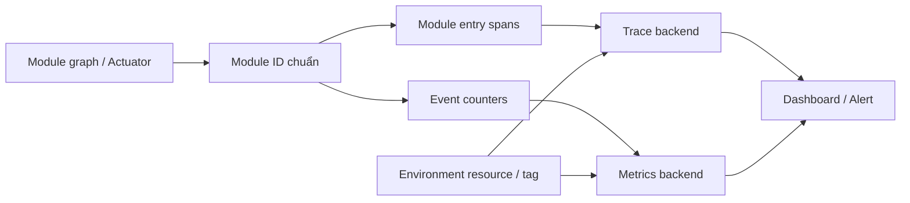
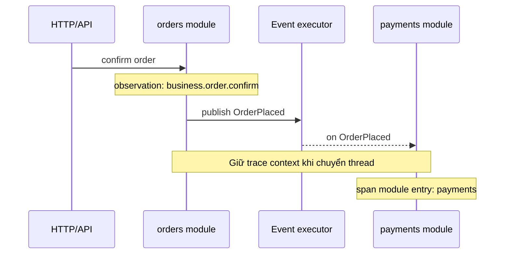

# Giữ tên metric và span ổn định giữa môi trường

> **Chương:** Cấu hình môi trường  
> **Phạm vi:** `SPRING_MODULITH_DOCUMENTATION_OBSERVABILITY` — sử dụng Spring Modulith để mô tả và kiểm chứng ranh giới application module trong ứng dụng Spring Boot; kết hợp module graph, Actuator, event metrics, distributed tracing và context propagation để quan sát các tương tác giữa module khi hệ thống vận hành.  
> **Mục tiêu bài:** Một hành vi của module `orders` phải có **cùng tên metric, observation và span** ở `local`, `dev`, `staging` và `prod`. Khác biệt môi trường được biểu diễn bằng **tag/resource attribute**, không được chèn vào tên telemetry.

Hãy tưởng tượng dashboard production đang theo dõi số sự kiện `OrderPlaced` do module `orders` phát ra. Nếu dev ghi `dev.module.events.published` còn production ghi `prod.module.events.published`, mỗi môi trường tạo ra một chuỗi metric riêng, dashboard và alert phải viết lại. Nếu tên span là `orders.confirm-staging` ở staging nhưng `orders.confirm-prod` ở production, việc so sánh trace giữa các đợt triển khai cũng khó khăn hơn. Trường hợp tốt hơn là giữ nguyên tên có ý nghĩa nghiệp vụ, rồi dùng nhãn `environment` để lọc.

## 1. Phân biệt ba loại tên trước khi cấu hình

Micrometer Observation là lớp trừu tượng để tạo cả **metric** và **trace/span**. Một observation có tên ổn định dùng cho công cụ đo, có thể có tên ngữ cảnh giúp người vận hành đọc trace, cùng các cặp khóa–giá trị (key-value). Spring Modulith bổ sung quan sát ở ranh giới module và metric sự kiện.

| Thành phần | Ví dụ | Tính ổn định mong muốn |
|---|---|---|
| **Observation name** | `business.order.confirm` | Giữ nguyên giữa môi trường và qua release nếu ý nghĩa thao tác không đổi |
| **Span name/contextual name** | `order.confirm` | Cùng thao tác nên cùng tên; tránh nối tên pod, host, profile, ID giao dịch |
| **Tên meter gốc của Micrometer** | `module.events.published` | Giữ nguyên tên logic để truy vấn/alert có thể tái sử dụng |
| **Tên series sau khi export** | Ví dụ `module_events_published_total` qua Prometheus | Phụ thuộc quy tắc registry/exporter; phải kiểm chứng đầu ra thực |
| **Tag giá trị hữu hạn** | `module.identifier=orders`, `environment=prod` | Khóa ổn định; giá trị tuân thủ từ điển chung, số lượng giá trị có giới hạn |
| **Resource/service identity** | `service.name=shop-app`, `deployment.environment.name=prod` | Cùng ứng dụng giữ `service.name`; chỉ môi trường triển khai thay đổi |
| **Trace ID/span ID** | ID phát sinh khi thực thi | **Phải thay đổi** theo trace/span; không dùng làm tên metric hoặc span |

Hai điều dễ nhầm:

1. **Tên observation và tên span không bắt buộc giống nhau.** Micrometer có thể dùng observation name cho meter và contextual name cho span. Khi đọc kết quả từ Tempo, Zipkin hoặc Jaeger, hãy kiểm tra tên exporter thực xuất thay vì suy đoán từ tên lớp Java.
2. **Tên meter trong Java khác cách biểu diễn ở Prometheus.** Micrometer chuyển định dạng để phù hợp backend: dấu chấm trong tên hoặc tag có thể được chuẩn hóa thành dấu gạch dưới; counter thường có hậu tố `_total`. Hãy lưu một bản đối chiếu tên **trước và sau export** trong quy ước giám sát của nhóm.

Ví dụ chính sách đặt tên:

```text
Cùng thao tác:
  observation.name     = business.order.confirm
  span/contextual name = order.confirm
  module.identifier    = orders

Môi trường dev:
  environment          = dev
  service.name         = shop-app

Môi trường prod:
  environment          = prod
  service.name         = shop-app
```

**Bất biến cần bảo vệ:** `business.order.confirm`, `order.confirm`, `orders` và `shop-app` là danh tính logic. `environment` được phép khác nhau.

## 2. Những metric và span Spring Modulith có sẵn

Ở **Spring Modulith 2.2**, chức năng quan sát module tích hợp Micrometer được bật qua `spring-modulith-starter-insight` hoặc dependency observability tương ứng. Thành phần instrumentation quan sát việc đi vào API của application module, và hệ thống ghi nhận hoạt động phát hành domain event.

### 2.1. Metric sự kiện

Theo tài liệu Spring Modulith 2.2, hai dạng counter mặc định gồm:

| Meter gốc | Ý nghĩa | Hệ quả với tính ổn định |
|---|---|---|
| `module.events.published` | Tổng hợp các lần phát hành domain event | Phù hợp cho dashboard tổng quan; phân nhóm theo tag module và loại event |
| `module.events.published.${moduleIdentifier}.${simpleEventTypeName}` | Counter riêng theo module và tên lớp event | Nếu đổi **module identifier** hoặc **tên lớp event**, tên metric này cũng đổi |

Counter tổng hợp công bố những low-cardinality key quan trọng:

- `module.identifier`: ID kỹ thuật của application module.
- `module.name`: tên hiển thị của module.
- `module.event.type`: kiểu event được phát hành.

Counter riêng từng event có các key `module.identifier` và `module.name`, và có thể được bổ sung tag qua `ModulithEventMetricsCustomizer`. Đây là **các tên do framework công bố**, không nên tự thêm hậu tố `.dev`, `.prod` khi cấu hình dashboard.

Vì metric riêng có tên chứa `simpleEventTypeName`, thao tác đổi `OrderPlaced` thành `OrderCreated` sẽ tạo **một tên metric mới** dù event payload có thể tương đương. Đó là thay đổi về telemetry contract cần được xem xét như một thay đổi API quan sát. Nếu cần biểu đồ dài hạn không bị chia đôi khi refactor, ưu tiên counter tổng hợp với tag đã định nghĩa hoặc một **custom business meter** có tên cố định.

### 2.2. Span đi vào module

Spring Modulith 2.2 ghi nhận các trường như:

| Key trên span | Giải thích | Quy ước |
|---|---|---|
| `module.identifier` | ID module được gọi | `orders`, `payments`, `inventory`; không kèm môi trường |
| `module.name` | Tên hiển thị của module | Nhất quán về ý nghĩa; tránh tên marketing thay đổi liên tục |
| `module.invocation-type` | Kiểu invocation (ví dụ bean hoặc event listener) | Giữ giá trị framework công bố, không dùng làm tên span |
| `module.method` | Phương thức của module được gọi | Có thể thay khi refactor Java; không dùng làm danh tính lâu dài cho alert |

**Không giả định có một danh sách tên span cứng cho mọi phiên bản Spring Modulith.** Tên ngữ cảnh mặc định do `ModulithContext` và `ModulithObservationConvention` quyết định; các phiên bản thư viện hoặc quy ước tùy biến có thể khác nhau. Để có hợp đồng span ổn định, hãy ghi lại **tên thực tế** từ bản build chuẩn đang dùng, xác định thay đổi nào được phép và chạy kiểm tra khi nâng phiên bản.

### 2.3. Modulith Actuator và module graph

Endpoint `/actuator/modulith` giúp kiểm tra cấu trúc module, identifier, display name và dependency. Khi theo dõi telemetry, nên đối chiếu:



Graph trả lời **module nào tồn tại và phụ thuộc module nào**; metric/span trả lời **tương tác đó xảy ra bao nhiêu lần, tốn bao lâu và có lỗi hay không**. Việc các tag tham chiếu cùng một module ID là cầu nối giữa tài liệu kiến trúc và dữ liệu vận hành.

## 3. Khóa định danh module ổn định, kể cả khi đổi package

Spring Modulith có thể suy ra application module từ cấu trúc package. Nếu identifier được suy ra rồi package bị đổi tên khi refactor, nhãn `module.identifier` và phần tên của metric event riêng có thể thay theo. Khi identifier đã được dùng trong dashboard/alert, nên khai báo ID rõ ràng và xem đó là **tên hợp đồng**.

Ví dụ trong `src/main/java/com/example/shop/orders/package-info.java`:

```java
@org.springframework.modulith.ApplicationModule(
    id = "orders",
    displayName = "Orders"
)
package com.example.shop.orders;
```

Tương tự có thể đặt `id="payments"` và `id="inventory"` cho các application module khác.

Một ID tốt cần có đặc điểm:

- Thể hiện miền chức năng ổn định: `orders`, `payments`, `inventory`.
- Dùng từ vựng nhất quán và không chứa `dev`, `staging`, `prod`.
- Không mang phiên bản phát hành, tên đội, máy chủ hoặc vùng triển khai nếu những yếu tố đó không thuộc định nghĩa module.
- Chỉ đổi khi ý nghĩa module thay đổi thực sự; có kế hoạch di chuyển dashboard, alert, module graph và tên event counter tương ứng.

`displayName` dành cho hiển thị/tài liệu; `id` là khóa liên kết đáng tin cậy hơn khi cần automation. Nếu module thực sự tách hoặc gộp, không cố giữ một identifier sai ngữ nghĩa chỉ để các biểu đồ cũ đẹp hơn: hãy tạo mapping và khoảng thời gian chuyển tiếp rõ ràng.

## 4. Định nghĩa quy ước tên custom telemetry độc lập với profile

Không phải thao tác nghiệp vụ nào cũng được Spring Modulith instrument sẵn. Bạn có thể bổ sung observation cho một nghiệp vụ quan trọng như xác nhận đơn hàng. **Một thao tác có một tên cố định** là đủ; môi trường, tenant, ID đơn hàng hoặc mã request được tách thành metadata theo tính chất cardinality.

### 4.1. Mã Java minh họa

```java
package com.example.shop.orders;

import io.micrometer.observation.Observation;
import io.micrometer.observation.ObservationRegistry;
import org.springframework.stereotype.Service;

@Service
public class OrderConfirmationFacade {

    private static final String OBSERVATION_NAME = "business.order.confirm";
    private static final String SPAN_NAME = "order.confirm";

    private final ObservationRegistry observations;
    private final OrderApplicationService orders;

    public OrderConfirmationFacade(
            ObservationRegistry observations,
            OrderApplicationService orders) {
        this.observations = observations;
        this.orders = orders;
    }

    public void confirm(String orderId) {
        Observation.createNotStarted(OBSERVATION_NAME, observations)
                .contextualName(SPAN_NAME)
                .lowCardinalityKeyValue("module.identifier", "orders")
                .lowCardinalityKeyValue("business.operation", "confirm")
                .observe(() -> orders.confirm(orderId));
    }
}

// API nghiệp vụ minh họa. Triển khai thực tế do ứng dụng cung cấp.
interface OrderApplicationService {
    void confirm(String orderId);
}
```

Ý nghĩa:

- `business.order.confirm` là observation name do ứng dụng chủ động sở hữu. Nó không đọc `spring.profiles.active`, biến môi trường hoặc hostname.
- `order.confirm` là tên ngữ cảnh dễ đọc trên trace.
- `module.identifier=orders` và `business.operation=confirm` là metadata có số lượng giá trị hữu hạn.
- `orderId` được truyền vào nghiệp vụ, **không** ghép vào observation/span name hoặc low-cardinality tags.

Spring Modulith cũng có thể tự tạo span ở ranh giới module. Observation nghiệp vụ bên trên chỉ nên thêm khi cần đo một **bước nghiệp vụ có ý nghĩa riêng**; tránh gắn observation trùng lặp lên mọi method và nhân đôi số span/timer.

Nếu cần chi tiết để debug, một ID đã được kiểm soát về dữ liệu nhạy cảm có thể được đưa vào **high-cardinality trace attribute** theo chính sách của hệ thống; không đưa trực tiếp email, số tài khoản, token hoặc order ID vào metric labels. High-cardinality attributes phục vụ trace và không thích hợp làm nhãn của time series.

### 4.2. Tránh cấu hình tên tùy môi trường

**Không nên:**

```java
String observationName =
        "business.order.confirm." + activeProfile;
String spanName =
        "order.confirm@" + System.getenv("HOSTNAME");
```

**Nên:**

```java
String observationName = "business.order.confirm";
String spanName = "order.confirm";
// Môi trường được gắn ở common metric tag hoặc tracing resource.
```

Tương tự, không đặt `Counter.builder("orders.completed." + environment)` nếu chỉ muốn lọc dashboard theo môi trường. Dùng cùng một metric name và tag `environment` có tập giá trị giới hạn.

## 5. Cấu hình giống nhau về tên, khác nhau về giá trị môi trường

Giả sử `shop-app` có các module `orders`, `payments`, `inventory`. Một file cấu hình cơ sở dùng chung cho mọi deployment có thể viết như sau:

```yaml
# application.yml
spring:
  application:
    name: shop-app

management:
  endpoints:
    web:
      exposure:
        include: health,info,metrics,prometheus,modulith
  metrics:
    tags:
      application: ${spring.application.name}
      environment: ${DEPLOYMENT_ENV:local}
  tracing:
    sampling:
      probability: ${TRACING_SAMPLE_PROBABILITY:0.10}
```

Đây là ví dụ cho **các dòng Spring Boot hỗ trợ những property này**; khi nâng major cần kiểm tra reference tương ứng với BOM. Endpoint `modulith` có khi bật hạ tầng actuator Spring Modulith; endpoint `prometheus` yêu cầu registry Prometheus trên classpath. Chỉ khai báo `include` không tự cài các dependency hoặc exporter cần thiết.

Dùng biến môi trường để đưa vào cùng file cấu hình:

| Deployment | `DEPLOYMENT_ENV` | `TRACING_SAMPLE_PROBABILITY` | `spring.application.name` | Tên observation/span |
|---|---|---|---|---|
| Máy cá nhân | `local` | `1.0` | `shop-app` | Không đổi |
| Dev | `dev` | `0.5` | `shop-app` | Không đổi |
| Staging | `staging` | `0.25` | `shop-app` | Không đổi |
| Production | `prod` | `0.10` | `shop-app` | Không đổi |

Giá trị sampling trong bảng **chỉ minh họa**. Tỷ lệ lấy mẫu trace cần dựa vào tải và chi phí thực tế; không dùng số lượng span thu thập được làm chỉ số tổng số giao dịch khi các môi trường có sampling khác nhau. Metric counter mới thích hợp để so tốc độ phát hành event hoặc tỷ lệ lỗi, nếu hạ tầng thu thập metric không bị sampling theo trace.

Với tracing qua OpenTelemetry, đồng thời phải bảo đảm backend nhận **resource attribute** thích hợp, ví dụ:

```text
service.name                 = shop-app
deployment.environment.name  = prod
```

Hai trường trên là tên theo ngữ nghĩa của OpenTelemetry. Cách truyền chúng có thể phụ thuộc exporter/agent/collector đang chọn, chẳng hạn cấu hình resource của OpenTelemetry Collector hoặc biến môi trường `OTEL_RESOURCE_ATTRIBUTES` nếu bộ runtime đang sử dụng hỗ trợ. **Common tags tại `management.metrics.tags.*` không tự bảo đảm resource attributes tương ứng được gắn vào tất cả trace.** Phải kiểm tra trực tiếp bản ghi tại trace backend.

### 5.1. Dependency hạ tầng

Với dòng Spring Modulith hiện hành có `spring-modulith-starter-insight`, dependency này gom Actuator và observability của Modulith. Ví dụ Maven (giả định project đã quản lý version bằng BOM phù hợp):

```xml
<!-- Spring Modulith Insight: module actuator + module observability -->
<dependency>
    <groupId>org.springframework.modulith</groupId>
    <artifactId>spring-modulith-starter-insight</artifactId>
    <scope>runtime</scope>
</dependency>

<!-- Xuất metrics qua Prometheus, nếu dùng Prometheus -->
<dependency>
    <groupId>io.micrometer</groupId>
    <artifactId>micrometer-registry-prometheus</artifactId>
    <scope>runtime</scope>
</dependency>
```

Starter Insight không tự thiết lập một đích gửi trace hoàn chỉnh. Cần cấu hình thêm bridge/exporter tương ứng theo **dòng Spring Boot, Micrometer Tracing và backend** đang vận hành. Trên các dòng Spring Modulith cũ, tên artifact hỗ trợ observability có thể khác; tham chiếu đúng tài liệu phiên bản thay vì trộn starter 2.x với dependency 1.x.

**Bảo mật:** đưa `/actuator/metrics`, `/actuator/prometheus`, `/actuator/modulith` lên mạng quản trị nội bộ hoặc bảo vệ bằng chính sách truy cập. Không mở các endpoint này ra Internet chỉ vì muốn dashboard hoạt động.

## 6. Từ tên meter trong ứng dụng đến dashboard của từng môi trường

Giả sử cả dev và production đều phát hành `OrderPlaced`. Dữ liệu mong muốn về mặt ngữ nghĩa:

```text
Tên metric logic: module.events.published

dev:
  module.identifier = orders
  module.event.type = OrderPlaced
  environment       = dev

prod:
  module.identifier = orders
  module.event.type = OrderPlaced
  environment       = prod
```

Khi export sang Prometheus, tên counter và label có thể được chuẩn hóa. Trước khi cố định câu truy vấn, hãy xem **dòng series thực tế** trong `/actuator/prometheus` hoặc Prometheus UI. Chẳng hạn nếu hệ thống xuất thành `module_events_published_total` và label `module_identifier`, bạn có thể viết:

```promql
# Tổng tốc độ phát sự kiện theo module trong production.
sum by (module_identifier) (
  rate(module_events_published_total{
    application="shop-app",
    environment="prod"
  }[5m])
)
```

Đây là **mẫu PromQL sau bước xác nhận tên được exporter tạo**, không phải cam kết rằng mọi version/registry luôn dùng chính xác chuỗi tên này. `rate` phù hợp counter; biểu đồ raw counter tăng dần không thể hiện trực tiếp thông lượng mỗi giây.

Để so dev/staging/prod cùng lúc mà không viết ba query khác tên metric, giữ tên chung và nhóm theo môi trường:

```promql
sum by (environment, module_identifier) (
  rate(module_events_published_total{
    application="shop-app"
  }[5m])
)
```

Nếu muốn so công suất và độ trễ, hãy chú ý tải các môi trường khác nhau. Việc tên metric giống nhau cho phép query dùng chung, nhưng **không** bảo đảm số liệu có thể so sánh trực tiếp về hiệu năng.

Một metric `module.events.published.orders.OrderPlaced` của Spring Modulith mang loại event trong **tên metric**. Đây là lý do những biểu đồ vận hành dài hạn nên ưu tiên dạng metric tổng hợp có nhãn; khi refactor tên event, metric riêng sẽ có series mới.

## 7. Giữ span ổn định khi có async event và context propagation

Tên span chỉ giải quyết **khả năng tìm và nhóm** các thao tác. Để ghép các span thành đúng một trace xuyên module, hệ thống còn cần truyền trace/observation context khi đổi thread hoặc chuyển sang message broker.



**Bài toán thường gặp:** ở dev, event listener chạy đồng bộ, trace hiển thị từ `orders` sang `payments`. Ở staging, listener chạy qua `@Async` hoặc executor tùy chỉnh nhưng chưa cấu hình context propagation. Kết quả là span của `payments` xuất hiện như một trace độc lập, mặc dù tên span vẫn đúng. Vấn đề lúc này nằm ở **context propagation**, không phải tên span.

Nếu tự cấu hình executor trong Spring Boot/Spring Framework hỗ trợ `ContextPropagatingTaskDecorator`, có thể gắn decorator trực tiếp vào executor được ứng dụng thực sự sử dụng:

```java
import org.springframework.context.annotation.Bean;
import org.springframework.context.annotation.Configuration;
import org.springframework.core.task.support.ContextPropagatingTaskDecorator;
import org.springframework.scheduling.concurrent.ThreadPoolTaskExecutor;

@Configuration(proxyBeanMethods = false)
class ModuleExecutorConfiguration {

    @Bean
    ThreadPoolTaskExecutor moduleEventExecutor() {
        var executor = new ThreadPoolTaskExecutor();
        executor.setThreadNamePrefix("module-event-");
        executor.setCorePoolSize(4);
        executor.setTaskDecorator(new ContextPropagatingTaskDecorator());
        return executor;
    }
}
```

Đây là **một executor mẫu**; chỉ có hiệu lực với công việc thực sự chạy qua executor đó. Với `@Async`, cấu hình để annotation dùng đúng executor; với Reactor hoặc executor do Boot tự cấu hình, đối chiếu property/context propagation của phiên bản Boot đang chạy. Spring Boot 4 có cơ chế opt-in `spring.task.execution.propagate-context` cho `AsyncTaskExecutor` được auto-configure, còn ở các dòng khác có thể cần decorator; không sao chép một property giữa mọi version mà chưa kiểm tra.

Context propagation trong cùng JVM **không** tự khôi phục trace ban đầu sau khi restart hoặc retry event từ cơ sở dữ liệu; khi qua message broker, process hoặc dịch vụ khác, cần cơ chế inject/extract trace context trên thông điệp và chính sách liên kết trace phù hợp. Cũng không được dùng `trace.id` làm metric label.

Một lưu ý riêng về độ ổn định: tỷ lệ sampling có thể khác nhau giữa môi trường. Việc không nhìn thấy span ở production có thể do sampling/exporter, chứ chưa chắc endpoint không chạy. Kiểm tra metric, log và tracing pipeline đồng thời.

## 8. Khi nào cần thay `ModulithObservationConvention`?

Spring Modulith cho phép cung cấp bean `ModulithObservationConvention` để điều chỉnh cách đặt tên và metadata quan sát module. Đây là điểm mở rộng phù hợp nếu một hệ thống có yêu cầu rất rõ về tên telemetry, ví dụ cần chuẩn hóa cách đặt tên xuyên một tập ứng dụng. Tuy vậy, chỉnh sửa convention là thay đổi **hợp đồng quan sát toàn hệ thống**, không phải cấu hình riêng cho production.

Quy tắc khi tùy biến:

1. Chốt observation name/contextual name và schema tag bằng một tài liệu versioned.
2. Dùng **cùng một implementation** ở local, dev, staging và production.
3. Bảo toàn các trường có ích như `module.identifier`, `module.name`, `module.invocation-type` và `module.method` khi chúng phục vụ truy vết.
4. Không thêm `spring.profiles.active` vào tên observation hoặc contextual name; đưa môi trường vào resource attribute/tag.
5. Kiểm tra các dashboard, SLO và alert khi thay đổi convention, vì đổi tên telemetry tương đương thay đổi schema dữ liệu giám sát.

Nếu tên mặc định của framework đã đáp ứng nhu cầu, **ưu tiên giữ mặc định** và cố định dependency version. Tạo custom convention chỉ để chèn tên môi trường vào span là một sai lầm thiết kế.

## 9. Kiểm thử tính ổn định trước khi triển khai

Một bài test nhỏ có thể kiểm tra rằng cùng logic tạo **cùng tên meter** khi thay giá trị `environment`. Ví dụ dùng Micrometer Observation và SimpleMeterRegistry, không cần khởi động server:

```java
import io.micrometer.core.instrument.simple.SimpleMeterRegistry;
import io.micrometer.core.instrument.observation.DefaultMeterObservationHandler;
import io.micrometer.observation.Observation;
import io.micrometer.observation.ObservationRegistry;
import org.junit.jupiter.api.Test;

import static org.junit.jupiter.api.Assertions.assertNotNull;
import static org.junit.jupiter.api.Assertions.assertNull;

class StableObservationNamingTest {

    @Test
    void sameMeterNameForDevAndProd() {
        assertMeterNaming("dev");
        assertMeterNaming("prod");
    }

    private void assertMeterNaming(String environment) {
        try (var meters = new SimpleMeterRegistry()) {
            meters.config().commonTags("environment", environment);

            var observations = ObservationRegistry.create();
            observations.observationConfig()
                    .observationHandler(
                            new DefaultMeterObservationHandler(meters));

            Observation.createNotStarted(
                    "business.order.confirm", observations)
                    .contextualName("order.confirm")
                    .lowCardinalityKeyValue("module.identifier", "orders")
                    .observe(() -> { /* thao tác mô phỏng */ });

            assertNotNull(meters.find("business.order.confirm")
                    .tag("environment", environment)
                    .tag("module.identifier", "orders")
                    .timer());

            assertNull(meters.find(
                    "business.order.confirm." + environment).timer());
        }
    }
}
```

Test này xác nhận **cách đặt tên của custom observation** trong ứng dụng. Nó **không** chứng minh Spring Modulith đã tạo module entry spans, `module.events.published` đã được xuất, exporter tracing hoạt động hay hai môi trường có cùng version; những điểm đó cần kiểm tra tích hợp.

### 9.1. Kiểm tra tích hợp theo từng bước

1. Chốt version Spring Boot, Spring Modulith, Micrometer và cách export. Dùng cùng bộ version trên những môi trường muốn so sánh.
2. Chạy cùng một kịch bản: gọi API của `orders`, phát `OrderPlaced`, để listener của `payments` xử lý.
3. Truy cập `/actuator/modulith` nếu endpoint được bật; đối chiếu module ID với module graph/documentation.
4. Truy cập `/actuator/metrics/module.events.published` sau khi đã phát sự kiện. Xác nhận meter xuất hiện và các tag `module.identifier`, `module.event.type` mang giá trị mong đợi.
5. Nếu dùng Prometheus, kiểm tra `/actuator/prometheus` để ghi chính xác tên series/label đã chuyển đổi.
6. Nếu dùng tracing, xem span qua collector/backend; xác nhận span name, `module.identifier`, trace parent/child và resource attributes.
7. Lặp lại cùng kịch bản ở dev, staging, prod. So sánh **tập hợp tên** (và tag keys), không so sánh trace ID hoặc số lượng request.

Ví dụ lệnh kiểm tra trên endpoint **đã được cấp quyền truy cập**:

```bash
curl -s http://localhost:8080/actuator/modulith
curl -s http://localhost:8080/actuator/metrics/module.events.published
curl -s http://localhost:8080/actuator/prometheus | grep 'module_events_published'
```

Địa chỉ `localhost:8080` chỉ là minh họa. Nếu ứng dụng chạy trên management port khác, context path khác hoặc endpoint được bảo vệ, sử dụng địa chỉ và xác thực tương ứng. `/actuator/metrics/module.events.published` có thể chưa trả kết quả khi ứng dụng **chưa phát sự kiện**.

### 9.2. Hợp đồng kiểm thử nên được ghi nhận

| Hạng mục | Giá trị kỳ vọng | Được khác giữa môi trường? |
|---|---|---|
| `spring.application.name` | `shop-app` | Không, nếu cùng dịch vụ |
| Module ID của order | `orders` | Không |
| Meter gốc sự kiện | `module.events.published` | Không nếu dùng cùng convention/version |
| Custom observation name | `business.order.confirm` | Không |
| Custom contextual span name | `order.confirm` | Không |
| Tag key | `module.identifier`, `environment` | Không |
| Tag `environment` | `dev`, `staging`, `prod` | Có |
| OpenTelemetry environment resource | `deployment.environment.name` | Giá trị có thể khác |
| Host/pod, instance, trace ID | Phát sinh lúc chạy | Có |
| Sampling, endpoint URL, exporter credentials | Theo cấu hình hạ tầng | Có; không nên đổi telemetry names |

Tập hợp tên/tag của ba môi trường có thể được lưu như một **schema telemetry** trong repository quan sát riêng. Khi nâng dependency, so sánh schema trước/sau, duyệt các khác biệt có chủ ý rồi mới điều chỉnh Grafana dashboard và alert.

## 10. Những lỗi thường làm telemetry mất tính nhất quán

| Biểu hiện | Nguyên nhân có thể | Hướng xử lý |
|---|---|---|
| Grafana dev có biểu đồ nhưng production trắng | Tên metric có hậu tố environment hoặc exporter khác | Dùng cùng tên meter, kiểm tra tên/label thực xuất và phiên bản exporter |
| Cùng sự kiện nhưng các dòng `module.events.published.*` bị chia hai | Module ID hoặc `simpleEventTypeName` đã đổi | Đối chiếu module ID và tên class event; ưu tiên metric tổng hợp cho dashboard dài hạn |
| Span từ `payments` không nằm trong trace của `orders` | Executor/async listener không truyền context | Kiểm tra `ContextPropagatingTaskDecorator`, executor được sử dụng và message headers |
| Label cardinality tăng đột biến | Đưa order ID, request ID hoặc tenant tùy ý vào metric tags | Giữ low-cardinality tags có tập giá trị hữu hạn; chuyển dữ liệu chi tiết sang trace/log theo chính sách |
| Production không thấy span, trong khi metric tăng | Sampling thấp, exporter lỗi hoặc không hỗ trợ trace | Kiểm tra `management.tracing.sampling.probability` và pipeline collector |
| `/actuator/prometheus` không có `module_events_published_total` | Chưa thêm Prometheus registry, meter chưa được khởi tạo, khác cách normalize | Kiểm tra classpath, tạo một event thử và xem toàn bộ output; không tự suy đoán tên |
| `/actuator/modulith` không xuất hiện | Chưa bật dependency actuator/Modulith phù hợp hoặc chưa expose endpoint | Kiểm tra starter Insight/Actuator, cấu hình exposure và bảo mật |
| Dashboard ghép sai module sau refactor | `module.identifier` suy ra từ package đã đổi | Khai báo `@ApplicationModule(id = "...")` và kiểm tra graph |
| Tên span khác nhau dù cùng module ID | Custom `ModulithObservationConvention` khác nhau hoặc nâng version | Dùng cùng convention/version, so trace name trước/sau triển khai |
| Event type có nhiều biến thể `OrderPlaced`/`orderplaced` | Không thống nhất Java event type/chuẩn hóa | Thiết lập schema và mapping migration, tránh ghi đè âm thầm lịch sử |

## 11. Kịch bản thực hành

**Bối cảnh:** ứng dụng Modulith bán hàng gồm `orders`, `payments` và `inventory`. Dev và staging có đủ span của ba module; production chỉ có một phần trace, đồng thời dashboard đã xuất hiện hai metric `module.events.published.orders.OrderPlaced` và `module.events.published.ordering.OrderPlaced` sau khi đổi package.

**Bài tập:**

1. Tìm nguyên nhân vì sao `orders` bị đổi thành `ordering` và đặt `@ApplicationModule(id = "orders")` nếu đó vẫn là cùng một module nghiệp vụ.
2. Thiết lập cùng `spring.application.name`, tên observation `business.order.confirm`, contextual name `order.confirm` ở cả ba môi trường.
3. Dùng `environment` làm tag metric và `deployment.environment.name` làm resource attribute tracing theo exporter đang dùng.
4. Dùng counter tổng hợp `module.events.published` để vẽ tốc độ phát event theo `module.identifier`, có thể lọc theo `environment`.
5. Xác minh listener async có truyền trace context khi đổi thread; chạy lại với sampling phù hợp để kiểm tra chuỗi trace.
6. Lưu bảng đối chiếu tên meter gốc, tên Prometheus thực tế, span names và tag keys trước/sau.
7. Thử refactor đổi tên class `OrderPlaced`; mô tả tác động lên metric riêng và cách bảo vệ dashboard dài hạn.

**Đạt yêu cầu khi:** cùng một hành vi phát ra **cùng tên observation/span/meter**, cùng các tag key liên quan, module graph vẫn dùng cùng identifier; giá trị môi trường được thể hiện ở đúng lớp metadata; test xác nhận được trace parent/child sau async; dashboard có thể dùng cùng query và chỉ đổi bộ lọc `environment`.

## 12. Quy tắc ghi nhớ và tài liệu tham khảo

- **Tên mô tả thao tác, tag/resource mô tả nơi thao tác diễn ra.** Không đặt tên `order.confirm.prod` nếu `order.confirm` là cùng hành vi ở mọi môi trường.
- **Module identifier là hợp đồng kiến trúc lẫn observability.** Sự ổn định của `@ApplicationModule(id)` giúp nối module graph, Actuator, span tags và event metrics.
- **Phân biệt metric gốc và tên sau exporter.** Bắt buộc đọc dữ liệu thực, vì backend có thể chuyển đổi dấu chấm, nhãn và hậu tố counter.
- **Truyền context là vấn đề khác đặt tên span.** Đúng tên không bảo đảm đúng trace, đặc biệt với listener bất đồng bộ, message broker và retry.
- **Giữ cùng framework version/convention khi so sánh môi trường.** Khi upgrade, xem telemetry schema là một phần của bài kiểm tra tương thích.

Nguồn đối chiếu (luôn chọn **đúng phiên bản đang triển khai**):

1. [Spring Modulith — Production-ready Features](https://docs.spring.io/spring-modulith/reference/production-ready.html): Insight starter, Actuator, module entry spans, `module.events.published`, customizer và `ModulithObservationConvention`.
2. [Spring Modulith — Fundamentals](https://docs.spring.io/spring-modulith/reference/fundamentals.html): ranh giới application module và identifier.
3. [Spring Modulith — `@ApplicationModule` API](https://docs.spring.io/spring-modulith/docs/current/api/org/springframework/modulith/ApplicationModule.html): `id`, `displayName`, `allowedDependencies`.
4. [Spring Boot — Observability](https://docs.spring.io/spring-boot/reference/actuator/observability.html): Micrometer Observation, sampling và context propagation.
5. [Spring Framework — Observability Support](https://docs.spring.io/spring-framework/reference/integration/observability.html): observation name, low/high-cardinality key values và convention.
6. [Micrometer — Observation Introduction](https://docs.micrometer.io/micrometer/reference/observation/introduction.html): observation lifecycle, contextual name và key-value.
7. [OpenTelemetry Semantic Conventions](https://opentelemetry.io/docs/specs/semconv/resource/deployment-environment/): phân biệt environment metadata với service/operation identity.
