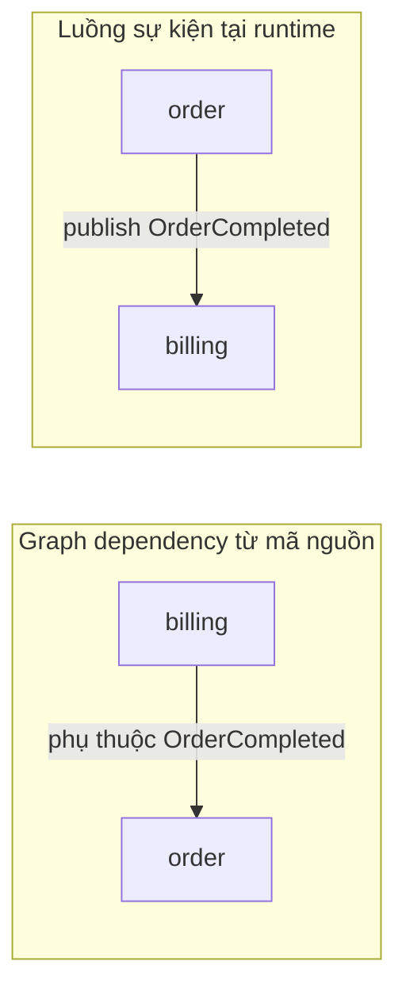
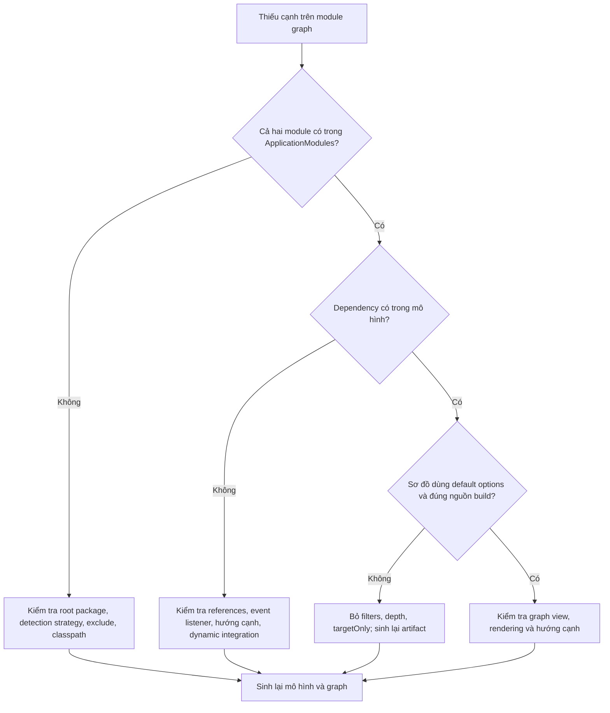
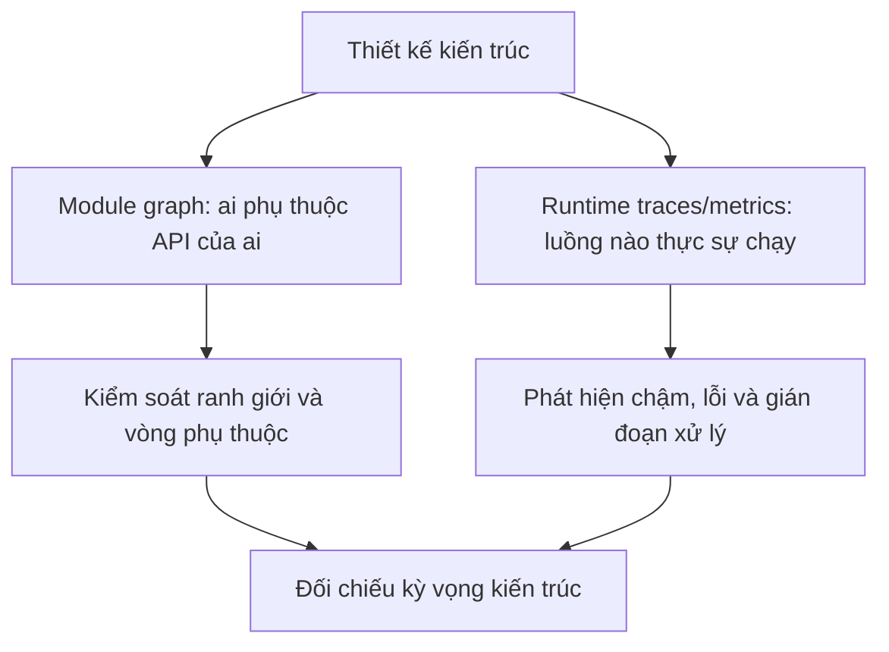

# Graph module thiếu dependency

## 1. Vấn đề cần chẩn đoán

Trong **SPRING_MODULITH_DOCUMENTATION_OBSERVABILITY**, Spring Modulith được dùng để mô tả ranh giới application module, sinh module graph, khai thác Actuator và quan sát tương tác bằng metrics, tracing, event. Ở phần **Chẩn đoán lỗi**, tình huống **“Graph module thiếu dependency”** xảy ra khi nhóm phát triển tin rằng module A đang phụ thuộc module B, nhưng biểu đồ tạo bởi `Documenter` không hiển thị mũi tên mong đợi.

Đây có thể là lỗi nhận diện module, lỗi suy luận dependency, tùy chọn lọc khi render hoặc khác biệt giữa **quan hệ trong mã nguồn** và **hành vi tại runtime**. Trước khi sửa code hoặc thêm annotation, cần trả lời ba câu hỏi:

1. Hai module có được phát hiện riêng biệt trong `ApplicationModules` hay không?
2. Mô hình `ApplicationModules` có chứa dependency thực tế giữa hai module hay không?
3. Khi dependency đã có trong mô hình, `Documenter`, Actuator hoặc công cụ xem graph có đang lọc/ẩn nó hay không?

Nếu câu (1) sai, xem lại module discovery. Nếu câu (1) đúng nhưng (2) sai, kiểm tra cách code biểu diễn kết nối. Nếu (2) đúng nhưng (3) sai, xử lý cấu hình tạo tài liệu hoặc nội dung được công bố tại runtime.

> **Phân biệt quan trọng:** `ApplicationModules.verify()` kiểm tra các **quan hệ đang tồn tại có tuân thủ ràng buộc kiến trúc hay không**. Nó không tự biết nhóm phát triển *mong muốn* phải có cạnh `billing → order`, nên kiểm tra kiến trúc có thể PASS dù cạnh mong đợi chưa xuất hiện.

## 2. Module graph thực sự biểu diễn điều gì?

Với bố cục mặc định, các package con trực tiếp của package chứa lớp `@SpringBootApplication` được xem là application module. Spring Modulith phân tích kiểu và mối quan hệ được nhận diện trong code để dựng các dependency giữa module.

Ví dụ:

```text
src/main/java/
└── com/acme/shop/
    ├── ShopApplication.java           # @SpringBootApplication
    ├── order/
    │   ├── OrderManagement.java       # public API của order
    │   └── OrderCompleted.java        # domain event
    ├── billing/
    │   ├── BillingService.java
    │   └── InvoiceListener.java       # phụ thuộc vào OrderCompleted
    └── shipping/
        └── ShippingService.java
```

Khi `InvoiceListener` của `billing` có tham số kiểu `com.acme.shop.order.OrderCompleted`, module **billing dùng type do order cung cấp**. Vì vậy cạnh dependency kiến trúc thường được hiểu theo hướng **billing → order**. Trong luồng sự kiện nghiệp vụ, sự kiện lại được **order phát ra** và **billing nhận**. Hai loại mũi tên có ý nghĩa khác nhau.



Khi nhìn graph và thấy không có cạnh `order → billing`, điều đó chưa chứng minh thiếu dữ liệu; có thể đội phát triển đang kỳ vọng **hướng của business event flow** thay vì hướng **module dependency**.

| Thực thể | Ý nghĩa | Có tạo dependency trên module graph? |
|---|---|---|
| Constructor injection / gọi public API của module khác | Code của module gọi phụ thuộc type ở module đích | Có, khi type/bean được xác định thuộc một module khác |
| Listener có tham số là event type thuộc module khác | Module nghe phụ thuộc định nghĩa event | Thường có, khi event type và listener được nhận diện |
| `@ApplicationModule(allowedDependencies = "order")` | Khai báo giới hạn những module được phép tham chiếu | **Không tự tạo cạnh** nếu mã nguồn không có dependency thực |
| `@NamedInterface` | Công bố phần API được module khác phép sử dụng | **Không tự tạo cạnh** nếu không có code thực sự sử dụng API |
| Gọi HTTP đến một ứng dụng khác qua URL cấu hình | Tương tác tích hợp ở runtime | Không mặc nhiên thành dependency giữa hai application module nội bộ |
| Event được định tuyến động qua payload generic / reflection | Quan hệ động, không có tham chiếu type rõ ràng trong code | Có thể không được bộ phân tích tĩnh nhận diện |
| Bean thuộc cùng application module | Gọi nội bộ giữa các package của cùng module | Không tạo cạnh **liên module** |
| Message broker chuyển event cho dịch vụ khác | Quan hệ runtime xuyên tiến trình | Không mặc nhiên được suy ra từ module graph trong JVM hiện tại |

Spring Modulith hỗ trợ các loại dependency như `DEFAULT`, `USES_COMPONENT` và `EVENT_LISTENER`; nội dung Actuator mô tả các loại này trong phần `dependencies[].types`. Điều đó không có nghĩa một lần gọi runtime được chèn vào graph tĩnh ngay khi xảy ra.

## 3. Quy trình chẩn đoán: từ dữ liệu gốc đến hình vẽ



Trình tự chẩn đoán hữu ích:

1. Ghi lại **cạnh mong đợi**: ví dụ “`billing` phụ thuộc `order` vì `InvoiceListener` nhận `OrderCompleted`”. Nêu rõ source, target, bằng chứng type hoặc event.
2. Xây lại `ApplicationModules` từ đúng lớp ứng dụng và in ra danh sách module: xác nhận tên logic, base package và các thành phần thuộc module.
3. Đọc **direct dependencies** từ mô hình, tránh bắt đầu bằng ảnh render.
4. Sinh sơ đồ toàn hệ thống bằng `DiagramOptions.defaults()`, đồng thời sinh module canvas; nếu cần, so sánh với biểu đồ từng module.
5. Nếu mô hình có cạnh nhưng hình không có, kiểm tra tùy chọn `withDependencyTypes`, `withDependencyDepth`, `withExclusions`, `withTargetOnly`, `withComponentFilter` và `withElementsWithoutRelationships`.
6. So sánh với `/actuator/modulith` trên **đúng phiên bản đã deploy**; nếu có khác biệt, kiểm tra config module discovery giữa test và production.
7. Chỉ khi đã xác định nguyên nhân mới chỉnh sửa code hoặc cấu hình; cuối cùng thêm kiểm thử giữ lại quan hệ kỳ vọng.

Đừng bắt đầu bằng cách “thêm `allowedDependencies` cho đủ”. Annotation này ràng buộc hướng phụ thuộc hợp lệ, không phải danh sách cạnh bắt buộc xuất hiện trong hình.

## 4. Kiểm tra trực tiếp mô hình `ApplicationModules`

Ví dụ dùng Spring Modulith trong dự án Spring Boot có lớp `ShopApplication` tại `com.acme.shop`. Bài kiểm thử sau in ra những module đã nhận diện và kiểm tra một cạnh cụ thể.

```java
package com.acme.shop;

import static org.assertj.core.api.Assertions.assertThat;

import org.junit.jupiter.api.Test;
import org.springframework.modulith.core.ApplicationModules;

class ModuleGraphDiagnosisTests {

    @Test
    void inspectDetectedModules() {
        var modules = ApplicationModules.of(ShopApplication.class);

        // Xác định các module thực sự được quét và base package của chúng.
        modules.forEach(module -> {
            System.out.println("MODULE: " + module.getIdentifier());
            System.out.println("PACKAGE: " + module.getBasePackage());
            System.out.println("DIRECT: "
                    + module.getDirectDependencies(modules)
                            .uniqueModules()
                            .map(dependency -> dependency.getIdentifier().toString())
                            .sorted()
                            .toList());
        });

        assertThat(modules.getModuleByName("order")).isPresent();
        assertThat(modules.getModuleByName("billing")).isPresent();
    }

    @Test
    void billingDependsOnOrder() {
        var modules = ApplicationModules.of(ShopApplication.class);
        var billing = modules.getModuleByName("billing").orElseThrow();

        // Đây là quy tắc nghiệp vụ bổ sung: cạnh này PHẢI tồn tại.
        assertThat(billing.getDirectDependencies(modules)
                .containsModuleNamed("order"))
                .as("billing must depend directly on order API")
                .isTrue();

        // Kiểm tra các dependency hiện có tuân thủ ranh giới.
        modules.verify();
    }
}
```

Các lệnh trên dùng API của `ApplicationModules`, `ApplicationModule#getDirectDependencies(...)` và `ApplicationModuleDependencies#containsModuleNamed(...)`. Không cần khởi động toàn bộ web server để phân tích mô hình. Khi phép kiểm tra có cạnh FAIL, chuyển sang kiểm tra source code/package. Khi phép kiểm tra có cạnh PASS, chuyển sang cấu hình vẽ đồ thị.

**Lưu ý:** `getDirectDependencies(...)` và `getAllDependencies(...)` không cùng ý nghĩa. Một quan hệ `billing → catalog` chỉ tồn tại qua `billing → order → catalog` là **transitive dependency**; nó có thể không hiện ở sơ đồ chỉ gồm direct edges. Hãy xác nhận mình cần cạnh trực tiếp hay chỉ quan hệ gián tiếp trước khi kết luận lỗi.

## 5. Nguyên nhân 1: Module không được nhận diện hoặc bị gộp

### 5.1. Đặt sai package gốc

Giả sử ứng dụng có:

```text
com.acme.shop.ShopApplication
com.acme.shop.order.OrderManagement
com.acme.shop.billing.InvoiceListener
com.acme.other.notifications.NotificationListener
```

Với root là `com.acme.shop`, package `com.acme.other.notifications` không tự động nằm trong phạm vi module discovery mặc định. Thay root khi gọi `ApplicationModules.of(...)` hoặc di chuyển code tới root phù hợp sẽ tạo mô hình khác.

**Cách kiểm tra:** in `module.getIdentifier()` và `getBasePackage()`. Nếu thiếu `notifications`, lỗi xảy ra **trước** giai đoạn tạo dependency. Kiểm tra địa chỉ lớp `ShopApplication`, package thực của source, các root bổ sung trong `@Modulithic(additionalPackages = ...)`, và các tùy chọn cấu hình phát hiện module.

### 5.2. Hai package chỉ là subpackage của cùng module

```text
com.acme.shop.order
com.acme.shop.order.internal
com.acme.shop.order.reporting
```

Ở cấu trúc mặc định, `order.internal` và `order.reporting` vẫn thuộc module `order`, trừ khi bạn chủ động định nghĩa nested modules theo tính năng phù hợp. Việc không có cạnh `reporting → order` trong graph liên module có thể **đúng**, vì đó là gọi nội bộ.

Nếu mong muốn reporting là module độc lập, nên xác định ranh giới nghiệp vụ và bố trí thành `com.acme.shop.reporting` (hoặc cấu hình nested module có chủ đích), sau đó xác nhận lại bằng test. Không tách package chỉ để vẽ thêm mũi tên khi bản chất nghiệp vụ vẫn thuộc cùng module.

### 5.3. Đang dùng strategy “explicitly annotated”

Nếu `spring.modulith.detection-strategy=explicitly-annotated`, chỉ những package được đánh dấu hợp lệ (ví dụ `@ApplicationModule`) mới được xem là module. Một package không được đánh dấu có thể biến mất khỏi mô hình.

```properties
spring.modulith.detection-strategy=explicitly-annotated
```

Kiểm tra giá trị cấu hình trong test và production. Khi dùng `ApplicationModuleDetectionStrategy` tùy biến hoặc `ApplicationModuleSourceFactory`, cần xác minh các gói được trả về đúng với dự định. Nếu chỉ đăng ký strategy trong `src/test`, tài liệu sinh từ test có thể khác mô hình được Actuator/observability dựng ở production. Muốn runtime cùng cách phát hiện, chuyển custom strategy và đăng ký của nó sang nguồn production theo hướng dẫn phiên bản đang dùng.

### 5.4. Classpath hoặc bộ lọc loại trừ khác nhau

`ApplicationModules.of(...)` có các cách khai báo predicate để loại trừ package/type khỏi phân tích. Nếu package đích nằm trong predicate loại trừ, graph có thể thiếu module hoặc thiếu tham chiếu cần thiết. Ngoài ra, bài kiểm thử module graph có thể chạy trên classpath không chứa lớp của một source set hoặc module build riêng; kiểm tra dependency của test runner.

Không tùy tiện loại bỏ các bộ lọc kiến trúc: trước tiên xác định chúng được đặt có chủ đích hay bị áp dụng quá rộng.

## 6. Nguyên nhân 2: Quan hệ có trong nghiệp vụ nhưng thiếu tham chiếu tĩnh

Ví dụ `order` phát sự kiện, `billing` đăng ký listener bằng type cụ thể:

```java
// com.acme.shop.order.OrderCompleted
package com.acme.shop.order;

import java.util.UUID;

public record OrderCompleted(UUID orderId) {}
```

```java
// com.acme.shop.billing.InvoiceListener
package com.acme.shop.billing;

import com.acme.shop.order.OrderCompleted;
import org.springframework.context.event.EventListener;
import org.springframework.stereotype.Component;

@Component
class InvoiceListener {

    @EventListener
    void on(OrderCompleted event) {
        // Phần xử lý lập hóa đơn được lược bớt.
    }
}
```

Do chữ ký listener tham chiếu `OrderCompleted`, `billing` có quan hệ phụ thuộc type vào `order`. Trong ứng dụng thực tế, có thể thay `@EventListener` bằng `@ApplicationModuleListener` khi cần xử lý bất đồng bộ theo transaction; vẫn cần kiểm tra ranh giới và cơ chế nhận diện của phiên bản Spring Modulith đang sử dụng.

Ngược lại, nếu business event được chuyển qua `Map<String, Object>`, `String`, reflection hoặc một dispatcher đăng ký listener theo tên cấu hình, model tĩnh có thể **không tìm thấy** type dependency. Cố thêm `@ApplicationModule(allowedDependencies = ...)` cũng không tạo tham chiếu tĩnh đó.

Cách xử lý phụ thuộc mục tiêu:

- Nếu muốn graph phản ánh **hợp đồng module nội bộ**, định nghĩa event/API typed, đặt type ở package API của module cung cấp và sử dụng type đó trong consumer. Tránh thêm một import “giả” chỉ để ép sơ đồ có cạnh.
- Nếu tương tác thực sự qua REST, topic broker hoặc adapter động, mô tả nó trong **integration diagram** hoặc module canvas/tài liệu kiến trúc bổ sung. Không giả định Spring Modulith sẽ tự suy ra kết nối giữa các hệ thống độc lập từ URL/topic string.
- Nếu graph dùng cho **phụ thuộc deployment**, lựa chọn công cụ quan sát runtime/service map và đối chiếu tracing; đó là khái niệm khác với module dependency graph được phân tích từ mã nguồn.

### Trường hợp module phụ thuộc vào interface trung gian

`billing` có thể inject một interface tại package `shared`, còn `order` chỉ cung cấp implementation. Khi đó dependency tĩnh có thể biểu diễn `billing → shared` hoặc không xuất hiện dưới dạng `billing → order` dù Spring DI tại runtime chọn bean được implement trong `order`. Kiểm tra cả định nghĩa interface, constructor injection, bean registration, module ownership và cách Spring Modulith phân loại quan hệ `USES_COMPONENT`. Nếu nhóm muốn ranh giới rõ, cần quyết định API thuộc module nào thay vì chỉnh sơ đồ để hợp thức hóa một hướng phụ thuộc chưa thể hiện trong code.

## 7. Nguyên nhân 3: Hiểu nhầm `allowedDependencies` và `@NamedInterface`

Hai cơ chế này điều khiển **ràng buộc phụ thuộc được phép**, không khai báo một cạnh hiển thị bắt buộc.

Ví dụ trong `com.acme.shop.billing/package-info.java`:

```java
@org.springframework.modulith.ApplicationModule(
        allowedDependencies = "order"
)
package com.acme.shop.billing;
```

Điều này cho phép `billing` phụ thuộc `order` trong giới hạn quy tắc module nhưng không làm `billing` tự động sử dụng bất kỳ type nào của `order`. Vì vậy:

- Nếu không có tham chiếu code, cạnh có thể không tồn tại dù `allowedDependencies` chứa `order`.
- Nếu code truy cập một type ở package `order.internal` của module đóng, `verify()` có thể phát hiện vi phạm kiến trúc; không nên sửa bằng cách mở toàn bộ module chỉ để vượt qua check.
- Nếu cần chia sẻ API ở một package con, định nghĩa named interface rõ ràng và điều chỉnh tham chiếu/allowed dependencies cho phù hợp.

Ví dụ API mở rộng ở `com.acme.shop.order.spi/package-info.java`:

```java
@org.springframework.modulith.NamedInterface("spi")
package com.acme.shop.order.spi;
```

Nếu `billing` chỉ được phép dùng API `spi` của `order`, khai báo:

```java
@org.springframework.modulith.ApplicationModule(
        allowedDependencies = "order :: spi"
)
package com.acme.shop.billing;
```

Khi cần cả base package `order` và `order.spi`, phải khai báo tương ứng theo cú pháp phiên bản đang dùng, chẳng hạn `order :: **` để chấp nhận toàn bộ giao diện được công bố. Chỉ dùng `order :: *` không bao gồm base package. Dù cấu hình nào, cạnh chỉ xuất hiện khi có **dependency thực tế**.

## 8. Nguyên nhân 4: `Documenter` đang ẩn cạnh khi render

Một graph hình ảnh có thể thiếu cạnh trong khi `ApplicationModules` đã phát hiện nó. Trước tiên sinh sơ đồ bằng **tùy chọn mặc định** để có baseline:

```java
package com.acme.shop;

import org.junit.jupiter.api.Test;
import org.springframework.modulith.core.ApplicationModules;
import org.springframework.modulith.docs.Documenter;

class ModuleDocumentationTests {

    @Test
    void generateGraphWithoutCustomFilters() {
        var modules = ApplicationModules.of(ShopApplication.class);

        new Documenter(modules)
                .writeModulesAsPlantUml()
                .writeIndividualModulesAsPlantUml()
                .writeModuleCanvases();
    }
}
```

`Documenter` mặc định sinh nội dung trong thư mục `spring-modulith-docs` thuộc thư mục build của hệ thống build (ví dụ `target` với Maven hoặc `build` với Gradle). Lệnh tạo PlantUML không bắt buộc ảnh PNG đã tồn tại; kiểm tra nội dung `.puml` trước khi quy kết trình render sai.

Các tùy chọn cần đối chiếu (API `Documenter.DiagramOptions`):

| Tùy chọn | Nếu cấu hình không phù hợp | Cách xác minh |
|---|---|---|
| `withDependencyTypes(...)` | Chỉ vẽ `USES_COMPONENT`, bỏ `EVENT_LISTENER` hoặc `DEFAULT` | Dùng default (mọi loại) hoặc bổ sung kiểu bị lọc |
| `withDependencyDepth(...)` | Sơ đồ từng module chỉ hiển thị trực tiếp thay vì toàn bộ chuỗi quan hệ | So sánh global overview và individual diagrams; xác định cần direct hay transitive |
| `withExclusions(...)` | Loại module source/target khỏi sơ đồ | Loại bộ lọc và sinh lại |
| `withTargetOnly(...)` | Giữ module làm target nhưng ẩn các cạnh outgoing của chính module đó | Kiểm tra predicate đang áp dụng |
| `withComponentFilter(...)` | Loại các component trước khi hiển thị | Đối chiếu với render mặc định |
| `withElementsWithoutRelationships(...)` | Ẩn module không có cạnh trong view đang hiển thị | Bật giữ isolated modules khi cần đánh giá module được nhận diện |
| Sơ đồ toàn hệ thống so với sơ đồ riêng lẻ | Sơ đồ riêng lẻ tập trung vào một module và dependencies của nó | Kiểm tra đúng hình/file tương ứng |

`DiagramOptions.defaults()` mặc định bao gồm mọi loại dependency, sử dụng mối quan hệ trực tiếp cho biểu đồ từng module và không chủ động loại bỏ module. Nếu graph trước đây dùng một `withDependencyTypes(...)` chỉ chọn `USES_COMPONENT`, việc thiếu cạnh do event listener là kết quả mong đợi của bộ lọc.

Để xác minh, có thể tạo **hai kết quả có cấu hình rõ ràng** và so sánh bằng mắt: sơ đồ mặc định, sơ đồ chỉ chọn event dependency. Không thay file tài liệu chuẩn đã được nhóm duyệt chỉ vì muốn minh họa một hướng cạnh khác.

## 9. Nguyên nhân 5: Tài liệu sinh từ test khác với Actuator ở production

Spring Modulith có thể cung cấp cấu trúc module tại `/actuator/modulith` khi có runtime/actuator support phù hợp, chẳng hạn `spring-modulith-starter-insight` và Spring Boot Actuator. Dữ liệu trả về là một mô hình module với `basePackage`, `dependencies[].target` và `dependencies[].types[]`.

Ví dụ minh họa cấu trúc response (giá trị cụ thể phụ thuộc ứng dụng):

```json
{
  "order": {
    "basePackage": "com.acme.shop.order",
    "displayName": "Order",
    "dependencies": []
  },
  "billing": {
    "basePackage": "com.acme.shop.billing",
    "displayName": "Billing",
    "dependencies": [
      { "target": "order", "types": ["EVENT_LISTENER"] }
    ]
  }
}
```

Khi sơ đồ test có cạnh `billing → order` mà Actuator không có, hãy đối chiếu:

1. **Artifact/version:** test đang chạy trên source/build hiện tại hay production vẫn là image cũ?
2. **Module detection strategy:** custom strategy có được đăng ký ở runtime hay chỉ trong test?
3. **Classpath:** runtime có các module/class cần thiết hay có bean/class bị loại bởi profile hoặc packaging?
4. **Root package:** lớp dùng làm điểm bắt đầu phân tích có khớp khi sinh tài liệu và khi chạy không?
5. **Dữ liệu endpoint:** đang gọi đúng instance/namespace, đúng port, đúng environment và đúng `/actuator/modulith`?

`/actuator/modulith` là endpoint **metadata cấu trúc**; mặc định không phải danh sách sự kiện đã chạy hay log kết nối. Nó không thay cho distributed tracing. Khi dùng endpoint này ở môi trường thực, giới hạn quyền truy cập theo chính sách vận hành của hệ thống.

## 10. Dùng tracing và event metrics để kiểm chứng giả thuyết runtime

Khi nhóm nói “có gọi qua module B mà graph không có”, cần hỏi họ thấy bằng chứng gì:

- **Static graph:** biểu diễn dependency giữa các application module được xác định từ mã nguồn.
- **Actuator modulith:** công bố metadata module trong ứng dụng chạy thật.
- **Traces:** ghi nhận những lời gọi được instrument; một đường trace không đảm bảo mô hình tĩnh phải có đúng một cạnh cùng hướng.
- **Event metrics:** bộ đếm publish event hoặc số liệu xử lý, không tự tạo cạnh kiến trúc.
- **Business log:** bằng chứng xử lý tác vụ nhưng có thể không chỉ ra module sở hữu type được tham chiếu.

Chẳng hạn, `order` publish `OrderCompleted` và `billing` xử lý async. Runtime trace có thể hiển thị trình tự `order → billing`, trong khi graph dependency hiển thị `billing → order`. Nếu context propagation qua executor không được cấu hình, các spans có thể nằm ở hai trace khác nhau, càng dễ làm người xem hiểu nhầm rằng không có giao tiếp.

Sơ đồ phù hợp cho hai góc nhìn:



Nếu đó là integration qua message broker hoặc REST sang dịch vụ độc lập, cần tài liệu kết nối ngoài module graph và telemetry của adapter/integration tương ứng. Không nên cố khai báo một dependency Java không có thật để biến luồng mạng thành cạnh trong hình.

## 11. Tình huống thực hành và cách giải quyết

### Tình huống A: Không thấy cả module `shipping`

**Triệu chứng:** `modules.forEach(...)` chỉ in `order` và `billing`.

**Hướng kiểm tra:** package `shipping` có nằm dưới root của `ShopApplication` không? Có bật `explicitly-annotated` nhưng thiếu `@ApplicationModule` không? Test có chạy trên classpath chứa code `shipping` không? Nếu source package nằm ngoài root, dùng cách bố trí module hoặc cấu hình `additionalPackages`/custom detection thích hợp. Chỉ sinh lại graph sau khi mô hình nhận diện đủ module.

### Tình huống B: Có module `billing` nhưng không thấy `billing → order`

**Triệu chứng:** cả hai module được phát hiện, nhưng `billing.getDirectDependencies(modules).containsModuleNamed("order")` là `false`.

**Hướng kiểm tra:** chữ ký listener, constructor, interface, event type thuộc module nào? Có đang chuyển events bằng `String` hoặc generic dispatcher không? Có đang kiểm tra nhầm hướng `order → billing` không? Nếu quan hệ bắt buộc có trong kiến trúc, bổ sung public API typed và kiểm thử đảm bảo consumer phụ thuộc đúng contract.

### Tình huống C: Direct dependencies có `order`, hình PlantUML lại không có

**Triệu chứng:** assertion direct dependency PASS; file `.puml` được render không vẽ cạnh.

**Hướng kiểm tra:** `DiagramOptions.withDependencyTypes(...)` có chỉ chọn `DEFAULT` hoặc `USES_COMPONENT` và bỏ `EVENT_LISTENER`? Có exclude một module? Bạn đang xem sơ đồ tổng quan hay sơ đồ riêng lẻ của module khác? So sánh với `Documenter(...).writeModulesAsPlantUml()` mặc định và kiểm tra nội dung file nguồn `.puml`.

### Tình huống D: Test docs đúng, `/actuator/modulith` sai

**Triệu chứng:** tài liệu local mới có cạnh nhưng endpoint ở production không có.

**Hướng kiểm tra:** build/version deployment, config production, custom module strategy chỉ có ở test, root package và dependency runtime. Cần xem là sai **model tại runtime** hay đang truy vấn sai ứng dụng.

### Tình huống E: `verify()` PASS dù thiếu cạnh mong muốn

**Triệu chứng:** module graph không phản ánh một ràng buộc thiết kế đã thống nhất, nhưng kiểm tra kiến trúc vẫn xanh.

**Hướng kiểm tra:** `verify()` không được thiết kế để xác nhận tất cả cạnh dự kiến phải tồn tại. Thêm assertion chủ đích `containsModuleNamed(...)` vào architectural test. Nếu business flow là quan hệ động, lưu nó trong tài liệu tích hợp phù hợp và kiểm thử integration riêng.

## 12. Thiết kế bài test để không tái phát lỗi

Bảo vệ cả **ràng buộc an toàn** lẫn **ràng buộc kỳ vọng**:

```java
package com.acme.shop;

import static org.assertj.core.api.Assertions.assertThat;

import org.junit.jupiter.api.Test;
import org.springframework.modulith.core.ApplicationModules;

class ApplicationArchitectureTests {

    private final ApplicationModules modules =
            ApplicationModules.of(ShopApplication.class);

    @Test
    void moduleBoundariesAreValid() {
        // Không truy cập internal API trái phép; không có cycle vi phạm.
        modules.verify();
    }

    @Test
    void essentialModulesAndDependenciesExist() {
        assertThat(modules.getModuleByName("order")).isPresent();
        assertThat(modules.getModuleByName("billing")).isPresent();

        var billing = modules.getModuleByName("billing").orElseThrow();

        assertThat(billing.getDirectDependencies(modules)
                .containsModuleNamed("order")).isTrue();
    }
}
```

Nếu điều kiện nghiệp vụ chỉ yêu cầu **có thể giao tiếp** chứ không yêu cầu dependency tĩnh trực tiếp, thay assertion bằng điều kiện đúng hơn: kiểm thử integration, test publish/listen event hoặc kiểm tra contract adapter. Không đưa vào test một “cạnh bắt buộc” chưa được đội kiến trúc thống nhất, vì sẽ làm hệ thống bị khóa vào dependency không cần thiết.

Đưa việc sinh docs vào bước build/test phù hợp, lưu và so sánh file tài liệu khi các module thay đổi. Khi đồ thị đã trở thành artifact đánh giá kiến trúc, nên yêu cầu code review đối với thay đổi về module discovery, named interface và cách lọc sơ đồ.

## 13. Checklist chẩn đoán nhanh

- [ ] Đã xác định source/target của cạnh và phân biệt dependency **A dùng API của B** với event flow **B phát cho A**.
- [ ] Hai application module đều xuất hiện trong `ApplicationModules.of(App.class)` với đúng identifier/base package.
- [ ] Đã kiểm tra root package, subpackage, nested module, `@Modulithic(additionalPackages)` và detection strategy.
- [ ] Đã kiểm tra excludes và classpath của source set được dùng để sinh mô hình.
- [ ] Đã kiểm tra direct dependencies bằng `getDirectDependencies(...)` trước khi nhìn ảnh.
- [ ] Đã kiểm tra event listener, public API, import, interface, reflection hoặc adapter động có tạo type dependency hay không.
- [ ] Hiểu `allowedDependencies` và `@NamedInterface` chỉ ràng buộc/công bố API, không bắt buộc tạo edge.
- [ ] Đã so sánh sơ đồ mặc định với sơ đồ dùng filters, dependency depth, exclude và target-only.
- [ ] Đã so sánh `.puml` gốc với ảnh render; loại trừ artifact cũ/sai môi trường.
- [ ] Nếu dùng Actuator, đã đối chiếu build/runtime config và dữ liệu `dependencies[].types`.
- [ ] Nếu giao tiếp thực sự chỉ xảy ra tại runtime, đã dùng tracing/event metrics/integration docs đúng mục đích.
- [ ] Đã thêm kiểm thử phù hợp để giữ ranh giới và quan hệ kiến trúc quan trọng.

### Tài liệu tham khảo

1. [Spring Modulith — Fundamentals: Application Modules, Named Interfaces, Detection](https://docs.spring.io/spring-modulith/reference/fundamentals.html)
2. [Spring Modulith — Verifying Application Module Structure](https://docs.spring.io/spring-modulith/reference/verification.html)
3. [Spring Modulith — Documenting Application Modules](https://docs.spring.io/spring-modulith/reference/documentation.html)
4. [Spring Modulith — Production-ready Features: Actuator and Observability](https://docs.spring.io/spring-modulith/reference/production-ready.html)
5. [Spring Modulith API — `ApplicationModules`](https://docs.spring.io/spring-modulith/docs/current/api/org/springframework/modulith/core/ApplicationModules.html)
6. [Spring Modulith API — `ApplicationModule`](https://docs.spring.io/spring-modulith/docs/current/api/org/springframework/modulith/core/ApplicationModule.html)
7. [Spring Modulith API — `Documenter.DiagramOptions`](https://docs.spring.io/spring-modulith/docs/current/api/org/springframework/modulith/docs/Documenter.DiagramOptions.html)
