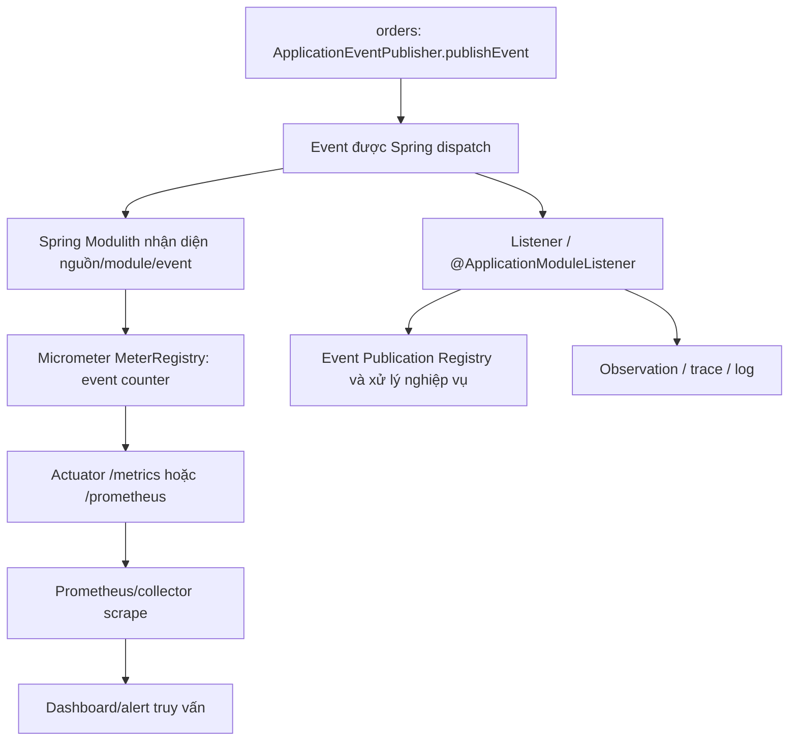
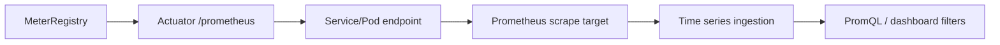
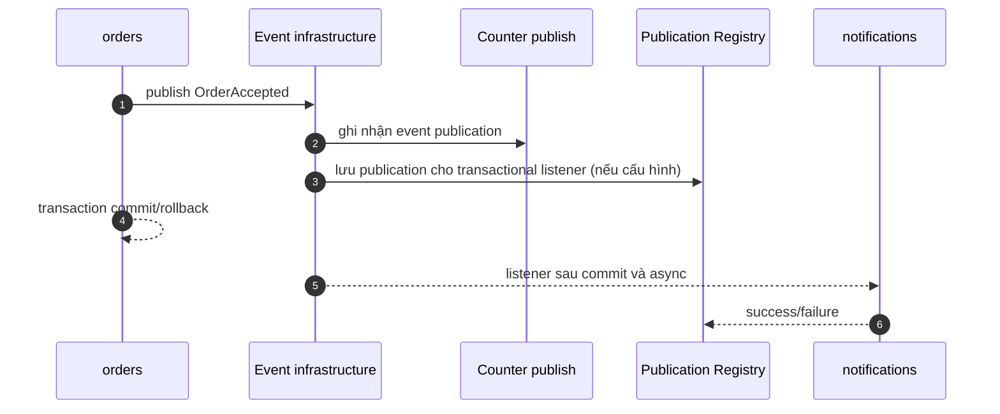

# Metric event không xuất hiện

Trong một ứng dụng Spring Boot dùng **Spring Modulith**, đội vận hành có thể thấy HTTP request hoạt động, sự kiện vẫn đến `@ApplicationModuleListener` và log có `traceId`, nhưng dashboard lại không hiển thị **metric sự kiện**. Một tình huống khác: `/actuator/metrics` trả về danh sách metric thông thường, song không có `module.events.published`. Hai hiện tượng này có nguyên nhân khác nhau; cần tìm nơi dữ liệu biến mất trong chuỗi **phát event → nhận diện module → ghi counter → xuất qua Actuator → hệ thống giám sát**.

Bài thuộc chương **Chẩn đoán lỗi** của **Spring Modulith Documentation & Observability**. Mục tiêu là chẩn đoán tình huống **“Metric event không xuất hiện”** bằng bằng chứng có thể lặp lại, kết hợp module graph, Actuator, Micrometer, event publication, tracing và context propagation. Cách xử lý áp dụng cho nhiều application module chạy trong **cùng ứng dụng Spring Boot**, không giả định các module là microservice hay mọi event đi qua message broker.

## 1. Xác định chính xác metric nào đang thiếu

Trước khi sửa cấu hình, hãy xác định metric mong đợi là **counter về sự kiện được phát**, **metric về hoạt động của listener** hay **dữ liệu trace**:

| Dữ liệu | Câu hỏi trả lời | Có phải metric event tự động của Modulith? |
| --- | --- | --- |
| `module.events.published` | Ứng dụng đã phát bao nhiêu domain event được Modulith nhận diện? | Có trong các phiên bản hỗ trợ event metrics |
| `module.events.published.<moduleIdentifier>.<SimpleEventTypeName>` | Một kiểu event cụ thể đã được phát bao nhiêu lần? | Có trong các phiên bản hỗ trợ event metrics |
| Số listener hoàn thành/thất bại | Handler đã thực sự xử lý event thành công chưa? | Không được suy ra trực tiếp từ hai counter publish |
| Publication đang chờ/retry | Event Publication Registry lưu bản ghi với trạng thái gì? | Là trạng thái hạ tầng publication; không đồng nghĩa counter publish |
| Span `orders → notifications` | Trong một trace được lấy mẫu, module nào gọi/nhận xử lý? | Thuộc tracing/Observation, không phải event counter |
| HTTP/CPU/GC metrics | Ứng dụng có tải, lỗi hoặc nghẽn tài nguyên không? | Metric của Spring Boot/JVM, chỉ cung cấp ngữ cảnh |

Theo tài liệu Spring Modulith dòng **2.2**, hai counter tự động là:

- `module.events.published`: tổng hợp sự kiện được phát, với low-cardinality keys `module.event.type`, `module.identifier` và `module.name`.
- `module.events.published.<moduleIdentifier>.<SimpleEventTypeName>`: counter riêng cho loại event, có thể được bổ sung thẻ bằng `ModulithEventMetricsCustomizer` theo API và phiên bản phù hợp.

Khả năng tự tạo event counters được giới thiệu cùng cải tiến observability ở **Spring Modulith 1.4**. Nếu dự án dùng phiên bản cũ hơn, **đừng kết luận lỗi cấu hình chỉ vì không có hai counter này**; trước hết đối chiếu chức năng được phiên bản đó hỗ trợ. Tên metric trong Micrometer cũng có thể được **đổi cách biểu diễn** bởi backend: ví dụ định dạng Prometheus chuyển dấu chấm thành gạch dưới và thêm hậu tố cho counter. Cần xem tên được xuất thực tế trước khi viết truy vấn dashboard.

**Ranh giới quan trọng:** counter publish tăng **không chứng minh** một `@ApplicationModuleListener` đã hoàn tất. Listener có thể chạy sau commit, thất bại, bị retry hoặc chưa bắt đầu; trạng thái đó cần kiểm tra qua Event Publication Registry, metrics nghiệp vụ hoặc trace riêng.

## 2. Bản đồ luồng số liệu và điểm có thể mất metric



Sơ đồ minh họa **hai nhánh khác nhau**: nhánh metric ghi nhận lúc phát sự kiện và nhánh xử lý bởi listener. Nhiệm vụ chẩn đoán là xác định **điểm cuối cùng còn bằng chứng**:

1. Event có thật sự được publish trong ứng dụng đang đo không?
2. Phiên bản và module observability của Spring Modulith có hỗ trợ nhận event đó không?
3. Micrometer có lưu meter trong `MeterRegistry` đang dùng không?
4. Actuator có bật endpoint metrics/prometheus và có trả meter đó không?
5. Hệ thống giám sát có scrape/ingest, lưu và truy vấn đúng series không?

Nếu `MeterRegistry` đã có counter nhưng dashboard không hiển thị thì ưu tiên kiểm tra **đường export**. Nếu registry không có counter dù event đã phát thật, ưu tiên kiểm tra **dependency, version, module detection và instrumentation**.

## 3. Quy trình kiểm tra nhanh trong 10 phút đầu

Không cần chỉnh code ngay. Trên **môi trường thử nghiệm được phép truy cập**, đi theo trình tự:

| Bước | Cách kiểm tra | Kết quả và hướng tiếp theo |
| --- | --- | --- |
| 1 | Xác nhận commit, profile, instance/replica và phiên bản Spring Modulith đang chạy | Tránh xem dashboard của instance khác hoặc bản cũ |
| 2 | `GET /actuator` và `GET /actuator/health` nếu được phép | Endpoint không truy cập: xem port, base path, firewall, authentication |
| 3 | `GET /actuator/metrics` | Không truy cập: kiểm tra Actuator và endpoint exposure; có các meter khác thì đi bước 4 |
| 4 | `GET /actuator/metrics/module.events.published` | 404/không có tên: kiểm tra version, observability, event và MeterRegistry |
| 5 | Phát **một event hợp lệ có kiểm soát**, đọc metric lại | Counter tăng: instrumentation hoạt động; không tăng: kiểm tra nguồn event |
| 6 | Nếu counter có, đọc `/actuator/prometheus` (khi dùng Prometheus) | Có ở Actuator nhưng không có ở endpoint Prometheus: xem registry/filter/exporter |
| 7 | Nếu exporter có, xem scrape target, query thô và dashboard | Giải quyết đường ingest, nhãn, tên metric, time range |

Ví dụ lệnh gọi khi ứng dụng chạy ở local và có quyền truy cập:

```bash
curl -i http://localhost:8080/actuator
curl -i http://localhost:8080/actuator/metrics
curl -i http://localhost:8080/actuator/metrics/module.events.published
curl -i http://localhost:8080/actuator/prometheus
```

Ví dụ phản hồi **minh họa** từ endpoint metrics sau khi event đã phát:

```json
{
  "name": "module.events.published",
  "description": "Event publications",
  "baseUnit": null,
  "measurements": [
    { "statistic": "COUNT", "value": 3.0 }
  ],
  "availableTags": [
    {
      "tag": "module.identifier",
      "values": ["orders"]
    }
  ]
}
```

Đây không phải dữ liệu thực nghiệm. Tên mô tả, các thẻ, số lượng và định dạng phản hồi thực tế phụ thuộc ứng dụng và phiên bản. HTTP `404` có thể có nghĩa endpoint/metric chưa tồn tại **hoặc** bị proxy/security che giấu; đừng chẩn đoán nguyên nhân chỉ từ mã trạng thái.

Nếu đang xem nhiều replica, gửi event vào pod A rồi đọc metric trên pod B sẽ có thể thấy giá trị không tăng: counter trong mỗi `MeterRegistry` là **theo instance**. Ghi pod/instance ID và lần truy cập trước khi kết luận một counter bị mất.

## 4. Kiểm tra phiên bản và dependency trước khi chạm vào event code

### 4.1. Điều kiện phiên bản

Khả năng observability thay đổi giữa các phiên bản Spring Modulith:

| Trạng thái | Cách xử lý |
| --- | --- |
| Spring Modulith trước dòng 1.4 | Kiểm tra tài liệu phiên bản; counter event tự động của 1.4+ có thể chưa tồn tại |
| Dòng 1.4.x | Xem module observability theo tên/đường phụ thuộc đúng dòng 1.4; đối chiếu bản vá thực tế |
| Dòng 2.x | Xem tài liệu production-ready đúng dòng đang chạy; kiểm tra starter insight hoặc observability core tương thích |
| BOM và artifact thuộc nhiều dòng | Khắc phục lệch phiên bản trước khi phân tích instrumentation |
| Bộ code test chạy 1 bản, process thật chạy bản khác | Kiểm tra dependency tree, manifest, build ID và container image đang chạy |

Ví dụ Maven dùng starter thuận tiện `spring-modulith-starter-insight` để bao gồm actuator và observability cùng nhau:

```xml
<dependencies>
    <!-- Quản lý version qua Spring Modulith BOM tương thích. -->
    <dependency>
        <groupId>org.springframework.modulith</groupId>
        <artifactId>spring-modulith-starter-insight</artifactId>
        <scope>runtime</scope>
    </dependency>
</dependencies>
```

Starter này còn phụ thuộc cách quản lý phiên bản Maven/Gradle của ứng dụng. Với cấu hình tách rời, tài liệu Spring Modulith 2.2 mô tả `spring-modulith-observability-core`; còn tài liệu 1.4 sử dụng `spring-modulith-observability`. **Không thay tên artifact theo phỏng đoán**, vì dependency chỉ có hiệu lực khi Spring Boot/Spring Modulith tương thích. Nếu dùng Actuator và observability artifact tách rời, bảo đảm có `spring-boot-starter-actuator` khi muốn truy cập management endpoints.

Có thể xác định dependency runtime với Maven:

```bash
mvn dependency:tree -Dincludes=org.springframework.modulith
mvn dependency:tree -Dincludes=io.micrometer
mvn dependency:tree -Dincludes=org.springframework.boot
```

Thực hiện trên repo dự án thực tế và so với **classpath bản đang chạy**, đặc biệt khi build sử dụng nhiều profile hoặc container chứa JAR cũ. Các dòng lệnh trên chỉ là hướng dẫn chẩn đoán, không phải kết quả đã chạy của bài học.

### 4.2. Phân biệt starter observability, Actuator, metrics và tracing

| Thành phần | Có tác dụng gì? | Thiếu thì thấy gì? |
| --- | --- | --- |
| Spring Modulith observability | Instrument tương tác module và event metrics được hỗ trợ | Counter module/event có thể không được đăng ký |
| Micrometer MeterRegistry | Giữ và tổng hợp meter | Không có counter trong registry thích hợp |
| Spring Boot Actuator | Cung cấp management endpoint `/actuator/metrics` | Không có endpoint để kiểm tra meter |
| Prometheus registry (nếu dùng) | Chuyển meter sang định dạng Prometheus | `/actuator/metrics` có meter nhưng `/actuator/prometheus` thiếu |
| Tracing bridge/exporter | Ghi và xuất span của Observation | Không có trace, nhưng event counter **vẫn có thể** xuất hiện |
| Event Publication Registry | Theo dõi publication cho transactional listener được hỗ trợ | Không có dữ liệu publication bền; không phải điều kiện tương đương với event counter |

Ví dụ: thêm Micrometer Tracing nhưng không có module observability sẽ không tự tạo `module.events.published`. Ngược lại, tắt tracing sampling không có nghĩa counter sự kiện Micrometer dừng tăng. **Metrics và traces là hai kênh quan sát khác nhau**.

## 5. Kiểm tra Actuator và registry nội bộ

### 5.1. Endpoint không xuất hiện

Trong môi trường local/lab, có thể mở có chọn lọc các endpoint cần thiết:

```yaml
management:
  endpoints:
    web:
      exposure:
        include: health,info,metrics,prometheus
  endpoint:
    metrics:
      enabled: true
    prometheus:
      enabled: true
```

Ví dụ này chỉ phù hợp khi dự án có **Actuator**, và muốn dùng `/actuator/prometheus` phải có thêm `micrometer-registry-prometheus`. `/actuator/metrics` và `/actuator/prometheus` là hai endpoint riêng; việc để `prometheus` trong danh sách exposure không tự thêm registry còn thiếu.

Với Spring Boot đã tùy biến `management.server.port`, `management.endpoints.web.base-path`, context path, Spring Security hoặc reverse proxy, URL không nhất thiết nằm ở cổng ứng dụng và `/actuator` như ví dụ. Nếu `metrics` trả 401/403, xử lý quyền truy cập của môi trường; không mở công khai mọi endpoint quản trị để “sửa” lỗi quan sát.

Để kiểm tra tên meter đã đăng ký ở endpoint:

```bash
# Mỗi dòng trong names chỉ là tên meter mà endpoint đã biết.
curl -s http://localhost:8080/actuator/metrics

# Tra cứu theo tên Micrometer, không dùng tên đã chuyển cho Prometheus.
curl -s http://localhost:8080/actuator/metrics/module.events.published
```

Một counter có thể chưa đăng ký trước **lần phát event đầu tiên** được instrumentation nhận diện. Vì vậy cần kích hoạt một request có kiểm soát rồi đọc lại, thay vì khởi động ứng dụng và kết luận thiếu ngay lập tức.

### 5.2. Debug từ `MeterRegistry` mà không phụ thuộc endpoint HTTP

Nếu endpoint metrics bị proxy che khuất, có thể kiểm tra registry trong **test hoặc profile chẩn đoán**:

```java
package com.acme.shop.diagnostics;

import io.micrometer.core.instrument.Meter;
import io.micrometer.core.instrument.MeterRegistry;
import java.util.Comparator;
import org.springframework.stereotype.Component;

@Component
class EventMeterInspector {
    private final MeterRegistry registry;

    EventMeterInspector(MeterRegistry registry) {
        this.registry = registry;
    }

    void printEventMeterNames() {
        registry.getMeters().stream()
            .map(Meter::getId)
            .map(id -> id.getName())
            .filter(name -> name.startsWith("module.events.published"))
            .distinct()
            .sorted(Comparator.naturalOrder())
            .forEach(System.out::println);
    }
}
```

Đây là đoạn chẩn đoán minh họa. Phương thức phải được gọi **sau khi** phát event; class không tự in metric khi khởi động. Nếu ứng dụng dùng nhiều `MeterRegistry`, kiểm tra registry được inject có chứa event meter hay không, có composite registry và filter làm loại meter không. Hạn chế code debug trong môi trường production.

Kết luận:

- **Có meter trong registry, không có trong Actuator:** xem endpoint enable/exposure, port và bean/registry mà endpoint sử dụng.
- **Có meter trong Actuator, không có trong Prometheus:** xem dependency Prometheus registry, meter filter, exporter và cách biểu diễn tên.
- **Không có meter trong registry dù đã gửi event:** chuyển sang mục 6 để xác minh **event thực tế và module instrumentation**.

## 6. Xác minh event được phát từ module mà Modulith nhận diện

### 6.1. Đừng nhầm một lời gọi nghiệp vụ với một lần publish event

Lời gọi `OrderService.confirm()` hoặc method có tên `publishOrder()` không tự tạo Spring application event. Cần có hành động publish, ví dụ:

```java
package com.acme.shop.orders;

import java.util.UUID;

public record OrderAccepted(UUID orderId) {}
```

```java
package com.acme.shop.orders;

import java.util.UUID;
import org.springframework.context.ApplicationEventPublisher;
import org.springframework.http.ResponseEntity;
import org.springframework.context.annotation.Profile;
import org.springframework.web.bind.annotation.PostMapping;
import org.springframework.web.bind.annotation.RequestMapping;
import org.springframework.web.bind.annotation.RestController;

@RestController
@Profile("event-metrics-lab")
@RequestMapping("/__lab/events")
class EventMetricsProbeController {
    private final ApplicationEventPublisher publisher;

    EventMetricsProbeController(ApplicationEventPublisher publisher) {
        this.publisher = publisher;
    }

    @PostMapping("/order-accepted")
    ResponseEntity<Void> publishOnce() {
        publisher.publishEvent(new OrderAccepted(UUID.randomUUID()));
        return ResponseEntity.accepted().build();
    }
}
```

Hai đoạn Java là **mẫu cho project lab**, với `ShopApplication` nằm ở `com.acme.shop` để `orders` được phát hiện là một module theo mô hình package mặc định. Không triển khai endpoint chẩn đoán ra production. Khi profile `event-metrics-lab` hoạt động, có thể phát một event:

```bash
curl -i -X POST http://localhost:8080/__lab/events/order-accepted
curl -s http://localhost:8080/actuator/metrics/module.events.published
```

Mẫu trên **không có listener bắt buộc** cho `OrderAccepted`: mục tiêu là phát một application event và kiểm tra counter **publish**, không chứng minh handler đã xử lý. Nếu counter vẫn không xuất hiện, cần kiểm tra log của process, module detection, mô hình event được nhận diện và phiên bản instrumentation. Một HTTP response `202` từ endpoint ví dụ chỉ xác nhận lời gọi publish không lỗi theo nhánh đồng bộ đang chạy; không khẳng định mọi subscriber thành công.

Nếu dự án phát event qua `AggregateRoot` và `@DomainEvents`, `@TransactionalEventListener`, hoặc một cơ chế tùy chỉnh, hãy tìm **điểm chuyển tới `ApplicationEventPublisher` thực tế**. Một record được tạo bằng `new OrderAccepted(...)` nhưng chưa publish thì sẽ không được tính. Sự kiện gửi trực tiếp ra Kafka/RabbitMQ mà không đi qua Spring application event publisher cũng không mặc nhiên tạo counter của Spring Modulith.

### 6.2. Kiểm tra ranh giới và runtime module metadata

Giả sử cấu trúc:

```text
com.acme.shop
├── ShopApplication.java
├── orders
│   ├── OrderAccepted.java
│   ├── EventMetricsProbeController.java
│   └── internal
│       └── OrderService.java
└── notifications
    └── internal
        └── OrderNotificationListener.java
```

Nếu đã điều chỉnh cách nhận diện application module (nested modules, explicit modules, named interfaces, metadata được sinh trong build...), phải kiểm tra **runtime** nhận ra package chứa publisher thuộc module nào. Một bộ test kiến trúc được cấu hình khác với runtime có thể phân tích module khác nhau.

Ví dụ test cấu trúc:

```java
package com.acme.shop;

import org.junit.jupiter.api.Test;
import org.springframework.modulith.core.ApplicationModules;

class ArchitectureTest {
    @Test
    void verifiesApplicationModules() {
        ApplicationModules.of(ShopApplication.class).verify();
    }
}
```

Test `verify()` giúp kiểm tra ranh giới và phụ thuộc tĩnh, **không chứng minh event counter đã được tạo trong process production**. Có thể so tài liệu module graph hoặc endpoint `/actuator/modulith` (nếu có bật Modulith Actuator) để xác minh module `orders` tồn tại. Endpoint `/actuator/modulith` dành cho **cấu trúc module**, còn `/actuator/metrics` dành cho meter; cái trước có dữ liệu không chứng minh cái sau hoạt động.

Theo tài liệu Spring Modulith, các tùy chỉnh phát hiện module cần được đưa vào **production sources** nếu tính năng runtime dùng đến chúng. Đừng chỉ cấu hình discovery trong test rồi mong instrumentation production tự áp dụng.

### 6.3. Khi event phát nhưng metric không được tạo

Kiểm tra theo thứ tự:

1. Event thực sự đi qua Spring `ApplicationEventPublisher` trong process đang đo.
2. Code publish chạy sau khi các bean observability cần thiết đã được khởi tạo; không dựa duy nhất vào event phát rất sớm trong bootstrap.
3. Module chứa publisher được runtime Spring Modulith nhận diện; kiểm tra package, metadata và ranh giới.
4. Không có duplicate/khác phiên bản thư viện Spring Modulith và Micrometer làm auto-configuration bị bỏ qua.
5. Không có `MeterFilter` từ chối hoặc đổi tên meter không phù hợp, và không có code chủ động tắt metrics.
6. Gửi event của module khác đã xác nhận hoạt động (nếu có) để phân biệt lỗi toàn hệ thống với lỗi riêng event/type.

**Đừng thêm counter thủ công trùng tên `module.events.published` để che sự cố:** nếu dùng đồng thời instrumentation tự động và counter tự tạo, hệ thống có thể đếm trùng hoặc sử dụng cùng metric name nhưng nghĩa khác.

## 7. Phân biệt “metric thiếu” với “metric bị lọc ở đường xuất”

Sau khi có counter trong `/actuator/metrics`, đường đi tới dashboard còn nhiều cấu phần:



### 7.1. Đối chiếu tên và tag trong Prometheus

Trong Micrometer, một counter có tên `module.events.published`. Khi sang Prometheus, metric thường được chuyển thành tên dạng `module_events_published_total`; tên/label thực tế cần lấy từ **`/actuator/prometheus`**. Các label từ `module.identifier` có thể được chuẩn hóa theo quy tắc registry; query phải dùng nhãn **đã export**, không sao chép tên key có dấu chấm từ bảng tài liệu Micrometer.

Ví dụ truy vấn PromQL **minh họa**, sau khi đã xác nhận tên metric thật:

```promql
sum(rate(module_events_published_total[5m]))
```

Nếu label thực tế là `module_identifier`, có thể nhóm theo module:

```promql
sum by (module_identifier) (rate(module_events_published_total[5m]))
```

Không áp dụng truy vấn thứ hai nếu exporter dùng tên label khác. Counter báo **số event phát**, còn `rate(...[5m])` đo tốc độ trung bình trong khoảng 5 phút. Với event xảy ra một lần trong lab và không có sự kiện mới, đường biểu diễn tốc độ có thể gần 0, dù counter tổng đã tăng.

### 7.2. Checklist exporter/scrape

| Triệu chứng | Kiểm tra | Cách xử lý |
| --- | --- | --- |
| `/actuator/metrics` có counter, `/actuator/prometheus` là 404 | Prometheus registry dependency, exposure, management port | Cấu hình đúng registry/endpoint và quyền truy cập |
| Prometheus endpoint có dòng event counter, target DOWN | URL/port/path, TLS, authorization, network policy, service discovery | Sửa scrape target theo môi trường |
| Target UP nhưng series không thấy | Relabel rules, sample/metric limits, exporter errors, scrape interval | Kiểm tra metrics được giữ lại sau relabel/ingest |
| Counter có, dashboard trống | Tên metric/label, datasource, environment/pod filters, khoảng thời gian | Query thô trong hệ thống lưu trữ trước khi sửa panel |
| Chỉ một replica có counter | Event chỉ được phát ở một instance; dashboard chọn replica khác | Gom series đúng nhãn và phạm vi instance |
| Truy vấn `rate` cho kết quả 0 | Cửa sổ thời gian không có event mới hoặc quá ít mẫu | Kiểm tra counter tổng, cửa sổ query và scrape interval |
| Query biến mất sau deploy | Counter chưa được tạo lại cho đến khi có event, tên/label thay đổi | Gửi ca thử hợp lệ và xem metric hiện hành |

Không nên mở tất cả management endpoints ra Internet để sửa scrape. Tạo đường truy cập quản trị được bảo vệ, áp dụng TLS/xác thực và cấu hình target phù hợp.

## 8. Event bất đồng bộ, transaction và lỗi xử lý có liên quan thế nào?

Metric publish và event handler có **thời điểm** khác nhau:



Sơ đồ là mô tả quan hệ logic, không mô tả thứ tự thread tuyệt đối của tất cả implementation. Việc **publish** có thể được instrumentation ghi nhận trước khi transaction kết thúc; nếu transaction rollback, listener `AFTER_COMMIT` không chạy như ca commit. Không nên lấy số lượng publish trừ số lượng listener success và coi ngay phần chênh là “mất event”, vì có thể có nhiều listener cho cùng event, retry, rollback hoặc event không có transactional listener.

Để chẩn đoán handler riêng, ghi nhận:

- `@EventListener` đồng bộ hay `@ApplicationModuleListener` bất đồng bộ và sau commit?
- Listener đã được đăng ký dưới Spring context, event type có khớp tham số method?
- Transaction gốc có commit? Nếu publish ngoài transaction, `@TransactionalEventListener` mặc định có thể không thực thi.
- Nếu dùng Event Publication Registry, nó có storage và trạng thái publication nào? Trong Spring Modulith 2.x có vòng đời publication chi tiết hơn; không dùng các state mới cho bản cũ một cách máy móc.
- Listener có ném lỗi hay nuốt exception? Registry có nhận ra thất bại và chính sách retry/resubmission đã được bật?

Nếu mục tiêu thực sự là **metric số listener hoàn thành**, cần thiết kế meter cho handler thành công/thất bại hoặc khai thác các số liệu trạng thái publication có cơ chế thu thập phù hợp. Đừng mong counter `module.events.published` cung cấp điều đó.

## 9. Tracing và context propagation: liên quan nhưng không thay thế event metric

Một event có thể xuất hiện trong `module.events.published` nhưng trace không cho thấy `orders → notifications` vì:

- Tracing chưa được cấu hình bridge/exporter hoặc request bị sampling.
- Listener chạy trên `@Async` executor khác thread nhưng chưa có propagation.
- Observation nguồn không còn active tại lúc task được schedule sau commit.
- Publication được phát lại sau restart; `ThreadLocal`/trace scope ban đầu đã mất.
- Listener không được instrument hoặc module nhận diện khác kỳ vọng.

Ngược lại, một trace có span event listener **không chứng minh** metric publish đang được xuất qua Prometheus. Khi xử lý lỗi “metric event không xuất hiện”, có thể dùng trace để **chứng minh có đường thực thi**, nhưng phải kiểm tra registry/counter/exporter riêng.

Trong Spring Framework hỗ trợ `ContextPropagatingTaskDecorator`, một executor dùng cho `@Async` có thể phục hồi Micrometer observation/tracing context đã được capture:

```java
import org.springframework.context.annotation.Bean;
import org.springframework.context.annotation.Configuration;
import org.springframework.core.task.support.ContextPropagatingTaskDecorator;
import org.springframework.scheduling.concurrent.ThreadPoolTaskExecutor;

@Configuration
class EventExecutorConfiguration {

    @Bean("taskExecutor")
    ThreadPoolTaskExecutor taskExecutor() {
        var executor = new ThreadPoolTaskExecutor();
        executor.setCorePoolSize(4);
        executor.setMaxPoolSize(8);
        executor.setQueueCapacity(100);
        executor.setTaskDecorator(
            new ContextPropagatingTaskDecorator());
        executor.initialize();
        return executor;
    }
}
```

Ví dụ này dành cho Spring Framework **6.1+** và giả định executor này là executor mà listener sử dụng. Với cấu hình async khác, phải gắn decorator tại **executor thực tế**, và có Micrometer Context Propagation cùng accessor phù hợp. Nó hữu ích để khôi phục trace/log context; **không phải biện pháp trực tiếp tạo counter event** và không truyền transaction nguồn vào thread listener.

Để đối chiếu các phần của một nghiệp vụ khi restart/retry, dùng **event ID/correlation ID bền** trong payload hoặc metadata được lưu có chủ đích. Không coi `traceId` là khóa nghiệp vụ và không lưu nguyên `ContextSnapshot` qua restart.

## 10. Bảng chẩn đoán theo triệu chứng

| Triệu chứng quan sát | Nguyên nhân có thể | Bước xác minh quyết định |
| --- | --- | --- |
| Không có `/actuator/metrics` | Thiếu Actuator, endpoint chưa expose, cổng/path/quyền sai | Kiểm tra `/actuator`, property management và security |
| Có JVM/HTTP meter, thiếu event counter | Phiên bản không hỗ trợ, thiếu Modulith observability, module/event chưa được instrument | Xác minh version/dependency, gửi event mẫu, xem `MeterRegistry` |
| Event log có, registry không có counter | Log chỉ ghi tạo object hoặc publish qua cơ chế khác; module discovery sai | Đặt quan sát tại điểm `ApplicationEventPublisher.publishEvent`, so module graph/runtime |
| Một event type không có counter riêng | Kiểu event chưa từng phát ở instance đó, khác tên module/type | Kiểm tra tên meter theo thực tế và phát event mẫu |
| Counter tăng trong registry, Actuator không trả | Endpoint/registry/filter/port khác nhau | So `MeterRegistry` với endpoint cùng process |
| Actuator có meter, Prometheus không có | Thiếu exporter, scrape/metric filter/label mismatch | Xem raw `/actuator/prometheus` rồi scrape target |
| Prometheus có raw series, dashboard trống | Query sai, time range/label/namespace sai | Chạy truy vấn thô rồi so panel variables |
| Counter publish tăng nhưng listener không xử lý | Rollback, listener thiếu, lỗi executor/transaction, publication chờ | Điều tra riêng listener và registry |
| Có counter, không có trace liên module | Sampling, exporter, propagation, span instrumentation | Xem current Observation/trace ID và executor |
| Metric nhảy số sau restart hoặc thay pod | Counter process-local được reset hoặc pod mới | Dùng rate/increase phù hợp và nhãn instance, không cộng số tùy tiện |

Trước khi sửa, hãy ghi một câu giả thuyết có thể kiểm chứng, ví dụ: “Event được publish trong pod A và counter đã tồn tại trong Micrometer, nhưng endpoint Prometheus của pod A thiếu meter”. Giả thuyết này dẫn đến kiểm tra exporter/filter, tránh thay đổi không liên quan trong event handler.

## 11. Bài thực hành: tái hiện và khắc phục metric event bị thiếu

### Bối cảnh

Ứng dụng `shop` có hai application module `orders` và `notifications`. `orders` phát `OrderAccepted`; `notifications` nhận bằng `@ApplicationModuleListener`. Nhóm vận hành nhìn thấy log thông báo đã được gửi nhưng không thấy `module.events.published` trên dashboard.

### Nhiệm vụ

1. **Khóa điều kiện thử:** ghi JDK, Spring Boot, Spring Modulith, commit/build, active profiles, container image, replica/pod và nguồn metrics đang được truy vấn.
2. **Kiểm tra khả năng hỗ trợ:** xác nhận dòng Modulith cung cấp event metrics, starter/dependency observability và Actuator được cấu hình tương thích. Không bắt đầu bằng việc thêm counter trùng tên.
3. **Xác minh module graph:** dùng `ApplicationModules.of(...).verify()` và tài liệu/Actuator module để xác nhận `orders` được nhận diện đúng tại runtime.
4. **Tạo event kiểm soát:** kích hoạt endpoint lab `POST /__lab/events/order-accepted` hoặc lệnh nghiệp vụ có thể lặp lại. Ghi rõ instance nhận request và log publish.
5. **Đọc ba lớp:** danh sách `MeterRegistry` ngay trong process, `/actuator/metrics/module.events.published` trên cùng instance và `/actuator/prometheus` nếu dùng Prometheus.
6. **Phân loại lỗi:** nếu registry không có counter, kiểm tra instrumentation/version/module/event; nếu registry có mà exporter không có, kiểm tra registry/filter/endpoint; nếu raw exporter có, kiểm tra scrape/PromQL/dashboard.
7. **Kiểm tra listener độc lập:** xác minh listener chạy sau commit, event publication completion/failure, trace ID qua async và context propagation. Không dùng kết quả này thay cho việc kiểm tra counter.
8. **Áp dụng một thay đổi tối thiểu**, chạy lại cùng ca và chứng minh counter tăng khi event phát, exporter nhìn thấy series, dashboard query trả kết quả đúng.
9. **Kiểm thử hồi quy:** đảm bảo metric HTTP/JVM vẫn xuất hiện, listener xử lý đúng, không nhân đôi metric, không đưa ID nghiệp vụ vào metric tags và management endpoints vẫn được bảo vệ.

### Mẫu phiếu điều tra

| Điểm kiểm tra | Bằng chứng | Kết quả |
| --- | --- | --- |
| Phiên bản hỗ trợ event metrics | Dependency tree và tài liệu đúng phiên bản | Chưa kiểm tra |
| Có event publish thật | Request ID, log, code path, pod | Chưa kiểm tra |
| Có module `orders` trong runtime | Module graph hoặc Modulith Actuator | Chưa kiểm tra |
| MeterRegistry có `module.events.published` | Danh sách meter/counter trước và sau event | Chưa kiểm tra |
| Actuator trả counter | HTTP response và tên meter | Chưa kiểm tra |
| Prometheus/exporter trả series | Raw metrics và scrape target | Chưa kiểm tra |
| Dashboard truy vấn đúng | Query, label, time range | Chưa kiểm tra |
| Listener hoàn thành hay thất bại | Registry trạng thái/trace/log | Chưa kiểm tra |
| Hiệu quả thay đổi | Counter delta, error và regression test | Chưa kiểm tra |

Không điền số liệu giả định vào phiếu: mọi kết luận phải kèm log/metric/trace đã kiểm tra. Nếu nguồn dữ liệu không truy cập được, ghi **chưa kiểm tra** và giải thích giới hạn.

### Tiêu chí hoàn thành

Người học cần phân biệt được **counter không được tạo** với **counter đã có nhưng chưa export/ingest**, chỉ ra tại sao một event có listener hoàn thành vẫn có thể thiếu metric trên dashboard, và chứng minh nguyên nhân bằng bằng chứng thu từ **cùng build và cùng instance**. Giải pháp đạt yêu cầu khi event counter tăng trong runtime, được hiển thị đúng ở hệ thống giám sát, đồng thời không ảnh hưởng đến logic event, transaction, tracing và ranh giới application module.

## Tài liệu tham khảo

- [Spring Modulith — Production-ready Features (2.2)](https://docs.spring.io/spring-modulith/reference/production-ready.html): các counter `module.events.published`, customizer, Actuator và observability.
- [Spring Modulith — Production-ready Features (1.4)](https://docs.spring.io/spring-modulith/reference/1.4/production-ready.html): đối chiếu artifact và khả năng hỗ trợ ở dòng 1.4.
- [Spring Modulith — Working with Application Events](https://docs.spring.io/spring-modulith/reference/events.html): transactional listeners, publication registry và replay.
- [Spring Boot — Metrics](https://docs.spring.io/spring-boot/reference/actuator/metrics.html): Micrometer, meter registry và exporter.
- [Spring Boot — Endpoints](https://docs.spring.io/spring-boot/reference/actuator/endpoints.html): endpoint enable/exposure và bảo mật.
- [Spring Blog — Spring Modulith 1.4 released](https://spring.io/blog/2025/05/28/spring-modulith-1-4-1-3-6-and-1-2-13-released/): thời điểm đưa event counters vào observability.

Khi một event metric không xuất hiện, **điểm điều tra đầu tiên** là loại dữ liệu đang thiếu và điểm nó biến mất trong pipeline. Kết hợp module graph, event source, Micrometer/Actuator, tracing và trạng thái publication giúp xác định rõ lỗi nằm ở **instrumentation**, **export**, **query** hay ở **quá trình thực thi event**, để khắc phục đúng nguyên nhân và tiếp tục kiểm chứng kiến trúc mô-đun khi ứng dụng vận hành.
