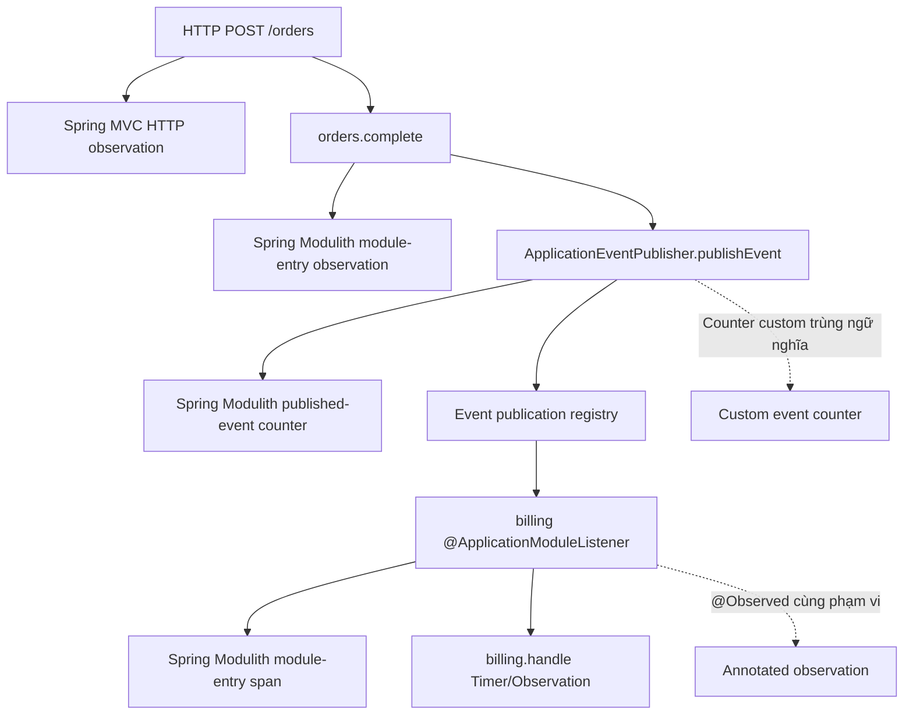
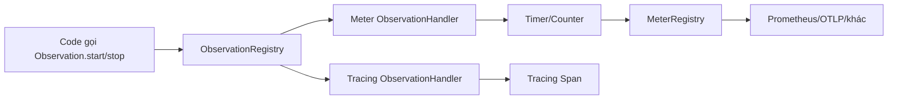
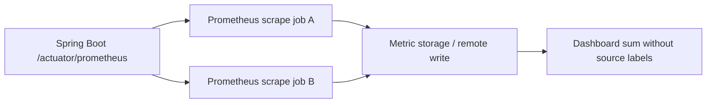

# Metric xuất hiện nhiều lần do instrument trùng

## 1. Bối cảnh và mục tiêu chẩn đoán

Ứng dụng Spring Boot sử dụng **Spring Modulith** để biểu diễn các application module, công bố ranh giới tương tác và quan sát hành vi chạy thực tế. Một nhóm phát triển bổ sung Actuator, Micrometer metrics, tracing, module entry spans và đo lường sự kiện nghiệp vụ. Sau khi triển khai, dashboard ghi nhận **hai lần phát sự kiện** cho mỗi đơn hàng được tạo, hoặc timer báo số lượt xử lý gấp đôi số request thực tế.

Đây là tình huống của chương **Chẩn đoán lỗi** trong học phần **SPRING_MODULITH_DOCUMENTATION_OBSERVABILITY**. Phạm vi học phần là sinh tài liệu/module graph, quan sát Actuator, event metrics, tracing và context propagation. Bài này đi sâu vào vấn đề: **metric xuất hiện nhiều lần do gắn instrument trùng**, và cách tìm nguồn đếm trùng trước khi sửa kiến trúc hoặc cấu hình monitoring.

Sau bài học, bạn có thể:

- Phân biệt **meter**, **time series**, **observation**, **span** và một **lần thực thi nghiệp vụ**.
- Phân biệt **một meter bị increment hai lần trong ứng dụng** với **một metric bị scrape hai lần** hoặc **các series hợp lệ khác nhau về tag**.
- Kiểm tra đúng vị trí phát sinh số liệu bằng `MeterRegistry`, `/actuator/metrics`, `/actuator/prometheus`, PromQL và trace/log.
- Tìm các chồng chéo như Spring Boot auto instrumentation + `@Observed`, Spring Modulith event metrics + counter tự viết, nhiều aspect/handler, hoặc duplicate scrape targets.
- Chọn một nguồn instrument làm chủ cho mỗi phép đo và viết kiểm thử để ngăn số liệu bị đếm trùng sau khi nâng cấp.

> **Nguyên tắc:** trước khi xóa một instrumentation, phải xác định metric đó đo *lượt phát*, *lượt nhận*, *lượt xử lý*, *lượt thử lại* hay *request HTTP*. Hai metric có tên gần giống nhau không mặc nhiên là cùng một dữ liệu nghiệp vụ.

## 2. Mô hình sự cố: một hành vi nhưng nhiều điểm instrument

Giả sử hai application module:

- `orders` phát `OrderCompleted` sau khi xác nhận đơn hàng.
- `billing` nhận sự kiện qua `@ApplicationModuleListener` để tạo bản chiếu lập hóa đơn.

Luồng thành công có thể tạo nhiều tín hiệu quan sát hợp lệ:



`A`, `M`, `S` và `B` có thể cùng tồn tại hợp lệ vì quan sát **những thao tác khác nhau**. Nhưng nếu `C` và `D` cùng ghi số “event đã phát” vào **cùng một metric identity** thì một lần phát có thể khiến counter tăng hai đơn vị. Tương tự, nếu `B` và `N` cùng tạo observation cho **chính một phạm vi** và cùng tên/tag, số lần quan sát có thể tăng hai.

Trong các ứng dụng thực tế, việc “metric bị nhân đôi” có thể xuất hiện do cấu hình backend, cách biểu diễn histogram/timer hoặc retry nghiệp vụ chứ không phải do trùng mã instrument.

### 2.1. Năm dạng “trùng” cần phân biệt

| Dạng | Hiện tượng | Bản chất |
|---|---|---|
| **Đếm trùng trong cùng một meter** | Một event thật làm counter tăng 2 thay vì 1 | Hai đường gọi `increment()`/record cùng meter identity |
| **Hai meter/series khác tag** | Cùng tên metric có hai bộ tag khác nhau | Có thể là phân nhóm hợp lệ hoặc instrument thêm tag không nhất quán |
| **Hai observation/span bao cùng công việc** | Một method sinh hai span gần giống nhau | Aspect/annotation và auto instrumentation cùng quan sát method |
| **Thu thập trùng** | Một exporter được scrape bởi hai job/target hoặc gửi tới hai tuyến thu nhận | Metric nguồn đúng, hệ thống thu thập/aggregate trùng |
| **Thực thi lặp thật** | Listener chạy 2 lần, cả hai được đo | Do retry/resubmit, hai listener hoặc publish hai lần; metric có thể hoàn toàn đúng |

Đặt giả thuyết đúng sẽ giúp tránh “sửa metric” trong khi lỗi thực sự nằm ở việc phát sự kiện hai lần hoặc ngược lại.

## 3. Từ Observation đến Meter và time series

### 3.1. Một observation có thể sinh nhiều tín hiệu

Micrometer Observation là API quan sát một hoạt động. `ObservationRegistry` điều phối `ObservationHandler` để sinh metric, span và các tín hiệu khác:



Spring Boot Actuator có thể đăng ký `DefaultMeterObservationHandler` để biến một Observation đã hoàn tất thành Timer. Tracing bridge giúp tạo span cho cùng observation. Điều này **không phải** tự nó là “đo trùng”: một observation được chuyển thành metric **và** span là điều bình thường.

Ví dụ:

```java
Observation.createNotStarted("billing.invoice.generate", observationRegistry)
    .lowCardinalityKeyValue("module", "billing")
    .observe(() -> generateInvoice());
```

Với handler đo metric, một lượt hoàn tất thường ghi **một phép đo thời gian** vào Timer `billing.invoice.generate`. Nếu một đoạn mã khác còn gọi `Timer.record(...)` cho **cùng thao tác** và **cùng tên/tag**, timer có thể tăng `count` thêm một lần nữa.

**Khác biệt quan trọng:** Timer tự có số lần đo (`count`) bên cạnh tổng thời gian (`totalTime`). Không cần tạo một Counter nữa chỉ để đếm lại số lượt Timer đã ghi.

### 3.2. Meter identity không phải chỉ là tên

Trong Micrometer, một meter được xác định bởi thông tin định danh, quan trọng nhất là **name** và **tags**; trong một registry, phép đăng ký trùng định danh thường trả về meter đã có thay vì sinh ra hai meter độc lập.

Ví dụ:

```text
invoice.process{module="billing", outcome="success"}  count=10
invoice.process{module="billing", outcome="error"}    count=2
```

Đây là **hai time series hợp lệ**, khác tag `outcome`. Khi lọc chỉ theo tên `invoice.process`, Actuator có thể tổng hợp số đo từ nhiều meter. Do đó thấy một tên metric ứng với nhiều series **không chứng minh lỗi**.

Nếu một ứng dụng gọi hai lần `registry.counter("orders.events", "type", "OrderCompleted").increment()` cho cùng một event, cả hai lời gọi thường tác động **cùng meter**. Khi đó tra danh sách meter vẫn có thể chỉ thấy một meter, nhưng giá trị đã bị đếm 2.

### 3.3. Dữ liệu Prometheus có các suffix kỹ thuật

Một Timer được xuất sang Prometheus có thể xuất hiện với các series như:

```text
billing_invoice_generate_seconds_count
billing_invoice_generate_seconds_sum
billing_invoice_generate_seconds_max
billing_invoice_generate_seconds_bucket   # nếu đã bật histogram phù hợp
```

Những suffix này đại diện cho các thống kê của **một phép đo thời gian**, không phải bốn lần instrument. Một Counter mang tên Micrometer `module.events.published` có thể hiển thị theo quy ước Prometheus như `module_events_published_total`. Tên và tập label cụ thể phụ thuộc exporter, phiên bản và naming convention; hãy đối chiếu output thực tế.

Trong dashboard, không cộng `_count` với `_bucket` hoặc ghép tổng series của timer và counter để suy ra số event. `_bucket` là các bộ đếm tích lũy theo ngưỡng, không phải các lần gọi độc lập.

## 4. Spring Modulith có metric nào sẵn?

Spring Modulith cung cấp observability để xem ranh giới module, module entry spans và thống kê sự kiện. Tùy cấu hình dự án, thường dùng `spring-modulith-starter-insight` hoặc `spring-modulith-observability-core` kết hợp hạ tầng Spring Boot Actuator, Micrometer và exporter.

Tài liệu Spring Modulith mô tả **hai dạng counter về domain event đã phát**:

| Meter name ở Micrometer | Ý nghĩa | Tags đáng chú ý |
|---|---|---|
| `module.events.published` | Tổng lượt domain event được phát theo nguồn | `module.event.type`, `module.identifier`, `module.name` |
| `module.events.published.<moduleIdentifier>.<simpleEventTypeName>` | Counter chuyên biệt theo module và loại event | `module.identifier`, `module.name`; có thể bổ sung tags có kiểm soát |

Hai loại counter được Spring Modulith chủ đích cung cấp để xem một sự kiện ở **hai mức tổng hợp**. Chúng **không** đại diện cho hai lần phát cùng event. Đừng cộng tổng của hai nhóm này rồi kết luận số event tăng gấp đôi.

Ngoài metrics, Modulith có thể tạo **module entry spans** cho tương tác đi qua module API hoặc event listener. Span cho biết method nào được chạy, với các thuộc tính như `module.identifier`, `module.invocation-type` và `module.method`. Span này **không tự xác nhận** rằng event publication đã được ghi nhận hoàn tất trong registry.

Trong hệ thống có event publication registry, các bản ghi trạng thái như `PUBLISHED`, `PROCESSING`, `FAILED`, `COMPLETED` (trên Spring Modulith 2.x phù hợp) giúp quan sát vòng đời từng listener. Registry là nguồn dữ liệu khác với **counter đếm event được phát**.

### 4.1. Đừng nhầm “thêm dependency” với “đăng ký instrument hai lần”

Nếu `spring-modulith-starter-insight` đã kéo theo thư viện observability, việc khai báo thêm cùng artifact qua dependency manager **thường chỉ tạo một bản thư viện** trên classpath. Điều đó tự nó chưa chứng minh aspect hoặc handler chạy hai lần.

Chỉ kết luận trùng instrumentation khi có bằng chứng như:

- Hai bean/aspect/`ObservationHandler` thực sự cùng ghi đo lường vào một `MeterRegistry`.
- Một class tự gọi counter cùng ngữ nghĩa với counter auto.
- Một method được auto instrument lại còn bật annotation quan sát hoặc aspect tùy biến đo cùng thao tác.
- Một cấu hình telemetry/exporter/scrape ghi số liệu giống nhau vào cùng nơi nhận.

Cần kiểm tra **đối tượng runtime** và kết quả đếm cho một ca kiểm soát, không chỉ nhìn tên dependency.

## 5. Tình huống 1: Spring Modulith counter và counter tự viết

Giả sử `orders` phát `OrderCompleted`. Spring Modulith đã theo dõi `module.events.published`, nhưng nhóm phát triển thêm một listener phụ chỉ để tăng chính metric tổng này.

```java
@Component
class RedundantOrderEventCounter {

    private final MeterRegistry meters;

    RedundantOrderEventCounter(MeterRegistry meters) {
        this.meters = meters;
    }

    @EventListener
    void on(OrderCompleted event) {
        Counter.builder("module.events.published")
            .tag("module.event.type", "OrderCompleted")
            .tag("module.identifier", "orders")
            .tag("module.name", "Orders")
            .register(meters)
            .increment();
    }
}
```

Nếu tags khớp chính xác với meter đã có, counter auto và counter tùy biến có thể tăng vào **cùng một series**. Nếu tags không khớp, chúng tạo **hai series khác nhau**, nhưng đều tuyên bố đo “event đã phát”, gây sai khi aggregate. Tên `module.name` và tags trong ví dụ chỉ mang tính minh họa, phải xem giá trị thực do Spring Modulith xuất ra.

**Cách sửa:** bỏ `RedundantOrderEventCounter` nếu chỉ muốn đếm domain event đã phát. Dùng counter Spring Modulith làm nguồn mặc định. Nếu muốn theo dõi số event **xử lý thành công**, hãy định nghĩa metric riêng với ngữ nghĩa khác, ví dụ:

```text
billing.order.completed.handled{outcome="success"}
billing.order.completed.handled{outcome="error"}
```

Không được lấy counter `module.events.published` làm số listener hoàn tất. Một event có thể có nhiều listener, retry, hoặc bị từ chối do lỗi.

### 5.1. Tùy biến metric sẵn có thay vì tạo counter bản sao

Spring Modulith hỗ trợ `ModulithEventMetricsCustomizer` để bổ sung tag cho metric event chuyên biệt. Chỉ dùng tag có tập giá trị **hữu hạn, nhỏ và ổn định**, ví dụ `channel=web|mobile|batch`.

Không đưa `orderId`, `eventId`, email hoặc trace ID làm tag metric: số series có thể tăng theo từng event, khiến metric “xuất hiện hàng nghìn lần” dù không có instrument trùng. Những định danh chi tiết thuộc structured log hoặc trace attribute và cần được xử lý theo quy tắc bảo mật.

## 6. Tình huống 2: `@Observed`/`@Timed` và auto instrumentation chồng nhau

Spring Boot có nhiều auto instrumentation: Spring MVC, WebClient/RestClient, Spring Data Repository, task executor, v.v. Spring Boot cũng hỗ trợ quan sát annotation (`@Observed`, `@Timed`, `@Counted`, `@NewSpan`) khi tính năng annotation được bật và có AOP phù hợp.

Một ví dụ nguy cơ:

```java
@RestController
class OrderController {

    @PostMapping("/orders/{id}/complete")
    @Observed(name = "http.server.requests") // Sai: trùng phạm vi request
    void complete(@PathVariable UUID id) {
        orders.complete(id);
    }
}
```

Spring MVC đã tự quan sát HTTP request trong cấu hình phổ biến. Gắn `@Observed` vào controller để quan sát lại cùng request có thể tạo **observation khác** ngoài observation của web server. Nếu tên, tags và phép đo trùng nhau, một số truy vấn có thể đếm chồng; nếu tag khác nhau, vẫn có thể thấy hai span/timer cho một request.

**Ưu tiên:** dùng auto observation cho HTTP và chỉnh tên/tags bằng `ServerRequestObservationConvention` hoặc cấu hình Spring Boot khi muốn thay đổi số liệu. Chỉ dùng `@Observed` cho hoạt động nghiệp vụ riêng, chẳng hạn `invoice.generate`, khi bạn thật sự cần một phép đo khác với thời gian HTTP.

Với Spring Modulith, một method thuộc module API có thể đã có module entry span. Nếu gắn `@Observed` cho cùng method, có thể thấy cả span module và span annotation. Đây không phải lỗi bắt buộc nếu mỗi span phục vụ mục đích khác nhau, nhưng phải ghi rõ phạm vi; không đặt chúng cùng một metric identity chỉ để “đếm số lần method được gọi”.

### 6.1. Mẫu instrument thủ công có ngữ nghĩa riêng

```java
@Component
public class BillingEventListener {

    private final ObservationRegistry observations;
    private final BillingService billing;

    public BillingEventListener(
            ObservationRegistry observations,
            BillingService billing) {
        this.observations = observations;
        this.billing = billing;
    }

    @ApplicationModuleListener
    public void on(OrderCompleted event) {
        Observation observation =
            Observation.createNotStarted("billing.order-completed.handle",
                                         observations)
                .lowCardinalityKeyValue("module", "billing")
                .lowCardinalityKeyValue("event.type", "OrderCompleted")
                .start();
        try (Observation.Scope ignored = observation.openScope()) {
            billing.applyOnce(event.eventId(), event.orderId());
        } catch (RuntimeException error) {
            observation.error(error);
            throw error;
        } finally {
            observation.stop();
        }
    }
}
```

Ví dụ sử dụng `@ApplicationModuleListener` của Spring Modulith và Micrometer Observation. Nó đo **thân method listener**, không tự nói rằng transaction bên ngoài đã commit. Đặc biệt, khi listener lỗi và được retry, mỗi **lượt thử** sẽ có một phép đo riêng: đó là dữ liệu có ý nghĩa và không phải instrument trùng.

Nếu dự án đã bật một observation cùng tên, cùng scope tại cùng method bằng annotation/AOP, **loại bỏ một trong hai lớp**. Giữ `Observation` để đo thời gian và sinh tracing/metric theo handler, không đồng thời tạo thêm `Timer` hoặc `Counter` trùng nghĩa cho cùng phép đo.

### 6.2. Kiểm tra cấu hình annotation và handler

Trong dự án sử dụng Spring Boot phiên bản hỗ trợ annotation observation, ví dụ:

```properties
management.observations.annotations.enabled=true
```

Nếu cấu hình này được bật, rà soát `@Observed`/`@Timed`/`@Counted` trên controller, repository, method module API và listener. Đặc biệt xem cấu hình aspect do ứng dụng tự khai báo có đang instrument những method này lần nữa hay không.

Spring Boot đã tự đăng ký meter observation handler trong cấu hình phổ biến. Nếu ứng dụng lại đăng ký một `DefaultMeterObservationHandler` khác trên **cùng ObservationRegistry/MeterRegistry**, phải xác minh xem mỗi observation có bị ghi nhiều lần hay không. Tránh tạo hai handler chỉ để “bật đồng thời metrics và tracing”: tracing có handler riêng.

## 7. Tình huống 3: meter được thu thập hoặc cộng gộp nhiều lần

Metric trong process có thể hoàn toàn đúng nhưng dashboard vẫn tăng gấp đôi do pipeline:



Ví dụ cùng một pod được thu thập bởi cả `ServiceMonitor` và một `scrape_config` thủ công; hoặc hai Prometheus độc lập cùng remote-write vào nơi nhận và query gom mà không kiểm soát replica labels.

Phân tích phải dựa trên các nhãn `job`, `instance`, `pod`, `namespace`, cluster/replica và cấu hình remote write thực tế:

- Nếu một exporter hiển thị **count = 1**, mà dashboard cho **2**, tìm lỗi ở scrape/routing/aggregation.
- Nếu exporter đã hiển thị **count = 2** sau một sự kiện duy nhất, kiểm tra instrument hoặc event execution ở ứng dụng trước.
- Nếu có **hai instance độc lập**, tổng count bằng 2 có thể đúng nếu mỗi instance đã xử lý một event; cần kiểm tra ID event và mức aggregation mong muốn.

`CompositeMeterRegistry` có thể gửi một metric sang nhiều backend một cách chủ đích; đó không tự động là lỗi. Lỗi chỉ xảy ra khi kết quả từ nhiều tuyến bị **nhập lại và đếm hai lần** như thể chúng là các phép đo độc lập.

## 8. Quy trình chẩn đoán từng bước

### Bước 1: Đặt định nghĩa “một lần” và tạo ca tái hiện

Chọn một thao tác có danh tính rõ ràng, ví dụ `OrderCompleted(eventId=...)` được publisher gọi đúng một lần. Xác nhận:

1. Publisher được gọi một lần; transaction của publisher có commit.
2. Có bao nhiêu listener đăng ký và listener nào chạy.
3. Có retry/resubmit, scheduler, message broker redelivery hoặc gọi HTTP lặp lại hay không.
4. Đo số liệu **delta trước/sau**, không chỉ nhìn số counter tuyệt đối vốn đã tăng từ trước.

Sử dụng `eventId` ở log hoặc trace để tìm mọi lượt xử lý cùng event. Nếu event thực sự phát hai lần, việc counter tăng hai có thể đúng; sửa nơi phát/truyền event hoặc thiết kế idempotency tùy nguyên nhân.

### Bước 2: Xem meter ngay trong ứng dụng qua Actuator

Spring Boot Actuator cung cấp endpoint `/actuator/metrics` để kiểm tra meter name và thống kê. Trong môi trường kiểm thử, nếu đã expose endpoint và có quyền:

```bash
curl -sS http://localhost:8080/actuator/metrics
curl -sS http://localhost:8080/actuator/metrics/module.events.published
curl -sS "http://localhost:8080/actuator/metrics/module.events.published?tag=module.identifier:orders"
```

Endpoint nhận **tên Micrometer dạng chấm**, không phải tên chuyển đổi của Prometheus. Nếu khác tên do customization, lấy tên thực tế từ danh sách đầu tiên.

Lưu ý rằng endpoint này có thể trả số đo **tổng hợp từ các meter cùng tên**, và nhiều bộ tag có thể cùng tham gia. Dùng tham số `tag=key:value` để khoanh đúng series; nhìn phần `availableTags` để biết còn phân nhóm nào. Không kết luận trùng chỉ vì endpoint trả một tổng.

Actuator endpoint mặc định có thể chưa expose ra HTTP và thường cần phân quyền; kiểm tra cấu hình Spring Boot và bảo vệ endpoint trước khi truy cập từ xa.

### Bước 3: Kiểm tra trực tiếp `MeterRegistry` và tags

Trong test hoặc môi trường chẩn đoán có thể dùng:

```java
import io.micrometer.core.instrument.Meter;
import io.micrometer.core.instrument.MeterRegistry;
import org.slf4j.Logger;
import org.slf4j.LoggerFactory;

public final class MeterInspector {

    private static final Logger log = LoggerFactory.getLogger(MeterInspector.class);

    public static void inspectEventMetrics(MeterRegistry registry) {
        registry.getMeters().stream()
            .filter(m -> m.getId().getName().startsWith("module.events.published"))
            .forEach(m -> {
                Meter.Id id = m.getId();
                log.info("name={}, type={}, tags={}",
                    id.getName(), id.getType(), id.getTags());
                m.measure().forEach(measurement ->
                    log.info("measurement={} value={}",
                        measurement.getStatistic(), measurement.getValue()));
            });
    }
}
```

Kết quả giúp xác định:

- Có những meter **khác tag** nào dưới cùng tên.
- Một meter là `COUNTER` hay `TIMER` và mỗi statistic có ý nghĩa gì.
- Instrument đã ghi số liệu trong process hay chưa.

**Giới hạn quan trọng:** thấy đúng **một** `Meter.Id` không chứng minh chỉ có một chỗ `increment()`. Micrometer có thể tái sử dụng meter cùng identity. Muốn truy nguồn, cần kiểm tra mã và lời gọi ghi nhận metric/observation.

Không đặt chức năng dump mọi meter vào hot path production: số lượng meter có thể rất lớn, thông tin tag có thể mang giá trị nội bộ, và việc log liên tục tạo overhead.

### Bước 4: Kiểm tra exporter trước khi kiểm tra Prometheus query

Nếu dùng Prometheus registry:

```bash
curl -sS http://localhost:8080/actuator/prometheus \
  | grep -E 'module_events_published|billing_order_completed_handle'
```

Đọc raw output để xác nhận giá trị ngay tại exporter, đặc biệt sau một event kiểm soát. Với timer, xem `_count` và `_sum`, không cộng chúng. Với histogram, mỗi bucket có diễn giải riêng.

Số liệu raw chỉ là một snapshot; Counter là tích lũy từ khi process/registry bắt đầu. Khi kiểm thử nhiều lượt, đọc giá trị *trước* và *sau*, không kỳ vọng sau mỗi thao tác tổng tuyệt đối luôn bằng 1.

### Bước 5: Xem các series và cấu hình scrape

Ví dụ truy vấn **minh họa** cho Prometheus, giả định exporter tạo tên `module_events_published_total`:

```promql
module_events_published_total
```

Quan sát nhãn `job`, `instance` và nhãn module. Để xem tốc độ theo nguồn trong một khoảng ổn định:

```promql
sum by (job, instance) (
  rate(module_events_published_total[5m])
)
```

Nếu dashboard đang dùng:

```promql
sum(rate(module_events_published_total[5m]))
```

thì tổng này bao gồm **mọi series** khớp metric name; khi hai scrape jobs ghi cùng dữ liệu mà có nhãn khác, tổng có thể tăng gấp đôi. Cần lọc nguồn/cấu hình scrape phù hợp với mục tiêu, thay vì chia số liệu cho 2.

Đối chiếu danh sách Targets và scrape config trong Prometheus, `ServiceMonitor`/`PodMonitor` nếu chạy trên Kubernetes, remote-write pipeline và chính sách replica/dedup của hệ thống lưu trữ. Không loại bỏ các replica thật chỉ để làm đồ thị nhỏ hơn: phải xác định số bản sao được tính theo định nghĩa SLI.

### Bước 6: Rà soát các nơi có thể tạo instrumentation

Tìm trong **mã nguồn dự án của chính bạn** những dấu hiệu sau (ví dụ lệnh chỉ để người đọc áp dụng; bài học không giả định tên folder nào của dự án):

```bash
rg '@Observed|@Timed|@Counted|@NewSpan' src
rg 'Observation\.createNotStarted|Observation\.start|Timer\.builder|Counter\.builder' src
rg 'increment\(|record\(' src
rg 'DefaultMeterObservationHandler|ObservationHandler|ObservationRegistry' src
rg 'module.events.published|ModulithEventMetricsCustomizer' src
```

Khi có auto instrumentation, rà soát cấu hình Spring Boot/Modulith và điểm tạo aspect. Với mỗi metric nghi trùng, xác định *chính xác* một owner. Lập bảng tối thiểu:

| Metric/nhóm tín hiệu | Owner | Đo gì? | Có chồng phạm vi? |
|---|---|---|---|
| `http.server.requests` | Spring Boot Web server observation | Một HTTP server request | Kiểm tra `@Observed` tại controller |
| `module.events.published` | Spring Modulith | Một lần publish domain event | Kiểm tra counter thủ công cùng ngữ nghĩa |
| Module entry span | Spring Modulith Observability | Một lời gọi đi qua module API/listener | Kiểm tra aspect/`@Observed` trùng phạm vi |
| `billing.order-completed.handle` | Ứng dụng `billing` | Một lượt xử lý listener | Kiểm tra Timer/Observation ghi hai lần |
| `spring.data.repository.invocations` | Spring Data/Boot | Một lượt gọi repository | Kiểm tra `@Timed` custom đo cùng method |

### Bước 7: Chọn cách sửa dựa trên bằng chứng

Không tắt toàn bộ instrumentation để “giảm số metric”. Chọn sửa ở lớp gây vấn đề:

| Nguồn gốc | Sửa tại đâu | Sau sửa cần xác minh |
|---|---|---|
| Counter tự viết đếm lại event Spring Modulith | Xóa counter cùng ngữ nghĩa, dùng metric có sẵn | Một `publishEvent` làm counter phù hợp tăng đúng 1 |
| `@Observed` trên controller đã được Web MVC instrument | Bỏ annotation cho cùng scope; dùng convention để bổ sung tags nếu cần | Một HTTP request được đo theo ý đồ và còn trace hữu ích |
| `@Observed` và Observation thủ công cùng bao listener | Giữ một lớp quan sát với tên/phạm vi rõ ràng | Một lần listener chạy sinh số phép đo dự kiến |
| Đăng ký handler đo metric nhiều lần | Giữ một meter observation handler thích hợp trong registry | Mỗi Observation hoàn tất ghi một đo lường |
| `Timer` và Counter cùng đo số lượt method | Dùng `Timer.count`, hoặc đặt counter cho một sự kiện khác có nghĩa | Không cộng hai lần “số lượt xử lý” |
| Hai scrape jobs tới cùng exporter | Điều chỉnh discovery/scrape hoặc dedup đúng thiết kế | Raw exporter không đổi; query backend về mức đúng |
| Event publish/retry thật hai lần | Sửa publisher hoặc xử lý idempotency; đo riêng attempts | Log/registry chỉ rõ mỗi event và lần thử |
| Tags khác nhau không có chủ ý | Thống nhất convention/low-cardinality tags | Series được phân nhóm đúng, không mất chiều phân tích cần thiết |

## 9. Ví dụ tái hiện: một Meter.Id nhưng bị increment hai lần

Đây là ví dụ **tối giản, có thể chạy với Micrometer và JUnit 5** để chứng minh hai đoạn instrument cùng ID thường ghi vào một counter. Nó không phụ thuộc Spring Modulith; dùng để giải thích cơ chế Micrometer.

```java
import static org.junit.jupiter.api.Assertions.assertEquals;
import static org.junit.jupiter.api.Assertions.assertSame;

import io.micrometer.core.instrument.Counter;
import io.micrometer.core.instrument.simple.SimpleMeterRegistry;
import org.junit.jupiter.api.Test;

class DuplicateInstrumentationTest {

    @Test
    void twoInstrumentersCanIncrementTheSameMeter() {
        try (SimpleMeterRegistry registry = new SimpleMeterRegistry()) {
            Counter fromFramework = Counter.builder("demo.orders.published")
                .tag("event.type", "OrderCompleted")
                .register(registry);

            Counter fromCustomListener = Counter.builder("demo.orders.published")
                .tag("event.type", "OrderCompleted")
                .register(registry);

            // Cùng name + tags được tái sử dụng trong một registry.
            assertSame(fromFramework, fromCustomListener);
            assertEquals(1, registry.getMeters().size());

            // Mô phỏng hai đường instrument cho một lần phát event.
            fromFramework.increment();
            fromCustomListener.increment();

            assertEquals(2.0, fromFramework.count(), 0.00001);
        }
    }
}
```

**Giải thích:** bảng meter có đúng một phần tử; tuy nhiên counter vẫn có `count=2`. Bởi vậy, chỉ đếm số series hoặc kiểm tra “có một meter” là chưa đủ để loại trừ instrument trùng.

Sau khi bỏ đường instrument thủ công thứ hai:

```java
fromFramework.increment();
// Không gọi fromCustomListener.increment() cho cùng event.
assertEquals(1.0, fromFramework.count(), 0.00001);
```

Đoạn thứ hai minh họa cách sửa nếu chạy ở một bài test riêng/registry mới; không thay thế assertion `count=2` trong test đầu bằng assertion `count=1` trên chính registry đã tăng hai lần.

### 9.1. Kiểm thử tích hợp trên Spring Modulith

Tạo một test theo module hoặc `@SpringBootTest` có `MeterRegistry` được cấu hình thực sự dùng cho observation. Không nên khẳng định rằng test với `ObservationRegistry` rỗng chắc chắn sinh metric: phải có meter observation handler hoặc Spring Boot auto configuration thích hợp.

Kịch bản kiểm thử khuyến nghị:

1. Đọc số counter `module.events.published` tại **một bộ tags cụ thể** trước khi phát event.
2. Phát một `OrderCompleted` với `eventId` duy nhất và xác nhận publisher được gọi một lần.
3. Đọc lại counter và assert delta bằng 1 trong **test không có publish khác xen vào**. Với ứng dụng có xử lý async/batch nền, cần cách ly hoặc dùng metric test riêng.
4. Nếu có listener, đo riêng số lượt listener chạy và `event publication registry`: chúng có thể khác số publish nếu có retry hoặc nhiều subscriber.
5. Thêm một instrument thủ công trong cấu hình test để tái tạo delta 2; loại bỏ nó và chạy lại để xác nhận sửa đúng nguyên nhân.
6. Nếu mục tiêu là trace/spans, assert số observation thuộc đúng scope/tên và span parent-child tương ứng, không dựa vào số HTTP requests làm số module invocations.

Với Spring Modulith, `@ApplicationModuleTest` có thể hữu ích khi chỉ muốn kiểm tra module `orders` hoặc `billing`; phạm vi bean được nạp quyết định những listener/aspect nào có mặt, nên so kết quả với cấu hình production trước khi kết luận.

### 9.2. Tránh sai lệch do test và registry

- Không dùng counter tích lũy từ các test trước nếu đang chia sẻ `ApplicationContext`/registry.
- Không chạy test đo “đúng một event” song song với job định kỳ đang phát event cùng tag.
- Không trộn tên đã đổi theo naming convention của Prometheus với tên gốc của Micrometer khi dùng API `MeterRegistry.find(...)`.
- Nếu metric được tạo lười ở lần thực thi đầu, counter có thể chưa tồn tại trước khi phát event; dùng giá trị 0 làm baseline khi việc thiếu meter là hợp lệ, và lấy cùng bộ tags sau đó.
- Không dựa trên thứ tự các span/traces đã export trong bài test async nếu chưa chờ đúng điều kiện hoàn tất.

## 10. Cách nhận biết số metric bất thường khi vận hành

### 10.1. Triệu chứng: số `module.events.published` cao gấp đôi log publisher

Có ba giả thuyết ưu tiên:

1. Publisher thực sự gọi hai lần, event lặp theo retry/HTTP request lặp.
2. Counter thủ công hoặc aspect tự viết ghi cùng ngữ nghĩa với metric auto.
3. Hệ thống metrics thu thập cùng counter hai lần.

**Bằng chứng phân biệt:** so số `publishEvent` thật theo `eventId`, delta tại `MeterRegistry` hoặc Actuator, raw exporter, rồi query backend. Đi từ gần ứng dụng ra bên ngoài giúp khoanh lỗi.

### 10.2. Triệu chứng: hai span giống nhau cho một module method

Kiểm tra module entry span của Spring Modulith và annotation `@Observed`/`@NewSpan`, AOP advice và manual observation. Hai span có thể là cha/con hợp lệ nếu đo hai lớp công việc khác nhau. Nếu thật sự quan sát cùng một khối code với tên và thuộc tính giống nhau, giữ một lớp.

Trace sampling và context propagation khiến số span được thấy **không nhất thiết bằng** số event hay số request. Context propagation làm thay đổi liên kết giữa các span, nhưng tự nó không phải cơ chế counter increment.

### 10.3. Triệu chứng: Timer count tăng 2, nhưng counter sự kiện chỉ tăng 1

Nếu Timer đo thời gian listener, còn counter đo số event **được phát**, hai giá trị đang đo hai hoạt động khác nhau. Listener có thể retry hoặc nhiều listener cùng nhận một event; kiểm tra số lượt method chạy. Nếu thực tế chỉ có một lượt, rà soát Timer manual + `@Observed` trên cùng scope hoặc hai lớp advice ghi Timer.

### 10.4. Triệu chứng: chỉ một dashboard sai, bảng Actuator đúng

Khả năng cao ở nhãn series, truy vấn PromQL, việc cộng các series khác nhau về tag hoặc dữ liệu scrape/remote-write bị đưa vào hai lần. Kiểm tra dashboard query và raw exporter thay vì xóa code instrumentation mà chưa xác nhận.

### 10.5. Triệu chứng: số series tăng rất nhanh dù số event bình thường

Kiểm tra high-cardinality tags như `orderId`, `eventId` hoặc URL chứa ID. Khi mỗi sự kiện tạo một giá trị tag mới, số lượng series tăng dù mỗi event chỉ được đếm một lần. Sửa cách đặt tag, dùng giá trị có tập hữu hạn; đưa chi tiết sang log/trace. Đây là lỗi **cardinality**, không phải tăng gấp đôi số lượt ghi metric.

## 11. Checklist nghiệm thu sau sửa

| Tiêu chí | Bằng chứng cần thu thập |
|---|---|
| Một lần phát domain event chỉ được đếm một lần bởi counter tổng đã chọn | Delta `module.events.published` ở bộ tags đã xác định |
| Counter theo từng loại event không bị cộng nhầm với counter tổng | Dashboard/query thể hiện từng metric riêng |
| Một scope xử lý được quan sát đúng số lượt thực thi | Timer `count` hoặc Observation/trace theo tên scope |
| Có thể phân biệt retry với instrument trùng | Log có `eventId` và số lần thử; registry ghi nhận publication |
| Không có annotation chồng lên auto instrument ngoài ý muốn | Danh sách `@Observed`, `@Timed`, aspect/handler đã rà soát |
| Tags metric ổn định | Không dùng ID người dùng/đơn hàng/event làm low-cardinality tag |
| Pipeline monitoring không scrape cùng exporter hai lần ngoài chủ đích | Danh sách targets, labels, remote-write và query |
| Module graph/tracing vẫn hữu ích | Actuator Modulith và span tương tác module còn hiển thị đúng |
| Không mất khả năng chẩn đoán lỗi | Có metric lỗi/độ trễ rõ nghĩa, log hoặc span cho listener fail |

**Bài thực hành:** trong một ứng dụng hai module `orders` và `billing`, cố tình thêm `RedundantOrderEventCounter` vào luồng đã bật Spring Modulith observability. Phát đúng một sự kiện, thu thập delta counter tại Actuator và raw Prometheus; gỡ instrument trùng rồi so sánh. Sau đó thử cấu hình scrape hai lần và chứng minh rằng giá trị exporter không đổi trong khi truy vấn backend có thể bị nhân đôi. Cuối cùng tạo retry cho listener, xác nhận cách phân biệt **nhiều lần xử lý hợp lệ** với **đếm trùng một lần xử lý**.

Bài đạt yêu cầu khi người học xác định được lỗi nằm ở **ứng dụng**, **nhiều series**, **pipeline** hay **nghiệp vụ retry** bằng bằng chứng cụ thể; chọn đúng owner của metric và bảo toàn các quan sát cần thiết của Spring Modulith.

## 12. Tài liệu tham khảo

- [Spring Modulith – Production-ready Features](https://docs.spring.io/spring-modulith/reference/production-ready.html): module Actuator endpoint, module entry spans, metric `module.events.published` và `ModulithEventMetricsCustomizer`.
- [Spring Modulith – Working with Application Events](https://docs.spring.io/spring-modulith/reference/events.html): event listeners, publication registry, retry và trạng thái publication.
- [Spring Boot – Metrics](https://docs.spring.io/spring-boot/reference/actuator/metrics.html): metric auto-configuration, Actuator metrics endpoint, tags và sự khác nhau giữa tên meter gốc với tên exporter.
- [Spring Boot – Observability](https://docs.spring.io/spring-boot/reference/actuator/observability.html): annotation observability, sự trùng lặp khi quan sát thành phần đã có auto instrumentation.
- [Micrometer – Observation Components](https://docs.micrometer.io/micrometer/reference/observation/components.html): `ObservationRegistry`, `DefaultMeterObservationHandler`, Timer/counter/long-task timer từ Observation.
- [Micrometer – Registry](https://docs.micrometer.io/micrometer/reference/concepts/registry.html): meter registry, composite registry và meter identity.
- [Micrometer – Counters](https://docs.micrometer.io/micrometer/reference/concepts/counters.html): Counter và lý do Timer đã có số lần thực thi.
