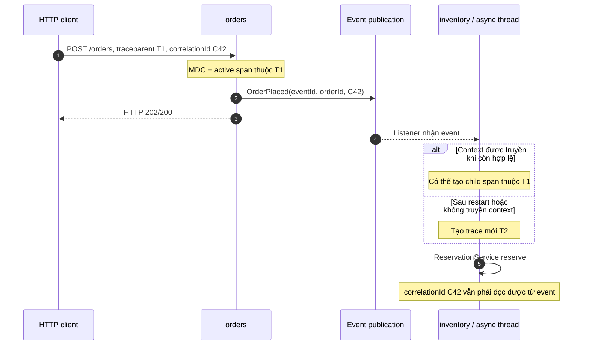
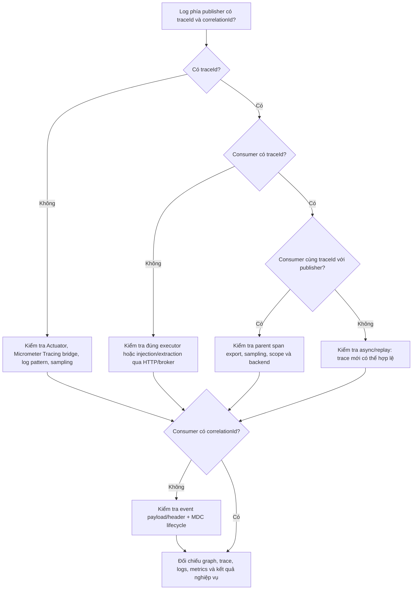

# Chẩn đoán lỗi: Trace mất parent hoặc mất correlation ID

Trong ứng dụng Spring Boot dùng **Spring Modulith**, một request có thể bắt đầu ở module `orders`, phát sự kiện `OrderPlaced` rồi được module `inventory` xử lý trên một thread khác. Khi mở hệ thống tracing, bạn thấy span của `inventory` xuất hiện như một trace riêng, thiếu parent span; trong khi log của listener đôi khi còn mất cả `correlationId`. Nếu quy mọi hiện tượng này về “tracing bị lỗi”, bạn dễ sửa nhầm cấu hình hoặc tạo quan hệ cha–con giả giữa những tác vụ không còn nằm trong cùng vòng đời.

Bài thuộc chương **Chẩn đoán lỗi** của `SPRING_MODULITH_DOCUMENTATION_OBSERVABILITY`. Bạn sẽ dùng **module graph**, **Spring Boot Actuator**, log có cấu trúc, **Micrometer Tracing**, event metrics và **context propagation** để tìm chính xác đoạn nào làm mất ngữ cảnh. Kết quả mong muốn là phân biệt được lỗi instrument, lỗi chuyển thread, lỗi truyền qua tiến trình/hàng đợi và trường hợp **trace mới là hành vi hợp lý** nhưng correlation ID nghiệp vụ vẫn phải liên tục.

## 1. Nhận diện bốn triệu chứng khác nhau

Ba định danh thường thấy trong log/traces:

- **`traceId`**: định danh toàn bộ một trace. Nhiều span thuộc cùng một trace thường chia sẻ traceId.
- **`spanId` / parent span ID**: định danh một thao tác và tham chiếu quan hệ cha–con. Span con ghi nhận parent theo trace context đang hoạt động tại thời điểm tạo.
- **`correlationId`**: định danh do ứng dụng tự quy ước để nối những bước của **cùng nghiệp vụ**, kể cả khi chúng nằm ở những trace khác nhau hoặc chạy lại sau restart.

`correlationId` không phải thuộc tính mặc định bắt buộc của W3C Trace Context. Đừng kỳ vọng Spring Boot, Micrometer hoặc Spring Modulith sẽ tự tạo, giữ và truyền nó qua mọi sự kiện nghiệp vụ nếu ứng dụng chưa thiết kế cơ chế đó.

| Triệu chứng | Quan sát điển hình | Khả năng cần kiểm tra |
|---|---|---|
| **Mất parent** | Span `inventory.reserve` có traceId nhưng là root/orphan trong giao diện | Parent chưa được export, bị sampling/drop, hoặc span được tạo ngoài scope của parent. |
| **Trace bị tách** | `orders` có traceId A, `inventory` có traceId B | Ngữ cảnh tracing không đi qua executor, broker/HTTP, hoặc đã qua một lần replay. |
| **Mất correlation ID** | `orders` ghi `correlationId=C42`; log `inventory` trống | ID chỉ nằm trong MDC/ThreadLocal, không nằm trong event/header, hoặc bị ghi đè/xóa sai. |
| **Chỉ còn correlation ID** | Hai phía cùng `C42` nhưng không có traceId hoặc có hai trace khác nhau | Thiếu tracing bridge/exporter/scope hoặc trace đã kết thúc trước khi consumer chạy. |

**Lưu ý:** Không thấy một parent trong giao diện tracing **chưa đủ** kết luận propagation hỏng. Trace backend có thể bỏ span do sampling, giới hạn lưu trữ, lỗi export hoặc dữ liệu được gửi tới tenant/service khác.

### 1.1. Khi nào cùng trace, khi nào nên là trace mới?

| Đường thực thi | Kỳ vọng có điều kiện |
|---|---|
| Các lời gọi đồng bộ trong cùng tiến trình/thread, đang ở observation scope | Có thể tạo các child span trong cùng trace nếu được instrument. |
| `@Async` / executor trong cùng JVM | Cần propagation trên **đúng executor** và context accessor tương thích; nếu thiếu có thể tạo root span mới. |
| `@ApplicationModuleListener` sau commit, chạy bất đồng bộ | Context có thể được truyền nếu được thu/phục hồi đúng thời điểm; không giả định luôn còn parent HTTP ban đầu. |
| HTTP/gRPC/broker giữa hai tiến trình | Cần injection/extraction trace context qua giao thức và instrumentation ở cả hai phía. |
| Publication được phát lại sau restart hoặc thời gian dài | Trace mới cùng correlation ID nghiệp vụ thường phù hợp; có thể liên kết qua span link nếu stack hỗ trợ. |

Đặc biệt, application module trong Modulith là **ranh giới kiến trúc mã nguồn**, không tự định nghĩa ranh giới tracing 1–1. Một cạnh trong module graph không bảo đảm phải có một span, và trace có thể vượt ra khỏi ranh giới JVM.

## 2. Tình huống tái hiện: `orders` phát event, `inventory` không còn parent

Ứng dụng minh họa có hai module:

```text
com.acme.shop
├── orders
│   ├── OrderService.java
│   └── events
│       └── OrderPlaced.java
└── inventory
    ├── InventoryEventListener.java
    └── ReservationService.java
```

`orders` publish `OrderPlaced` trong transaction. `inventory` nhận event bằng `@ApplicationModuleListener` và giữ hàng sau commit. Module graph cho phép `inventory` sử dụng một named interface `orders :: events`. Khi chạy, ta muốn kết nối được log của cùng `orderId` và `correlationId`; còn quan hệ parent span phụ thuộc **vòng đời trace và đường truyền context thực tế**.



Trong sự kiện bất đồng bộ, **phần chắc chắn cần giữ qua retry** là thông tin nghiệp vụ đủ để nhận diện event và correlation. Trace context có thể truyền được ở lần chạy thông thường nhưng không thể coi là thay thế cho một định danh nghiệp vụ bền vững.

## 3. Quy trình chẩn đoán theo bằng chứng

Trước khi sửa mã, chọn **một yêu cầu tái hiện được**; ghi lại `orderId`, `eventId`, `correlationId`, mốc thời gian và tên module. Bắt đầu từ nơi tín hiệu đầu tiên còn đầy đủ rồi theo dấu tới điểm bị mất.

### 3.1. Bốn câu hỏi quyết định



Câu hỏi quan trọng nhất: **ID bị mất ở điểm nào?** Không đặt giả thuyết “listener lỗi” chỉ từ trace viewer; cần xem log trước và sau từng biên (HTTP ingress, publisher, executor submit, executor run, consumer, retry).

### 3.2. Ma trận kiểm tra theo từng biên

| Điểm đo | Ghi nhận tối thiểu | Nếu thiếu, kiểm tra |
|---|---|---|
| HTTP ingress | `traceId`, `spanId`, header `X-Correlation-ID` sau chuẩn hóa | Server instrumentation, filter order, tracing bridge, sampling. |
| `orders` trước publish | `orderId`, `eventId`, `correlationId`, current trace | Event đã lấy ID nghiệp vụ chưa; đang ở scope nào? |
| Thời điểm submit sang executor | Context có được capture ngay lúc submit không? | Đúng executor, `TaskDecorator`, accessor cho MDC custom. |
| Đầu listener `inventory` | Thread name, trace/span hiện tại, `event.correlationId` | Đổi thread; listener đọc event hay đọc ThreadLocal? |
| Sau restart / replay | `eventId` và `correlationId` còn như cũ không? | Persistence/serialization, code tạo lại ID sai chỗ. |
| Outbound HTTP/broker | Có trace propagation headers và correlation header/payload không? | Instrumented client/broker producer; header allowlist; consumer extractor. |
| Tracing backend | Span parent có được nhận, cùng service/tenant/time range không? | Exporter, sampling, clock skew, lỗi ingest, retention. |

Để tránh lộ thông tin, chỉ ghi định danh kỹ thuật đã được kiểm soát; không đưa access token, dữ liệu khách hàng hoặc payload đầy đủ vào logs/traces.

## 4. Bật nền tảng quan sát đủ để chẩn đoán

Bài lab cần Actuator, Micrometer Observation và một tracing bridge/exporter phù hợp hệ Spring Boot đang dùng. Ví dụ các dependency Maven (phiên bản cần được quản lý qua BOM tương thích):

```xml
<dependency>
    <groupId>org.springframework.boot</groupId>
    <artifactId>spring-boot-starter-actuator</artifactId>
</dependency>
<dependency>
    <groupId>org.springframework.modulith</groupId>
    <artifactId>spring-modulith-starter-observability</artifactId>
</dependency>
<dependency>
    <groupId>io.micrometer</groupId>
    <artifactId>micrometer-tracing-bridge-otel</artifactId>
</dependency>
<dependency>
    <groupId>io.opentelemetry</groupId>
    <artifactId>opentelemetry-exporter-otlp</artifactId>
</dependency>
```

Ví dụ dùng Micrometer Tracing bridge sang OpenTelemetry; không trộn thêm bridge Brave thứ hai nếu không có lý do rõ ràng. Cấu hình OTLP exporter cụ thể phụ thuộc phiên bản Spring Boot và backend quan sát; kiểm tra startup log, dependency tree và endpoint ingest thay vì đoán dữ liệu đã đến server.

### 4.1. Cấu hình chỉ dành cho môi trường lab

```yaml
management:
  endpoints:
    web:
      exposure:
        include: health,info,metrics,applicationmodules
  tracing:
    sampling:
      probability: 1.0

logging:
  pattern:
    level: "%5p [traceId=%X{traceId:-},spanId=%X{spanId:-},correlationId=%X{correlationId:-}]"
```

`management.tracing.sampling.probability=1.0` giúp dễ nhìn đầy đủ trace trong lab; trên production cần sampling theo chi phí/SLO và chính sách bảo mật. `applicationmodules` chỉ có khi đã thêm starter Actuator của Spring Modulith tương thích và endpoint thực sự được cung cấp; thêm `spring-modulith-starter-actuator` nếu cần theo hướng dẫn phiên bản đang dùng.

Từ môi trường có quyền:

```bash
curl -i http://localhost:8080/actuator/health
curl -i http://localhost:8080/actuator/metrics
curl -i http://localhost:8080/actuator/applicationmodules
```

**Không công khai Actuator trên Internet.** Trong vận hành thật, dùng cổng quản trị/mạng nội bộ, xác thực, phân quyền và chỉ expose endpoint cần thiết. Endpoint `applicationmodules` cho biết cấu trúc module nhưng không cho thấy liệu trace context đã được truyền trong runtime.

### 4.2. Kiểm tra log pattern trước khi đi tìm span

Nếu log không có `traceId` ở cả HTTP ingress, lỗi có thể thuộc cấu hình tracing hoặc logging, chưa liên quan tới `@ApplicationModuleListener`. Nếu log có traceId nhưng backend trống, ưu tiên kiểm tra exporter/collector và sampling. Nếu backend có span nhưng log không có traceId, kiểm tra cấu hình MDC logging và thư viện bridge tương thích.

Lưu ý MDC là bộ lưu dữ liệu gắn với **thread**, không tự hiểu rằng hai thread đang xử lý cùng một giao dịch; `%X{correlationId}` chỉ in giá trị đã được đưa vào MDC hiện tại.

## 5. Tạo và lưu correlation ID ở biên HTTP

Một quy ước thực tế: nhận header `X-Correlation-ID` nếu hợp lệ; nếu thiếu/sai định dạng thì sinh ID mới. Echo ID ra response để người gọi có thể báo lỗi và đối chiếu log. **Không** dùng giá trị header tùy ý làm tên metric, đường dẫn file hoặc dữ liệu log không được chuẩn hóa.

```java
package com.acme.shop.observability;

import java.io.IOException;
import java.util.UUID;
import java.util.regex.Pattern;
import jakarta.servlet.FilterChain;
import jakarta.servlet.ServletException;
import jakarta.servlet.http.HttpServletRequest;
import jakarta.servlet.http.HttpServletResponse;
import org.slf4j.MDC;
import org.springframework.stereotype.Component;
import org.springframework.web.filter.OncePerRequestFilter;

@Component
public class CorrelationIdFilter extends OncePerRequestFilter {
    private static final Pattern ALLOWED =
        Pattern.compile("[A-Za-z0-9._-]{1,64}");

    @Override
    protected void doFilterInternal(
            HttpServletRequest request,
            HttpServletResponse response,
            FilterChain chain) throws ServletException, IOException {

        String supplied = request.getHeader("X-Correlation-ID");
        String correlationId =
            supplied != null && ALLOWED.matcher(supplied).matches()
                ? supplied
                : UUID.randomUUID().toString();

        response.setHeader("X-Correlation-ID", correlationId);

        String previous = MDC.get("correlationId");
        MDC.put("correlationId", correlationId);
        try {
            chain.doFilter(request, response);
        } finally {
            if (previous == null) {
                MDC.remove("correlationId");
            } else {
                MDC.put("correlationId", previous);
            }
        }
    }
}
```

**Phạm vi bảo đảm:** filter đặt correlation ID vào MDC cho thread đang chạy request và dọn dẹp sau khi kết thúc. Nó không đảm bảo giữ ID qua `@Async`, event listener, retry hoặc qua tiến trình khác; cũng không tự động truyền ID vào business event. Với Servlet async dispatch, cần xác minh lại filter strategy và MDC trên từng luồng; đừng giả định chỉ có một thread từ đầu tới cuối.

Nếu hệ thống cần **tin cậy** correlation ID từ một đối tác cụ thể, xác thực đầu gọi trước khi tin giá trị header; header đến từ Internet có thể bị giả mạo. Bài lab dùng format validation để ngăn đầu vào quá dài/ký tự bất thường, không phải cơ chế xác thực.

### 5.1. Mang ID qua event như một phần hợp đồng

Định nghĩa event do `orders` xuất bản:

```java
package com.acme.shop.orders.events;

import java.time.Instant;
import java.util.UUID;

public record OrderPlaced(
    UUID eventId,
    String orderId,
    String correlationId,
    Instant occurredAt) {
}
```

Publisher lấy correlation ID đã được chuẩn hóa từ **biên ứng dụng** và đưa nó vào event. Nếu `OrderService` được gọi ngoài HTTP (scheduler, CLI, broker), tầng gọi đó phải cấp một correlation ID mới hoặc chuyển ID đã có; không được giả định `MDC.get("correlationId")` luôn khác `null`.

Ví dụ phương thức application service nhận ID **tường minh**:

```java
package com.acme.shop.orders;

import com.acme.shop.orders.events.OrderPlaced;
import java.time.Clock;
import java.util.UUID;
import org.springframework.context.ApplicationEventPublisher;
import org.springframework.stereotype.Service;
import org.springframework.transaction.annotation.Transactional;

@Service
public class OrderService {
    private final ApplicationEventPublisher events;
    private final Clock clock;

    public OrderService(ApplicationEventPublisher events, Clock clock) {
        this.events = events;
        this.clock = clock;
    }

    @Transactional
    public void placeOrder(String orderId, String correlationId) {
        // TODO: validate và lưu đơn hàng bằng repository trong transaction.
        events.publishEvent(new OrderPlaced(
            UUID.randomUUID(), orderId, correlationId, clock.instant()));
    }
}
```

Ví dụ này giả định ứng dụng có bean `Clock` và transaction manager. Khi phát lại **cùng event publication**, phải giữ nguyên `eventId`/`correlationId` đã lưu, không gọi lại `placeOrder` để tạo event mới. Đặt định danh tường minh vào event giúp đối chiếu log ngay cả sau restart, trong khi trace/span context chỉ thích hợp với từng đoạn thực thi có instrument.

## 6. Khắc phục mất correlation ID trong listener

Trước hết kiểm tra **event có chứa ID hay không**. Nếu event có `correlationId` nhưng log listener không có, vấn đề có thể nằm ở MDC của thread mới.

Listener dùng `@ApplicationModuleListener` và phục hồi ID vào MDC **chỉ trong phạm vi xử lý**:

```java
package com.acme.shop.inventory;

import com.acme.shop.orders.events.OrderPlaced;
import org.slf4j.Logger;
import org.slf4j.LoggerFactory;
import org.slf4j.MDC;
import org.springframework.modulith.events.ApplicationModuleListener;
import org.springframework.stereotype.Component;

@Component
public class InventoryEventListener {
    private static final Logger log =
        LoggerFactory.getLogger(InventoryEventListener.class);

    private final ReservationService reservations;

    public InventoryEventListener(ReservationService reservations) {
        this.reservations = reservations;
    }

    @ApplicationModuleListener
    public void on(OrderPlaced event) {
        String previous = MDC.get("correlationId");
        MDC.put("correlationId", event.correlationId());

        try {
            log.info("Start eventId={} orderId={}",
                     event.eventId(), event.orderId());
            reservations.reserveOnce(event.orderId());
            log.info("Completed eventId={}", event.eventId());
        } finally {
            if (previous == null) {
                MDC.remove("correlationId");
            } else {
                MDC.put("correlationId", previous);
            }
        }
    }
}
```

`ReservationService.reserveOnce` là nghiệp vụ cần được hiện thực bằng transaction và khóa idempotency, ví dụ `UNIQUE(order_id)`; ví dụ listener này chưa gồm repository. `MDC.put` không tạo trace span hay parent span; nó chỉ làm log trong khối xử lý có correlation ID. Việc lưu và phục hồi giá trị cũ tránh rò rỉ MDC khi thread pool tái sử dụng worker thread.

Nếu sự kiện đến từ nguồn không tin cậy hoặc thiếu correlation ID, kiểm tra và chuẩn hóa tại consumer boundary; không gọi `MDC.put` với giá trị null. Event nội bộ trong ví dụ bắt buộc producer cấp ID hợp lệ.

### 6.1. Không dùng MDC làm kho dữ liệu nghiệp vụ

Không dùng `MDC.get("correlationId")` làm cơ chế duy nhất để truyền ID giữa module. MDC có thể bị mất khi chuyển thread, khi listener được gọi lại bằng event publication registry hoặc khi ứng dụng restart. **Event payload hoặc metadata bền vững** mới là nơi giữ một correlation ID cần tồn tại qua retry.

Đồng thời không dùng `correlationId` làm idempotency key nếu một correlation có thể bao gồm nhiều đơn hàng/sự kiện. Một đơn đặt hàng cần business key riêng (`orderId` hoặc reservation ID); correlation ID phục vụ điều tra.

## 7. Khắc phục mất trace parent khi đổi thread

Micrometer Observation/Tracing thường dùng **current context** gắn với thread/scope. Khi chạy `@Async`, CompletableFuture hoặc executor, context ban đầu không tự động đi theo. Một task decorator phù hợp có thể chụp và phục hồi context ở điểm giao cho executor.

Ví dụ với Spring Framework 6.1+:

```java
package com.acme.shop.observability;

import java.util.concurrent.Executor;
import org.springframework.context.annotation.Bean;
import org.springframework.context.annotation.Configuration;
import org.springframework.core.task.support.ContextPropagatingTaskDecorator;
import org.springframework.scheduling.annotation.EnableAsync;
import org.springframework.scheduling.concurrent.ThreadPoolTaskExecutor;

@Configuration
@EnableAsync
public class AsyncContextConfig {

    @Bean(name = "taskExecutor")
    public Executor taskExecutor() {
        var executor = new ThreadPoolTaskExecutor();
        executor.setCorePoolSize(4);
        executor.setMaxPoolSize(8);
        executor.setQueueCapacity(100);
        executor.setThreadNamePrefix("module-events-");
        executor.setTaskDecorator(new ContextPropagatingTaskDecorator());
        executor.initialize();
        return executor;
    }
}
```

**Ba điều phải xác nhận trước khi coi đã sửa xong:**

1. **Đúng executor:** `@ApplicationModuleListener` hoặc `@Async` thực sự chạy trên bean này? Nếu framework hoặc cấu hình ứng dụng chọn executor khác, decorator sẽ không có tác dụng.
2. **Đúng context accessor:** Micrometer Context Propagation phải có accessor cho trace/observation context cần truyền. Một khóa MDC tùy biến như `correlationId` có thể cần accessor/cơ chế riêng; decorator không mặc nhiên bảo đảm mọi MDC key của mọi hệ sinh thái.
3. **Đúng thời điểm capture:** nếu task chỉ được submit sau khi HTTP observation scope đã kết thúc, có thể không còn parent context để capture. Khi replay sau restart, dù có decorator cũng không thể khôi phục span cha đã thuộc tiến trình trước.

Decorator tăng chi phí capture/restore context. Chỉ áp dụng trên đường đi cần thiết, đo ảnh hưởng hiệu năng và xác nhận nó không giữ dữ liệu nhạy cảm ngoài vòng đời hợp lệ.

### 7.1. Tạo observation có ý nghĩa ở consumer

Nếu muốn có span/timer cho thao tác giữ hàng và ứng dụng đã cài Micrometer bridge phù hợp, có thể tạo observation ở service:

```java
package com.acme.shop.inventory;

import io.micrometer.observation.Observation;
import io.micrometer.observation.ObservationRegistry;
import org.springframework.stereotype.Service;

@Service
public class ReservationService {
    private final ObservationRegistry registry;

    public ReservationService(ObservationRegistry registry) {
        this.registry = registry;
    }

    public void reserveOnce(String orderId) {
        Observation.createNotStarted("inventory.reserve", registry)
            .lowCardinalityKeyValue("target.module", "inventory")
            .observe(() -> doReserveIdempotently(orderId));
    }

    private void doReserveIdempotently(String orderId) {
        // TODO: transaction/repository + UNIQUE(order_id).
    }
}
```

Nếu có trace context hiện hành, observation có thể tạo child span theo cấu hình. Nếu không có, nó có thể tạo span gốc trong trace mới; **việc tạo observation không tự tạo lại parent đã mất**. Spring Modulith observability có thể đã instrument một số điểm giao module; kiểm tra trace thực tế để tránh nhân đôi span ở cùng ranh giới.

Không đặt `orderId` hoặc `correlationId` vào `lowCardinalityKeyValue` của một observation xuất metrics. Nếu cần một ID cho điều tra, dùng log/trace attribute có kiểm soát và quyền truy cập phù hợp.

### 7.2. Trường hợp cùng traceId nhưng không thấy parent

Nếu traceId vẫn giống nhau, đừng vội sửa executor. Kiểm tra lần lượt:

- Parent span có được tạo/export không hay chỉ là một current context?
- Tracing sampler có ghi parent nhưng loại child, hoặc ngược lại? Có collector tail sampling hay backend drop một phần?
- Span parent đã bị retention xóa, được gửi tới backend khác, hoặc query đang lọc sai service/time range?
- Có tạo span **ngoài** observation scope, rồi gán traceId thủ công mà không truyền parent context?
- Đồng hồ máy và timestamp của span có lệch khiến giao diện không hiển thị đúng trật tự?

Cố gắng “sửa” bằng cách set cùng traceId thủ công không bảo đảm quan hệ parent hợp lệ. Hãy sửa chỗ injection/extraction hoặc scope để tracing library quyết định span relationship.

## 8. Qua HTTP, message broker hoặc Reactor

Không phải mọi mất parent đều xuất phát từ `@Async` của Spring Modulith.

| Biên truyền | Cơ chế cần có | Cách kiểm tra |
|---|---|---|
| HTTP client/server | Tracing instrumentation và header propagation (thường `traceparent`) | Xác nhận outbound header và server extraction. |
| Kafka/RabbitMQ/khác | Producer inject và consumer extract context vào header bản tin | Theo dõi metadata ở hai phía, cân nhắc replay. |
| `@Async` / `Executor` | Capture/restore context trên đúng executor | So thread name, executor bean, active span trước/sau. |
| Reactor | Context và hook/mode propagation tương thích | Kiểm tra chuỗi reactive, các scheduler và chỗ dùng blocking bridge. |
| Spring Modulith publication replay | Event metadata bền vững; trace mới hoặc span link nếu cần | So `eventId`, `correlationId` qua lần phát lại. |

### 8.1. HTTP: đừng tạo client ngoài cấu hình instrumentation

Nếu ứng dụng gọi service khác qua `RestClient`, `WebClient` hoặc client HTTP khác, hãy dùng builder/client đã được Spring Boot auto-configuration instrument phù hợp. Tạo client thủ công ngoài cấu hình có thể bỏ qua observation interceptor và không inject `traceparent`.

Ví dụ header W3C:

```text
traceparent: 00-4bf92f3577b34da6a3ce929d0e0e4736-00f067aa0ba902b7-01
```

Các thành phần là version, trace ID 16 byte, parent ID 8 byte và trace flags. **Không tự nối một header `traceparent` bằng chuỗi** trong code ứng dụng; để tracing library inject từ context hiện hành. Cần bảo đảm cả consumer có cơ chế extraction. Nếu proxy/gateway loại bỏ header, trace thường bắt đầu lại từ service đích.

### 8.2. Broker và replay

Tính toán context ở producer và lưu nó trong header bản tin chỉ có ích nếu consumer đọc lại. Một số broker/tracing SDK có sẵn instrumentation, một số cần cấu hình riêng. Khi bản tin được xử lý hàng giờ sau, parent span đã kết thúc; việc nối lại một parent cũ có thể làm trace khó đọc. Trong hệ thống yêu cầu đo thời gian của từng attempt/replay, nên tạo một trace cho lần xử lý hiện tại và dùng `eventId`/`correlationId` để liên kết, hoặc span link theo khả năng backend.

**Không lưu toàn bộ baggage/header nhạy cảm trong database event publication.** Chọn whitelist metadata cần thiết, kiểm soát kích thước và hạn lưu, và giữ correlation ID nghiệp vụ ở schema riêng khi phù hợp.

## 9. Phân biệt vấn đề tracing với lỗi giao nhận event

Một listener không có log có thể **chưa hề được gọi**. Trước khi kết luận mất parent/correlation, hãy kiểm tra event pipeline:

- `orders` có thực sự publish event trong transaction được commit không?
- `inventory` có listener nhận đúng kiểu event, đã được Spring đăng ký bean chưa?
- Event publication registry (nếu dùng persistence) có publication pending, lỗi xử lý hay resubmit không?
- Có cấu hình executor khiến tác vụ bị từ chối (queue đầy, shutdown) hoặc listener ném lỗi không?
- Application modules có cho phép `inventory` phụ thuộc vào API công khai chứa `OrderPlaced` không? `ApplicationModules.verify()` có pass không?

Một test kiến trúc minh họa:

```java
package com.acme.shop;

import org.junit.jupiter.api.Test;
import org.springframework.modulith.core.ApplicationModules;

class ModuleBoundaryTest {
    @Test
    void moduleDependenciesAreValid() {
        ApplicationModules.of(ShopApplication.class).verify();
    }
}
```

`verify()` kiểm tra **quan hệ phụ thuộc trong code**. Nó không khẳng định một event đã được tiêu thụ, một executor đã truyền trace context hay backend đã nhận span. Để xem module graph và metadata tại runtime, có thể dùng Spring Modulith Documenter và Actuator `applicationmodules` nếu dependency phù hợp đã được bật; sau đó đối chiếu với event log và trace.

### 9.1. Event metrics và trace dùng chung một ngôn ngữ

Định nghĩa các metric tùy biến có cardinality thấp:

| Metric minh họa | Đơn vị | Điều tra |
|---|---|---|
| `shop.event.listener.attempts` | Một lần listener bắt đầu | Có event được nhận/retry không? |
| `shop.event.listener.terminations` | Method trả về hoặc ném lỗi | Listener bị lỗi kỹ thuật hay chạy xong? |
| `shop.event.listener.duration` | Độ trễ mỗi attempt | Có worker chậm/hàng chờ tăng không? |
| `shop.event.publications.pending` | Snapshot publication chưa hoàn tất | Registry còn publication chưa ack không? |
| `shop.inventory.reservations.confirmed` | Business result đã commit theo orderId duy nhất | Nghiệp vụ có thực sự hoàn tất không? |

Các tên trên là **ví dụ do ứng dụng đặt**, không phải metric mặc định Spring Modulith cam kết có sẵn. Retry có thể làm attempts tăng nhiều lần trong khi một reservation chỉ được commit một lần. Việc mất trace parent **không nên làm thay đổi số nghiệp vụ hoàn thành**; phải bảo vệ state bằng transaction/idempotency thay vì dùng trace ID làm khóa nghiệp vụ.

Ví dụ log điều tra một order khi có ba attempt:

```text
10:00:01 orders     traceId=T1 correlationId=C42 eventId=E7 publish
10:00:02 inventory  traceId=T1 correlationId=C42 eventId=E7 attempt=1 error
10:00:05 inventory  traceId=T2 correlationId=C42 eventId=E7 attempt=2 committed
10:05:00 inventory  traceId=T3 correlationId=C42 eventId=E7 attempt=3 duplicate
```

`T1`, `T2`, `T3` ở đây là ký hiệu minh họa, không phải traceId chuẩn ở wire format. Cả ba attempt cùng `eventId`, cùng `correlationId` và cùng một kết quả nghiệp vụ; khác trace có thể là dấu vết của retry/replay hợp lệ.

## 10. Kế hoạch kiểm thử tái hiện và phòng hồi quy

Thực hiện trên một ứng dụng Spring Boot có Spring Modulith observability, Actuator và tracing bridge. Dùng một endpoint tạo đơn cùng event `OrderPlaced`; cho listener hoạt động qua đúng executor cấu hình.

| Mã | Kịch bản | Bằng chứng / kỳ vọng |
|---|---|---|
| TR-01 | HTTP request có `X-Correlation-ID=C42` | Response và log `orders` có `C42` đã chuẩn hóa. |
| TR-02 | Request không có header hoặc header không hợp lệ | Ứng dụng sinh ID mới, không để trống/null. |
| TR-03 | `orders` publish event rồi `inventory` xử lý async | Event có `C42`; log listener còn `C42` dù đổi thread. |
| TR-04 | Dùng executor không có propagation | Có thể thấy trace mới/mất span cha; chứng minh bằng traceId trước/sau khi submit. |
| TR-05 | Bật decorator trên **đúng** executor + accessor | Với đường đi còn active context, child span được nối theo khả năng framework. |
| TR-06 | Restart rồi resubmit cùng publication | `eventId` và `C42` được giữ; trace mới có thể hợp lệ. |
| TR-07 | Gọi service khác qua HTTP | Outbound `traceparent` và consumer extraction được kiểm tra; trace được nối khi cấu hình đúng. |
| TR-08 | Broker loại bỏ trace headers | Consumer có thể tạo trace khác; `correlationId` trong payload vẫn cho phép tìm chuỗi nghiệp vụ. |
| TR-09 | Hai request có `C42`/`C43` chạy đồng thời trên pool | Không rò rỉ ID giữa thread và request; MDC được restore/clear. |
| TR-10 | Sampling/exporter được thay đổi | Phân biệt parent không xuất hiện trong backend với lỗi propagation thực tế. |
| EVT-01 | Listener lỗi rồi retry | Attempts tăng theo lần chạy; business completed vẫn đếm theo orderId duy nhất. |
| MOD-01 | Chạy `ApplicationModules.verify()` và đối chiếu graph | Không có dependency trái ranh giới; event API được công bố. |

### 10.1. Cách ghi bằng chứng có thể so sánh

Với mỗi testcase, lưu **một dòng log của producer**, **một dòng log của consumer**, `eventId`/`correlationId`, thread name, traceId, spanId, trạng thái publication và kết quả nghiệp vụ sau commit. Kết quả quan sát cần nói rõ trace có hay không, parent span có hiển thị hay không và lý do dự kiến; không chỉ ghi “PASS/FAIL” dựa trên số lượng span.

Khi kiểm thử context propagation, cần chạy **thực sự trên thread pool hoặc cơ chế event**. Gọi trực tiếp method listener bằng unit test trong cùng thread sẽ không phát hiện lỗi ThreadLocal/MDC. Nếu kiểm thử HTTP/broker liên tiến trình, cần hai thành phần/instance độc lập và quan sát header thực tế.

### 10.2. Bài thực nghiệm: cô lập từng nguyên nhân

1. Chạy với cấu hình tracing, exporter và sampling đúng; ghi trace của `POST /orders`.
2. Tắt task decorator của executor đang dùng; đối chiếu traceId giữa publisher và consumer, đồng thời xác nhận event vẫn có correlation ID.
3. Bật lại propagation trên đúng executor; xác nhận context được truyền với đường đi thực tế, hoặc chỉ ra điểm capture xảy ra khi scope đã đóng.
4. Loại `correlationId` khỏi event trong bản lab; chứng minh log consumer mất ID sau restart/replay. Khôi phục field và kiểm thử lại.
5. Cố tình làm backend không nhận parent span (ví dụ thay đổi phạm vi query/sampling trong môi trường thử nghiệm); xác minh ứng dụng vẫn có thể truyền context mà giao diện hiển thị trace chưa đầy đủ.
6. Phát lại cùng event và đối chiếu số attempt với số reservation đã commit, để chứng minh trace ID và counter vận hành không phải khóa chống xử lý trùng.

Không đưa cấu hình bỏ propagation/giảm bảo vệ Actuator của bước thử nghiệm vào môi trường production.

## 11. Quy tắc khắc phục theo nguyên nhân gốc

| Nguyên nhân xác nhận được | Cách sửa phù hợp | Không nên làm |
|---|---|---|
| Thiếu Micrometer Tracing bridge/exporter | Bổ sung stack tracing nhất quán, xác minh ingest và MDC | Tự sinh traceId ngẫu nhiên rồi điền vào log để giả tracing. |
| Span được tạo ngoài observation scope | Tạo/quan sát span khi scope parent còn hiện hành, dùng instrumentation của framework | Gán lại parent ID thủ công bằng chuỗi. |
| `@Async` dùng executor khác | Xác định executor thực sự và gắn task decorator/context propagation vào đó | Chỉ cấu hình một bean `taskExecutor` rồi mặc định listener sẽ dùng. |
| Chưa có accessor cho custom MDC | Đăng ký propagation phù hợp hoặc giữ ID trong event; restore MDC trong listener | Tin rằng MDC luôn được truyền tự động. |
| Correlation ID chỉ có ở HTTP filter | Truyền ID tường minh qua service và event payload/metadata | Lấy lại ID từ HTTP ThreadLocal trong worker khác. |
| Broker/proxy bỏ trace headers | Bật producer injection, consumer extraction và cấu hình header forwarding | Dùng correlation ID thay cho traceparent chuẩn. |
| Replay sau restart | Chấp nhận trace mới, nối qua eventId/correlationId hoặc span link | Cố gắng phục hồi parent span đã đóng từ bộ nhớ JVM. |
| Parent không hiển thị do sampling/export | Kiểm tra tracer/sampler/collector/backend, service name và query | Chỉ sửa business code khi chưa có bằng chứng. |
| Module graph không phản ánh ranh giới | Sửa API/named interface và chạy `verify()` | Xem trace graph là bằng chứng thay cho kiểm thử kiến trúc. |
| Retry đếm thừa nghiệp vụ | Dùng durable idempotency key và transaction; tách attempt metrics | Dùng traceId/correlationId làm unique business counter. |

## 12. Checklist hoàn thành và câu hỏi ôn tập

Sau khi khắc phục, có thể chấp nhận kết quả nếu:

- Khi người dùng báo một `correlationId`, bạn truy được log từ `orders` tới `inventory`, kể cả event được retry hoặc replay sau restart.
- Khi thấy trace bị tách, bạn chỉ ra được **biên tạo trace mới** và giải thích đó là lỗi propagation hay vòng đời xử lý hợp lệ.
- Khi parent span không hiển thị, bạn kiểm tra được sampling/exporter/backend trước khi thay đổi instrument.
- Khi đổi thread, MDC được đặt lại, không rò rỉ ID của request trước và không dùng ID động làm metric tags.
- Module dependency được kiểm tra qua `ApplicationModules.verify()`, event API được công bố và tracing phản ánh các đường đi có instrument.
- Retry không làm tăng sai số **kết quả nghiệp vụ duy nhất**; attempt metrics và business metrics vẫn tách nghĩa.

Câu hỏi ôn tập:

1. Hai span có cùng traceId nhưng giao diện chỉ hiển thị một root span: bạn kiểm tra những nguyên nhân nào?
2. Vì sao `correlationId` nên tồn tại trong event payload dù đã bật `ContextPropagatingTaskDecorator`?
3. Khi listener chạy lại sau restart, vì sao traceId mới không nhất thiết là lỗi?
4. `MDC.put` có tạo span cha hoặc thiết lập trace context hay không?
5. Vì sao cấu hình decorator trên sai executor không giúp `@ApplicationModuleListener`?
6. Khi proxy gửi `X-Correlation-ID` nhưng xóa `traceparent`, log và tracing của downstream sẽ khác nhau thế nào?
7. Đếm retry theo traceId hoặc correlationId có làm đúng business metrics không? Vì sao?
8. Dùng `ApplicationModules.verify()` và `/actuator/applicationmodules` giúp điều tra phần nào của bài toán, và không kiểm tra được điều gì?
9. Nếu trace backend không thấy parent trong khi log producer/consumer ghi cùng traceId, bạn cần loại trừ những nguyên nhân nào trước khi sửa code?
10. Tại sao `orderId`, `eventId` và `correlationId` không nên là low-cardinality tags trên time-series metrics?

**Kết quả cần nhớ:** tracing cho biết **đường đi của một lần thực thi**, còn correlation ID nghiệp vụ nối **những lần thực thi có cùng ngữ cảnh công việc**. Khi trace mất parent hoặc mất correlation ID, hãy xác định chính xác biên gây thất thoát, đối chiếu event payload và executor với dữ liệu Actuator/traces/logs, rồi sửa nơi context thực sự được truyền hoặc khôi phục. Không ép các lần retry/replay thành một parent–child trace giả chỉ để sơ đồ nhìn liền mạch.
